# Bugs — New EM vs Old EM (UAT)

[← Sanity index](README.md) · [Differences](differences.md) · [Jira](jira.md)

A **bug** here means New EM does something **wrong**: wrong money, wrong report numbers, blocks something Old EM allows, or lets the user do something wrong without telling them. Places where New is only *different* from Old (but not wrong) are in [Differences](differences.md).

**Severity:** S1 · Critical: wrong money or blocks a business flow · S2 · Wrong business behaviour, a workaround exists · S3 · Minor: display, error message, user experience

**How to read the images**
- Each image has two parts: **OLD EM** (red frame) and **NEW EM** (green frame), same action, same data.
- Boxes with red English labels mark exactly where the two differ. Orange text at the top of an image is a note.
- Images with a dark background are New EM's API responses, used when the screen does not show enough (for example hidden decimals).
- Every image comes with a "look at" sentence saying what it proves.

All tests: Old EM https://www.uat.ted.synergy.yomaland360.com/ (baseline) vs New EM https://uat.newem.ted.synergy.yomaland360.com/ build `v0.4.1-31-g1482a663`, tested 2026-10-29/30. BUG-01, BUG-13 and BUG-30 were retested on build `v0.4.1-37-g3090ff81` (2026-10-31).

## Summary: 32 bugs (S1: 4, S2: 16, S3: 12)

| Bug | Sev | Summary | Sanity cases | Jira | Retest -37 |
|---|---|---|---|---|---|
| [BUG-01](#bug-01) · [Invoices / Debit Note > Add Invoice] Invoice stays Partially Paid after paying the full displayed amount (3-decimal unit price) | S1 | With a 3-decimal unit price (e.g. 1000.555), New stores the total with 4 decimals but shows only 2. The customer pays exactly what they see, yet 0.0034 Ks stays due and the invoice never becomes PAID. | [SAN-G-002](cases/00-general.md), [SAN-INV-013](cases/03-invoices.md), [SAN-MP-003](cases/04-make-payment.md), [SAN-MP-005](cases/04-make-payment.md), [SAN-MP-006](cases/04-make-payment.md), [SAN-MP-007](cases/04-make-payment.md), [SAN-MP-015](cases/04-make-payment.md), [SAN-UNK-006](cases/07-cash-received.md) | [EM-93](https://zeyalabs-team-a83df6me.atlassian.net/browse/EM-93) | Not fixed |
| [BUG-02](#bug-02) · [Cash & Bank Account > Edit Initial Balance] Update fails with 'Could not update initial balance' | S1 | Editing the Initial Balance of a cash or bank account always fails in New. Old saves it normally. | [SAN-ACC-003](cases/09-accounts.md) | [EM-94](https://zeyalabs-team-a83df6me.atlassian.net/browse/EM-94) | Not retested |
| [BUG-03](#bug-03) · [Accounts Receivable > AR Snapshot] USD snapshot total does not match actual AR | S1 | The AR Snapshot is a daily picture of total receivables. The USD snapshot for 29/10 says $200, while the AR screen for the same day says $550. The MMK snapshot matches. | [SAN-ARS-002](cases/02-ar.md) | [EM-95](https://zeyalabs-team-a83df6me.atlassian.net/browse/EM-95) | Not retested |
| [BUG-04](#bug-04) · [Cash Transfer > API] Transfer can be created to the internal control account INCOME-CTRL | S1 | Through the API, New accepts a Cash Transfer from a cash account to the internal account `INCOME-CTRL`, which is an accounting ledger account, not a cash account. | – | [EM-96](https://zeyalabs-team-a83df6me.atlassian.net/browse/EM-96) | Not retested |
| [BUG-05](#bug-05) · [Cash Outflow / Cash Transfer] Draft can be created for an amount above the account balance | S2 | A Cash Outflow or Cash Transfer larger than the account balance: Old blocks it at creation, New creates the draft and only blocks it at approval. | [SAN-PV-001](cases/08-outflow-transfer.md), [SAN-JV-002](cases/08-outflow-transfer.md) | [EM-97](https://zeyalabs-team-a83df6me.atlassian.net/browse/EM-97) | Not retested |
| [BUG-07](#bug-07) · [Cash & Bank Account > API] Bank account can be created without Bank Name and Account Number | S2 | The screen form requires Bank and Account No, but calling the API directly still creates a BANK account without both. | [SAN-ACC-001](cases/09-accounts.md) | [EM-98](https://zeyalabs-team-a83df6me.atlassian.net/browse/EM-98) | Not retested |
| [BUG-08](#bug-08) · [Accounts Receivable / Reports > Invoices] Type filter 'Invoice' / 'Debit Note' excludes UO and EM documents | S2 | In Old, 'Invoice' includes utility (UO) invoices and 'Debit Note' includes estate management (EM) debit notes. New splits them into 4 types, so 'Invoice' loses UO invoices and 'Debit note' loses EM debit notes. | [SAN-AR-003](cases/02-ar.md), [SAN-RPT-005](cases/12-reports.md) | [EM-99](https://zeyalabs-team-a83df6me.atlassian.net/browse/EM-99) | Not retested |
| [BUG-10](#bug-10) · [Invoices / Debit Note > List] Totals row is missing | S2 | Old has a Totals row at the bottom of the invoice list (amount, paid, balance). New does not. | [SAN-INV-015](cases/03-invoices.md) | [EM-100](https://zeyalabs-team-a83df6me.atlassian.net/browse/EM-100) | Not retested |
| [BUG-12](#bug-12) · [Apartments > S.O.A] Statement shows wallet rows and internal text 'OVERPAYMENT_RESIDUE' | S2 | When the customer overpays, New's SOA adds wallet rows such as 'OVERPAYMENT_RESIDUE' (technical text) and a 'Payment … 0.00 Ks' row. Old's SOA shows only invoices and payments. | [SAN-MP-015](cases/04-make-payment.md) | [EM-101](https://zeyalabs-team-a83df6me.atlassian.net/browse/EM-101) | Not retested |
| [BUG-13](#bug-13) · [Cash Received > Recent Receipts] Wallet recharge and deposit receipts are not listed | S2 | New's Recent Receipts does not show the wallet recharge (RV-00059) and deposit (RV-00060) receipts. Old lists them all. | [SAN-WAL-001](cases/06-wallet-deposit.md), [SAN-DEP-001](cases/06-wallet-deposit.md), [SAN-RV-001](cases/07-cash-received.md) | [EM-102](https://zeyalabs-team-a83df6me.atlassian.net/browse/EM-102) | Fixed |
| [BUG-15](#bug-15) · [Deposit Invoice] No Date field; approved invoice shows no dates, creator or approver | S2 | New's Deposit Invoice form has no Date field. After approval, Issue Date, Due Date, creator and approver all show '—', and the Remove button is still on the approved invoice. | [SAN-DB-008](cases/01-dashboard.md), [SAN-DI-001](cases/06-wallet-deposit.md), [SAN-DI-002](cases/06-wallet-deposit.md) | [EM-103](https://zeyalabs-team-a83df6me.atlassian.net/browse/EM-103) | Not retested |
| [BUG-16](#bug-16) · [UO > Import] Reading in the same month as the last approved reading is quarantined with a wrong message | S2 | The apartment has an approved reading on 29/10. A CSV import dated 30/10 (later) is rejected with 'Current Reading Date cannot be same or lesser than previous', although 30/10 is after 29/10. The real reason is in the second line: 'same calendar month as the last approved reading'. | — (import cases pending clarification) | [EM-83](https://zeyalabs-team-a83df6me.atlassian.net/browse/EM-83) (existing, possible duplicate) | Not retested |
| [BUG-19](#bug-19) · [Make Payment > Wallet] Payment amount is not limited to wallet balance; ERR_UNKNOWN on confirm | S2 | Paying by Wallet: Old locks Received to the wallet balance and caps each line. New lets you allocate more than the wallet holds, then shows the generic error 'ERR_UNKNOWN'. | [SAN-MP-010](cases/04-make-payment.md) | [EM-104](https://zeyalabs-team-a83df6me.atlassian.net/browse/EM-104) | Not retested |
| [BUG-20](#bug-20) · [Cash Received > Unknown Receipt > Assign] Confirm disabled until Payer is entered, with no message; invoice no. truncated | S2 | When assigning an Unknown receipt to an apartment, New's Confirm stays disabled until Payer is typed, with no text saying it is required. The invoice number on the form is also cut to 'INV-202610-00…'. | [SAN-UNK-004](cases/07-cash-received.md) | [EM-85](https://zeyalabs-team-a83df6me.atlassian.net/browse/EM-85) (existing, truncation part only) | Not retested |
| [BUG-24](#bug-24) · [Settings > UO Pricing] Two pricing items named 'Electricity (YESC)' shown on UO form | S2 | New's UO form, Meter Reset and CSV template have two columns named 'Electricity (YESC)', one priced 100 and one 1,000. | – | [EM-35](https://zeyalabs-team-a83df6me.atlassian.net/browse/EM-35) (existing, duplicate) | Not retested |
| [BUG-30](#bug-30) · [Deposit > Withdraw] 'Withdraw From' is free text (account ID) instead of account dropdown | S2 | In the deposit withdrawal form, Old lets you pick the account from a list. New has an empty text box where you type the internal account ID (e.g. '57'), and the hint wrongly says 'Enter an amount to deposit'. | [SAN-DEP-002](cases/06-wallet-deposit.md) | [EM-105](https://zeyalabs-team-a83df6me.atlassian.net/browse/EM-105) | Fixed (hint text still wrong) |
| [BUG-32](#bug-32) · [Reports > Cash Received] Unknown receipts are missing from the report | S2 | Old's Cash Received report includes Unknown receipts (assigned and unassigned). New's report is missing RV-00061 and RV-00062. | [SAN-RPT-006](cases/12-reports.md) | [EM-106](https://zeyalabs-team-a83df6me.atlassian.net/browse/EM-106) | Not retested |
| [BUG-33](#bug-33) · [Reports > Cash Outflow / Transactions] Unapproved drafts are included | S2 | New's Cash Outflow and Transactions reports include drafts (ID '—', no approver), e.g. draft #20 (9 Ks) and #21 (100 Ks). Old shows only approved vouchers. | [SAN-RPT-007](cases/12-reports.md), [SAN-RPT-008](cases/12-reports.md) | [EM-107](https://zeyalabs-team-a83df6me.atlassian.net/browse/EM-107) | Not retested |
| [BUG-35](#bug-35) · [Funding Received > New] Category dropdown is empty; record cannot be submitted | S2 | New's Funding Received form requires a Category but the list has no options. Old has 5 categories. | [SAN-FR-001](cases/07-cash-received.md) | [EM-39](https://zeyalabs-team-a83df6me.atlassian.net/browse/EM-39) (existing, duplicate) | Not retested |
| [BUG-39](#bug-39) · [API Gateway] Save / delete succeeds but returns 503 Service Unavailable | S2 | Twice in New, saving an apartment owner and deleting a Cash Outflow draft returned 503 (service unavailable), although the data was actually saved or deleted. | [SAN-CON-003](cases/13-contacts.md) | [EM-47](https://zeyalabs-team-a83df6me.atlassian.net/browse/EM-47) (existing, possible duplicate) | Not retested |
| [BUG-09](#bug-09) · [Reports > Invoices] 'Last 30 days' starts one day later than current EM | S3 | Old's 'Last 30 days' covers 30/09 to 30/10 (31 days); New covers 01/10 to 30/10 (30 days). | [SAN-RPT-004](cases/12-reports.md) | [EM-108](https://zeyalabs-team-a83df6me.atlassian.net/browse/EM-108) | Not retested |
| [BUG-14](#bug-14) · [Reports > Cash Received] One receipt shown as a single row without allocation details | S3 | One receipt paying 3 invoices with the excess to the wallet: Old splits it into 4 rows with descriptions; New shows 1 total row with an empty description. | [SAN-MP-007](cases/04-make-payment.md), [SAN-RV-001](cases/07-cash-received.md), [SAN-RPT-006](cases/12-reports.md) | [EM-109](https://zeyalabs-team-a83df6me.atlassian.net/browse/EM-109) | Not retested |
| [BUG-17](#bug-17) · [UO > Meter Reset] Reset is rejected on the same day as the last reading | S3 | After an electricity reading on 30/10, replacing the meter and resetting it to 0 on the same day: Old allows it, New rejects it. | [SAN-MR-002](cases/10-uo-mr.md) | [EM-110](https://zeyalabs-team-a83df6me.atlassian.net/browse/EM-110) | Not retested |
| [BUG-21](#bug-21) · [EM > New] 'From' date is not auto-filled from the previous period | S3 | The apartment already has an EM period up to 31/12/2026. Creating a new period: Old auto-fills From = 01/01/2027 and locks it; New leaves it empty with only a hint. | [SAN-EM-001](cases/11-em.md) | [EM-111](https://zeyalabs-team-a83df6me.atlassian.net/browse/EM-111) | Not retested |
| [BUG-22](#bug-22) · [Invoices / Debit Note > Add Invoice] 100% discount shows generic 'ERR_UNKNOWN' instead of the real reason | S3 | Both sides allow at most 99% discount. Old clears the field when 100 is typed; New keeps 100 and shows a 'Could not calculate the total / ERR_UNKNOWN' box. | [SAN-INV-004](cases/03-invoices.md), [SAN-INV-005](cases/03-invoices.md) | [EM-112](https://zeyalabs-team-a83df6me.atlassian.net/browse/EM-112) | Not retested |
| [BUG-23](#bug-23) · [Invoices / Debit Note > Add Invoice] 'Disc. Price' and line 'Total' have different meaning from current EM | S3 | Same column names, different meaning: Old 'Disc. Price' = unit price after discount (900), New 'Disc. Price' = discount amount (300). Line Total: Old excludes tax (2,700), New includes tax (2,835). Grand Total is the same. | [SAN-INV-002](cases/03-invoices.md), [SAN-INV-003](cases/03-invoices.md) | [EM-75](https://zeyalabs-team-a83df6me.atlassian.net/browse/EM-75), [EM-76](https://zeyalabs-team-a83df6me.atlassian.net/browse/EM-76) (existing) | Not retested |
| [BUG-26](#bug-26) · [Invoices / Debit Note > Approve] No message when approving an already approved invoice | S3 | Open the same draft in 2 tabs, approve in tab 1, then click Approve in tab 2. Old says 'already approved'; New says nothing and just shows the approved invoice. | [SAN-INV-011](cases/03-invoices.md) | [EM-113](https://zeyalabs-team-a83df6me.atlassian.net/browse/EM-113) | Not retested |
| [BUG-28](#bug-28) · [Cash Transfer] Conversion rate not shown for cross-currency transfer | S3 | Transfer 10 USD to an MMK account receiving 21,000 MMK: Old shows a Conversion Rate field (2,100) before saving; New shows no rate. | [SAN-JV-004](cases/08-outflow-transfer.md) | — | Not retested |
| [BUG-31](#bug-31) · [Cash Received > Unknown Receipt > Assign] Wrong 'short of' amount in the error message | S3 | Assigning an Unknown receipt of 1,000 (80.01 already allocated to an invoice), New says 'Allocated lines are short of 1000.0000 MMK', while the real shortfall is 919.99. | [SAN-UNK-004](cases/07-cash-received.md) | [EM-114](https://zeyalabs-team-a83df6me.atlassian.net/browse/EM-114) | Not retested |
| [BUG-36](#bug-36) · [Make Payment] Wallet still selectable when paying in USD | S3 | Paying an MMK invoice in USD: in Old, ticking 'Pay in $' removes Wallet from the payment methods. In New, with Pay In Currency = USD, Wallet is still in the list. | [SAN-MP-011](cases/04-make-payment.md) | [EM-115](https://zeyalabs-team-a83df6me.atlassian.net/browse/EM-115) | Not retested |
| [BUG-37](#bug-37) · [Make Payment > USD] 1-cent difference across invoices (no rounding adjustment) | S3 | Pay $1 for 3 invoices of 1,000 Ks (rate 3,000). Each invoice gets $0.33, total $0.99. Old adds $0.01 to the last invoice (0.33 + 0.33 + 0.34 = 1.00); New records 0.33 for all 3. | [SAN-MP-012](cases/04-make-payment.md) | [EM-116](https://zeyalabs-team-a83df6me.atlassian.net/browse/EM-116) | Not retested |
| [BUG-38](#bug-38) · [Cash Received > Unknown Receipt > Assign] USD to MMK invoice loses the conversion description | S3 | Assigning an Unknown receipt of $1 to a 5,000 Ks invoice: Old writes 'Payment $1.00 for 5000.00Ks ( $1 = 5000Ks )'; New leaves the description empty (null). | [SAN-UNK-007](cases/07-cash-received.md) | [EM-117](https://zeyalabs-team-a83df6me.atlassian.net/browse/EM-117) | Not retested |

There are also 4 minor display items, [UI-17…20](#ui-17) (end of file), and 3 round-1 bugs that are **no longer present**: [BUG-06](#bug-06), [BUG-25](#bug-25), [BUG-27](#bug-27).

---

## BUG-01 · [Invoices / Debit Note > Add Invoice] Invoice stays Partially Paid after paying the full displayed amount (3-decimal unit price)

| Severity | Sanity cases | Jira | GIF |
|---|---|---|---|
| S1 · Critical | [SAN-G-002](cases/00-general.md), [SAN-INV-013](cases/03-invoices.md), [SAN-MP-003](cases/04-make-payment.md), [SAN-MP-005](cases/04-make-payment.md), [SAN-MP-006](cases/04-make-payment.md), [SAN-MP-007](cases/04-make-payment.md), [SAN-MP-015](cases/04-make-payment.md), [SAN-UNK-006](cases/07-cash-received.md) | [EM-93](https://zeyalabs-team-a83df6me.atlassian.net/browse/EM-93) (logged 2026-10-30) | [BUG-01.gif](gif/BUG-01.gif) · [BUG-01-DN.gif](gif/BUG-01-DN.gif) |

**Summary:** If the unit price has 3 decimals (e.g. 1000.555), New stores the total with 4 decimals but shows only 2. The customer pays exactly the amount they see, yet 0.0034 Ks remains due and the invoice never becomes PAID.

**Impact:** The invoice cannot be closed even though the customer paid in full. It stays in AR and Make Payment forever with 'Due 0.00', so status-based reports count it wrongly. The hidden decimals also spread: an overpayment to the wallet loses 0.0074 Ks (499.99 instead of 500), and the account balance differs from Old by 0.03 Ks.

**Priority:** Highest · **Parent:** EM-4 Invoice-Debit Note · **Type:** Bug

**Precondition:**
Menu: Invoices / Debit Note > Add Invoice; Make Payment.
Logged in as an Admin user. A new apartment with no outstanding invoices. A cash account exists.

**Steps to reproduce:**
1. Go to Invoices / Debit Note, click [Add Invoice]
2. Enter Unit 3, Gross Price 1000.555, Discount 10%, Tax 5%
3. Click [Create], then [Approve]
4. Go to Make Payment, pay 400, click [Confirm]
5. Pay again with exactly the Balance Due shown on screen, click [Confirm]
6. Open the apartment's invoice list and Make Payment

**Expected result (Old EM):**
Gross Price is rounded to 2 decimals as in current EM (Grand Total 2,836.55). After paying the displayed balance, Balance Due = 0.00, the invoice is PAID and disappears from Make Payment.

**Actual result (New EM):**
Gross Price keeps 1000.555 (Grand Total 2,836.57; API stores 2836.5734). After paying the displayed balance the invoice stays PARTIALLY_PAID with 0.0034 due, and Make Payment shows 'Partially paid, Due 0.00' that cannot be paid.

Build: `v0.4.1-31-g1482a663` · Tested: 2026-10-29/30

**How it was found** (each step done identically on Old and New)

- Preparation: a new apartment with no debt: Old `A1-QEPAIR01`, New `Building 1 -QEPAIR01`. Same receiving account `QE PAIR Cash`.

| # | Action | Old EM | New EM | Evidence |
|---|---|---|---|---|
| 1 | Add Invoice: Unit 3, Gross Price typed `1000.555`, Discount 10%, Tax 5% | Field is cut to `1,000.55`. Grand Total **2,836.55** | Field keeps `1000.555`. Grand Total **2,836.57** | [BUG-01-1.png](img/BUG-01-1.png) |
| 2 | Create, then Approve the invoice | `Inv-202610-00036`, Total 2,836.55 | `INV-202610-00033`, Due 2,836.57. API stores `2836.5734` | [BUG-01-3.png](img/BUG-01-3.png) |
| 3 | Make Payment 400 | Remaining due 2,436.55 | Remaining due 2,436.57 | [BUG-01-4.png](img/BUG-01-4.png) |
| 4 | Make Payment again: pay **exactly the displayed balance** | Balance Due **0.00**, invoice **PAID** | Invoice stays **PARTIALLY_PAID**. API: `0.0034` still due | [BUG-01-6.png](img/BUG-01-6.png) |
| 5 | Reopen the apartment's invoice list | PAID, gone from Make Payment | Still in Make Payment: 'Partially paid, Due 0.00'. Cannot be paid further because the screen shows 0.00 | [BUG-01-7.png](img/BUG-01-7.png) |

**Expected fix (user-visible):** Unit price and totals are rounded to 2 decimals as in Old (or input with more than 2 decimals is blocked), and an invoice closes as PAID when the remaining due is below 0.01.

**Retest (build -37):** **Not fixed.** On `v0.4.1-37-g3090ff81` (2026-10-31) typing a 3-decimal price is now blocked, but a 2-decimal price such as 1000.52 still stores the total with 4 decimals, so after paying the displayed balance the invoice stays PARTIALLY_PAID with 0.0042 due.

**Evidence:**

**`BUG-01-1.png`** — Red frame (Old): the price field is cut to 1,000.55. Green frame (New): the field keeps 1000.555 and Grand Total is 0.02 higher than Old.

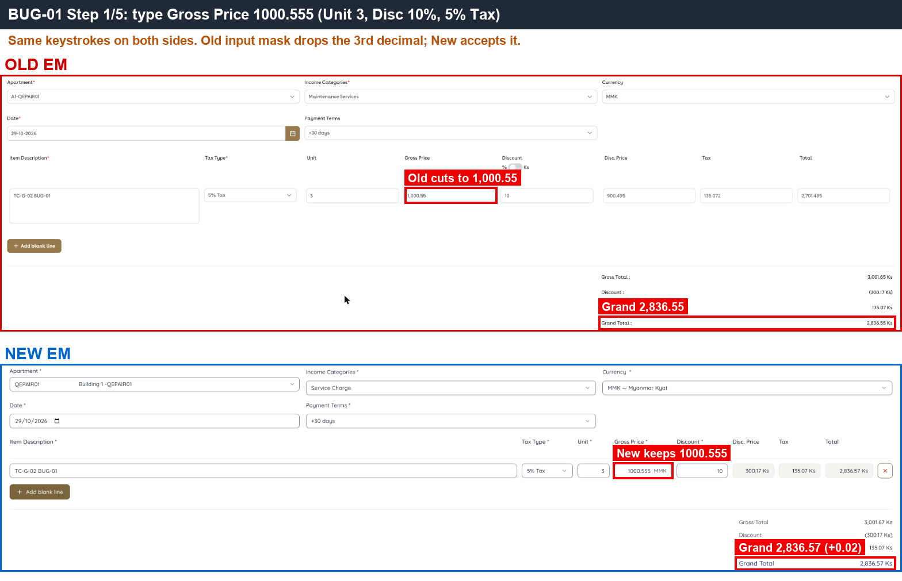

**`BUG-01-6.png`** — After paying in full: Old shows Balance Due 0.00; New still shows PARTIALLY_PAID.

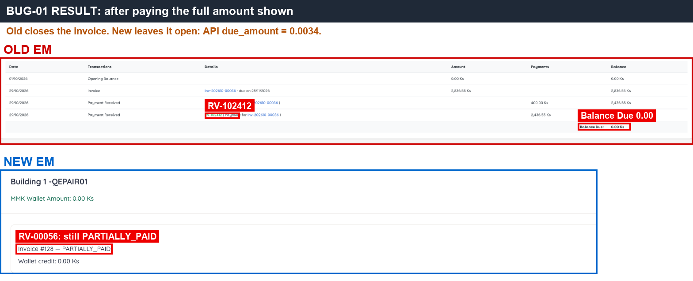

**`BUG-01-api2.png`** — Dark image is New's API data: `due_amount 0.0034`, the hidden debt the screen does not show.

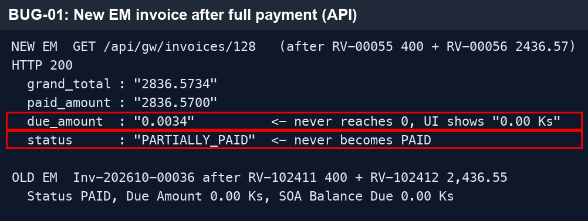

**`BUG-01-7.png`** — New: the invoice shows 'Due 0.00' but is still 'Partially paid'. This is a "ghost" invoice that never closes.

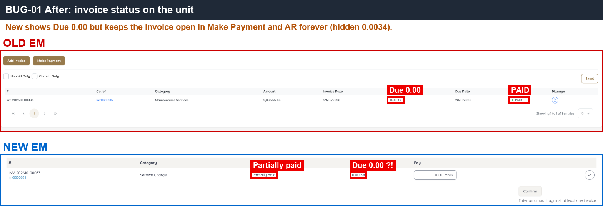

**`TC-MP-07.png`** — Knock-on effect in [SAN-MP-007](cases/04-make-payment.md): an overpayment of 500, but New's wallet receives only 499.99 (lower green frame).

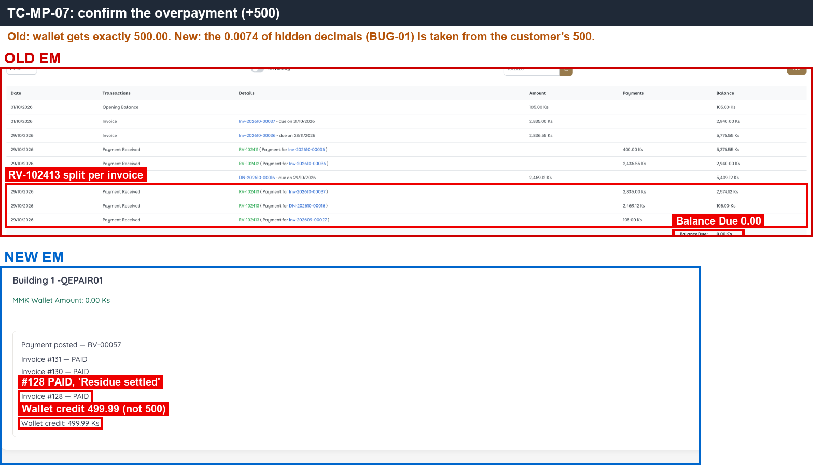

**`TC-INV-13.png`** — Same bug on a Debit Note: 1234.567 × 2. Old cuts to 1,234.56, New keeps 3 decimals.

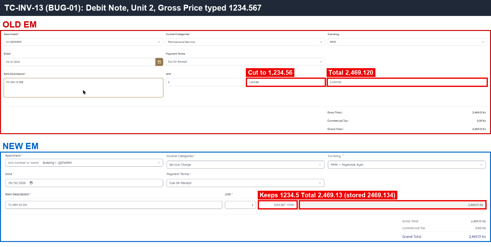

---

## BUG-02 · [Cash & Bank Account > Edit Initial Balance] Update fails with 'Could not update initial balance'

| Severity | Sanity cases | Jira | GIF |
|---|---|---|---|
| S1 · Critical | [SAN-ACC-003](cases/09-accounts.md) | [EM-94](https://zeyalabs-team-a83df6me.atlassian.net/browse/EM-94) (logged 2026-10-30) | [BUG-02.gif](gif/BUG-02.gif) |

**Summary:** Editing the Initial Balance of a cash or bank account always fails in New. Old saves it normally.

**Impact:** When data is migrated to the new system, accounting must enter opening balances, and a wrong entry must be correctable. In New this function is completely broken: every click on Update is rejected (405 Method Not Allowed).

**Priority:** Highest · **Parent:** EM-21 Cash and Bank Account · **Type:** Bug

**Precondition:**
Menu: Cash & Bank Account > Edit Initial Balance.
Logged in as an Admin user. A bank account exists with Initial Balance 10,000.

**Steps to reproduce:**
1. Go to Cash & Bank Account
2. Open the bank account, click [Edit Initial Balance]
3. Change 10,000 to 15,000
4. Click [Update]

**Expected result (Old EM):**
Initial Balance is saved (15,000) and the Closing Balance is updated, as in current EM.

**Actual result (New EM):**
Error 'Could not update initial balance'; the balance is unchanged (API: 405 Method Not Allowed).

Build: `v0.4.1-31-g1482a663` · Tested: 2026-10-29/30

**How it was found** (each step done identically on Old and New)

- Preparation: test account `QE PAIR Bank`, Initial Balance 10,000 on both sides.

| # | Action | Old EM | New EM | Evidence |
|---|---|---|---|---|
| 1 | Cash & Bank Account > QE PAIR Bank > Edit Initial Balance: 10,000 → 15,000 > Update | Saved. Initial 15,000, Closing 15,050 | Error box 'Could not update initial balance'. Balance unchanged | [BUG-02-1.png](img/BUG-02-1.png) |

**Expected fix (user-visible):** Edit Initial Balance > Update saves the new value and the Closing Balance is recalculated, as in Old.

**Jira cross-check:** Related, not a duplicate: [EM-72](https://zeyalabs-team-a83df6me.atlassian.net/browse/EM-72), [EM-73](https://zeyalabs-team-a83df6me.atlassian.net/browse/EM-73) cover the account Edit form, which matched Old on 30/10; the separate 'Edit Initial Balance' button is still broken, so BUG-02 was logged separately.

**Evidence:**

**`BUG-02-1.png`** — Red frame (Old): saved, Initial 15,000. Green frame (New): error box 'Could not update initial balance'.

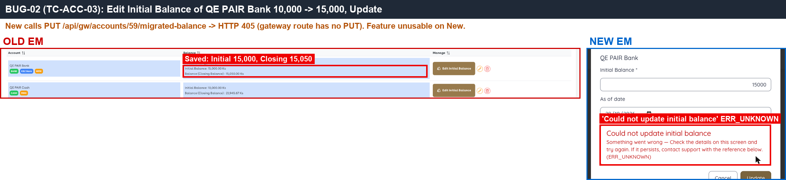

**`BUG-02-api.png`** — API image: `PUT /api/gw/accounts/59/migrated-balance` returns **405** (method not allowed).

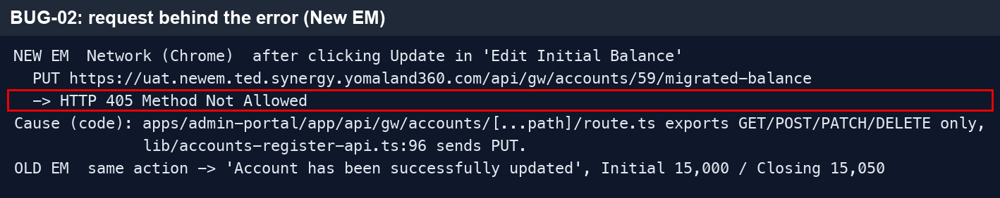

---

## BUG-03 · [Accounts Receivable > AR Snapshot] USD snapshot total does not match actual AR

| Severity | Sanity cases | Jira | GIF |
|---|---|---|---|
| S1 · Critical | [SAN-ARS-002](cases/02-ar.md) | [EM-95](https://zeyalabs-team-a83df6me.atlassian.net/browse/EM-95) (logged 2026-10-30) | [ARS-02.gif](gif/ARS-02.gif) |

**Summary:** The AR Snapshot is a daily picture of total receivables. The USD snapshot for 29/10 says $200, but the AR screen for the same day says $550. The MMK snapshot matches.

**Impact:** Snapshots are used to look back at receivables on past days. A wrong snapshot means the USD history report is short by $350: the whole 31-60 day bucket and part of the 61-90 day bucket are missing.

**Priority:** Highest · **Parent:** EM-3 Accounts Receivable · **Type:** Bug

**Precondition:**
Menu: Accounts Receivable > AR Snapshot.
Logged in as an Admin user. USD invoices with outstanding balance in the 31-60 and 61-90 day buckets.

**Steps to reproduce:**
1. Go to Accounts Receivable, Currency = USD, note the totals per aging bucket
2. Go to AR Snapshot, Currency = USD
3. Compare the row for 29/10

**Expected result (Old EM):**
Snapshot totals equal the AR totals for that day ($550: 31-60 $300, 61-90 $250).

**Actual result (New EM):**
Snapshot shows $200 (31-60: 0, 61-90: $200). $350 of USD receivables are missing.

Build: `v0.4.1-31-g1482a663` · Tested: 2026-10-29/30

**How it was found** (each step done identically on Old and New)

- Preparation: no data needed; read the 29/10 figures on New.

| # | Action | Old EM | New EM | Evidence |
|---|---|---|---|---|
| 1 | Accounts Receivable, Currency USD: note the totals | (Old has no USD AR figure for yesterday to compare) | Actual AR = **$550** (31-60: $300, 61-90: $250) | – |
| 2 | AR Snapshot, USD, row 29/10 | Snapshot = AR, same calculation | Snapshot = **$200** (31-60: 0, 61-90: $200) | [ARS-02-api.png](img/ARS-02-api.png) |

**Expected fix (user-visible):** The daily USD snapshot includes every outstanding USD invoice, so its totals match the AR screen for that day.

**Evidence:**

**`ARS-02-api.png`** — New's API data: the 29/10 snapshot ($200) side by side with the actual AR ($550).

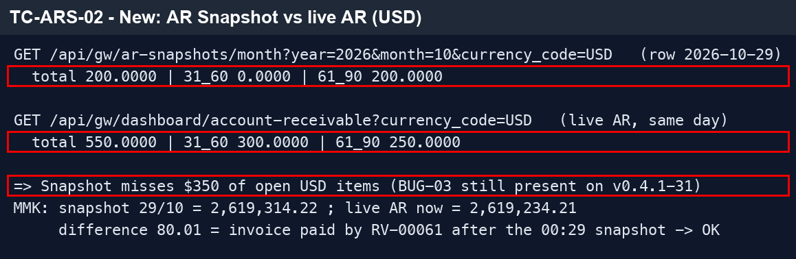

---

## BUG-04 · [Cash Transfer > API] Transfer can be created to the internal control account INCOME-CTRL

| Severity | Sanity cases | Jira | GIF |
|---|---|---|---|
| S1 · Critical | – | [EM-96](https://zeyalabs-team-a83df6me.atlassian.net/browse/EM-96) (logged 2026-10-30) | [BUG-04.gif](gif/BUG-04.gif) |

**Summary:** Through the API, New accepts a Cash Transfer from a cash account to the internal account `INCOME-CTRL`. This is an accounting ledger account, not a cash account.

**Impact:** A control account is an internal ledger. If money transferred into it is approved, the books are wrong and nobody sees it on the Cash & Bank screen. The screen does not list this account, but the API does not block it. UAT already has 4 seeded transfers into `INCOME-CTRL`.

**Priority:** Highest · **Parent:** EM-10 Cash Transfer · **Type:** Bug

**Precondition:**
Menu: Cash Transfer (API).
Logged in as an Admin user. A cash account exists. Only a draft is created and deleted right after.

**Steps to reproduce:**
1. Call the Cash Transfer create API with from = a cash account, to = INCOME-CTRL (id 1)
2. Check the response

**Expected result (Old EM):**
API rejects the request (422): only CASH/BANK accounts can be source or destination.

**Actual result (New EM):**
API returns 201 and a DRAFT transfer is created to INCOME-CTRL.

Build: `v0.4.1-31-g1482a663` · Tested: 2026-10-29/30

**How it was found** (each step done identically on Old and New)

- Preparation: a test cash account (id 54). Only a draft is created, then deleted immediately.

| # | Action | Old EM | New EM | Evidence |
|---|---|---|---|---|
| 1 | Call the create Cash Transfer API: from = cash account, to = `INCOME-CTRL` (id 1) | Old has no control accounts, so this cannot happen | API returns **201 DRAFT**: a draft is created (deleted afterwards) | [API-04.png](img/API-04.png) |

**Expected fix (user-visible):** A Cash Transfer can only be created between CASH/BANK accounts; a request to a control account is rejected (422). Control accounts should also not be offered as report filter options.

**Evidence:**

**`API-04.png`** — New's API: the request to create a transfer to account id 1 (INCOME-CTRL) and the 201 DRAFT response.

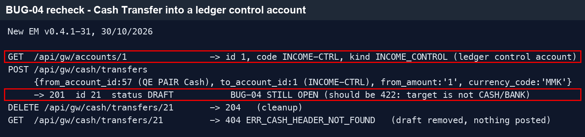

---

## BUG-05 · [Cash Outflow / Cash Transfer] Draft can be created for an amount above the account balance

| Severity | Sanity cases | Jira | GIF |
|---|---|---|---|
| S2 · Wrong behaviour, workaround exists | [SAN-PV-001](cases/08-outflow-transfer.md), [SAN-JV-002](cases/08-outflow-transfer.md) | [EM-97](https://zeyalabs-team-a83df6me.atlassian.net/browse/EM-97) (logged 2026-10-30) | [BUG-05.gif](gif/BUG-05.gif) |

**Summary:** A Cash Outflow or Cash Transfer larger than the account balance: Old blocks it at creation, New still creates the draft and only blocks it at approval.

**Impact:** No money is lost, because approval still blocks it. But approvers receive vouchers that can never be approved, and the creator does not know they made a mistake until it is rejected.

**Priority:** High · **Parent:** EM-9 Cash Outflow · **Type:** Bug

**Precondition:**
Menu: Cash Outflow; Cash Transfer.
Logged in as an Admin user. A cash account with balance about 21,946.

**Steps to reproduce:**
1. Go to Cash Outflow, click [New], amount 30,000 from the cash account, click [Create]
2. Click [Approve] on the draft
3. Go to Cash Transfer, click [New], 50,000 Cash → Bank, click [Create]

**Expected result (Old EM):**
Creation is blocked with 'Insufficient Balance in Withdraw From Account'; no draft is created.

**Actual result (New EM):**
'Successfully created' (draft #29 / transfer draft #19); the error only appears when approving.

Build: `v0.4.1-31-g1482a663` · Tested: 2026-10-29/30

**How it was found** (each step done identically on Old and New)

- Preparation: account `QE PAIR Cash`, balance about 21,946.

| # | Action | Old EM | New EM | Evidence |
|---|---|---|---|---|
| 1 | Cash Outflow 30,000 from QE PAIR Cash > Create | Blocked: 'Insufficient Balance in Withdraw From Account', no draft | 'successfully created': draft #29 | [BUG-05-1.png](img/BUG-05-1.png) |
| 2 | Approve draft #29 (New only) | – | Only now blocked: 'Insufficient balance… overdraft'. Draft cancelled | [BUG-05-2.png](img/BUG-05-2.png) |
| 3 | Cash Transfer 50,000 Cash → Bank | Blocked at creation | Draft #19 created, blocked at approval (cancelled) | [BUG-05-3.png](img/BUG-05-3.png) |

**Expected fix (user-visible):** The balance is checked when the draft is created, as in Old: an amount above the balance shows 'Insufficient Balance' and no draft is created.

**Evidence:**

**`BUG-05-1.png`** — Red frame: Old shows 'Insufficient Balance' immediately. Green frame: New says created successfully.

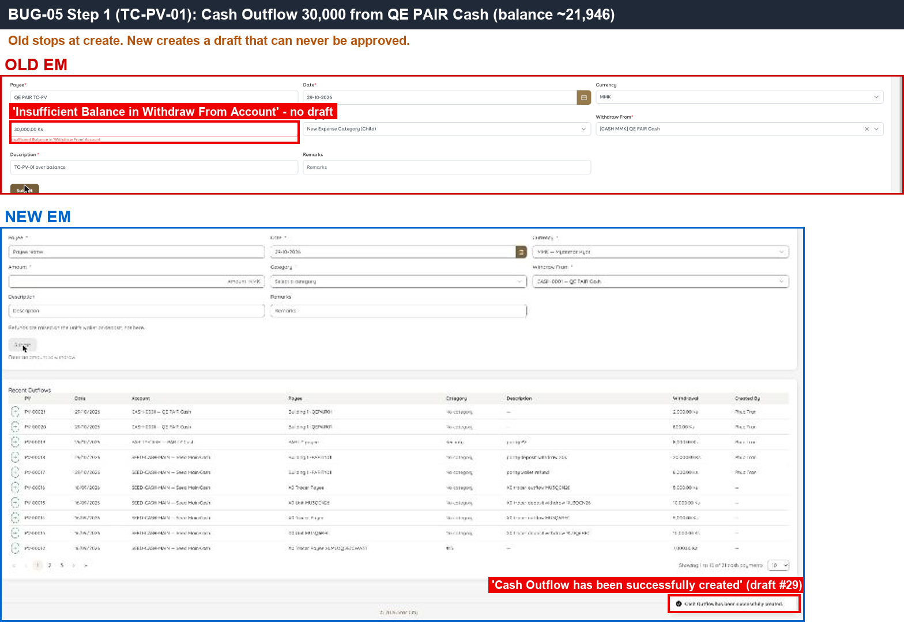

**`BUG-05-2.png`** — New only reports insufficient funds when Approve is clicked.

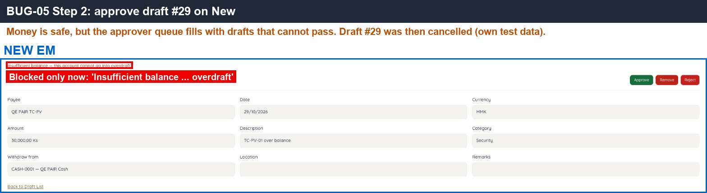

**`BUG-05-3.png`** — Same pattern for Cash Transfer.

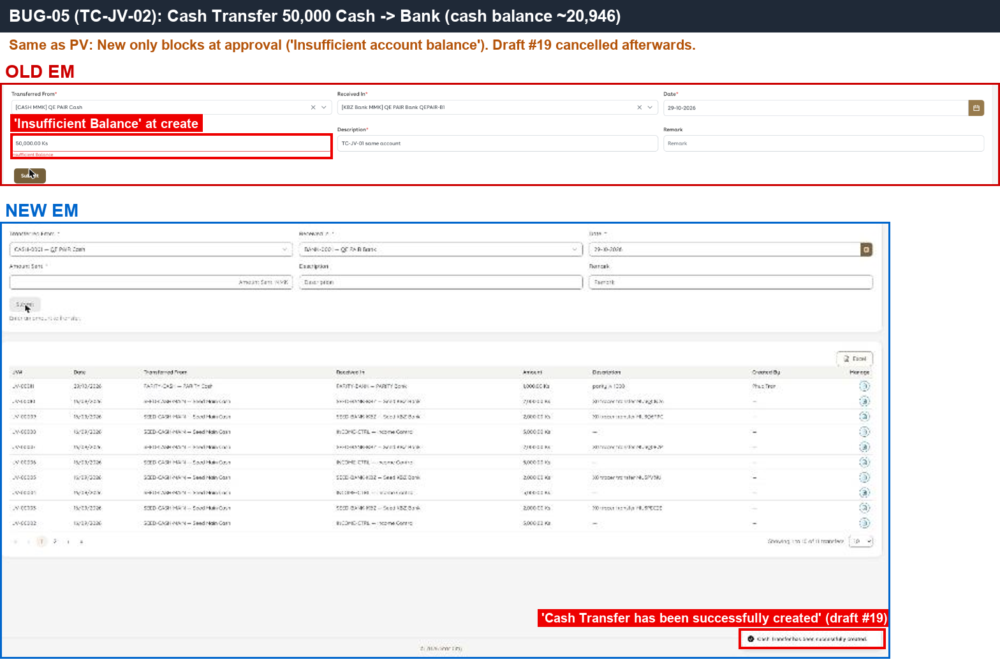

---

## BUG-07 · [Cash & Bank Account > API] Bank account can be created without Bank Name and Account Number

| Severity | Sanity cases | Jira | GIF |
|---|---|---|---|
| S2 · Wrong behaviour, workaround exists | [SAN-ACC-001](cases/09-accounts.md) | [EM-98](https://zeyalabs-team-a83df6me.atlassian.net/browse/EM-98) (logged 2026-10-30) | [BUG-07.gif](gif/BUG-07.gif) |

**Summary:** The screen form requires Bank and Account No, but calling the API directly, New still creates a BANK account without both.

**Impact:** If the check is only in the UI, anyone calling the API (integrations, scripts, a faulty client) can still create an account with missing details. That account can then not be reconciled with the bank statement.

**Priority:** High · **Parent:** EM-21 Cash and Bank Account · **Type:** Bug

**Precondition:**
Menu: Cash & Bank Account (API).
Logged in as an Admin user.

**Steps to reproduce:**
1. Call the create account API with Type = BANK and no bank name / account number
2. Check the response and the account list

**Expected result (Old EM):**
API rejects the request: Bank Name and Account Number are required for BANK accounts.

**Actual result (New EM):**
Account is created (id 62) without bank details.

Build: `v0.4.1-31-g1482a663` · Tested: 2026-10-29/30

**How it was found** (each step done identically on Old and New)

- Preparation: test account `QE PAIR API Bank` (id 62) created through the API.

| # | Action | Old EM | New EM | Evidence |
|---|---|---|---|---|
| 1 | Call the API to create a Type BANK account without bank and account number | Old requires both fields | Account id 62 is created | [API-06-07.png](img/API-06-07.png) |

**Expected fix (user-visible):** Creating a BANK account without Bank Name or Account Number is rejected with a clear message, whether from the form or the API.

**Jira cross-check:** Related, not a duplicate: [EM-88](https://zeyalabs-team-a83df6me.atlassian.net/browse/EM-88), [EM-71](https://zeyalabs-team-a83df6me.atlassian.net/browse/EM-71) fixed the screen part on 30/10 (Type = BANK now shows and requires Bank Name, Account Number, Enable Overdraft as in Old); BUG-07 is the remaining API-level gap, logged separately and linked to EM-88.

**Evidence:**

**`API-06-07.png`** — Lower half: the request has no bank / account number, and the response creates account id 62.

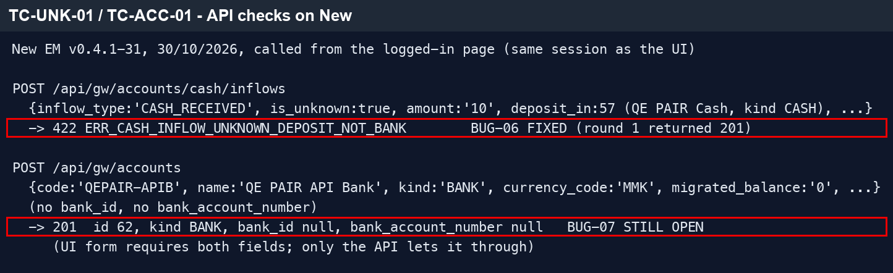

---

## BUG-08 · [Accounts Receivable / Reports > Invoices] Type filter 'Invoice' / 'Debit Note' excludes UO and EM documents

| Severity | Sanity cases | Jira | GIF |
|---|---|---|---|
| S2 · Wrong behaviour, workaround exists | [SAN-AR-003](cases/02-ar.md), [SAN-RPT-005](cases/12-reports.md) | [EM-99](https://zeyalabs-team-a83df6me.atlassian.net/browse/EM-99) (logged 2026-10-30) | [AR-03.gif](gif/AR-03.gif) · [RPT-05.gif](gif/RPT-05.gif) |

**Summary:** In Old, the 'Invoice' filter includes utility (UO) invoices, and 'Debit Note' includes estate management (EM) debit notes. New splits them into 4 types, so choosing 'Invoice' loses UO invoices and choosing 'Debit note' loses EM debit notes.

**Impact:** Users used to Old filter by 'Invoice' and believe they see everything. In New, 479,200 Ks of UO receivables disappear from the AR screen, and the Debit note report is missing 4 EM debit notes. Reported figures will be short.

**Priority:** High · **Parent:** EM-3 Accounts Receivable · **Type:** Bug

**Precondition:**
Menu: Accounts Receivable; Reports > Invoices.
Logged in as an Admin user. Existing UO invoices and EM debit notes (read only).

**Steps to reproduce:**
1. Go to Accounts Receivable, Currency MMK, Type = Invoice
2. Look for UO invoices (e.g. INV-202610-00011)
3. Go to Reports > Invoices, Type = Debit Note
4. Look for Estate Management debit notes

**Expected result (Old EM):**
'Invoice' includes UO invoices and 'Debit Note' includes EM debit notes, as in current EM.

**Actual result (New EM):**
479,200 Ks of UO invoices are missing from 'Invoice'; 4 EM debit notes (DN-202610-00001/05/07/08) are missing from 'Debit Note'.

Build: `v0.4.1-31-g1482a663` · Tested: 2026-10-29/30

**How it was found** (each step done identically on Old and New)

- Preparation: existing data on both environments (read only).

| # | Action | Old EM | New EM | Evidence |
|---|---|---|---|---|
| 1 | Accounts Receivable, MMK, Type = Invoice | List includes UO invoices (Utilities rows) | Only regular invoices. UO such as `INV-202610-00011` must be selected separately as 'Utility operation' | [AR-03-1.png](img/AR-03-1.png) |
| 2 | Check whether UO invoices are in 'Invoice' | Yes | No: 479,200 Ks of UO excluded | [AR-03-2.png](img/AR-03-2.png) |
| 3 | Reports > Invoices, Type = Debit Note | Includes EM debit notes (Estate Mgmt Fees) | 4 ESTATE_MANAGEMENT debit notes missing (DN-202610-00001/05/07/08) | [RPT-05-api.png](img/RPT-05-api.png) |

**Expected fix (user-visible):** The Type filter groups documents as in Old (Invoice = invoices + UO, Debit Note = debit notes + EM), or, if the PO keeps 4 types, the screen states clearly what each type includes.

**Jira cross-check:** Related, not a duplicate: [EM-53](https://zeyalabs-team-a83df6me.atlassian.net/browse/EM-53) is about the advanced filters of the Invoices list; BUG-08 is the Type filter in AR and reports leaving out UO / EM documents. Logged separately; the same grouping should be applied when EM-53 is fixed.

**Evidence:**

**`AR-03-1.png`** — Red frame: Old has 2 types (Invoice / Debit Note). Green frame: New has 4 types.

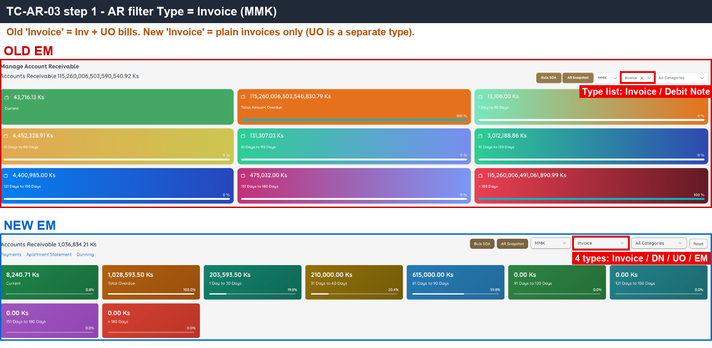

**`AR-03-2.png`** — Lower green frame: UO invoice INV-202610-00011 is not in New's 'Invoice' filter.

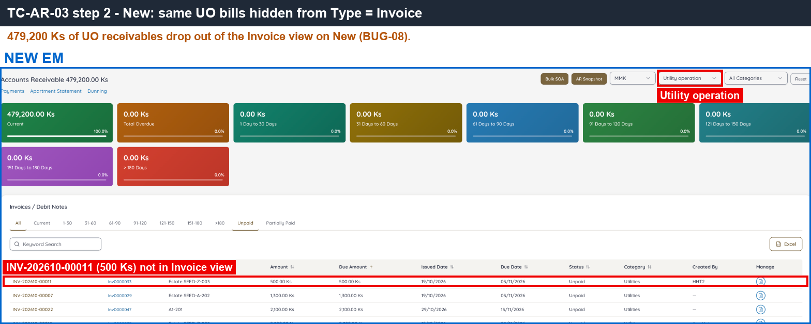

**`RPT-05-api.png`** — API image: 4 ESTATE_MANAGEMENT debit notes excluded from the 'Debit note' filter.

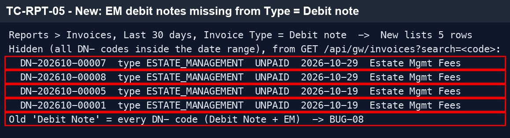

---

## BUG-10 · [Invoices / Debit Note > List] Totals row is missing

| Severity | Sanity cases | Jira | GIF |
|---|---|---|---|
| S2 · Wrong behaviour, workaround exists | [SAN-INV-015](cases/03-invoices.md) | [EM-100](https://zeyalabs-team-a83df6me.atlassian.net/browse/EM-100) (logged 2026-10-30) | [BUG-10.gif](gif/BUG-10.gif) |

**Summary:** Old has a Totals row at the bottom of the invoice list (amount, paid, balance). New does not.

**Impact:** Accounting uses the totals row for quick reconciliation. In New they have to add up by hand or export to Excel.

**Priority:** High · **Parent:** EM-4 Invoice-Debit Note · **Type:** Bug

**Precondition:**
Menu: Invoices / Debit Note.
Logged in as an Admin user. An apartment with 3 invoices.

**Steps to reproduce:**
1. Go to Invoices / Debit Note
2. Filter Last 30 Days and the test apartment
3. Scroll to the bottom of the list

**Expected result (Old EM):**
Totals row shown (e.g. 8,140.67 / 2,836.55 / 5,304.12).

**Actual result (New EM):**
No totals row.

Build: `v0.4.1-31-g1482a663` · Tested: 2026-10-29/30

**How it was found** (each step done identically on Old and New)

- Preparation: Invoices list, Last 30 Days, filtered by the test apartment (the same 3 documents on both sides).

| # | Action | Old EM | New EM | Evidence |
|---|---|---|---|---|
| 1 | Invoices / Debit Note, filter by the test apartment | Totals row: 8,140.67 / 2,836.55 / 5,304.12 | No totals row | [BUG-10-1.png](img/BUG-10-1.png) |

**Expected fix (user-visible):** The list shows a Totals footer (Amount / Paid / Balance) for the filtered rows, as in Old.

**Evidence:**

**`BUG-10-1.png`** — Red frame: Old's Totals row. Green frame: New has nothing below the table.

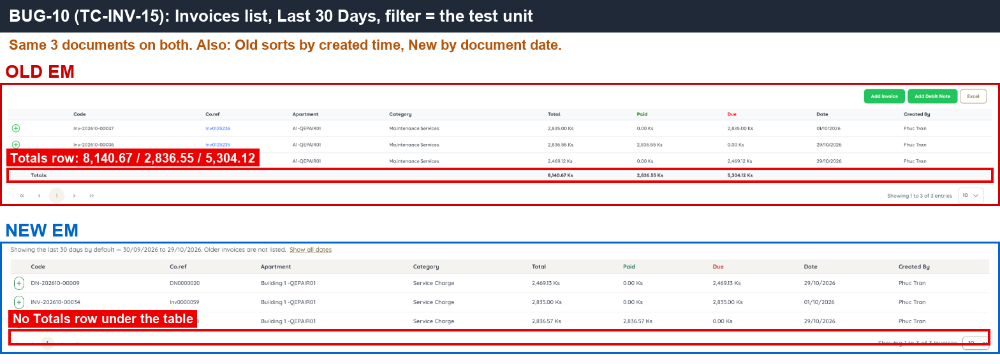

---

## BUG-12 · [Apartments > S.O.A] Statement shows wallet rows and internal text 'OVERPAYMENT_RESIDUE'

| Severity | Sanity cases | Jira | GIF |
|---|---|---|---|
| S2 · Wrong behaviour, workaround exists | [SAN-MP-015](cases/04-make-payment.md) | [EM-101](https://zeyalabs-team-a83df6me.atlassian.net/browse/EM-101) (logged 2026-10-30) | [BUG-12.gif](gif/BUG-12.gif) |

**Summary:** When the customer overpays, New's SOA adds wallet rows such as 'OVERPAYMENT_RESIDUE' (technical text) and a 'Payment … 0.00 Ks' row. Old's SOA shows only invoices and payments.

**Impact:** The SOA is the statement sent to residents. Odd rows and technical text confuse the customer, the running balance is temporarily negative at times, and the closing balance differs from Old by 0.01 (80.01 vs 80.00).

**Priority:** High · **Parent:** EM-15 SOA - OB & CB · **Type:** Bug

**Precondition:**
Menu: Apartments > S.O.A.
Logged in as an Admin user. An apartment with an overpayment of 500 (from the Make Payment tests).

**Steps to reproduce:**
1. Go to Apartments > open the apartment > S.O.A
2. Select October

**Expected result (Old EM):**
Only Opening, invoices and Payment Received rows; closing balance 80.00.

**Actual result (New EM):**
Extra 0.00 row and wallet rows 499.99 / OVERPAYMENT_RESIDUE; closing balance 80.01.

Build: `v0.4.1-31-g1482a663` · Tested: 2026-10-29/30

**How it was found** (each step done identically on Old and New)

- Preparation: the test apartment after the TC-MP payments (including one overpayment of 500).

| # | Action | Old EM | New EM | Evidence |
|---|---|---|---|---|
| 1 | Apartment > S.O.A tab, October | Opening, invoices, Payment Received; closing **80.00** | Extra 0.00 row, 2 wallet rows 499.99 / OVERPAYMENT_RESIDUE; closing **80.01** | [SOA-1.png](img/SOA-1.png) |

**Expected fix (user-visible):** The SOA shows only opening balance, invoices and payments, without wallet rows or internal text, as in Old.

**Evidence:**

**`SOA-1.png`** — Middle green frame: the 'Payment … 0.00 Ks' row. Lower green frame: 2 extra wallet rows. Last green frame: Closing 80.01, Old shows 80.00.

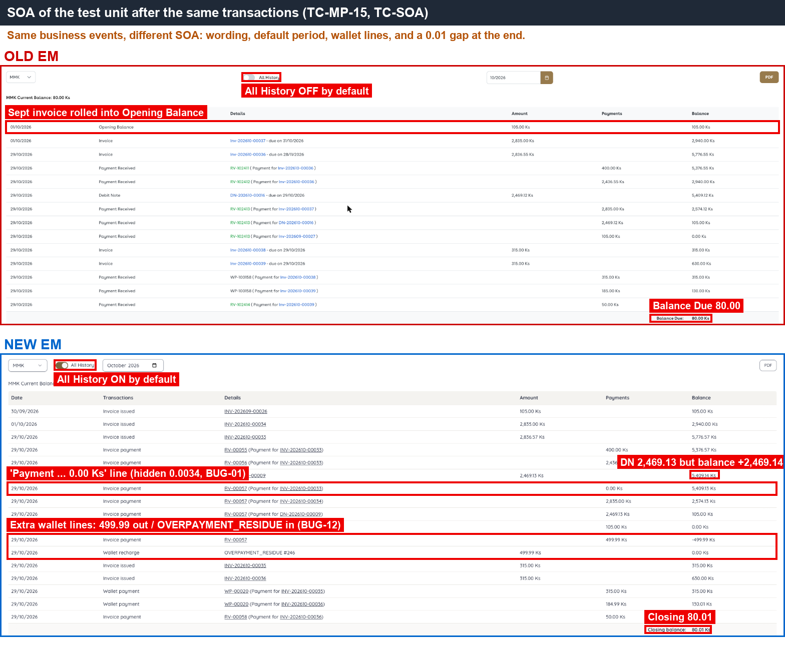

---

## BUG-13 · [Cash Received > Recent Receipts] Wallet recharge and deposit receipts are not listed

| Severity | Sanity cases | Jira | GIF |
|---|---|---|---|
| S2 · Wrong behaviour, workaround exists | [SAN-WAL-001](cases/06-wallet-deposit.md), [SAN-DEP-001](cases/06-wallet-deposit.md), [SAN-RV-001](cases/07-cash-received.md) | [EM-102](https://zeyalabs-team-a83df6me.atlassian.net/browse/EM-102) (logged 2026-10-30) | [RV-01.gif](gif/RV-01.gif) |

**Summary:** New's Recent Receipts screen does not show the wallet recharge (RV-00059) and deposit (RV-00060) receipts. Old lists them all.

**Impact:** Cashiers use this screen to see what was collected today. Missing receipts make the end-of-day cash reconciliation wrong, even though the page itself says every receipt is shown here.

**Priority:** High · **Parent:** EM-7 Cash Received · **Type:** Bug

**Precondition:**
Menu: Cash Received > Recent Receipts.
Logged in as an Admin user. Receipts created for the apartment: wallet recharge 1,000, deposit 5,000, invoice payment, unknown.

**Steps to reproduce:**
1. Go to Cash Received > Recent Receipts
2. Look for the wallet and deposit receipts

**Expected result (Old EM):**
All receipts are listed (incl. wallet and deposit), one row per allocation, with Created By column.

**Actual result (New EM):**
RV-00059 (wallet) and RV-00060 (deposit) are missing; one row per receipt; no Created By column.

Build: `v0.4.1-31-g1482a663` · Tested: 2026-10-29/30

**How it was found** (each step done identically on Old and New)

- Preparation: the same receipts on the test apartment: wallet recharge 1,000, deposit 5,000, invoice payment, Unknown.

| # | Action | Old EM | New EM | Evidence |
|---|---|---|---|---|
| 1 | Cash Received > Recent Receipts | Wallet receipt and deposit receipt RV-102416 listed; 1 row per allocation; Created By column | RV-00059 (wallet) and RV-00060 (deposit) missing; 1 row per receipt; no Created By | [RV-01-1.png](img/RV-01-1.png) |

**Expected fix (user-visible):** Recent Receipts lists wallet recharge and deposit receipts together with all other receipts.

**Retest (build -37):** **Fixed.** On `v0.4.1-37-g3090ff81` (2026-10-31) wallet recharge and deposit receipts are listed. Remaining difference: New still shows one row per receipt, while Old splits a receipt into one row per allocation.

**Evidence:**

**`RV-01-1.png`** — Red frame: Old splits RV-102417 into 2 rows (Wallet 920 + Inv 80) and has a Created By column. Green frame: New shows 'No category' and no description.

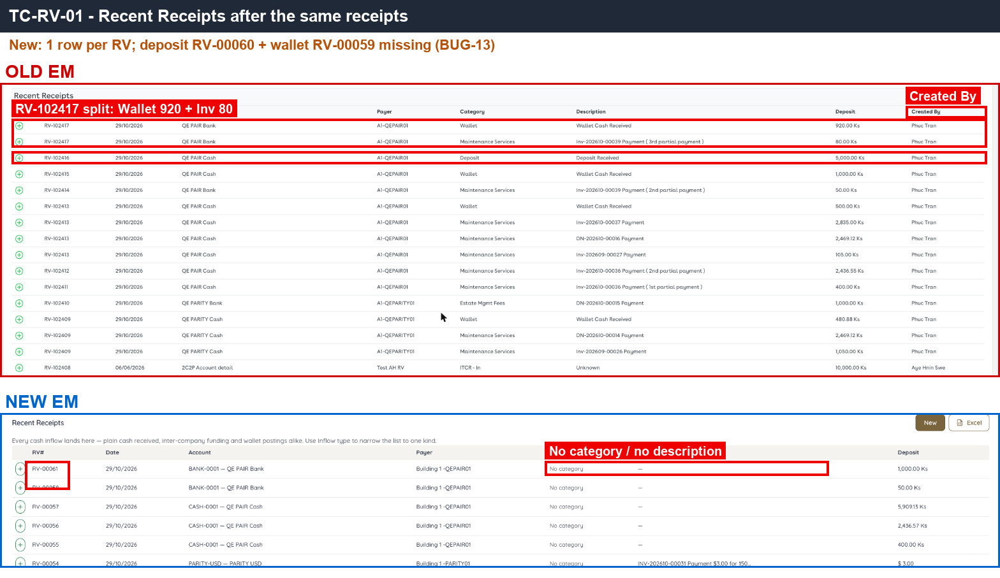

---

## BUG-15 · [Deposit Invoice] No Date field; approved invoice shows no dates, creator or approver

| Severity | Sanity cases | Jira | GIF |
|---|---|---|---|
| S2 · Wrong behaviour, workaround exists | [SAN-DB-008](cases/01-dashboard.md), [SAN-DI-001](cases/06-wallet-deposit.md), [SAN-DI-002](cases/06-wallet-deposit.md) | [EM-103](https://zeyalabs-team-a83df6me.atlassian.net/browse/EM-103) (logged 2026-10-30) | [BUG-15.gif](gif/BUG-15.gif) |

**Summary:** New's Deposit Invoice form has no Date field. After approval, issue date, due date, creator and approver all show '—', and the Remove button is still on the approved invoice.

**Impact:** Without a date the invoice cannot be placed in a period, overdue cannot be calculated, and nobody can trace who created or approved it. The Remove button on an approved document risks accidental deletion.

**Priority:** High · **Parent:** EM-19 Deposit · **Type:** Bug

**Precondition:**
Menu: Deposit Invoice.
Logged in as an Admin user. An apartment exists.

**Steps to reproduce:**
1. Go to Deposit Invoice, click [New]
2. Add 2 × 1,000, click [Create]
3. Click [Approve] and open the details

**Expected result (Old EM):**
Date field available; approved invoice shows Issue/Due date, creator and approver; no Remove button after approval.

**Actual result (New EM):**
No Date field; all dates and users show '—'; Remove button still shown on the approved invoice.

Build: `v0.4.1-31-g1482a663` · Tested: 2026-10-29/30

**How it was found** (each step done identically on Old and New)

- Preparation: test apartment, Deposit Invoice 2 × 1,000.

| # | Action | Old EM | New EM | Evidence |
|---|---|---|---|---|
| 1 | Deposit Invoice > New | Date field present; total shown while typing | No Date field; total only calculated when the draft is created | [BUG-15-1.png](img/BUG-15-1.png) |
| 2 | Approve, then open details | `DI-202610-00003`: creator/approver shown, Issue and Due 29/10 | `DEP-202610-0002`: all dates and users '—'; Remove button still there | [BUG-15-2.png](img/BUG-15-2.png) |

**Expected fix (user-visible):** The form has an invoice date; the due date follows Payment Terms; the approved invoice shows creator and approver; Remove is hidden after approval.

**Jira cross-check:** Related, not a duplicate: [EM-89](https://zeyalabs-team-a83df6me.atlassian.net/browse/EM-89) says wallet / deposit recharges should not need approval; BUG-15 is about the approved deposit invoice losing dates and approver. Logged separately; recheck BUG-15 if EM-89 removes the approval step.

**Evidence:**

**`BUG-15-1.png`** — Red frame: Old's Date field. Green frame: New has no such field.

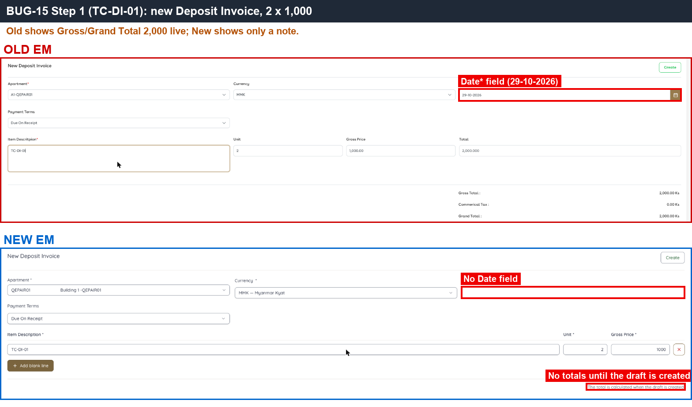

**`BUG-15-2.png`** — Right green frame: Created By / Approved By / dates are all '—'. Top green frame: the 'Remove' button is still there.

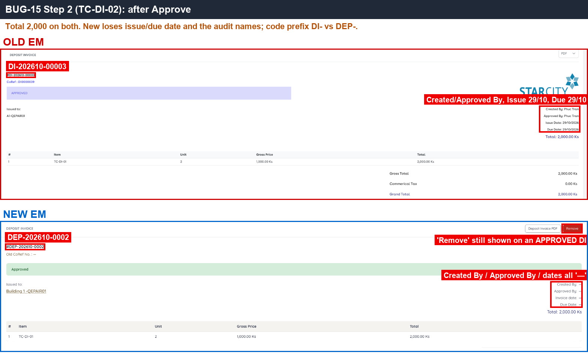

---

## BUG-16 · [UO > Import] Reading in the same month as the last approved reading is quarantined with a wrong message

| Severity | Sanity cases | Jira | GIF |
|---|---|---|---|
| S2 · Wrong behaviour, workaround exists | — (import cases pending clarification) | Not logged separately; evidence for existing [EM-83](https://zeyalabs-team-a83df6me.atlassian.net/browse/EM-83) (possible duplicate) | – |

**Summary:** The apartment has an approved reading on 29/10. A CSV import dated 30/10 (after the previous date) is rejected with 'Current Reading Date cannot be same or lesser than previous', although 30/10 is after 29/10. The real reason is in the second line: 'same calendar month as the last approved reading'.

**Impact:** Users cannot import a second reading in a month (e.g. a re-read or a meter replacement), and the message gives the wrong reason, so they do not know what to fix. Found in round 1; rerun on 30/10 during the Jira cross-check (EM-83) and still present.

**Priority:** High · **Parent:** EM-13 Uo import · **Type:** Bug

**Precondition:**
Menu: UO > Import.
Logged in as an Admin user. A test apartment in Building 1 has an approved reading on 29/10/2026.

**Steps to reproduce:**
1. Go to UO, click [Import]
2. Select Zone 1 / Building 1, click [Download CSV Template]
3. Fill one row: the test apartment, 30/10/2026, readings higher than the previous ones
4. Choose the file, click [Import]

**Expected result (Old EM):**
The row is staged (current EM accepts the import), or, if the business rule is one reading per month, the message says exactly that.

**Actual result (New EM):**
'0 of 1 rows staged; 0 sent for co-signature; 1 quarantined' - reading_date_invalid: "Current 'Reading Date' cannot be same or lesser than previous 'Reading Date'" / reading_date is in the same calendar month as the last approved reading.

Build: `v0.4.1-31-g1482a663` · Tested: 2026-10-29/30

**How it was found** (each step done identically on Old and New)

- Preparation: a test apartment in Building 1 with an approved reading on 29/10. Template downloaded from UO > Import (Zone 1 / Building 1).

| # | Action | Old EM | New EM | Evidence |
|---|---|---|---|---|
| 1 | UO > Import, select Zone 1 / Building 1, Download CSV Template | – | File has the 4 apartments of Building 1, but the header has 2 'Electricity (YESC)' columns | – |
| 2 | Fill 1 row: the test apartment, 30/10/2026, readings higher than last time; upload and click Import | Round 1: Old accepts the import | '0 of 1 rows staged; 1 quarantined', reading_date_invalid | [jira-em83-uo-import.jpg](img/jira-em83-uo-import.jpg) |

**Expected fix (user-visible):** A reading dated after the previous one is imported (or, if the PO confirms a one-reading-per-month rule, the message states that rule); the message must give the real reason.

**Jira cross-check:** Very likely a duplicate of [EM-83](https://zeyalabs-team-a83df6me.atlassian.net/browse/EM-83) (same UO Import screen, "no rows staged"); on 30/10 the file is read (1 row) but still '0 of 1 rows staged' with the wrong message. Evidence added to EM-83 instead of a new ticket.

**Evidence:**

**`jira-em83-uo-import.jpg`** — The 'Import result — batch #19' table: 0 of 1 rows staged. Detail column: the main line says the date is 'same or lesser'; only the small line below gives the real reason, same month as the last approved reading.

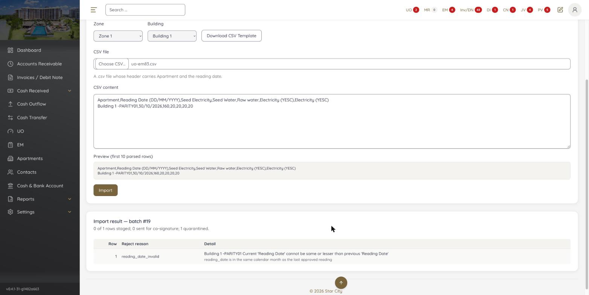

---

## BUG-19 · [Make Payment > Wallet] Payment amount is not limited to wallet balance; ERR_UNKNOWN on confirm

| Severity | Sanity cases | Jira | GIF |
|---|---|---|---|
| S2 · Wrong behaviour, workaround exists | [SAN-MP-010](cases/04-make-payment.md) | [EM-104](https://zeyalabs-team-a83df6me.atlassian.net/browse/EM-104) (logged 2026-10-30) | [BUG-19.gif](gif/BUG-19.gif) |

**Summary:** Paying by Wallet: Old locks the received amount to the wallet balance and caps each line automatically. New lets you allocate more than the wallet holds, then shows the generic error 'ERR_UNKNOWN'.

**Impact:** Users do not know what is wrong. They have to guess and type exactly 499.99 to be able to pay, while Old does it automatically.

**Priority:** High · **Parent:** EM-5 Make Payment · **Type:** Bug

**Precondition:**
Menu: Make Payment.
Logged in as an Admin user. Apartment wallet 500 (499.99 in New because of [BUG-01](#bug-01)); 2 invoices of 315.

**Steps to reproduce:**
1. Go to Make Payment, select the apartment
2. Payment Method = Wallet
3. Pay both lines in full
4. Click [Confirm]

**Expected result (Old EM):**
Received is locked to 500; line 2 is capped at 185; payment succeeds.

**Actual result (New EM):**
Received stays editable; 315 + 315 = 630 is accepted; Confirm shows 'Something went wrong / ERR_UNKNOWN'.

Build: `v0.4.1-31-g1482a663` · Tested: 2026-10-29/30

**How it was found** (each step done identically on Old and New)

- Preparation: test apartment wallet 500 (New 499.99 because of BUG-01), 2 invoices 315 + 315.

| # | Action | Old EM | New EM | Evidence |
|---|---|---|---|---|
| 1 | Make Payment, Payment Method = Wallet, pay both lines in full | Received locked = 500; line 2 max 185 | Received still editable; 315 + 315 = 630 > wallet accepted | [BUG-19-1.png](img/BUG-19-1.png) |
| 2 | Confirm | Succeeds immediately (WP-100158) | 'Something went wrong / ERR_UNKNOWN' | [BUG-19-2.png](img/BUG-19-2.png) |
| 3 | New: type Received 499.99 manually, then Confirm | – | WP-00020: 315 + 184.99 | [BUG-19-3.png](img/BUG-19-3.png) |

**Expected fix (user-visible):** With Wallet selected, Received is locked to the wallet balance and each line is capped as in Old; if the amount still exceeds the wallet, a clear message says so.

**Evidence:**

**`BUG-19-1.png`** — Red frame: Old locks Received = 500 and caps line 2. Green frame: New accepts 630, more than the wallet.

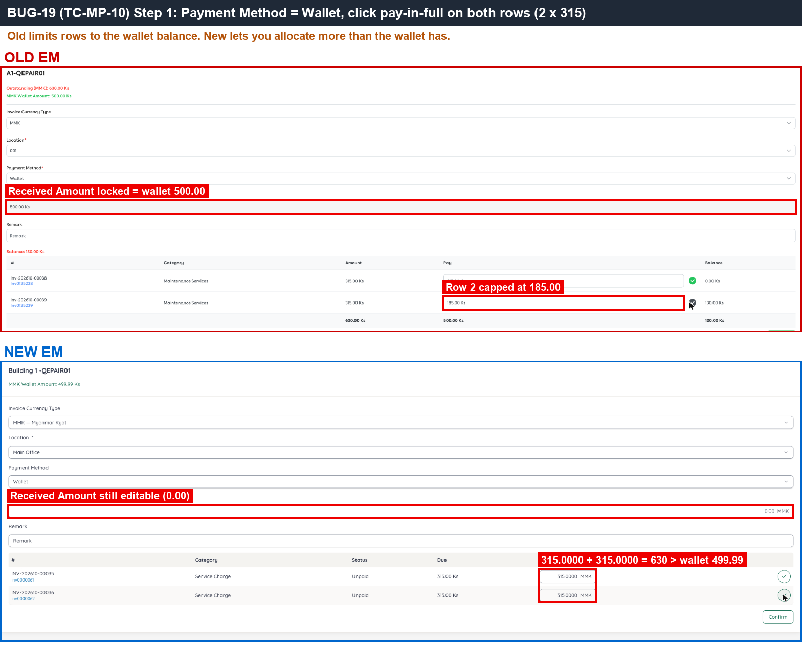

**`BUG-19-2.png`** — New shows a generic error without the reason.

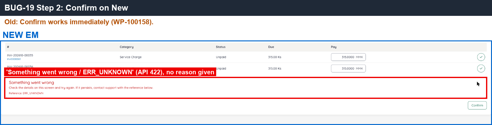

**`BUG-19-3.png`** — Final result is the same, but in New the amount has to be typed by hand.

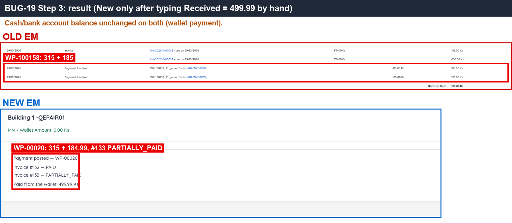

---

## BUG-20 · [Cash Received > Unknown Receipt > Assign] Confirm disabled until Payer is entered, with no message; invoice no. truncated

| Severity | Sanity cases | Jira | GIF |
|---|---|---|---|
| S2 · Wrong behaviour, workaround exists | [SAN-UNK-004](cases/07-cash-received.md) | Truncation part: existing [EM-85](https://zeyalabs-team-a83df6me.atlassian.net/browse/EM-85) (possible duplicate); Payer part: not logged yet | [UNK-04.gif](gif/UNK-04.gif) |

**Summary:** When assigning an Unknown receipt to an apartment, New's Confirm button stays disabled until Payer is typed, with no text saying it is required. The invoice number on the form is also cut to 'INV-202610-00…'.

**Impact:** Users do not understand why Confirm cannot be clicked. With a truncated invoice number they cannot tell which invoice the money goes to.

**Priority:** High · **Parent:** EM-7 Cash Received · **Type:** Bug

**Precondition:**
Menu: Cash Received > Unknown Receipt > Assign.
Logged in as an Admin user. An Unknown Receipt of 1,000; the apartment has an invoice with 80 due.

**Steps to reproduce:**
1. Go to Cash Received > Unknown Receipt
2. Click [Assign], select the apartment
3. Try to click [Confirm]

**Expected result (Old EM):**
Confirm can be clicked (no Payer field in current EM); full invoice number shown.

**Actual result (New EM):**
Payer is empty, Confirm is disabled with no explanation; invoice number truncated.

Build: `v0.4.1-31-g1482a663` · Tested: 2026-10-29/30

**How it was found** (each step done identically on Old and New)

- Preparation: Unknown 1,000 on the Bank account; the test apartment has an invoice with 80 due.

| # | Action | Old EM | New EM | Evidence |
|---|---|---|---|---|
| 1 | Unknown Received > Assign 1,000 to the test apartment | No Payer field; Confirm clickable | Payer empty, Confirm disabled, no explanation | [UNK-04-0.png](img/UNK-04-0.png) |
| 2 | Type Payer (New), then Confirm | RV-102417: 80 to the invoice, 920 to the wallet | RV-00061: 80.01 to the invoice, 919.99 to the deposit | [UNK-04-2.png](img/UNK-04-2.png) |

**Expected fix (user-visible):** The form says clearly that Payer is required (or Payer becomes optional), and the full invoice number is shown.

**Jira cross-check:** Very likely a duplicate of [EM-85](https://zeyalabs-team-a83df6me.atlassian.net/browse/EM-85) for the truncated invoice number (overlapping, misaligned fields in the Assign Unknown popup); the "Confirm disabled without a message until Payer is entered" part is not in that ticket and should be logged separately.

**Evidence:**

**`UNK-04-0.png`** — Red frame: Old has no Payer field. Green frame: Payer is empty and Confirm is greyed out.

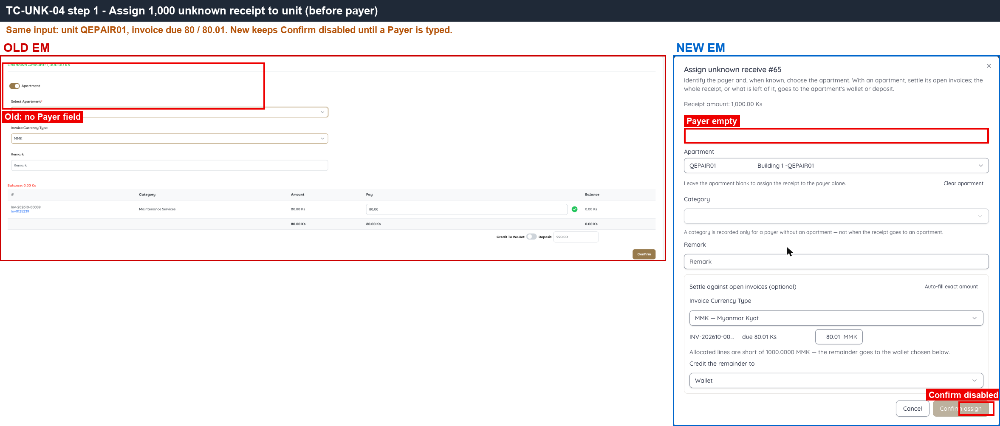

**`UNK-04-1.png`** — Only after Payer is typed does Confirm become active.

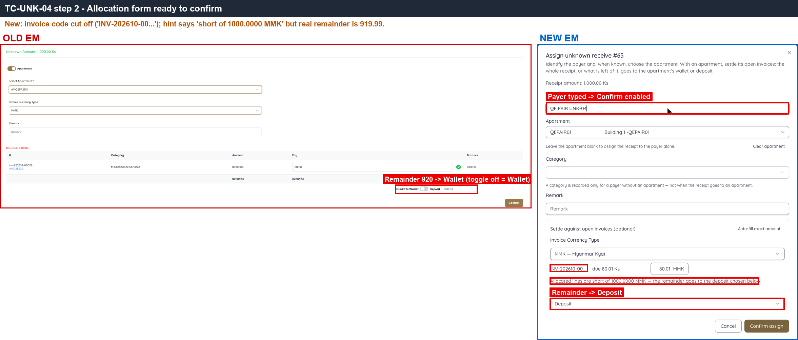

**`UNK-04-2.png`** — Result: the money goes to the right invoice on both sides; the 0.01 difference comes from BUG-01.

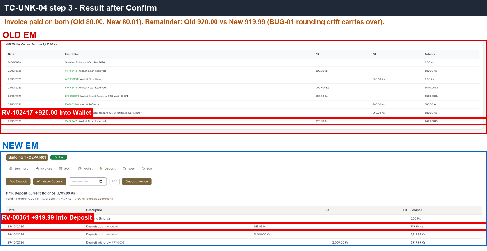

---

## BUG-24 · [Settings > UO Pricing] Two pricing items named 'Electricity (YESC)' shown on UO form

| Severity | Sanity cases | Jira | GIF |
|---|---|---|---|
| S2 · Wrong behaviour, workaround exists | – | Not logged separately; duplicate of existing [EM-35](https://zeyalabs-team-a83df6me.atlassian.net/browse/EM-35) | [BUG-24.gif](gif/BUG-24.gif) |

**Summary:** New's UO form, Meter Reset and CSV template have 2 columns with the same name 'Electricity (YESC)', one priced 100 and one 1,000.

**Impact:** The person entering readings cannot tell which column is which price, so it is easy to type into the wrong column and bill electricity wrongly. New does not block duplicate names.

**Priority:** High · **Parent:** EM-24 Setting · **Type:** Bug

**Precondition:**
Menu: Settings > UO Pricing; UO > New.
Logged in as an Admin user.

**Steps to reproduce:**
1. Go to UO, click [New] (UO Draft) for an apartment
2. Look at the meter columns

**Expected result (Old EM):**
One row per meter type; duplicate pricing names are not allowed.

**Actual result (New EM):**
Two 'Electricity (YESC)' rows.

Build: `v0.4.1-31-g1482a663` · Tested: 2026-10-29/30

**How it was found** (each step done identically on Old and New)

- Preparation: Settings > UO Pricing on UAT (read only).

| # | Action | Old EM | New EM | Evidence |
|---|---|---|---|---|
| 1 | UO > New UO Draft for the test apartment | One row per meter type | 2 'Electricity (YESC)' rows | [UO-02-1.png](img/UO-02-1.png) |

**Expected fix (user-visible):** UO Pricing does not allow two items with the same name, and the UO form shows each meter type once (the existing duplicate pricing record on UAT is cleaned up).

**Jira cross-check:** Duplicate of [EM-35](https://zeyalabs-team-a83df6me.atlassian.net/browse/EM-35) (UO Pricing allows extra records beyond the 4 standard types); BUG-24 is the effect on the UO form. Not logged separately; note added to EM-35 that the duplicate record on UAT must be cleaned up after the fix.

**Evidence:**

**`UO-02-1.png`** — New lists 'Electricity (YESC)' twice. Amounts differ from Old because each environment has its own price table.

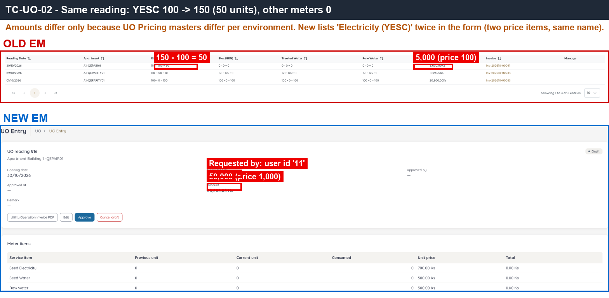

---

## BUG-30 · [Deposit > Withdraw] 'Withdraw From' is free text (account ID) instead of account dropdown

| Severity | Sanity cases | Jira | GIF |
|---|---|---|---|
| S2 · Wrong behaviour, workaround exists | [SAN-DEP-002](cases/06-wallet-deposit.md) | [EM-105](https://zeyalabs-team-a83df6me.atlassian.net/browse/EM-105) (logged 2026-10-30) | [BUG-30.gif](gif/BUG-30.gif) |

**Summary:** In the deposit withdrawal form, Old lets you choose the account from a list. New has only an empty text box where you must type the internal account ID (e.g. '57'), and the hint wrongly says 'Enter an amount to deposit'.

**Impact:** Normal users do not know account IDs. A wrong ID takes the money out of a different account.

**Priority:** High · **Parent:** EM-19 Deposit · **Type:** Bug

**Precondition:**
Menu: Apartments > Deposit > Withdraw.
Logged in as an Admin user. An apartment with deposit 5,000.

**Steps to reproduce:**
1. Go to Apartments > open the apartment > Deposit, click [Withdraw]
2. Look at the Withdraw From field

**Expected result (Old EM):**
Withdraw From is a dropdown of cash/bank accounts.

**Actual result (New EM):**
Free-text field; the user must type the account ID (e.g. '57'); wrong hint text.

Build: `v0.4.1-31-g1482a663` · Tested: 2026-10-29/30

**How it was found** (each step done identically on Old and New)

- Preparation: test apartment with deposit 5,000.

| # | Action | Old EM | New EM | Evidence |
|---|---|---|---|---|
| 1 | Deposit > Withdraw 6,000 (deposit is only 5,000) | Account chosen from a list; blocked with 'Invalid Amount' | Must type '57'; blocked with 'Insufficient deposit balance' | [BUG-30-1.png](img/BUG-30-1.png) |

**Expected fix (user-visible):** Withdraw From is a dropdown of cash/bank accounts, as in Old.

**Jira cross-check:** Related, not a duplicate: [EM-78](https://zeyalabs-team-a83df6me.atlassian.net/browse/EM-78) is the same kind of issue (text box instead of a list) on Wallet Transfer; BUG-30 is on Deposit Withdraw. Logged separately; both should be fixed together.

**Retest (build -37):** **Fixed.** On `v0.4.1-37-g3090ff81` (2026-10-31) Withdraw From is an account dropdown. The hint text 'Enter an amount to deposit' is still shown.

**Evidence:**

**`BUG-30-1.png`** — Top red frame: Old has an account dropdown. Top green frame: New has a free-text box. Blocking a withdrawal above the deposit works on both sides.

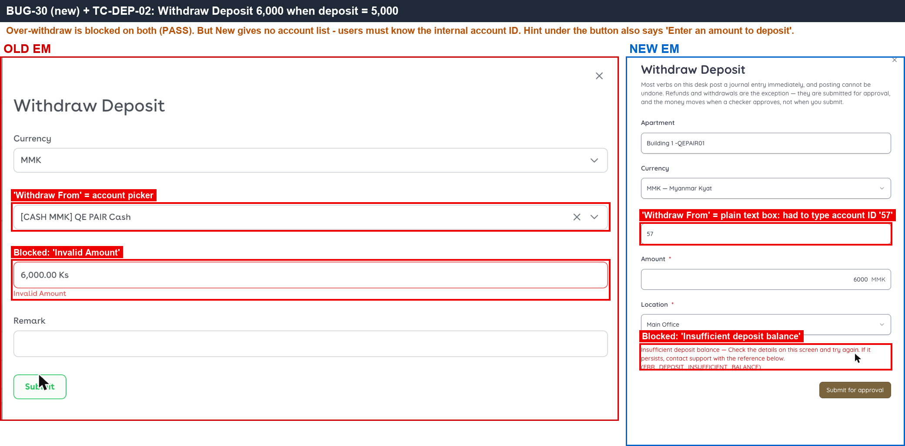

---

## BUG-32 · [Reports > Cash Received] Unknown receipts are missing from the report

| Severity | Sanity cases | Jira | GIF |
|---|---|---|---|
| S2 · Wrong behaviour, workaround exists | [SAN-RPT-006](cases/12-reports.md) | [EM-106](https://zeyalabs-team-a83df6me.atlassian.net/browse/EM-106) (logged 2026-10-30) | [RPT-06.gif](gif/RPT-06.gif) |

**Summary:** Old's Cash Received report includes Unknown receipts (assigned and unassigned). New's report is missing RV-00061 and RV-00062.

**Impact:** The money has really arrived in the bank, but the receipts report does not show it, so total receipts are lower than the real amount in the account.

**Priority:** High · **Parent:** EM-22 Reports · **Type:** Bug

**Precondition:**
Menu: Reports > Cash Received.
Logged in as an Admin user. One assigned and one unassigned Unknown Receipt of 1,000.

**Steps to reproduce:**
1. Go to Reports > Cash Received
2. Currency MMK, Last 30 days
3. Look for the Unknown receipts

**Expected result (Old EM):**
Unknown receipts are listed (e.g. RV-102418, RV-102417).

**Actual result (New EM):**
RV-00061 and RV-00062 are missing.

Build: `v0.4.1-31-g1482a663` · Tested: 2026-10-29/30

**How it was found** (each step done identically on Old and New)

- Preparation: Unknown 1,000 (assigned) and Unknown 1,000 (unassigned) on the test account.

| # | Action | Old EM | New EM | Evidence |
|---|---|---|---|---|
| 1 | Reports > Cash Received, MMK, 30 days | RV-102418 (Unknown) and RV-102417 (assigned Unknown) listed | RV-00061 and RV-00062 not listed | [RPT-06-1.png](img/RPT-06-1.png) |

**Expected fix (user-visible):** The Cash Received report includes Unknown receipts, assigned and unassigned.

**Evidence:**

**`RPT-06-1.png`** — Top red frame: Old has 2 Unknown rows. Top green frame: New's first row is RV-00060; the 2 Unknown receipts are missing.

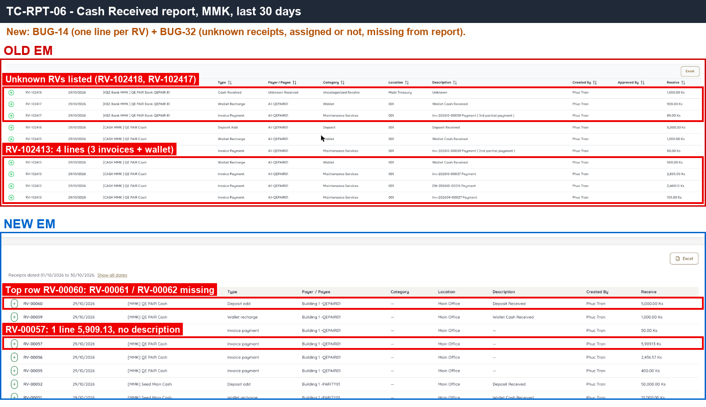

---

## BUG-33 · [Reports > Cash Outflow / Transactions] Unapproved drafts are included

| Severity | Sanity cases | Jira | GIF |
|---|---|---|---|
| S2 · Wrong behaviour, workaround exists | [SAN-RPT-007](cases/12-reports.md), [SAN-RPT-008](cases/12-reports.md) | [EM-107](https://zeyalabs-team-a83df6me.atlassian.net/browse/EM-107) (logged 2026-10-30) | [BUG-33.gif](gif/BUG-33.gif) |

**Summary:** New's Cash Outflow and Transactions reports include drafts (ID '—', no approver), e.g. draft #20 (9 Ks) and #21 (100 Ks). Old shows only approved vouchers.

**Impact:** The outflow report adds amounts that have not been paid out, so total spending is higher than reality.

**Priority:** High · **Parent:** EM-22 Reports · **Type:** Bug

**Precondition:**
Menu: Reports > Cash Outflow; Reports > Transactions.
Logged in as an Admin user. An unapproved Cash Outflow draft exists.

**Steps to reproduce:**
1. Go to Reports > Transactions, filter by Location
2. Go to Reports > Cash Outflow

**Expected result (Old EM):**
Only approved vouchers are listed.

**Actual result (New EM):**
Draft rows with ID '—' are listed (e.g. draft #20 9 Ks, #21 100 Ks).

Build: `v0.4.1-31-g1482a663` · Tested: 2026-10-29/30

**How it was found** (each step done identically on Old and New)

- Preparation: an unapproved PV draft exists on New.

| # | Action | Old EM | New EM | Evidence |
|---|---|---|---|---|
| 1 | Reports > Transactions, filter by Location | Only approved vouchers | 2 draft rows with ID '—' | [RPT-08-1.png](img/RPT-08-1.png) |
| 2 | Reports > Cash Outflow | Only approved PV-100269 | PV-00023 plus draft #20 | [RPT-07-1.png](img/RPT-07-1.png) |

**Expected fix (user-visible):** The Cash Outflow and Transactions reports list only approved vouchers.

**Evidence:**

**`RPT-08-1.png`** — Two lower green frames: draft rows #20 and #21, without an ID.

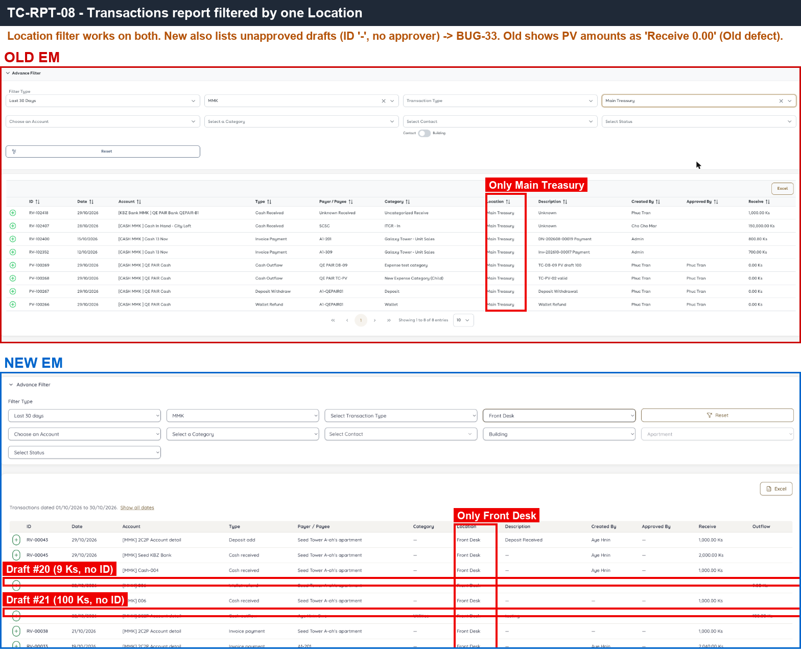

**`BUG-33-api.png`** — API image: 2 rows with status DRAFT.

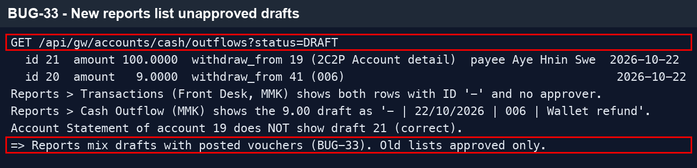

---

## BUG-35 · [Funding Received > New] Category dropdown is empty; record cannot be submitted

| Severity | Sanity cases | Jira | GIF |
|---|---|---|---|
| S2 · Wrong behaviour, workaround exists | [SAN-FR-001](cases/07-cash-received.md) | Not logged separately; duplicate of existing [EM-39](https://zeyalabs-team-a83df6me.atlassian.net/browse/EM-39) | [BUG-35.gif](gif/BUG-35.gif) |

**Summary:** New's Funding Received form requires a Category, but the list has no options. Old has 5 categories.

**Impact:** Recording capital contributions or inter-company funding is completely unusable in New.

**Priority:** High · **Parent:** EM-7 Cash Received · **Type:** Bug

**Precondition:**
Menu: Funding Received > New.
Logged in as an Admin user.

**Steps to reproduce:**
1. Go to Funding Received, click [New]
2. Open the Category dropdown

**Expected result (Old EM):**
Funding categories are listed (Funding Category, ITCR - In, …) and the record can be submitted.

**Actual result (New EM):**
Dropdown is empty; Submit is not possible.

Build: `v0.4.1-31-g1482a663` · Tested: 2026-10-29/30

**How it was found** (each step done identically on Old and New)

- Preparation: open the form; no data needed.

| # | Action | Old EM | New EM | Evidence |
|---|---|---|---|---|
| 1 | Funding Received > New, open Category | 5 categories (Funding Category, ITCR - In, …) | Empty list; cannot Submit | [FR-01-1.png](img/FR-01-1.png) |

**Expected fix (user-visible):** The Category dropdown lists the funding categories (as set up in Settings) and the record can be submitted.

**Jira cross-check:** Duplicate of [EM-39](https://zeyalabs-team-a83df6me.atlassian.net/browse/EM-39) (created Fund Categories do not appear in related forms; Funding Received is that form). Not logged separately; BUG-35 evidence attached to EM-39.

**Evidence:**

**`FR-01-1.png`** — Green frame: the Category* field has no options.

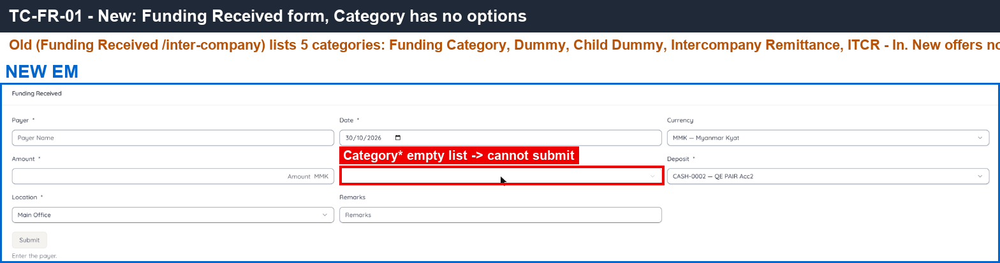

---

## BUG-39 · [API Gateway] Save / delete succeeds but returns 503 Service Unavailable

| Severity | Sanity cases | Jira | GIF |
|---|---|---|---|
| S2 · Wrong behaviour, workaround exists | [SAN-CON-003](cases/13-contacts.md) | Save part: existing [EM-47](https://zeyalabs-team-a83df6me.atlassian.net/browse/EM-47) (possible duplicate); delete part: not logged yet | [BUG-39.gif](gif/BUG-39.gif) |

**Summary:** Twice in New, saving an apartment owner and deleting a Cash Outflow draft both returned 503 (service unavailable), but the data was actually saved or deleted.

**Impact:** Seeing an error, the user (or the client retrying automatically) will submit again. For actions that create money documents, this can create duplicates.

**Priority:** High · **Parent:** EM-27 API · **Type:** Bug

**Precondition:**
Menu: Apartments > Contacts; Cash Outflow.
Logged in as an Admin user. An apartment and a Cash Outflow draft exist.

**Steps to reproduce:**
1. Assign an owner to the apartment, click [Save]
2. Click [Delete] on a Cash Outflow draft
3. Reload and check the data

**Expected result (Old EM):**
Response 200/204 matching the result.

**Actual result (New EM):**
PUT /estates/30/contacts → 503 but owner is saved; DELETE draft → 503 but draft is deleted (404 on reload).

Build: `v0.4.1-31-g1482a663` · Tested: 2026-10-29/30

**How it was found** (each step done identically on Old and New)

- Preparation: [SAN-CON-003](cases/13-contacts.md) (assign owner) and draft clean-up in [SAN-PV-005](cases/08-outflow-transfer.md).

| # | Action | Old EM | New EM | Evidence |
|---|---|---|---|---|
| 1 | Assign an owner to QEPAIR01 > Save | Saved normally | `PUT /estates/30/contacts` → **503**, but reading it again shows the owner was saved | [BUG-39.png](img/BUG-39.png) |
| 2 | Delete outflow draft #34 | – | `DELETE` → **503**, but reading it again → 404 (deleted) | [BUG-39.png](img/BUG-39.png) |

**Expected fix (user-visible):** When a save or delete succeeds, the user gets a success response (200/204) and no error message.

**Jira cross-check:** Very likely a duplicate of [EM-47](https://zeyalabs-team-a83df6me.atlassian.net/browse/EM-47) for the owner/tenant save (screen and data match Old, but Save returns 503 although it saved); to be merged if EM-47's tester saw this error. The 503 on deleting a Cash Outflow draft is not on Jira and should be logged separately.

**Evidence:**

**`BUG-39.png`** — New's network log: the write request returns 503, and the read request right after shows the data has changed.

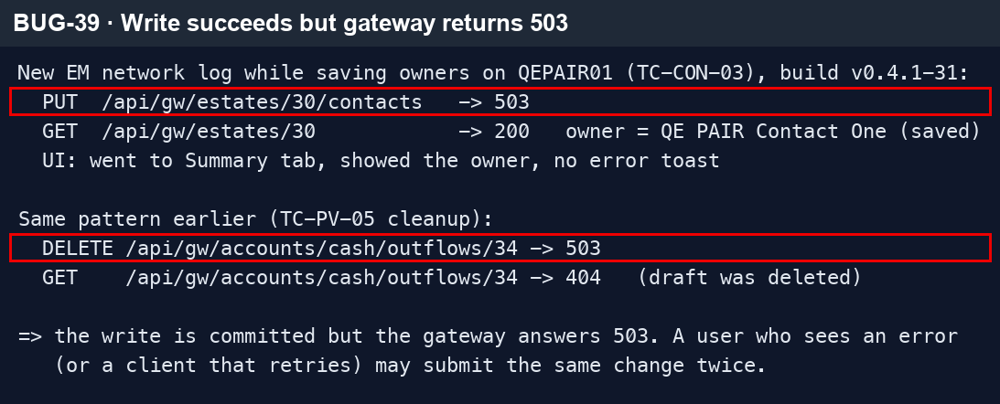

---

## BUG-09 · [Reports > Invoices] 'Last 30 days' starts one day later than current EM

| Severity | Sanity cases | Jira | GIF |
|---|---|---|---|
| S3 · Minor: display, error message, UX | [SAN-RPT-004](cases/12-reports.md) | [EM-108](https://zeyalabs-team-a83df6me.atlassian.net/browse/EM-108) | [BUG-09.gif](gif/BUG-09.gif) |

**Summary:** The 'Last 30 days' filter in Old EM covers 30/09 to 30/10 (31 days); New EM covers 01/10 to 30/10 (30 days).

**Impact:** Invoices dated exactly 30 days before today appear in the Old EM report but not in New EM. The same report gives different numbers in the two systems.

**Precondition:**
Menu: Reports > Invoices. Logged in as an Admin user. Run on 30/10/2026.

**Steps to reproduce:**
1. Go to Reports > Invoices
2. Keep the default 'Last 30 days'
3. Check the From date

**Expected result (Old EM):** From = today − 30 days (30/09).

**Actual result (New EM):** From = 01/10.

Build: `v0.4.1-31-g1482a663` · Tested: 2026-10-29/30

**How it was found** (each step done identically on Old and New)

- Preparation: Open the Invoices report on 30/10.

| # | Action | Old EM | New EM | Evidence |
|---|---|---|---|---|
| 1 | Reports > Invoices, keep the default 'Last 30 days' | From **30/09** to 30/10 | From **01/10** to 30/10 | [RPT-04-1.png](img/RPT-04-1.png) |

**Expected fix (user-visible):** 'Last 30 days' starts at today minus 30 days, as in Old EM.

**Evidence:**

**`RPT-04-1.png`** — Top red box: Old EM's date range. Blue box: New EM's date range, one day shorter. The Due column is correct in both.

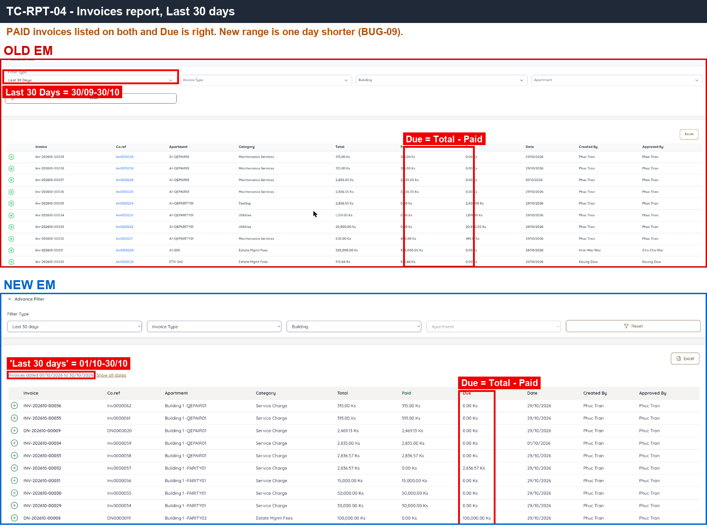

---

## BUG-14 · [Reports > Cash Received] One receipt shown as a single row without allocation details

| Severity | Sanity cases | Jira | GIF |
|---|---|---|---|
| S3 · Minor: display, error message, UX | [SAN-MP-007](cases/04-make-payment.md), [SAN-RV-001](cases/07-cash-received.md), [SAN-RPT-006](cases/12-reports.md) | [EM-109](https://zeyalabs-team-a83df6me.atlassian.net/browse/EM-109) | [RPT-06.gif](gif/RPT-06.gif) |

**Summary:** A receipt that pays 3 invoices and puts the overpayment into the wallet: Old EM splits it into 4 rows with descriptions; New EM shows a single total row with an empty description.

**Impact:** Accountants cannot see which invoices the receipt paid or how much went to the wallet, so they have to open each receipt.

**Precondition:**
Menu: Reports > Cash Received. Logged in as an Admin user. A receipt that pays 3 invoices and puts the overpayment into the wallet.

**Steps to reproduce:**
1. Go to Reports > Cash Received, Currency MMK
2. Find the receipt

**Expected result (Old EM):** 4 rows: 3 × Invoice Payment + 1 × Wallet Recharge, with descriptions.

**Actual result (New EM):** 1 row of 5,909.13 with empty description.

Build: `v0.4.1-31-g1482a663` · Tested: 2026-10-29/30

**How it was found** (each step done identically on Old and New)

- Preparation: The overpayment receipt from SAN-MP-007: Old RV-102413, New RV-00057.

| # | Action | Old EM | New EM | Evidence |
|---|---|---|---|---|
| 1 | Reports > Cash Received, MMK | RV-102413 = 3 Invoice Payment rows + 1 Wallet Recharge row | RV-00057 = 1 row of 5,909.13, empty description | [RPT-06-1.png](img/RPT-06-1.png) |

**Expected fix (user-visible):** One row per allocation (each invoice payment and the wallet recharge), with descriptions, as in Old EM.

**Evidence:**

**`RPT-06-1.png`** — Bottom red box: the 4 rows of RV-102413. Bottom blue box: the single row of RV-00057.

---

## BUG-17 · [UO > Meter Reset] Reset is rejected on the same day as the last reading

| Severity | Sanity cases | Jira | GIF |
|---|---|---|---|
| S3 · Minor: display, error message, UX | [SAN-MR-002](cases/10-uo-mr.md) | [EM-110](https://zeyalabs-team-a83df6me.atlassian.net/browse/EM-110) | [MR.gif](gif/MR.gif) |

**Summary:** After reading the meter on 30/10, replacing the meter and resetting it to 0 on the same day works in Old EM but is rejected in New EM.

**Impact:** In practice the meter is often replaced on the day it is read. In New EM the reset date has to be moved, so the record does not match reality.

**Precondition:**
Menu: UO > Meter Reset. Logged in as an Admin user. The apartment has a YESC reading of 150 on 30/10.

**Steps to reproduce:**
1. Go to Meter Reset
2. YESC 150 → 0, date 30/10
3. Click [Submit], then [Approve]

**Expected result (Old EM):** Reset is saved and approved; next UO uses Previous = 0.

**Actual result (New EM):** Error `ERR_METER_RESET_DATE_NOT_AFTER_PREVIOUS`.

Build: `v0.4.1-31-g1482a663` · Tested: 2026-10-29/30

**How it was found** (each step done identically on Old and New)

- Preparation: Test apartment with a YESC reading of 150 on 30/10.

| # | Action | Old EM | New EM | Evidence |
|---|---|---|---|---|
| 1 | Meter Reset: YESC 150 → 0, date 30/10 > Submit, Approve | Saved and approved | Error `ERR_METER_RESET_DATE_NOT_AFTER_PREVIOUS` | [MR-02-1.png](img/MR-02-1.png) |
| 2 | Create a new UO after the reset | Previous = 0 (correct) | Cannot reach this step | [MR-03-1.png](img/MR-03-1.png) |

**Expected fix (user-visible):** A reset dated the same day as the last reading is accepted.

**Evidence:**

**`MR-02-1.png`** — Same reset on 30/10: Old EM saves it, New EM shows the error.

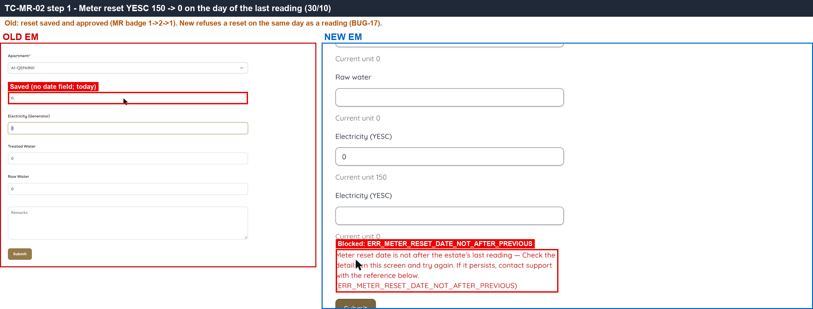

**`MR-03-1.png`** — Old EM only: the new UO has Previous = 0 after the reset.

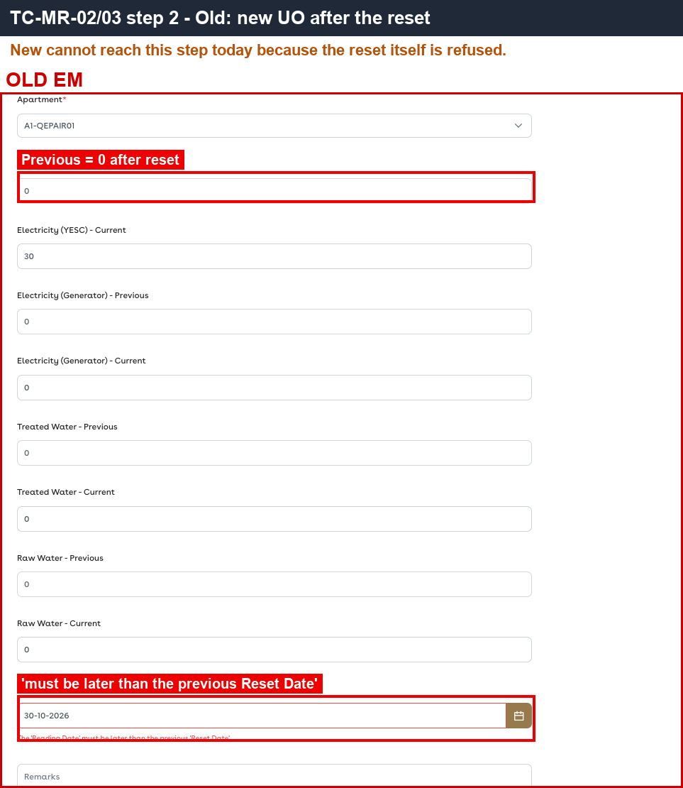

---

## BUG-21 · [EM > New] 'From' date is not auto-filled from the previous period

| Severity | Sanity cases | Jira | GIF |
|---|---|---|---|
| S3 · Minor: display, error message, UX | [SAN-EM-001](cases/11-em.md) | [EM-111](https://zeyalabs-team-a83df6me.atlassian.net/browse/EM-111) | [EM.gif](gif/EM.gif) |

**Summary:** The apartment already has an EM period until 31/12/2026. When creating a new period, Old EM auto-fills From = 01/01/2027 and locks the field. New EM leaves it empty and only shows a hint.

**Impact:** Users must type the date themselves; a wrong date can leave a gap or an overlap between billing periods. Old EM does not allow that mistake.

**Precondition:**
Menu: Estate Management > New. Logged in as an Admin user. The apartment has an EM period 01/10–31/12/2026.

**Steps to reproduce:**
1. Go to Estate Management, click [New]
2. Select the apartment
3. Look at the From field

**Expected result (Old EM):** From = 01-01-2027, auto-filled and locked.

**Actual result (New EM):** From is empty; hint 'Next period must start 01/01/2027'.

Build: `v0.4.1-31-g1482a663` · Tested: 2026-10-29/30

**How it was found** (each step done identically on Old and New)

- Preparation: Test apartment with EM from 01/10 to 31/12/2026.

| # | Action | Old EM | New EM | Evidence |
|---|---|---|---|---|
| 1 | Estate Management > New EM for the test apartment | From = 01-01-2027, auto-filled and locked | From empty; hint 'Next period must start 01/01/2027' | [EM-01-1.png](img/EM-01-1.png) |

**Expected fix (user-visible):** From is auto-filled with the day after the previous period and locked.

**Evidence:**

**`EM-01-1.png`** — Red box: Old EM's From field pre-filled with 01-01-2027 and locked.

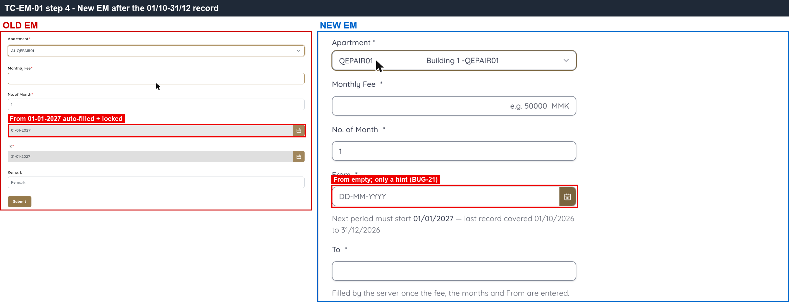

---

## BUG-22 · [Invoices / Debit Note > Add Invoice] 100% discount shows generic 'ERR_UNKNOWN' instead of the real reason

| Severity | Sanity cases | Jira | GIF |
|---|---|---|---|
| S3 · Minor: display, error message, UX | [SAN-INV-004](cases/03-invoices.md), [SAN-INV-005](cases/03-invoices.md) | [EM-112](https://zeyalabs-team-a83df6me.atlassian.net/browse/EM-112) | [BUG-22.gif](gif/BUG-22.gif) |

**Summary:** Both systems allow at most 99% discount. Old EM clears the field when 100 is entered. New EM keeps 100 and shows the box 'Could not calculate the total / ERR_UNKNOWN'.

**Impact:** The rule is the same, but New EM hides the real reason, so the user does not know what is wrong.

**Precondition:**
Menu: Invoices / Debit Note > Add Invoice. Logged in as an Admin user.

**Steps to reproduce:**
1. Go to Invoices / Debit Note, click [Add Invoice]
2. Change Discount % from 10 to 100 and click outside
3. Set Discount amount = full price (1,000 Ks)

**Expected result (Old EM):** Field is cleared or a clear message 'Discount cannot exceed 99%' is shown.

**Actual result (New EM):** Generic error box 'Could not calculate the total' (API 422).

Build: `v0.4.1-31-g1482a663` · Tested: 2026-10-29/30

**How it was found** (each step done identically on Old and New)

- Preparation: Add Invoice form.

| # | Action | Old EM | New EM | Evidence |
|---|---|---|---|---|
| 1 | Change Discount % from 10 to 100, click outside | Field cleared (max 99%) | Keeps 100; box 'Could not calculate the total' (API 422: not more than 99) | [BUG-22-1.png](img/BUG-22-1.png) |
| 2 | Discount amount = full price (1,000 Ks) | Field cleared | Same generic error box | [BUG-22-2.png](img/BUG-22-2.png) |

**Expected fix (user-visible):** Show the real reason: 'Discount cannot exceed 99%'.

**Jira cross-check:** Related, not a duplicate of [EM-75](https://zeyalabs-team-a83df6me.atlassian.net/browse/EM-75) (same Add Invoice discount area; EM-75 is about Inclusive tax still allowing a discount). Logged separately.

**Evidence:**

**`BUG-22-1.png`** — Bottom blue box: New EM's generic error box.

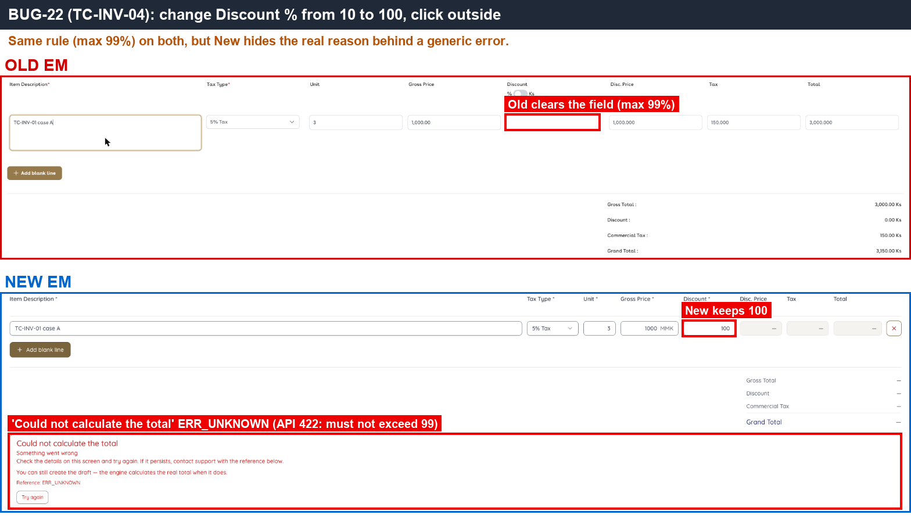

**`BUG-22-2.png`** — Same behaviour with a discount by amount.

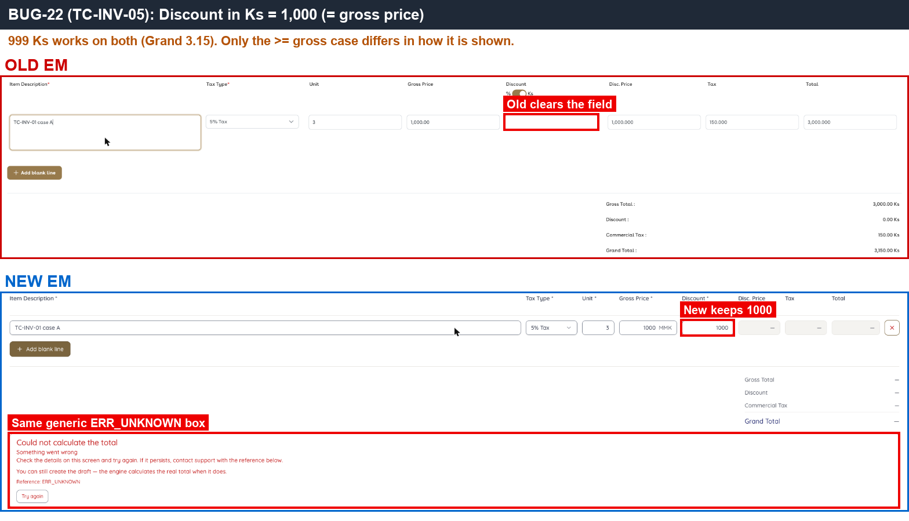

---

## BUG-23 · [Invoices / Debit Note > Add Invoice] 'Disc. Price' and line 'Total' have different meaning from current EM

| Severity | Sanity cases | Jira | GIF |
|---|---|---|---|
| S3 · Minor: display, error message, UX | [SAN-INV-002](cases/03-invoices.md), [SAN-INV-003](cases/03-invoices.md) | — (evidence to be added to [EM-75](https://zeyalabs-team-a83df6me.atlassian.net/browse/EM-75) / [EM-76](https://zeyalabs-team-a83df6me.atlassian.net/browse/EM-76)) | [BUG-23.gif](gif/BUG-23.gif) |

**Summary:** Same column names, different meaning: Old EM 'Disc. Price' = unit price after discount (900); New EM 'Disc. Price' = discount amount (300). Line Total: Old EM excludes tax (2,700); New EM includes tax (2,835). Grand Total is the same.

**Impact:** A user used to Old EM reads 300 as the discounted unit price, i.e. misreads the number.

**Precondition:**
Menu: Invoices / Debit Note > Add Invoice. Logged in as an Admin user.

**Steps to reproduce:**
1. Go to Invoices / Debit Note, click [Add Invoice]
2. Enter qty 3, price 1,000, discount 10%, tax 5%
3. Look at Disc. Price and Total

**Expected result (Old EM):** Disc. Price 900; line Total 2,700.

**Actual result (New EM):** Disc. Price 300; line Total 2,835.

Build: `v0.4.1-31-g1482a663` · Tested: 2026-10-29/30

**How it was found** (each step done identically on Old and New)

- Preparation: Invoice line: qty 3, price 1,000, discount 10%, tax 5%.

| # | Action | Old EM | New EM | Evidence |
|---|---|---|---|---|
| 1 | Enter the invoice line as above | Disc. Price 900; line Total 2,700 | Disc. Price 300; line Total 2,835 | [TC-INV-01.png](img/TC-INV-01.png) |

**Expected fix (user-visible):** Rename the columns to match their meaning, or calculate them as Old EM does.

**Jira cross-check:** Very likely a duplicate of [EM-75](https://zeyalabs-team-a83df6me.atlassian.net/browse/EM-75) / [EM-76](https://zeyalabs-team-a83df6me.atlassian.net/browse/EM-76) (Inclusive tax 5%/3% UI differs from Old; with Inclusive tax line Total is Old 2,000 vs New 2,100, SAN-INV-003). Add the SAN-INV-002/003 evidence to EM-75/76.

**Evidence:**

**`TC-INV-01.png`** — Red/blue boxes on the Disc. Price and Total columns: same column names, numbers with different meaning. Grand Total 2,835 is the same.

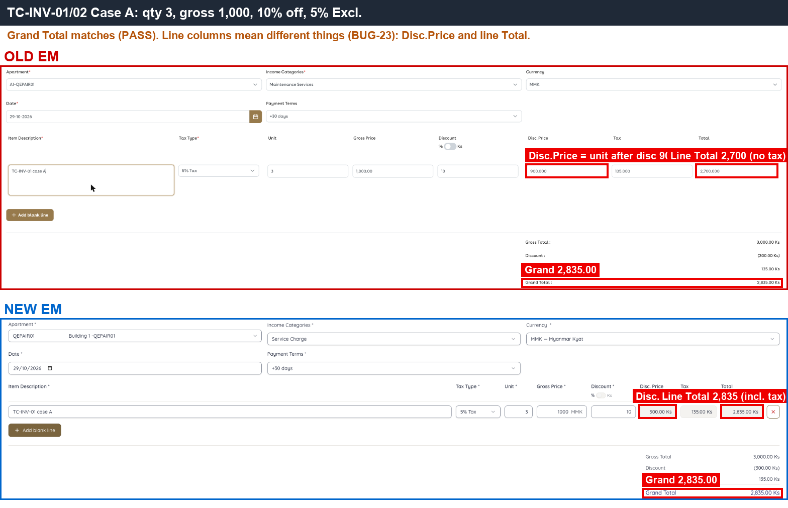

---

## BUG-26 · [Invoices / Debit Note > Approve] No message when approving an already approved invoice

| Severity | Sanity cases | Jira | GIF |
|---|---|---|---|
| S3 · Minor: display, error message, UX | [SAN-INV-011](cases/03-invoices.md) | [EM-113](https://zeyalabs-team-a83df6me.atlassian.net/browse/EM-113) | [BUG-26.gif](gif/BUG-26.gif) |

**Summary:** With the same draft open in 2 tabs, approve in tab 1 then click Approve in tab 2. Old EM says 'already approved'. New EM says nothing and just shows the approved invoice.

**Impact:** Data is safe (only one journal entry). But the user does not know someone else approved first and may think they approved it.

**Precondition:**
Menu: Invoices / Debit Note. Logged in as an Admin user. An invoice draft opened in 2 browser tabs.

**Steps to reproduce:**
1. Click [Approve] in tab 1
2. Click [Approve] in tab 2

**Expected result (Old EM):** Message 'Invoice has been already approved.'

**Actual result (New EM):** No message; the approved invoice is just shown.

Build: `v0.4.1-31-g1482a663` · Tested: 2026-10-29/30

**How it was found** (each step done identically on Old and New)

- Preparation: One invoice draft open in 2 tabs.

| # | Action | Old EM | New EM | Evidence |
|---|---|---|---|---|
| 1 | Approve in tab 1, then Approve in tab 2 | Tab 2: 'Invoice has been already approved.' | Tab 2: no message | [BUG-26-1.png](img/BUG-26-1.png) |

**Expected fix (user-visible):** Show an 'already approved' message when approving again.

**Evidence:**

**`BUG-26-1.png`** — Top-corner red box: Old EM's message. Blue box: New EM has no message.

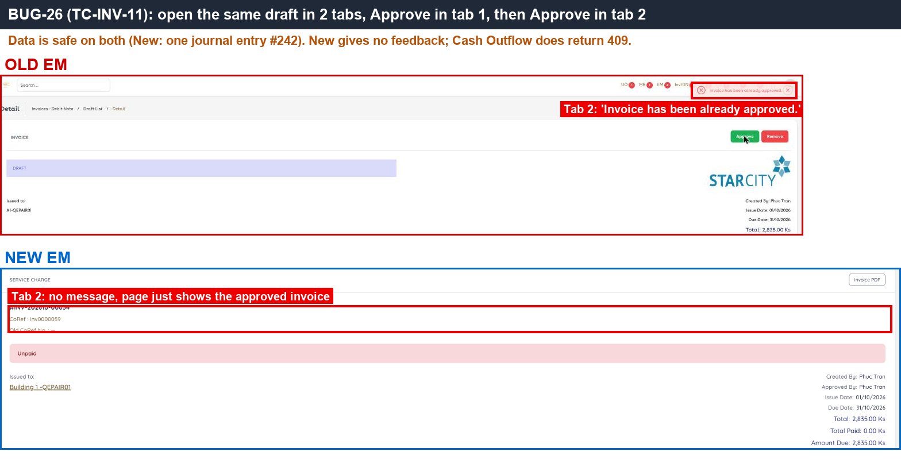

---

## BUG-28 · [Cash Transfer] Conversion rate not shown for cross-currency transfer

| Severity | Sanity cases | Jira | GIF |
|---|---|---|---|
| S3 · Minor: display, error message, UX | [SAN-JV-004](cases/08-outflow-transfer.md) | — (on hold: conflicts with [EM-61](https://zeyalabs-team-a83df6me.atlassian.net/browse/EM-61), PO decision needed) | [BUG-28.gif](gif/BUG-28.gif) |

**Summary:** Transferring 10 USD to an MMK account and receiving 21,000 MMK: Old EM shows a Conversion Rate field (2,100) before saving; New EM shows no rate.

**Impact:** The user cannot check whether the rate they entered is sensible, so a typo in the MMK amount is saved without anyone noticing.

**Precondition:**
Menu: Cash Transfer > New. Logged in as an Admin user. A USD account and an MMK account (do not Submit).

**Steps to reproduce:**
1. Go to Cash Transfer, click [New]
2. From the USD account, To the MMK account
3. Send 10, receive 21,000

**Expected result (Old EM):** Conversion Rate 2,100 is shown.

**Actual result (New EM):** No conversion rate shown.

Build: `v0.4.1-31-g1482a663` · Tested: 2026-10-29/30

**How it was found** (each step done identically on Old and New)

- Preparation: Test USD and MMK accounts (Submit not clicked).

| # | Action | Old EM | New EM | Evidence |
|---|---|---|---|---|
| 1 | Cash Transfer USD → MMK: send 10, receive 21,000 | Conversion Rate 2100 shown | No rate field | [BUG-28-1.png](img/BUG-28-1.png) |

**Expected fix (user-visible):** Show the conversion rate calculated from the two amounts.

**Jira cross-check:** Conflicts with [EM-61](https://zeyalabs-team-a83df6me.atlassian.net/browse/EM-61), which says Old EM has no Amount Received / Conversion Rate fields and New should drop them. On Old UAT a USD → MMK transfer does show both (Conversion Rate 2,100); build -31 has Amount Received but no Conversion Rate. PO to decide: show both fields for cross-currency transfers as in Old EM, rather than removing them per EM-61.

**Evidence:**

**`BUG-28-1.png`** — Red box: Old EM's Conversion Rate field. Blue box: New EM has none.

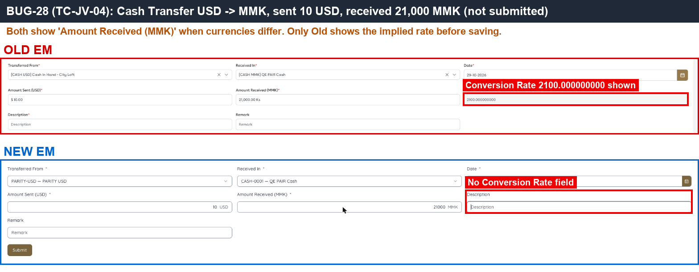

---

## BUG-31 · [Cash Received > Unknown Receipt > Assign] Wrong 'short of' amount in the error message

| Severity | Sanity cases | Jira | GIF |
|---|---|---|---|
| S3 · Minor: display, error message, UX | [SAN-UNK-004](cases/07-cash-received.md) | [EM-114](https://zeyalabs-team-a83df6me.atlassian.net/browse/EM-114) | [UNK-04.gif](gif/UNK-04.gif) |

**Summary:** Assigning an Unknown Receipt of 1,000 with 80.01 already allocated to an invoice, New EM says 'Allocated lines are short of 1000.0000 MMK', while the real shortfall is 919.99.

**Impact:** The message gives the wrong number, so the user allocates the wrong amount.

**Precondition:**
Menu: Cash Received > Unknown Receipt > Assign. Logged in as an Admin user. An Unknown Receipt of 1,000; the apartment has an invoice with 80 due.

**Steps to reproduce:**
1. Click [Assign], select the apartment
2. Allocate 80.01 to the invoice
3. Click [Confirm]

**Expected result (Old EM):** Message shows the remaining amount (919.99).

**Actual result (New EM):** 'Allocated lines are short of 1000.0000 MMK'.

Build: `v0.4.1-31-g1482a663` · Tested: 2026-10-29/30

**How it was found** (each step done identically on Old and New)

- Preparation: Same as [BUG-20](#bug-20).

| # | Action | Old EM | New EM | Evidence |
|---|---|---|---|---|
| 1 | Assign Unknown 1,000 with 80.01 allocated to the invoice | (Old EM has no such message) | 'short of 1000.0000 MMK' (real: 919.99) | [UNK-04-1.png](img/UNK-04-1.png) |

**Expected fix (user-visible):** The message shows the receipt amount minus what is already allocated (919.99).

**Jira cross-check:** Related, not a duplicate of [EM-85](https://zeyalabs-team-a83df6me.atlassian.net/browse/EM-85) (same Assign Unknown popup; EM-85 is about layout only). Logged separately, linked to EM-85.

**Evidence:**

**`UNK-04-1.png`** — The hint line on New EM's form says 1000.0000, without subtracting the allocated part.

---

## BUG-36 · [Make Payment] Wallet still selectable when paying in USD

| Severity | Sanity cases | Jira | GIF |
|---|---|---|---|
| S3 · Minor: display, error message, UX | [SAN-MP-011](cases/04-make-payment.md) | [EM-115](https://zeyalabs-team-a83df6me.atlassian.net/browse/EM-115) | [MP-11.gif](gif/MP-11.gif) · [BUG-36.gif](gif/BUG-36.gif) |

**Summary:** Paying an MMK invoice in USD: in Old EM, ticking 'Pay in $' removes Wallet from Payment Method. In New EM, with Pay In Currency = USD, Wallet is still listed.

**Impact:** The wallet is in MMK, so paying USD from the wallet makes no sense. Confirm was not clicked with this option, so the consequence is unknown, but the screen should not offer it.

**Precondition:**
Menu: Make Payment. Logged in as an Admin user. An MMK invoice of 15,000; rate 5,000.

**Steps to reproduce:**
1. Go to Make Payment, select the apartment
2. Set Pay In Currency = USD
3. Open Payment Method

**Expected result (Old EM):** Wallet is not listed.

**Actual result (New EM):** Wallet is still listed.

Build: `v0.4.1-31-g1482a663` · Tested: 2026-10-29/30

**How it was found** (each step done identically on Old and New)

- Preparation: MMK invoice of 15,000 on apartment QEPAIR02, rate 5,000.

| # | Action | Old EM | New EM | Evidence |
|---|---|---|---|---|
| 1 | Make Payment, choose to pay in USD | Wallet disappears from Payment Method | Wallet still listed | [MP-11.png](img/MP-11.png) |
| 2 | Pay $3 by Cash | RV-102421, description '… $3.00 for 15000.00Ks ( $1 = 5000Ks )' | RV-00065, identical description | – |

**Expected fix (user-visible):** Hide Wallet when paying in a different currency.

**Evidence:**

**`MP-11.png`** — Top: both forms, same rate 5,000. Middle: the Payment Method list after choosing USD; Old EM has no Wallet (label 'no Wallet'), New EM still has Wallet (label 'Wallet still offered'). Bottom (dark background): the $3.00 result and identical descriptions.

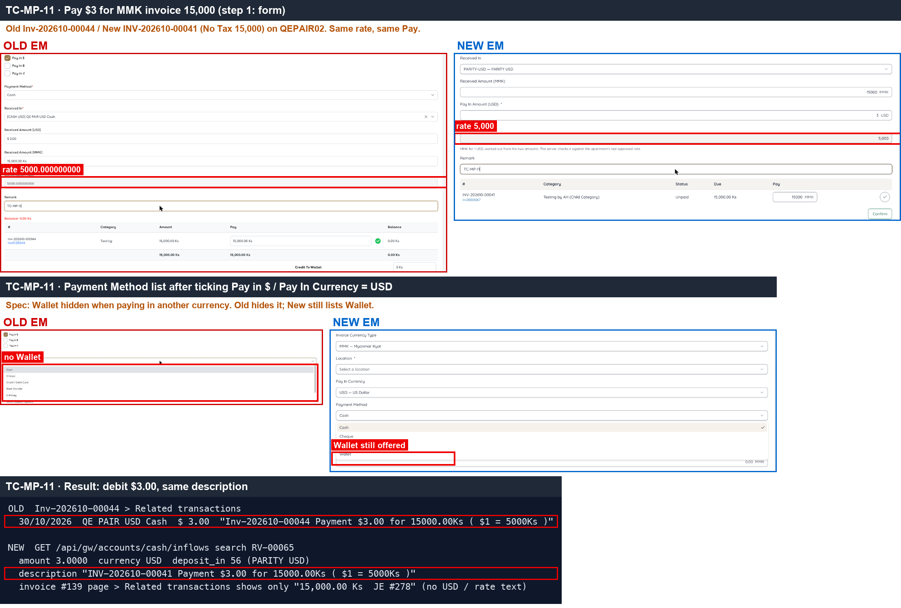

---

## BUG-37 · [Make Payment > USD] 1-cent difference across invoices (no rounding adjustment)

| Severity | Sanity cases | Jira | GIF |
|---|---|---|---|
| S3 · Minor: display, error message, UX | [SAN-MP-012](cases/04-make-payment.md) | [EM-116](https://zeyalabs-team-a83df6me.atlassian.net/browse/EM-116) | [BUG-37.gif](gif/BUG-37.gif) |

**Summary:** Paying $1 for 3 invoices of 1,000 Ks (rate 3,000): each invoice gets $0.33, totalling only $0.99. Old EM adds the $0.01 to the last invoice (0.33 + 0.33 + 0.34 = 1.00). New EM records 0.33 for all 3.

**Impact:** The USD per invoice does not add up to the USD the customer paid. USD reports drift by a cent each time.

**Precondition:**
Menu: Make Payment. Logged in as an Admin user. 3 MMK invoices of 1,000; rate 3,000.

**Steps to reproduce:**
1. Go to Make Payment, Pay In Currency = USD
2. Pay $1 for all 3 invoices, click [Confirm]
3. Open the receipt

**Expected result (Old EM):** 0.33 / 0.33 / 0.34 (total $1.00).

**Actual result (New EM):** 0.33 / 0.33 / 0.33 (total $0.99).

Build: `v0.4.1-31-g1482a663` · Tested: 2026-10-29/30

**How it was found** (each step done identically on Old and New)

- Preparation: 3 MMK invoices of 1,000 on the test apartment, rate 3,000.

| # | Action | Old EM | New EM | Evidence |
|---|---|---|---|---|
| 1 | Make Payment, pay $1 for all 3 invoices > Confirm | RV-102422: 0.33 / 0.33 / **0.34** | RV-00066: 0.33 / 0.33 / **0.33** (total 0.99) | [MP-12.png](img/MP-12.png) |

**Expected fix (user-visible):** The rounding difference is added to the last invoice, so the per-invoice USD adds up to the amount paid, as in Old EM.

**Evidence:**

**`MP-12.png`** — Top: both forms, same rate 3,000. Bottom (dark background): USD recorded per invoice. Upper red box: Old EM adjusts the last line to $0.34, total $1.00. Lower red box: New EM does not adjust, total $0.99.

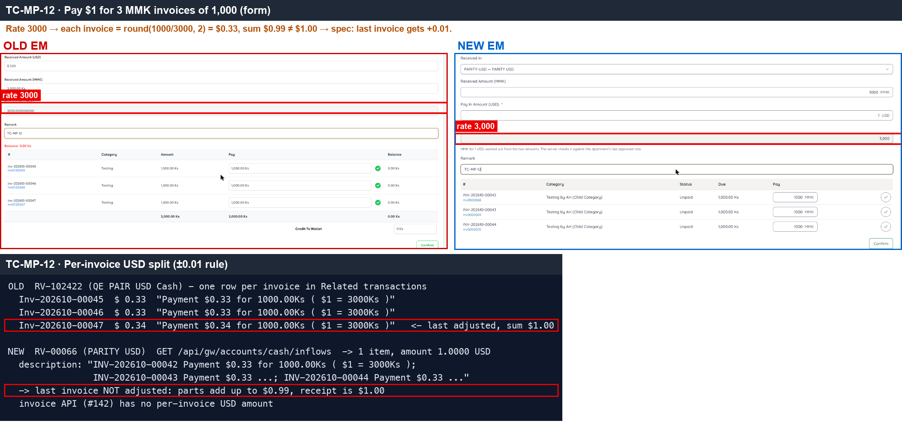

---

## BUG-38 · [Cash Received > Unknown Receipt > Assign] USD to MMK invoice loses the conversion description

| Severity | Sanity cases | Jira | GIF |
|---|---|---|---|
| S3 · Minor: display, error message, UX | [SAN-UNK-007](cases/07-cash-received.md) | [EM-117](https://zeyalabs-team-a83df6me.atlassian.net/browse/EM-117) | [BUG-38.gif](gif/BUG-38.gif) |

**Summary:** Assigning an Unknown $1 to a 5,000 Ks invoice: Old EM writes the description 'Payment $1.00 for 5000.00Ks ( $1 = 5000Ks )'. New EM leaves the description empty (null).

**Impact:** The currency conversion trail is lost: statements and reports do not show what $1 was converted to. Also, New EM lists this receipt in Assigned Logs while Old EM does not (PO to decide on that part).

**Precondition:**
Menu: Cash Received > Unknown Receipt > Assign. Logged in as an Admin user. A USD bank account; Unknown Receipt $1; MMK invoice 5,000; rate 5,000.

**Steps to reproduce:**
1. Click [Assign], allocate the Unknown $1 to the invoice, click [Confirm]
2. Open the receipt and Reports > Assigned Unknown Received Logs

**Expected result (Old EM):** Description shows the conversion.

**Actual result (New EM):** Description is null / '—'.

Build: `v0.4.1-31-g1482a663` · Tested: 2026-10-29/30

**How it was found** (each step done identically on Old and New)

- Preparation: Test USD Bank account; Unknown $1; MMK invoice 5,000.

| # | Action | Old EM | New EM | Evidence |
|---|---|---|---|---|
| 1 | Assign Unknown $1 to the 5,000 Ks invoice, rate 5,000 | Invoice PAID; full description | Invoice PAID; description = null | [UNK-07.png](img/UNK-07.png) |
| 2 | Reports > Assigned Unknown Received Logs | RV-102423 not listed | RV-00067 listed, description '—' | [UNK-07.png](img/UNK-07.png) |

**Expected fix (user-visible):** Write the conversion description as Old EM does. Whether the receipt should appear in Assigned Logs needs a PO decision.

**Evidence:**

**`UNK-07.png`** — Top: the assign form, same rate 5,000. Middle (dark background): Old EM has the description 'Payment $1.00 for 5000.00Ks'; New EM has `description null` (red box). Bottom: Assigned Logs, Old EM has no RV-102423, New EM has RV-00067 with an empty description.

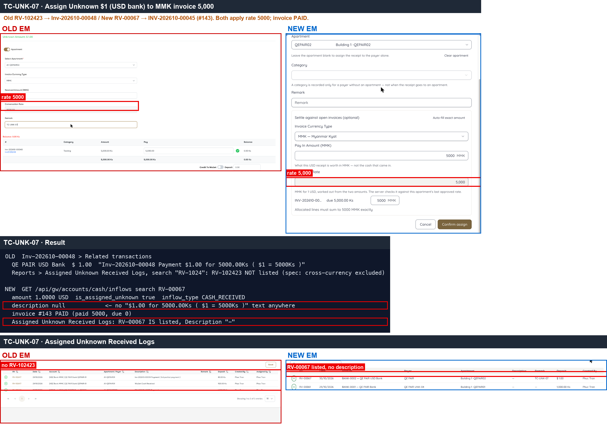

---

## Minor UI issues (UI-17…UI-20)

No wrong numbers, but they make users misread or get confused.

- **UI-17:** AR Snapshot: column headers are right-aligned and numbers left-aligned, so numbers look like they belong to the column on the left. Evidence: [ARS-01-1.png](img/ARS-01-1.png)

- **UI-18:** The date picker on the UO form is squashed; the day numbers run into each other.

- **UI-19:** UO / EM show 'Requested by 11' (the user ID) instead of the user's name. Evidence: [UO-02-1.png](img/UO-02-1.png)

- **UI-20:** UO: the same message 'Invalid Reading Date' is used for 2 different errors (future date; date not after the previous reading). Evidence: [UO-04-1.png](img/UO-04-1.png) **Jira: duplicate of [EM-37](https://zeyalabs-team-a83df6me.atlassian.net/browse/EM-37)** (still wrong on build -31).

## No longer bugs

## BUG-06 · Unknown Received posted to a CASH-type account (FIXED)

| Severity | Sanity cases | Jira | GIF |
|---|---|---|---|
| S2 · Wrong business logic, workaround exists | [SAN-UNK-001](cases/07-cash-received.md) | — | [BUG-06.gif](gif/BUG-06.gif) |

**What it was:** In round 1, the API allowed an Unknown Received (money of unknown source) to be posted to a cash account.

**Why it is no longer a bug:** Fixed. On build -31 the API returns 422.

| # | Action | Old EM | New EM | Evidence |
|---|---|---|---|---|
| 1 | Call the API to create an Unknown Received into the `QE PAIR Cash` (CASH) account | Dropdown only offers BANK accounts | 422 `ERR_CASH_INFLOW_UNKNOWN_DEPOSIT_NOT_BANK` | [API-06-07.png](img/API-06-07.png) |

**`API-06-07.png`** — Top half: the API rejects the CASH account, i.e. fixed.

---

## BUG-25 · Settings missing the account Type table (FIXED)

| Severity | Sanity cases | Jira | GIF |
|---|---|---|---|
| S2 · Wrong business logic, workaround exists | — | [EM-60](https://zeyalabs-team-a83df6me.atlassian.net/browse/EM-60) (duplicate) | — |

**What it was:** In round 1, New EM had no account Type table.

**Why it is no longer a bug:** Fixed. On 30/10, Settings > Account Classification on build -31 has a 'Manage Type' section (BANK, CASH, Petty Cash, Escrow, Operating) with a New button. The Type flags (allow bank, account number, overdraft) have not yet been checked against Old EM.

**Jira cross-check:** Duplicate of [EM-60](https://zeyalabs-team-a83df6me.atlassian.net/browse/EM-60) (same missing Type table); both are fixed on build -31. Retest and close EM-60.

**`ACC-NEW-1.png`** — Round-1 evidence. Red box: Old EM takes Type from Settings. Blue box: New EM used a fixed list.

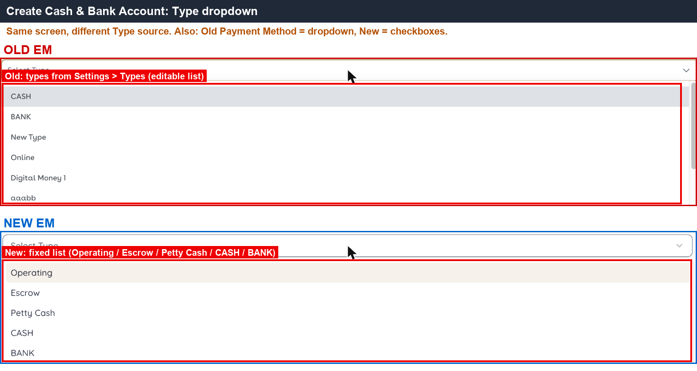

---

## BUG-27 · Search requires the full document number (NOT REPRODUCIBLE)

| Severity | Sanity cases | Jira | GIF |
|---|---|---|---|
| S3 · Minor: display, error message, UX | — | — | [BUG-27.gif](gif/BUG-27.gif) |

**What it was:** In round 1, global search needed the full document number.

**Why it is no longer a bug:** Not reproducible on build -31: searching '202610-0003' returns 5 invoices, so partial-number search works.

| # | Action | Old EM | New EM | Evidence |
|---|---|---|---|---|
| 1 | Global search '202610-0003' | Result list | 5 results, grouped by type | [SRCH-03.png](img/SRCH-03.png) |

**Jira cross-check:** Related, not a duplicate of [EM-54](https://zeyalabs-team-a83df6me.atlassian.net/browse/EM-54) / [EM-55](https://zeyalabs-team-a83df6me.atlassian.net/browse/EM-55) (search boxes inside the EM / UO screens, not tested here).

**`SRCH-03.png`** — Both systems find results by partial number.

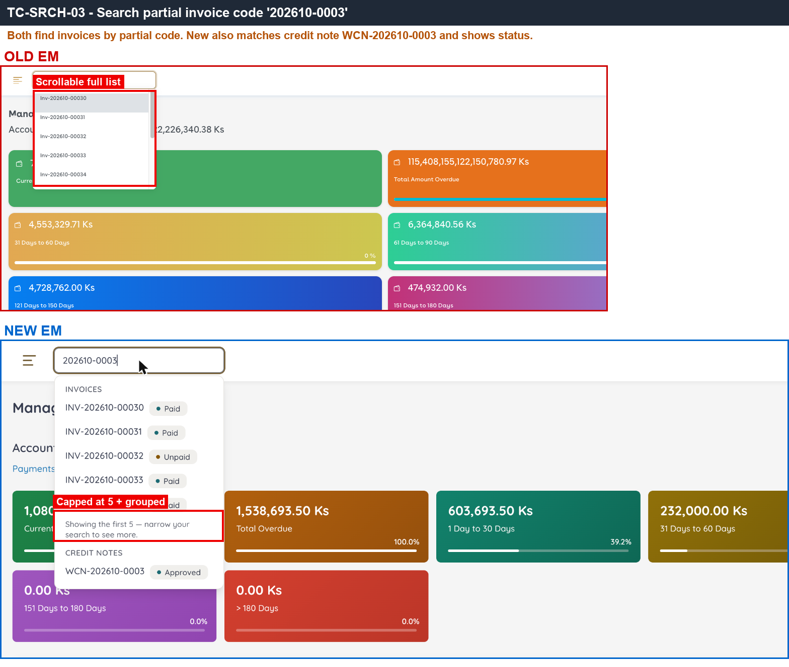

---
