# 00 · General, Topbar & Search — Sanity

[← Sanity index](../README.md) · [Bugs](../bugs.md)

**Test cases:** 11 · **Parity result:** ✅ 7 · ⚠️ 3 · ❌ 1

## Summary

| ID | Test case | Pri | Result | Bug / note |
|---|---|---|---|---|
| [SAN-G-001](#san-g-001--money-field-rejects-a-15-digit-integer-amount) | Money field rejects a 15-digit integer amount | P1 | ✅ Match | — |
| [SAN-G-002](#-san-g-002--amount-with-3-decimals-is-not-kept--invoice-total-stays-at-2-decimals-and-closes-when-paid) | ★ Amount with 3 decimals is not kept — invoice total stays at 2 decimals and closes when paid | P1 | ❌ Bug | [BUG-01](../bugs.md#bug-01) |
| [SAN-G-004](#san-g-004--expanding-a-list-row-at-1280px-shows-the-hidden-columns) | Expanding a list row at 1280px shows the hidden columns | P3 | ⚠️ Differs | [Difference](../differences.md#san-g-004) |
| [SAN-TOP-001](#san-top-001--creating-a-uo-draft-increments-the-uo-chip-immediately) | Creating a UO draft increments the UO chip immediately | P1 | ⚠️ Differs | [Difference](../differences.md#san-top-001) · [D-12](../differences.md#d-12) |
| [SAN-TOP-002](#san-top-002--approving-the-uo-draft-decrements-the-uo-chip-immediately) | Approving the UO draft decrements the UO chip immediately | P1 | ⚠️ Differs | [Difference](../differences.md#san-top-002) · [D-12](../differences.md#d-12) |
| [SAN-TOP-005](#san-top-005--pv-chip-updates-in-another-open-tab-without-reload) | PV chip updates in another open tab without reload | P3 | ✅ Match | — |
| [SAN-SRCH-001](#san-srch-001--searching-an-apartment-name-suggests-the-apartment-and-opens-its-summary) | Searching an apartment name suggests the apartment and opens its Summary | P1 | ✅ Match | — |
| [SAN-SRCH-002](#san-srch-002--searching-part-of-the-apartment-name-without-the-prefix-still-finds-it) | Searching part of the apartment name without the prefix still finds it | P3 | ✅ Match | — |
| [SAN-SRCH-003](#san-srch-003--searching-part-of-an-invoice-number-lists-the-invoices-containing-it) | Searching part of an invoice number lists the invoices containing it | P2 | ✅ Match | — |
| [SAN-SRCH-004](#san-srch-004--searching-a-coref-finds-the-matching-invoice) | Searching a Co.ref finds the matching invoice | P2 | ✅ Match | — |
| [SAN-SRCH-005](#san-srch-005--searching-a-receipt-number-finds-the-rv-and-opens-its-detail) | Searching a receipt number finds the RV and opens its detail | P2 | ✅ Match | — |

## Test cases

#### SAN-G-001 · Money field rejects a 15-digit integer amount

| Priority | Suites | Automation | Status | Source |
|---|---|---|---|---|
| P1 | Sanity · Regression | Auto-UI | Active | EM Parity v2 (TC-G-01), 2026-10-30 |

**Preconditions:**

1. Logged in to EM as an Admin user.

**Steps:**

1. Go to Invoices / Debit Note, click [Add Invoice].
2. In Gross Price, type a 15-digit integer amount, e.g. `123456789012345`.
3. Try to [Create] the invoice.

**Expected result:**

1. The 15-digit amount is not accepted: either the input stops at 14 digits or a validation error is shown.
2. The invoice cannot be saved with a 15-digit amount.

**Parity result (build -31):**

| Old EM | New EM | Result |
|---|---|---|
| Input mask stops at 14 digits | 15 digits can be typed, but 'Amount exceeded maximum limit' (ERR_MONEY_AMOUNT_EXCEEDS_LIMIT) is shown | ✅ Match |

**Evidence:**

- 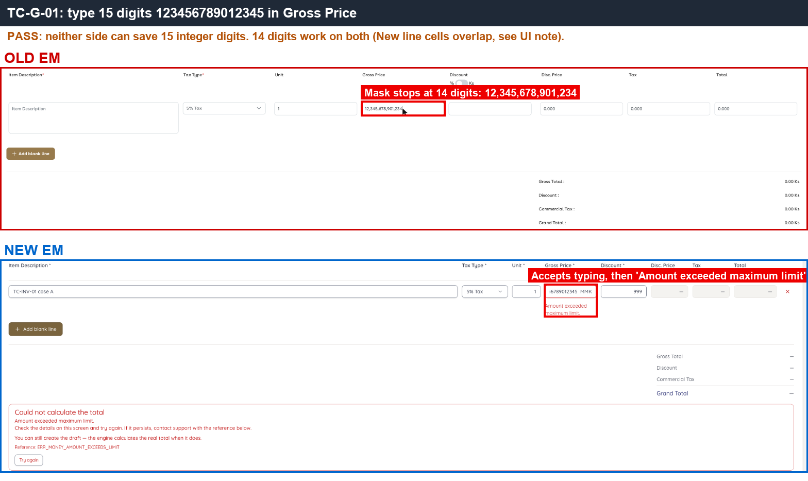 — Old field stops at 14 digits; New shows 'Amount exceeded maximum limit'.

---

#### ★ SAN-G-002 · Amount with 3 decimals is not kept — invoice total stays at 2 decimals and closes when paid

| Priority | Suites | Automation | Status | Source |
|---|---|---|---|---|
| P1 | Sanity · Regression | Auto-UI+API | Active | EM Parity v2 (TC-G-02), 2026-10-30 |

**Preconditions:**

1. Logged in to EM as an Admin user.
2. The test apartment has no outstanding invoices.
3. Receiving account: `QE PAIR Cash` (CASH, MMK) on both sides.

**Test data:**

1. Apartment: Old `A1-QEPAIR01`, New `Building 1 -QEPAIR01`.
2. Unit 3 · Gross Price `1000.555` · Discount 10% · Tax 5%
3. Payments: 400, then the displayed balance

**Steps:**

1. Go to Invoices / Debit Note, click [Add Invoice] for the test apartment.
2. Enter Unit 3, Gross Price `1000.555`, Discount 10%, Tax 5%. Check the Gross Price field and Grand Total.
3. Click [Create], then [Approve]. Check the stored grand total through the API response.
4. Go to Make Payment, pay 400 into `QE PAIR Cash`, click [Confirm].
5. Make Payment again with exactly the Balance Due shown on screen, click [Confirm].
6. Open the apartment's invoice list and Make Payment.

**Expected result:**

1. The 3-decimal price is either blocked or rounded to `1,000.55`; it is never kept with 3 decimals.
2. If rounded, Grand Total is 2,836.55; the stored total never has more than 2 decimals.
3. After paying the displayed balance: Balance Due = 0.00, the invoice is PAID and no longer listed in Make Payment.

**Parity result (build -31):**

| Old EM | New EM | Result |
|---|---|---|
| `1000.555` → `1,000.55`, Grand Total 2,836.55; paying the displayed balance → Balance Due 0.00, PAID | Keeps `1000.555`, Grand Total 2,836.57 (stored 2836.5734); after paying the displayed balance the invoice stays PARTIALLY_PAID with 0.0034 due | ❌ [BUG-01](../bugs.md#bug-01) · [EM-93](https://zeyalabs-team-a83df6me.atlassian.net/browse/EM-93) |

**Retest (build -37):** ❌ Not fixed. A 3-decimal price is now blocked ("Amount can have at most 2 decimal places.", API 422 `ERR_MONEY_AMOUNT_TOO_MANY_DECIMALS`), but a 2-decimal price `1000.52` still stores the total with 4 decimals (`2836.4742`). Paying the displayed 2,836.47 leaves the invoice PARTIALLY_PAID with 0.0042 due, shown in Make Payment as 'Partially paid, Due 0.00' that cannot be paid.

**Evidence:**

- 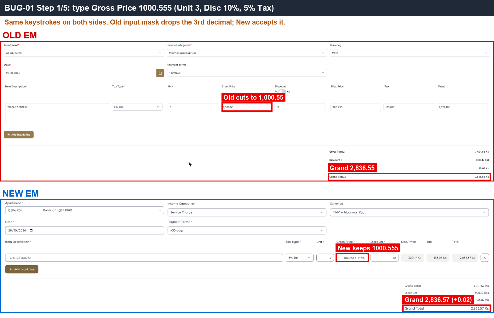 — Old truncates the price to 1,000.55; New keeps 1000.555 and Grand Total is 0.02 higher.
- 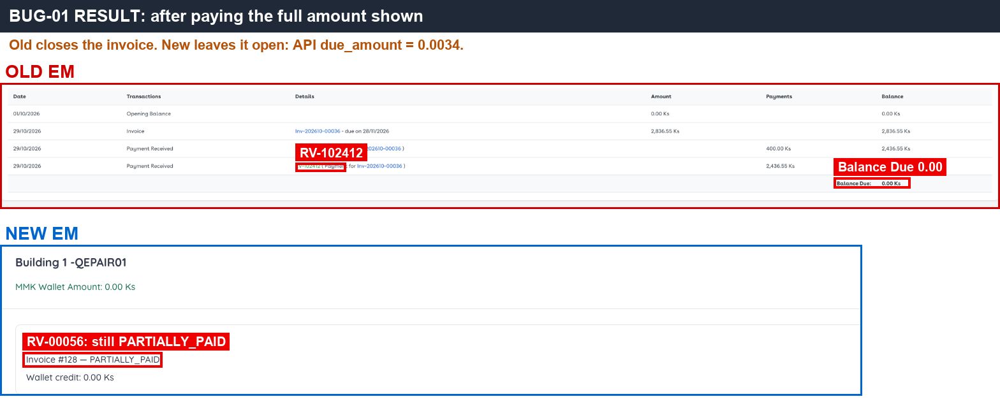 — After the full payment Old shows Balance Due 0.00; New still shows PARTIALLY_PAID.
- 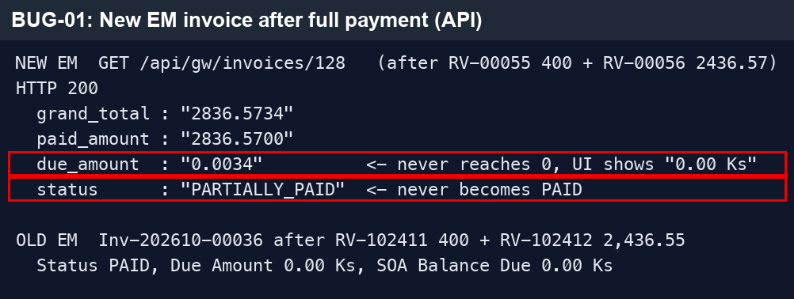 — API response on New: `due_amount 0.0034`, the hidden balance the screen does not show.
- [BUG-01.gif](../gif/BUG-01.gif) — full repro on both sides.
- 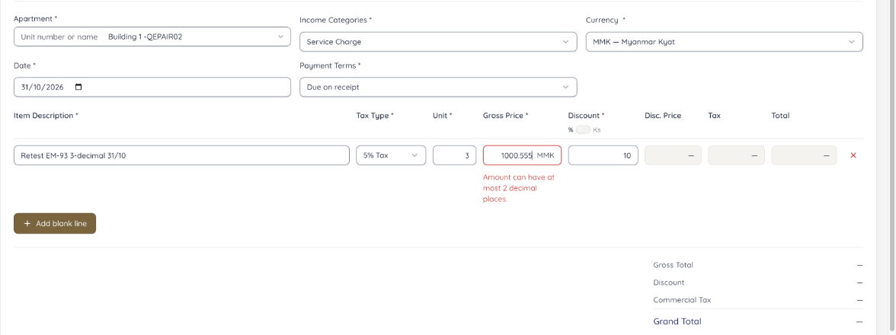 — build -37: 3-decimal price is refused.
- 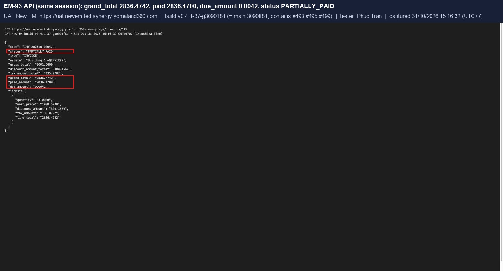 — build -37 API response: `grand_total 2836.4742`, `due_amount 0.0042`, `status PARTIALLY_PAID`.

---

#### SAN-G-004 · Expanding a list row at 1280px shows the hidden columns

| Priority | Suites | Automation | Status | Source |
|---|---|---|---|---|
| P3 | Sanity · Regression | Auto-UI | Active | EM Parity v2 (TC-G-04), 2026-10-30 |

**Preconditions:**

1. Logged in to EM as an Admin user.

**Steps:**

1. Set the browser window width to 1280px.
2. Open a list page (e.g. Invoices / Debit Note).
3. Click (+) on a row.

**Expected result:**

1. The columns hidden at this width (Approved By, Manage) are shown in the expanded part of the row.
2. The visible columns fit within 1280px; no column is cut off.

**Parity result (build -31):**

| Old EM | New EM | Result |
|---|---|---|
| 1280px: (+) shows Approved By + Manage | 1280px: (+) also shows Approved By + Manage, but the Created By column is cut off at the right edge and needs horizontal scrolling | ⚠️ [Differs](../differences.md#san-g-004) |

**Evidence:**

- 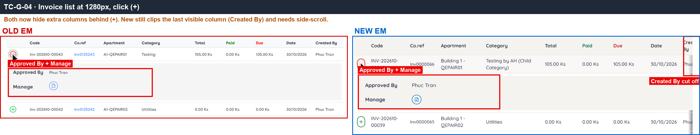 — both sides expand Approved By + Manage; New's Created By column is cut off at the right edge.

---

#### SAN-TOP-001 · Creating a UO draft increments the UO chip immediately

| Priority | Suites | Automation | Status | Source |
|---|---|---|---|---|
| P1 | Sanity · Regression | Auto-UI | Active | EM Parity v2 (TC-TOP-01), 2026-10-30 |

**Preconditions:**

1. Logged in to EM as an Admin user.

**Test data:**

1. Apartment: Old `A1-QEPAIR01`, New `Building 1 -QEPAIR01`.

**Steps:**

1. Note the UO draft chip count in the topbar.
2. Create a new Utility Operation (UO) for the test apartment and save it as a draft.
3. Without reloading, check the UO chip.

**Expected result:**

1. The UO chip increases by 1 immediately (it appears if it was 0).

**Parity result (build -31):**

| Old EM | New EM | Result |
|---|---|---|
| UO draft created: UO chip 1→2 immediately | Chip stays at 2, becomes 3 only after reload (D-12) | ⚠️ [Differs](../differences.md#san-top-001) |

**Evidence:**

- 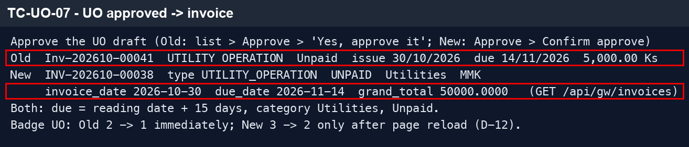 — UO chip count before and after the draft, compared with the API count.

---

#### SAN-TOP-002 · Approving the UO draft decrements the UO chip immediately

| Priority | Suites | Automation | Status | Source |
|---|---|---|---|---|
| P1 | Sanity · Regression | Auto-UI | Active | EM Parity v2 (TC-TOP-02), 2026-10-30 |

**Preconditions:**

1. Logged in to EM as an Admin user.
2. The UO draft from SAN-TOP-001 exists.

**Steps:**

1. Note the UO draft chip count in the topbar.
2. Approve the UO draft created in SAN-TOP-001.
3. Without reloading, check the UO chip.

**Expected result:**

1. The UO chip decreases by 1 immediately; at 0 the chip is hidden.

**Parity result (build -31):**

| Old EM | New EM | Result |
|---|---|---|
| Approve: chip 2→1 immediately | Chip stays at 3, becomes 2 only after reload (D-12) | ⚠️ [Differs](../differences.md#san-top-002) |

**Evidence:**

-  — UO chip count after approval, compared with the API count.

---

#### SAN-TOP-005 · PV chip updates in another open tab without reload

| Priority | Suites | Automation | Status | Source |
|---|---|---|---|---|
| P3 | Sanity · Regression | Auto-UI | Active | EM Parity v2 (TC-TOP-05), 2026-10-30 |

**Preconditions:**

1. Logged in to EM as an Admin user.

**Steps:**

1. Open EM in two browser tabs and note the PV chip count.
2. In one tab, create a Cash Outflow draft.
3. Without reloading, watch the PV chip in the other tab.

**Expected result:**

1. The PV chip in the other tab increases by 1 without a reload.

**Parity result (build -31):**

| Old EM | New EM | Result |
|---|---|---|
| Tab 2 creates a PV draft → PV chip in tab 1 29 → 30 after ~13 s, no reload | Chip 5 → 6 without reload, but after 30–80 s, also in the tab that created the draft | ✅ Match |

**Evidence:**

-  — PV chip increases in the other tab without reload on both sides.

---

#### SAN-SRCH-001 · Searching an apartment name suggests the apartment and opens its Summary

| Priority | Suites | Automation | Status | Source |
|---|---|---|---|---|
| P1 | Sanity · Regression | Auto-UI | Active | EM Parity v2 (TC-SRCH-01), 2026-10-30 |

**Preconditions:**

1. Logged in to EM as an Admin user.

**Test data:**

1. Apartment: Old `A1-QEPAIR01`, New `Building 1 -QEPAIR01`.
2. Search text: `QEPAIR01`

**Steps:**

1. Type `QEPAIR01` in the topbar search.
2. Click the apartment suggestion.

**Expected result:**

1. The apartment is suggested.
2. Clicking it opens the apartment Summary.

**Parity result (build -31):**

| Old EM | New EM | Result |
|---|---|---|
| Typed `QEPAIR01` → A1-QEPAIR01 | → Building 1 -QEPAIR01 (with Enable status) | ✅ Match |

**Evidence:**

- 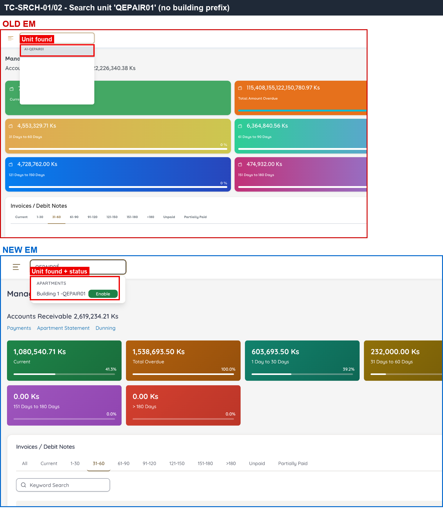 — the apartment suggestion on both sides.
- [SRCH.gif](../gif/SRCH.gif) — search flow on both sides.

---

#### SAN-SRCH-002 · Searching part of the apartment name without the prefix still finds it

| Priority | Suites | Automation | Status | Source |
|---|---|---|---|---|
| P3 | Sanity · Regression | Auto-UI | Active | EM Parity v2 (TC-SRCH-02), 2026-10-30 |

**Preconditions:**

1. Logged in to EM as an Admin user.

**Test data:**

1. Apartment: Old `A1-QEPAIR01`, New `Building 1 -QEPAIR01`.
2. Search text: `QEPAIR01`

**Steps:**

1. Type only the unit part of the apartment name, without building prefix or hyphen, in the topbar search.
2. Check the suggestions.

**Expected result:**

1. The apartment is still suggested.

**Parity result (build -31):**

| Old EM | New EM | Result |
|---|---|---|
| Finds by part of the unit name (no prefix needed) | Same as Old | ✅ Match |

**Evidence:**

-  — the apartment is found without the building prefix.

---

#### SAN-SRCH-003 · Searching part of an invoice number lists the invoices containing it

| Priority | Suites | Automation | Status | Source |
|---|---|---|---|---|
| P2 | Sanity · Regression | Auto-UI | Active | EM Parity v2 (TC-SRCH-03), 2026-10-30 |

**Preconditions:**

1. Logged in to EM as an Admin user.

**Test data:**

1. Search text: `202610-0003`

**Steps:**

1. Type `202610-0003` in the topbar search.
2. Check the suggestions.

**Expected result:**

1. The invoices whose number contains the text are listed.

**Parity result (build -31):**

| Old EM | New EM | Result |
|---|---|---|
| '202610-0003' → Inv-202610-00030…00034, scrollable | Shows the first 5 invoices ('Showing the first 5'), grouped by type, including WCN-202610-0003 | ✅ Match |

**Evidence:**

- 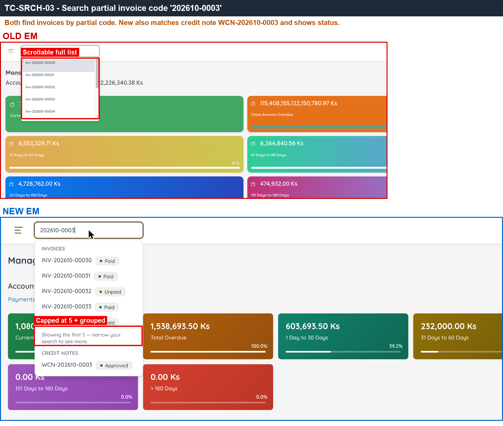 — invoice results for the partial number on both sides.

---

#### SAN-SRCH-004 · Searching a Co.ref finds the matching invoice

| Priority | Suites | Automation | Status | Source |
|---|---|---|---|---|
| P2 | Sanity · Regression | Auto-UI | Active | EM Parity v2 (TC-SRCH-04), 2026-10-30 |

**Preconditions:**

1. Logged in to EM as an Admin user.

**Test data:**

1. Co.ref: Old `Inv0125239`, New `Inv0000062`

**Steps:**

1. Type an existing Co.ref in the topbar search.
2. Check the suggestions.

**Expected result:**

1. The matching invoice is shown.

**Parity result (build -31):**

| Old EM | New EM | Result |
|---|---|---|
| Co.ref Inv0125239 → shows that Co.ref | Co.ref Inv0000062 → shows INV-202610-00036 (Paid) | ✅ Match |

**Evidence:**

-  — the invoice found by Co.ref on both sides.

---

#### SAN-SRCH-005 · Searching a receipt number finds the RV and opens its detail

| Priority | Suites | Automation | Status | Source |
|---|---|---|---|---|
| P2 | Sanity · Regression | Auto-UI | Active | EM Parity v2 (TC-SRCH-05), 2026-10-30 |

**Preconditions:**

1. Logged in to EM as an Admin user.

**Test data:**

1. RV number: Old `RV-102417`, New `RV-00061`

**Steps:**

1. Type an existing receipt (RV) number in the topbar search.
2. Click the result.

**Expected result:**

1. The receipt is suggested.
2. Clicking it opens the RV detail.

**Parity result (build -31):**

| Old EM | New EM | Result |
|---|---|---|
| RV-102417 → RV shown | RV-00061 → RV shown, Posted | ✅ Match |

**Evidence:**

- 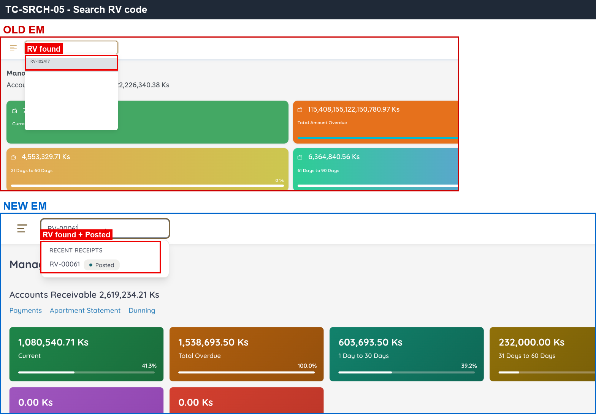 — the RV found by number on both sides.

---
