# 01 · Dashboard — Sanity

[← Sanity index](../README.md) · [Bugs](../bugs.md)

**Test cases:** 12 · **Parity result:** ✅ 12 · ⚠️ 0 · ❌ 0

## Summary

| ID | Test case | Pri | Result | Bug / note |
|---|---|---|---|---|
| [SAN-DB-001](#-san-db-001--dashboard-shows-one-ar-card-per-currency-as-of-today) | ★ Dashboard shows one AR card per currency, as of today | P1 | ✅ Match | [D-13](../differences.md#d-13) |
| [SAN-DB-002](#-san-db-002--ar-card-total-equals-current--overdue) | ★ AR card Total equals Current + Overdue | P1 | ✅ Match | — |
| [SAN-DB-003](#-san-db-003--approving-a-1000-mmk-invoice-due-on-or-after-today-adds-1000-to-ar-total-and-current) | ★ Approving a 1,000 MMK invoice due on or after today adds 1,000 to AR Total and Current | P1 | ✅ Match | — |
| [SAN-DB-004](#-san-db-004--invoice-due-today-is-counted-in-current-not-overdue) | ★ Invoice due today is counted in Current, not Overdue | P1 | ✅ Match | — |
| [SAN-DB-005](#-san-db-005--paying-400-of-a-1000-invoice-reduces-ar-by-400) | ★ Paying 400 of a 1,000 invoice reduces AR by 400 | P1 | ✅ Match | — |
| [SAN-DB-006](#-san-db-006--paying-the-rest-makes-the-invoice-paid-and-removes-it-from-ar) | ★ Paying the rest makes the invoice PAID and removes it from AR | P1 | ✅ Match | — |
| [SAN-DB-007](#-san-db-007--approving-a-500-credit-note-leaves-ar-unchanged-and-adds-500-to-wallet--deposits) | ★ Approving a 500 Credit Note leaves AR unchanged and adds 500 to Wallet & Deposits | P1 | ✅ Match | — |
| [SAN-DB-008](#san-db-008--approving-a-deposit-invoice-leaves-ar-unchanged) | Approving a Deposit Invoice leaves AR unchanged | P2 | ✅ Match | Side note: [BUG-15](../bugs.md#bug-15) (Deposit Invoice shows '—' for dates / creator) |
| [SAN-DB-009](#-san-db-009--cash-outflow-draft-does-not-change-cash-approving-it-adds-100-to-total-payment) | ★ Cash Outflow draft does not change cash; approving it adds 100 to Total Payment | P1 | ✅ Match | — |
| [SAN-DB-010](#-san-db-010--recording-an-unknown-received-of-1000-adds-1000-to-total-collection-immediately) | ★ Recording an Unknown Received of 1,000 adds 1,000 to Total Collection immediately | P1 | ✅ Match | — |
| [SAN-DB-011](#-san-db-011--cash-transfer-between-two-accounts-keeps-net-cash-and-moves-the-balance) | ★ Cash Transfer between two accounts keeps Net Cash and moves the balance | P1 | ✅ Match | — |
| [SAN-DB-013](#san-db-013--wallet-refund-draft-does-not-change-wallet--deposits-until-approved) | Wallet Refund draft does not change Wallet & Deposits until approved | P2 | ✅ Match | — |

## Test cases

#### ★ SAN-DB-001 · Dashboard shows one AR card per currency, as of today

| Priority | Suites | Automation | Status | Source |
|---|---|---|---|---|
| P1 | Sanity · Regression | Auto-UI | Active | EM Parity v2 (TC-DB-01), 2026-10-30 |

**Preconditions:**

1. Logged in to EM as an Admin user.

**Steps:**

1. Open the Dashboard.
2. Check the AR cards and the "as of" date in their title.

**Expected result:**

1. There is one AR card for each currency, including currencies at 0.00.
2. The "as of" date is today.

**Parity result (build -31):**

| Old EM | New EM | Result |
|---|---|---|
| Card for every currency including 0.00. 'as of 30/10' by machine clock. MMK Total off Current+Overdue by 20 Ks (10^17 figure) | Card for every currency. 'as of 29/10' by Yangon time. Total = Current + Overdue | ✅ Match |

**Evidence:**

- 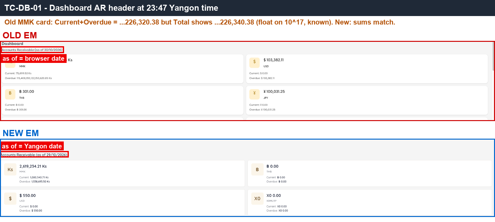 — AR cards per currency and the "as of" date on both sides.

---

#### ★ SAN-DB-002 · AR card Total equals Current + Overdue

| Priority | Suites | Automation | Status | Source |
|---|---|---|---|---|
| P1 | Sanity · Regression | Auto-UI | Active | EM Parity v2 (TC-DB-02), 2026-10-30 |

**Preconditions:**

1. Logged in to EM as an Admin user.

**Steps:**

1. Open the Dashboard.
2. On any AR card, add Current and Overdue.

**Expected result:**

1. Total = Current + Overdue.

**Parity result (build -31):**

| Old EM | New EM | Result |
|---|---|---|
| Off by 20 Ks at the 10^17 figure (known float issue) | 2,619,234.21 = 1,080,540.71 + 1,538,693.50 | ✅ Match |

**Evidence:**

-  — the MMK card Total, Current and Overdue figures.

---

#### ★ SAN-DB-003 · Approving a 1,000 MMK invoice due on or after today adds 1,000 to AR Total and Current

| Priority | Suites | Automation | Status | Source |
|---|---|---|---|---|
| P1 | Sanity · Regression | Auto-UI | Active | EM Parity v2 (TC-DB-03), 2026-10-30 |

**Preconditions:**

1. Logged in to EM as an Admin user.

**Test data:**

1. Apartment: Old `A1-QEPAIR01`, New `Building 1 -QEPAIR01`.
2. Invoice: MMK 1,000, due date ≥ today

**Steps:**

1. Open the Dashboard and note the MMK AR Total and Current.
2. Create an MMK invoice of 1,000 for the test apartment with a due date on or after today, then approve it.
3. Open the Dashboard again.

**Expected result:**

1. MMK AR Total and Current both increase by 1,000.

**Parity result (build -31):**

| Old EM | New EM | Result |
|---|---|---|
| Inv-202610-00040 · Current +1,000 (header +990 due to float) | INV-202610-00037 · Total and Current +1,000 | ✅ Match |

**Evidence:**

- 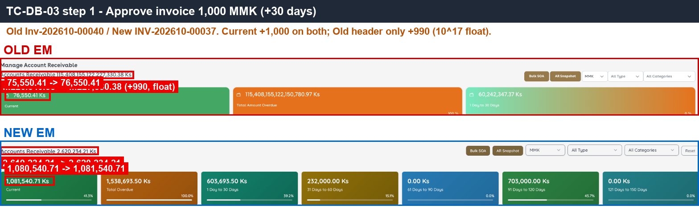 — MMK Total and Current before and after the approval.
- [DB-03.gif](../gif/DB-03.gif) — the flow on both sides.

---

#### ★ SAN-DB-004 · Invoice due today is counted in Current, not Overdue

| Priority | Suites | Automation | Status | Source |
|---|---|---|---|---|
| P1 | Sanity · Regression | Auto-UI | Active | EM Parity v2 (TC-DB-04), 2026-10-30 |

**Preconditions:**

1. Logged in to EM as an Admin user.

**Test data:**

1. Apartment: Old `A1-QEPAIR01`, New `Building 1 -QEPAIR01`.
2. Invoice: MMK 105, due date = today

**Steps:**

1. Note the Dashboard MMK Current.
2. Create and approve an MMK invoice of 105 for the test apartment with due date = today.
3. Check the apartment's AR and the Dashboard.

**Expected result:**

1. The invoice is counted in Current (+105); Overdue does not change.

**Parity result (build -31):**

| Old EM | New EM | Result |
|---|---|---|
| Inv-202610-00043 105, due 30/10 → apartment: Current +105, Overdue 0; Dashboard Current 530,550.41 → 530,655.41 | INV-202610-00040 105, due 30/10 → Current +105, Overdue 0; Dashboard Current 1,580,540.71 → 1,580,645.71 | ✅ Match |

**Evidence:**

- 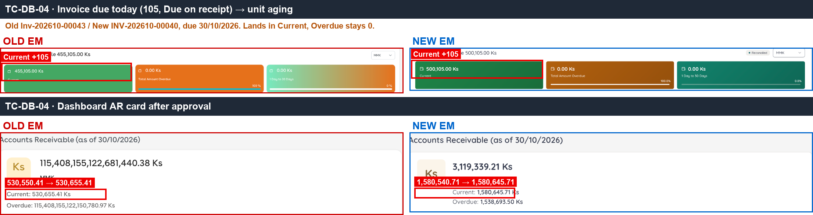 — Current +105 and Overdue unchanged on both sides.

---

#### ★ SAN-DB-005 · Paying 400 of a 1,000 invoice reduces AR by 400

| Priority | Suites | Automation | Status | Source |
|---|---|---|---|---|
| P1 | Sanity · Regression | Auto-UI | Active | EM Parity v2 (TC-DB-05), 2026-10-30 |

**Preconditions:**

1. Logged in to EM as an Admin user.
2. The approved 1,000 MMK invoice from SAN-DB-003.
3. Receiving account: `QE PAIR Cash` (CASH, MMK) on both sides.

**Steps:**

1. Note the Dashboard MMK AR.
2. Make Payment of 400 (Cash) for the 1,000 invoice from SAN-DB-003.
3. Check the Dashboard and the invoice status.

**Expected result:**

1. AR decreases by 400.
2. The invoice is PARTIALLY_PAID and its remaining 600 stays in AR.

**Parity result (build -31):**

| Old EM | New EM | Result |
|---|---|---|
| Paid 400 Cash: Current −400, 600 remaining | RV-00063 · −400, PARTIALLY_PAID 600 | ✅ Match |

**Evidence:**

- 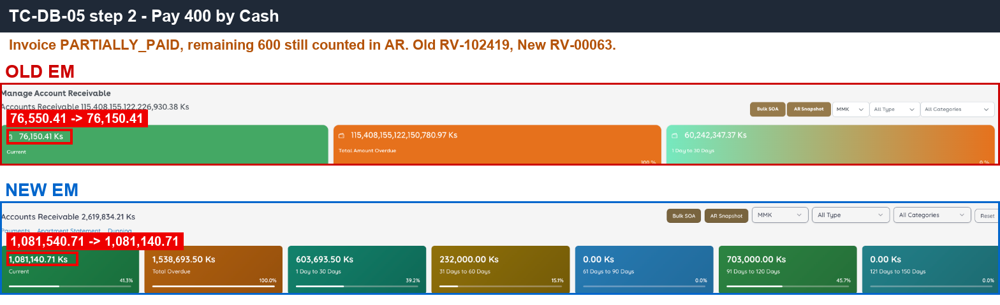 — AR −400 and the 600 remaining on both sides.

---

#### ★ SAN-DB-006 · Paying the rest makes the invoice PAID and removes it from AR

| Priority | Suites | Automation | Status | Source |
|---|---|---|---|---|
| P1 | Sanity · Regression | Auto-UI | Active | EM Parity v2 (TC-DB-06), 2026-10-30 |

**Preconditions:**

1. Logged in to EM as an Admin user.
2. The PARTIALLY_PAID invoice from SAN-DB-005.
3. Bank account: `QE PAIR Bank` (BANK, MMK) on both sides.

**Steps:**

1. Make Payment of the remaining 600 (Cheque) for the same invoice.
2. Check the invoice status and the Dashboard.

**Expected result:**

1. The invoice is PAID.
2. It is no longer counted in AR; AR returns to its value before SAN-DB-003.

**Parity result (build -31):**

| Old EM | New EM | Result |
|---|---|---|
| Paid 600 Cheque → PAID, AR back to the starting value | RV-00064 (Cheque, Cleared) → PAID, AR back to the starting value | ✅ Match |

**Evidence:**

- 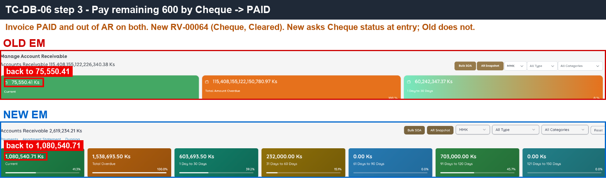 — invoice PAID and AR back to the starting value.

---

#### ★ SAN-DB-007 · Approving a 500 Credit Note leaves AR unchanged and adds 500 to Wallet & Deposits

| Priority | Suites | Automation | Status | Source |
|---|---|---|---|---|
| P1 | Sanity · Regression | Auto-UI | Active | EM Parity v2 (TC-DB-07), 2026-10-30 |

**Preconditions:**

1. Logged in to EM as an Admin user.
2. The test apartment has outstanding invoices.

**Test data:**

1. Apartment: Old `A1-QEPAIR01`, New `Building 1 -QEPAIR01`.
2. Credit Note: 500

**Steps:**

1. Note the Dashboard AR and Wallet & Deposits (today and this month).
2. Create a Credit Note of 500 for the test apartment and approve it.
3. Check the Dashboard.

**Expected result:**

1. AR does **not** change.
2. Wallet & Deposits increases by 500 (today and this month).

**Parity result (build -31):**

| Old EM | New EM | Result |
|---|---|---|
| CN 500 (draft 5414) approved: AR unchanged; Wallet today 0 → 500, Oct 2,923.23 → 3,423.23 | WCN #6 approved: AR unchanged (3,119,234.21); Wallet today 0 → 500, Oct 23,890.11 → 24,390.11 | ✅ Match |

**Evidence:**

- 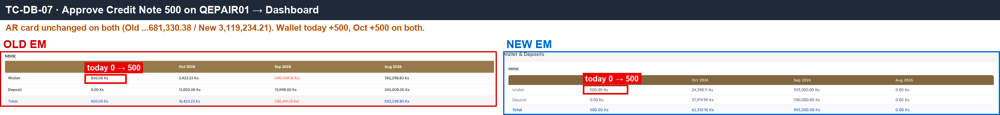 — AR unchanged and Wallet +500 on both sides.

---

#### SAN-DB-008 · Approving a Deposit Invoice leaves AR unchanged

| Priority | Suites | Automation | Status | Source |
|---|---|---|---|---|
| P2 | Sanity · Regression | Auto-UI | Active | EM Parity v2 (TC-DB-08), 2026-10-30 |

**Preconditions:**

1. Logged in to EM as an Admin user.

**Test data:**

1. Apartment: Old `A1-QEPAIR01`, New `Building 1 -QEPAIR01`.
2. Deposit Invoice: 1,000

**Steps:**

1. Note the apartment's AR.
2. Create a Deposit Invoice of 1,000 for the test apartment and approve it.
3. Check the apartment's AR and the Dashboard.

**Expected result:**

1. AR does not change.

**Parity result (build -31):**

| Old EM | New EM | Result |
|---|---|---|
| DI-202610-00004 1,000 approved: apartment AR stays 455,105 | DEP-202610-0003 1,000 approved: apartment AR stays 500,105 | ✅ Match |

**Evidence:**

- 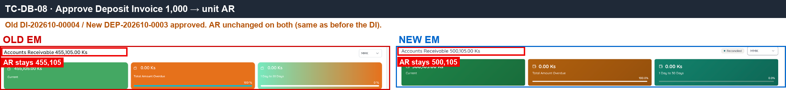 — apartment AR unchanged after the Deposit Invoice approval.

---

#### ★ SAN-DB-009 · Cash Outflow draft does not change cash; approving it adds 100 to Total Payment

| Priority | Suites | Automation | Status | Source |
|---|---|---|---|---|
| P1 | Sanity · Regression | Auto-UI | Active | EM Parity v2 (TC-DB-09), 2026-10-30 |

**Preconditions:**

1. Logged in to EM as an Admin user.
2. Receiving account: `QE PAIR Cash` (CASH, MMK) on both sides.

**Test data:**

1. Cash Outflow: 100

**Steps:**

1. Note Net Cash and the monthly Total Payment on the Dashboard.
2. Create a Cash Outflow draft of 100 from `QE PAIR Cash`.
3. Check the Dashboard.
4. Approve the draft and check the Dashboard again.

**Expected result:**

1. After the draft: Net Cash and Total Payment do **not** change.
2. After approval: Total Payment increases by 100.

**Parity result (build -31):**

| Old EM | New EM | Result |
|---|---|---|
| PV draft 100: monthly Total Payment stays 3,800. Approve PV-100269 → 3,900 | Draft #32: stays 39,800. Approve PV-00023 → 39,900 | ✅ Match |

**Evidence:**

- 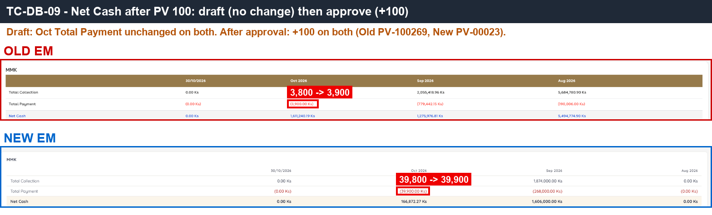 — Total Payment unchanged after the draft, +100 after approval.
- [DB-09.gif](../gif/DB-09.gif) — the flow on both sides.

---

#### ★ SAN-DB-010 · Recording an Unknown Received of 1,000 adds 1,000 to Total Collection immediately

| Priority | Suites | Automation | Status | Source |
|---|---|---|---|---|
| P1 | Sanity · Regression | Auto-UI | Active | EM Parity v2 (TC-DB-10), 2026-10-30 |

**Preconditions:**

1. Logged in to EM as an Admin user.

**Test data:**

1. Unknown Received: 1,000

**Steps:**

1. Note Total Collection (today and this month) on the Dashboard.
2. Record an Unknown Received of 1,000.
3. Check the Dashboard.

**Expected result:**

1. Total Collection increases by 1,000 immediately (no approval needed), today and this month.

**Parity result (build -31):**

| Old EM | New EM | Result |
|---|---|---|
| RV-102418 · Total Collection today 20,795.67 → 21,795.67, month +1,000 | RV-00062 · 187,632.27 → 188,632.27, month +1,000 | ✅ Match |

**Evidence:**

- 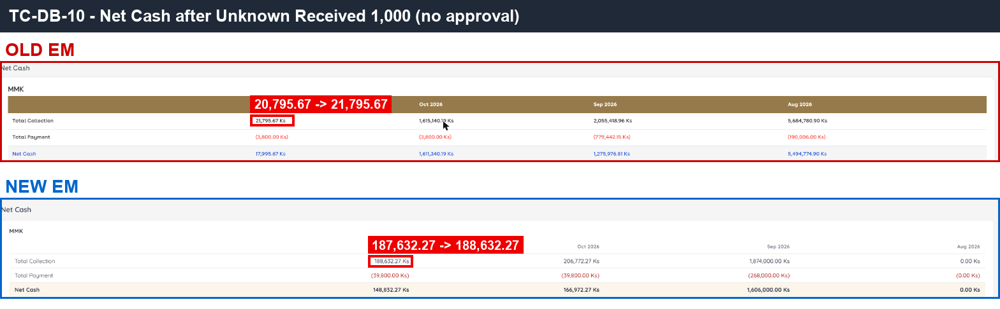 — Total Collection +1,000 on both sides.
- [DB-10.gif](../gif/DB-10.gif) — the flow on both sides.

---

#### ★ SAN-DB-011 · Cash Transfer between two accounts keeps Net Cash and moves the balance

| Priority | Suites | Automation | Status | Source |
|---|---|---|---|---|
| P1 | Sanity · Regression | Auto-UI | Active | EM Parity v2 (TC-DB-11), 2026-10-30 |

**Preconditions:**

1. Logged in to EM as an Admin user.
2. Receiving account: `QE PAIR Cash` (CASH, MMK) on both sides.
3. Bank account: `QE PAIR Bank` (BANK, MMK) on both sides.

**Test data:**

1. Cash Transfer: 100, QE PAIR Cash → QE PAIR Bank

**Steps:**

1. Note Net Cash and the Cash & Bank balances on the Dashboard.
2. Create a Cash Transfer of 100 from `QE PAIR Cash` to `QE PAIR Bank` and approve it.
3. Check the Dashboard.

**Expected result:**

1. Net Cash does not change.
2. Cash & Bank: the source account decreases by 100 and the destination increases by 100.

**Parity result (build -31):**

| Old EM | New EM | Result |
|---|---|---|
| JV 100 Cash→Bank approved: Net Cash unchanged | #22 approved: Net Cash unchanged; Cash & Bank: QE PAIR Cash 20,145.70, Bank 13,750 (correct −100/+100) | ✅ Match |

**Evidence:**

- 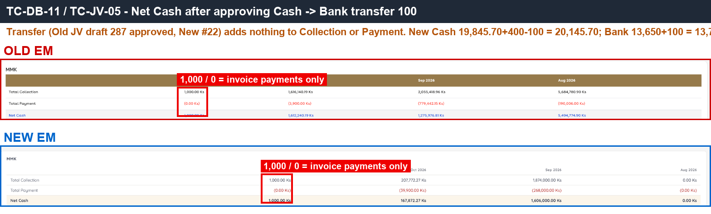 — Net Cash unchanged and the −100/+100 balances.

---

#### SAN-DB-013 · Wallet Refund draft does not change Wallet & Deposits until approved

| Priority | Suites | Automation | Status | Source |
|---|---|---|---|---|
| P2 | Sanity · Regression | Auto-UI | Active | EM Parity v2 (TC-DB-13), 2026-10-30 |

**Preconditions:**

1. Logged in to EM as an Admin user.
2. The test apartment has a wallet balance of 500 (from SAN-DB-007).

**Test data:**

1. Apartment: Old `A1-QEPAIR01`, New `Building 1 -QEPAIR01`.
2. Wallet Refund: 100

**Steps:**

1. Note Wallet & Deposits on the Dashboard.
2. Create a Wallet Refund draft of 100 for the test apartment.
3. Check the Dashboard.
4. Delete / cancel the draft.

**Expected result:**

1. Wallet & Deposits does not change while the refund is a draft.

**Parity result (build -31):**

| Old EM | New EM | Result |
|---|---|---|
| Refund draft 100 (PV draft 5415): Wallet today stays 500. Draft deleted | Refund 100 → outflow #35 'No money has moved yet': Wallet stays 500. Draft cancelled. The New form has no Remark field | ✅ Match |

**Evidence:**

- 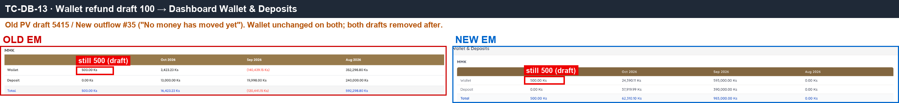 — Wallet unchanged after the refund draft on both sides.
