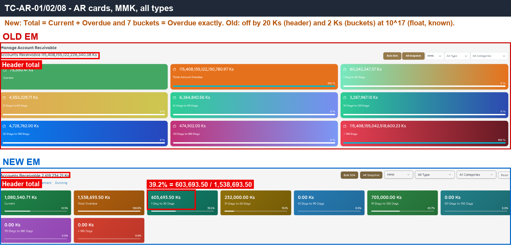
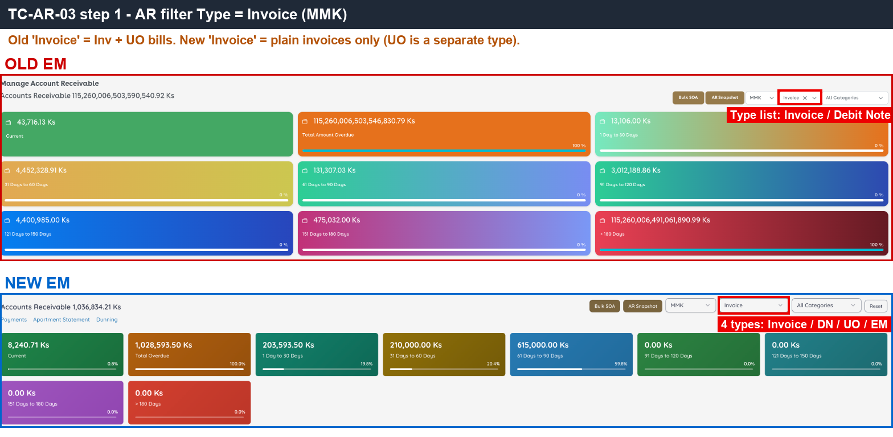
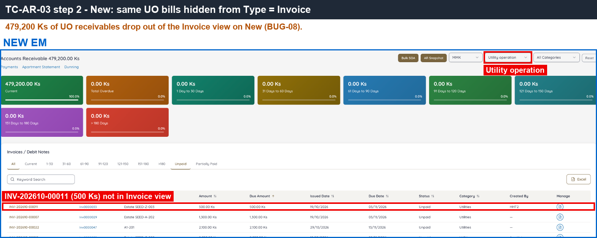
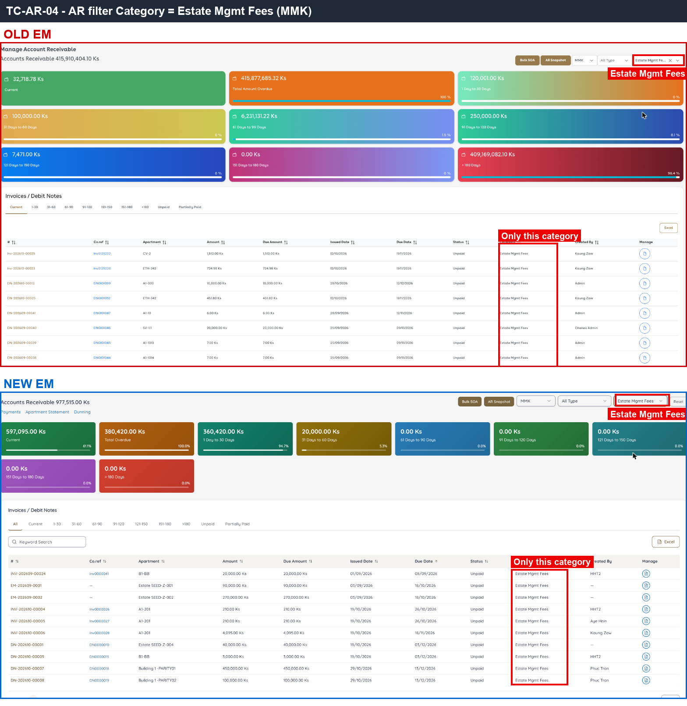
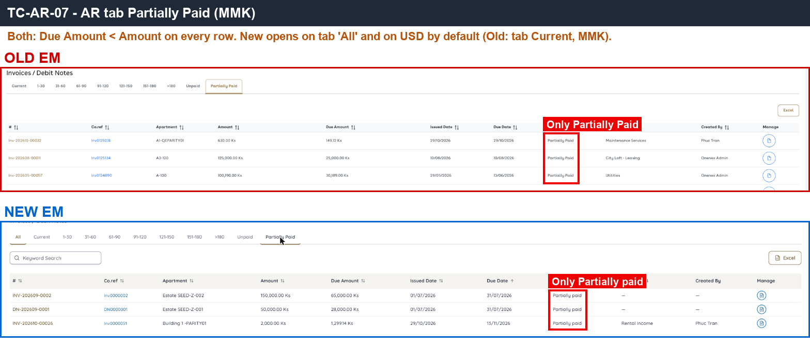
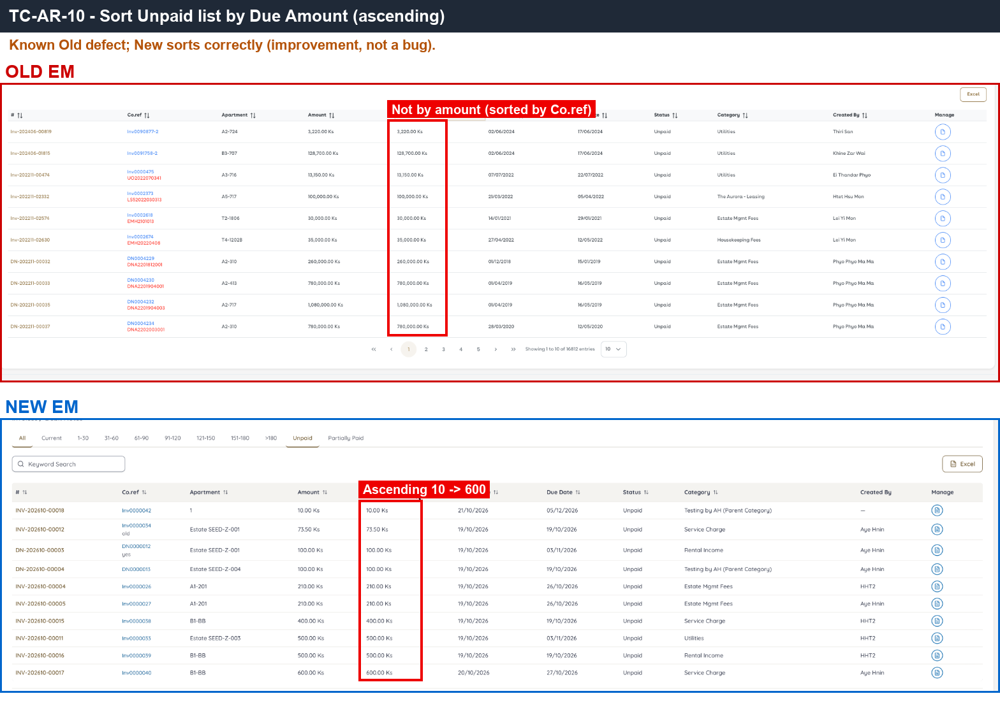
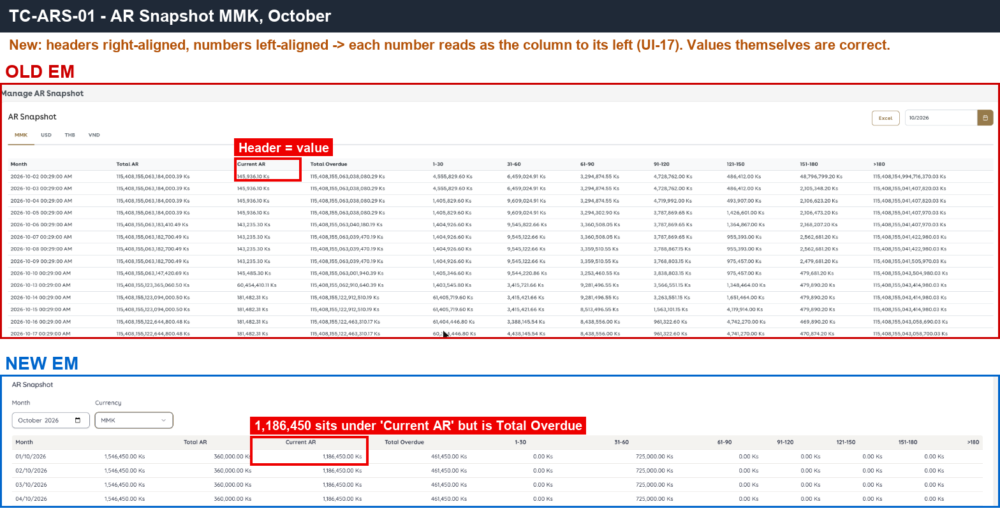
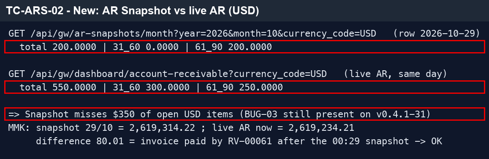

# 02 · AR, AR Snapshot & Bulk SOA — Sanity

[← Sanity index](../README.md) · [Bugs](../bugs.md)

**Test cases:** 12 · **Parity result:** ✅ 8 · ⚠️ 2 · ❌ 2

## Summary

| ID | Test case | Pri | Result | Bug / note |
|---|---|---|---|---|
| [SAN-AR-001](#-san-ar-001--ar-page-mmk-shows-9-cards-and-header-total--current--overdue) | ★ AR page (MMK) shows 9 cards and header Total = Current + Overdue | P1 | ✅ Match | — |
| [SAN-AR-002](#-san-ar-002--the-7-overdue-buckets-add-up-to-total-amount-overdue) | ★ The 7 overdue buckets add up to Total Amount Overdue | P1 | ✅ Match | — |
| [SAN-AR-003](#-san-ar-003--type--invoice-counts-both-regular-and-uo-invoices) | ★ Type = Invoice counts both regular and UO invoices | P1 | ❌ Bug | [BUG-08](../bugs.md#bug-08) |
| [SAN-AR-004](#-san-ar-004--category--estate-mgmt-fees-limits-cards-and-table-to-that-category) | ★ Category = Estate Mgmt Fees limits cards and table to that category | P1 | ✅ Match | — |
| [SAN-AR-011](#-san-ar-011--currency--usd-shows-only-usd-cards-and-rows) | ★ Currency = USD shows only USD cards and rows | P1 | ✅ Match | — |
| [SAN-AR-005](#-san-ar-005--tab-31-60-lists-only-invoices-3160-days-overdue-cards-do-not-change) | ★ Tab 31-60 lists only invoices 31–60 days overdue; cards do not change | P1 | ✅ Match | — |
| [SAN-AR-006](#-san-ar-006--tab-unpaid-lists-only-unpaid-invoices-of-every-due-date) | ★ Tab Unpaid lists only UNPAID invoices of every due date | P1 | ✅ Match | — |
| [SAN-AR-007](#-san-ar-007--tab-partially-paid-lists-only-partially_paid-invoices-with-due--amount) | ★ Tab Partially Paid lists only PARTIALLY_PAID invoices with Due < Amount | P1 | ✅ Match | — |
| [SAN-AR-008](#san-ar-008--bucket--bar--bucket--overdue--100-rounded-to-1-decimal) | Bucket % bar = bucket / Overdue × 100, rounded to 1 decimal | P2 | ✅ Match | — |
| [SAN-AR-010](#san-ar-010--sorting-by-due-amount-orders-rows-by-amount) | Sorting by Due Amount orders rows by amount | P3 | ⚠️ Differs | [Difference](../differences.md#san-ar-010) |
| [SAN-ARS-001](#-san-ars-001--ar-snapshot-mmk-has-one-row-per-day-with-total-ar--current--overdue) | ★ AR Snapshot (MMK) has one row per day with Total AR = Current + Overdue | P1 | ⚠️ Differs | [Difference](../differences.md#san-ars-001) · [UI-17](../bugs.md#ui-17) |
| [SAN-ARS-002](#san-ars-002--yesterdays-snapshot-row-matches-yesterdays-ar) | Yesterday's snapshot row matches yesterday's AR | P2 | ❌ Bug | [BUG-03](../bugs.md#bug-03) |

## Test cases

#### ★ SAN-AR-001 · AR page (MMK) shows 9 cards and header Total = Current + Overdue

| Priority | Suites | Automation | Status | Source |
|---|---|---|---|---|
| P1 | Sanity · Regression | Auto-UI | Active | EM Parity v2 (TC-AR-01), 2026-10-30 |

**Preconditions:**

1. Logged in to EM as an Admin user.

**Steps:**

1. Go to Accounts Receivable.
2. Select Currency = MMK.
3. Check the cards and the header Total.

**Expected result:**

1. 9 cards are shown.
2. Header Total = Current + Overdue.

**Parity result (build -31):**

| Old EM | New EM | Result |
|---|---|---|
| 9 cards. Header 115,408,155,122,226,340.38 ≠ Current+Overdue by 20 Ks (float) | 9 cards. 2,619,234.21 = 1,080,540.71 + 1,538,693.50. Default currency USD | ✅ Match |

**Evidence:**

-  — the 9 MMK cards and the header Total.

---

#### ★ SAN-AR-002 · The 7 overdue buckets add up to Total Amount Overdue

| Priority | Suites | Automation | Status | Source |
|---|---|---|---|---|
| P1 | Sanity · Regression | Auto-UI | Active | EM Parity v2 (TC-AR-02), 2026-10-30 |

**Preconditions:**

1. Logged in to EM as an Admin user.

**Steps:**

1. Go to Accounts Receivable, Currency = MMK.
2. Add the amounts of the 7 aging buckets.

**Expected result:**

1. The sum equals Total Amount Overdue.

**Parity result (build -31):**

| Old EM | New EM | Result |
|---|---|---|
| 7 buckets ≠ Overdue by 2 Ks at 10^17 (float) | 603,693.50 + 232,000 + 703,000 = 1,538,693.50 | ✅ Match |

**Evidence:**

-  — bucket amounts and Total Amount Overdue.

---

#### ★ SAN-AR-003 · Type = Invoice counts both regular and UO invoices

| Priority | Suites | Automation | Status | Source |
|---|---|---|---|---|
| P1 | Sanity · Regression | Auto-UI | Active | EM Parity v2 (TC-AR-03), 2026-10-30 |

**Preconditions:**

1. Logged in to EM as an Admin user.
2. Approved UO invoices with outstanding balance exist (read only).

**Steps:**

1. Go to Accounts Receivable, Currency = MMK.
2. Set Type = Invoice.
3. Look for UO invoices (Utilities rows, e.g. INV-202610-00011) in the cards and table.

**Expected result:**

1. Cards and table count both regular invoices and UO invoices.
2. UO invoices are listed under Type = Invoice.

**Parity result (build -31):**

| Old EM | New EM | Result |
|---|---|---|
| Type has only Invoice / Debit Note. Invoice includes UO invoices (Utilities rows) | Type has 4 values. Invoice does NOT include UO: 479,200 Ks of UO (e.g. INV-202610-00011) needs a separate 'Utility operation' filter | ❌ [BUG-08](../bugs.md#bug-08) · [EM-99](https://zeyalabs-team-a83df6me.atlassian.net/browse/EM-99) |

**Evidence:**

-  — Old has 2 Type values; New has 4.
-  — UO invoice INV-202610-00011 missing from New's 'Invoice' filter.
- [AR-03.gif](../gif/AR-03.gif) — the filter on both sides.

---

#### ★ SAN-AR-004 · Category = Estate Mgmt Fees limits cards and table to that category

| Priority | Suites | Automation | Status | Source |
|---|---|---|---|---|
| P1 | Sanity · Regression | Auto-UI | Active | EM Parity v2 (TC-AR-04), 2026-10-30 |

**Preconditions:**

1. Logged in to EM as an Admin user.

**Steps:**

1. Go to Accounts Receivable.
2. Set Category = Estate Mgmt Fees.

**Expected result:**

1. Cards and table count only the Estate Mgmt Fees category.

**Parity result (build -31):**

| Old EM | New EM | Result |
|---|---|---|
| Cards and table show only Estate Mgmt Fees (9 rows in tab Current) | Cards and table show only Estate Mgmt Fees (10 rows in tab All; includes EM-… and DN) | ✅ Match |

**Evidence:**

-  — cards and rows filtered to Estate Mgmt Fees.

---

#### ★ SAN-AR-011 · Currency = USD shows only USD cards and rows

| Priority | Suites | Automation | Status | Source |
|---|---|---|---|---|
| P1 | Sanity · Regression | Auto-UI | Active | EM Parity v2 (TC-AR-11), 2026-10-30 |

**Preconditions:**

1. Logged in to EM as an Admin user.

**Steps:**

1. Go to Accounts Receivable.
2. Select Currency = USD.

**Expected result:**

1. Cards and table show only USD documents.

**Parity result (build -31):**

| Old EM | New EM | Result |
|---|---|---|
| Switched to USD: cards and table USD only | USD is the default: $550, cards and table USD only | ✅ Match |

---

#### ★ SAN-AR-005 · Tab 31-60 lists only invoices 31–60 days overdue; cards do not change

| Priority | Suites | Automation | Status | Source |
|---|---|---|---|---|
| P1 | Sanity · Regression | Auto-UI | Active | EM Parity v2 (TC-AR-05), 2026-10-30 |

**Preconditions:**

1. Logged in to EM as an Admin user.

**Steps:**

1. Go to Accounts Receivable, note the cards.
2. Click tab 31-60.

**Expected result:**

1. The table lists only invoices 31–60 days overdue.
2. The cards do **not** change.

**Parity result (build -31):**

| Old EM | New EM | Result |
|---|---|---|
| Tab 31-60: 35–60 days overdue, cards unchanged | Tab 31-60: 42–52 days overdue, cards unchanged | ✅ Match |

---

#### ★ SAN-AR-006 · Tab Unpaid lists only UNPAID invoices of every due date

| Priority | Suites | Automation | Status | Source |
|---|---|---|---|---|
| P1 | Sanity · Regression | Auto-UI | Active | EM Parity v2 (TC-AR-06), 2026-10-30 |

**Preconditions:**

1. Logged in to EM as an Admin user.

**Steps:**

1. Go to Accounts Receivable.
2. Click tab Unpaid.

**Expected result:**

1. Only UNPAID invoices are listed, including not-yet-due (Current) ones.

**Parity result (build -31):**

| Old EM | New EM | Result |
|---|---|---|
| Only Unpaid, both future (28/11) and overdue due dates. 16,812 rows | Only Unpaid, both kinds of due date. 45 rows. Default sort Due Date ascending | ✅ Match |

---

#### ★ SAN-AR-007 · Tab Partially Paid lists only PARTIALLY_PAID invoices with Due < Amount

| Priority | Suites | Automation | Status | Source |
|---|---|---|---|---|
| P1 | Sanity · Regression | Auto-UI | Active | EM Parity v2 (TC-AR-07), 2026-10-30 |

**Preconditions:**

1. Logged in to EM as an Admin user.

**Steps:**

1. Go to Accounts Receivable.
2. Click tab Partially Paid.

**Expected result:**

1. Only PARTIALLY_PAID invoices are listed.
2. Each row has Due Amount < Amount.

**Parity result (build -31):**

| Old EM | New EM | Result |
|---|---|---|
| Only Partially Paid, Due < Amount (224 rows) | Only Partially paid, Due < Amount (3 rows) | ✅ Match |

**Evidence:**

-  — Partially Paid rows with Due < Amount.

---

#### SAN-AR-008 · Bucket % bar = bucket / Overdue × 100, rounded to 1 decimal

| Priority | Suites | Automation | Status | Source |
|---|---|---|---|---|
| P2 | Sanity · Regression | Auto-UI | Active | EM Parity v2 (TC-AR-08), 2026-10-30 |

**Preconditions:**

1. Logged in to EM as an Admin user.

**Steps:**

1. Go to Accounts Receivable, Currency = MMK.
2. Read the % bar of one bucket (e.g. 1-30).

**Expected result:**

1. % = round(bucket / Total Amount Overdue × 100, 1).

**Parity result (build -31):**

| Old EM | New EM | Result |
|---|---|---|
| % rounds to 0% (the 10^17 figure absorbs everything) | 1-30 = 39.2% = 603,693.50 / 1,538,693.50 | ✅ Match |

**Evidence:**

-  — the 1-30 bucket % and amounts.

---

#### SAN-AR-010 · Sorting by Due Amount orders rows by amount

| Priority | Suites | Automation | Status | Source |
|---|---|---|---|---|
| P3 | Sanity · Regression | Auto-UI | Active | EM Parity v2 (TC-AR-10), 2026-10-30 |

**Preconditions:**

1. Logged in to EM as an Admin user.

**Steps:**

1. Go to Accounts Receivable.
2. Click the Due Amount column header to sort.

**Expected result:**

1. Rows are ordered by Due Amount numerically. (Old EM sorts by Co.ref instead; New's numeric sort is the intended behaviour.)

**Parity result (build -31):**

| Old EM | New EM | Result |
|---|---|---|
| Due Amount sort actually follows Co.ref (3,220 → 128,700 → 13,150...) | Sorts by amount 10 → 600 (New fixes the old issue) | ⚠️ [Differs](../differences.md#san-ar-010) |

**Evidence:**

-  — Old's order follows Co.ref; New's follows the amount.
- [AR-10.gif](../gif/AR-10.gif) — sorting on both sides.

---

#### ★ SAN-ARS-001 · AR Snapshot (MMK) has one row per day with Total AR = Current + Overdue

| Priority | Suites | Automation | Status | Source |
|---|---|---|---|---|
| P1 | Sanity · Regression | Auto-UI | Active | EM Parity v2 (TC-ARS-01), 2026-10-30 |

**Preconditions:**

1. Logged in to EM as an Admin user.

**Steps:**

1. Go to Accounts Receivable > AR Snapshot.
2. Select Currency = MMK.
3. Check the rows and their totals.

**Expected result:**

1. There is one row per day.
2. On each row, Total AR = Current + Overdue.

**Parity result (build -31):**

| Old EM | New EM | Result |
|---|---|---|
| 1 row/day with time 00:29, tabs per currency. Some days missing (11, 12/10). Row 28/10 Total jumps to 195,408,… (Old float issue) | 1 row/day for the whole month, currency chosen from a dropdown, default USD. Extra per-apartment reconciliation table. Column headers misaligned with values → UI-17 | ⚠️ [Differs](../differences.md#san-ars-001) |

**Evidence:**

-  — one row per day on both sides; New's headers are offset from the values.

---

#### SAN-ARS-002 · Yesterday's snapshot row matches yesterday's AR

| Priority | Suites | Automation | Status | Source |
|---|---|---|---|---|
| P2 | Sanity · Regression | Auto-UI+API | Active | EM Parity v2 (TC-ARS-02), 2026-10-30 |

**Preconditions:**

1. Logged in to EM as an Admin user.
2. USD invoices with outstanding balance in the 31-60 and 61-90 buckets.

**Steps:**

1. Go to Accounts Receivable, Currency = USD, note the totals per aging bucket.
2. Go to AR Snapshot, Currency = USD.
3. Compare the row for yesterday with the AR totals.

**Expected result:**

1. The snapshot totals equal the AR totals for that day (USD: $550 = 31-60 $300 + 61-90 $250).

**Parity result (build -31):**

| Old EM | New EM | Result |
|---|---|---|
| (no AR figure from yesterday to compare) | USD: snapshot 29/10 = $200, actual AR = $550 → BUG-03 still present. MMK matches (80.01 off because RV-00061 was paid after the snapshot time) | ❌ [BUG-03](../bugs.md#bug-03) · [EM-95](https://zeyalabs-team-a83df6me.atlassian.net/browse/EM-95) |

**Evidence:**

-  — API response on New: snapshot 29/10 ($200) next to the actual AR ($550).
- [ARS-02.gif](../gif/ARS-02.gif) — the comparison on New.

---

