# 03 · Invoices / Debit Note — Sanity

[← Sanity index](../README.md) · [Bugs](../bugs.md)

**Test cases:** 13 · **Parity result:** ✅ 7 · ⚠️ 0 · ❌ 6

## Summary

| ID | Test case | Pri | Result | Bug / note |
|---|---|---|---|---|
| [SAN-INV-001](#-san-inv-001--create-invoice-with-exclusive-tax-and-10-discount--draft-grand-total-283500) | ★ Create invoice with exclusive tax and 10% discount — draft Grand Total 2,835.00 | P1 | ✅ Match | — |
| [SAN-INV-002](#-san-inv-002--invoice-line-shows-disc-price-as-discounted-unit-price-and-total-before-tax) | ★ Invoice line shows Disc. Price as discounted unit price and Total before tax | P1 | ❌ Bug | [BUG-23](../bugs.md#bug-23) |
| [SAN-INV-003](#-san-inv-003--create-invoice-with-inclusive-tax--grand-total-210000-tax-10000) | ★ Create invoice with inclusive tax — Grand Total 2,100.00, tax 100.00 | P1 | ✅ Match | Line Total column: [BUG-23](../bugs.md#bug-23) |
| [SAN-INV-004](#san-inv-004--discount-100-is-rejected--discount-field-is-cleared-max-99) | Discount 100% is rejected — Discount field is cleared (max 99%) | P1 | ❌ Bug | [BUG-22](../bugs.md#bug-22) |
| [SAN-INV-005](#san-inv-005--discount-amount-equal-to-the-gross-price-is-rejected-on-a-non-inclusive-line) | Discount amount equal to the gross price is rejected on a non-inclusive line | P2 | ❌ Bug | [BUG-22](../bugs.md#bug-22) |
| [SAN-INV-006](#san-inv-006--invoice-date-before-the-1st-of-the-previous-month-cannot-be-used) | Invoice date before the 1st of the previous month cannot be used | P1 | ✅ Match | — |
| [SAN-INV-007](#-san-inv-007--payment-term-30-days--due-date-is-invoice-date--30-days) | ★ Payment term 30 days — Due Date is invoice date + 30 days | P1 | ✅ Match | New has no default Payment Terms ([D-03](../differences.md#d-03)) |
| [SAN-INV-008](#san-inv-008--unit-0-is-rejected-with-the-selected-unit-is-invalid) | Unit 0 is rejected with 'The selected Unit is invalid.' | P1 | ✅ Match | — |
| [SAN-INV-011](#-san-inv-011--approving-an-already-approved-invoice-from-a-second-tab-shows-already-approved) | ★ Approving an already approved invoice from a second tab shows 'already approved' | P1 | ❌ Bug | [BUG-26](../bugs.md#bug-26) |
| [SAN-INV-013](#san-inv-013--debit-note-2--1234567--unit-price-limited-to-2-decimals-total-246912) | Debit Note 2 × 1,234.567 — unit price limited to 2 decimals, Total 2,469.12 | P2 | ❌ Bug | [BUG-01](../bugs.md#bug-01) |
| [SAN-INV-014](#-san-inv-014--approve-debit-note--number-dn-yyyymm-nnnnn-status-unpaid-soa-row-debit-note) | ★ Approve Debit Note — number DN-YYYYMM-NNNNN, status Unpaid, S.O.A row "Debit Note" | P1 | ✅ Match | — |
| [SAN-INV-015](#san-inv-015--invoice-list-last-30-days-shows-a-totals-row-with-total-paid-and-due) | Invoice list (Last 30 Days) shows a Totals row with Total, Paid and Due | P1 | ❌ Bug | [BUG-10](../bugs.md#bug-10) |
| [SAN-INV-016](#san-inv-016--invoice-dated-last-month-and-approved-this-month-uses-last-months-yyyymm-in-its-number) | Invoice dated last month and approved this month uses last month's YYYYMM in its number | P2 | ✅ Match | — |

## Test cases

#### ★ SAN-INV-001 · Create invoice with exclusive tax and 10% discount — draft Grand Total 2,835.00

| Priority | Suites | Automation | Status | Source |
|---|---|---|---|---|
| P1 | Sanity · Regression | Auto-UI | Active | EM Parity v2 (TC-INV-01), 2026-10-30 |

**Preconditions:**

1. Logged in to EM as an Admin user.
2. Test apartment exists: Old `A1-QEPAIR01`, New `Building 1 -QEPAIR01`.

**Test data:**

1. Line (case A): Unit 3, Gross Price 1,000, Discount 10%, Tax 5% Exclusive.

**Steps:**

1. Note the Inv/DN draft count chip in the top bar.
2. Go to Invoices / Debit Note, click [Add Invoice].
3. Select the test apartment and a Payment Terms value (New has no default, see [D-03](../differences.md#d-03)).
4. Enter the line from the test data and click outside each field.
5. Click [Create].

**Expected result:**

1. The draft page opens.
2. Gross total 3,000.00, discount 300.00, tax 135.00, Grand Total **2,835.00**.
3. The Inv/DN draft chip increases by 1.

**Parity result (build -31):**

| Old EM | New EM | Result |
|---|---|---|
| Grand 2,835.00; chip Inv/DN 34→35 | Grand 2,835.00; chip 48→49 | ✅ Match |

**Evidence:**

- 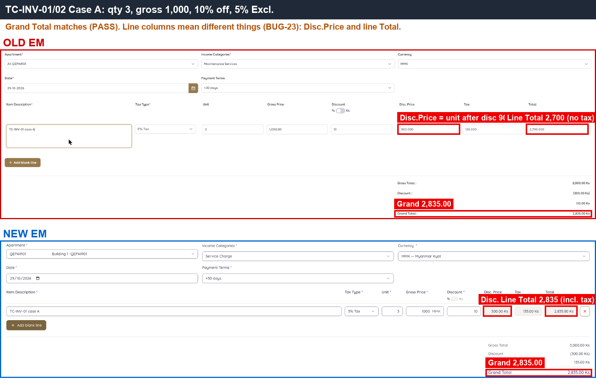 — Grand Total 2,835.00 on both sides.
- 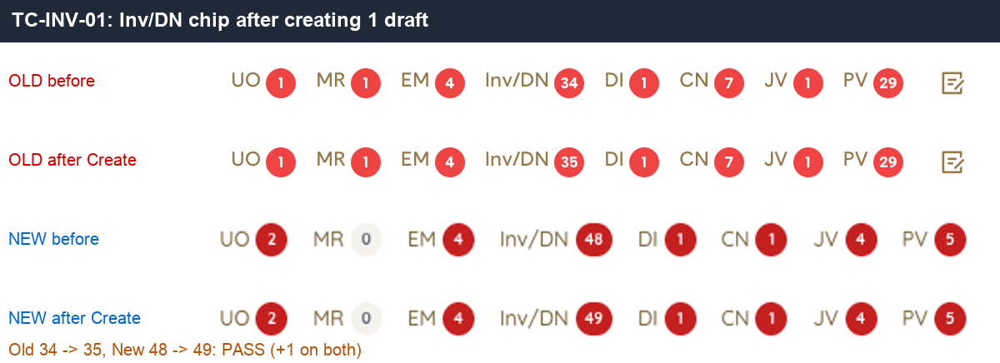 — Inv/DN chip increased by one after Create.

---

#### ★ SAN-INV-002 · Invoice line shows Disc. Price as discounted unit price and Total before tax

| Priority | Suites | Automation | Status | Source |
|---|---|---|---|---|
| P1 | Sanity · Regression | Auto-UI | Active | EM Parity v2 (TC-INV-02), 2026-10-30 |

**Preconditions:**

1. Logged in to EM as an Admin user.
2. Test apartment exists: Old `A1-QEPAIR01`, New `Building 1 -QEPAIR01`.

**Test data:**

1. Line (case A): Unit 3, Gross Price 1,000, Discount 10%, Tax 5% Exclusive.

**Steps:**

1. Go to Invoices / Debit Note, click [Add Invoice].
2. Enter the line from the test data and click outside each field.
3. Read the line columns Disc. Price, Tax and Total, and the Grand Total.

**Expected result:**

1. Disc. Price = unit price after discount: **900**.
2. Line Tax = 135.
3. Line Total = total before tax: **2,700**.
4. Grand Total = 2,835.00.

**Parity result (build -31):**

| Old EM | New EM | Result |
|---|---|---|
| Disc. Price = discounted unit price 900; line Total 2,700 (before tax) | Disc. Price = discount amount 300; line Total 2,835 (tax included). Grand Total equal | ❌ [BUG-23](../bugs.md#bug-23) |

**Evidence:**

-  — Disc. Price and Total columns: same header, different meaning; Grand Total 2,835 on both sides.

---

#### ★ SAN-INV-003 · Create invoice with inclusive tax — Grand Total 2,100.00, tax 100.00

| Priority | Suites | Automation | Status | Source |
|---|---|---|---|---|
| P1 | Sanity · Regression | Auto-UI | Active | EM Parity v2 (TC-INV-03), 2026-10-30 |

**Preconditions:**

1. Logged in to EM as an Admin user.
2. Test apartment exists: Old `A1-QEPAIR01`, New `Building 1 -QEPAIR01`.

**Test data:**

1. Line (case B): Unit 2, Gross Price 1,050, Tax 5% Inclusive, no discount.

**Steps:**

1. Go to Invoices / Debit Note, click [Add Invoice].
2. Select the test apartment and Payment Terms.
3. Enter the line from the test data and click [Create].

**Expected result:**

1. Tax 100.00 (2 × (1,050 − 1,000)).
2. Grand Total **2,100.00**.
3. Line Total 2,000 (before tax).

**Parity result (build -31):**

| Old EM | New EM | Result |
|---|---|---|
| Grand 2,100, tax 100; line Total 2,000 | Grand 2,100, tax 100; line Total 2,100 (line column meaning: BUG-23) | ✅ Match |

**Evidence:**

- 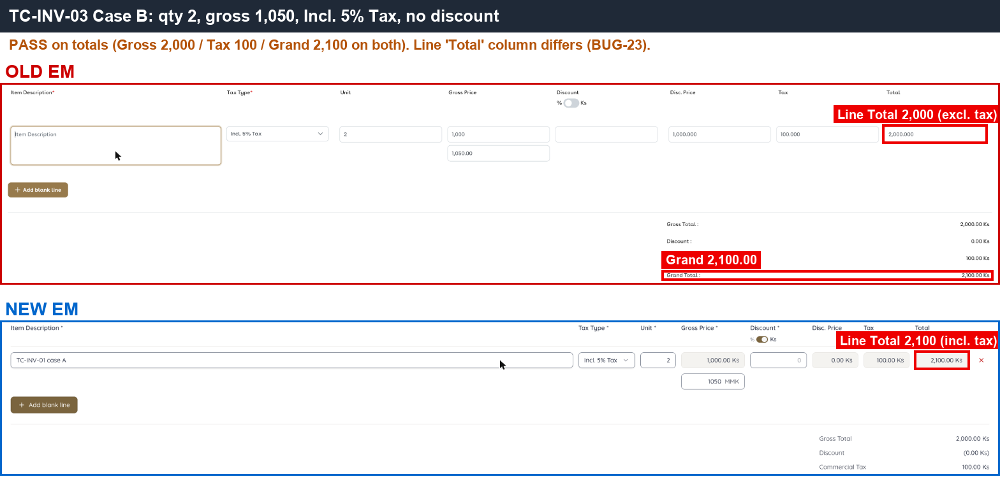 — Grand Total 2,100 and tax 100 on both sides.

---

#### SAN-INV-004 · Discount 100% is rejected — Discount field is cleared (max 99%)

| Priority | Suites | Automation | Status | Source |
|---|---|---|---|---|
| P1 | Sanity · Regression | Auto-UI | Active | EM Parity v2 (TC-INV-04), 2026-10-30 |

**Preconditions:**

1. Logged in to EM as an Admin user.
2. Test apartment exists: Old `A1-QEPAIR01`, New `Building 1 -QEPAIR01`.

**Test data:**

1. Line: Unit 3, Gross Price 1,000, Discount 10%, Tax 5% Exclusive.

**Steps:**

1. Go to Invoices / Debit Note, click [Add Invoice].
2. Enter the line from the test data.
3. Change Discount % from 10 to 100 and click outside.

**Expected result:**

1. The Discount field is cleared (maximum is 99%).
2. No generic error dialog is shown; if a message is shown it states the real reason (discount cannot exceed 99%).

**Parity result (build -31):**

| Old EM | New EM | Result |
|---|---|---|
| Field cleared (max 99%) | Keeps 100; dialog 'Could not calculate the total / ERR_UNKNOWN' (API 422) | ❌ [BUG-22](../bugs.md#bug-22) · [EM-112](https://zeyalabs-team-a83df6me.atlassian.net/browse/EM-112) |

**Evidence:**

- 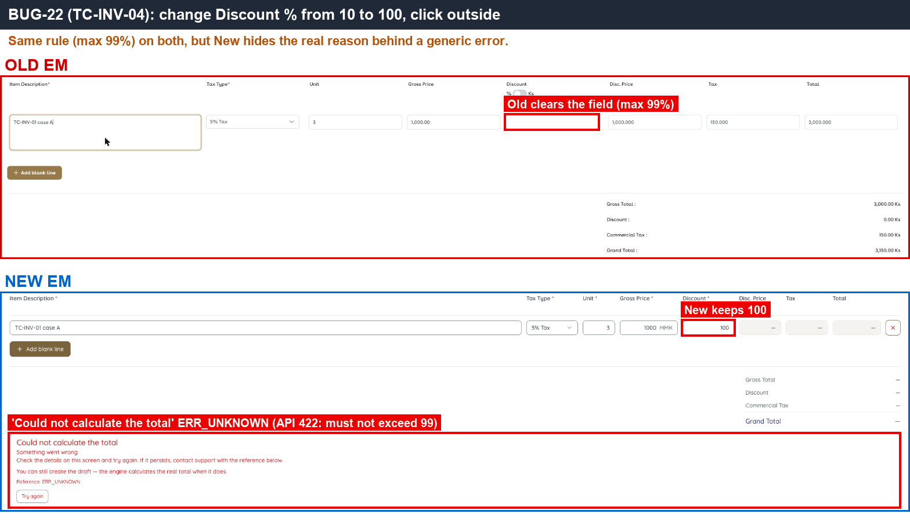 — New shows the generic error dialog instead of clearing the field.
- [BUG-22.gif](../gif/BUG-22.gif)

---

#### SAN-INV-005 · Discount amount equal to the gross price is rejected on a non-inclusive line

| Priority | Suites | Automation | Status | Source |
|---|---|---|---|---|
| P2 | Sanity · Regression | Auto-UI | Active | EM Parity v2 (TC-INV-05), 2026-10-30 |

**Preconditions:**

1. Logged in to EM as an Admin user.
2. Test apartment exists: Old `A1-QEPAIR01`, New `Building 1 -QEPAIR01`.

**Test data:**

1. Line: Unit 1, Gross Price 1,000 Ks, non-inclusive tax.
2. Discount amount 1,000 Ks (= gross), then 999 Ks.

**Steps:**

1. Go to Invoices / Debit Note, click [Add Invoice].
2. Enter the line and set Discount amount = 1,000 Ks, click outside.
3. Change Discount amount to 999 Ks, click outside.

**Expected result:**

1. Discount 1,000 Ks (= gross) is cleared from the field.
2. Discount 999 Ks is accepted and the total is calculated.

**Parity result (build -31):**

| Old EM | New EM | Result |
|---|---|---|
| Discount 1,000 Ks = gross: field cleared; 999 accepted | Keeps 1000 + ERR_UNKNOWN; 999 accepted | ❌ [BUG-22](../bugs.md#bug-22) · [EM-112](https://zeyalabs-team-a83df6me.atlassian.net/browse/EM-112) |

**Evidence:**

- 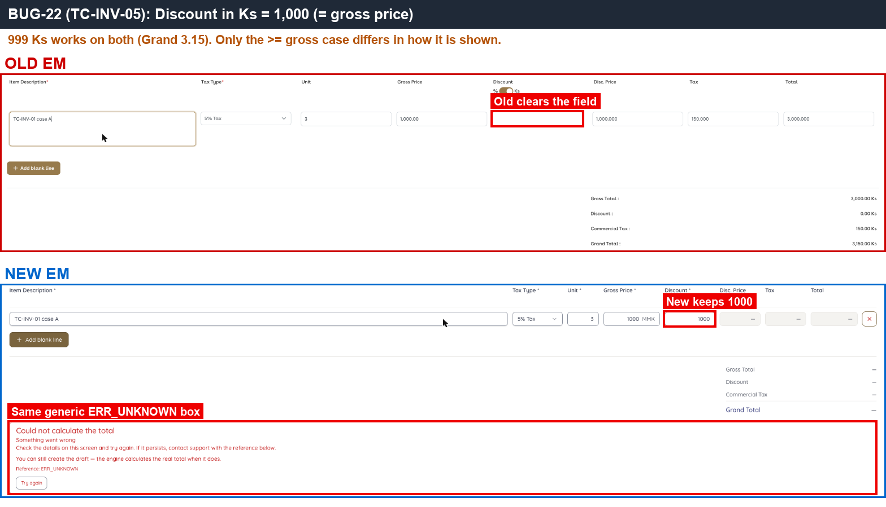 — same generic error for a discount amount equal to the price.

---

#### SAN-INV-006 · Invoice date before the 1st of the previous month cannot be used

| Priority | Suites | Automation | Status | Source |
|---|---|---|---|---|
| P1 | Sanity · Regression | Auto-UI | Active | EM Parity v2 (TC-INV-06), 2026-10-30 |

**Preconditions:**

1. Logged in to EM as an Admin user.
2. Test apartment exists: Old `A1-QEPAIR01`, New `Building 1 -QEPAIR01`.

**Test data:**

1. Today 29/10/2026; invoice date 15/08/2026 (two months back).

**Steps:**

1. Go to Invoices / Debit Note, click [Add Invoice].
2. Try to set the Date to 15/08/2026 (calendar click, or typing).
3. Fill a valid line and click [Create].

**Expected result:**

1. The date cannot be used: allowed range is from the 1st of the previous month (01/09/2026) to today.
2. No draft is created with date 15/08/2026.

**Parity result (build -31):**

| Old EM | New EM | Result |
|---|---|---|
| Calendar: clicking 15/08 does not change the date | Typing 15/08 is accepted, but Create is blocked with 'must be 01/09/2026 or later' | ✅ Match |

**Evidence:**

- 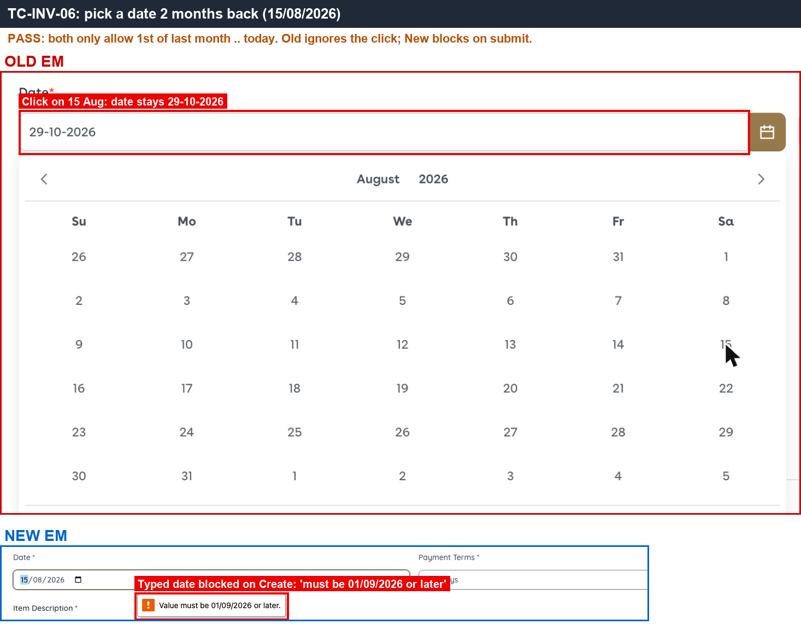 — Old calendar ignores 15/08; New blocks Create with the date-range message.

---

#### ★ SAN-INV-007 · Payment term 30 days — Due Date is invoice date + 30 days

| Priority | Suites | Automation | Status | Source |
|---|---|---|---|---|
| P1 | Sanity · Regression | Auto-UI | Active | EM Parity v2 (TC-INV-07), 2026-10-30 |

**Preconditions:**

1. Logged in to EM as an Admin user.
2. Test apartment exists: Old `A1-QEPAIR01`, New `Building 1 -QEPAIR01`.

**Test data:**

1. Invoice date 01/10/2026, Payment Terms 30 days.
2. Line (case A): Unit 3, Gross Price 1,000, Discount 10%, Tax 5% Exclusive (Grand Total 2,835).

**Steps:**

1. Go to Invoices / Debit Note, click [Add Invoice].
2. Select the test apartment, set Date 01/10/2026 and Payment Terms 30 days.
3. Enter the line and click [Create].

**Expected result:**

1. Due Date = **31/10/2026**.

**Parity result (build -31):**

| Old EM | New EM | Result |
|---|---|---|
| 01/10 + 30 → Due 31/10 (Inv draft, 2,835) | 01/10 + 30 → Due 31/10 (draft #129, 2,835) | ✅ Match |

**Evidence:**

- 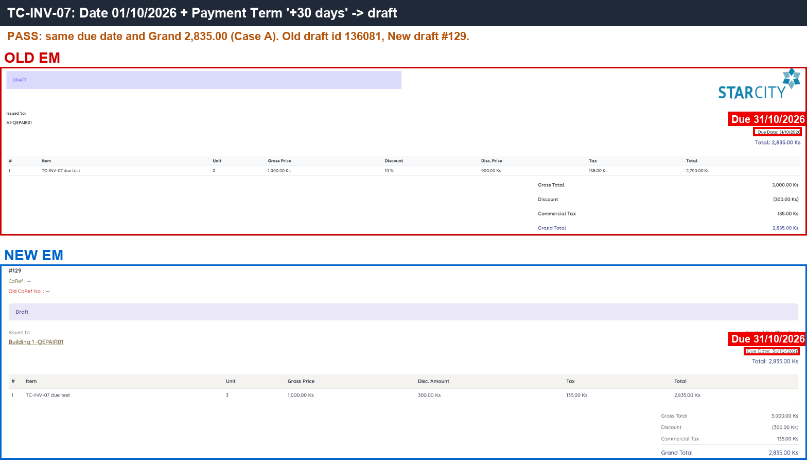 — Due Date 31/10 on both sides.

---

#### SAN-INV-008 · Unit 0 is rejected with 'The selected Unit is invalid.'

| Priority | Suites | Automation | Status | Source |
|---|---|---|---|---|
| P1 | Sanity · Regression | Auto-UI | Active | EM Parity v2 (TC-INV-08), 2026-10-30 |

**Preconditions:**

1. Logged in to EM as an Admin user.
2. Test apartment exists: Old `A1-QEPAIR01`, New `Building 1 -QEPAIR01`.

**Test data:**

1. Line: Unit 0, Gross Price 1,000.

**Steps:**

1. Go to Invoices / Debit Note, click [Add Invoice].
2. Enter the line with Unit 0 and click [Create].

**Expected result:**

1. Validation error 'The selected Unit is invalid.'
2. No draft is created.

**Parity result (build -31):**

| Old EM | New EM | Result |
|---|---|---|
| 'The selected Unit is invalid.' | Same message, plus an ERR_UNKNOWN dialog | ✅ Match |

**Evidence:**

- 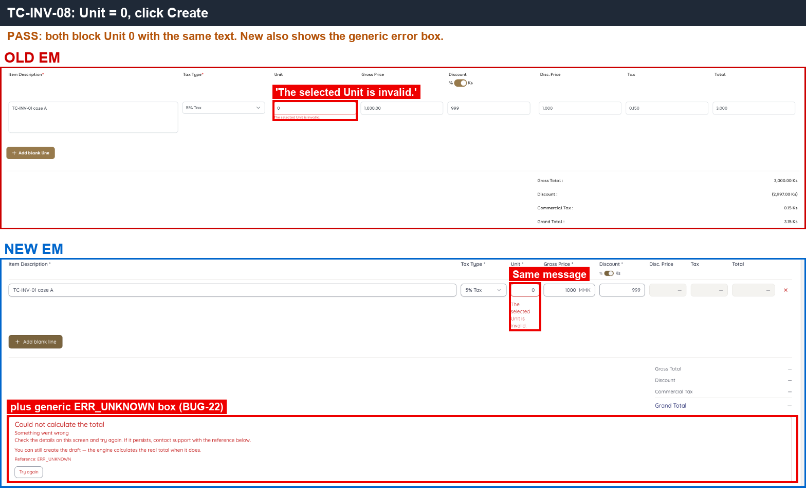 — same validation text on both sides; New also shows the ERR_UNKNOWN dialog.

---

#### ★ SAN-INV-011 · Approving an already approved invoice from a second tab shows 'already approved'

| Priority | Suites | Automation | Status | Source |
|---|---|---|---|---|
| P1 | Sanity · Regression | Auto-UI | Active | EM Parity v2 (TC-INV-11), 2026-10-30 |

**Preconditions:**

1. Logged in to EM as an Admin user.
2. One invoice draft for the test apartment, opened in two browser tabs.

**Steps:**

1. In tab 1, click [Approve].
2. In tab 2 (page not reloaded), click [Approve].

**Expected result:**

1. Tab 2 shows 'Invoice has been already approved.'
2. No second approval: only one journal entry and one invoice number exist.

**Parity result (build -31):**

| Old EM | New EM | Result |
|---|---|---|
| Tab 2: 'Invoice has been already approved.' | Tab 2: no message; only one journal entry (data is safe) | ❌ [BUG-26](../bugs.md#bug-26) · [EM-113](https://zeyalabs-team-a83df6me.atlassian.net/browse/EM-113) |

**Evidence:**

- 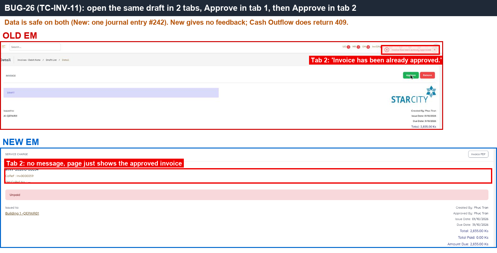 — Old message in the top corner; New shows no message.
- [BUG-26.gif](../gif/BUG-26.gif)

---

#### SAN-INV-016 · Invoice dated last month and approved this month uses last month's YYYYMM in its number

| Priority | Suites | Automation | Status | Source |
|---|---|---|---|---|
| P2 | Sanity · Regression | Auto-UI | Active | EM Parity v2 (TC-INV-16), 2026-10-30 |

**Preconditions:**

1. Logged in to EM as an Admin user.
2. Test apartment exists: Old `A1-QEPAIR01`, New `Building 1 -QEPAIR01`.

**Test data:**

1. Invoice date 30/09/2026, amount 105; approval date 29/10/2026.

**Steps:**

1. Go to Invoices / Debit Note, click [Add Invoice].
2. Set Date 30/09/2026, enter a line of 105 and click [Create].
3. Click [Approve].

**Expected result:**

1. The number uses the invoice-date month: `Inv-202609-NNNNN`.

**Parity result (build -31):**

| Old EM | New EM | Result |
|---|---|---|
| Inv-202609-00027 (date 30/09, approved 29/10) | INV-202609-00026 (date 30/09, approved 29/10) | ✅ Match |

**Evidence:**

- 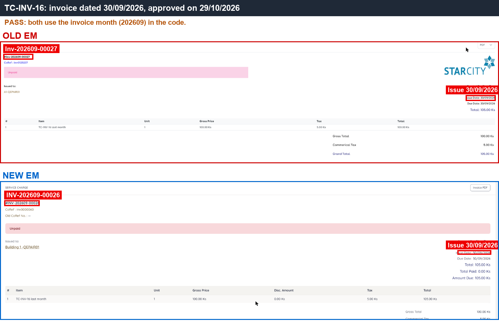 — both numbers use 202609.

---

#### SAN-INV-013 · Debit Note 2 × 1,234.567 — unit price limited to 2 decimals, Total 2,469.12

| Priority | Suites | Automation | Status | Source |
|---|---|---|---|---|
| P2 | Sanity · Regression | Auto-UI+API | Active | EM Parity v2 (TC-INV-13), 2026-10-30 |

**Preconditions:**

1. Logged in to EM as an Admin user.
2. Test apartment exists: Old `A1-QEPAIR01`, New `Building 1 -QEPAIR01`.

**Test data:**

1. Debit Note line: Unit 2, Gross Price `1234.567`, No Tax.

**Steps:**

1. Go to Invoices / Debit Note, click [Add Debit Note].
2. Select the test apartment, enter the line from the test data, click outside.
3. Read the Gross Price field and the Total.
4. Click [Create].
5. Read the stored total of the draft (API response of the debit note).

**Expected result:**

1. Gross Price is limited to 2 decimals: **1,234.56**.
2. Total **2,469.12**, and the stored total has 2 decimals (no hidden decimals).

**Parity result (build -31):**

| Old EM | New EM | Result |
|---|---|---|
| Field cut to 1,234.56; Total 2,469.12 (DN-202610-00016) | Keeps 1234.567; shows 2,469.13, stores 2469.1340 (DN-202610-00009) | ❌ [BUG-01](../bugs.md#bug-01) · [EM-93](https://zeyalabs-team-a83df6me.atlassian.net/browse/EM-93) |

**Retest (build -37):** BUG-01 / [EM-93](https://zeyalabs-team-a83df6me.atlassian.net/browse/EM-93) **not fixed**. A 3-decimal price is now refused ('Amount can have at most 2 decimal places.'), but discount, tax and total are still stored with 4 decimals. An invoice with a 2-decimal price (Unit 3 × 1000.52, Discount 10%, Tax 5% → INV-202610-00046, shown 2,836.47, stored 2836.4742) paid with exactly the displayed 2,836.47 (RV-00070) stays PARTIALLY_PAID with 0.0042 due, and Make Payment keeps listing it as 'Partially paid, Due 0.00 Ks'.

**Evidence:**

- 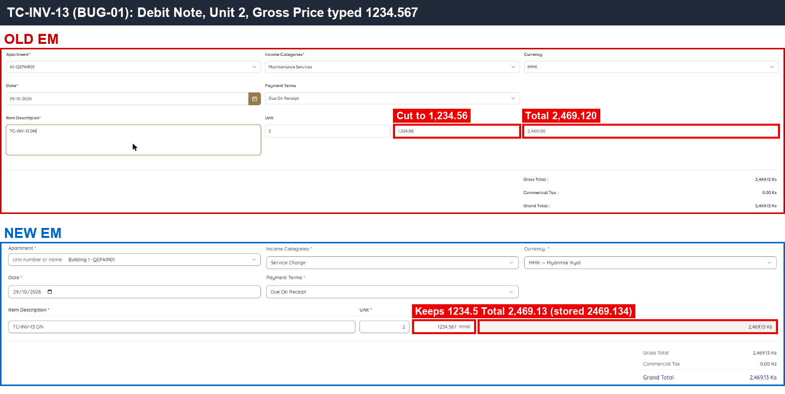 — Old cuts the price to 1,234.56; New keeps 3 decimals.
- 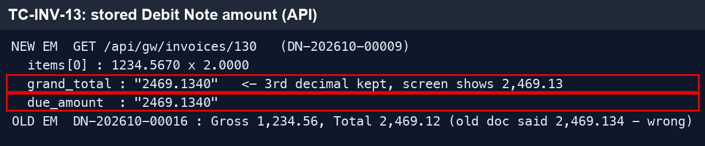 — API response of New: total stored as 2469.1340.
- [BUG-01-DN.gif](../gif/BUG-01-DN.gif)
- 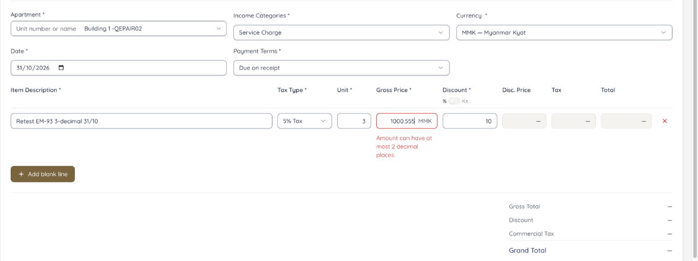 — retest -37: 3-decimal price now refused under the field.

---

#### ★ SAN-INV-014 · Approve Debit Note — number DN-YYYYMM-NNNNN, status Unpaid, S.O.A row "Debit Note"

| Priority | Suites | Automation | Status | Source |
|---|---|---|---|---|
| P1 | Sanity · Regression | Auto-UI | Active | EM Parity v2 (TC-INV-14), 2026-10-30 |

**Preconditions:**

1. Logged in to EM as an Admin user.
2. Debit Note draft from SAN-INV-013 exists.

**Steps:**

1. Open the Debit Note draft, click [Approve].
2. Check number, Co.ref and status.
3. Open the apartment's S.O.A.

**Expected result:**

1. Number `DN-YYYYMM-NNNNN` and a Co.ref are assigned.
2. Status **Unpaid**.
3. The S.O.A shows a "Debit Note" row.

**Parity result (build -31):**

| Old EM | New EM | Result |
|---|---|---|
| DN-202610-00016 / DN0101063, Unpaid | DN-202610-00009 / DN0000020, Unpaid | ✅ Match |

**Evidence:**

- 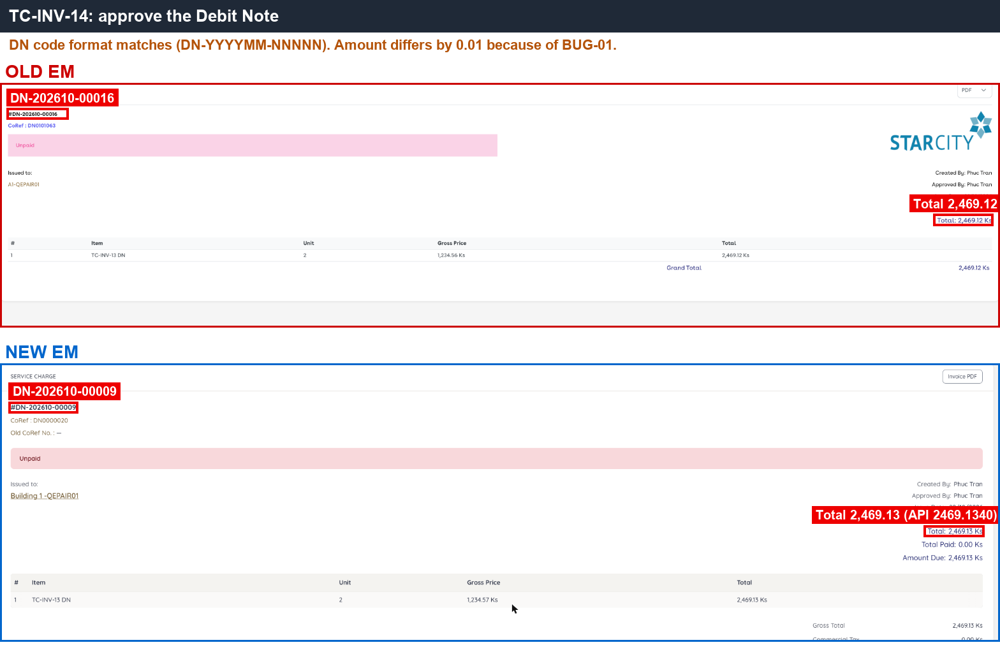 — DN number, Co.ref and Unpaid status on both sides.

---

#### SAN-INV-015 · Invoice list (Last 30 Days) shows a Totals row with Total, Paid and Due

| Priority | Suites | Automation | Status | Source |
|---|---|---|---|---|
| P1 | Sanity · Regression | Auto-UI | Active | EM Parity v2 (TC-INV-15), 2026-10-30 |

**Preconditions:**

1. Logged in to EM as an Admin user.
2. The test apartment has 3 approved documents in the last 30 days (same on both sides).

**Steps:**

1. Go to Invoices / Debit Note.
2. Filter Last 30 Days and the test apartment.
3. Scroll to the bottom of the list.

**Expected result:**

1. A Totals row is shown: sum of Total, Paid and Due of the rows on the current page (Old: 8,140.67 / 2,836.55 / 5,304.12).
2. Due = Total − Paid.

**Parity result (build -31):**

| Old EM | New EM | Result |
|---|---|---|
| Totals row 8,140.67 / 2,836.55 / 5,304.12 | No Totals row | ❌ [BUG-10](../bugs.md#bug-10) · [EM-100](https://zeyalabs-team-a83df6me.atlassian.net/browse/EM-100) |

**Evidence:**

- 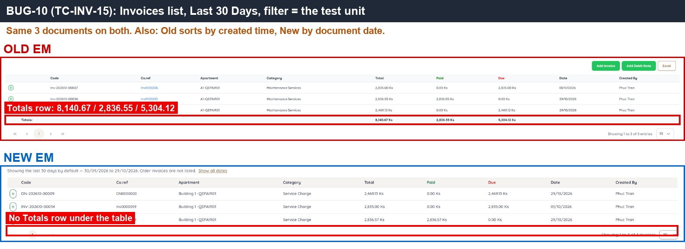 — Old Totals row under the table; nothing under the New table.

---
