# 04 · Make Payment — Sanity

[← Sanity index](../README.md) · [Bugs](../bugs.md)

**Test cases:** 12 · **Parity result:** ✅ 3 · ⚠️ 2 · ❌ 7

## Summary

| ID | Test case | Pri | Result | Bug / note |
|---|---|---|---|---|
| [SAN-MP-003](#-san-mp-003--received--total-due--500--all-rows-paid-in-full-and-credit-to-wallet-50000-shown) | ★ Received = total due + 500 — all rows paid in full and Credit To Wallet 500.00 shown | P1 | ❌ Bug | [BUG-01](../bugs.md#bug-01) |
| [SAN-MP-004](#-san-mp-004--pay-amount-above-the-rows-due-is-pulled-back-to-the-due-amount) | ★ Pay amount above the row's due is pulled back to the due amount | P1 | ⚠️ Differs | New blocks on Confirm instead of auto-correcting; see also [D-06](../differences.md#d-06) |
| [SAN-MP-005](#-san-mp-005--partial-payment-400-by-cash--invoice-partially-paid-rv-created-account-400) | ★ Partial payment 400 by Cash — invoice Partially Paid, RV created, account +400 | P1 | ✅ Match | Due differs by 0.02 because of [BUG-01](../bugs.md#bug-01) |
| [SAN-MP-006](#-san-mp-006--pay-the-remaining-balance--invoice-becomes-paid-with-balance-due-000) | ★ Pay the remaining balance — invoice becomes PAID with Balance Due 0.00 | P1 | ❌ Bug | [BUG-01](../bugs.md#bug-01) |
| [SAN-MP-007](#-san-mp-007--overpayment-of-500--all-open-invoices-paid-and-50000-credited-to-the-wallet) | ★ Overpayment of 500 — all open invoices PAID and 500.00 credited to the wallet | P1 | ❌ Bug | [BUG-01](../bugs.md#bug-01) · [BUG-14](../bugs.md#bug-14) |
| [SAN-MP-008](#-san-mp-008--pay-by-cheque-uncleared--rv-created-and-the-bank-account-balance-still-increases) | ★ Pay by Cheque (Uncleared) — RV created and the bank account balance still increases | P1 | ⚠️ Differs | New adds a 'Cheque status' field |
| [SAN-MP-009](#-san-mp-009--mmk-payment-without-pay-in---received-in-lists-only-mmk-accounts) | ★ MMK payment without Pay in $ — Received In lists only MMK accounts | P1 | ✅ Match | — |
| [SAN-MP-010](#-san-mp-010--pay-by-wallet--received-locked-to-wallet-balance-rows-limited-wp-created) | ★ Pay by Wallet — Received locked to wallet balance, rows limited, WP created | P1 | ❌ Bug | [BUG-19](../bugs.md#bug-19) |
| [SAN-MP-011](#-san-mp-011--pay-a-15000-ks-invoice-with-3--rate-5000-conversion-description-wallet-hidden) | ★ Pay a 15,000 Ks invoice with $3 — rate 5,000, conversion description, Wallet hidden | P1 | ❌ Bug | [BUG-36](../bugs.md#bug-36) |
| [SAN-MP-012](#san-mp-012--pay-1-across-3-mmk-invoices--001-rounding-difference-added-to-the-last-invoice) | Pay $1 across 3 MMK invoices — 0.01 rounding difference added to the last invoice | P2 | ❌ Bug | [BUG-37](../bugs.md#bug-37) |
| [SAN-MP-013](#san-mp-013--make-payment-without-location-is-blocked) | Make Payment without Location is blocked | P1 | ✅ Match | — |
| [SAN-MP-015](#-san-mp-015--soa-after-payment-shows-payment-received-rows-and-the-reduced-balance) | ★ S.O.A after payment shows 'Payment Received' rows and the reduced balance | P1 | ❌ Bug | [BUG-12](../bugs.md#bug-12) · [BUG-01](../bugs.md#bug-01) |

## Test cases

#### ★ SAN-MP-003 · Received = total due + 500 — all rows paid in full and Credit To Wallet 500.00 shown

| Priority | Suites | Automation | Status | Source |
|---|---|---|---|---|
| P1 | Sanity · Regression | Auto-UI+API | Active | EM Parity v2 (TC-MP-03), 2026-10-30 |

**Preconditions:**

1. Logged in to EM as an Admin user.
2. Test apartment has 3 open documents (Outstanding 5,409.12).

**Test data:**

1. Received = total due + 500.

**Steps:**

1. Go to Apartments, open the test apartment, click [Make Payment].
2. Enter Received = total due + 500.
3. Read each row's Pay amount and the wallet credit line. Do not click [Confirm].

**Expected result:**

1. Every row is paid in full (row turns green); Pay amounts have 2 decimals.
2. 'Credit To Wallet' shows **500.00**.

**Parity result (build -31):**

| Old EM | New EM | Result |
|---|---|---|
| All rows green; Credit To Wallet 500.00 | Pay shows 2469.134 / 0.0034; no wallet amount shown | ❌ [BUG-01](../bugs.md#bug-01) · [EM-93](https://zeyalabs-team-a83df6me.atlassian.net/browse/EM-93) |

**Retest (build -37):** BUG-01 / [EM-93](https://zeyalabs-team-a83df6me.atlassian.net/browse/EM-93) **not fixed**. A 3-decimal price is now refused ('Amount can have at most 2 decimal places.'), but discount, tax and total are still stored with 4 decimals. An invoice with a 2-decimal price (Unit 3 × 1000.52, Discount 10%, Tax 5% → INV-202610-00046, shown 2,836.47, stored 2836.4742) paid with exactly the displayed 2,836.47 (RV-00070) stays PARTIALLY_PAID with 0.0042 due, and Make Payment keeps listing it as 'Partially paid, Due 0.00 Ks'.

**Evidence:**

- 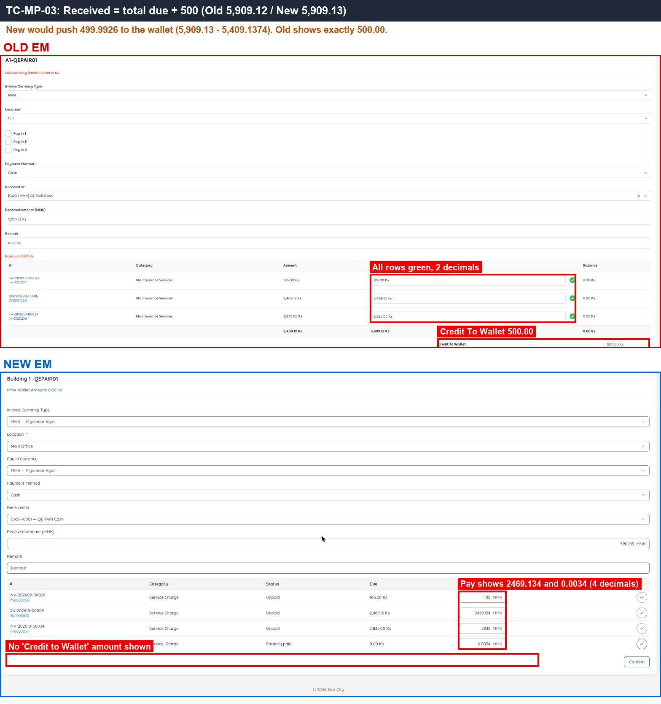 — bottom red frame: Old 'Credit To Wallet 500.00'; New shows nothing.

---

#### ★ SAN-MP-004 · Pay amount above the row's due is pulled back to the due amount

| Priority | Suites | Automation | Status | Source |
|---|---|---|---|---|
| P1 | Sanity · Regression | Auto-UI | Active | EM Parity v2 (TC-MP-04), 2026-10-30 |

**Preconditions:**

1. Logged in to EM as an Admin user.
2. Test apartment has an open invoice with due 105.

**Test data:**

1. Pay 500 on the row with due 105.

**Steps:**

1. Go to Apartments, open the test apartment, click [Make Payment].
2. On row 1 (due 105), type Pay = 500 and click outside.
3. Fill Payment Method, Received In and Location, click [Confirm].

**Expected result:**

1. Pay is pulled back to the due amount (105).
2. No payment is recorded above the row's due.

**Parity result (build -31):**

| Old EM | New EM | Result |
|---|---|---|
| Pay 500 > due 105 → pulled back to 105 | Keeps 500; Confirm → 422 'line exceeds remaining due' (if Received = 0, only ERR_UNKNOWN) | ⚠️ [Differs](../differences.md#san-mp-004) |

**Evidence:**

- 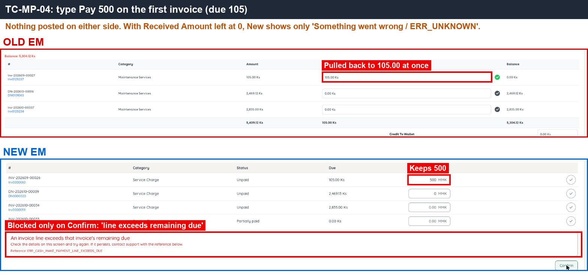 — Old pulls Pay back to 105; New keeps 500 and rejects on Confirm.

---

#### ★ SAN-MP-005 · Partial payment 400 by Cash — invoice Partially Paid, RV created, account +400

| Priority | Suites | Automation | Status | Source |
|---|---|---|---|---|
| P1 | Sanity · Regression | Auto-UI+API | Active | EM Parity v2 (TC-MP-05), 2026-10-30 |

**Preconditions:**

1. Logged in to EM as an Admin user.
2. Account `QE PAIR Cash` (CASH, MMK, Payment Method Cash) exists.
3. Approved invoice on the test apartment: Unit 3, Gross Price 1000.555, Discount 10%, Tax 5% (Old Inv-202610-00036 2,836.55; New INV-202610-00033 2,836.57).

**Test data:**

1. Pay 400, Payment Method Cash, Received In `QE PAIR Cash`.

**Steps:**

1. Go to Apartments, open the test apartment, click [Make Payment].
2. Select Payment Method Cash, Received In `QE PAIR Cash` and a Location.
3. Enter Received 400 and Pay 400 on the invoice row.
4. Click [Confirm].
5. Open the invoice, the receipt and the account `QE PAIR Cash`.

**Expected result:**

1. Invoice status **Partially Paid**, Balance Due 2,436.55.
2. A new RV is created; the line description contains "( Nth partial payment )".
3. `QE PAIR Cash` balance increases by 400.

**Parity result (build -31):**

| Old EM | New EM | Result |
|---|---|---|
| Paid 400 → Partially paid, Balance 2,436.55 (RV-102411) | Paid 400 → PARTIALLY_PAID, Due 2,436.57 (RV-00055) | ✅ Match |

**Retest (build -37):** BUG-01 / [EM-93](https://zeyalabs-team-a83df6me.atlassian.net/browse/EM-93) **not fixed**. A 3-decimal price is now refused ('Amount can have at most 2 decimal places.'), but discount, tax and total are still stored with 4 decimals. An invoice with a 2-decimal price (Unit 3 × 1000.52, Discount 10%, Tax 5% → INV-202610-00046, shown 2,836.47, stored 2836.4742) paid with exactly the displayed 2,836.47 (RV-00070) stays PARTIALLY_PAID with 0.0042 due, and Make Payment keeps listing it as 'Partially paid, Due 0.00 Ks'.

**Evidence:**

- 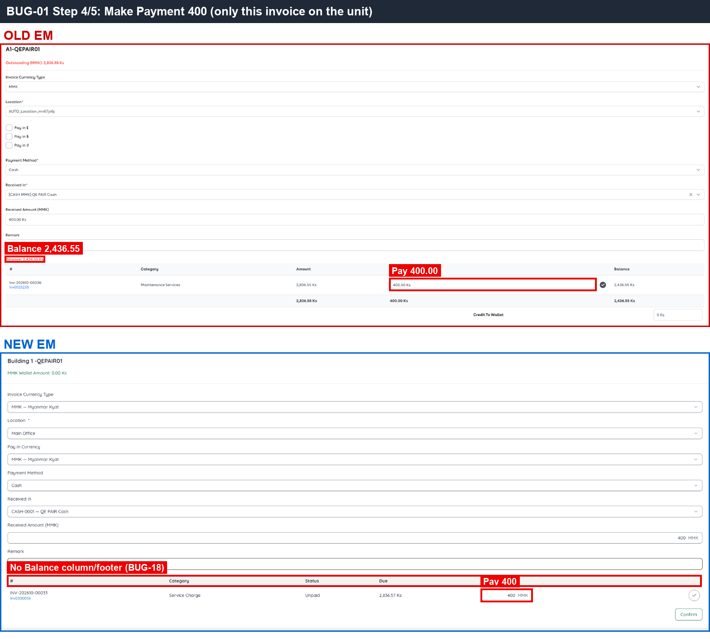 — after paying 400: Old due 2,436.55, New due 2,436.57.
- [BUG-01.gif](../gif/BUG-01.gif)

---

#### ★ SAN-MP-006 · Pay the remaining balance — invoice becomes PAID with Balance Due 0.00

| Priority | Suites | Automation | Status | Source |
|---|---|---|---|---|
| P1 | Sanity · Regression | Auto-UI+API | Active | EM Parity v2 (TC-MP-06), 2026-10-30 |

**Preconditions:**

1. Logged in to EM as an Admin user.
2. Partially paid invoice from SAN-MP-005.

**Test data:**

1. Pay exactly the Balance Due shown on screen (Old 2,436.55, New 2,436.57).

**Steps:**

1. Go to Apartments, open the test apartment, click [Make Payment].
2. Pay exactly the displayed Balance Due by Cash into `QE PAIR Cash`, click [Confirm].
3. Open the apartment's invoice list and Make Payment again.
4. Read the invoice due amount from the API response.

**Expected result:**

1. Balance Due **0.00** (no hidden remainder in the API), status **PAID**.
2. Receipt line description contains "( 2th partial payment )".
3. The invoice no longer appears in Make Payment.

**Parity result (build -31):**

| Old EM | New EM | Result |
|---|---|---|
| Balance 0.00 after full payment, PAID (RV-102412) | No Balance shown; invoice stuck PARTIALLY_PAID with 'Due 0.00' (API due 0.0034, RV-00056) | ❌ [BUG-01](../bugs.md#bug-01) · [EM-93](https://zeyalabs-team-a83df6me.atlassian.net/browse/EM-93) |

**Retest (build -37):** BUG-01 / [EM-93](https://zeyalabs-team-a83df6me.atlassian.net/browse/EM-93) **not fixed**. A 3-decimal price is now refused ('Amount can have at most 2 decimal places.'), but discount, tax and total are still stored with 4 decimals. An invoice with a 2-decimal price (Unit 3 × 1000.52, Discount 10%, Tax 5% → INV-202610-00046, shown 2,836.47, stored 2836.4742) paid with exactly the displayed 2,836.47 (RV-00070) stays PARTIALLY_PAID with 0.0042 due, and Make Payment keeps listing it as 'Partially paid, Due 0.00 Ks'.

**Evidence:**

- 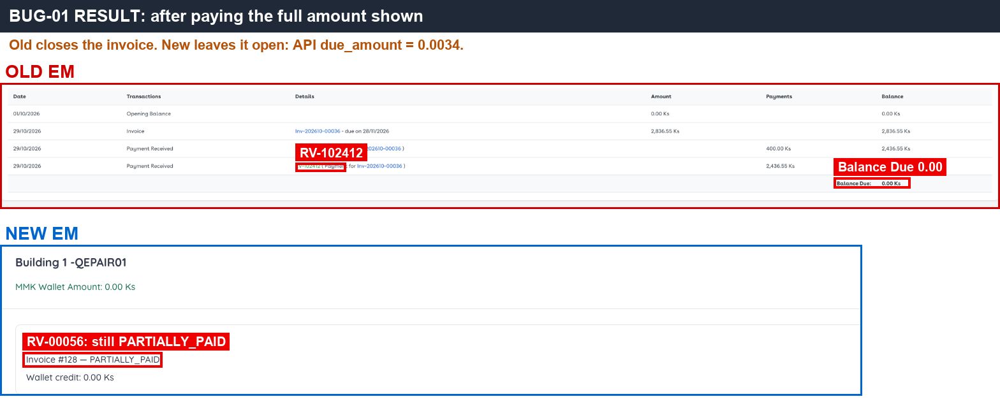 — after full payment: Old Balance Due 0.00; New still PARTIALLY_PAID.
- 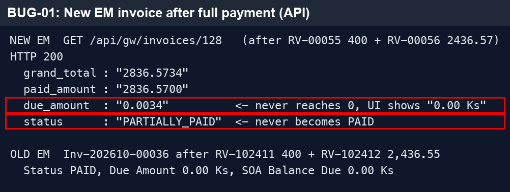 — API response of New: `due_amount 0.0034`, the hidden remainder.
- 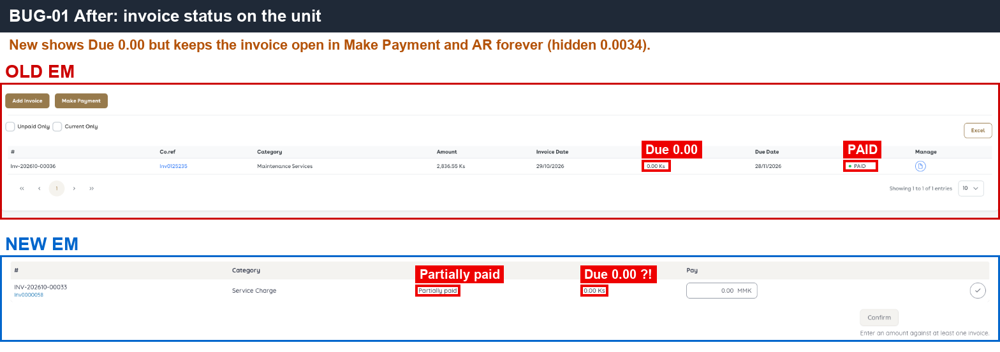 — New ghost invoice 'Partially paid, Due 0.00' that cannot be closed.
- [BUG-01.gif](../gif/BUG-01.gif)
- 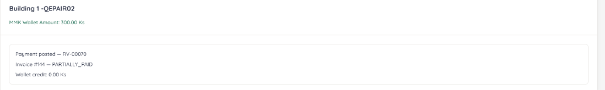 — retest -37: 2-decimal price invoice still PARTIALLY_PAID after paying the displayed amount.

---

#### ★ SAN-MP-007 · Overpayment of 500 — all open invoices PAID and 500.00 credited to the wallet

| Priority | Suites | Automation | Status | Source |
|---|---|---|---|---|
| P1 | Sanity · Regression | Auto-UI+API | Active | EM Parity v2 (TC-MP-07), 2026-10-30 |

**Preconditions:**

1. Logged in to EM as an Admin user.
2. Test apartment has 3 open invoices; account `QE PAIR Cash` exists.

**Test data:**

1. Received = total due + 500 (Old 5,909.12; New 5,909.13), Cash into `QE PAIR Cash`.

**Steps:**

1. Go to Apartments, open the test apartment, click [Make Payment].
2. Enter Received = total due + 500, pay every row in full, click [Confirm].
3. Open the receipt, the apartment Wallet tab, the account `QE PAIR Cash` and Reports > Cash Received.

**Expected result:**

1. All open invoices are PAID.
2. The RV has an extra 'Wallet Recharge' line of **500.00**; Wallet tab +500.00.
3. `QE PAIR Cash` increases by the full Received amount.
4. Reports > Cash Received lists the RV split per allocation (invoice payments + wallet recharge).

**Parity result (build -31):**

| Old EM | New EM | Result |
|---|---|---|
| RV-102413 5,909.12; 3 invoices PAID; wallet +500.00; S.O.A has no wallet row | RV-00057 5,909.13; 'Wallet credit 499.99' (0.0074 lost because of BUG-01); 4 invoices PAID; Cash Received report shows 1 row | ❌ [BUG-01](../bugs.md#bug-01) · [EM-93](https://zeyalabs-team-a83df6me.atlassian.net/browse/EM-93) · [BUG-14](../bugs.md#bug-14) · [EM-109](https://zeyalabs-team-a83df6me.atlassian.net/browse/EM-109) |

**Retest (build -37):** BUG-01 / [EM-93](https://zeyalabs-team-a83df6me.atlassian.net/browse/EM-93) **not fixed**. A 3-decimal price is now refused ('Amount can have at most 2 decimal places.'), but discount, tax and total are still stored with 4 decimals. An invoice with a 2-decimal price (Unit 3 × 1000.52, Discount 10%, Tax 5% → INV-202610-00046, shown 2,836.47, stored 2836.4742) paid with exactly the displayed 2,836.47 (RV-00070) stays PARTIALLY_PAID with 0.0042 due, and Make Payment keeps listing it as 'Partially paid, Due 0.00 Ks'.

**Evidence:**

- 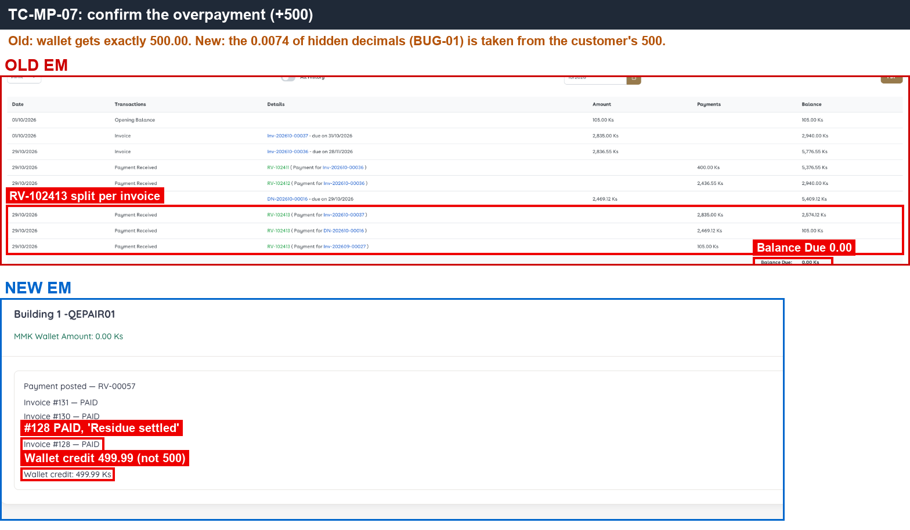 — New wallet receives 499.99 instead of 500.00 (bottom green frame).
- 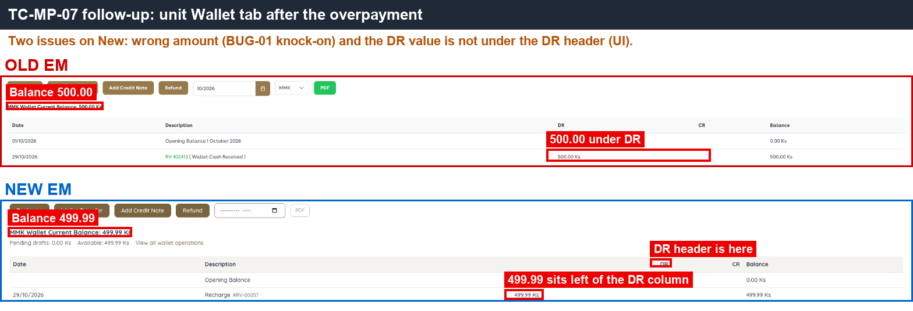 — Wallet tab after the overpayment (New amount not aligned under DR, [D-07](../differences.md#d-07)).
- 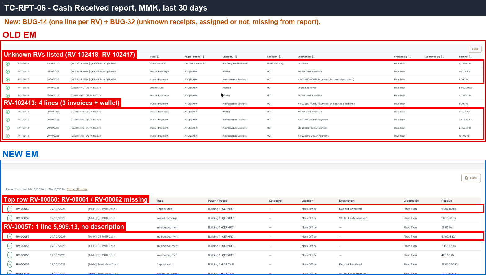 — Cash Received report: Old 4 rows for RV-102413; New 1 row for RV-00057.

---

#### ★ SAN-MP-008 · Pay by Cheque (Uncleared) — RV created and the bank account balance still increases

| Priority | Suites | Automation | Status | Source |
|---|---|---|---|---|
| P1 | Sanity · Regression | Auto-UI | Active | EM Parity v2 (TC-MP-08), 2026-10-30 |

**Preconditions:**

1. Logged in to EM as an Admin user.
2. Account `QE PAIR Bank` (BANK, KBZ, QEPAIR-B1, Payment Methods Cheque + Bank Transfer) with balance 10,000.
3. Test apartment has an open invoice.

**Test data:**

1. Pay 50, Payment Method Cheque, cheque status Uncleared, Received In `QE PAIR Bank`.

**Steps:**

1. Go to Apartments, open the test apartment, click [Make Payment].
2. Select Payment Method Cheque, Received In `QE PAIR Bank`, Location; set cheque status Uncleared if the field exists.
3. Pay 50, click [Confirm].
4. Open the receipt and the account `QE PAIR Bank`.

**Expected result:**

1. A new RV is created with cheque status Uncleared.
2. `QE PAIR Bank` balance still increases: 10,000 → **10,050**.

**Parity result (build -31):**

| Old EM | New EM | Result |
|---|---|---|
| Cheque: no status field; Bank +50 (10,050), RV-102414 | 'Cheque status' field Uncleared / Cleared; Bank +50 (10,050), RV-00058 | ⚠️ [Differs](../differences.md#san-mp-008) |

**Evidence:**

- 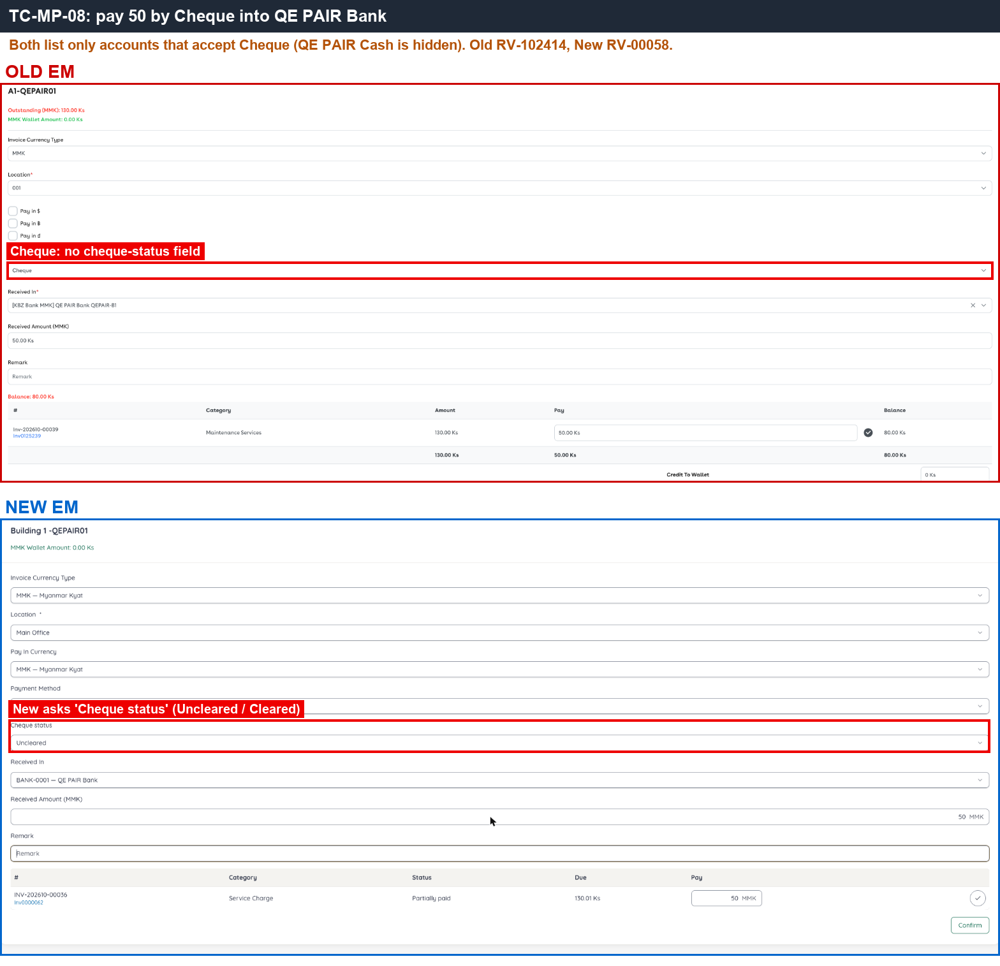 — New has the extra 'Cheque status' field; Old does not.
- 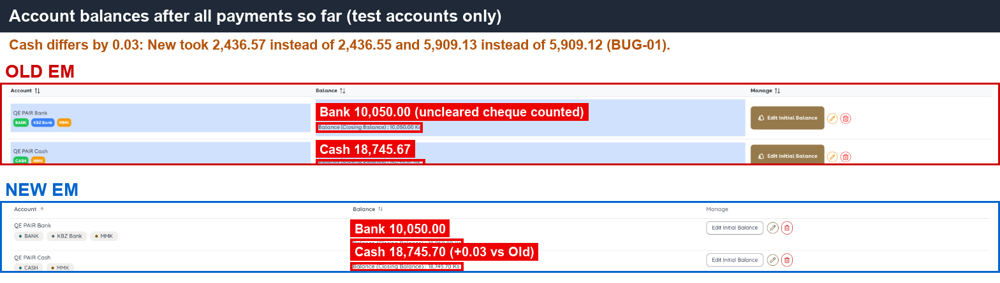 — `QE PAIR Bank` 10,050 on both sides.

---

#### ★ SAN-MP-009 · MMK payment without Pay in $ — Received In lists only MMK accounts

| Priority | Suites | Automation | Status | Source |
|---|---|---|---|---|
| P1 | Sanity · Regression | Auto-UI | Active | EM Parity v2 (TC-MP-09), 2026-10-30 |

**Preconditions:**

1. Logged in to EM as an Admin user.
2. USD accounts exist (e.g. `QE PAIR USD Bank`) besides the MMK accounts.
3. Test apartment has an open MMK invoice.

**Steps:**

1. Go to Apartments, open the test apartment, click [Make Payment].
2. Leave Pay in $ / Pay In Currency at MMK.
3. Open the Received In dropdown.

**Expected result:**

1. Received In lists only MMK accounts; no USD account can be selected (a currency mismatch can never be submitted).

**Parity result (build -31):**

| Old EM | New EM | Result |
|---|---|---|
| Received In lists only MMK accounts (38 accounts, no USD) | Received In lists only MMK accounts (5 accounts) | ✅ Match |

---

#### SAN-MP-013 · Make Payment without Location is blocked

| Priority | Suites | Automation | Status | Source |
|---|---|---|---|---|
| P1 | Sanity · Regression | Auto-UI | Active | EM Parity v2 (TC-MP-13), 2026-10-30 |

**Preconditions:**

1. Logged in to EM as an Admin user.
2. Test apartment has an open invoice.

**Steps:**

1. Go to Apartments, open the test apartment, click [Make Payment].
2. Fill Payment Method, Received In, Received and Pay; leave Location empty.
3. Click [Confirm] (or try to).

**Expected result:**

1. The payment is not submitted; Location is reported as required.

**Parity result (build -31):**

| Old EM | New EM | Result |
|---|---|---|
| Confirm → 'Location is required' | Confirm button disabled, hint 'Choose a location' | ✅ Match |

**Evidence:**

- 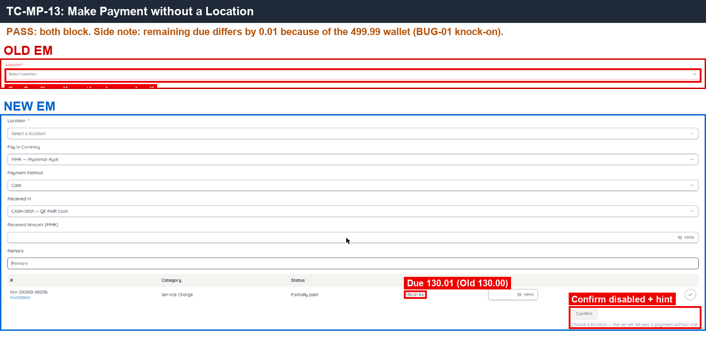 — Old required-field message; New disabled Confirm with the hint.

---

#### ★ SAN-MP-010 · Pay by Wallet — Received locked to wallet balance, rows limited, WP created

| Priority | Suites | Automation | Status | Source |
|---|---|---|---|---|
| P1 | Sanity · Regression | Auto-UI | Active | EM Parity v2 (TC-MP-10), 2026-10-30 |

**Preconditions:**

1. Logged in to EM as an Admin user.
2. Test apartment wallet balance 500 (New 499.99 because of BUG-01).
3. Two open invoices of 315 each (Old Inv-202610-00038/39; New INV-202610-00035/36).

**Steps:**

1. Go to Apartments, open the test apartment, click [Make Payment].
2. Select Payment Method = Wallet.
3. Click to pay both rows in full.
4. Click [Confirm].
5. Check the wallet balance and the `QE PAIR Cash` / `QE PAIR Bank` balances.

**Expected result:**

1. Received is locked to the wallet balance (500).
2. Row 1 = 315, row 2 is limited to the remaining 185.
3. Confirm succeeds at once and creates a WP; wallet −500.
4. Cash and bank account balances are unchanged.

**Parity result (build -31):**

| Old EM | New EM | Result |
|---|---|---|
| Received locked = 500; row 2 max 185; WP-100158 | Received still editable; allows 315 + 315 = 630 > wallet → 'Something went wrong / ERR_UNKNOWN'; Received 499.99 typed by hand → WP-00020 (315 + 184.99) | ❌ [BUG-19](../bugs.md#bug-19) · [EM-104](https://zeyalabs-team-a83df6me.atlassian.net/browse/EM-104) |

**Evidence:**

- 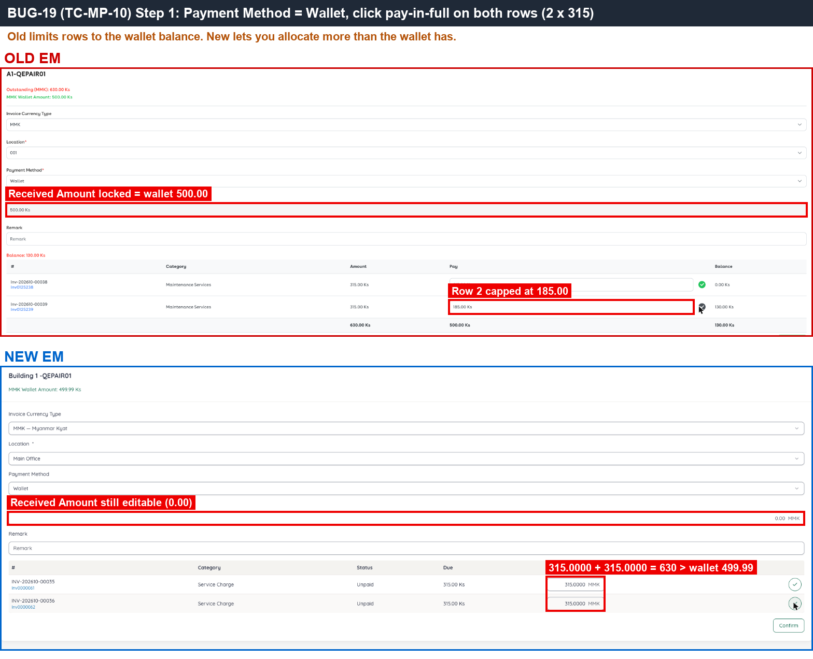 — Old locks Received to 500 and limits row 2; New allows 630.
- 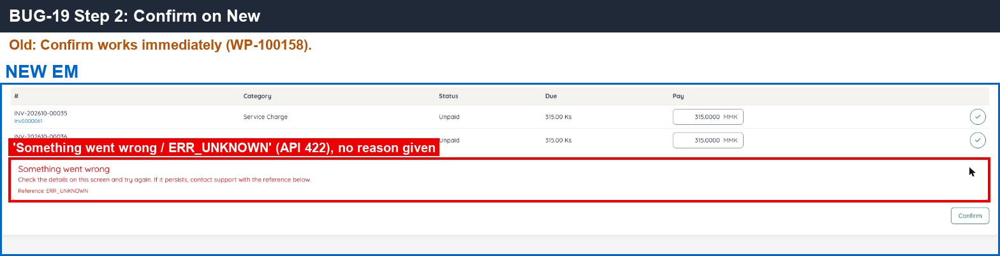 — New generic error on Confirm.
- 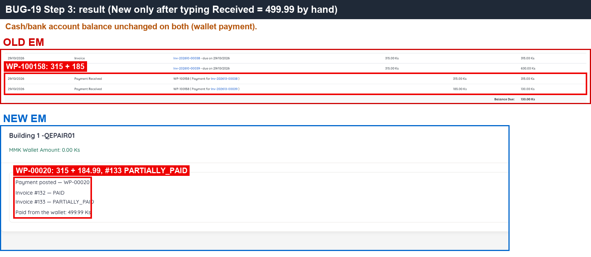 — same end result, but New needs Received typed by hand.
- [BUG-19.gif](../gif/BUG-19.gif)

---

#### ★ SAN-MP-011 · Pay a 15,000 Ks invoice with $3 — rate 5,000, conversion description, Wallet hidden

| Priority | Suites | Automation | Status | Source |
|---|---|---|---|---|
| P1 | Sanity · Regression | Auto-UI+API | Active | EM Parity v2 (TC-MP-11), 2026-10-30 |

**Preconditions:**

1. Logged in to EM as an Admin user.
2. Apartment `A1-QEPAIR02` / `Building 1 -QEPAIR02` has an open MMK invoice of 15,000 (Old Inv-202610-00044; New INV-202610-00041).
3. A USD cash account exists (Old `QE PAIR USD Cash`).

**Test data:**

1. Pay-in $3.00 for 15,000 Ks (rate 5,000), Payment Method Cash, USD account.

**Steps:**

1. Go to Apartments, open the apartment, click [Make Payment].
2. Tick Pay in $ (New: Pay In Currency = USD).
3. Open the Payment Method list.
4. Select Cash, the USD account, Location; pay-in $3 for the 15,000 invoice; click [Confirm].
5. Open the receipt.

**Expected result:**

1. Wallet is not offered in Payment Method while paying in USD.
2. Rate 5,000; receipt debit **$3.00**.
3. Line description 'Inv-… Payment $3.00 for 15000.00Ks ( $1 = 5000Ks )'.
4. Invoice is PAID.

**Parity result (build -31):**

| Old EM | New EM | Result |
|---|---|---|
| Pay in $ ticked: Wallet removed from Payment Method; rate 5000; RV-102421; 'Inv-202610-00044 Payment $3.00 for 15000.00Ks ( $1 = 5000Ks )' | Pay In Currency USD: Wallet still offered; rate 5,000; RV-00065 $3.00, same description; invoice page shows only 15,000 Ks | ❌ [BUG-36](../bugs.md#bug-36) · [EM-115](https://zeyalabs-team-a83df6me.atlassian.net/browse/EM-115) |

**Evidence:**

- 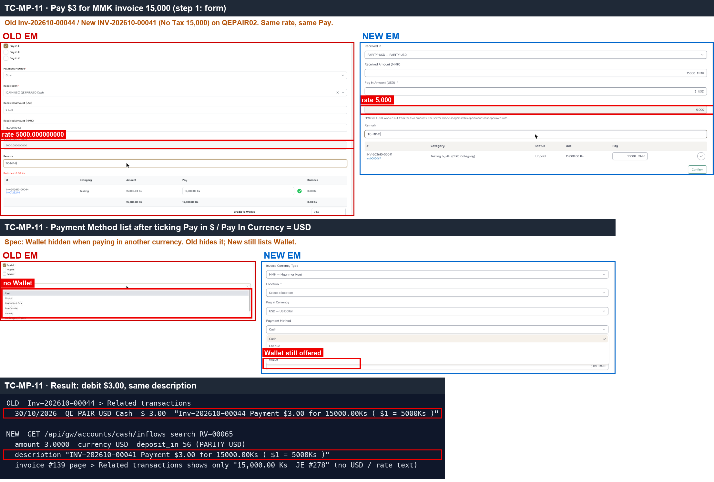 — middle part: Old Payment Method list has no Wallet, New still offers Wallet; bottom (API): same $3.00 and description.
- [MP-11.gif](../gif/MP-11.gif)

---

#### SAN-MP-012 · Pay $1 across 3 MMK invoices — 0.01 rounding difference added to the last invoice

| Priority | Suites | Automation | Status | Source |
|---|---|---|---|---|
| P2 | Sanity · Regression | Auto-UI+API | Active | EM Parity v2 (TC-MP-12), 2026-10-30 |

**Preconditions:**

1. Logged in to EM as an Admin user.
2. Test apartment has 3 open MMK invoices of 1,000 each (Old Inv-202610-00045/46/47; New INV-202610-00042/43/44).
3. A USD account exists.

**Test data:**

1. Pay-in $1.00 for 3,000 Ks (rate 3,000), so each invoice rounds to $0.33 and the sum is off by exactly 0.01.

**Steps:**

1. Go to Apartments, open the test apartment, click [Make Payment].
2. Set Pay In Currency = USD, pay $1 for all 3 invoices, click [Confirm].
3. Open the receipt and read the USD amount per invoice (screen and API).

**Expected result:**

1. USD per invoice 0.33 / 0.33 / **0.34**: the 0.01 difference is added to the last invoice so the sum = $1.00.
2. A difference of 0.02 or more is not adjusted.

**Parity result (build -31):**

| Old EM | New EM | Result |
|---|---|---|
| RV-102422: 0.33 / 0.33 / 0.34 (last invoice +0.01, total 1.00) | RV-00066 $1: 0.33 / 0.33 / 0.33 (total 0.99), no adjustment on the last invoice | ❌ [BUG-37](../bugs.md#bug-37) · [EM-116](https://zeyalabs-team-a83df6me.atlassian.net/browse/EM-116) |

**Evidence:**

- 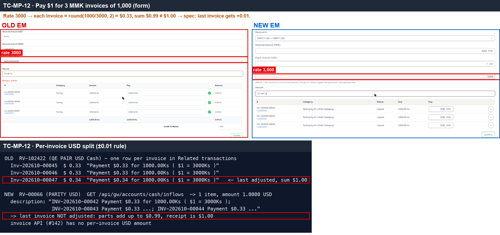 — bottom (API): USD per invoice; Old adjusts the last line to $0.34, New leaves total $0.99.

---

#### ★ SAN-MP-015 · S.O.A after payment shows 'Payment Received' rows and the reduced balance

| Priority | Suites | Automation | Status | Source |
|---|---|---|---|---|
| P1 | Sanity · Regression | Auto-UI+API | Active | EM Parity v2 (TC-MP-15), 2026-10-30 |

**Preconditions:**

1. Logged in to EM as an Admin user.
2. Payments of SAN-MP-005 … SAN-MP-010 done on the test apartment (including the 500 overpayment).

**Steps:**

1. Go to Apartments, open the test apartment, open the S.O.A tab.
2. Select October.
3. Read the payment rows and the closing balance.

**Expected result:**

1. One 'Payment Received' row per paid invoice, in the form `RV-x (Payment for Inv-…)`, and the balance decreases.
2. No wallet rows, no 0.00 payment row, no internal text (e.g. 'OVERPAYMENT_RESIDUE').
3. Closing balance **80.00**.

**Parity result (build -31):**

| Old EM | New EM | Result |
|---|---|---|
| 'Payment Received' rows RV-x (Payment for Inv-…); closing 80.00 | 'Invoice payment' rows; an extra 0.00 row and 2 wallet rows 499.99 / OVERPAYMENT_RESIDUE; closing 80.01 | ❌ [BUG-12](../bugs.md#bug-12) · [EM-101](https://zeyalabs-team-a83df6me.atlassian.net/browse/EM-101) · [BUG-01](../bugs.md#bug-01) · [EM-93](https://zeyalabs-team-a83df6me.atlassian.net/browse/EM-93) |

**Retest (build -37):** BUG-01 / [EM-93](https://zeyalabs-team-a83df6me.atlassian.net/browse/EM-93) **not fixed**. A 3-decimal price is now refused ('Amount can have at most 2 decimal places.'), but discount, tax and total are still stored with 4 decimals. An invoice with a 2-decimal price (Unit 3 × 1000.52, Discount 10%, Tax 5% → INV-202610-00046, shown 2,836.47, stored 2836.4742) paid with exactly the displayed 2,836.47 (RV-00070) stays PARTIALLY_PAID with 0.0042 due, and Make Payment keeps listing it as 'Partially paid, Due 0.00 Ks'.

**Evidence:**

- 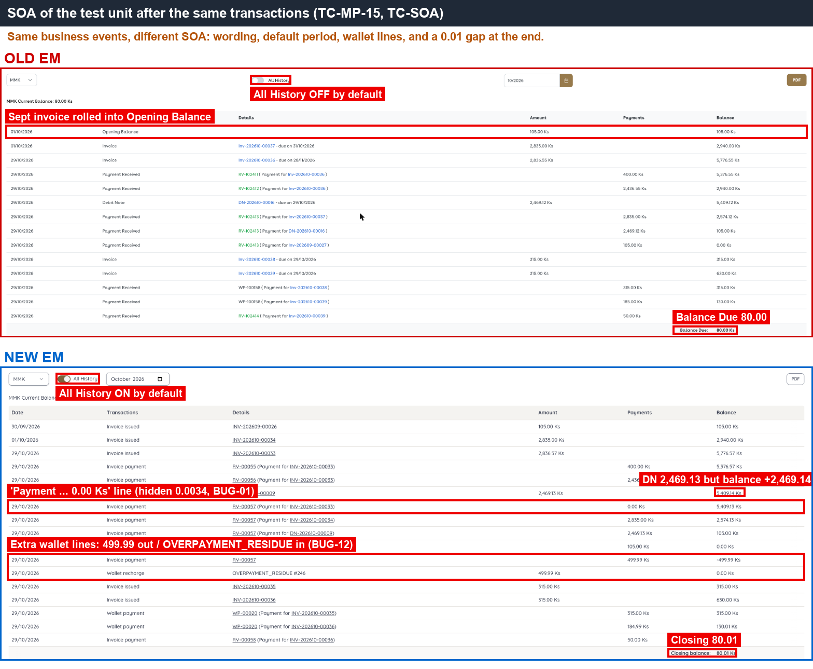 — New extra 'Payment … 0.00 Ks' row, 2 wallet rows, and closing 80.01 vs Old 80.00.

---
