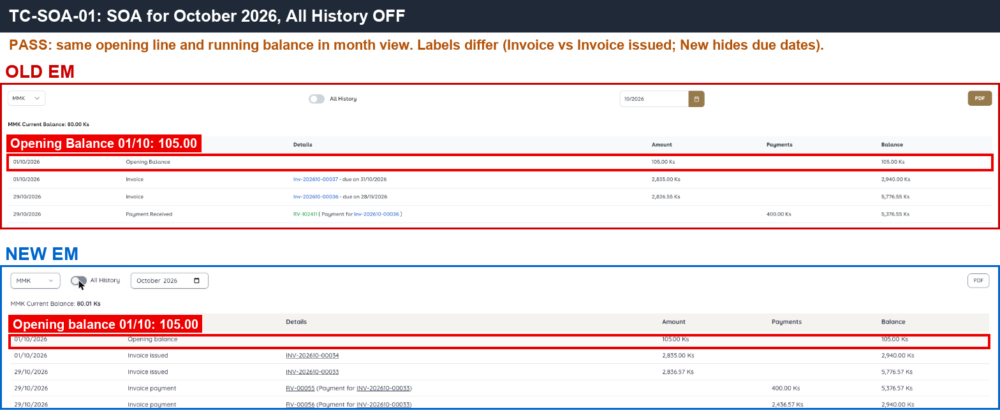
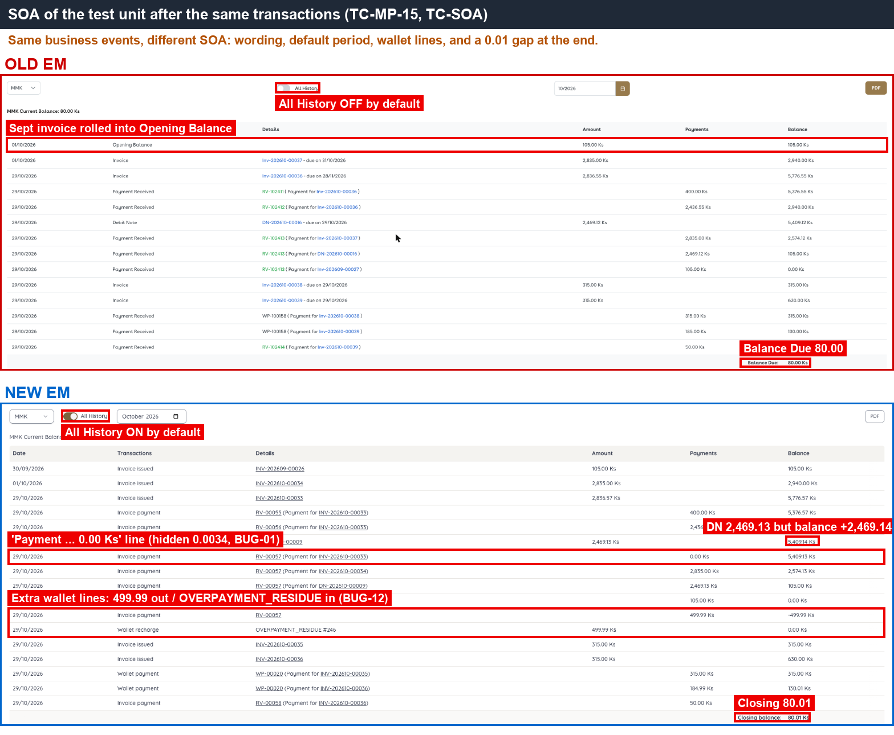
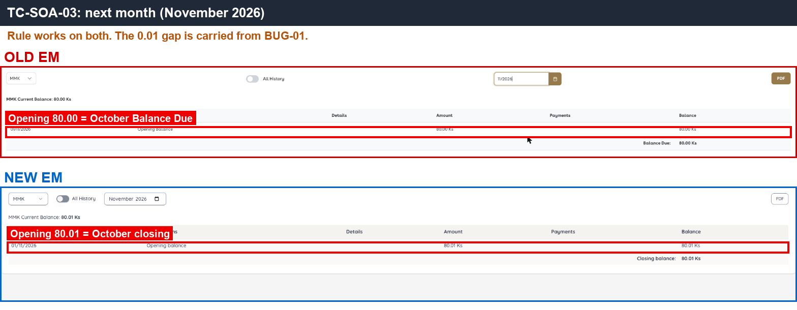
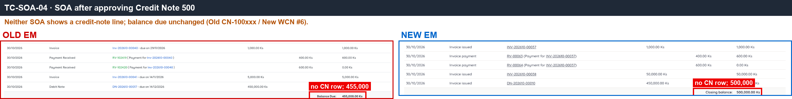

# 05 · Apartment SOA — Sanity

[← Sanity index](../README.md) · [Bugs](../bugs.md)

**Test cases:** 5 · **Parity result:** ✅ 5 · ⚠️ 0 · ❌ 0

## Summary

| ID | Test case | Pri | Result | Bug / note |
|---|---|---|---|---|
| [SAN-SOA-001](#-san-soa-001--current-month-soa-starts-with-opening-balance-on-the-1st-and-the-running-balance-is-correct) | ★ Current-month SOA starts with Opening Balance on the 1st and the running balance is correct | P1 | ✅ Match | — |
| [SAN-SOA-002](#-san-soa-002--soa-balance-due-equals-the-balance-of-the-last-row) | ★ SOA Balance Due equals the balance of the last row | P1 | ✅ Match | — |
| [SAN-SOA-003](#-san-soa-003--next-months-opening-equals-the-previous-months-balance-due) | ★ Next month's Opening equals the previous month's Balance Due | P1 | ✅ Match | — |
| [SAN-SOA-004](#-san-soa-004--approving-a-credit-note-for-the-apartment-adds-no-row-to-the-soa) | ★ Approving a Credit Note for the apartment adds no row to the SOA | P1 | ✅ Match | — |
| [SAN-SOA-005](#-san-soa-005--paying-from-the-wallet-adds-a-payment-row-with-a-wp-number) | ★ Paying from the wallet adds a payment row with a WP number | P1 | ✅ Match | — |

## Test cases

#### ★ SAN-SOA-001 · Current-month SOA starts with Opening Balance on the 1st and the running balance is correct

| Priority | Suites | Automation | Status | Source |
|---|---|---|---|---|
| P1 | Sanity · Regression | Auto-UI | Active | EM Parity v2 (TC-SOA-01), 2026-10-30 |

**Preconditions:**

1. Logged in to EM as an Admin user.

**Test data:**

1. Apartment: Old `A1-QEPAIR01`, New `Building 1 -QEPAIR01`.

**Steps:**

1. Open the test apartment, tab S.O.A.
2. Select the current month (on New, turn off All History).
3. Check the first row and the running balance of every row.

**Expected result:**

1. Row 1 is the Opening Balance dated the 1st of the month.
2. Each row's balance = previous balance + debit − credit.

**Parity result (build -31):**

| Old EM | New EM | Result |
|---|---|---|
| Row 1 Opening 01/10 = 105.00; running balance correct | Same (with All History turned off). New has All History on by default | ✅ Match |

**Evidence:**

-  — Opening row on the 1st on both sides.
-  — running balance down to the last row.

---

#### ★ SAN-SOA-002 · SOA Balance Due equals the balance of the last row

| Priority | Suites | Automation | Status | Source |
|---|---|---|---|---|
| P1 | Sanity · Regression | Auto-UI | Active | EM Parity v2 (TC-SOA-02), 2026-10-30 |

**Preconditions:**

1. Logged in to EM as an Admin user.

**Test data:**

1. Apartment: Old `A1-QEPAIR01`, New `Building 1 -QEPAIR01`.

**Steps:**

1. Open the test apartment's SOA for the current month.
2. Compare Balance Due with the last row's balance.

**Expected result:**

1. Balance Due equals the balance of the last row.

**Parity result (build -31):**

| Old EM | New EM | Result |
|---|---|---|
| Balance Due 80.00 = last row | Closing balance 80.01 = last row | ✅ Match |

**Evidence:**

-  — Balance Due / Closing balance next to the last row.

---

#### ★ SAN-SOA-003 · Next month's Opening equals the previous month's Balance Due

| Priority | Suites | Automation | Status | Source |
|---|---|---|---|---|
| P1 | Sanity · Regression | Auto-UI | Active | EM Parity v2 (TC-SOA-03), 2026-10-30 |

**Preconditions:**

1. Logged in to EM as an Admin user.

**Test data:**

1. Apartment: Old `A1-QEPAIR01`, New `Building 1 -QEPAIR01`.

**Steps:**

1. Open the test apartment's SOA for the current month, note Balance Due.
2. Switch to the next month.

**Expected result:**

1. The Opening Balance of the next month equals the previous month's Balance Due.

**Parity result (build -31):**

| Old EM | New EM | Result |
|---|---|---|
| Opening 11/2026 = 80.00 | Opening 11/2026 = 80.01 | ✅ Match |

**Evidence:**

-  — Opening of 11/2026 on both sides.

---

#### ★ SAN-SOA-004 · Approving a Credit Note for the apartment adds no row to the SOA

| Priority | Suites | Automation | Status | Source |
|---|---|---|---|---|
| P1 | Sanity · Regression | Auto-UI | Active | EM Parity v2 (TC-SOA-04), 2026-10-30 |

**Preconditions:**

1. Logged in to EM as an Admin user.

**Test data:**

1. Apartment: Old `A1-QEPAIR01`, New `Building 1 -QEPAIR01`.
2. Credit Note: 500

**Steps:**

1. Approve a Credit Note of 500 for the test apartment.
2. Open the apartment's SOA.

**Expected result:**

1. The SOA has **no** Credit Note row.
2. Balance Due is not reduced by the Credit Note.

**Parity result (build -31):**

| Old EM | New EM | Result |
|---|---|---|
| After CN 500: no CN row in SOA; Balance Due 455,000 | No CN row; Closing 500,000 | ✅ Match |

**Evidence:**

-  — no CN row after the Credit Note approval.

---

#### ★ SAN-SOA-005 · Paying from the wallet adds a payment row with a WP number

| Priority | Suites | Automation | Status | Source |
|---|---|---|---|---|
| P1 | Sanity · Regression | Auto-UI | Active | EM Parity v2 (TC-SOA-05), 2026-10-30 |

**Preconditions:**

1. Logged in to EM as an Admin user.
2. The test apartment has a wallet balance and an unpaid invoice.

**Test data:**

1. Apartment: Old `A1-QEPAIR01`, New `Building 1 -QEPAIR01`.

**Steps:**

1. Pay an invoice of the test apartment with the wallet balance (Make Payment).
2. Open the apartment's SOA.

**Expected result:**

1. The SOA has a payment row with the WP document number.

**Parity result (build -31):**

| Old EM | New EM | Result |
|---|---|---|
| Row 'Payment Received' WP-100158 | Row 'Wallet payment' WP-00020 | ✅ Match |

**Evidence:**

-  — the wallet payment row with its WP number.

---

