# 06 · Wallet, Deposit, Deposit Invoice — Sanity

[← Sanity index](../README.md) · [Bugs](../bugs.md)

**Test cases:** 12 · **Parity result:** ✅ 10 · ⚠️ 0 · ❌ 2

## Summary

| ID | Test case | Pri | Result | Bug / note |
|---|---|---|---|---|
| [SAN-DEP-001](#-san-dep-001--add-deposit-5000--rv-category-deposit-created-deposit-5000-account-5000) | ★ Add Deposit 5,000 — RV (category Deposit) created, deposit +5,000, account +5,000 | P1 | ✅ Match | [BUG-13](../bugs.md#bug-13) fixed in -37 |
| [SAN-DEP-002](#-san-dep-002--withdraw-6000-when-the-deposit-is-5000-is-blocked) | ★ Withdraw 6,000 when the deposit is 5,000 is blocked | P1 | ✅ Match | [BUG-30](../bugs.md#bug-30) (Withdraw From field) fixed in -37 |
| [SAN-DEP-003](#-san-dep-003--withdraw-2000-and-approve--pv-created-deposit-3000-account-2000) | ★ Withdraw 2,000 and approve — PV created, deposit 3,000, account −2,000 | P1 | ✅ Match | — |
| [SAN-DI-001](#san-di-001--create-deposit-invoice-2--1000--date-field-available-and-total-2000-shown-while-typing) | Create Deposit Invoice 2 × 1,000 — Date field available and total 2,000 shown while typing | P2 | ❌ Bug | [BUG-15](../bugs.md#bug-15) |
| [SAN-DI-002](#san-di-002--approve-deposit-invoice--di-number-issue-and-due-dates-creator-and-approver-shown) | Approve Deposit Invoice — DI number, issue and due dates, creator and approver shown | P2 | ❌ Bug | [BUG-15](../bugs.md#bug-15) |
| [SAN-WAL-001](#-san-wal-001--wallet-recharge-1000-into-the-cash-account--rv-created-wallet-1000-account-1000) | ★ Wallet recharge 1,000 into the Cash account — RV created, wallet 1,000, account +1,000 | P1 | ✅ Match | [BUG-13](../bugs.md#bug-13) fixed in -37; DR/CR alignment [D-07](../differences.md#d-07) |
| [SAN-WAL-002](#-san-wal-002--add-credit-note-500--draft-created-wallet-unchanged) | ★ Add Credit Note 500 — draft created, wallet unchanged | P1 | ✅ Match | — |
| [SAN-WAL-003](#-san-wal-003--approve-credit-note--cn-number-assigned-wallet-500-ar-unchanged) | ★ Approve Credit Note — CN number assigned, wallet +500, AR unchanged | P1 | ✅ Match | — |
| [SAN-WAL-004](#-san-wal-004--wallet-refund-above-the-wallet-balance-is-blocked) | ★ Wallet refund above the wallet balance is blocked | P1 | ✅ Match | — |
| [SAN-WAL-005](#-san-wal-005--second-refund-above-the-balance-left-after-a-pending-refund-draft-is-blocked) | ★ Second refund above the balance left after a pending refund draft is blocked | P1 | ✅ Match | — |
| [SAN-WAL-006](#-san-wal-006--approve-wallet-refund-800--pv-created-wallet-800-account-800) | ★ Approve wallet refund 800 — PV created, wallet −800, account −800 | P1 | ✅ Match | New approves from a separate page ([D-09](../differences.md#d-09)) |
| [SAN-WAL-007](#-san-wal-007--wallet-transfer-200-to-apartment-b--wt-created-a-200-b-200-account-balances-unchanged) | ★ Wallet transfer 200 to apartment B — WT created, A −200, B +200, account balances unchanged | P1 | ✅ Match | — |

## Test cases

#### ★ SAN-WAL-001 · Wallet recharge 1,000 into the Cash account — RV created, wallet 1,000, account +1,000

| Priority | Suites | Automation | Status | Source |
|---|---|---|---|---|
| P1 | Sanity · Regression | Auto-UI | Active | EM Parity v2 (TC-WAL-01), 2026-10-30 |

**Preconditions:**

1. Logged in to EM as an Admin user.
2. Test apartment (Old `A1-QEPAIR01`, New `Building 1 -QEPAIR01`) with wallet balance 0.
3. Account `QE PAIR Cash` (CASH, MMK, Payment Method Cash).

**Test data:**

1. Recharge 1,000, Payment Method Cash, Received In `QE PAIR Cash`.

**Steps:**

1. Go to Apartments, open the test apartment, open the Wallet tab.
2. Click [Recharge], enter the test data, submit.
3. Check the Wallet tab, Cash Received > Recent Receipts and the account `QE PAIR Cash`.

**Expected result:**

1. Wallet tab has a DR row of 1,000; wallet balance 1,000.
2. A new RV appears in Recent Receipts (Category Wallet, 'Wallet Cash Received').
3. `QE PAIR Cash` +1,000.

**Parity result (build -31):**

| Old EM | New EM | Result |
|---|---|---|
| RV-102415 'Wallet Cash Received'; wallet 1,000 | RV-00059 'Recharge'; wallet 1,000 (amount not aligned under DR/CR, D-07); RV not in Recent Receipts (BUG-13) | ✅ Match |

**Retest (build -37):** BUG-13 / [EM-102](https://zeyalabs-team-a83df6me.atlassian.net/browse/EM-102) fixed: RV-00059 (Wallet Cash Received 1,000) is now listed in Recent Receipts. Still one row per receipt, while Old splits a receipt by allocation. Repro 2026-11-01: EM-102 is **partly open** (still one row per receipt, no Created By column).

**Evidence:**

- 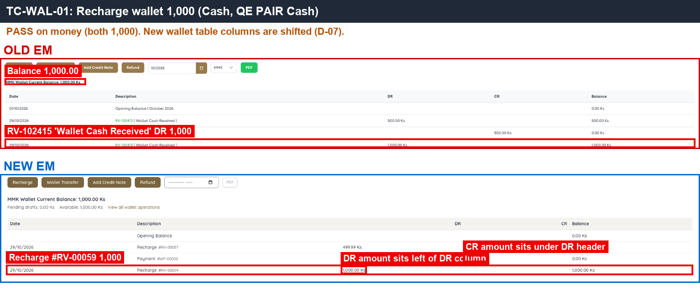 — recharge receipt and wallet balance 1,000 on both sides.
- 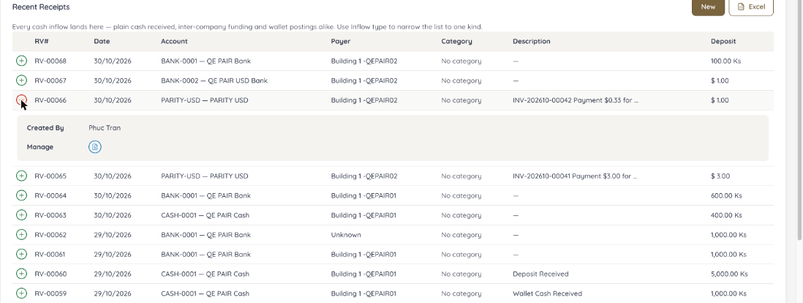 — retest -37: RV-00059 and RV-00060 listed in Recent Receipts.

---

#### ★ SAN-WAL-002 · Add Credit Note 500 — draft created, wallet unchanged

| Priority | Suites | Automation | Status | Source |
|---|---|---|---|---|
| P1 | Sanity · Regression | Auto-UI | Active | EM Parity v2 (TC-WAL-02), 2026-10-30 |

**Preconditions:**

1. Logged in to EM as an Admin user.
2. Test apartment wallet balance 1,000 (after SAN-WAL-001).

**Test data:**

1. Credit Note 500 for the test apartment.

**Steps:**

1. Go to Apartments, open the test apartment, open the Wallet tab.
2. Click [Add Credit Note], select the apartment if not pre-filled, enter 500, create the draft.
3. Check the CN draft chip and the wallet balance.

**Expected result:**

1. A CN draft is created and counted in the CN draft chip.
2. Wallet balance is still 1,000.

**Parity result (build -31):**

| Old EM | New EM | Result |
|---|---|---|
| CN draft; wallet still 1,000 | CN draft #5; wallet still 1,000 (form does not pre-fill the apartment) | ✅ Match |

**Evidence:**

- 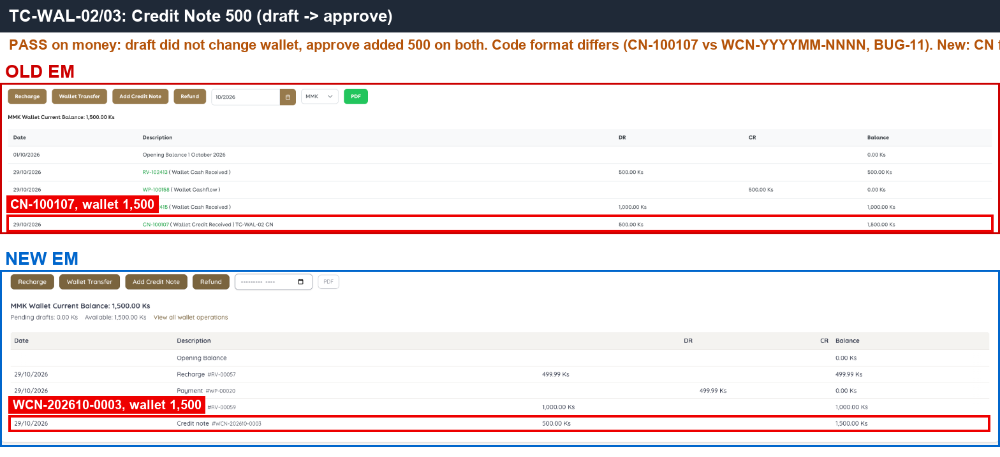 — credit note on both sides; wallet before and after approval.

---

#### ★ SAN-WAL-003 · Approve Credit Note — CN number assigned, wallet +500, AR unchanged

| Priority | Suites | Automation | Status | Source |
|---|---|---|---|---|
| P1 | Sanity · Regression | Auto-UI | Active | EM Parity v2 (TC-WAL-03), 2026-10-30 |

**Preconditions:**

1. Logged in to EM as an Admin user.
2. CN draft 500 from SAN-WAL-002.

**Steps:**

1. Note the apartment's AR total.
2. Open the CN draft, click [Approve].
3. Check the CN number, the wallet balance, the AR total and Reports > Credit Note.

**Expected result:**

1. A CN number is assigned.
2. Wallet 1,000 → **1,500**.
3. Apartment AR is unchanged.
4. Reports > Credit Note lists the CN with amount 500.00.

**Parity result (build -31):**

| Old EM | New EM | Result |
|---|---|---|
| CN-100107; wallet 1,500 | WCN-202610-0003; wallet 1,500 | ✅ Match |

**Evidence:**

-  — wallet 1,500 after approval; CN number formats differ.

---

#### ★ SAN-WAL-004 · Wallet refund above the wallet balance is blocked

| Priority | Suites | Automation | Status | Source |
|---|---|---|---|---|
| P1 | Sanity · Regression | Auto-UI | Active | EM Parity v2 (TC-WAL-04), 2026-10-30 |

**Preconditions:**

1. Logged in to EM as an Admin user.
2. Test apartment wallet balance 1,500.

**Test data:**

1. Refund amount greater than the wallet balance.

**Steps:**

1. Go to Apartments, open the test apartment, open the Wallet tab.
2. Click [Refund], enter an amount above the balance, select `QE PAIR Cash`, submit.

**Expected result:**

1. The refund is blocked with an insufficient-balance error.
2. No refund draft is created; wallet unchanged.

**Parity result (build -31):**

| Old EM | New EM | Result |
|---|---|---|
| Blocked: 'Invalid Amount' | Blocked: 'Insufficient wallet balance' (ERR_WALLET_INSUFFICIENT_BALANCE) | ✅ Match |

**Evidence:**

- 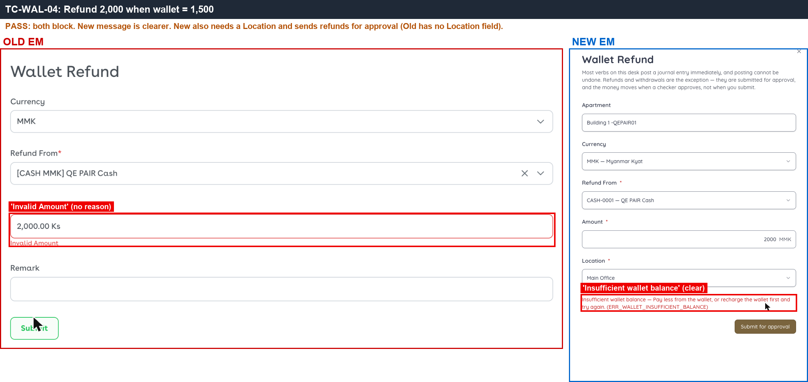 — both sides block the refund, with different message text.

---

#### ★ SAN-WAL-005 · Second refund above the balance left after a pending refund draft is blocked

| Priority | Suites | Automation | Status | Source |
|---|---|---|---|---|
| P1 | Sanity · Regression | Auto-UI | Active | EM Parity v2 (TC-WAL-05), 2026-10-30 |

**Preconditions:**

1. Logged in to EM as an Admin user.
2. Test apartment wallet balance 1,500.

**Test data:**

1. Refund draft 800, then a second refund of 800 (1,500 − 800 = 700 < 800).

**Steps:**

1. Go to the test apartment Wallet tab, click [Refund], enter 800 from `QE PAIR Cash`, submit (draft, not approved).
2. Click [Refund] again, enter 800, submit.

**Expected result:**

1. The first refund draft is created.
2. The second refund is blocked: the pending draft counts against the balance.

**Parity result (build -31):**

| Old EM | New EM | Result |
|---|---|---|
| Draft 800, then 800 more → blocked 'Insufficient Balance in Withdraw From Account' | Draft 800 (outflow #27), then 800 more → blocked 'Insufficient wallet balance' | ✅ Match |

**Evidence:**

- 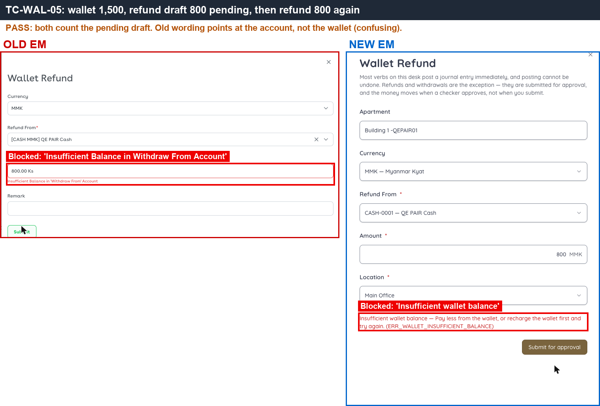 — second refund blocked on both sides.

---

#### ★ SAN-WAL-006 · Approve wallet refund 800 — PV created, wallet −800, account −800

| Priority | Suites | Automation | Status | Source |
|---|---|---|---|---|
| P1 | Sanity · Regression | Auto-UI | Active | EM Parity v2 (TC-WAL-06), 2026-10-30 |

**Preconditions:**

1. Logged in to EM as an Admin user.
2. Refund draft 800 from SAN-WAL-005; wallet 1,500.

**Steps:**

1. Open the refund draft (New: link 'Approve or remove this draft').
2. Click [Approve].
3. Check the PV number, the wallet balance, `QE PAIR Cash` and the Dashboard Payment total.

**Expected result:**

1. A PV number is assigned.
2. Wallet 1,500 → **700**; `QE PAIR Cash` −800.
3. Dashboard Payment +800.

**Parity result (build -31):**

| Old EM | New EM | Result |
|---|---|---|
| PV-100266; wallet 700 | PV-00020 (outflow #27, approved through the /approve page); wallet 700 | ✅ Match |

**Evidence:**

- 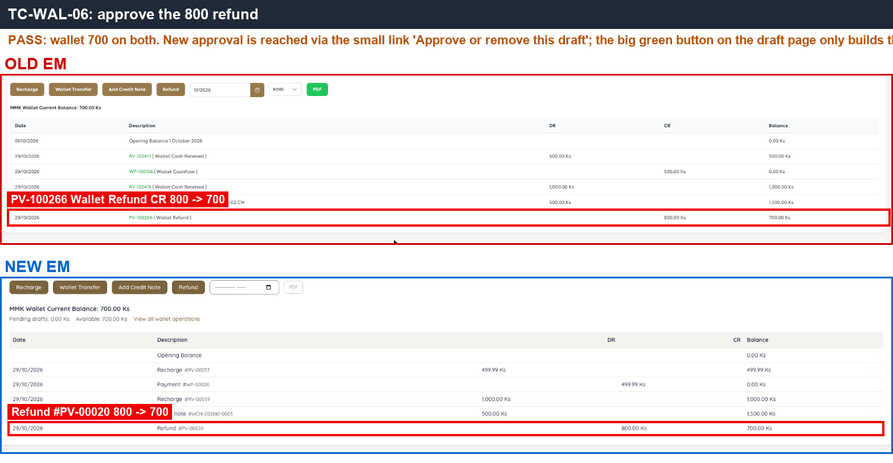 — PV created and wallet 700 on both sides.

---

#### ★ SAN-WAL-007 · Wallet transfer 200 to apartment B — WT created, A −200, B +200, account balances unchanged

| Priority | Suites | Automation | Status | Source |
|---|---|---|---|---|
| P1 | Sanity · Regression | Auto-UI | Active | EM Parity v2 (TC-WAL-07), 2026-10-30 |

**Preconditions:**

1. Logged in to EM as an Admin user.
2. Apartment A (`A1-QEPAIR01` / `Building 1 -QEPAIR01`) wallet 700; apartment B (`A1-QEPAIR02` / `Building 1 -QEPAIR02`).

**Test data:**

1. Transfer 200 from A to B.

**Steps:**

1. Go to apartment A, Wallet tab, click [Transfer].
2. Select apartment B, enter 200, submit.
3. Check both wallets and the cash/bank account balances.

**Expected result:**

1. A WT number is assigned.
2. Wallet A 700 → **500**; wallet B +200.
3. Cash and bank account balances are unchanged.

**Parity result (build -31):**

| Old EM | New EM | Result |
|---|---|---|
| WT-100116 → A1-QEPAIR02; wallet A 500 | WT-00005 → QEPAIR02; wallet A 500 | ✅ Match |

**Evidence:**

- 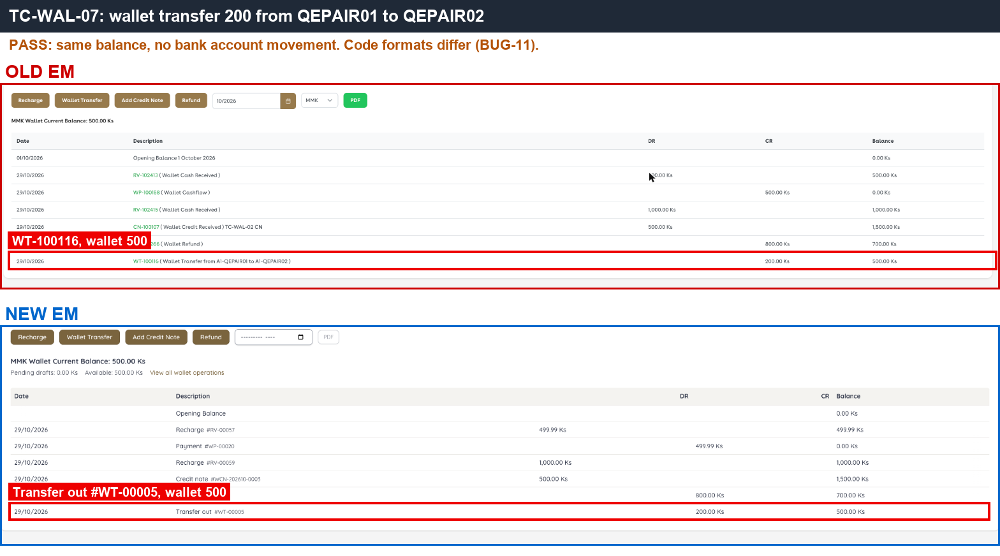 — transfer number and wallet A 500 on both sides.

---

#### ★ SAN-DEP-001 · Add Deposit 5,000 — RV (category Deposit) created, deposit +5,000, account +5,000

| Priority | Suites | Automation | Status | Source |
|---|---|---|---|---|
| P1 | Sanity · Regression | Auto-UI | Active | EM Parity v2 (TC-DEP-01), 2026-10-30 |

**Preconditions:**

1. Logged in to EM as an Admin user.
2. Test apartment with deposit balance 0; account `QE PAIR Cash`.

**Test data:**

1. Deposit 5,000, Payment Method Cash, Received In `QE PAIR Cash`.

**Steps:**

1. Go to Apartments, open the test apartment, open the Deposit tab.
2. Click [Add Deposit], enter the test data, submit.
3. Check the Deposit tab, Cash Received > Recent Receipts and `QE PAIR Cash`.

**Expected result:**

1. A new RV with category Deposit; deposit balance **5,000**.
2. The RV appears in Recent Receipts.
3. `QE PAIR Cash` +5,000.

**Parity result (build -31):**

| Old EM | New EM | Result |
|---|---|---|
| RV-102416; deposit 5,000; account +5,000 | RV-00060; deposit 5,000; RV not in Recent Receipts (BUG-13) | ✅ Match |

**Retest (build -37):** BUG-13 / [EM-102](https://zeyalabs-team-a83df6me.atlassian.net/browse/EM-102) fixed: RV-00060 (Deposit Received 5,000) is now listed; a new deposit RV-00069 appears at the top of Recent Receipts and the Deposit tab shows 'RV-00069 ( Deposit Received )'. Still one row per receipt (Old splits by allocation). Repro 2026-11-01: EM-102 is **partly open** (still one row per receipt, no Created By column).

**Evidence:**

- 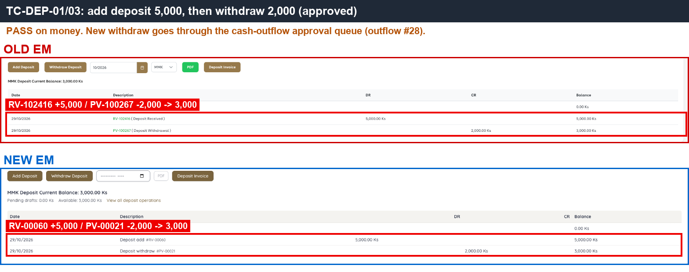 — deposit receipt and balance on both sides.
- 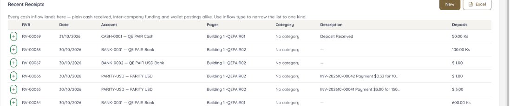 — retest -37: new deposit receipt listed in Recent Receipts.

---

#### ★ SAN-DEP-002 · Withdraw 6,000 when the deposit is 5,000 is blocked

| Priority | Suites | Automation | Status | Source |
|---|---|---|---|---|
| P1 | Sanity · Regression | Auto-UI | Active | EM Parity v2 (TC-DEP-02), 2026-10-30 |

**Preconditions:**

1. Logged in to EM as an Admin user.
2. Test apartment deposit balance 5,000.

**Test data:**

1. Withdraw 6,000 from `QE PAIR Cash`.

**Steps:**

1. Go to the test apartment, Deposit tab, click [Withdraw].
2. Select Withdraw From = `QE PAIR Cash` from the account dropdown.
3. Enter 6,000 and submit.

**Expected result:**

1. Withdraw From is a dropdown of cash/bank accounts in the deposit currency.
2. The withdrawal is blocked with an insufficient-balance error; deposit unchanged.

**Parity result (build -31):**

| Old EM | New EM | Result |
|---|---|---|
| Account chosen from a dropdown; 6,000 → 'Invalid Amount' | 6,000 → 'Insufficient deposit balance', but Withdraw From is free text where the account ID must be typed | ✅ Match |

**Retest (build -37):** BUG-30 / [EM-105](https://zeyalabs-team-a83df6me.atlassian.net/browse/EM-105) fixed: Withdraw From is a dropdown 'Choose an account' listing only MMK accounts; withdrawing 6,000 above the deposit is blocked with 'Insufficient deposit balance (ERR_DEPOSIT_INSUFFICIENT_BALANCE)'. The hint 'Enter an amount to deposit' is still shown on the withdraw form. Repro 2026-11-01: EM-105 is **partly open** (hint still says 'Enter an amount to deposit.').

**Evidence:**

- 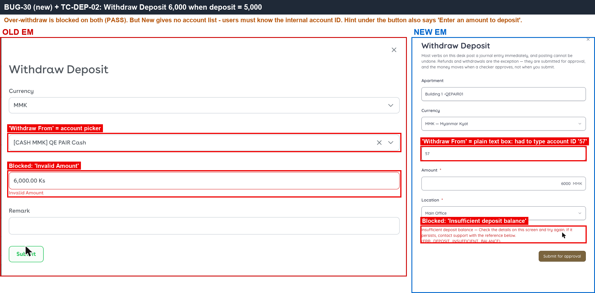 — Old account dropdown vs New free-text field; both block the over-withdrawal.
- [BUG-30.gif](../gif/BUG-30.gif)
- 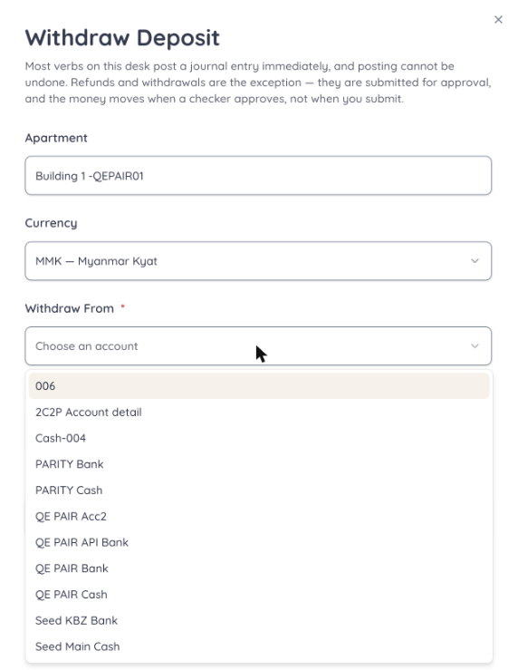 — retest -37: Withdraw From dropdown with MMK accounts only.
- 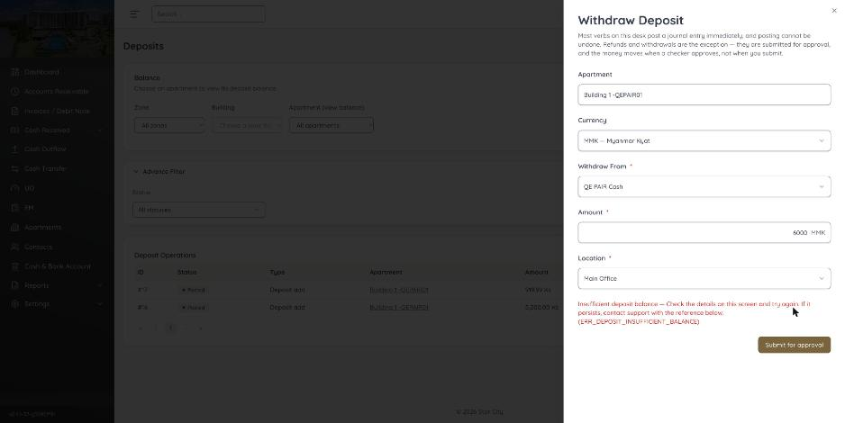 — retest -37: over-withdrawal blocked.

---

#### ★ SAN-DEP-003 · Withdraw 2,000 and approve — PV created, deposit 3,000, account −2,000

| Priority | Suites | Automation | Status | Source |
|---|---|---|---|---|
| P1 | Sanity · Regression | Auto-UI | Active | EM Parity v2 (TC-DEP-03), 2026-10-30 |

**Preconditions:**

1. Logged in to EM as an Admin user.
2. Test apartment deposit balance 5,000.

**Test data:**

1. Withdraw 2,000 from `QE PAIR Cash`.

**Steps:**

1. Go to the test apartment, Deposit tab, click [Withdraw].
2. Select `QE PAIR Cash`, enter 2,000, submit.
3. Open the withdrawal draft and click [Approve].
4. Check the deposit balance and `QE PAIR Cash`.

**Expected result:**

1. A PV number is assigned.
2. Deposit 5,000 → **3,000**; `QE PAIR Cash` −2,000.

**Parity result (build -31):**

| Old EM | New EM | Result |
|---|---|---|
| PV-100267; deposit 3,000 | outflow #28 → PV-00021; deposit 3,000 | ✅ Match |

**Evidence:**

-  — withdrawal PV and deposit 3,000 on both sides.

---

#### SAN-DI-001 · Create Deposit Invoice 2 × 1,000 — Date field available and total 2,000 shown while typing

| Priority | Suites | Automation | Status | Source |
|---|---|---|---|---|
| P2 | Sanity · Regression | Auto-UI | Active | EM Parity v2 (TC-DI-01), 2026-10-30 |

**Preconditions:**

1. Logged in to EM as an Admin user.
2. Test apartment exists.

**Test data:**

1. Deposit Invoice line: Unit 2 × 1,000.

**Steps:**

1. Go to Deposit Invoice, click [New].
2. Select the test apartment and set the Date.
3. Enter the line from the test data and read the total.
4. Click [Create].

**Expected result:**

1. The form has a Date field.
2. Total **2,000** is shown as soon as the line is entered.
3. The draft is created and the DI draft chip increases by 1.

**Parity result (build -31):**

| Old EM | New EM | Result |
|---|---|---|
| Date field present; total 2,000 shown immediately | No Date field; total only calculated after the draft is created; total 2,000 | ❌ [BUG-15](../bugs.md#bug-15) · [EM-103](https://zeyalabs-team-a83df6me.atlassian.net/browse/EM-103) |

**Evidence:**

- 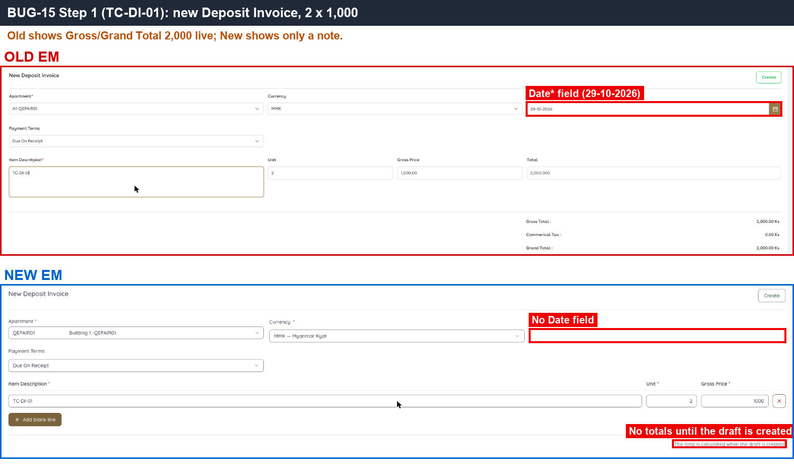 — Old Date field; New form has none.

---

#### SAN-DI-002 · Approve Deposit Invoice — DI number, issue and due dates, creator and approver shown

| Priority | Suites | Automation | Status | Source |
|---|---|---|---|---|
| P2 | Sanity · Regression | Auto-UI | Active | EM Parity v2 (TC-DI-02), 2026-10-30 |

**Preconditions:**

1. Logged in to EM as an Admin user.
2. Deposit Invoice draft 2,000 from SAN-DI-001.

**Steps:**

1. Note the apartment's AR total and S.O.A.
2. Open the Deposit Invoice draft, click [Approve].
3. Open the approved Deposit Invoice details.
4. Check AR and S.O.A again.

**Expected result:**

1. A DI number is assigned; Issue Date and Due Date are shown (29/10).
2. Created By and Approved By are shown.
3. [Remove] is no longer available on the approved invoice.
4. AR and S.O.A are unchanged.

**Parity result (build -31):**

| Old EM | New EM | Result |
|---|---|---|
| DI-202610-00003; Issue/Due 29/10; Created/Approved By shown | DEP-202610-0002; all dates and creator/approver '—'; [Remove] still shown | ❌ [BUG-15](../bugs.md#bug-15) · [EM-103](https://zeyalabs-team-a83df6me.atlassian.net/browse/EM-103) |

**Evidence:**

- 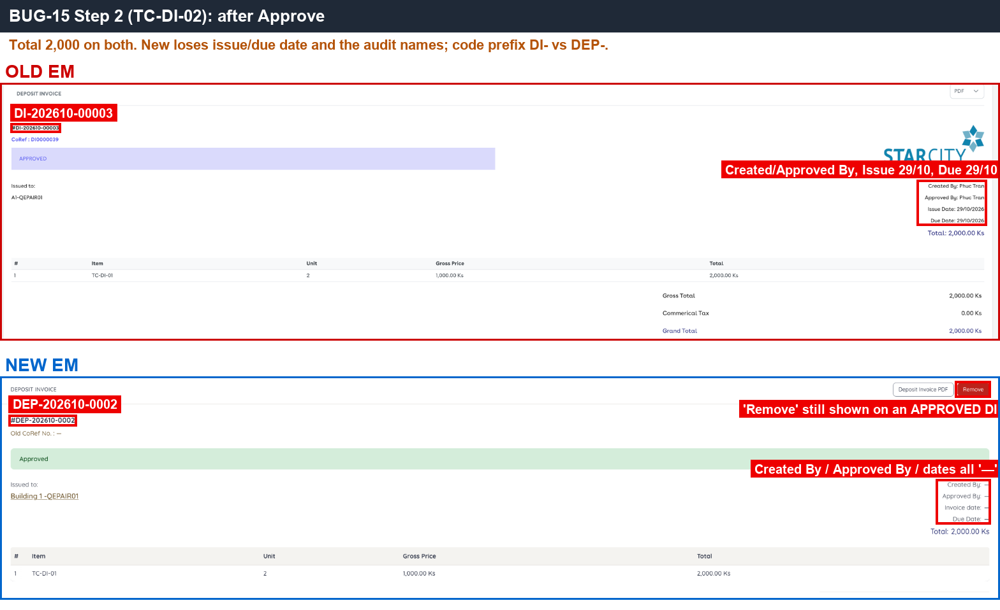 — New Created By / Approved By / dates all '—', and [Remove] still shown.
- [BUG-15.gif](../gif/BUG-15.gif)

---
