# 07 · Cash Received, Unknown Receipts & Funding — Sanity

[← Sanity index](../README.md) · [Bugs](../bugs.md)

**Test cases:** 10 · **Parity result:** ✅ 5 · ⚠️ 1 · ❌ 4

## Summary

| ID | Test case | Pri | Result | Bug / note |
|---|---|---|---|---|
| [SAN-RV-001](#san-rv-001--recent-receipts-lists-all-receipts-newest-first-one-row-per-allocation) | Recent Receipts lists all receipts, newest first, one row per allocation | P1 | ❌ Bug | [BUG-13](../bugs.md#bug-13) · [EM-102](https://zeyalabs-team-a83df6me.atlassian.net/browse/EM-102), [BUG-14](../bugs.md#bug-14) · [EM-109](https://zeyalabs-team-a83df6me.atlassian.net/browse/EM-109) |
| [SAN-RV-002](#san-rv-002--mark-cheque-receipt-as-uncleared--status-changes-account-balance-unchanged) | Mark cheque receipt as Uncleared — status changes, account balance unchanged | P2 | ⚠️ Differs | [Differs](../differences.md#san-rv-002) — New follows the spec; see [N-02](../new-only.md#n-02) |
| [SAN-UNK-001](#san-unk-001--unknown-receipt-cannot-be-recorded-into-a-cash-type-account) | Unknown receipt cannot be recorded into a CASH-type account | P1 | ✅ Match | — |
| [SAN-UNK-002](#-san-unk-002--create-unknown-receipt-into-a-bank-account--rv-created-bank-balance-increased) | ★ Create Unknown receipt into a Bank account — RV created, bank balance increased | P1 | ✅ Match | Bank account +1,000 on both |
| [SAN-UNK-003](#san-unk-003--unknown-receipt-with-a-future-date-is-rejected) | Unknown receipt with a future date is rejected | P1 | ✅ Match | Time-zone note: [D-13](../differences.md#d-13) |
| [SAN-UNK-004](#-san-unk-004--assign-unknown-receipt-to-apartment-credit-to-wallet--invoices-paid-remainder-to-wallet) | ★ Assign Unknown receipt to apartment, credit to Wallet — invoices paid, remainder to wallet | P1 | ❌ Bug | [BUG-20](../bugs.md#bug-20), [BUG-31](../bugs.md#bug-31) · [EM-114](https://zeyalabs-team-a83df6me.atlassian.net/browse/EM-114) |
| [SAN-UNK-005](#san-unk-005--assigned-unknown-receipt-leaves-the-unknown-list-and-appears-in-assigned-unknown-logs) | Assigned Unknown receipt leaves the Unknown list and appears in Assigned Unknown Logs | P1 | ✅ Match | — |
| [SAN-UNK-006](#san-unk-006--assign-unknown-receipt-with-credit-to-deposit--remainder-added-to-deposit) | Assign Unknown receipt with credit to Deposit — remainder added to deposit | P2 | ✅ Match | — |
| [SAN-UNK-007](#san-unk-007--assign-usd-unknown-receipt-to-an-mmk-invoice--rate-applied-conversion-description-recorded) | Assign USD Unknown receipt to an MMK invoice — rate applied, conversion description recorded | P2 | ❌ Bug | [BUG-38](../bugs.md#bug-38) · [EM-117](https://zeyalabs-team-a83df6me.atlassian.net/browse/EM-117) |
| [SAN-FR-001](#-san-fr-001--create-funding-received--rv-listed-in-recent-receipts-and-account-increased) | ★ Create Funding Received — RV listed in Recent Receipts and account increased | P1 | ❌ Bug | [BUG-35](../bugs.md#bug-35) · duplicate of [EM-39](https://zeyalabs-team-a83df6me.atlassian.net/browse/EM-39) |

## Test cases

#### SAN-RV-001 · Recent Receipts lists all receipts, newest first, one row per allocation

| Priority | Suites | Automation | Status | Source |
|---|---|---|---|---|
| P1 | Sanity · Regression | Auto-UI | Active | EM Parity v2 (TC-RV-01), 2026-10-30 |

**Preconditions:**

1. Logged in to EM as an Admin user.
2. Receipts created today for the test apartment: wallet recharge 1,000, deposit 5,000, an invoice payment, and an assigned Unknown receipt that paid an invoice and put the remainder into the wallet.

**Test data:**

1. Apartment: Old `A1-QEPAIR01` · New `Building 1 -QEPAIR01`.
2. Receipts — Old: RV-102415 (wallet), RV-102416 (deposit), RV-102417 (Unknown assigned: Wallet 920 + Inv 80) · New: RV-00059 (wallet), RV-00060 (deposit), RV-00061 (Unknown assigned, 1,000).

**Steps:**

1. Go to Cash Received > Recent Receipts.
2. Check the sort order of the list.
3. Look for the wallet recharge and deposit receipts.
4. Look at how the assigned Unknown receipt is shown.
5. Check the columns (Category, Description, Created By).

**Expected result:**

1. Newest receipt is on top.
2. All receipts are listed, including wallet recharge and deposit receipts.
3. A receipt split across several allocations is shown as one row per allocation (e.g. Wallet 920 + Inv 80).
4. Category and Description are filled; a Created By column is available.

**Parity result (build -31):**

| Old EM | New EM | Result |
|---|---|---|
| Newest on top. One row per allocation: RV-102417 split into Wallet 920 + Inv 80. Deposit receipt RV-102416 listed. Columns Created By, Category, Description present | One row per receipt (RV-00061 = 1,000). Category 'No category', Description '—'. RV-00060 (deposit 5,000) and RV-00059 (wallet) missing. No Created By column | ❌ [BUG-13](../bugs.md#bug-13) · [EM-102](https://zeyalabs-team-a83df6me.atlassian.net/browse/EM-102), [BUG-14](../bugs.md#bug-14) · [EM-109](https://zeyalabs-team-a83df6me.atlassian.net/browse/EM-109) |

**Retest (build -37):** BUG-13 / EM-102 fixed — RV-00059 'Wallet Cash Received' 1,000 and RV-00060 'Deposit Received' 5,000 are now listed, and a new deposit (RV-00069, 50) appears at the top immediately. Created By is available in the expanded [+] row. Still one row per receipt (RV-00066, which pays 3 invoices, is a single row); Old splits by allocation.

**Evidence:**

- 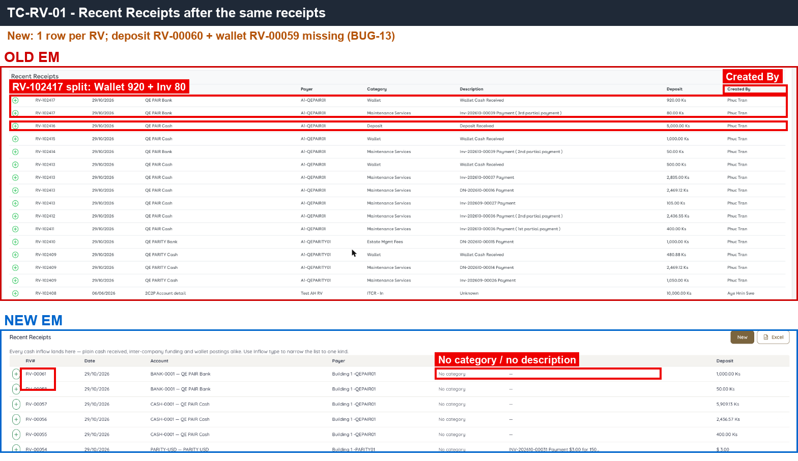 — Old splits RV-102417 into 2 rows (Wallet 920 + Inv 80) with a Created By column; New shows 'No category' and no description.
- [RV-01.gif](../gif/RV-01.gif)
- 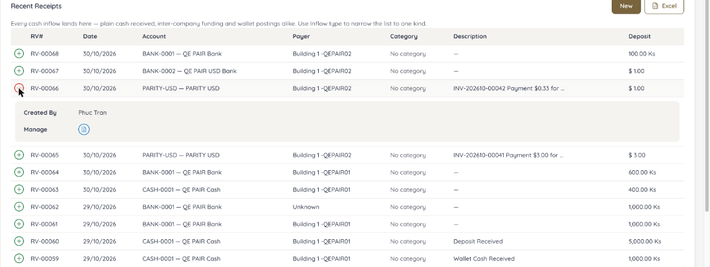 — build -37: wallet and deposit receipts RV-00059 / RV-00060 now listed.
- 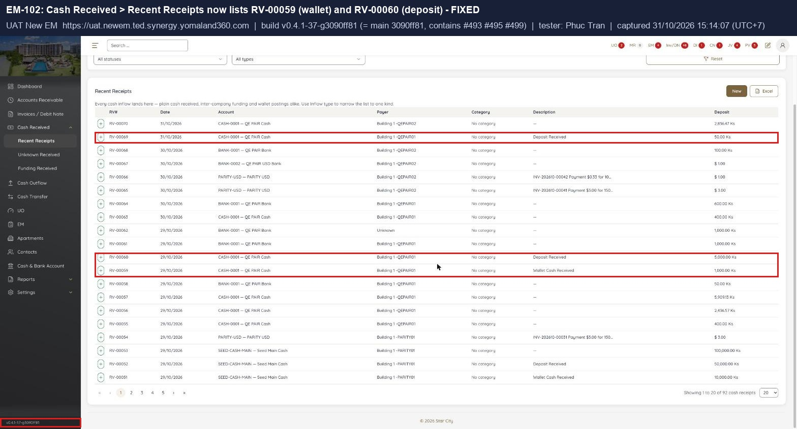 — build -37: the same check run with the Jira ticket steps.
- 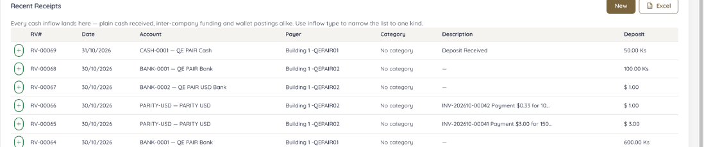 — build -37: new deposit RV-00069 shown at the top of Recent Receipts.

---

#### SAN-RV-002 · Mark cheque receipt as Uncleared — status changes, account balance unchanged

| Priority | Suites | Automation | Status | Source |
|---|---|---|---|---|
| P2 | Sanity · Regression | Auto-UI | Active | EM Parity v2 (TC-RV-02), 2026-10-30 |

**Preconditions:**

1. Logged in to EM as an Admin user.
2. A cleared cheque receipt exists, paid into the test bank account.

**Test data:**

1. Account: `QE PAIR Bank`.
2. Receipt — Old: RV-102420 · New: RV-00064 (Cheque, Cleared).

**Steps:**

1. Note the balance of `QE PAIR Bank` in Cash & Bank Account.
2. Go to Cash Received and open the cheque receipt.
3. Click Mark Uncleared and confirm.
4. Check the receipt status.
5. Check the `QE PAIR Bank` balance and its Account Statement.

**Expected result:**

1. The cheque status is saved as Uncleared.
2. The account balance and the Account Statement do not change (journal entry kept as is).

**Parity result (build -31):**

| Old EM | New EM | Result |
|---|---|---|
| UAT has no place to change the cheque status (neither the Make Payment form nor the RV-102420 page), although the spec says it exists | RV-00064: Mark Uncleared → confirm → status changes; QE PAIR Bank balance stays 13,650; journal entry #269 unchanged | ⚠️ [Differs](../differences.md#san-rv-002) — New follows the spec; see [N-02](../new-only.md#n-02) |

**Evidence:**

- 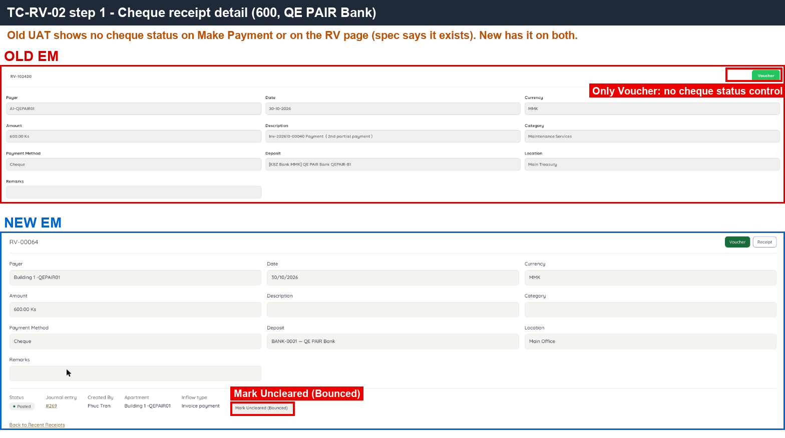 — New receipt page with the Mark Uncleared action; Old has no equivalent.
- 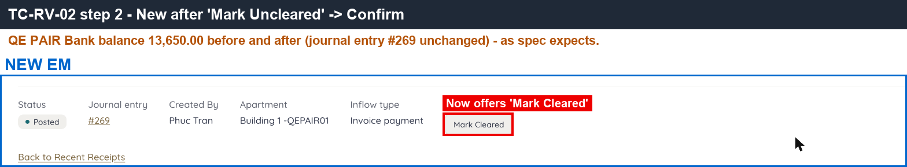 — after marking Uncleared, the account balance is unchanged.
- [RV-02.gif](../gif/RV-02.gif)

---

#### SAN-UNK-001 · Unknown receipt cannot be recorded into a CASH-type account

| Priority | Suites | Automation | Status | Source |
|---|---|---|---|---|
| P1 | Sanity · Regression | Auto-UI+API | Active | EM Parity v2 (TC-UNK-01), 2026-10-30 |

**Preconditions:**

1. Logged in to EM as an Admin user.
2. A CASH-type account exists.

**Test data:**

1. Account: `QE PAIR Cash` (type CASH).
2. Amount: 100,000.

**Steps:**

1. Go to Cash Received > Unknown Receipt, click New.
2. Open the account dropdown.
3. Via the API, create an Unknown receipt of 100,000 into `QE PAIR Cash`.

**Expected result:**

1. The account dropdown lists BANK accounts only.
2. The API request into a CASH account is rejected with an account-type error.

**Parity result (build -31):**

| Old EM | New EM | Result |
|---|---|---|
| Dropdown lists BANK accounts only. API not called on Old (a 403 ends the session) | Dropdown lists BANK only. API into a CASH account → 422 `ERR_CASH_INFLOW_UNKNOWN_DEPOSIT_NOT_BANK` ([BUG-06](../bugs.md#bug-06) fixed in build -31) | ✅ Match |

**Evidence:**

- 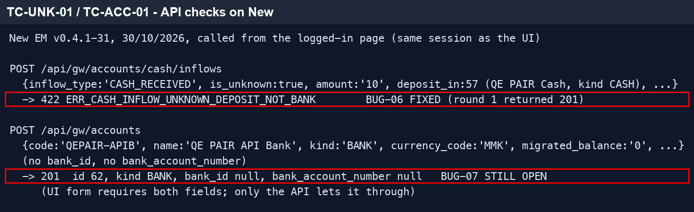 — top half: the API rejects the CASH account with 422.

---

#### ★ SAN-UNK-002 · Create Unknown receipt into a Bank account — RV created, bank balance increased

| Priority | Suites | Automation | Status | Source |
|---|---|---|---|---|
| P1 | Sanity · Regression | Auto-UI | Active | EM Parity v2 (TC-UNK-02), 2026-10-30 |

**Preconditions:**

1. Logged in to EM as an Admin user.
2. A BANK-type account exists; note its balance and today's Total Collection on the Dashboard.

**Test data:**

1. Account: `QE PAIR Bank`.
2. Amount: 1,000.

**Steps:**

1. Go to Cash Received > Unknown Receipt, click New.
2. Select `QE PAIR Bank`, enter 1,000, today's date.
3. Submit.
4. Check the `QE PAIR Bank` balance and the Dashboard collection.

**Expected result:**

1. A new RV number is created.
2. The bank account balance increases by 1,000.
3. Dashboard Total Collection increases by 1,000.

**Parity result (build -31):**

| Old EM | New EM | Result |
|---|---|---|
| RV-102417 · 1,000 into QE PAIR Bank | RV-00061 · 1,000 into QE PAIR Bank (BANK-0001) | ✅ Match — bank account +1,000 on both |

---

#### SAN-UNK-003 · Unknown receipt with a future date is rejected

| Priority | Suites | Automation | Status | Source |
|---|---|---|---|---|
| P1 | Sanity · Regression | Auto-UI | Active | EM Parity v2 (TC-UNK-03), 2026-10-30 |

**Preconditions:**

1. Logged in to EM as an Admin user.

**Test data:**

1. Account: `QE PAIR Bank`.
2. Date: tomorrow.

**Steps:**

1. Go to Cash Received > Unknown Receipt, click New.
2. Open the date picker and try to pick tomorrow.
3. Submit with a date after today.

**Expected result:**

1. Tomorrow cannot be picked in the calendar.
2. Submitting a future date is rejected with a date error.

**Parity result (build -31):**

| Old EM | New EM | Result |
|---|---|---|
| Calendar locks the 31st. Submitting 30/10 (machine time, Yangon still 29/10) is blocked: 'must be a date before tomorrow' | Calendar locks the 31st. Submitting 30/10 is blocked: 'Choose today's date or earlier' | ✅ Match (time-zone note: [D-13](../differences.md#d-13)) |

**Evidence:**

- 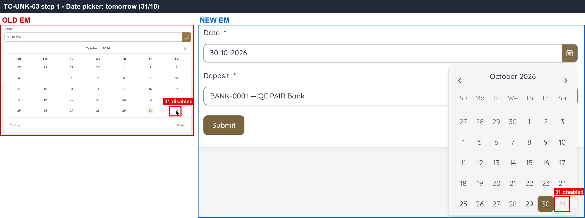 — both calendars lock tomorrow.
- 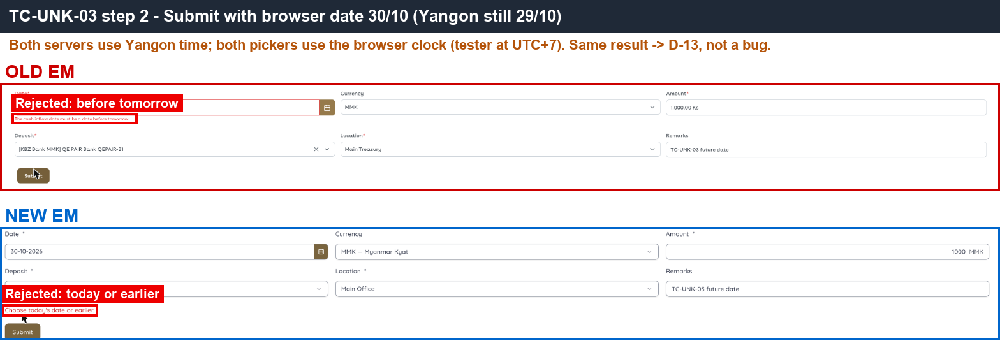 — the error each side shows on submit.
- [UNK-03.gif](../gif/UNK-03.gif)

---

#### ★ SAN-UNK-004 · Assign Unknown receipt to apartment, credit to Wallet — invoices paid, remainder to wallet

| Priority | Suites | Automation | Status | Source |
|---|---|---|---|---|
| P1 | Sanity · Regression | Auto-UI+API | Active | EM Parity v2 (TC-UNK-04), 2026-10-30 |

**Preconditions:**

1. Logged in to EM as an Admin user.
2. An unassigned Unknown receipt of 1,000 exists on the test bank account.
3. The test apartment has an unpaid invoice with 80 due.

**Test data:**

1. Apartment: Old `A1-QEPAIR01` · New `Building 1 -QEPAIR01`.
2. Unknown receipt: Old RV-102417 · New RV-00061 (1,000, `QE PAIR Bank`).

**Steps:**

1. Go to Cash Received > Unknown Receipt, click Assign on the 1,000 receipt.
2. Select the test apartment.
3. Check the invoice lines and the allocation.
4. Keep the remainder going to Wallet.
5. Click Confirm (New: enter a Payer first if Confirm is disabled).
6. Check the invoice status, the wallet balance and the bank account balance.

**Expected result:**

1. Confirm can be clicked without extra required fields; the full invoice number is shown.
2. The invoice due (80) is paid; the remainder (920) goes to the wallet.
3. The allocation uses the same RV number.
4. The bank account balance does not change again.
5. Any shortfall message shows the remaining amount, not the full receipt amount.

**Parity result (build -31):**

| Old EM | New EM | Result |
|---|---|---|
| No Payer field. 80.00 auto-allocated to Inv-202610-00039; remainder 920 → Wallet (default toggle). RV-102417 | Confirm stays disabled until Payer is typed, with no message. Invoice number truncated 'INV-202610-00…'. Hint says 'short of 1000.0000 MMK' (real: 919.99). Paid 80.01, remainder 919.99 | ❌ [BUG-20](../bugs.md#bug-20), [BUG-31](../bugs.md#bug-31) · [EM-114](https://zeyalabs-team-a83df6me.atlassian.net/browse/EM-114) |

**Evidence:**

- 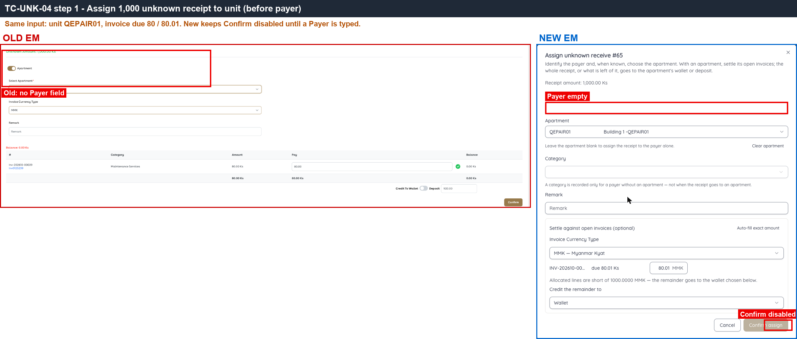 — Old has no Payer field; New Payer is empty and Confirm is greyed out.
- 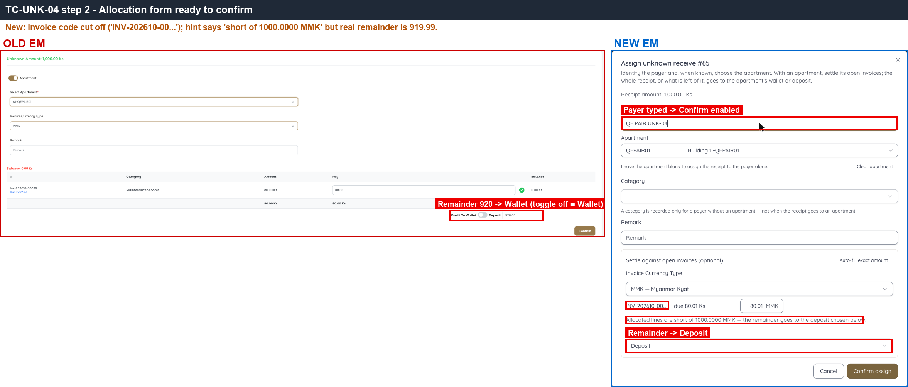 — Confirm is enabled only after typing a Payer; the hint shows 1000.0000 instead of the remaining amount.
- 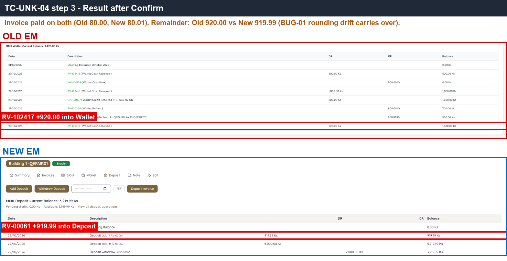 — result: the money goes to the right invoice on both sides; 0.01 difference from BUG-01.
- [UNK-04.gif](../gif/UNK-04.gif)

---

#### SAN-UNK-005 · Assigned Unknown receipt leaves the Unknown list and appears in Assigned Unknown Logs

| Priority | Suites | Automation | Status | Source |
|---|---|---|---|---|
| P1 | Sanity · Regression | Auto-UI | Active | EM Parity v2 (TC-UNK-05), 2026-10-30 |

**Preconditions:**

1. Logged in to EM as an Admin user.
2. SAN-UNK-004 done (Unknown receipt assigned).

**Test data:**

1. Receipt: Old RV-102417 · New RV-00061.

**Steps:**

1. Go to Cash Received > Unknown Receipt and look for the assigned receipt in the allocation list.
2. Go to Reports > Assigned Unknown Received Logs.

**Expected result:**

1. The receipt is no longer in the Unknown allocation list.
2. The receipt is listed in Assigned Unknown Logs.

**Parity result (build -31):**

| Old EM | New EM | Result |
|---|---|---|
| RV leaves the Allocation list and moves to the Unknown Received tab | RV leaves the Allocation list | ✅ Match |

**Evidence:**

-  — the assigned receipt is no longer waiting for allocation.

---

#### SAN-UNK-006 · Assign Unknown receipt with credit to Deposit — remainder added to deposit

| Priority | Suites | Automation | Status | Source |
|---|---|---|---|---|
| P2 | Sanity · Regression | Auto-UI+API | Active | EM Parity v2 (TC-UNK-06), 2026-10-30 |

**Preconditions:**

1. Logged in to EM as an Admin user.
2. An unassigned Unknown receipt of 1,000 exists; the test apartment has an unpaid invoice with 80 due.

**Test data:**

1. Apartment: Old `A1-QEPAIR01` · New `Building 1 -QEPAIR01`.
2. Unknown receipt: New RV-00061 (1,000, `QE PAIR Bank`).

**Steps:**

1. Go to Cash Received > Unknown Receipt, click Assign, select the test apartment.
2. Switch the remainder credit from Wallet to Deposit.
3. Click Confirm.
4. Open the apartment Deposit tab.

**Expected result:**

1. The deposit balance increases by the remainder.
2. The Deposit ledger has a row for the receipt.

**Parity result (build -31):**

| Old EM | New EM | Result |
|---|---|---|
| (Old was run with Wallet credit, see SAN-UNK-004) | Remainder 919.99 → Deposit; Deposit ledger has row #RV-00061 (0.01 off because of [BUG-01](../bugs.md#bug-01)) | ✅ Match |

**Evidence:**

-  — remainder credited, with the 0.01 difference from BUG-01.

---

#### SAN-UNK-007 · Assign USD Unknown receipt to an MMK invoice — rate applied, conversion description recorded

| Priority | Suites | Automation | Status | Source |
|---|---|---|---|---|
| P2 | Sanity · Regression | Auto-UI+API | Active | EM Parity v2 (TC-UNK-07), 2026-10-30 |

**Preconditions:**

1. Logged in to EM as an Admin user.
2. A USD bank account exists with an unassigned Unknown receipt of $1.
3. The test apartment has an unpaid MMK invoice of 5,000.

**Test data:**

1. Account: `QE PAIR USD Bank`.
2. Unknown receipt: Old RV-102423 · New RV-00067 ($1).
3. Invoice: Old Inv-202610-00048 · New INV-202610-00045 (5,000 Ks).
4. Rate: 5,000.

**Steps:**

1. Go to Cash Received > Unknown Receipt, click Assign on the $1 receipt.
2. Allocate it to the 5,000 Ks invoice with rate 5,000, click Confirm.
3. Open the receipt and check the description.
4. Go to Reports > Assigned Unknown Received Logs.

**Expected result:**

1. The rate is applied and the invoice becomes Paid.
2. The description reads like 'Payment $1.00 for 5000.00Ks ( $1 = 5000Ks )'.
3. Old EM baseline: the receipt is not shown in Assigned Logs.

**Parity result (build -31):**

| Old EM | New EM | Result |
|---|---|---|
| Unknown $1 (RV-102423, QE PAIR USD Bank) assigned to Inv-202610-00048 5,000: rate 5000, description '… Payment $1.00 for 5000.00Ks ( $1 = 5000Ks )'; NOT in Assigned Logs | RV-00067 assigned to INV-202610-00045: rate 5,000, invoice PAID. But description = null; IS shown in Assigned Logs | ❌ [BUG-38](../bugs.md#bug-38) · [EM-117](https://zeyalabs-team-a83df6me.atlassian.net/browse/EM-117) |

**Evidence:**

- 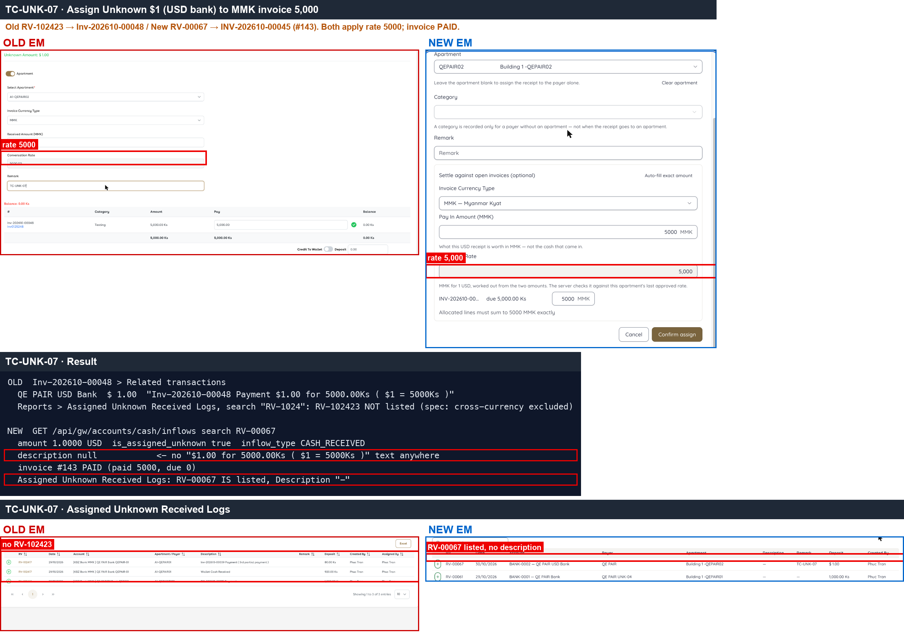 — middle (API, dark background): Old has the conversion description, New has `description null`; bottom: Assigned Logs, New lists RV-00067 with an empty description.
- [BUG-38.gif](../gif/BUG-38.gif)

---

#### ★ SAN-FR-001 · Create Funding Received — RV listed in Recent Receipts and account increased

| Priority | Suites | Automation | Status | Source |
|---|---|---|---|---|
| P1 | Sanity · Regression | Auto-UI | Active | EM Parity v2 (TC-FR-01), 2026-10-30 |

**Preconditions:**

1. Logged in to EM as an Admin user.
2. Funding categories are configured.

**Test data:**

1. Account: `QE PAIR Bank`.

**Steps:**

1. Go to Funding Received, click New.
2. Open the Category dropdown and pick a category.
3. Fill the account and amount, click Submit.
4. Check Recent Receipts, Reports > Cash Received and the account balance.

**Expected result:**

1. Funding categories are listed (Funding Category, ITCR - In, …).
2. The record can be submitted; the RV appears in Recent Receipts and the Cash Received report.
3. The account balance increases by the amount.

**Parity result (build -31):**

| Old EM | New EM | Result |
|---|---|---|
| Form lists 5 categories (Funding Category, ITCR - In, …); Submit not clicked | Category is required but the dropdown is empty → Funding Received cannot be created | ❌ [BUG-35](../bugs.md#bug-35) · duplicate of [EM-39](https://zeyalabs-team-a83df6me.atlassian.net/browse/EM-39) |

**Evidence:**

- 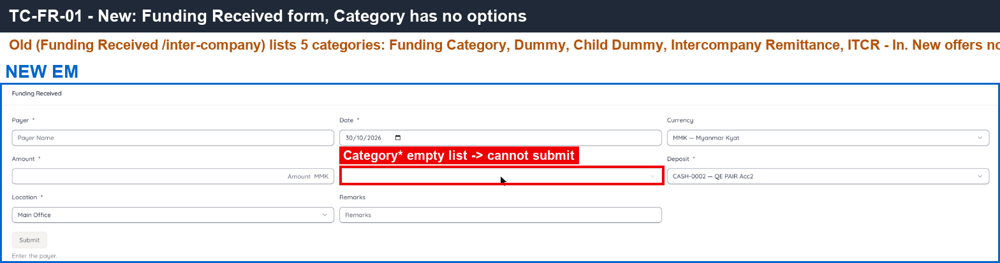 — New Category* field has no options.
- [BUG-35.gif](../gif/BUG-35.gif)

---
