# 08 · Cash Outflow & Cash Transfer — Sanity

[← Sanity index](../README.md) · [Bugs](../bugs.md)

**Test cases:** 12 · **Parity result:** ✅ 8 · ⚠️ 1 · ❌ 3

## Summary

| ID | Test case | Pri | Result | Bug / note |
|---|---|---|---|---|
| [SAN-PV-001](#-san-pv-001--cash-outflow-above-the-account-balance-no-overdraft-is-blocked-at-creation) | ★ Cash Outflow above the account balance (no overdraft) is blocked at creation | P1 | ❌ Bug | [BUG-05](../bugs.md#bug-05) · [EM-97](https://zeyalabs-team-a83df6me.atlassian.net/browse/EM-97) |
| [SAN-PV-002](#-san-pv-002--create-valid-cash-outflow--draft-without-number-pv-chip-1-balance-unchanged) | ★ Create valid Cash Outflow — draft without number, PV chip +1, balance unchanged | P1 | ⚠️ Differs | [Differs](../differences.md#san-pv-002) — chip refresh, see [D-12](../differences.md#d-12) |
| [SAN-PV-003](#-san-pv-003--approve-cash-outflow--pv-number-issued-account-debited-cr-row-in-account-statement) | ★ Approve Cash Outflow — PV number issued, account debited, CR row in Account Statement | P1 | ✅ Match | — |
| [SAN-PV-004](#-san-pv-004--approve-an-already-approved-cash-outflow--already-approved-error) | ★ Approve an already approved Cash Outflow — 'already approved' error | P1 | ✅ Match | — |
| [SAN-PV-005](#-san-pv-005--two-drafts-each-80-of-balance--second-one-blocked-at-approval) | ★ Two drafts each 80% of balance — second one blocked at approval | P1 | ✅ Match | — |
| [SAN-PV-006](#san-pv-006--cash-outflow-with-a-future-date-is-rejected) | Cash Outflow with a future date is rejected | P1 | ✅ Match | — |
| [SAN-PV-007](#-san-pv-007--approve-back-dated-cash-outflow-1-week--row-on-the-right-date-later-balances-reduced) | ★ Approve back-dated Cash Outflow (1 week) — row on the right date, later balances reduced | P1 | ✅ Match | — |
| [SAN-JV-001](#san-jv-001--cash-transfer-with-from--to-account-is-rejected) | Cash Transfer with From = To account is rejected | P1 | ✅ Match | — |
| [SAN-JV-002](#-san-jv-002--cash-transfer-above-the-source-balance-is-blocked-at-creation) | ★ Cash Transfer above the source balance is blocked at creation | P1 | ❌ Bug | [BUG-05](../bugs.md#bug-05) · [EM-97](https://zeyalabs-team-a83df6me.atlassian.net/browse/EM-97) |
| [SAN-JV-003](#-san-jv-003--approve-same-currency-mmk-cash-transfer--jv-number-source-debited-target-credited) | ★ Approve same-currency MMK Cash Transfer — JV number, source debited, target credited | P1 | ✅ Match | — |
| [SAN-JV-004](#-san-jv-004--cross-currency-cash-transfer-usd--mmk-shows-amount-received-and-conversion-rate) | ★ Cross-currency Cash Transfer USD → MMK shows Amount Received and Conversion Rate | P1 | ❌ Bug | [BUG-28](../bugs.md#bug-28) — conflicts with [EM-61](https://zeyalabs-team-a83df6me.atlassian.net/browse/EM-61), PO to confirm |
| [SAN-JV-005](#san-jv-005--cash-transfer-does-not-change-dashboard-net-cash) | Cash Transfer does not change Dashboard Net Cash | P2 | ✅ Match | — |

## Test cases

#### ★ SAN-PV-001 · Cash Outflow above the account balance (no overdraft) is blocked at creation

| Priority | Suites | Automation | Status | Source |
|---|---|---|---|---|
| P1 | Sanity · Regression | Auto-UI | Active | EM Parity v2 (TC-PV-01), 2026-10-30 |

**Preconditions:**

1. Logged in to EM as an Admin user.
2. A cash account without overdraft, balance about 21,946.

**Test data:**

1. Account: `QE PAIR Cash`.
2. Amount: 30,000.

**Steps:**

1. Go to Cash Outflow, click New.
2. Select `QE PAIR Cash`, enter 30,000, fill the required fields.
3. Click Create.
4. (New only, if a draft was created) Click Approve on the draft, then cancel the draft.

**Expected result:**

1. Creation is blocked with 'Insufficient Balance in Withdraw From Account'.
2. No draft is created.

**Parity result (build -31):**

| Old EM | New EM | Result |
|---|---|---|
| Blocked at creation: 'Insufficient Balance' | Draft #29 created ('successfully created'); blocked only at approval ('Insufficient balance… overdraft'); draft cancelled | ❌ [BUG-05](../bugs.md#bug-05) · [EM-97](https://zeyalabs-team-a83df6me.atlassian.net/browse/EM-97) |

**Evidence:**

- 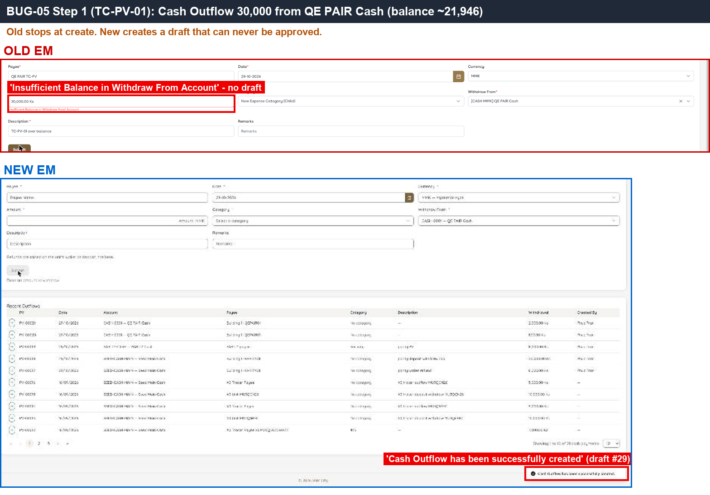 — Old shows 'Insufficient Balance' immediately; New reports the draft as created.
- 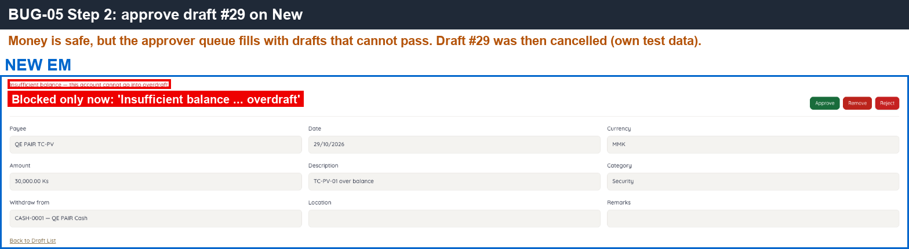 — New only reports the missing balance when Approve is clicked.
- [BUG-05.gif](../gif/BUG-05.gif)

---

#### ★ SAN-PV-002 · Create valid Cash Outflow — draft without number, PV chip +1, balance unchanged

| Priority | Suites | Automation | Status | Source |
|---|---|---|---|---|
| P1 | Sanity · Regression | Auto-UI | Active | EM Parity v2 (TC-PV-02), 2026-10-30 |

**Preconditions:**

1. Logged in to EM as an Admin user.
2. Note the PV chip count and the account balance.

**Test data:**

1. Account: `QE PAIR Cash`.
2. Amount: 1,000.

**Steps:**

1. Go to Cash Outflow, click New.
2. Select `QE PAIR Cash`, enter 1,000, fill the required fields, click Create.
3. Without reloading, check the PV chip.
4. Check the account balance.

**Expected result:**

1. A draft is created with no PV number yet.
2. The PV chip increases by 1 immediately.
3. The account balance does not change.

**Parity result (build -31):**

| Old EM | New EM | Result |
|---|---|---|
| Draft created; PV chip 29→30 immediately | Draft #30; PV chip increases only after reload (5→6) | ⚠️ [Differs](../differences.md#san-pv-002) — chip refresh, see [D-12](../differences.md#d-12) |

**Evidence:**

- 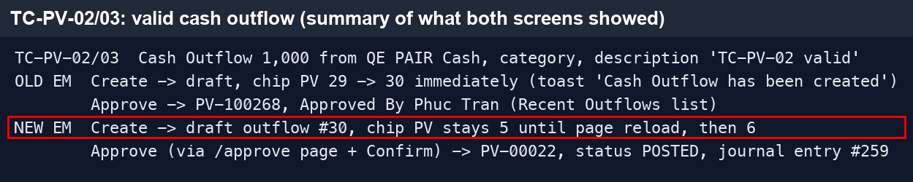 — the New PV chip keeps its old count until the page is reloaded.

---

#### ★ SAN-PV-003 · Approve Cash Outflow — PV number issued, account debited, CR row in Account Statement

| Priority | Suites | Automation | Status | Source |
|---|---|---|---|---|
| P1 | Sanity · Regression | Auto-UI | Active | EM Parity v2 (TC-PV-03), 2026-10-30 |

**Preconditions:**

1. Logged in to EM as an Admin user.
2. SAN-PV-002 done (Cash Outflow draft of 1,000 exists).

**Test data:**

1. Account: `QE PAIR Cash`.
2. Amount: 1,000.

**Steps:**

1. Open the Cash Outflow draft.
2. Click Approve (New: use the 'Approve or remove this draft' link on the draft page, see [D-09](../differences.md#d-09)).
3. Check the voucher number and status.
4. Check the account balance and the Account Statement.

**Expected result:**

1. A PV number is issued (PV-…).
2. The account balance decreases by 1,000.
3. The Account Statement has a CR row for the voucher.

**Parity result (build -31):**

| Old EM | New EM | Result |
|---|---|---|
| PV-100268 | PV-00022 (POSTED, journal entry #259) | ✅ Match |

**Evidence:**

-  — approved vouchers on both sides.

---

#### ★ SAN-PV-004 · Approve an already approved Cash Outflow — 'already approved' error

| Priority | Suites | Automation | Status | Source |
|---|---|---|---|---|
| P1 | Sanity · Regression | Auto-UI+API | Active | EM Parity v2 (TC-PV-04), 2026-10-30 |

**Preconditions:**

1. Logged in to EM as an Admin user.
2. A Cash Outflow draft is open in two browser tabs.

**Test data:**

1. Account: `QE PAIR Cash`.

**Steps:**

1. In tab 1, approve the draft.
2. In tab 2, click Approve on the same (stale) draft.

**Expected result:**

1. The second approval is rejected with an 'already approved' error.
2. The voucher is approved only once (account debited once).

**Parity result (build -31):**

| Old EM | New EM | Result |
|---|---|---|
| 'Transaction has been already approved.' | 409 'Cash operation header is not DRAFT' | ✅ Match |

**Evidence:**

- 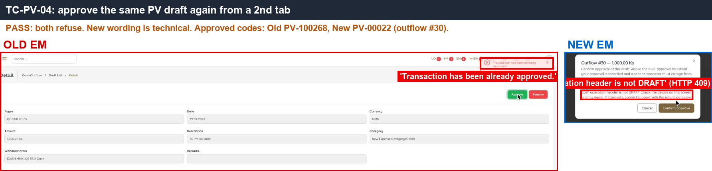 — the second approval is rejected on both sides.

---

#### ★ SAN-PV-005 · Two drafts each 80% of balance — second one blocked at approval

| Priority | Suites | Automation | Status | Source |
|---|---|---|---|---|
| P1 | Sanity · Regression | Auto-UI | Active | EM Parity v2 (TC-PV-05), 2026-10-30 |

**Preconditions:**

1. Logged in to EM as an Admin user.
2. A cash account without overdraft with a known balance.

**Test data:**

1. Two Cash Outflow drafts, each = 80% of the account balance.

**Steps:**

1. Create Cash Outflow draft A for 80% of the balance.
2. Create Cash Outflow draft B for 80% of the balance.
3. Approve draft A.
4. Approve draft B.

**Expected result:**

1. Draft A is approved.
2. Draft B is blocked at approval with an insufficient-balance error.

**Parity result (build -31):**

| Old EM | New EM | Result |
|---|---|---|
| Draft A approved; draft B: 'Insufficient Balance' | #33 approved (account left with 20,000); #34: 'Insufficient balance — this account cannot go into overdraft.' | ✅ Match |

**Evidence:**

- 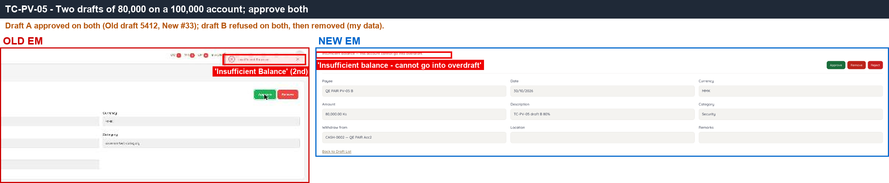 — the second draft is rejected at approval on both sides.

---

#### SAN-PV-006 · Cash Outflow with a future date is rejected

| Priority | Suites | Automation | Status | Source |
|---|---|---|---|---|
| P1 | Sanity · Regression | Auto-UI | Active | EM Parity v2 (TC-PV-06), 2026-10-30 |

**Preconditions:**

1. Logged in to EM as an Admin user.

**Test data:**

1. Account: `QE PAIR Cash`.
2. Date: tomorrow.

**Steps:**

1. Go to Cash Outflow, click New.
2. Open the date picker and try to pick tomorrow.
3. Try to type a future date in the Date field.

**Expected result:**

1. A future date cannot be selected or submitted.

**Parity result (build -31):**

| Old EM | New EM | Result |
|---|---|---|
| Calendar does not allow 31/10 | Calendar greys out 30–31/10; the date field does not accept typed input ([D-11](../differences.md#d-11)) | ✅ Match |

**Evidence:**

- 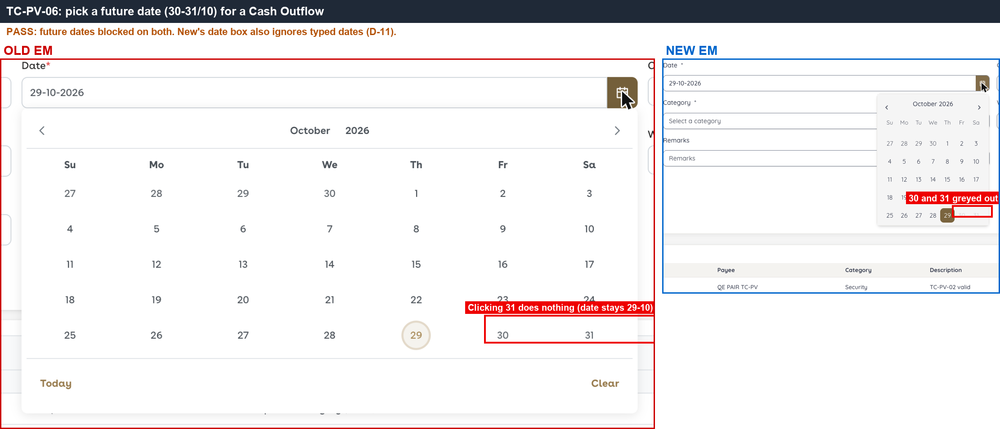 — future dates disabled in both calendars.

---

#### ★ SAN-PV-007 · Approve back-dated Cash Outflow (1 week) — row on the right date, later balances reduced

| Priority | Suites | Automation | Status | Source |
|---|---|---|---|---|
| P1 | Sanity · Regression | Auto-UI | Active | EM Parity v2 (TC-PV-07), 2026-10-30 |

**Preconditions:**

1. Logged in to EM as an Admin user.

**Test data:**

1. Account: `QE PAIR Cash`.
2. Amount: 100, date 23/10 (one week back).

**Steps:**

1. Go to Cash Outflow, click New; enter 100 from `QE PAIR Cash` dated 23/10, click Create.
2. Approve the draft.
3. Open Reports > Account Statement for `QE PAIR Cash` covering 23/10 to today.

**Expected result:**

1. The statement has the row on 23/10.
2. The running balance drops by 100 on 23/10, and every later day is 100 lower.

**Parity result (build -31):**

| Old EM | New EM | Result |
|---|---|---|
| PV-100271 100 on 23/10: Account Statement has the 23/10 row, balance -100 and all later days reduced by 100 | PV-00025 (#37) same. Statement defaults from 30/09; the opening row reads 'Migrated balance set to …' (UI-09) | ✅ Match |

**Evidence:**

- 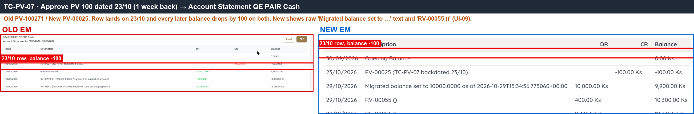 — the back-dated row sits on 23/10 and later balances are reduced on both sides.

---

#### SAN-JV-001 · Cash Transfer with From = To account is rejected

| Priority | Suites | Automation | Status | Source |
|---|---|---|---|---|
| P1 | Sanity · Regression | Auto-UI | Active | EM Parity v2 (TC-JV-01), 2026-10-30 |

**Preconditions:**

1. Logged in to EM as an Admin user.

**Test data:**

1. From and To: `QE PAIR Cash`.

**Steps:**

1. Go to Cash Transfer, click New.
2. Select `QE PAIR Cash` as both From and To, enter an amount.
3. Click Create.

**Expected result:**

1. Creation is rejected with an error that the accounts must be different.

**Parity result (build -31):**

| Old EM | New EM | Result |
|---|---|---|
| 'from/to account must be different' | 'Accounts must differ' | ✅ Match |

**Evidence:**

- 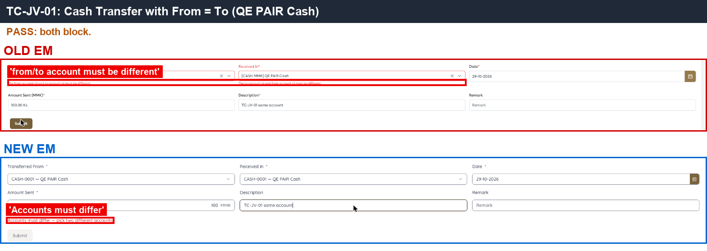 — the same-account error on both sides.

---

#### ★ SAN-JV-002 · Cash Transfer above the source balance is blocked at creation

| Priority | Suites | Automation | Status | Source |
|---|---|---|---|---|
| P1 | Sanity · Regression | Auto-UI | Active | EM Parity v2 (TC-JV-02), 2026-10-30 |

**Preconditions:**

1. Logged in to EM as an Admin user.
2. Source cash account without overdraft, balance about 21,946.

**Test data:**

1. From `QE PAIR Cash` → To `QE PAIR Bank`.
2. Amount: 50,000.

**Steps:**

1. Go to Cash Transfer, click New.
2. From `QE PAIR Cash`, To `QE PAIR Bank`, amount 50,000.
3. Click Create.
4. (New only, if a draft was created) Click Approve, then cancel the draft.

**Expected result:**

1. Creation is blocked with 'Insufficient Balance'.
2. No draft is created.

**Parity result (build -31):**

| Old EM | New EM | Result |
|---|---|---|
| Blocked at creation: 'Insufficient Balance' | Draft #19 created; blocked only at approval (draft cancelled) | ❌ [BUG-05](../bugs.md#bug-05) · [EM-97](https://zeyalabs-team-a83df6me.atlassian.net/browse/EM-97) |

**Evidence:**

- 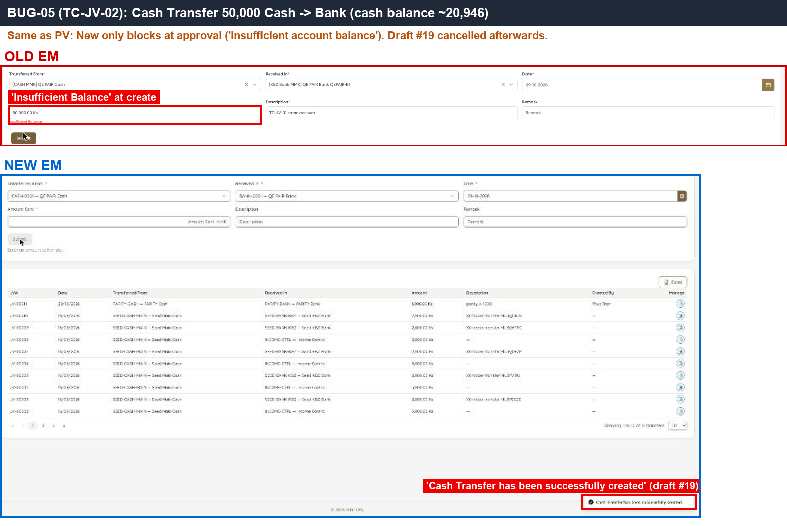 — same pattern as Cash Outflow: New creates the transfer draft.
- [BUG-05.gif](../gif/BUG-05.gif)

---

#### ★ SAN-JV-003 · Approve same-currency MMK Cash Transfer — JV number, source debited, target credited

| Priority | Suites | Automation | Status | Source |
|---|---|---|---|---|
| P1 | Sanity · Regression | Auto-UI | Active | EM Parity v2 (TC-JV-03), 2026-10-30 |

**Preconditions:**

1. Logged in to EM as an Admin user.
2. Note the balances of both accounts.

**Test data:**

1. From `QE PAIR Cash` → To `QE PAIR Bank` (both MMK).
2. Amount: 1,000.

**Steps:**

1. Go to Cash Transfer, click New.
2. From `QE PAIR Cash`, To `QE PAIR Bank`, amount 1,000, click Create.
3. Approve the transfer.
4. Check both account balances.

**Expected result:**

1. A JV number is issued.
2. The source account decreases and the target account increases by the amount.

**Parity result (build -31):**

| Old EM | New EM | Result |
|---|---|---|
| JV-100266 | JV-00012 (transfer #20, POSTED) | ✅ Match |

**Evidence:**

- 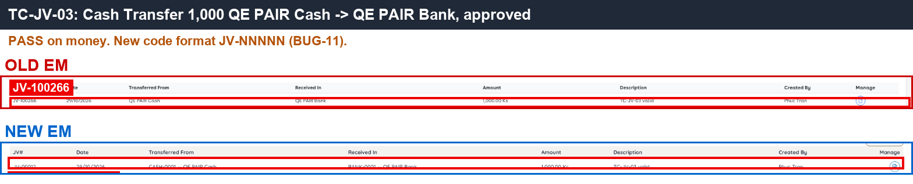 — approved transfer and updated balances on both sides.

---

#### ★ SAN-JV-004 · Cross-currency Cash Transfer USD → MMK shows Amount Received and Conversion Rate

| Priority | Suites | Automation | Status | Source |
|---|---|---|---|---|
| P1 | Sanity · Regression | Auto-UI | Active | EM Parity v2 (TC-JV-04), 2026-10-30 |

**Preconditions:**

1. Logged in to EM as an Admin user.
2. A USD account and an MMK account exist.

**Test data:**

1. From: USD account (`QE PAIR USD Bank`) → To: MMK account.
2. Send 10, receive 21,000.

**Steps:**

1. Go to Cash Transfer, click New.
2. Select the USD account as From and the MMK account as To.
3. Enter 10 to send and 21,000 received.
4. Look at the form before saving (do not Submit).

**Expected result:**

1. The Amount Received field appears when the currencies differ.
2. The Conversion Rate is shown (2,100).
3. After approval each account is updated in its own currency.

**Parity result (build -31):**

| Old EM | New EM | Result |
|---|---|---|
| Shows Amount Received + Conversion Rate 2100 | Shows Amount Received but no Conversion Rate | ❌ [BUG-28](../bugs.md#bug-28) — conflicts with [EM-61](https://zeyalabs-team-a83df6me.atlassian.net/browse/EM-61), PO to confirm |

**Evidence:**

- 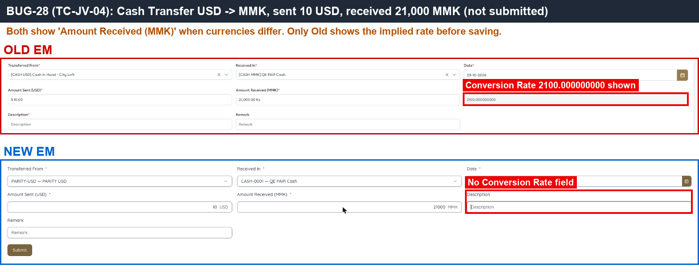 — Old Conversion Rate field; New has none.
- [BUG-28.gif](../gif/BUG-28.gif)

---

#### SAN-JV-005 · Cash Transfer does not change Dashboard Net Cash

| Priority | Suites | Automation | Status | Source |
|---|---|---|---|---|
| P2 | Sanity · Regression | Auto-UI | Active | EM Parity v2 (TC-JV-05), 2026-10-30 |

**Preconditions:**

1. Logged in to EM as an Admin user.
2. Note Net Cash on the Dashboard.

**Test data:**

1. Transfer from SAN-JV-003 (`QE PAIR Cash` → `QE PAIR Bank`).

**Steps:**

1. Approve a same-currency Cash Transfer (SAN-JV-003).
2. Open the Dashboard and check Net Cash.

**Expected result:**

1. Net Cash is unchanged.

**Parity result (build -31):**

| Old EM | New EM | Result |
|---|---|---|
| Net Cash unchanged | Net Cash unchanged | ✅ Match |

**Evidence:**

- 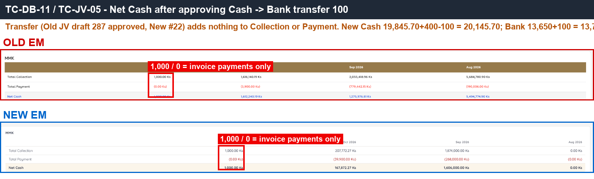 — Net Cash before and after the transfer.

---
