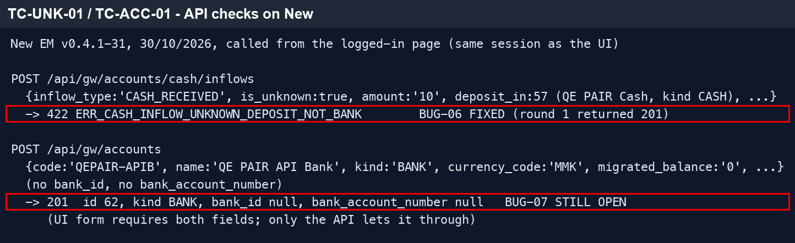
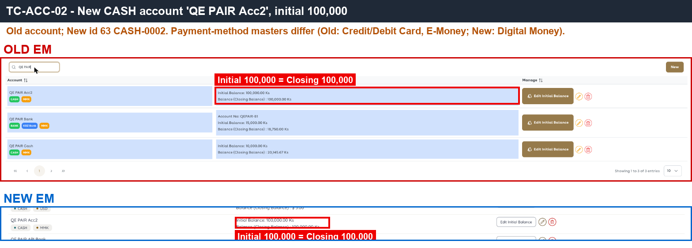
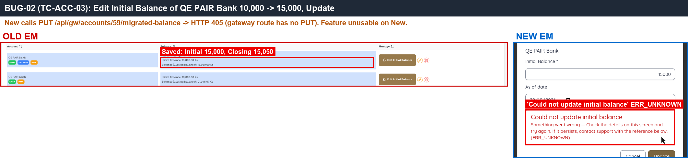
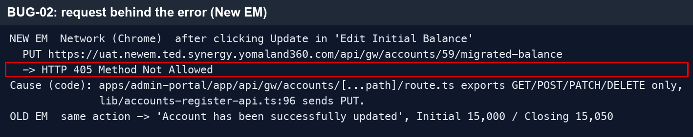
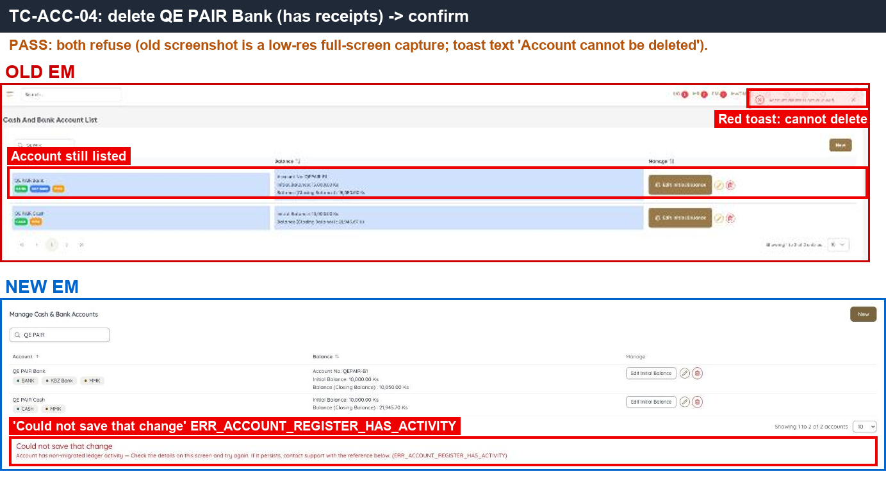
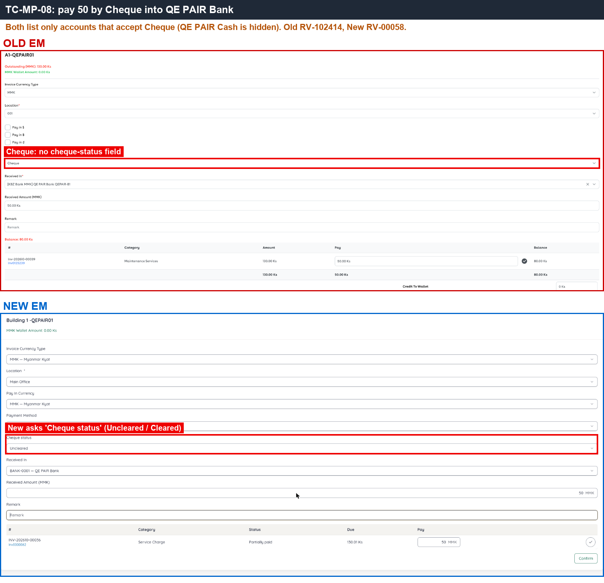

# 09 · Cash & Bank Account — Sanity

[← Sanity index](../README.md) · [Bugs](../bugs.md)

**Test cases:** 5 · **Parity result:** ✅ 3 · ⚠️ 0 · ❌ 2

## Summary

| ID | Test case | Pri | Result | Bug / note |
|---|---|---|---|---|
| [SAN-ACC-001](#san-acc-001--bank-account-without-bank-name-and-account-no-is-rejected-form-and-api) | Bank account without Bank Name and Account No is rejected (form and API) | P1 | ❌ Bug | [BUG-07](../bugs.md#bug-07) |
| [SAN-ACC-002](#-san-acc-002--create-account-with-initial-balance-100000--closing-100000-and-initial-row-in-statement) | ★ Create account with Initial Balance 100,000 — Closing 100,000 and Initial row in statement | P1 | ✅ Match | Type list / Payment Method UI differ ([D-02](../differences.md#d-02)) |
| [SAN-ACC-003](#-san-acc-003--edit-initial-balance--saved-and-closing-balance-changes-by-the-same-difference) | ★ Edit Initial Balance — saved and Closing Balance changes by the same difference | P1 | ❌ Bug | [BUG-02](../bugs.md#bug-02) |
| [SAN-ACC-004](#san-acc-004--deleting-an-account-that-already-has-receipts-is-blocked) | Deleting an account that already has receipts is blocked | P1 | ✅ Match | — |
| [SAN-ACC-005](#san-acc-005--received-in-lists-only-accounts-linked-to-the-selected-payment-method) | Received In lists only accounts linked to the selected payment method | P1 | ✅ Match | — |

## Test cases

#### SAN-ACC-001 · Bank account without Bank Name and Account No is rejected (form and API)

| Priority | Suites | Automation | Status | Source |
|---|---|---|---|---|
| P1 | Sanity · Regression | Auto-API | Active | EM Parity v2 (TC-ACC-01), 2026-10-30 |

**Preconditions:**

1. Logged in to EM as an Admin user.
2. Account Type BANK allows an account number.

**Test data:**

1. Account `QE PAIR API Bank`, Type BANK, MMK, no Bank Name, no Account No.

**Steps:**

1. Go to Cash & Bank Account, click [New], select Type BANK, leave Bank and Account No empty, click [Create].
2. Send the create-account request directly (API) with Type BANK and no bank name / account number.
3. Check the API response and the account list.

**Expected result:**

1. The form requires Bank and Account No.
2. The API rejects the request with a validation error; no account is created.

**Parity result (build -31):**

| Old EM | New EM | Result |
|---|---|---|
| Form requires Bank + Account No; the server also validates them | Form requires them, but the API creates BANK account id 62 'QE PAIR API Bank' with no bank and no account number | ❌ [BUG-07](../bugs.md#bug-07) · [EM-98](https://zeyalabs-team-a83df6me.atlassian.net/browse/EM-98) |

**Evidence:**

-  — lower half (API): request without bank / account number, response creates account id 62.

---

#### ★ SAN-ACC-002 · Create account with Initial Balance 100,000 — Closing 100,000 and Initial row in statement

| Priority | Suites | Automation | Status | Source |
|---|---|---|---|---|
| P1 | Sanity · Regression | Auto-UI | Active | EM Parity v2 (TC-ACC-02), 2026-10-30 |

**Preconditions:**

1. Logged in to EM as an Admin user.

**Test data:**

1. Account `QE PAIR Acc2`, Type CASH, MMK, Initial Balance 100,000, Payment Method Cash.

**Steps:**

1. Go to Cash & Bank Account, click [New].
2. Enter the test data and click [Create].
3. Open the account and its Account Statement.

**Expected result:**

1. Initial Balance 100,000 = Closing Balance **100,000**.
2. The Account Statement has an Initial row.

**Parity result (build -31):**

| Old EM | New EM | Result |
|---|---|---|
| QE PAIR Acc2 · Initial 100,000 = Closing 100,000 | QE PAIR Acc2 (CASH-0002) · Initial 100,000 = Closing 100,000 | ✅ Match |

**Evidence:**

-  — Initial and Closing 100,000 on both sides.

---

#### ★ SAN-ACC-003 · Edit Initial Balance — saved and Closing Balance changes by the same difference

| Priority | Suites | Automation | Status | Source |
|---|---|---|---|---|
| P1 | Sanity · Regression | Auto-UI | Active | EM Parity v2 (TC-ACC-03), 2026-10-30 |

**Preconditions:**

1. Logged in to EM as an Admin user.
2. Account `QE PAIR Bank` with Initial Balance 10,000 and Closing Balance 10,050.

**Test data:**

1. Initial Balance 10,000 → 15,000.

**Steps:**

1. Go to Cash & Bank Account, open `QE PAIR Bank`.
2. Click [Edit Initial Balance], change 10,000 to 15,000.
3. Click [Update].

**Expected result:**

1. Initial Balance is saved as 15,000.
2. Closing Balance changes by +5,000: 10,050 → **15,050**.

**Parity result (build -31):**

| Old EM | New EM | Result |
|---|---|---|
| Saved; Initial 15,000, Closing 15,050 | Error 'Could not update initial balance' (PUT 405); balance unchanged | ❌ [BUG-02](../bugs.md#bug-02) · [EM-94](https://zeyalabs-team-a83df6me.atlassian.net/browse/EM-94) |

**Evidence:**

-  — Old saved Initial 15,000; New error dialog.
-  — API: the update request returns 405.
- [BUG-02.gif](../gif/BUG-02.gif)

---

#### SAN-ACC-004 · Deleting an account that already has receipts is blocked

| Priority | Suites | Automation | Status | Source |
|---|---|---|---|---|
| P1 | Sanity · Regression | Auto-UI | Active | EM Parity v2 (TC-ACC-04), 2026-10-30 |

**Preconditions:**

1. Logged in to EM as an Admin user.
2. Account `QE PAIR Cash` has at least one RV.

**Steps:**

1. Go to Cash & Bank Account.
2. Delete `QE PAIR Cash` and confirm.

**Expected result:**

1. Delete is blocked with an error.
2. The account is still listed.

**Parity result (build -31):**

| Old EM | New EM | Result |
|---|---|---|
| Delete blocked (red toast); account still listed | Blocked: ERR_ACCOUNT_REGISTER_HAS_ACTIVITY | ✅ Match |

**Evidence:**

-  — delete blocked on both sides.

---

#### SAN-ACC-005 · Received In lists only accounts linked to the selected payment method

| Priority | Suites | Automation | Status | Source |
|---|---|---|---|---|
| P1 | Sanity · Regression | Auto-UI | Active | EM Parity v2 (TC-ACC-05), 2026-10-30 |

**Preconditions:**

1. Logged in to EM as an Admin user.
2. `QE PAIR Cash` linked only to Payment Method Cash; `QE PAIR Bank` linked to Cheque + Bank Transfer (not Cash).
3. Test apartment has an open invoice.

**Steps:**

1. Go to Apartments, open the test apartment, click [Make Payment].
2. Select Payment Method Cash, open Received In.
3. Select Payment Method Cheque, open Received In.

**Expected result:**

1. With Cash: `QE PAIR Bank` (no Cash method) is not listed.
2. With Cheque: `QE PAIR Cash` (Cash only) is not listed.

**Parity result (build -31):**

| Old EM | New EM | Result |
|---|---|---|
| Account with only Cash is not listed when Cheque is selected | Same: Received In is filtered by payment method | ✅ Match |

**Evidence:**

-  — Received In for a Cheque payment lists only the bank account.

---
