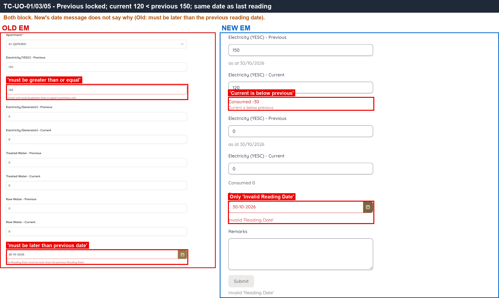
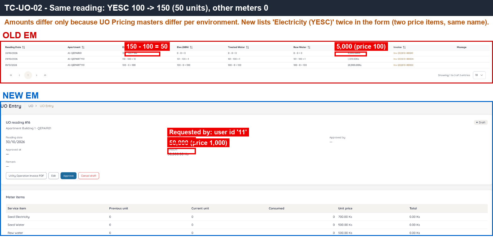
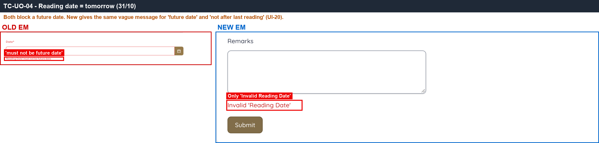
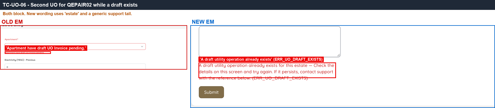
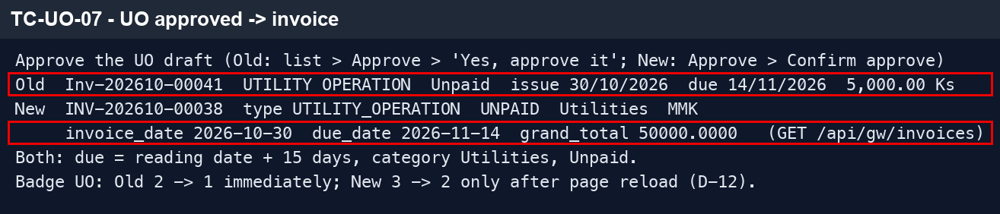
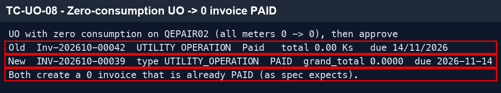
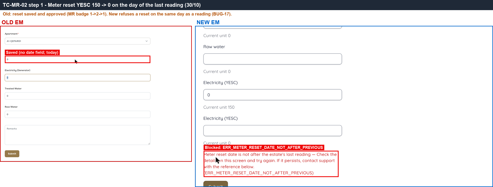

# 10 · Utility Operations & Meter Reset — Sanity

[← Sanity index](../README.md) · [Bugs](../bugs.md)

**Test cases:** 9 · **Parity result:** ✅ 6 · ⚠️ 2 · ❌ 1

## Summary

| ID | Test case | Pri | Result | Bug / note |
|---|---|---|---|---|
| [SAN-UO-001](#san-uo-001--new-uo-for-an-apartment-with-reading-history--previous-auto-filled-and-locked) | New UO for an apartment with reading history — Previous auto-filled and locked | P1 | ✅ Match | — |
| [SAN-UO-002](#-san-uo-002--uo-amount--consumed-units--unit-price-uo-total--sum-of-lines) | ★ UO amount = consumed units × unit price; UO total = sum of lines | P1 | ✅ Match | — |
| [SAN-UO-003](#san-uo-003--current-reading-lower-than-previous-is-rejected) | Current reading lower than previous is rejected | P1 | ✅ Match | — |
| [SAN-UO-004](#san-uo-004--reading-date-in-the-future-is-rejected-with-a-future-date-message) | Reading date in the future is rejected with a future-date message | P1 | ⚠️ Differs | [Differs](../differences.md#san-uo-004) — message does not say why |
| [SAN-UO-005](#san-uo-005--reading-date-equal-to-the-previous-reading-date-is-rejected) | Reading date equal to the previous reading date is rejected | P1 | ⚠️ Differs | [Differs](../differences.md#san-uo-005) — message does not say why |
| [SAN-UO-006](#san-uo-006--second-uo-for-an-apartment-with-a-pending-draft-is-blocked) | Second UO for an apartment with a pending draft is blocked | P1 | ✅ Match | — |
| [SAN-UO-007](#-san-uo-007--approve-uo--utilities-invoice-created-due-15-days-unpaid-uo-chip-1) | ★ Approve UO — Utilities invoice created, due +15 days, Unpaid, UO chip −1 | P1 | ✅ Match | — |
| [SAN-UO-008](#san-uo-008--approve-uo-with-zero-consumption--invoice-of-0-created-as-paid) | Approve UO with zero consumption — invoice of 0 created as Paid | P2 | ✅ Match | — |
| [SAN-MR-002](#san-mr-002--reset-yesc-to-0-and-approve--next-uo-uses-previous--0) | Reset YESC to 0 and approve — next UO uses Previous = 0 | P1 | ❌ Bug | [BUG-17](../bugs.md#bug-17) · [EM-110](https://zeyalabs-team-a83df6me.atlassian.net/browse/EM-110) |

## Test cases

#### SAN-UO-001 · New UO for an apartment with reading history — Previous auto-filled and locked

| Priority | Suites | Automation | Status | Source |
|---|---|---|---|---|
| P1 | Sanity · Regression | Auto-UI | Active | EM Parity v2 (TC-UO-01), 2026-10-30 |

**Preconditions:**

1. Logged in to EM as an Admin user.
2. The test apartment has an approved UO reading (YESC = 150).

**Test data:**

1. Apartment: Old `A1-QEPAIR01` · New `Building 1 -QEPAIR01`.

**Steps:**

1. Go to UO, click New.
2. Select the test apartment.
3. Look at the Previous reading for YESC.

**Expected result:**

1. Previous is auto-filled with the last reading (150) and cannot be edited.

**Parity result (build -31):**

| Old EM | New EM | Result |
|---|---|---|
| Previous YESC = 150, locked | Previous = 150, locked, labelled 'as at 30/10/2026' | ✅ Match |

**Evidence:**

-  — Previous field pre-filled and locked on both sides.

---

#### ★ SAN-UO-002 · UO amount = consumed units × unit price; UO total = sum of lines

| Priority | Suites | Automation | Status | Source |
|---|---|---|---|---|
| P1 | Sanity · Regression | Auto-UI | Active | EM Parity v2 (TC-UO-02), 2026-10-30 |

**Preconditions:**

1. Logged in to EM as an Admin user.
2. The test apartment has a previous YESC reading of 100; no UO draft pending.
3. UO Pricing for YESC is configured (unit price differs per environment).

**Test data:**

1. Apartment: Old `A1-QEPAIR01` · New `Building 1 -QEPAIR01`.
2. YESC: previous 100, current 150.

**Steps:**

1. Go to UO, click New, select the test apartment.
2. Enter YESC current = 150.
3. Check the consumed units, the line amount and the UO total.
4. Submit the draft.

**Expected result:**

1. Consumed = 150 − 100 = 50.
2. Line amount = 50 × the configured YESC unit price.
3. UO total = sum of all lines.

**Parity result (build -31):**

| Old EM | New EM | Result |
|---|---|---|
| 150−100 = 50 × 100 = 5,000 (Old price table) | 50 × 1,000 = 50,000 (New price table). Form shows two 'Electricity (YESC)' rows with the same name ([BUG-24](../bugs.md#bug-24)); 'Requested by' shows id '11' ([UI-19](../bugs.md#ui-19)) | ✅ Match |

**Evidence:**

-  — same calculation on both sides; New shows the duplicate 'Electricity (YESC)' rows and 'Requested by 11'.
- [UO.gif](../gif/UO.gif)

---

#### SAN-UO-003 · Current reading lower than previous is rejected

| Priority | Suites | Automation | Status | Source |
|---|---|---|---|---|
| P1 | Sanity · Regression | Auto-UI | Active | EM Parity v2 (TC-UO-03), 2026-10-30 |

**Preconditions:**

1. Logged in to EM as an Admin user.
2. The test apartment has a previous YESC reading.

**Test data:**

1. Apartment: Old `A1-QEPAIR01` · New `Building 1 -QEPAIR01`.
2. YESC current = previous − 30.

**Steps:**

1. Go to UO, click New, select the test apartment.
2. Enter a YESC current reading lower than previous.
3. Try to save.

**Expected result:**

1. An error says the current unit must be greater than or equal to the previous unit.
2. The UO cannot be saved.

**Parity result (build -31):**

| Old EM | New EM | Result |
|---|---|---|
| 'Current unit must be greater than or equal to previous unit.' | 'Consumed -30 / Current is below previous'; cannot save | ✅ Match |

**Evidence:**

-  — both sides block a current reading below previous.

---

#### SAN-UO-004 · Reading date in the future is rejected with a future-date message

| Priority | Suites | Automation | Status | Source |
|---|---|---|---|---|
| P1 | Sanity · Regression | Auto-UI | Active | EM Parity v2 (TC-UO-04), 2026-10-30 |

**Preconditions:**

1. Logged in to EM as an Admin user.

**Test data:**

1. Apartment: Old `A1-QEPAIR01` · New `Building 1 -QEPAIR01`.
2. Reading date: tomorrow.

**Steps:**

1. Go to UO, click New, select the test apartment.
2. Pick tomorrow as Reading Date in the calendar.
3. Fill the readings and click Submit.

**Expected result:**

1. The calendar allows picking tomorrow, but Submit is rejected.
2. The message states the reading date must not be a future date.

**Parity result (build -31):**

| Old EM | New EM | Result |
|---|---|---|
| Calendar allows the 31st; Submit shows ''Reading Date' must not be future date' | Calendar allows the 31st; Submit only shows 'Invalid Reading Date' ([UI-20](../bugs.md#ui-20)) | ⚠️ [Differs](../differences.md#san-uo-004) — message does not say why |

**Evidence:**

-  — both sides block the future date; New message is generic.

---

#### SAN-UO-005 · Reading date equal to the previous reading date is rejected

| Priority | Suites | Automation | Status | Source |
|---|---|---|---|---|
| P1 | Sanity · Regression | Auto-UI | Active | EM Parity v2 (TC-UO-05), 2026-10-30 |

**Preconditions:**

1. Logged in to EM as an Admin user.
2. The test apartment has a previous reading dated today.

**Test data:**

1. Apartment: Old `A1-QEPAIR01` · New `Building 1 -QEPAIR01`.
2. Reading date: same as the previous reading date.

**Steps:**

1. Go to UO, click New, select the test apartment.
2. Set Reading Date to the previous reading date.
3. Fill the readings and click Submit.

**Expected result:**

1. Submit is rejected with 'The Reading Date must be later than the previous Reading Date'.

**Parity result (build -31):**

| Old EM | New EM | Result |
|---|---|---|
| 'The Reading Date must be later than the previous Reading Date' | Only 'Invalid Reading Date', no reason given ([UI-20](../bugs.md#ui-20)) | ⚠️ [Differs](../differences.md#san-uo-005) — message does not say why |

**Evidence:**

-  — the reading-date error on each side.

---

#### SAN-UO-006 · Second UO for an apartment with a pending draft is blocked

| Priority | Suites | Automation | Status | Source |
|---|---|---|---|---|
| P1 | Sanity · Regression | Auto-UI | Active | EM Parity v2 (TC-UO-06), 2026-10-30 |

**Preconditions:**

1. Logged in to EM as an Admin user.
2. The test apartment has a UO draft pending.

**Test data:**

1. Apartment: Old `A1-QEPAIR01` · New `Building 1 -QEPAIR01`.

**Steps:**

1. Go to UO, click New, select the test apartment.
2. Fill the readings and submit.

**Expected result:**

1. Creation is blocked with a 'draft UO pending' error.

**Parity result (build -31):**

| Old EM | New EM | Result |
|---|---|---|
| 'Apartment have draft UO Invoice pending.' | Blocked: 'A draft utility operation already exists for this estate … (ERR_UO_DRAFT_EXISTS)' | ✅ Match |

**Evidence:**

-  — both sides block a second draft.

---

#### ★ SAN-UO-007 · Approve UO — Utilities invoice created, due +15 days, Unpaid, UO chip −1

| Priority | Suites | Automation | Status | Source |
|---|---|---|---|---|
| P1 | Sanity · Regression | Auto-UI+API | Active | EM Parity v2 (TC-UO-07), 2026-10-30 |

**Preconditions:**

1. Logged in to EM as an Admin user.
2. SAN-UO-002 done (UO draft exists); note the UO chip count.

**Test data:**

1. Apartment: Old `A1-QEPAIR01` · New `Building 1 -QEPAIR01`.

**Steps:**

1. Open the UO draft and click Approve.
2. Without reloading, check the UO chip.
3. Open the generated invoice.

**Expected result:**

1. An invoice (Inv…) is created: category Utilities, MMK, due date = issue date + 15 days, status Unpaid.
2. The UO chip decreases by 1 immediately.

**Parity result (build -31):**

| Old EM | New EM | Result |
|---|---|---|
| Inv-202610-00041, due 14/11 (+15), Unpaid; UO chip 2→1 immediately | INV-202610-00038, UTILITY_OPERATION, Utilities, due 14/11, Unpaid; chip only decreases after reload ([D-12](../differences.md#d-12)) | ✅ Match |

**Evidence:**

-  — API response (dark background): invoice type UTILITY_OPERATION, category Utilities, due 14/11, Unpaid.

---

#### SAN-UO-008 · Approve UO with zero consumption — invoice of 0 created as Paid

| Priority | Suites | Automation | Status | Source |
|---|---|---|---|---|
| P2 | Sanity · Regression | Auto-UI+API | Active | EM Parity v2 (TC-UO-08), 2026-10-30 |

**Preconditions:**

1. Logged in to EM as an Admin user.
2. No UO draft pending for the test apartment.

**Test data:**

1. Apartment: Old `A1-QEPAIR01` · New `Building 1 -QEPAIR01`.
2. All current readings = previous readings (consumption 0).

**Steps:**

1. Go to UO, click New, select the test apartment.
2. Enter current = previous for every meter, submit.
3. Approve the draft and open the generated invoice.

**Expected result:**

1. The invoice is created with amount 0 and status Paid.

**Parity result (build -31):**

| Old EM | New EM | Result |
|---|---|---|
| Inv-202610-00042 · 0.00 · Paid | INV-202610-00039 · 0 · PAID | ✅ Match |

**Evidence:**

-  — API response: zero-amount UO invoice with status PAID.

---

#### SAN-MR-002 · Reset YESC to 0 and approve — next UO uses Previous = 0

| Priority | Suites | Automation | Status | Source |
|---|---|---|---|---|
| P1 | Sanity · Regression | Auto-UI | Active | EM Parity v2 (TC-MR-02), 2026-10-30 |

**Preconditions:**

1. Logged in to EM as an Admin user.
2. The test apartment has an approved YESC reading of 150 dated today; no UO draft pending.

**Test data:**

1. Apartment: Old `A1-QEPAIR01` · New `Building 1 -QEPAIR01`.
2. Reset YESC 150 → 0, date = today (same day as the last reading).
3. Next UO: YESC current 30.

**Steps:**

1. Go to UO > Meter Reset, click New, select the test apartment.
2. Set YESC from 150 to 0, date today, click Submit.
3. Approve the reset.
4. Create a new UO for the apartment with YESC current 30.

**Expected result:**

1. The reset is saved and approved.
2. The new UO shows Previous = 0 and consumed = 30.

**Parity result (build -31):**

| Old EM | New EM | Result |
|---|---|---|
| Reset YESC 150→0 on the same day as the reading: saved and approved; new UO has Previous = 0 | Reset rejected on the same day as the reading: `ERR_METER_RESET_DATE_NOT_AFTER_PREVIOUS`; the UO step cannot be reached | ❌ [BUG-17](../bugs.md#bug-17) · [EM-110](https://zeyalabs-team-a83df6me.atlassian.net/browse/EM-110) |

**Evidence:**

-  — same reset on 30/10: Old saves it, New shows the error.
- [MR.gif](../gif/MR.gif)

---
