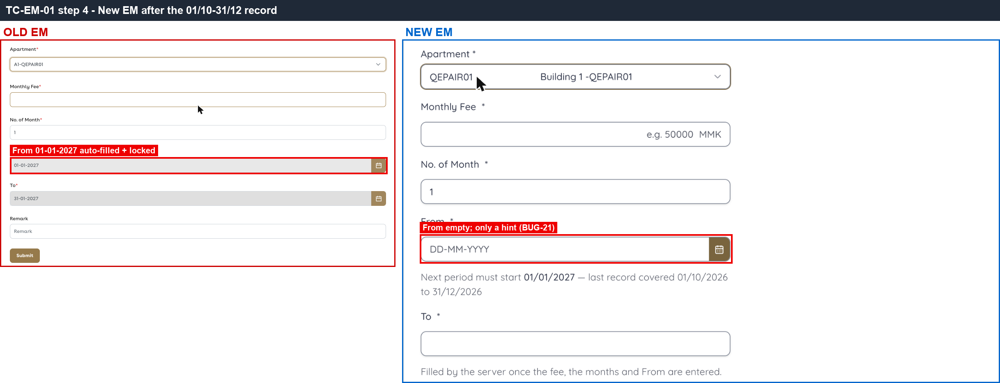
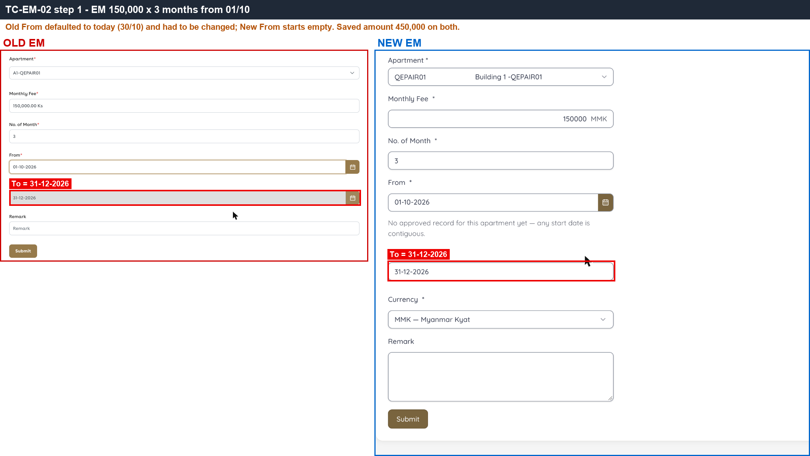
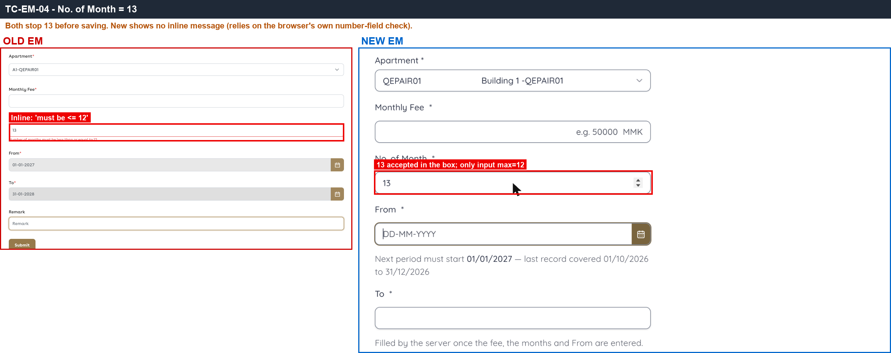
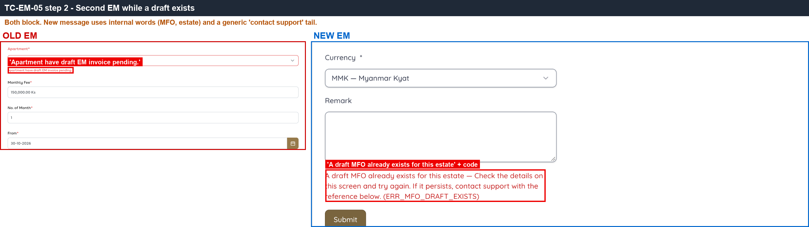
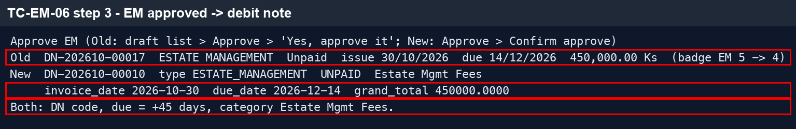

# 11 · Estate Management — Sanity

[← Sanity index](../README.md) · [Bugs](../bugs.md)

**Test cases:** 5 · **Parity result:** ✅ 4 · ⚠️ 0 · ❌ 1

## Summary

| ID | Test case | Pri | Result | Bug / note |
|---|---|---|---|---|
| [SAN-EM-001](#san-em-001--new-em-for-an-apartment-with-a-previous-period--from-auto-filled-with-the-next-day-and-locked) | New EM for an apartment with a previous period — From auto-filled with the next day and locked | P1 | ❌ Bug | [BUG-21](../bugs.md#bug-21) · [EM-111](https://zeyalabs-team-a83df6me.atlassian.net/browse/EM-111) |
| [SAN-EM-002](#-san-em-002--em-fee-150000--3-months-from-0110--to-3112-amount-450000) | ★ EM fee 150,000 × 3 months from 01/10 — To 31/12, amount 450,000 | P1 | ✅ Match | — |
| [SAN-EM-004](#san-em-004--em-with-13-months-is-rejected) | EM with 13 months is rejected | P1 | ✅ Match | — |
| [SAN-EM-005](#san-em-005--second-em-for-an-apartment-with-a-pending-draft-is-blocked) | Second EM for an apartment with a pending draft is blocked | P1 | ✅ Match | — |
| [SAN-EM-006](#-san-em-006--approve-em--debit-note-dn-yyyymm-xxxxx-due-45-days-category-estate-mgmt-fees) | ★ Approve EM — Debit Note DN-YYYYMM-xxxxx, due +45 days, category Estate Mgmt Fees | P1 | ✅ Match | — |

## Test cases

#### SAN-EM-001 · New EM for an apartment with a previous period — From auto-filled with the next day and locked

| Priority | Suites | Automation | Status | Source |
|---|---|---|---|---|
| P1 | Sanity · Regression | Auto-UI | Active | EM Parity v2 (TC-EM-01), 2026-10-30 |

**Preconditions:**

1. Logged in to EM as an Admin user.
2. The test apartment has an EM period 01/10–31/12/2026.

**Test data:**

1. Apartment: Old `A1-QEPAIR01` · New `Building 1 -QEPAIR01`.

**Steps:**

1. Go to Estate Management, click New.
2. Select the test apartment.
3. Look at the From field.

**Expected result:**

1. From is auto-filled with the day after the previous period ends (01-01-2027) and cannot be edited.

**Parity result (build -31):**

| Old EM | New EM | Result |
|---|---|---|
| From auto-filled = 01-01-2027 and locked | From is empty; only a hint 'Next period must start 01/01/2027' | ❌ [BUG-21](../bugs.md#bug-21) · [EM-111](https://zeyalabs-team-a83df6me.atlassian.net/browse/EM-111) |

**Evidence:**

-  — Old From field pre-filled with 01-01-2027 and locked; New is empty.
- [EM.gif](../gif/EM.gif)

---

#### ★ SAN-EM-002 · EM fee 150,000 × 3 months from 01/10 — To 31/12, amount 450,000

| Priority | Suites | Automation | Status | Source |
|---|---|---|---|---|
| P1 | Sanity · Regression | Auto-UI | Active | EM Parity v2 (TC-EM-02), 2026-10-30 |

**Preconditions:**

1. Logged in to EM as an Admin user.
2. No EM draft pending for the test apartment.

**Test data:**

1. Apartment: Old `A1-QEPAIR01` · New `Building 1 -QEPAIR01`.
2. Fee 150,000; Months 3; From 01/10/2026.

**Steps:**

1. Go to Estate Management, click New, select the test apartment.
2. Set From = 01/10/2026 (Old defaults to today — change it), Months = 3, Fee = 150,000.
3. Check To and Amount, then submit.

**Expected result:**

1. To = 31-12-2026.
2. Amount = 450,000 (fee × months).

**Parity result (build -31):**

| Old EM | New EM | Result |
|---|---|---|
| To 31-12-2026, 450,000 (From defaults to today, had to be changed) | To 31-12-2026, EM #11 450,000 | ✅ Match |

**Evidence:**

-  — same To date and amount on both sides.

---

#### SAN-EM-004 · EM with 13 months is rejected

| Priority | Suites | Automation | Status | Source |
|---|---|---|---|---|
| P1 | Sanity · Regression | Auto-UI | Active | EM Parity v2 (TC-EM-04), 2026-10-30 |

**Preconditions:**

1. Logged in to EM as an Admin user.

**Test data:**

1. Apartment: Old `A1-QEPAIR01` · New `Building 1 -QEPAIR01`.
2. Months = 13.

**Steps:**

1. Go to Estate Management, click New, select the test apartment.
2. Enter Months = 13.
3. Click Submit.

**Expected result:**

1. The form blocks the value with 'Number of months must be less than or equal to 12'.

**Parity result (build -31):**

| Old EM | New EM | Result |
|---|---|---|
| Shows 'Number of months must be less than or equal to 12' immediately | Field accepts 13 but the input has max=12 (browser blocks on Submit). No message on the form | ✅ Match |

**Evidence:**

-  — Old message vs New browser validation on Submit.

---

#### SAN-EM-005 · Second EM for an apartment with a pending draft is blocked

| Priority | Suites | Automation | Status | Source |
|---|---|---|---|---|
| P1 | Sanity · Regression | Auto-UI | Active | EM Parity v2 (TC-EM-05), 2026-10-30 |

**Preconditions:**

1. Logged in to EM as an Admin user.
2. SAN-EM-002 done (EM draft pending for the test apartment).

**Test data:**

1. Apartment: Old `A1-QEPAIR01` · New `Building 1 -QEPAIR01`.

**Steps:**

1. Go to Estate Management, click New, select the test apartment.
2. Fill the form and submit.

**Expected result:**

1. Creation is blocked with 'Apartment have draft EM invoice pending.'

**Parity result (build -31):**

| Old EM | New EM | Result |
|---|---|---|
| 'Apartment have draft EM invoice pending.' | Blocked: 'A draft MFO already exists for this estate … (ERR_MFO_DRAFT_EXISTS)'. Wording uses an internal term | ✅ Match |

**Evidence:**

-  — both sides block a second draft.

---

#### ★ SAN-EM-006 · Approve EM — Debit Note DN-YYYYMM-xxxxx, due +45 days, category Estate Mgmt Fees

| Priority | Suites | Automation | Status | Source |
|---|---|---|---|---|
| P1 | Sanity · Regression | Auto-UI+API | Active | EM Parity v2 (TC-EM-06), 2026-10-30 |

**Preconditions:**

1. Logged in to EM as an Admin user.
2. SAN-EM-002 done (EM draft exists); note the EM chip count.

**Test data:**

1. Apartment: Old `A1-QEPAIR01` · New `Building 1 -QEPAIR01`.

**Steps:**

1. Open the EM draft and click Approve.
2. Check the EM chip.
3. Open the generated debit note.

**Expected result:**

1. A debit note DN-YYYYMM-xxxxx is created, category Estate Mgmt Fees, due date = issue date + 45 days.
2. The EM chip decreases by 1.

**Parity result (build -31):**

| Old EM | New EM | Result |
|---|---|---|
| DN-202610-00017, due 14/12 (+45), EM chip 5→4 | DN-202610-00010, ESTATE_MANAGEMENT, Estate Mgmt Fees, due 14/12 | ✅ Match |

**Evidence:**

-  — API response (dark background): DN type ESTATE_MANAGEMENT, category Estate Mgmt Fees, due 14/12.

---

