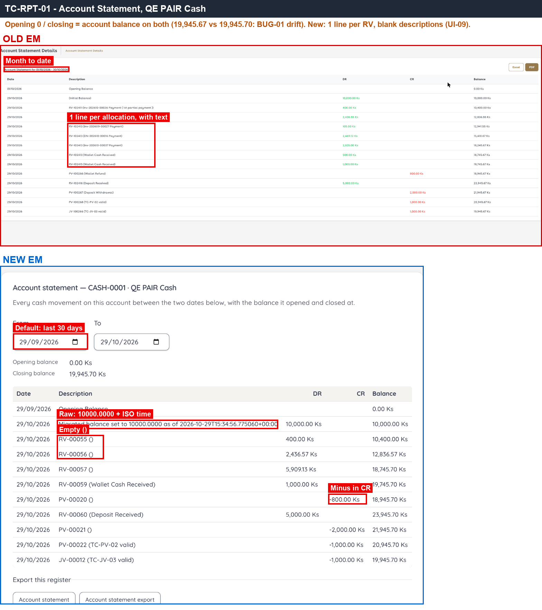
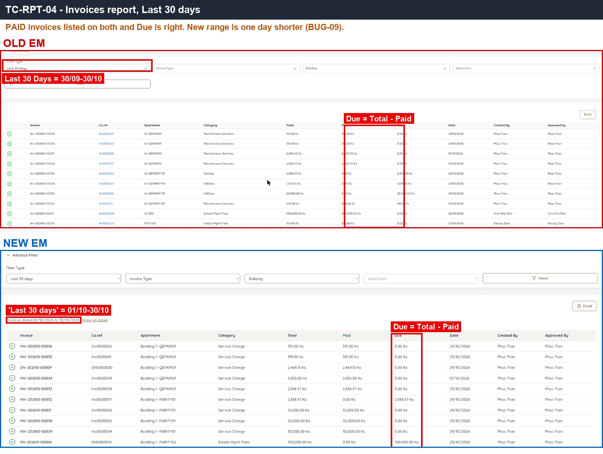
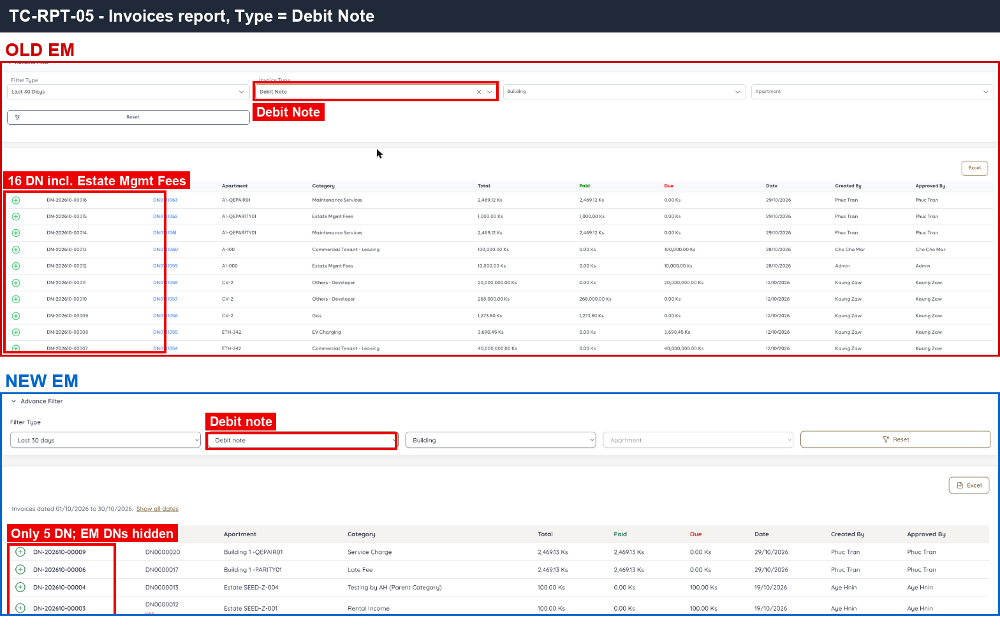
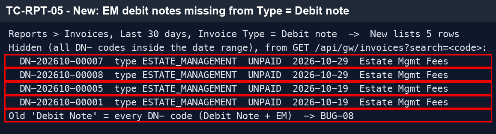
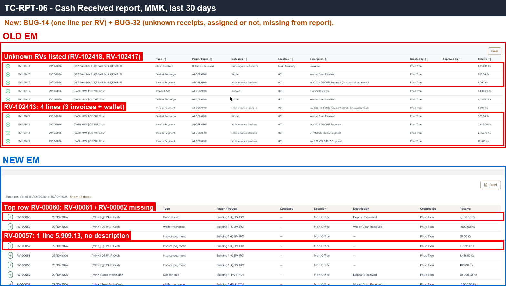
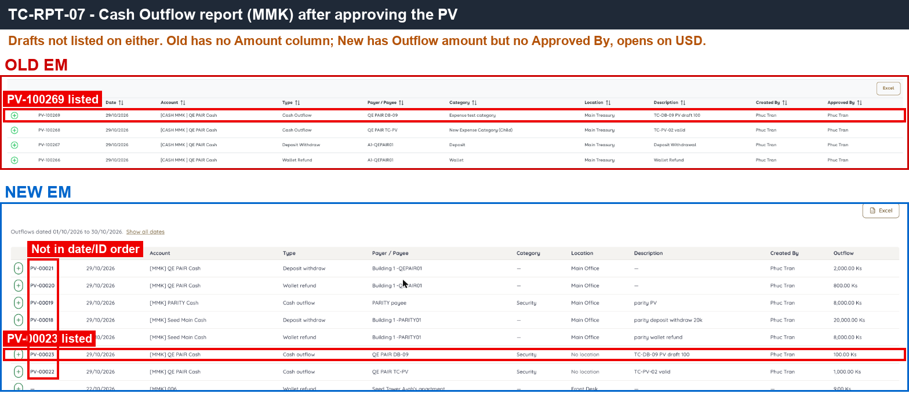
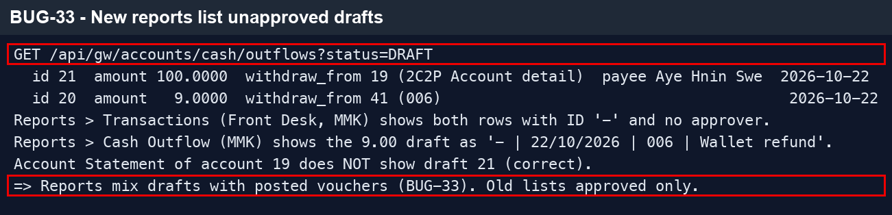
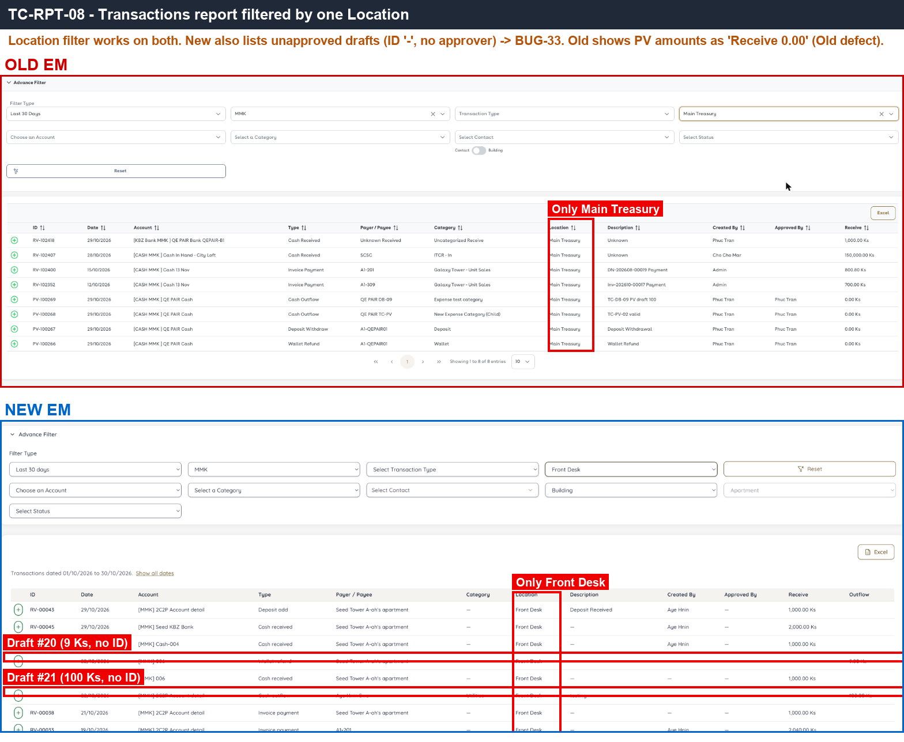
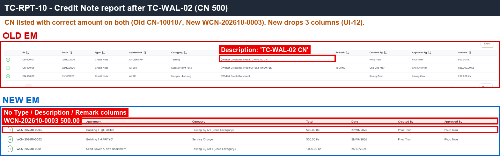

# 12 · Reports — Sanity

[← Sanity index](../README.md) · [Bugs](../bugs.md)

**Test cases:** 8 · **Parity result:** ✅ 2 · ⚠️ 2 · ❌ 4

## Summary

| ID | Test case | Pri | Result | Bug / note |
|---|---|---|---|---|
| [SAN-RPT-001](#-san-rpt-001--account-statement-for-this-month--opening--previous-month-closing-closing--account-balance) | ★ Account Statement for this month — Opening = previous month closing, Closing = account balance | P1 | ⚠️ Differs | [Differs](../differences.md#san-rpt-001) — amounts correct (0.03 from [BUG-01](../bugs.md#bug-01)); display only |
| [SAN-RPT-002](#san-rpt-002--cash-outflow-draft-in-the-period-is-not-shown-in-the-account-statement) | Cash Outflow draft in the period is not shown in the Account Statement | P1 | ✅ Match | — |
| [SAN-RPT-004](#san-rpt-004--invoices-report-last-30-days--includes-paid-invoices-due--total--paid) | Invoices report Last 30 Days — includes Paid invoices, Due = Total − Paid | P1 | ❌ Bug | [BUG-09](../bugs.md#bug-09) · [EM-108](https://zeyalabs-team-a83df6me.atlassian.net/browse/EM-108) |
| [SAN-RPT-005](#san-rpt-005--invoices-report-type--debit-note--only-debit-notes-including-em-debit-notes) | Invoices report Type = Debit Note — only debit notes, including EM debit notes | P2 | ❌ Bug | [BUG-08](../bugs.md#bug-08) · [EM-99](https://zeyalabs-team-a83df6me.atlassian.net/browse/EM-99) |
| [SAN-RPT-006](#san-rpt-006--cash-received-report--receipt-split-into-invoice-payment-and-wallet-recharge-rows-unknown-receipts-listed) | Cash Received report — receipt split into Invoice Payment and Wallet Recharge rows; Unknown receipts listed | P1 | ❌ Bug | [BUG-14](../bugs.md#bug-14) · [EM-109](https://zeyalabs-team-a83df6me.atlassian.net/browse/EM-109), [BUG-32](../bugs.md#bug-32) · [EM-106](https://zeyalabs-team-a83df6me.atlassian.net/browse/EM-106) |
| [SAN-RPT-007](#san-rpt-007--cash-outflow-report-lists-approved-vouchers-only) | Cash Outflow report lists approved vouchers only | P1 | ❌ Bug | [BUG-33](../bugs.md#bug-33) · [EM-107](https://zeyalabs-team-a83df6me.atlassian.net/browse/EM-107) |
| [SAN-RPT-008](#san-rpt-008--transactions-report-filtered-by-location-shows-only-that-location) | Transactions report filtered by Location shows only that location | P2 | ✅ Match | Draft rows: [BUG-33](../bugs.md#bug-33) |
| [SAN-RPT-010](#san-rpt-010--credit-note-report-lists-the-wallet-credit-note-with-the-correct-amount) | Credit Note report lists the wallet credit note with the correct amount | P1 | ⚠️ Differs | [Differs](../differences.md#san-rpt-010) — data correct, 3 columns missing |

## Test cases

#### ★ SAN-RPT-001 · Account Statement for this month — Opening = previous month closing, Closing = account balance

| Priority | Suites | Automation | Status | Source |
|---|---|---|---|---|
| P1 | Sanity · Regression | Auto-UI | Active | EM Parity v2 (TC-RPT-01), 2026-10-30 |

**Preconditions:**

1. Logged in to EM as an Admin user.
2. The test cash account has receipts and vouchers this month (incl. the overpayment receipt of the Make Payment cases).

**Test data:**

1. Account: `QE PAIR Cash`.
2. Receipt split over several allocations: Old RV-102413 · New RV-00057.

**Steps:**

1. Go to Reports > Account Statement.
2. Select `QE PAIR Cash`, period = this month (01/10 to today).
3. Check Opening and Closing.
4. Compare Closing with the balance in Cash & Bank Account.
5. Check how a multi-allocation receipt and CR amounts are shown.

**Expected result:**

1. Opening = closing balance of the last day of the previous month.
2. Closing = the account balance shown in the account list (when the period ends today).
3. Each allocation row has a description; CR amounts are shown without a minus sign.

**Parity result (build -31):**

| Old EM | New EM | Result |
|---|---|---|
| Period 01/10–30/10. Opening 0, closing 19,945.67 = account balance. RV-102413 split into 4 rows with descriptions. CR without minus sign | Default period 29/09–29/10 (30 days). Opening 0, closing 19,945.70. One row per RV, empty description '()' (UI-09). Opening line shows raw text '10000.0000 as of 2026-10-29T15:34:56…'. CR with '-' sign | ⚠️ [Differs](../differences.md#san-rpt-001) — amounts correct (0.03 from [BUG-01](../bugs.md#bug-01)); display only |

**Evidence:**

-  — Opening/Closing match the balance on both sides; New default period, raw opening text and '-' on CR.
- [RPT-01.gif](../gif/RPT-01.gif)

---

#### SAN-RPT-002 · Cash Outflow draft in the period is not shown in the Account Statement

| Priority | Suites | Automation | Status | Source |
|---|---|---|---|---|
| P1 | Sanity · Regression | Auto-UI | Active | EM Parity v2 (TC-RPT-02), 2026-10-30 |

**Preconditions:**

1. Logged in to EM as an Admin user.
2. An unapproved Cash Outflow draft exists in the period.

**Test data:**

1. An unapproved Cash Outflow draft dated in the period (New: draft #21, 100, 22/10).

**Steps:**

1. Go to Reports > Account Statement.
2. Select the draft's account, period 01/10–30/10.
3. Look for the draft amount.
4. Approve the draft and reload the statement.

**Expected result:**

1. The draft does not appear in the statement.
2. It appears only after approval.

**Parity result (build -31):**

| Old EM | New EM | Result |
|---|---|---|
| (per spec: drafts are not posted) | Draft PV #21 (100, 22/10, account 2C2P) is not in the Account Statement 01–30/10 of that account | ✅ Match |

---

#### SAN-RPT-004 · Invoices report Last 30 Days — includes Paid invoices, Due = Total − Paid

| Priority | Suites | Automation | Status | Source |
|---|---|---|---|---|
| P1 | Sanity · Regression | Auto-UI | Active | EM Parity v2 (TC-RPT-04), 2026-10-30 |

**Preconditions:**

1. Logged in to EM as an Admin user.
2. Paid and unpaid invoices exist in the last 30 days.

**Test data:**

1. Run date 30/10/2026.

**Steps:**

1. Go to Reports > Invoices.
2. Keep the default 'Last 30 days'.
3. Check the From date.
4. Check that Paid invoices are listed and Due = Total − Paid.

**Expected result:**

1. From = today − 30 days (30/09).
2. Paid invoices are listed; Due = Total − Paid.

**Parity result (build -31):**

| Old EM | New EM | Result |
|---|---|---|
| Last 30 Days = 30/09–30/10. Paid invoices listed, Due = Total − Paid | Paid listed, Due correct. But 'Last 30 days' = 01/10–30/10, one day shorter than Old | ❌ [BUG-09](../bugs.md#bug-09) · [EM-108](https://zeyalabs-team-a83df6me.atlassian.net/browse/EM-108) |

**Evidence:**

-  — date range on each side; New is one day shorter. Due column correct on both.
- [BUG-09.gif](../gif/BUG-09.gif)

---

#### SAN-RPT-005 · Invoices report Type = Debit Note — only debit notes, including EM debit notes

| Priority | Suites | Automation | Status | Source |
|---|---|---|---|---|
| P2 | Sanity · Regression | Auto-UI+API | Active | EM Parity v2 (TC-RPT-05), 2026-10-30 |

**Preconditions:**

1. Logged in to EM as an Admin user.
2. Estate Management debit notes exist (read only).

**Test data:**

1. New EM debit notes: DN-202610-00001/05/07/08 (ESTATE_MANAGEMENT).

**Steps:**

1. Go to Reports > Invoices.
2. Set Type = Debit Note.
3. Look for Estate Management debit notes (Estate Mgmt Fees).

**Expected result:**

1. Only debit notes are listed, including Estate Management debit notes.

**Parity result (build -31):**

| Old EM | New EM | Result |
|---|---|---|
| Debit Note: 16 DNs, including EM DNs (Estate Mgmt Fees) | Debit note: 5 DNs. 4 ESTATE_MANAGEMENT DNs missing (DN-202610-00001/05/07/08) | ❌ [BUG-08](../bugs.md#bug-08) · [EM-99](https://zeyalabs-team-a83df6me.atlassian.net/browse/EM-99) |

**Evidence:**

-  — Debit Note filter result on each side; New list is shorter.
-  — API response: the 4 ESTATE_MANAGEMENT DNs are excluded from the 'Debit note' filter.
- [RPT-05.gif](../gif/RPT-05.gif)

---

#### SAN-RPT-006 · Cash Received report — receipt split into Invoice Payment and Wallet Recharge rows; Unknown receipts listed

| Priority | Suites | Automation | Status | Source |
|---|---|---|---|---|
| P1 | Sanity · Regression | Auto-UI | Active | EM Parity v2 (TC-RPT-06), 2026-10-30 |

**Preconditions:**

1. Logged in to EM as an Admin user.
2. The overpayment receipt from Make Payment (3 invoices paid, remainder to wallet) exists.
3. One assigned and one unassigned Unknown receipt of 1,000 exist.

**Test data:**

1. Overpayment receipt: Old RV-102413 · New RV-00057 (5,909.13).
2. Unknown receipts: Old RV-102417 (assigned), RV-102418 · New RV-00061 (assigned), RV-00062.

**Steps:**

1. Go to Reports > Cash Received, Currency MMK, Last 30 days.
2. Find the overpayment receipt.
3. Look for the Unknown receipts.
4. Open the Account filter and check the listed accounts.

**Expected result:**

1. The overpayment receipt is shown as Invoice Payment rows plus a Wallet Recharge row, with descriptions.
2. Unknown receipts (assigned and unassigned) are listed.
3. The Account filter lists cash/bank accounts only.

**Parity result (build -31):**

| Old EM | New EM | Result |
|---|---|---|
| RV-102413 split into 4 rows (3 Invoice Payment + Wallet Recharge). Unknown RV-102418 and assigned RV-102417 listed | RV-00057 = 1 row 5,909.13, empty description. RV-00061 (assigned Unknown) and RV-00062 (Unknown) missing. Account filter also lists internal accounts AR-CTRL, DEPOSIT_CONTROL-… | ❌ [BUG-14](../bugs.md#bug-14) · [EM-109](https://zeyalabs-team-a83df6me.atlassian.net/browse/EM-109), [BUG-32](../bugs.md#bug-32) · [EM-106](https://zeyalabs-team-a83df6me.atlassian.net/browse/EM-106) |

**Evidence:**

-  — top: Old has 2 Unknown rows, New starts at RV-00060 without them; bottom: Old 4 rows for RV-102413, New a single row for RV-00057.
- [RPT-06.gif](../gif/RPT-06.gif)

---

#### SAN-RPT-007 · Cash Outflow report lists approved vouchers only

| Priority | Suites | Automation | Status | Source |
|---|---|---|---|---|
| P1 | Sanity · Regression | Auto-UI+API | Active | EM Parity v2 (TC-RPT-07), 2026-10-30 |

**Preconditions:**

1. Logged in to EM as an Admin user.
2. An approved Cash Outflow and an unapproved Cash Outflow draft exist.

**Test data:**

1. Approved: Old PV-100269 · New PV-00023.
2. New draft #20 (Wallet refund 9.00, 22/10).

**Steps:**

1. Go to Reports > Cash Outflow.
2. Check the listed vouchers, currency default, sort order and columns.

**Expected result:**

1. Only approved vouchers are listed; drafts do not appear.

**Parity result (build -31):**

| Old EM | New EM | Result |
|---|---|---|
| Approved PV only (PV-100269). No amount column | PV-00023 listed. But drafts too: row ID '—' 22/10 Wallet refund 9.00 (draft #20). Default currency USD, order reversed, no Approved By | ❌ [BUG-33](../bugs.md#bug-33) · [EM-107](https://zeyalabs-team-a83df6me.atlassian.net/browse/EM-107) |

**Evidence:**

-  — Old lists the approved PV only; New also lists draft #20 with ID '—'.
-  — API response: 2 rows with status DRAFT.

---

#### SAN-RPT-008 · Transactions report filtered by Location shows only that location

| Priority | Suites | Automation | Status | Source |
|---|---|---|---|---|
| P2 | Sanity · Regression | Auto-UI | Active | EM Parity v2 (TC-RPT-08), 2026-10-30 |

**Preconditions:**

1. Logged in to EM as an Admin user.
2. Transactions exist for more than one location.

**Test data:**

1. Location: Old Main Treasury · New Front Desk.

**Steps:**

1. Go to Reports > Transactions.
2. Filter by one Location.
3. Check every row's location and whether drafts appear.

**Expected result:**

1. Only rows of the selected location are listed.
2. Only approved transactions are listed.

**Parity result (build -31):**

| Old EM | New EM | Result |
|---|---|---|
| Filter Main Treasury: 8 rows, all Main Treasury. (PV shows 'Receive 0.00', no Outflow column — an Old defect) | Filter Front Desk: 10 rows, all Front Desk. But 2 draft rows (ID '—') | ✅ Match (draft rows: [BUG-33](../bugs.md#bug-33)) |

**Evidence:**

-  — location filter correct on both; the two lower New rows are drafts #20 and #21 without an ID.
- [BUG-33.gif](../gif/BUG-33.gif)

---

#### SAN-RPT-010 · Credit Note report lists the wallet credit note with the correct amount

| Priority | Suites | Automation | Status | Source |
|---|---|---|---|---|
| P1 | Sanity · Regression | Auto-UI | Active | EM Parity v2 (TC-RPT-10), 2026-10-30 |

**Preconditions:**

1. Logged in to EM as an Admin user.
2. The wallet credit note of 500 from the Wallet cases exists.

**Test data:**

1. Credit note: Old CN-100107 · New WCN-202610-0003 (500.00).

**Steps:**

1. Go to Reports > Credit Note.
2. Find the credit note.
3. Check the amount and the Type, Description and Remark columns.

**Expected result:**

1. The credit note is listed with the correct amount (500.00).
2. Type, Description and Remark columns are shown.

**Parity result (build -31):**

| Old EM | New EM | Result |
|---|---|---|
| CN-100107 · 500.00, with Type, Description ('TC-WAL-02 CN') and Remark columns | WCN-202610-0003 · 500.00 correct. Type / Description / Remark columns missing (UI-12) | ⚠️ [Differs](../differences.md#san-rpt-010) — data correct, 3 columns missing |

**Evidence:**

-  — same amount on both; New lacks the Type, Description and Remark columns.

---

