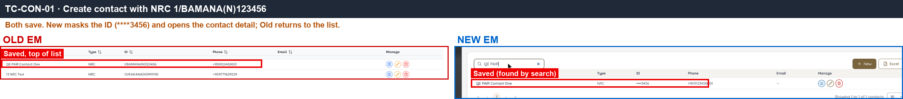
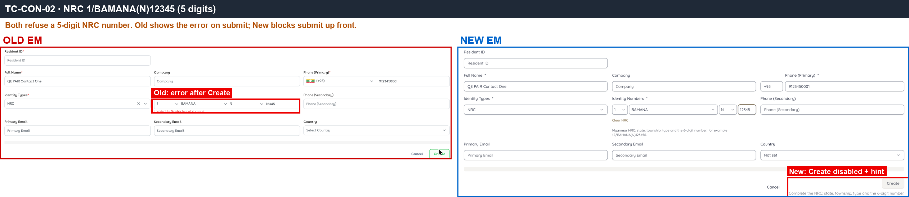
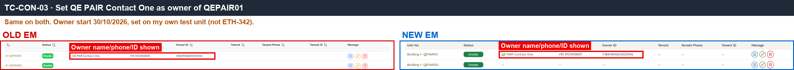
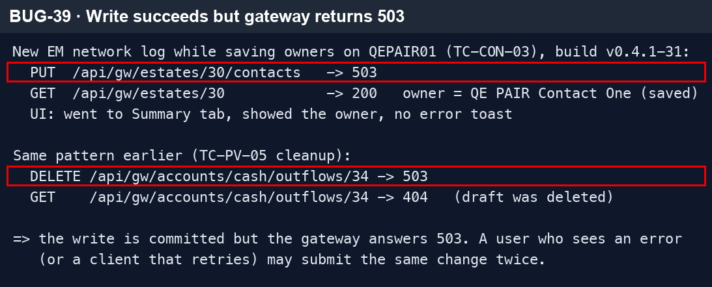
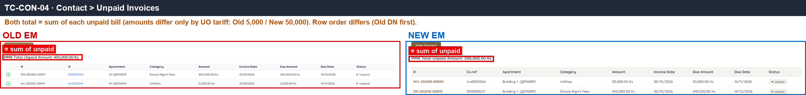

# 13 · Contacts — Sanity

[← Sanity index](../README.md) · [Bugs](../bugs.md)

**Test cases:** 4 · **Parity result:** ✅ 4 · ⚠️ 0 · ❌ 0

## Summary

| ID | Test case | Pri | Result | Bug / note |
|---|---|---|---|---|
| [SAN-CON-001](#san-con-001--create-contact-with-a-valid-nrc--saved-and-shown-in-the-contact-list) | Create contact with a valid NRC — saved and shown in the contact list | P1 | ✅ Match | — |
| [SAN-CON-002](#san-con-002--create-contact-with-an-invalid-nrc-format-is-rejected) | Create contact with an invalid NRC format is rejected | P1 | ✅ Match | — |
| [SAN-CON-003](#san-con-003--assign-contact-as-apartment-owner--apartments-list-shows-owner-name-phone-and-id) | Assign contact as apartment owner — Apartments list shows owner name, phone and ID | P1 | ✅ Match | Save returns 503: [BUG-39](../bugs.md#bug-39) |
| [SAN-CON-004](#san-con-004--contact-invoices-tab--unpaid-total-per-currency--sum-of-unpaid-invoices-of-current-apartments) | Contact Invoices tab — unpaid total per currency = sum of unpaid invoices of current apartments | P2 | ✅ Match | — |

## Test cases

#### SAN-CON-001 · Create contact with a valid NRC — saved and shown in the contact list

| Priority | Suites | Automation | Status | Source |
|---|---|---|---|---|
| P1 | Sanity · Regression | Auto-UI | Active | EM Parity v2 (TC-CON-01), 2026-10-30 |

**Preconditions:**

1. Logged in to EM as an Admin user.

**Test data:**

1. Full Name: `QE PAIR Contact One`.
2. ID type: NRC · ID number: `1/BAMANA(N)123456`.
3. Phone: `+95 9123450001`.

**Steps:**

1. Go to Contact, click New.
2. Fill Full Name, phone and NRC with the test data.
3. Click Create.
4. Open the contact list and find the new contact.

**Expected result:**

1. The contact is saved.
2. The contact is shown in the contact list.

**Parity result (build -31):**

| Old EM | New EM | Result |
|---|---|---|
| Saved 'QE PAIR Contact One' NRC 1/BAMANA(N)123456; Resident ID auto-generated (locked field); returns to the list, contact in the first row | Saved (contact #15); opens the detail page; Resident ID not required; list masks the NRC (****3456) and does not put the newest first | ✅ Match |

**Evidence:**

-  — the contact is saved on both sides; New masks the NRC in the list.

---

#### SAN-CON-002 · Create contact with an invalid NRC format is rejected

| Priority | Suites | Automation | Status | Source |
|---|---|---|---|---|
| P1 | Sanity · Regression | Auto-UI | Active | EM Parity v2 (TC-CON-02), 2026-10-30 |

**Preconditions:**

1. Logged in to EM as an Admin user.

**Test data:**

1. Full Name: `QE PAIR Contact One`.
2. NRC: `1/BAMANA(N)12345` (5 digits).

**Steps:**

1. Go to Contact, click New.
2. Fill the form with the invalid NRC.
3. Click Create (if enabled).

**Expected result:**

1. The contact is not saved; an NRC format error is shown.

**Parity result (build -31):**

| Old EM | New EM | Result |
|---|---|---|
| NRC 1/BAMANA(N)12345 → on Create: 'The Identity Number format is invalid.' | Create button disabled up front + hint 'Complete the NRC: state, township, type and the 6-digit number.' | ✅ Match |

**Evidence:**

-  — Old error on Create vs New disabled button with hint.

---

#### SAN-CON-003 · Assign contact as apartment owner — Apartments list shows owner name, phone and ID

| Priority | Suites | Automation | Status | Source |
|---|---|---|---|---|
| P1 | Sanity · Regression | Auto-UI+API | Active | EM Parity v2 (TC-CON-03), 2026-10-30 |

**Preconditions:**

1. Logged in to EM as an Admin user.
2. SAN-CON-001 done (`QE PAIR Contact One` exists).

**Test data:**

1. Apartment: Old `A1-QEPAIR01` · New `Building 1 -QEPAIR01`.
2. Contact: `QE PAIR Contact One`, owner from 30/10/2026.

**Steps:**

1. Open the test apartment > Contacts.
2. Assign `QE PAIR Contact One` as owner from 30/10/2026, click Save.
3. Check the save response (network) and reload.
4. Go to Apartments and find the test apartment.

**Expected result:**

1. The owner is saved and the save returns success.
2. The Apartments list shows the owner name, phone and ID number.

**Parity result (build -31):**

| Old EM | New EM | Result |
|---|---|---|
| Owner of A1-QEPAIR01 from 30/10/2026 → Apartments shows name / +95 9123450001 / 1/BAMANA(N)123456 | Same: Building 1 -QEPAIR01 shows name / phone / full NRC. Note: the save request returns 503 but the owner is saved | ✅ Match (save returns 503: [BUG-39](../bugs.md#bug-39)) |

**Evidence:**

-  — owner name, phone and NRC in the Apartments list on both sides.
-  — New network log: the save returns 503, the next read shows the owner saved.
- [BUG-39.gif](../gif/BUG-39.gif)

---

#### SAN-CON-004 · Contact Invoices tab — unpaid total per currency = sum of unpaid invoices of current apartments

| Priority | Suites | Automation | Status | Source |
|---|---|---|---|---|
| P2 | Sanity · Regression | Auto-UI | Active | EM Parity v2 (TC-CON-04), 2026-10-30 |

**Preconditions:**

1. Logged in to EM as an Admin user.
2. SAN-CON-003 done; the owned apartment has unpaid UO and EM documents.

**Test data:**

1. Contact: `QE PAIR Contact One`.
2. Apartment: Old `A1-QEPAIR01` · New `Building 1 -QEPAIR01`.

**Steps:**

1. Open `QE PAIR Contact One` > Invoices tab (Unpaid Invoices).
2. Check the listed documents and the total.

**Expected result:**

1. The tab lists every unpaid invoice / debit note of the contact's current apartments.
2. Unpaid total per currency = Σ (grand total − paid) of those documents.

**Parity result (build -31):**

| Old EM | New EM | Result |
|---|---|---|
| Unpaid Invoices (2): total 455,000 = DN 450,000 + UO 5,000; DN listed first | Unpaid Invoices (2): total 500,000 = UO 50,000 + DN 450,000; UO listed first (UO price differs per environment) | ✅ Match |

**Evidence:**

-  — both totals equal the sum of the two unpaid documents.

---
