# Differences — New EM behaves differently, but not wrongly

[← Sanity index](README.md) · [Bugs](bugs.md)

A **difference** means New EM gives the **correct business result** (right money, right data) but differs from Old EM in display, message wording, refresh speed, or because it adds a feature. It is not a bug. Some items show New doing better than Old. Dev can align them with Old if the PO wants.

How to read the images: **OLD EM** has a red frame and **NEW EM** a green frame, both doing the same action on the same data. Red English labels mark the difference and orange text at the top is a note. A dark background means the image shows data from New's API response.

## Summary

| Item | What differs | Suggestion |
|---|---|---|
| [SAN-G-004](#san-g-004) | Created By column clipped at 1280px | Fix table layout |
| [SAN-TOP-001](#san-top-001) | Topbar UO chip updates late after creating a draft | Faster realtime update |
| [SAN-TOP-002](#san-top-002) | Topbar UO chip updates late after approving | Same as above |
| [SAN-AR-010](#san-ar-010) | Sort by Due Amount — New is correct, Old is not | Keep New |
| [SAN-ARS-001](#san-ars-001) | AR Snapshot column headers misaligned with values | Align headers and numbers |
| [SAN-UO-004](#san-uo-004) | Future reading date: vague error message | State the reason |
| [SAN-UO-005](#san-uo-005) | Same date as previous reading: vague error message | State the reason |
| [SAN-MP-004](#san-mp-004) | Pay above due: Old clamps, New blocks on Confirm | Optionally clamp like Old |
| [SAN-MP-008](#san-mp-008) | Cheque payment: New adds a Cheque status field | Keep |
| [SAN-RV-002](#san-rv-002) | New can mark a receipt cheque Uncleared/Cleared | Keep |
| [SAN-PV-002](#san-pv-002) | PV chip updates only after reload | Same as SAN-TOP-001 |
| [SAN-RPT-001](#san-rpt-001) | Account Statement: default period and raw text | Clean up display |
| [SAN-RPT-010](#san-rpt-010) | Credit Note report missing Type / Description / Remark | Add the columns back |
| [D-01 … D-13](#other-differences-d-01d-13) | Differences seen outside a test case | — |

---

## SAN-G-004 · Open a list at 1280px and click (+)

[Case](cases/00-general.md)

- **What differs:** At 1280px the Created By column in New is clipped on the right and needs horizontal scrolling.
- **Why it is not a bug:** Data is correct and (+) works as in Old. Layout only.
- **Suggestion:** Make the table fit 1280px.

| | Result |
|---|---|
| Old EM | 1280px: (+) expands Approved By + Manage |
| New EM | 1280px: (+) also expands Approved By + Manage (UI-12 nearly fixed), but the Created By column is clipped on the right and needs horizontal scrolling |

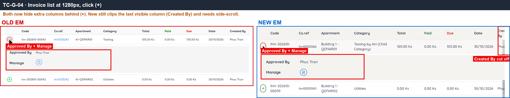

## SAN-TOP-001 · Create one UO draft

[Case](cases/00-general.md)

- **What differs:** After creating a UO draft, Old's topbar counter chip increases immediately. New increases slowly (30–80 seconds) or only after a page reload.
- **Why it is not a bug:** The final count is correct; it is only slow.
- **Suggestion:** Push the realtime update faster.

| | Result |
|---|---|
| Old EM | Create UO draft: UO chip 1→2 immediately |
| New EM | Chip stays at 2, becomes 3 only after reload ([D-12](#d-12)) |

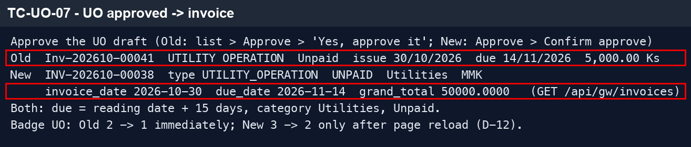

## SAN-TOP-002 · Approve that UO draft

[Case](cases/00-general.md)

- **What differs:** After approving the draft, Old's chip decreases immediately, New's decreases late.
- **Why it is not a bug / Suggestion:** Same as SAN-TOP-001.

| | Result |
|---|---|
| Old EM | Approve: chip 2→1 immediately |
| New EM | Chip stays at 3, becomes 2 only after reload ([D-12](#d-12)) |

## SAN-AR-010 · Sort by the Due Amount column

[Case](cases/02-ar.md)

- **What differs:** Sorting by Due Amount: Old actually sorts by Co.ref (wrong), New sorts by amount correctly.
- **Why it is not a bug:** New is more correct than Old.
- **Suggestion:** Keep New's behaviour.

| | Result |
|---|---|
| Old EM | Sort by Due Amount actually sorts by Co.ref (3,220 → 128,700 → 13,150 …) |
| New EM | Sorts correctly by amount 10 → 600 (New fixes the old defect) |

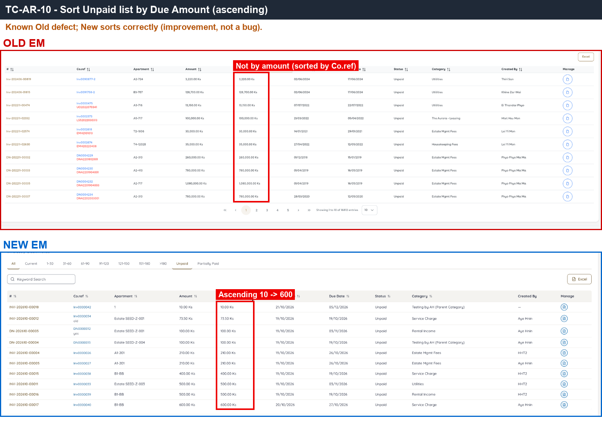

## SAN-ARS-001 · Open the MMK snapshot

[Case](cases/02-ar.md)

- **What differs:** In New's AR Snapshot the column headers are right-aligned while the numbers are left-aligned, so each number looks like it belongs to the column on its left ([UI-17](bugs.md#ui-17)).
- **Why it is not a bug:** Values are correct, just easy to misread.
- **Suggestion:** Align numbers and headers on the same side.

| | Result |
|---|---|
| Old EM | One row per day with time 00:29, tabs by currency. Some days missing (11, 12/10). Row 28/10 Total jumps to 195,408,… (Old float defect) |
| New EM | One row per day for the full month, currency picked from a dropdown (default USD). Adds a per-apartment reconciliation table. Column headers misaligned with numbers → UI-17 |

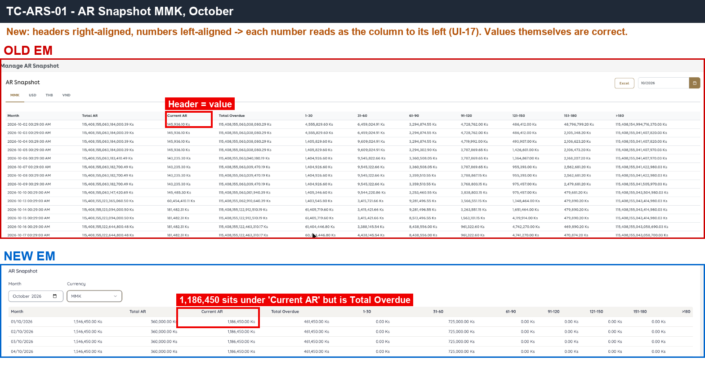

## SAN-UO-004 · Pick tomorrow as the reading date

[Case](cases/10-uo-mr.md)

- **What differs:** Both block a future reading date. Old says clearly 'must not be future date', New only says 'Invalid Reading Date' ([UI-20](bugs.md#ui-20)).
- **Why it is not a bug:** Both block correctly; only the message is vague.
- **Suggestion:** State the reason.

| | Result |
|---|---|
| Old EM | Calendar allows the 31st, Submit shows ''Reading Date' must not be future date' |
| New EM | Calendar allows the 31st, Submit only shows 'Invalid Reading Date' (UI-20) |

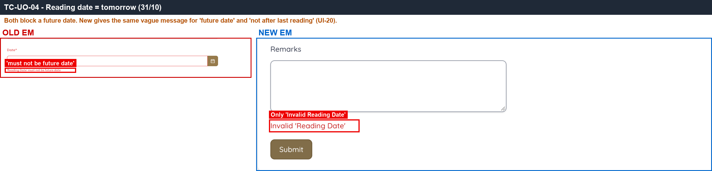

## SAN-UO-005 · Reading date equals the previous reading date

[Case](cases/10-uo-mr.md)

- **What differs:** Both block a reading on the same date as the previous one; New only says 'Invalid Reading Date'.
- **Why it is not a bug / Suggestion:** Same as SAN-UO-004.

| | Result |
|---|---|
| Old EM | 'The Reading Date must be later than the previous Reading Date' |
| New EM | Only 'Invalid Reading Date', no reason given |

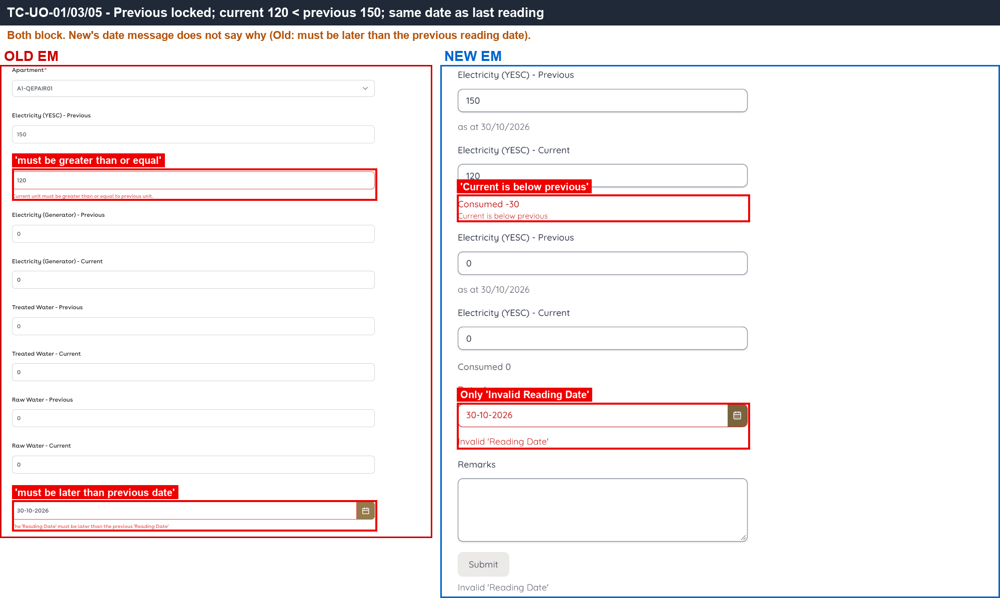

## SAN-MP-004 · Edit Pay on line 1 above its due

[Case](cases/04-make-payment.md)

- **What differs:** Typing Pay 500 for an invoice with only 105 due: Old clamps it to 105, New keeps 500 and blocks on Confirm ('line exceeds remaining due').
- **Why it is not a bug:** No wrong money is recorded; only the guidance differs.
- **Suggestion:** Optionally clamp like Old.

| | Result |
|---|---|
| Old EM | Pay 500 > due 105 → clamped to 105 |
| New EM | Keeps 500; Confirm → 422 'line exceeds remaining due' (if Received = 0, only ERR_UNKNOWN — see [D-06](#d-06)) |

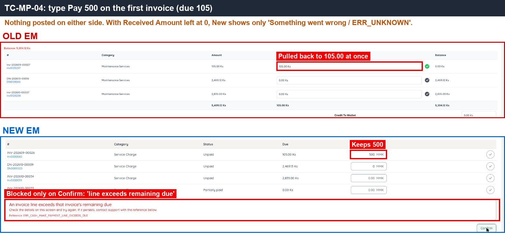

## SAN-MP-008 · Payment Method = Cheque, Uncleared

[Case](cases/04-make-payment.md)

- **What differs:** Paying by cheque: New has an extra 'Cheque status' field (Uncleared/Cleared), Old does not.
- **Why it is not a bug:** Extra feature in New; the account receives the same money (+50).
- **Suggestion:** Keep.

| | Result |
|---|---|
| Old EM | Cheque: no status field; Bank account +50 (10,050) |
| New EM | 'Cheque status' Uncleared/Cleared field; Bank account +50 (10,050) |

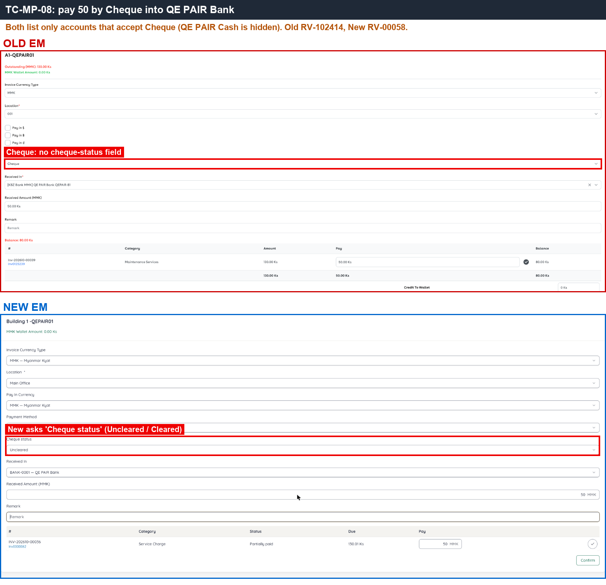

## SAN-RV-002 · Change a receipt's cheque status to Uncleared

[Case](cases/07-cash-received.md)

- **What differs:** New can change the cheque status (Mark Uncleared/Cleared) on a receipt; the account balance stays the same. Old UAT has no such button.
- **Why it is not a bug:** New follows the spec; Old is missing it.
- **Suggestion:** Keep.

| | Result |
|---|---|
| Old EM | UAT has no place to change cheque status (neither the Make Payment form nor the RV-102420 page), although the spec says it exists |
| New EM | RV-00064: Mark Uncleared → confirm → status changes, QE PAIR Bank balance stays 13,650, journal entry #269 unchanged ✅ |

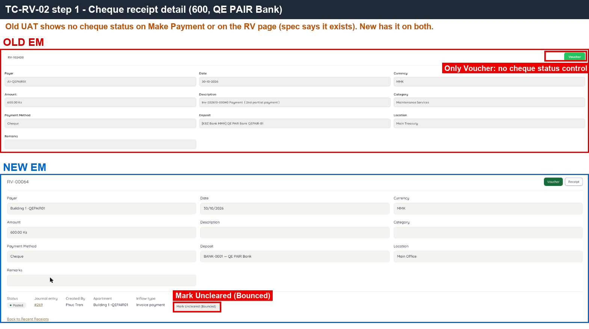

## SAN-PV-002 · Create a valid Cash Outflow (PV)

[Case](cases/08-outflow-transfer.md)

- **What differs:** After creating a PV draft, New's PV chip only increases after reload.
- **Why it is not a bug:** The voucher is created correctly.
- **Suggestion:** Same as SAN-TOP-001.

| | Result |
|---|---|
| Old EM | Draft, PV chip 29→30 immediately |
| New EM | Draft #30, PV chip only increases after reload (5→6) |

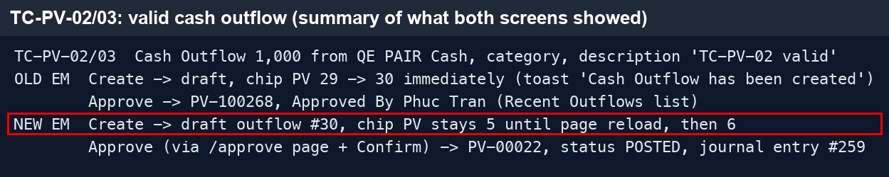

## SAN-RPT-001 · Account Statement for account X, this month

[Case](cases/12-reports.md)

- **What differs:** Opening and closing balances are correct. But New defaults to the last 30 days (Old: from the start of the month), shows raw text '10000.0000 as of 2026-…', an empty description '()', and a minus sign in the CR column (UI-09).
- **Why it is not a bug:** Amounts are correct (the 0.03 gap comes from [BUG-01](bugs.md#bug-01)); display only.
- **Suggestion:** Clean up the displayed text.

| | Result |
|---|---|
| Old EM | Period 01/10–30/10. Opening 0, closing 19,945.67 = account balance. RV-102413 split into 4 rows with descriptions. CR without minus sign |
| New EM | Default period 29/09–29/10 (30 days). Opening 0, closing 19,945.70. One row per RV, empty description '()' (UI-09). Opening shown raw as '10000.0000 as of 2026-10-29T15:34:56…'. CR has a '-' sign |

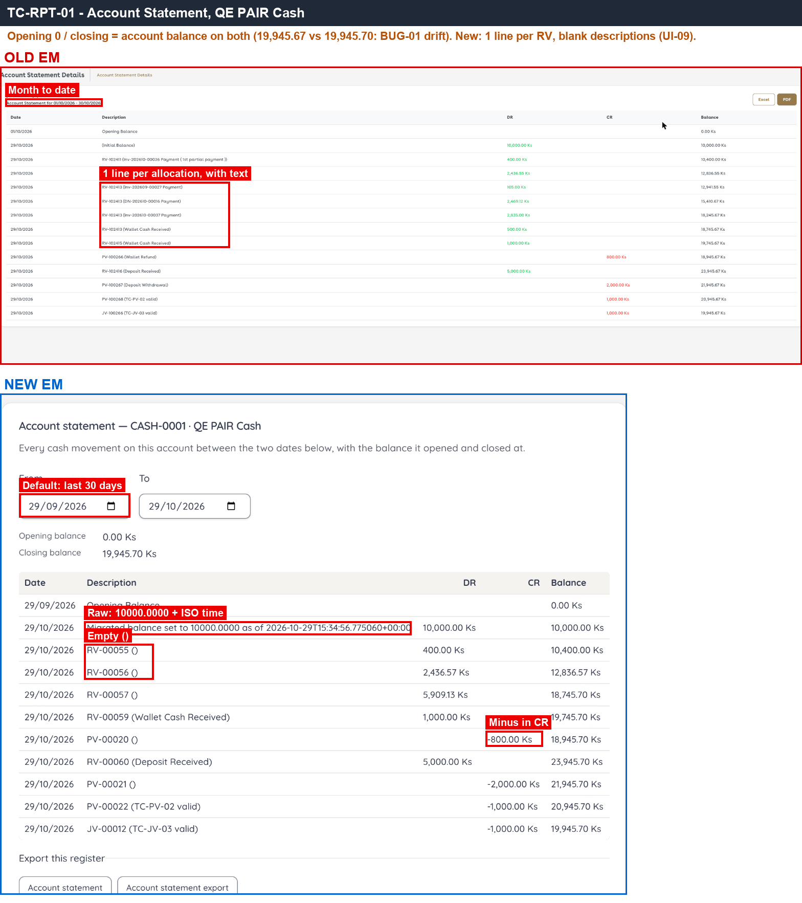

## SAN-RPT-010 · Credit Note report after SAN-WAL-003

[Case](cases/12-reports.md)

- **What differs:** Credit Note report amounts are correct, but New lacks the Type / Description / Remark columns (UI-12).
- **Why it is not a bug:** Data is correct; columns are missing for reading.
- **Suggestion:** Add the 3 columns back.

| | Result |
|---|---|
| Old EM | CN-100107 · 500.00, with Type, Description ('TC-WAL-02 CN') and Remark columns |
| New EM | WCN-202610-0003 · 500.00 correct. Type / Description / Remark columns missing (UI-12) |

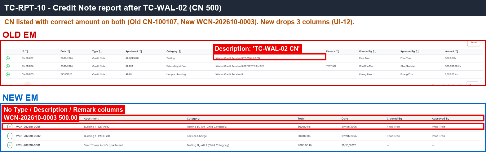

---

## Other differences (D-01…D-13)

Differences noticed while testing, outside a specific test case.

| ID | Area | Old EM | New EM | Evidence |
|---|---|---|---|---|
| D-01 | Create Apartment | Has Status* ENABLE/DISABLE. Name `A1-<unit>`. Returns to the list after create | No Status. Name `Building 1 -<unit>`. Opens the apartment Summary after create | [APT-NEW-1](img/APT-NEW-1.png) |
| D-02 | Create Account | Type comes from Settings > Types (CASH, BANK, New Type, Online…). Payment Method is a dropdown. Initial shown as `10,000.00 Ks` | Fixed Types (Operating, Escrow, Petty Cash, CASH, BANK). Payment Method is checkboxes. Initial shown as `10000` | [ACC-NEW-1](img/ACC-NEW-1.png) |
| D-03 | Create Invoice (default Payment Terms) | `Due On Receipt` | Empty, must be chosen | — |
| D-04 | Delete invoice draft | Remove deletes immediately, no confirmation | Remove (not tried) | — |
| D-05 | Invoice form with 14-digit amounts | Shown in full | Disc. Price / Tax / Total fields overlap | — |
| D-06 | Make Payment: Pay filled but Received = 0 | (n/a: Old computes it) | Confirm is clickable, server returns 422, UI shows only 'Something went wrong / ERR_UNKNOWN' | — |
| D-07 | Wallet tab | Amount sits under the DR column; Opening row dated 01/10 | Amount shifted left, not under DR; Opening row has no date | [TC-MP-07-wallet](img/TC-MP-07-wallet.png) |
| D-08 | Create account, Type BANK | Keeps the selected Payment Methods | Changing Type clears the ticked Payment Methods | [ACC-NEW-2](img/ACC-NEW-2.png) |
| D-09 | Cash Outflow / Refund draft | Approve button on the draft page | Draft page only has a green button to create the Voucher PDF; approving needs the small link 'Approve or remove this draft' | — |
| D-10 | UAT incident | — | At 23:30 New returned 503 ERR_BFF_CIRCUIT_OPEN for about 1 minute, then recovered | — |
| D-11 | Date field (Cash Outflow) | Calendar picker | Text field DD-MM-YYYY, but typed dates revert to the old date; only the calendar works | [TC-PV-06](img/TC-PV-06.png) |
| D-12 | Topbar chips after creating / approving drafts | Update immediately | Update only after page reload | [TC-PV-03](img/TC-PV-03.png) |
| D-13 | "Today" near midnight (test machine UTC+7, Yangon still 29/10) | Calendar follows the machine clock, server blocks the 30th. Dashboard "as of 30/10" | Same as Old. Dashboard "29/10" (Yangon time) | [UNK-03-2](img/UNK-03-2.png), [DB-01-1](img/DB-01-1.png) |
