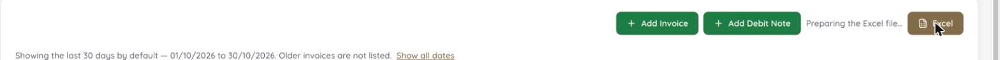
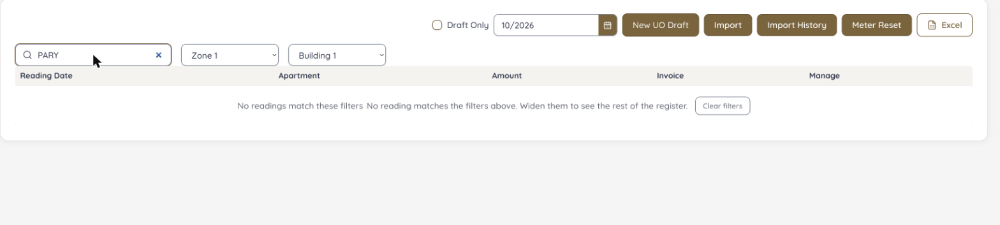
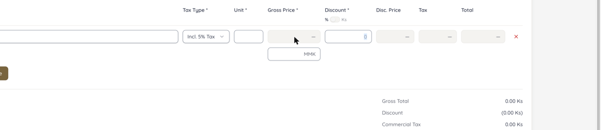
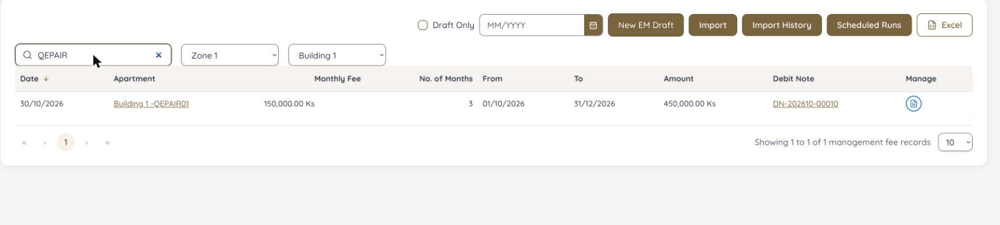
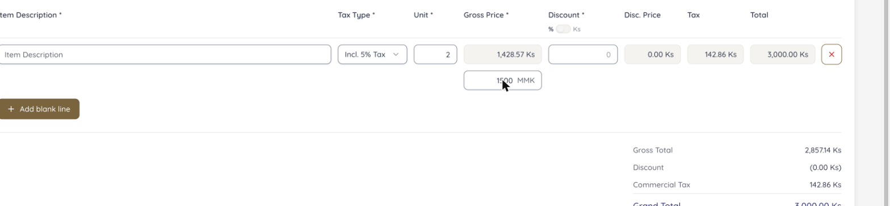
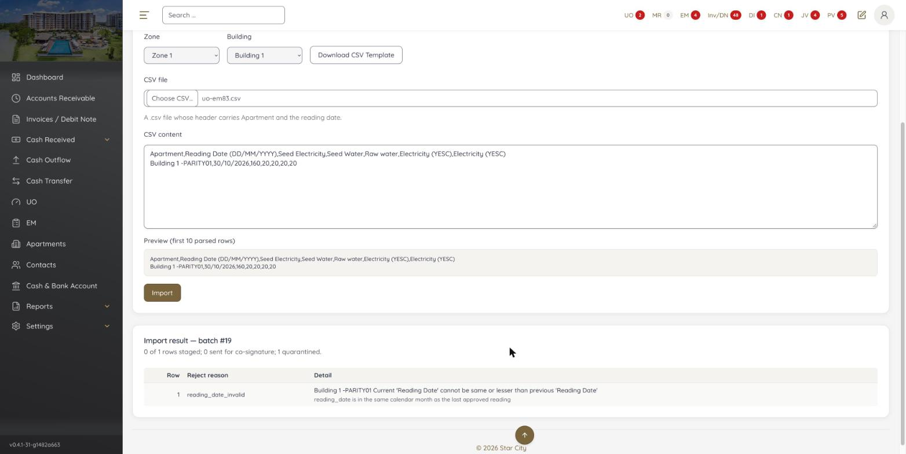
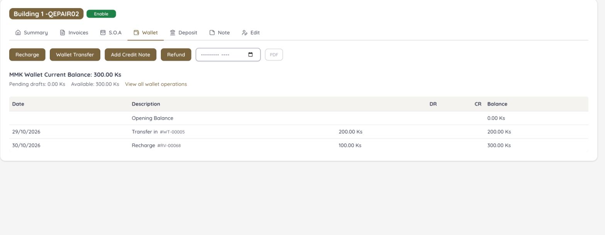

# Jira cross-check

[← Sanity index](README.md) · [Bugs](bugs.md)

> **Current status is in [tickets/README.md](tickets/README.md)** (all 90 tickets, build -37, 2026-11-01). Sections 2 and 3 below record the 30/10 check on build -31 and are kept as history. Priorities in section 1 are as filed on 30/10; on 01/11 Jira shows EM-93 … EM-107 as Medium, including the hard-stop EM-96.

On 30/10/2026 all **65 bugs** in Jira `project = EM` (EM-28 … EM-92) were read without editing anything and compared with this report. A pair counts as the same when it is on **the same screen with the same symptom**, since Jira tickets are short. Jira attachments could not be opened, so 🔗 pairs need a look at the ticket's images to be sure. After that, the **25 new bugs were filed as EM-93 … EM-117**.

Jira base: `https://zeyalabs-team-a83df6me.atlassian.net/browse/EM-NN`

**Legend**

- 🔁 **Duplicate:** same defect, same screen. Add evidence to the existing ticket, no new ticket.
- 🔗 **Very likely duplicate:** same screen and symptom, but the ticket is too short to be 100% sure. Merge after checking its attachments.
- ⚔️ **Conflict:** the Jira ticket and this report reach opposite conclusions. The PO decides before dev fixes it.
- ↔️ **Related, not duplicate:** same screen or topic, different defect. Filed separately with a link.

## 1. New tickets filed (EM-93 … EM-117, 30/10/2026)

Format: Description, Precondition, Steps to reproduce, Expected result, Actual result, Reference. Evidence is inline in the description. Priority and Parent (epic) are set; Assignee is empty. Build `v0.4.1-31-g1482a663`.

| Priority | Count |
|---|---|
| Highest | 4 |
| High | 11 |
| Medium | 10 |
| **Total** | **25** |

| # | Jira | Bug | Priority | Parent | Related existing ticket |
|---|---|---|---|---|---|
| 1 | [EM-93](https://zeyalabs-team-a83df6me.atlassian.net/browse/EM-93) | [BUG-01](bugs.md#bug-01) | Highest | EM-4 Invoice-Debit Note | – |
| 2 | [EM-94](https://zeyalabs-team-a83df6me.atlassian.net/browse/EM-94) | [BUG-02](bugs.md#bug-02) | Highest | EM-21 Cash and Bank Account | EM-72, EM-73 (different defect) |
| 3 | [EM-95](https://zeyalabs-team-a83df6me.atlassian.net/browse/EM-95) | [BUG-03](bugs.md#bug-03) | Highest | EM-3 Accounts Receivable | – |
| 4 | [EM-96](https://zeyalabs-team-a83df6me.atlassian.net/browse/EM-96) | [BUG-04](bugs.md#bug-04) | Highest | EM-10 Cash Transfer | – |
| 5 | [EM-97](https://zeyalabs-team-a83df6me.atlassian.net/browse/EM-97) | [BUG-05](bugs.md#bug-05) | High | EM-9 Cash Outflow | – |
| 6 | [EM-98](https://zeyalabs-team-a83df6me.atlassian.net/browse/EM-98) | [BUG-07](bugs.md#bug-07) | High | EM-21 Cash and Bank Account | EM-88, EM-71 (different defect) |
| 7 | [EM-99](https://zeyalabs-team-a83df6me.atlassian.net/browse/EM-99) | [BUG-08](bugs.md#bug-08) | High | EM-3 Accounts Receivable | EM-53 (different defect) |
| 8 | [EM-100](https://zeyalabs-team-a83df6me.atlassian.net/browse/EM-100) | [BUG-10](bugs.md#bug-10) | High | EM-4 Invoice-Debit Note | – |
| 9 | [EM-101](https://zeyalabs-team-a83df6me.atlassian.net/browse/EM-101) | [BUG-12](bugs.md#bug-12) | High | EM-15 SOA - OB & CB | – |
| 10 | [EM-102](https://zeyalabs-team-a83df6me.atlassian.net/browse/EM-102) | [BUG-13](bugs.md#bug-13) | High | EM-7 Cash Received | – |
| 11 | [EM-103](https://zeyalabs-team-a83df6me.atlassian.net/browse/EM-103) | [BUG-15](bugs.md#bug-15) | High | EM-19 Deposit | EM-89 (different defect) |
| 12 | [EM-104](https://zeyalabs-team-a83df6me.atlassian.net/browse/EM-104) | [BUG-19](bugs.md#bug-19) | High | EM-5 Make Payment | – |
| 13 | [EM-105](https://zeyalabs-team-a83df6me.atlassian.net/browse/EM-105) | [BUG-30](bugs.md#bug-30) | High | EM-19 Deposit | EM-78 (different defect) |
| 14 | [EM-106](https://zeyalabs-team-a83df6me.atlassian.net/browse/EM-106) | [BUG-32](bugs.md#bug-32) | High | EM-22 Reports | – |
| 15 | [EM-107](https://zeyalabs-team-a83df6me.atlassian.net/browse/EM-107) | [BUG-33](bugs.md#bug-33) | High | EM-22 Reports | – |
| 16 | [EM-108](https://zeyalabs-team-a83df6me.atlassian.net/browse/EM-108) | [BUG-09](bugs.md#bug-09) | Medium | EM-22 Reports | – |
| 17 | [EM-109](https://zeyalabs-team-a83df6me.atlassian.net/browse/EM-109) | [BUG-14](bugs.md#bug-14) | Medium | EM-22 Reports | – |
| 18 | [EM-110](https://zeyalabs-team-a83df6me.atlassian.net/browse/EM-110) | [BUG-17](bugs.md#bug-17) | Medium | EM-12 UO | – |
| 19 | [EM-111](https://zeyalabs-team-a83df6me.atlassian.net/browse/EM-111) | [BUG-21](bugs.md#bug-21) | Medium | EM-14 EM | – |
| 20 | [EM-112](https://zeyalabs-team-a83df6me.atlassian.net/browse/EM-112) | [BUG-22](bugs.md#bug-22) | Medium | EM-4 Invoice-Debit Note | EM-75 (different defect) |
| 21 | [EM-113](https://zeyalabs-team-a83df6me.atlassian.net/browse/EM-113) | [BUG-26](bugs.md#bug-26) | Medium | EM-4 Invoice-Debit Note | – |
| 22 | [EM-114](https://zeyalabs-team-a83df6me.atlassian.net/browse/EM-114) | [BUG-31](bugs.md#bug-31) | Medium | EM-7 Cash Received | EM-85 (different defect) |
| 23 | [EM-115](https://zeyalabs-team-a83df6me.atlassian.net/browse/EM-115) | [BUG-36](bugs.md#bug-36) | Medium | EM-5 Make Payment | – |
| 24 | [EM-116](https://zeyalabs-team-a83df6me.atlassian.net/browse/EM-116) | [BUG-37](bugs.md#bug-37) | Medium | EM-5 Make Payment | – |
| 25 | [EM-117](https://zeyalabs-team-a83df6me.atlassian.net/browse/EM-117) | [BUG-38](bugs.md#bug-38) | Medium | EM-7 Cash Received | – |

## 2. Report findings vs existing tickets

Summary: 🔁 duplicate **6** · 🔗 very likely duplicate **6** · ⚔️ conflict **1** · ↔️ related **10** (BUG-11 left out until clarified).

| Report | Jira | Relation | Explanation | Action |
|---|---|---|---|---|
| [UI-20](bugs.md#ui-20) | EM-37 [UO] Incorrect error message when meter reading date equals the previous reading date | 🔁 | Same UO screen, same defect. When EM-37 was logged New showed 'ERR_UO_READING_DATE_NOT_AFTER_PREVIOUS'; build -31 shows 'Invalid Reading Date', still not Old's message. Covers SAN-UO-004/005. | Add to EM-37 that build -31 is still wrong (UO-04-1, UO-03-1) |
| [BUG-25](bugs.md#bug-25) | EM-60 [Settings > Account Classification] Manage Type section is missing | 🔁 | Same defect. Build -31 has 'Manage Type' (5 Types, New button): both fixed. | Retest and close EM-60 |
| [BUG-35](bugs.md#bug-35) | EM-39 [TC_Setting_07] Created Fund Category is not available in related filters and forms | 🔁 | Same defect from two sides: the Funding Received Category dropdown is empty. | Attach BUG-35 evidence to EM-39 |
| [BUG-24](bugs.md#bug-24) | EM-35 [Settings > UO Pricing] New button allows creating extra UO Pricing records | 🔁 | Same root: an extra pricing record → two 'Electricity (YESC)' items on the UO form (100 and 1,000). | Add to EM-35: clean up the duplicate record on UAT after the fix |
| [D-01](differences.md#d-01) | EM-32 Only unit name displayed instead of full name · EM-66 Full Name not updated after selecting Zone and Building | 🔁 | Same Create Apartment screen, same naming issue: Old 'A1-<unit>', New 'Building 1 -<unit>' everywhere incl. search. | Add D-01 / SAN-SRCH-001 evidence to EM-32 and EM-66 |
| SAN-RV-001 | EM-74 [Cash Received > Unknown Received] Category field is not mandatory | 🔁 | Unknown receipt RV-00061 saved with 'No category' (Old: 'Uncategorized Receive'). | Add evidence to EM-74 |
| [BUG-20](bugs.md#bug-20) | EM-85 [Cash Received > Unknown Receipt Allocation] Assign popup has overlapping fields and misalignment | 🔗 | Same Assign popup. The truncated 'INV-202610-00…' is that defect; Confirm disabled without a Payer message is not in the ticket. | Truncation → EM-85; Payer part filed separately |
| [BUG-23](bugs.md#bug-23) | EM-75 / EM-76 Inclusive Tax 5%/3% UI differs and allows discount | 🔗 | Same Add Invoice form; with Inclusive tax the line Total is Old 2,000 vs New 2,100 (SAN-INV-003). | Add SAN-INV-002/003 evidence to EM-75/76 |
| [BUG-39](bugs.md#bug-39) | EM-47 [Apartments] Add Owner/Tenant contacts does not match current EM | 🔗 | Same assign-owner action; screen and data match Old, but Save returns 503 although it saved. | Ask EM-47's tester; merge if it was the save error. 503 on PV draft delete stays separate |
| [BUG-16](bugs.md#bug-16) | EM-83 [UO > Import] Import with provided CSV template stages 0 rows | 🔗 | Same screen, same symptom. On 30/10 the file is read (1 row) but '0 of 1 rows staged': quarantined for same month as the approved reading, with a wrong message. | Add BUG-16 evidence to EM-83 |
| [D-02](differences.md#d-02) | EM-70 / EM-71 Create Cash / Bank Account UI does not match current EM | 🔗 | Mostly aligned on 30/10 (no Code field, Types from Manage Type, bank fields shown for BANK). Remaining: Payment Method is checkboxes, Old is a multi-select dropdown. | Note the checkbox point on EM-70/71; close if PO accepts |
| [D-09](differences.md#d-09) | EM-81 [Wallet Refund] Admin with self-approval cannot approve refund | 🔗 | The draft page has no Approve button; approval is behind the small link 'Approve or remove this draft' (N-15). Approval works via that link (SAN-WAL-006). | Note on EM-81: approvable but the button is hidden; put Approve on the draft page like Old |
| [BUG-28](bugs.md#bug-28) | EM-61 [Cash Transfer] Extra fields (Amount Received MMK, Conversion Rate, Currency, Location) not in current EM | ⚔️ | EM-61 says Old has no Amount Received / Conversion Rate. On Old UAT, USD → MMK **does** show both (rate 2,100). Build -31 has Amount Received but lacks Conversion Rate. | PO decides: show both for cross-currency like Old. Do not "fix" EM-61 by removing them |
| [BUG-07](bugs.md#bug-07) | EM-88 Bank fields not shown when Type = Bank · EM-71 | ↔️ | The UI part is fixed (BANK requires Bank Name, Account Number). BUG-07 is what remains: creating via API still works without them. | File BUG-07 separately, link EM-88 |
| [BUG-02](bugs.md#bug-02) | EM-72 / EM-73 Edit Cash / Bank Account UI does not match current EM | ↔️ | Edit form now matches Old. Edit Initial Balance is a separate button and still fails. | File BUG-02 separately |
| [BUG-31](bugs.md#bug-31) | EM-85 | ↔️ | Same popup, but a number defect: 'short of 1000.0000 MMK' should be 919.99. | File separately, link EM-85 |
| [BUG-22](bugs.md#bug-22) | EM-75 | ↔️ | Same discount area; EM-75 = discount allowed with Inclusive tax, BUG-22 = 100% → ERR_UNKNOWN. | File separately |
| [BUG-30](bugs.md#bug-30) | EM-78 [Wallet Transfer] "Transfer To" is free text | ↔️ | Same kind of defect (free text instead of a list) on a different screen. | File separately; fix both together |
| [BUG-15](bugs.md#bug-15) | EM-89 [Wallet / Deposit] approval state should not be required | ↔️ | Same Deposit area, different defect. | File separately; recheck BUG-15 if EM-89 removes approval |
| [BUG-08](bugs.md#bug-08) | EM-53 [Invoices > Advance filter] Layout and fields differ | ↔️ | Same filter topic, different screen (AR / report Type filter). | File separately; apply the same type grouping |
| SAN-UNK-004 | EM-84 Amount not credited to wallet when apartment has no open invoices | ↔️ | EM-84's exact condition (QEPAIR02 with no open invoice): 100 Ks went to the wallet, 200 → 300. EM-84 not reproduced. | EM-84 can be closed |
| SAN-G-004 | EM-44 [Apartments > Side Panel] not responsive | ↔️ | Same kind of layout issue on other screens (invoice list at 1280px, UO calendar UI-18, 14-digit numbers D-05). | File separately if PO wants |
| [BUG-27](bugs.md#bug-27) | EM-54 / EM-55 EM / UO Search differ from current EM | ↔️ | Round 1 global search needed the full code; gone in round 2. The EM / UO screen search was not part of the report. | Not duplicate |

**25 of 32 bugs** had no Jira ticket (including the "related" ones) and were filed as EM-93 … EM-117.

Existing tickets to update instead of new ones: UI-20 → EM-37 · BUG-25 → EM-60 · BUG-35 → EM-39 · BUG-24 → EM-35 · BUG-20 → EM-85 · BUG-23 → EM-75/76 · BUG-39 → EM-47 · BUG-16 → EM-83 · D-01 → EM-32/66.

## 3. Verdict per existing Jira ticket (build -31)

Each ticket was compared with the Old/New result on the same action. On 30/10, **48 tickets were retested** (🔄), using only test apartments and accounts. The trial Payment Method 'QE PAIR PM' was disabled again.

| Verdict | Count | Meaning |
|---|---|---|
| ✅ Valid | 9 | New is wrong, Old is right, as the ticket says |
| 🟡 Partly valid | 11 | Part of the ticket holds, part changed |
| ❌ Not consistent with Old | 2 | Old UAT contradicts the ticket's expected result; PO reviews before dev follows it |
| 🔧 Not reproducible on build -31 | 40 | The same action works on build -31; probably fixed, retest and close |
| ⬜ Not checked | 3 | Outside the 168 cases (password entry / logout needed) |

### ✅ Valid (9)

| Jira | Title | Jira status | Finding | Evidence |
|---|---|---|---|---|
| EM-32 | [Apartments] Only unit name is displayed instead of apartment full name | In Review | New names apartments 'Building 1 -<unit>' instead of 'A1-<unit>' everywhere (list, search, contact). Build -31 shows the building name, not just the unit. | – |
| EM-38 | [TC_Setting_08/15] Parent-child hierarchy not shown in Category filter | In Review | 🔄 The Category filter is flat, child categories only; the parent is missing. Old lists parent then children. | – |
| EM-39 | [TC_Setting_07] Created Fund Category not available in related filters and forms | In Review | Funding Received Category is empty (Old has 5). See [BUG-35](bugs.md#bug-35). | – |
| EM-40 | [TC_Setting_14] New parent expense category not displayed in Categories filter | In Review | 🔄 As EM-38. | – |
| EM-49 | [Invoices / Debit Note] Excel export of list does not work | In Review | 🔄 Invoices MMK (10 rows) → Excel: stuck at 'Preparing the Excel file…', job status call keeps returning 500, no file. Old downloads a 10 KB .xlsx at once. |  |
| EM-55 | [UO > Search] Search behaviour and UI differ from current EM | In Review | 🔄 Typing 'PARITY' at normal speed loses characters ('PARY' / 'PAITY') → 'No readings match', 3/3 times. Old keeps the text and returns 2 rows. Building has no 'All'. |  |
| EM-74 | [Cash Received > Unknown Received] Category field is not mandatory | In Review | 🔄 The Unknown Received form has no Category field; RV-00068 saved with 'No category'. | – |
| EM-77 | [Wallet Recharge] Redirects to Wallet Operations instead of apartment wallet | In Review | 🔄 Recharge from the apartment Wallet tab jumps to Wallet Operations. | – |
| EM-92 | [Add Invoice] Changing Tax Type clears Unit and Gross Price | In Progress | 🔄 Unit 2, Gross 1500, 5% → switch to 'Incl. 5% Tax': Unit and Gross Price cleared, totals 0.00. |  |

### 🟡 Partly valid (11)

| Jira | Title | Jira status | Finding | Evidence |
|---|---|---|---|---|
| EM-35 | [Settings > UO Pricing] New button allows extra records | In Review | 🔄 The New button is gone, but the extra records remain: 5 items with two 'Electricity (YESC)' (100 and 1,000 Ks); Old has 4. The UO import template still has two YESC columns. | – |
| EM-37 | [UO] Incorrect error message when reading date equals previous | In Review | Still wrong, message changed to 'Invalid Reading Date'. Old: 'The Reading Date must be later than the previous Reading Date'. Update the ticket's actual result. | – |
| EM-47 | [Apartments] Add Owner/Tenant contacts does not match current EM | In Review | Screen and data match Old, but Save returns 503 although it saved ([BUG-39](bugs.md#bug-39)). | – |
| EM-53 | [Invoices > Advance filter] Layout and fields differ | In Progress | 🔄 Has Filter Type, Building, Apartment, Currency, Reset like Old. Remaining: default currency USD (Old MMK). The AR / report Type filter still drops UO invoices ([BUG-08](bugs.md#bug-08)). | – |
| EM-54 | [EM > Search] Search behaviour and UI differ | In Review | 🔄 Search works ('QEPAIR' → 1 row like Old). UI differs: month empty, needs 'Show all dates'; no 'All' building; no PDF button. |  |
| EM-69 | [Cash & Bank Account > List] List does not match | In Review | 🔄 Same columns and data as Old. Only styling differs. | – |
| EM-75 | [Add Invoice] Inclusive Tax 5%/3% UI differs and allows discount | In Review | 🔄 Discount is now locked at 0 with Inclusive tax; numbers right (2 × 1500 → Gross 1,428.57, Tax 142.86, Total 3,000). UI still differs: extra tax-inclusive price field, line Total includes tax ([BUG-23](bugs.md#bug-23)). |  |
| EM-76 | [Apartments > Add Invoice] Inclusive Tax 5%/3% UI differs | In Review | 🔄 As EM-75, from Apartment > Add Invoice. |  |
| EM-81 | [Wallet Refund] Admin with self-approval cannot approve refund | In Review | Approvable by the creator (PV-00020), but only via the small link ([D-09](differences.md#d-09)). | – |
| EM-83 | [UO > Import] CSV template stages 0 rows | To Do | 🔄 The file is read now, but the valid row is quarantined: '0 of 1 rows staged; 1 quarantined', wrong message ([BUG-16](bugs.md#bug-16)). |  |
| EM-85 | [Unknown Receipt Allocation] Assign popup overlapping fields | In Review | Invoice number truncated 'INV-202610-00…' (the ticket's point). Two more defects: [BUG-20](bugs.md#bug-20), [BUG-31](bugs.md#bug-31). Allocation list shows Payer '—' (UI-16). | – |

### ❌ Not consistent with Old (2)

| Jira | Title | Jira status | Finding |
|---|---|---|---|
| EM-59 | [Cash Outflow] Extra Payment Method and Location fields not in current EM | In Review | Old UAT does use Location: the Transactions report filters outflows by Location (Main Treasury) and Make Payment requires it ('Location is required'). Check Old's Cash Outflow form before removing Location. |
| EM-61 | [Cash Transfer] Extra fields not in current EM | In Review | Old UAT shows Amount Received and Conversion Rate (2,100) for USD → MMK. New lacks Conversion Rate rather than having extra fields ([BUG-28](bugs.md#bug-28)). Currency / Location not checked. |

### 🔧 Not reproducible on build -31 (40)

| Jira | Title | Finding on build -31 |
|---|---|---|
| EM-31 | [Dashboard] Two scroll bars and large white space | 🔄 One content scroll bar; footer at the end, no white space |
| EM-33 | [Apartments] Created without a Building linked to a Zone | 🔄 'Building is required', nothing created |
| EM-34 | [Settings > General Setting] Extra CoRef fields | 🔄 Only 'Old CoRef No.' (Enable / Disable), like Old |
| EM-36 | [Reports] Arrow symbols in Category filter | 🔄 Names only, no arrows |
| EM-41 | [Apartments > Summary] Currency filter missing | 🔄 Currency selector next to 'Accounts Receivable' |
| EM-42 | [Apartments > Invoice] Debit Note can be created from the Invoices tab | 🔄 Only Add Invoice and Make Payment |
| EM-43 | [Contact > Summary] Currency filter misaligned | 🔄 Same layout as the apartment Summary |
| EM-44 | [Apartments > Side Panel] Not responsive | 🔄 Create/edit apartment is a page; Wallet side panels scroll internally at 1564×784 (one size tested) |
| EM-45 | [Contact] NRC free text instead of Myanmar NRC dropdowns | NRC split into state / township / type / 6-digit number, 'Complete the NRC…' on incomplete input (SAN-CON-001/002) |
| EM-46 | [Settings > Zone and Building] Delete button should not exist | 🔄 Edit only, no Delete; same as Old |
| EM-48 | [Apartments > Invoice tab] Count includes paid, loads late | 🔄 'Invoices (3)' immediately = 3 unpaid; 7 paid not counted |
| EM-50 | [UO > Zone filter] Disabled zones displayed | 🔄 Only the 5 enabled zones |
| EM-51 | [EM > Zone filter] Disabled zones displayed | 🔄 As EM-50 |
| EM-52 | [Apartments > Zone filter] Disabled zones displayed | 🔄 As EM-50 |
| EM-56 | [Settings > Building] Duplicate buildings can be created | 🔄 'Building Name Already Exists' |
| EM-57 | [Settings > Currency] Required fields missing | 🔄 Currencies, Name, Code, Symbol, Status present |
| EM-58 | [TC_Setting_28] Check areas fail after creating a payment method | 🔄 'QE PAIR PM' appears in account create and wallet Recharge (disabled again) |
| EM-60 | [Settings > Account Classification] Manage Type missing | 🔄 Manage Type present ([BUG-25](bugs.md#bug-25) fixed too) |
| EM-62 | [Side Panel] Roles, Cash & Bank, Currency, Payment Method, Staff should be pages | 🔄 All open as pages |
| EM-63 | [Settings > Staff] Phone field missing | 🔄 Country code + Phone present |
| EM-64 | [Settings > Staff] Enable/Disable instead of Activate/Deactivate | 🔄 Activate / Deactivate like Old |
| EM-65 | [Settings > Staff] Reset Password flow differs | 🔄 'Click to change password' button, like Old |
| EM-66 | [Create Apartment] Full Name not updated after Zone/Building | 🔄 Updates ('Building 1 -X9'); format still differs (EM-32) |
| EM-67 | [Create Apartment] Extra "Name (optional)" field | 🔄 Gone; Old has Status that New lacks |
| EM-68 | [Deposit > Add Deposit] Error on Post | Add Deposit 5,000 → RV-00060, like Old. UAT 503s ([D-10](differences.md#d-10), [BUG-39](bugs.md#bug-39)) may explain the ticket |
| EM-70 | [Create Cash Account] UI does not match | 🔄 No Code field; only Payment Method checkboxes differ |
| EM-71 | [Create Bank Account] UI does not match | 🔄 BANK shows Bank Name*, Account Number*, Enable Overdraft; API gap is [BUG-07](bugs.md#bug-07) |
| EM-72 | [Edit Cash Account] UI does not match | 🔄 Same fields as Old; Edit Initial Balance still fails ([BUG-02](bugs.md#bug-02)) |
| EM-73 | [Edit Bank Account] UI does not match | 🔄 As EM-72 for QE PAIR Bank |
| EM-78 | [Wallet Transfer] "Transfer To" free text | 🔄 Apartment dropdown; Deposit withdraw had the same issue ([BUG-30](bugs.md#bug-30)) |
| EM-79 | [Wallet Transfer] Fails with a valid destination | 200 to apartment B → WT-00005, like Old (SAN-WAL-007) |
| EM-80 | [Wallet Transfer] Location field should not be displayed | 🔄 No Location |
| EM-82 | [UO Import template] Apartments of selected Zone/Building missing | 🔄 All 4 apartments present, but two 'Electricity (YESC)' columns ([BUG-24](bugs.md#bug-24)) |
| EM-84 | [Unknown Allocation] Not credited to wallet without open invoices | 🔄 'the whole receipt goes to its wallet', wallet 200 → 300 —  |
| EM-86 | [Cash Transfer] Self-approval cannot approve own transfer | JV-00012 created and approved by the same user (SAN-JV-003) |
| EM-87 | [Sign In] "Forgot Your Password" shown but not supported | 🔄 The /login page no longer contains 'Forgot' (not viewed while logged out) |
| EM-88 | [Cash and Bank] Bank fields not shown for Bank; Payment Method missing | 🔄 Payment Method (checkboxes) and bank fields present; API gap is [BUG-07](bugs.md#bug-07) |
| EM-89 | [Wallet / Deposit] Approval should not be required | 🔄 Recharge, Add Deposit, Wallet Transfer post immediately; only refund / withdraw need approval (Old also creates a PV draft) |
| EM-90 | [UO] Self-approve does not work | UO draft approved by its creator → INV-202610-00038 (SAN-UO-007) |
| EM-91 | [MFO] Self-approve does not work for EM fee | EM draft approved by its creator → DN-202610-00010 (SAN-EM-006) |

### ⬜ Not checked (3)

| Jira | Title | Why |
|---|---|---|
| EM-28 | [Change Password] "Log out of every device?" dialog overflows | Needs password entry or logout |
| EM-29 | [TC_Login_001] Redirected to error page after changing password | Same |
| EM-30 | [Sign In] Invalid email/password alert message is incorrect | Same |

## 4. Differences (not bugs) vs Jira

- [SAN-UO-004 / SAN-UO-005](differences.md#san-uo-004): vague 'Invalid Reading Date' → same topic as **EM-37**.
- [SAN-G-004](differences.md#san-g-004): clipped column at 1280px → similar to **EM-44** but a different screen.
- The other 10 differences (slow chips, Cheque status, AR sort, AR Snapshot alignment, missing report columns…) have no Jira ticket.
