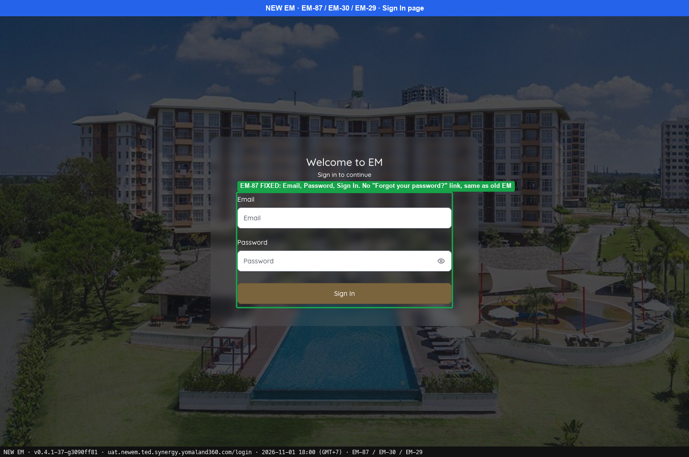
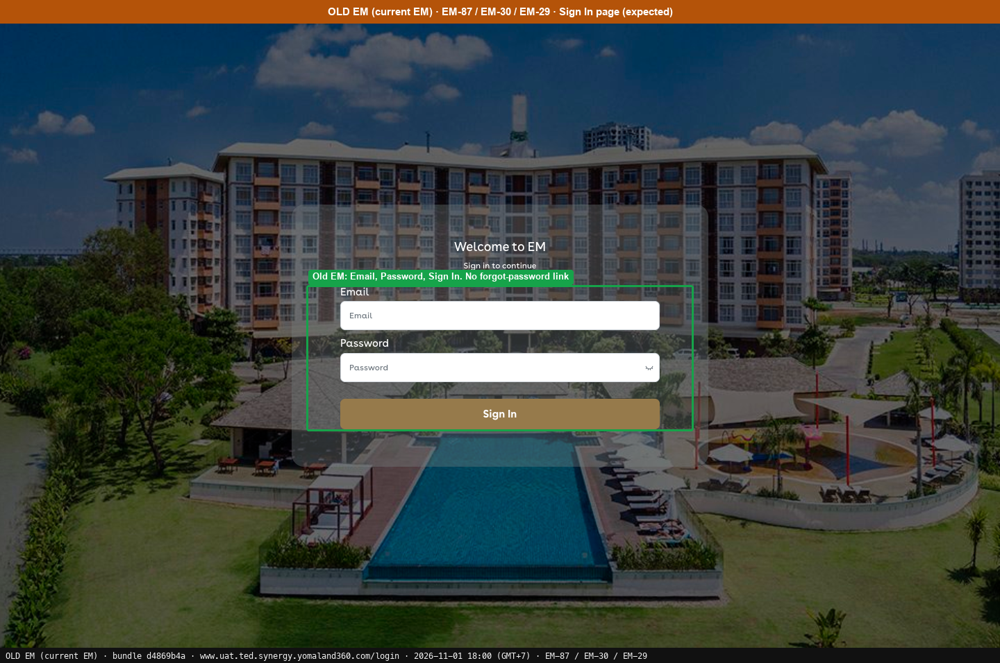

# Blocked · Needs a person to run it

[← Ticket index](README.md) · [Sanity index](../README.md)

**Tickets:** 1 · **Blocked:** 1

Needs an invited test user with a mailbox, then a first login with the temporary password.

## Summary

| Ticket | Title | Jira priority | Status (build -37) | Result | Case |
|---|---|---|---|---|---|
| [EM-29](https://zeyalabs-team-a83df6me.atlassian.net/browse/EM-29) | [TC_Login_001] - Users are redirected to error page after changing password | Medium | Blocked | Not run: needs an invited user, that user's mailbox and a sign-out | [SAN-EM29-001](#san-em29-001--newly-invited-user-changes-the-password-on-first-sign-in-and-continue-opens-the-main-page) |

## Tickets

### EM-29 · [TC_Login_001] - Users are redirected to error page after changing password

[EM-29](https://zeyalabs-team-a83df6me.atlassian.net/browse/EM-29) · Jira priority Medium · Status **Blocked**

**Reported:** Newly invited users are redirected to the error page after changing the password and clicking Continue.

#### SAN-EM29-001 · Newly invited user changes the password on first sign-in and Continue opens the main page

| Priority | Suites | Automation | Status | Source |
|---|---|---|---|---|
| P2 | Sanity · Regression | Manual — needs the invited user's mailbox for the temporary password | Review — needs an invited test user and that user's mailbox, signed out, run by a tester | EM-29 repro (TC-EM-29-01), 2026-11-01 |

**Preconditions:**

1. Settings › Staff has invited a new user; the user received the invitation email and temporary password.
2. First sign-in forces a password change.
3. Pages: New EM `/login`, Old EM `/login` (bundle `d4869b4a`).

**Steps:**

1. Sign in with the temporary password.
2. Enter the current password, the new password and the new password again.
3. Click [Continue].

**Expected result:**

1. The change password page opens.
2. The new password is saved and the user returns to the main page.

**Result (build -37, 2026-11-01):**

| # | Old EM | New EM | |
|---|---|---|---|
| 1 | Not run | Not run | ⛔ Not run |
| 2 | Not run | Not run | ⛔ Not run |
| 3 | Not run | Not run (the ticket reports an error page) | ⛔ Not run |

**Conclusion:** Blocked, also after the re-run. The case needs an invited test user and that user's mailbox, then a first sign-in with the temporary password, which were out of scope for this run. No step was run. A tester must run it with a test account.

**Evidence:**

-  — EM-87 FIXED: Email, Password, Sign In. No "Forgot your password?" link, same as old EM
-  — Old EM: Email, Password, Sign In. No forgot-password link
---
