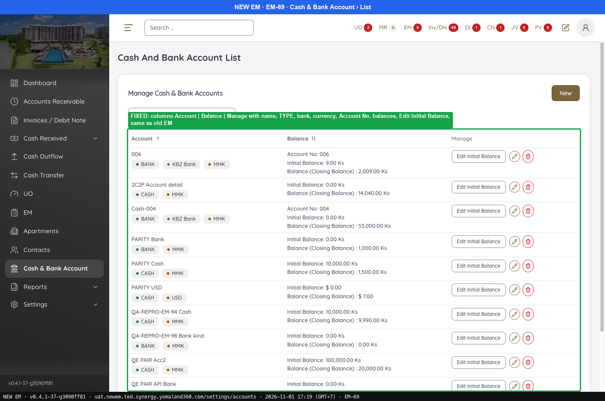
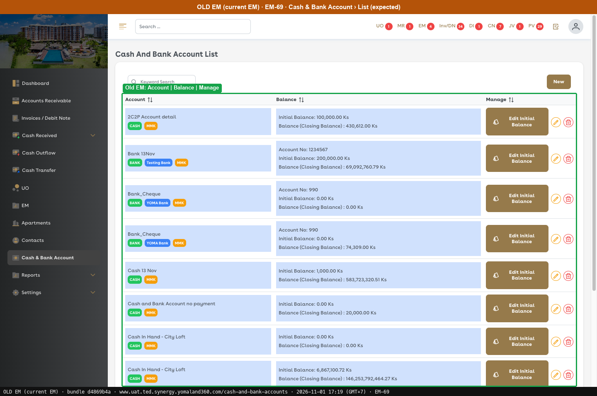
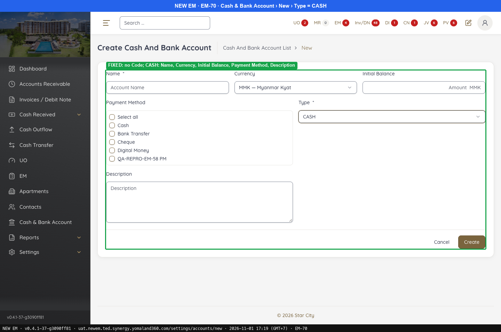
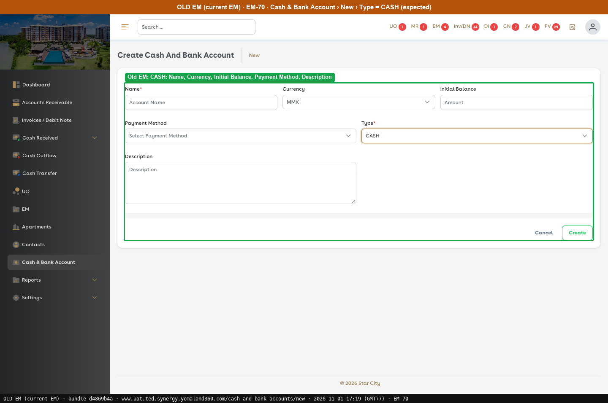
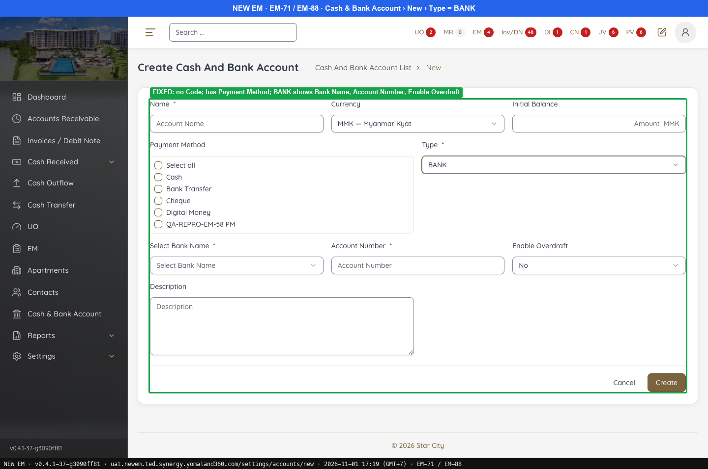
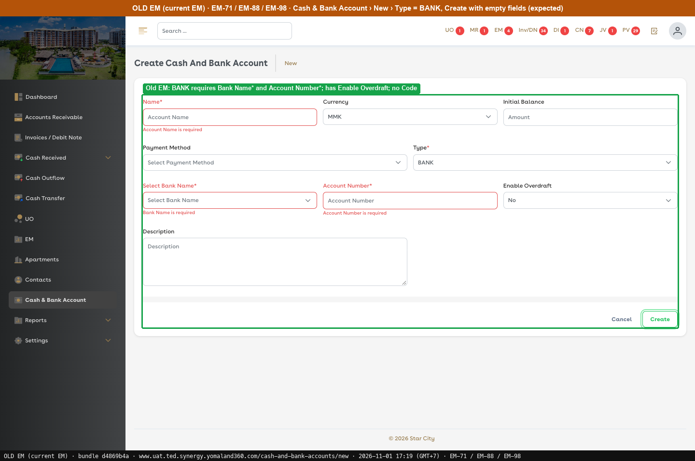

# Fixed · Cash & Bank Account

[← Ticket index](README.md) · [Sanity index](../README.md)

**Tickets:** 4 · **Fixed:** 4

These tickets are fixed on build -37. Their cases are now regression checks.

## Summary

| Ticket | Title | Jira priority | Status (build -37) | Result | Case |
|---|---|---|---|---|---|
| [EM-69](https://zeyalabs-team-a83df6me.atlassian.net/browse/EM-69) | [Cash & Bank Account > List] List does not match current EM UAT | Medium | Fixed | The list matches Old EM (columns, content, Edit Initial Balance). | [SAN-EM69-001](#san-em69-001--cash--bank-account-list-matches-old-em-columns-and-content) |
| [EM-70](https://zeyalabs-team-a83df6me.atlassian.net/browse/EM-70) | [Cash & Bank Account > New > Create New Cash Account] Create UI does not match current EM UAT | Highest | Fixed | Code removed; CASH has Name, Currency, Initial Balance, Payment Method, Description (Payment Method is still a checkbox list). | [SAN-EM70-001](#san-em70-001--new-account-with-type-cash-matches-old-em-fields-and-has-no-code) |
| [EM-71](https://zeyalabs-team-a83df6me.atlassian.net/browse/EM-71) | [Cash & Bank Account > New > Create New Bank Account] Create UI does not match current EM UAT | Highest | Fixed | Code removed; BANK shows Bank Name, Account Number, Enable Overdraft (Payment Method is still a checkbox list). | [SAN-EM71-001](#san-em71-001--new-account-with-type-bank-matches-old-em-fields-and-has-no-code) |
| [EM-88](https://zeyalabs-team-a83df6me.atlassian.net/browse/EM-88) | [Cash and Bank] Bank fields not shown when Type = Bank; Payment Method field missing | Highest | Fixed | Payment Method is present; BANK shows all bank fields. | [SAN-EM88-001](#san-em88-001--new-account-has-payment-method-type-bank-shows-bank-name-account-number-enable-overdraft) |

## Tickets

### EM-69 · [Cash & Bank Account > List] List does not match current EM UAT

[EM-69](https://zeyalabs-team-a83df6me.atlassian.net/browse/EM-69) · Jira priority Medium · Status **Fixed**

**Reported:** The Cash & Bank Account list columns and layout differed from the current EM UAT.

#### SAN-EM69-001 · Cash & Bank Account list matches Old EM columns and content

| Priority | Suites | Automation | Status | Source |
|---|---|---|---|---|
| P2 | Sanity · Regression | Auto-UI | Active | EM-69 repro (TC-EM-69-01), 2026-11-01 |

**Preconditions:**

1. Logged in as an Admin user.
2. CASH and BANK accounts exist.

**Steps:**

1. Open Cash & Bank Account (New `/settings/accounts`, Old `/cash-and-bank-accounts`).
2. Read the Account cell.
3. Read the Balance cell.
4. Read the Manage cell.
5. Check Keyword Search and pagination.

**Expected result:**

1. Columns Account / Balance / Manage.
2. Account shows name, TYPE label, bank (BANK) and currency.
3. Balance shows Account No (BANK), Initial Balance and Balance (Closing Balance).
4. Manage shows Edit Initial Balance, Edit and Delete.
5. Keyword Search and pagination are available.

**Result (build -37, 2026-11-01):**

| # | Old EM | New EM | |
|---|---|---|---|
| 1 | Account / Balance / Manage | Account / Balance / Manage | ✅ Same |
| 2 | Name, TYPE label, bank (BANK), currency | Name, TYPE label, bank, currency | ✅ Same |
| 3 | Account No (BANK), Initial Balance, Balance (Closing Balance) | Same as Old EM | ✅ Same |
| 4 | Edit Initial Balance + Edit + Delete | Edit Initial Balance + Edit + Delete | ✅ Same |
| 5 | Available | Available | ✅ Same |

**Conclusion:** Fixed. Also noted: the Edit Initial Balance button style differs (Old EM: solid brown button on a blue row; New EM: outlined button), with no change in function.

**Evidence:**

-  — FIXED: columns Account | Balance | Manage with name, TYPE, bank, currency, Account No, balances, Edit Initial Balance, same as old EM
-  — Old EM: Account | Balance | Manage
---

### EM-70 · [Cash & Bank Account > New > Create New Cash Account] Create UI does not match current EM UAT

[EM-70](https://zeyalabs-team-a83df6me.atlassian.net/browse/EM-70) · Jira priority Highest · Status **Fixed**

**Reported:** The Code field was shown and the field set differed from the current EM UAT; the Code field should be removed and Type = Cash should show Name, Currency, Initial Balance, Payment Method and Description.

#### SAN-EM70-001 · New account with Type CASH matches Old EM fields and has no Code

| Priority | Suites | Automation | Status | Source |
|---|---|---|---|---|
| P1 | Sanity · Regression | Auto-UI | Active | EM-70 repro (TC-EM-70-01), 2026-11-01 |

**Preconditions:**

1. Logged in as an Admin user.

**Steps:**

1. Go to Cash & Bank Account › New (New `/settings/accounts/new`, Old `/cash-and-bank-accounts/new`).
2. Select Type = CASH.
3. Read the Payment Method control.

**Expected result:**

1. No Code field.
2. Name*, Currency, Initial Balance, Payment Method, Type*, Description.
3. Payment Method is the multiselect dropdown "Select Payment Method" as in Old EM.

**Result (build -37, 2026-11-01):**

| # | Old EM | New EM | |
|---|---|---|---|
| 1 | No Code | **No** Code | ✅ Same |
| 2 | Name*, Currency, Initial Balance, Payment Method, Type*, Description | Name*, Currency, Initial Balance, Payment Method, Type*, Description | ✅ Same |
| 3 | Multiselect dropdown "Select Payment Method" | Checkbox list (Select all, Cash, Bank Transfer, …) | ❌ Differs |

**Conclusion:** Fixed. The field set is correct and Code is gone; it used to be a bug because of the extra Code field and a field set that differed from Old EM. Also noted: the Payment Method control differs (checkbox list vs multiselect), tracked with EM-72 and EM-73. [Create] was not clicked.

**Evidence:**

-  — FIXED: no Code; CASH: Name, Currency, Initial Balance, Payment Method, Description
-  — Old EM: CASH: Name, Currency, Initial Balance, Payment Method, Description
---

### EM-71 · [Cash & Bank Account > New > Create New Bank Account] Create UI does not match current EM UAT

[EM-71](https://zeyalabs-team-a83df6me.atlassian.net/browse/EM-71) · Jira priority Highest · Status **Fixed**

**Reported:** The Code field was shown and the bank fields differed from the current EM UAT; the Code field should be removed and Type = Bank should show the bank fields.

#### SAN-EM71-001 · New account with Type BANK matches Old EM fields and has no Code

| Priority | Suites | Automation | Status | Source |
|---|---|---|---|---|
| P1 | Sanity · Regression | Auto-UI | Active | EM-71 repro (TC-EM-71-01), 2026-11-01 |

**Preconditions:**

1. Logged in as an Admin user.

**Steps:**

1. Go to Cash & Bank Account › New (New `/settings/accounts/new`, Old `/cash-and-bank-accounts/new`).
2. Select Type = BANK.
3. Read the Payment Method control.

**Expected result:**

1. No Code field.
2. Name*, Currency, Initial Balance, Payment Method, Type*, Select Bank Name*, Account Number*, Enable Overdraft, Description.
3. Payment Method is the multiselect dropdown "Select Payment Method" as in Old EM.

**Result (build -37, 2026-11-01):**

| # | Old EM | New EM | |
|---|---|---|---|
| 1 | No Code | **No** Code | ✅ Same |
| 2 | Name*, Currency, Initial Balance, Payment Method, Type*, Select Bank Name*, Account Number*, Enable Overdraft, Description | Name*, Currency, Initial Balance, Payment Method, Type*, Select Bank Name*, Account Number*, Enable Overdraft, Description | ✅ Same |
| 3 | Multiselect dropdown "Select Payment Method" | Checkbox list (Select all, Cash, Bank Transfer, …) | ❌ Differs |

**Conclusion:** Fixed. The field set is correct and Code is gone; it used to be a bug because of the extra Code field and a field set that differed from Old EM. Also noted: the Payment Method control differs (checkbox list vs multiselect), tracked with EM-72 and EM-73. [Create] was not clicked.

**Evidence:**

-  — FIXED: no Code; has Payment Method; BANK shows Bank Name, Account Number, Enable Overdraft
-  — Old EM: BANK requires Bank Name* and Account Number*; has Enable Overdraft; no Code
---

### EM-88 · [Cash and Bank] Bank fields not shown when Type = Bank; Payment Method field missing

[EM-88](https://zeyalabs-team-a83df6me.atlassian.net/browse/EM-88) · Jira priority Highest · Status **Fixed**

**Reported:** The Payment Method field was missing, and selecting Bank in Type did not show the bank information fields (Bank Name, Account Number, Enable Overdraft).

#### SAN-EM88-001 · New account has Payment Method; Type BANK shows Bank Name, Account Number, Enable Overdraft

| Priority | Suites | Automation | Status | Source |
|---|---|---|---|---|
| P1 | Sanity · Regression | Auto-UI | Active | EM-88 repro (TC-EM-88-01), 2026-11-01 |

**Preconditions:**

1. Logged in as an Admin user.

**Steps:**

1. Open Cash & Bank Account › New (New `/settings/accounts/new`, Old `/cash-and-bank-accounts/new`) and look for Payment Method.
2. Select Type = BANK.
3. Check whether Payment Method is marked as required.

**Expected result:**

1. Payment Method is present.
2. Select Bank Name*, Account Number* and Enable Overdraft (No/Yes) are displayed.
3. Payment Method has no * as in Old EM (the ticket says "required"; see Conclusion).

**Result (build -37, 2026-11-01):**

| # | Old EM | New EM | |
|---|---|---|---|
| 1 | Present | **Present** (checkbox list) | ✅ Same |
| 2 | Select Bank Name*, Account Number*, Enable Overdraft (No/Yes) | **All 3 fields shown**, Bank Name and Account Number have * | ✅ Same |
| 3 | Label has no * | No *; same as Old EM | ✅ Same |

**Conclusion:** Fixed, matches Old EM. Also noted: the ticket's "Payment Method field is required" does not match Old EM, whose label has no *; BA confirmation is needed.

**Evidence:**

-  — FIXED: no Code; has Payment Method; BANK shows Bank Name, Account Number, Enable Overdraft
-  — Old EM: BANK requires Bank Name* and Account Number*; has Enable Overdraft; no Code
---
