# Fixed · Apartments

[← Ticket index](README.md) · [Sanity index](../README.md)

**Tickets:** 10 · **Fixed:** 10

These tickets are fixed on build -37. Their cases are now regression checks.

## Summary

| Ticket | Title | Jira priority | Status (build -37) | Result | Case |
|---|---|---|---|---|---|
| [EM-32](https://zeyalabs-team-a83df6me.atlassian.net/browse/EM-32) | [Apartments] Only unit name is displayed instead of apartment full name (e.g. A1-202) | High | Fixed | New apartment shows Building-Unit full name on detail, Global Search and Create Invoice; older records still show the unit only | [SAN-EM32-001](#san-em32-001--apartment-shows-its-full-name-building-unit-everywhere) |
| [EM-33](https://zeyalabs-team-a83df6me.atlassian.net/browse/EM-33) | [Apartments] Apartment can be created without selecting a Building linked to a Zone | High | Fixed | Building list follows the selected Zone; Zone, Building and Unit are required | [SAN-EM33-001](#san-em33-001--apartment-can-only-be-created-in-a-building-of-the-selected-zone) |
| [EM-41](https://zeyalabs-team-a83df6me.atlassian.net/browse/EM-41) | [Apartments > Summary] Currency filter is missing on Apartment Summary | Medium | Fixed | Apartment Summary has the Currency dropdown; switching currency not tried (test apartment has no AR) | [SAN-EM41-001](#san-em41-001--apartment-summary-shows-a-currency-filter) |
| [EM-42](https://zeyalabs-team-a83df6me.atlassian.net/browse/EM-42) | [Apartments > Invoice] Debit Note can be created from the apartment's Invoices tab | High | Fixed | Invoices tab shows Add Invoice + Make Payment, with no way to add a Debit Note | [SAN-EM42-001](#san-em42-001--apartment-invoices-tab-offers-add-invoice-but-no-debit-note) |
| [EM-44](https://zeyalabs-team-a83df6me.atlassian.net/browse/EM-44) | [Apartments > Side Panel] Side panel not responsive; buttons and fields cut off | High | Fixed | Apartments New/Edit are now a page and a tab with no cut-off side panel | [SAN-EM44-001](#san-em44-001--apartments-create-and-edit-forms-are-fully-visible-at-100-zoom) |
| [EM-47](https://zeyalabs-team-a83df6me.atlassian.net/browse/EM-47) | [Apartments] Add Owner/Tenant contacts to apartment does not match current EM | Highest | Fixed | Owners/Tenants Add More flow and layout match Old EM; New EM has an extra Delete apartment button | [SAN-EM47-001](#san-em47-001--add-owner--tenant-to-an-apartment-works-as-on-old-em) |
| [EM-48](https://zeyalabs-team-a83df6me.atlassian.net/browse/EM-48) | [Apartments > Invoice tab] Tab count shows paid + unpaid invoices and loads late | Medium | Fixed | Tab shows Invoices (6) = 5 Unpaid + 1 Partially paid, immediately on open | [SAN-EM48-001](#san-em48-001--invoices-tab-count-shows-only-unpaid-invoices-immediately-on-open) |
| [EM-52](https://zeyalabs-team-a83df6me.atlassian.net/browse/EM-52) | [Apartments > Zone filter] Disabled zones are displayed | Medium | Fixed | Apartments Zone filter lists only Enable zones | [SAN-EM52-001](#san-em52-001--apartments-zone-filter-does-not-list-disable-zones) |
| [EM-66](https://zeyalabs-team-a83df6me.atlassian.net/browse/EM-66) | [Apartments > Create Apartment] Full Name not updated after selecting Zone and Building | Medium | Fixed | Full Name is generated as Building-Unit from the selections | [SAN-EM66-001](#san-em66-001--full-name-updates-from-zone-building-and-unit) |
| [EM-67](https://zeyalabs-team-a83df6me.atlassian.net/browse/EM-67) | [Apartments > Create Apartment] Additional "Name (optional)" field should not be displayed | Medium | Fixed | "Name (optional)" is gone; New EM has no Status field, unlike Old EM | [SAN-EM67-001](#san-em67-001--create-apartment-form-has-no-name-optional-field) |

## Tickets

### EM-32 · [Apartments] Only unit name is displayed instead of apartment full name (e.g. A1-202)

[EM-32](https://zeyalabs-team-a83df6me.atlassian.net/browse/EM-32) · Jira priority High · Status **Fixed**

**Reported:** After an admin creates an apartment, only the unit name (e.g. "202") is displayed in Apartments, Invoice/Debit Note, Global Search and other related areas, instead of the full name (e.g. "A1-202").

#### SAN-EM32-001 · Apartment shows its full name (Building-Unit) everywhere

| Priority | Suites | Automation | Status | Source |
|---|---|---|---|---|
| P1 | Sanity · Regression | Auto-UI | Active | EM-32 repro (TC-EM-32-01), 2026-11-01 |

**Preconditions:**

1. Logged in as Admin.
2. Zone "Zone 1" (Enable) contains building "QA-REPRO-EM-56 Tower" (created under EM-56).
3. Pages: New EM `/estates/new`, `/estates/32`, global search, `/receivables/invoices/new`. Old EM `/apartments/new` (bundle `dd551ca9`).

**Test data:**

1. Unit `R32-101`.

**Steps:**

1. Apartments › New: select Zone 1, Building QA-REPRO-EM-56 Tower, enter Unit `R32-101`, click [Create].
2. Read the title of the detail page.
3. Global Search for "R32-101".
4. Create Invoice › open the Apartment dropdown.

**Expected result:**

1. Full Name = Building-Unit.
2. The title is `<Building>-<Unit>`.
3. Global Search shows the full name.
4. The Apartment dropdown shows the full name.

**Result (build -37, 2026-11-01):**

| # | Old EM | New EM | |
|---|---|---|---|
| 1 | Full Name = Building-Unit (not saved on Old EM) | Saved, opens detail page `/estates/32` | ✅ Same |
| 2 | "A1-R32-101" | **"QA-REPRO-EM-56 Tower-R32-101"** | ✅ Same |
| 3 | Full name | Full name (visually cut to "QA-REPRO-EM-56 T…" by the narrow box; the full text is in the DOM) | ✅ Same |
| 4 | Full name | **"QA-REPRO-EM-56 Tower-R32-101"** | ✅ Same |

**Conclusion:** Fixed for newly created apartments. It was a bug because showing only the unit number ("202") lets apartments be confused between buildings. Also noted: older UAT records ("1", "800", "MT") still have only the unit (created before the fix; they need a data migration to align). Typing "R32" in the Invoice Apartment dropdown does not filter the list on New EM, while Old EM filters.

**Test data created:** New EM apartment **QA-REPRO-EM-56 Tower-R32-101** (id 32). Old EM: nothing saved.

**Evidence:**

- 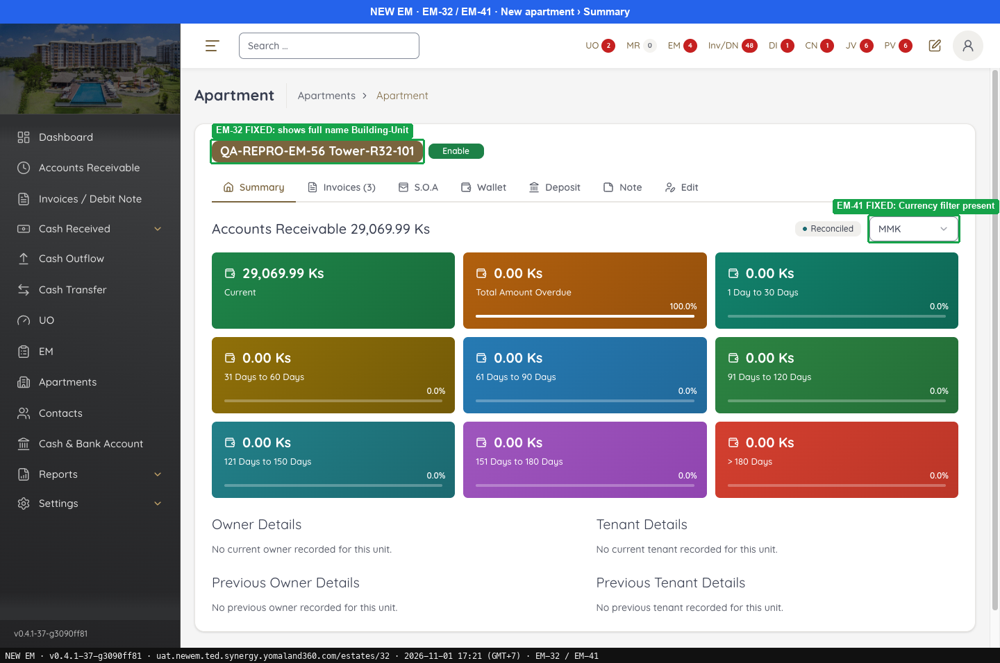 — EM-32 FIXED: shows full name Building-Unit
- 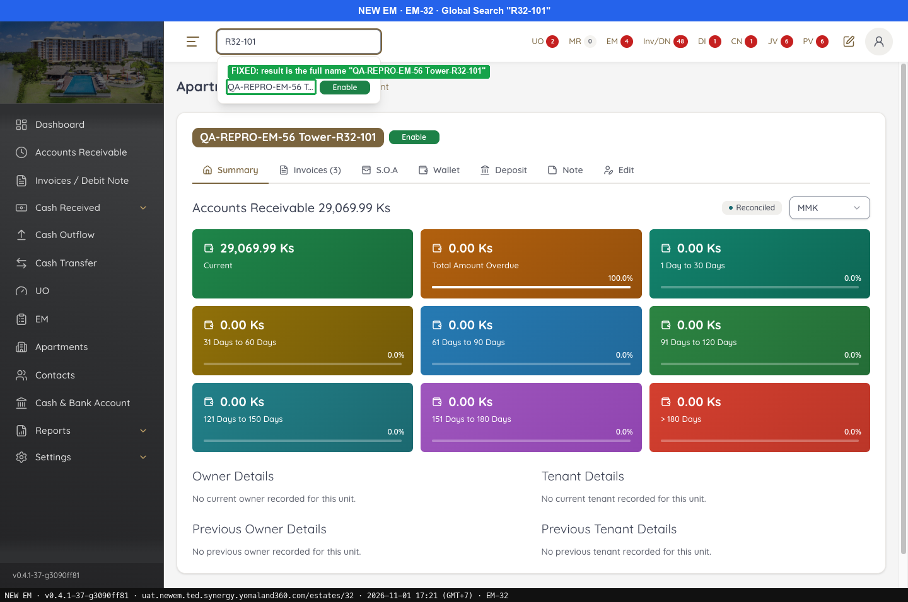 — FIXED: result is the full name "QA-REPRO-EM-56 Tower-R32-101"
- 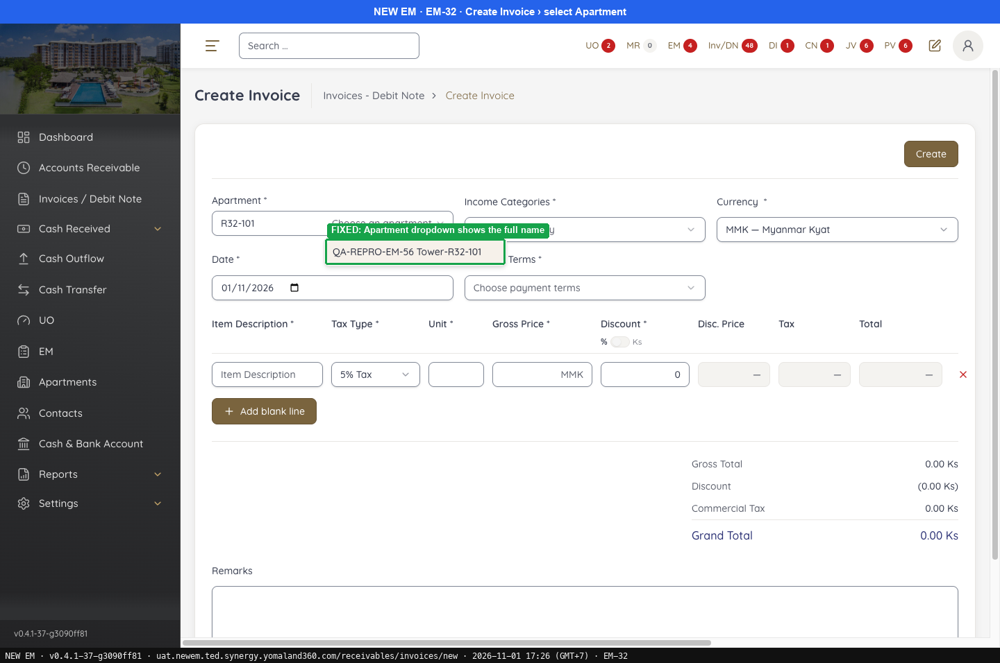 — FIXED: Apartment dropdown shows the full name
-  — Old EM: Full Name auto-built = Building-Unit ("A1-R32-101")
---

### EM-33 · [Apartments] Apartment can be created without selecting a Building linked to a Zone

[EM-33](https://zeyalabs-team-a83df6me.atlassian.net/browse/EM-33) · Jira priority High · Status **Fixed**

**Reported:** Admin can create an apartment without choosing a building assigned to a specific zone, so the apartment has no valid Zone/Building relationship.

#### SAN-EM33-001 · Apartment can only be created in a building of the selected zone

| Priority | Suites | Automation | Status | Source |
|---|---|---|---|---|
| P1 | Sanity · Regression | Auto-UI | Active | EM-33 repro (TC-EM-33-01), 2026-11-01 |

**Preconditions:**

1. Logged in as Admin.
2. Zone "Zone 1" (Enable) contains building "QA-REPRO-EM-56 Tower" (created under EM-56).
3. Pages: New EM `/estates/new`. Old EM `/apartments/new` (bundle `dd551ca9`).

**Steps:**

1. Open New and look at Building before choosing another Zone.
2. Select Zone = Zone 1.
3. Check the Zone, Building and Unit fields, leaving Unit empty.
4. Open the Zone list.

**Expected result:**

1. Building follows the default zone.
2. Building lists only the buildings of Zone 1.
3. Zone, Building and Unit are marked * and required.
4. The Zone list shows only Enable zones.

**Result (build -37, 2026-11-01):**

| # | Old EM | New EM | |
|---|---|---|---|
| 1 | Building follows the default zone | Building follows the default zone | ✅ Same |
| 2 | Only buildings of Zone 1 | Building = [Building 1, QA-REPRO-EM-56 Tower], only those of Zone 1 | ✅ Same |
| 3 | Required | Required ([Create] is locked when Unit is missing, hint "Enter the unit number") | ✅ Same |
| 4 | Only Enable zones | Only Enable zones (no "X0 …" Disable zones) | ✅ Same |

**Conclusion:** Fixed. Not run: calling the create-apartment API with a building that is not in the zone.

**Test data created:** Apartment id 32 (see EM-32).

**Evidence:**

-  — EM-66 FIXED: Full Name auto-built = Building-Unit
- 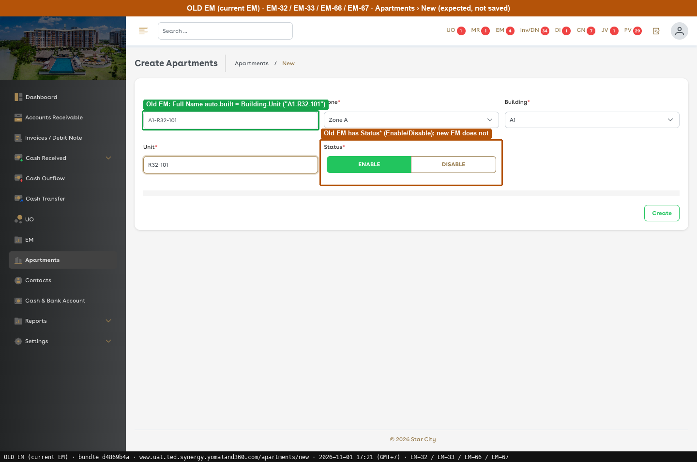 — Old EM: Full Name auto-built = Building-Unit ("A1-R32-101")
---

### EM-41 · [Apartments > Summary] Currency filter is missing on Apartment Summary

[EM-41](https://zeyalabs-team-a83df6me.atlassian.net/browse/EM-41) · Jira priority Medium · Status **Fixed**

**Reported:** The Currency filter is missing on the Apartment Summary page, so users cannot switch currencies when viewing Accounts Receivable data.

#### SAN-EM41-001 · Apartment Summary shows a Currency filter

| Priority | Suites | Automation | Status | Source |
|---|---|---|---|---|
| P2 | Sanity · Regression | Auto-UI | Active | EM-41 repro (TC-EM-41-01), 2026-11-01 |

**Preconditions:**

1. Logged in as Admin; an apartment exists.
2. Pages: New EM `/estates/32` (Summary). Old EM `/apartments/12349/detail` (bundle `d4869b4a`).

**Steps:**

1. Open an apartment › Summary.
2. Open the dropdown and change the currency.

**Expected result:**

1. A row `Accounts Receivable <total>` with a Currency dropdown on the right.
2. The dropdown lists currencies and the aging cards follow the selection.

**Result (build -37, 2026-11-01):**

| # | Old EM | New EM | |
|---|---|---|---|
| 1 | `Accounts Receivable <total>` + Currency dropdown on the right | "Accounts Receivable 0.00 Ks" + dropdown **MMK** on the right | ✅ Same |
| 2 | Currency list; aging cards follow | Dropdown present; currency not switched because the test apartment has no AR | ⛔ Not run |

**Conclusion:** Fixed. Also noted: New EM shows "Total Amount Overdue 0.00 Ks · 100.0%" when the total is 0 (Old EM also shows 100%).

**Evidence:**

-  — EM-32 FIXED: shows full name Building-Unit
- 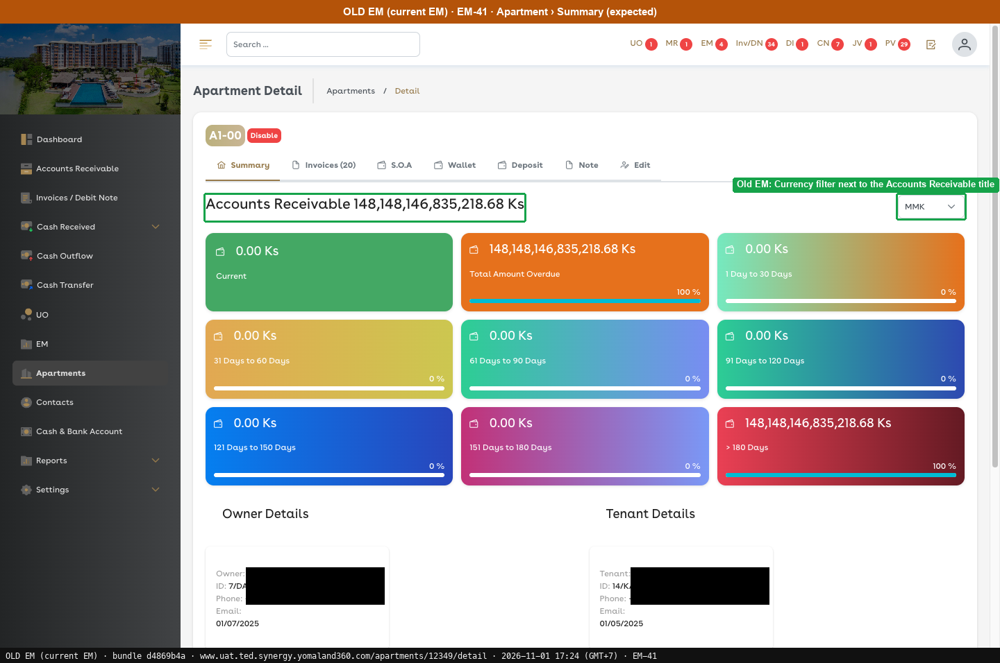 — Old EM: Currency filter next to the Accounts Receivable title
---

### EM-42 · [Apartments > Invoice] Debit Note can be created from the apartment's Invoices tab

[EM-42](https://zeyalabs-team-a83df6me.atlassian.net/browse/EM-42) · Jira priority High · Status **Fixed**

**Reported:** A new Debit Note can be created from the apartment's Invoices tab; it must not be creatable from the apartment.

#### SAN-EM42-001 · Apartment Invoices tab offers Add Invoice but no Debit Note

| Priority | Suites | Automation | Status | Source |
|---|---|---|---|---|
| P1 | Sanity · Regression | Auto-UI | Active | EM-42 repro (TC-EM-42-01), 2026-11-01 |

**Preconditions:**

1. Logged in as Admin; the apartment is **Enable** (a Disable apartment on Old EM, A1-00, shows no buttons).
2. Pages: New EM `/estates/1?tab=invoices` (Estate SEED-Z-001). Old EM `/apartments/12348/invoice` (A1-000, bundle `d4869b4a`).

**Steps:**

1. Open the apartment › Invoices tab and read the buttons.
2. Look for Add Debit Note / Debit Note.

**Expected result:**

1. Buttons: Add Invoice + Make Payment.
2. No Add Debit Note / Debit Note.

**Result (build -37, 2026-11-01):**

| # | Old EM | New EM | |
|---|---|---|---|
| 1 | Add Invoice + Make Payment | **Add Invoice + Make Payment** | ✅ Same |
| 2 | None | **None** | ✅ Same |

**Conclusion:** Fixed.

**Evidence:**

-  — EM-48 FIXED: (6) = Unpaid + Partially paid only; shown on open
-  — Old EM: unpaid count on the tab
---

### EM-44 · [Apartments > Side Panel] Side panel not responsive; buttons and fields cut off

[EM-44](https://zeyalabs-team-a83df6me.atlassian.net/browse/EM-44) · Jira priority High · Status **Fixed**

**Reported:** The Apartments side panel exceeds the screen size, so part of the form and the action buttons are hidden unless browser zoom is reduced.

#### SAN-EM44-001 · Apartments create and edit forms are fully visible at 100% zoom

| Priority | Suites | Automation | Status | Source |
|---|---|---|---|---|
| P1 | Sanity · Regression | Auto-UI | Active | EM-44 repro (TC-EM-44-01), 2026-11-01 |

**Preconditions:**

1. Logged in as Admin; screen 1568×776 (zoom 100%).
2. Pages: New EM `/estates/new`, `/estates/32?tab=edit`. Old EM `/apartments/12349/edit` (bundle `d4869b4a`).

**Steps:**

1. Apartments › New.
2. Open an apartment › Edit tab.
3. Click Add More under Owners.

**Expected result:**

1. All fields and buttons are visible.
2. All fields and buttons are visible.
3. The new row is fully displayed.

**Result (build -37, 2026-11-01):**

| # | Old EM | New EM | |
|---|---|---|---|
| 1 | — | **Separate page** `/estates/new` (no side panel); Full Name, Zone, Building, Unit and Create are all visible | ✅ Same |
| 2 | Edit is a page (see screenshot) | Edit tab inside the page: Account Name, Enable, Owners/Tenants, Save, Delete apartment; no zoom needed | ✅ Same |
| 3 | — | Fully displayed (Select Owner, Ownership Start Date, Current, delete) | ✅ Same |

**Conclusion:** Fixed. The form moved to a page/tab, like Old EM.

**Evidence:**

-  — EM-66 FIXED: Full Name auto-built = Building-Unit
-  — EM-47: Select Owner + Ownership Start Date + Current row, same layout as old EM
- 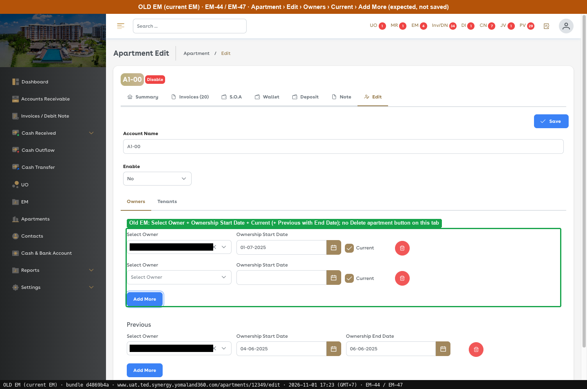 — Old EM: Select Owner + Ownership Start Date + Current (+ Previous with End Date); no Delete apartment button on this tab
---

### EM-47 · [Apartments] Add Owner/Tenant contacts to apartment does not match current EM

[EM-47](https://zeyalabs-team-a83df6me.atlassian.net/browse/EM-47) · Jira priority Highest · Status **Fixed**

**Reported:** The function to add Owner/Tenant contacts to a created apartment is not the same as in the current EM.

#### SAN-EM47-001 · Add Owner / Tenant to an apartment works as on Old EM

| Priority | Suites | Automation | Status | Source |
|---|---|---|---|---|
| P1 | Sanity · Regression | Auto-UI | Active | EM-47 repro (TC-EM-47-01), 2026-11-01 |

**Preconditions:**

1. Logged in as Admin; apartment QA-REPRO-EM-56 Tower-R32-101 (id 32); a contact exists.
2. Pages: New EM `/estates/32?tab=edit`. Old EM `/apartments/12349/edit` (bundle `d4869b4a`).

**Steps:**

1. Open the apartment › Edit tab.
2. Owners › Current › Add More.
3. Previous › Add More.
4. Do not click Save.

**Expected result:**

1. Account Name, Enable, tabs Owners/Tenants, Current/Previous, Add More, Save.
2. Row: Select Owner + Ownership Start Date + ☑ Current + delete.
3. Row: Select Owner + Start + **End Date**.

**Result (build -37, 2026-11-01):**

| # | Old EM | New EM | |
|---|---|---|---|
| 1 | As expected | As Old EM | ✅ Same |
| 2 | Select Owner (search by name, shows NRC) + Ownership Start Date + ☑ Current + delete | Select Owner (search by name) + Ownership Start Date + ☑ Current + delete | ✅ Same |
| 3 | Select Owner + Start + **End Date** | Previous row not added; the structure looks the same | ⛔ Not run |

**Conclusion:** Fixed (flow and layout match). Not fully checked: saving a real owner/tenant and then viewing Summary. Also noted: New EM has an extra **"Delete apartment"** button that Old EM does not have; the New EM owner list also includes X0 tracer contacts.

**Evidence:**

- 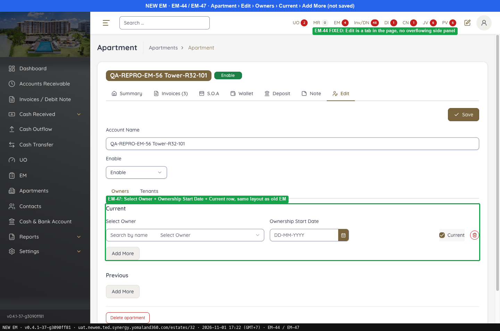 — EM-47: Select Owner + Ownership Start Date + Current row, same layout as old EM
-  — Old EM: Select Owner + Ownership Start Date + Current (+ Previous with End Date); no Delete apartment button on this tab
---

### EM-48 · [Apartments > Invoice tab] Tab count shows paid + unpaid invoices and loads late

[EM-48](https://zeyalabs-team-a83df6me.atlassian.net/browse/EM-48) · Jira priority Medium · Status **Fixed**

**Reported:** The Invoices tab counts paid + unpaid invoices, and the count does not appear immediately after opening the apartment.

#### SAN-EM48-001 · Invoices tab count shows only unpaid invoices, immediately on open

| Priority | Suites | Automation | Status | Source |
|---|---|---|---|---|
| P2 | Sanity · Regression | Auto-UI | Active | EM-48 repro (TC-EM-48-01), 2026-11-01 |

**Preconditions:**

1. Logged in as Admin; the apartment has both Paid and Unpaid invoices (Estate SEED-Z-001: 5 Unpaid, 1 Partially paid, 2 Paid).
2. Pages: New EM `/estates/1` (Estate SEED-Z-001). Old EM `/apartments/12348/invoice` (A1-000, bundle `d4869b4a`).

**Steps:**

1. Open the apartment and note when the tab shows its number.
2. Read the number on the tab.
3. Turn off "Unpaid Only" and count the list.

**Expected result:**

1. The number appears immediately.
2. Only Unpaid (+ Partially paid) invoices are counted.
3. The tab number does not include Paid invoices.

**Result (build -37, 2026-11-01):**

| # | Old EM | New EM | |
|---|---|---|---|
| 1 | Immediately | Immediately ("Invoices (6)" already present at the first DOM read after load) | ✅ Same |
| 2 | Only Unpaid (+ Partially paid) | **6** = 5 Unpaid + 1 Partially paid | ✅ Same |
| 3 | "Invoices (30)" while the list has 66 rows | 8 rows (2 more Paid), so the tab number does not count Paid | ✅ Same |

**Conclusion:** Fixed.

**Evidence:**

- 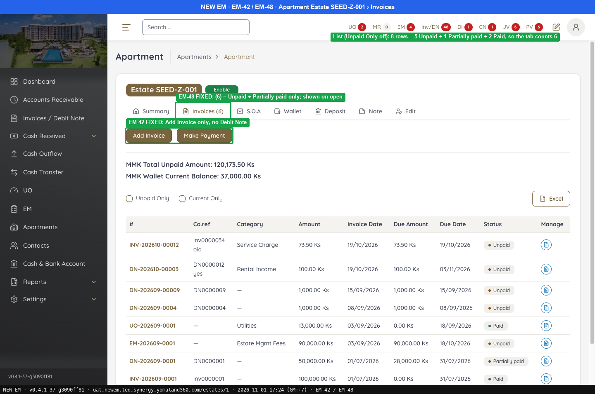 — EM-48 FIXED: (6) = Unpaid + Partially paid only; shown on open
- 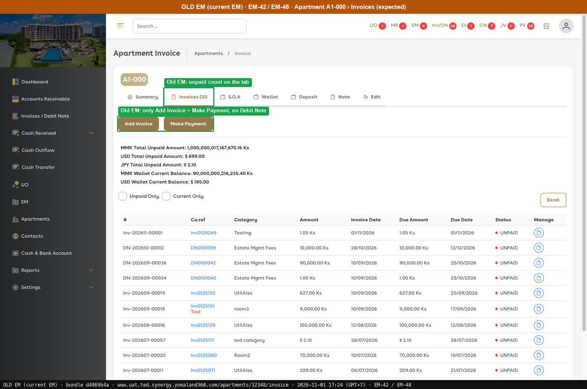 — Old EM: unpaid count on the tab
---

### EM-52 · [Apartments > Zone filter] Disabled zones are displayed

[EM-52](https://zeyalabs-team-a83df6me.atlassian.net/browse/EM-52) · Jira priority Medium · Status **Fixed**

**Reported:** Disabled zones are displayed in the Zone filter list of Apartments.

#### SAN-EM52-001 · Apartments Zone filter does not list Disable zones

| Priority | Suites | Automation | Status | Source |
|---|---|---|---|---|
| P2 | Sanity · Regression | Auto-UI | Active | EM-52 repro (TC-EM-52-01), 2026-11-01 |

**Preconditions:**

1. Logged in as Admin; a Disable zone exists (New EM: 10 "X0 …" zones).
2. Pages: New EM `/estates` (Advance Filter). Old EM `/apartments` (bundle `dd551ca9`).

**Steps:**

1. Apartments › Advance Filter › open Zone.

**Expected result:**

1. Only Enable zones are listed.

**Result (build -37, 2026-11-01):**

| # | Old EM | New EM | |
|---|---|---|---|
| 1 | Only Enable zones | Commercial Units, Seed North Zone, Zone 1, Zone-A, Zone B; **no Disable zone** | ✅ Same |

**Conclusion:** Fixed.

**Evidence:**

- 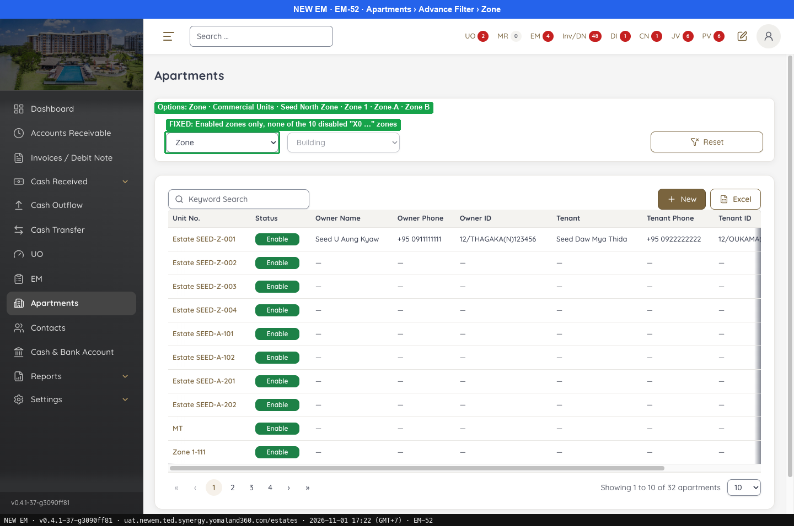 — FIXED: Enabled zones only, none of the 10 disabled "X0 …" zones
- 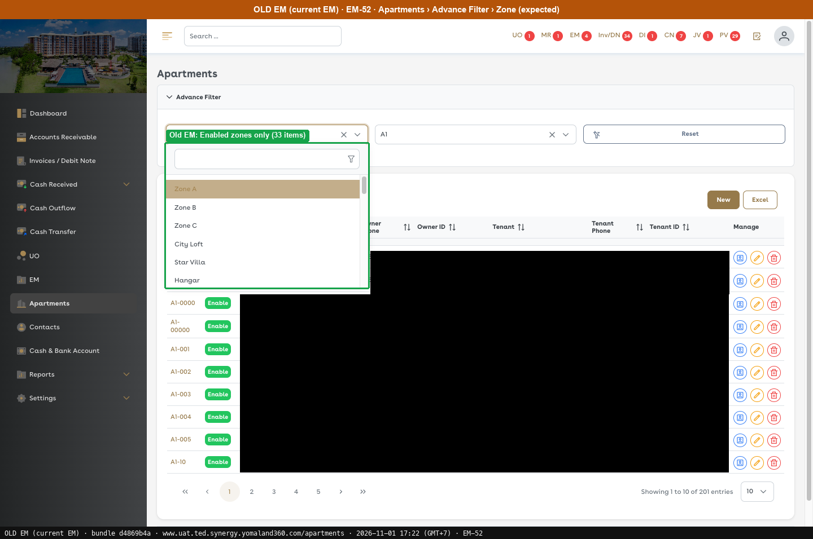 — Old EM: Enabled zones only (33 items)
---

### EM-66 · [Apartments > Create Apartment] Full Name not updated after selecting Zone and Building

[EM-66](https://zeyalabs-team-a83df6me.atlassian.net/browse/EM-66) · Jira priority Medium · Status **Fixed**

**Reported:** Full Name is not automatically updated after selecting Zone and Building.

#### SAN-EM66-001 · Full Name updates from Zone, Building and Unit

| Priority | Suites | Automation | Status | Source |
|---|---|---|---|---|
| P2 | Sanity · Regression | Auto-UI | Active | EM-66 repro (TC-EM-66-01), 2026-11-01 |

**Preconditions:**

1. Logged in as Admin; Zone "Zone 1" (Enable) contains building "QA-REPRO-EM-56 Tower" (created under EM-56).
2. Pages: New EM `/estates/new`. Old EM `/apartments/new` (bundle `dd551ca9`).

**Test data:**

1. Unit `R32-101`.

**Steps:**

1. Open New.
2. Select Zone 1 and Building QA-REPRO-EM-56 Tower.
3. Enter Unit `R32-101`.

**Expected result:**

1. Full Name = `<default Building>-`.
2. Full Name changes with the Building.
3. Full Name = `<Building>-<Unit>`.

**Result (build -37, 2026-11-01):**

| # | Old EM | New EM | |
|---|---|---|---|
| 1 | `<default Building>-` | "Zone A Commercial Unit-" | ✅ Same |
| 2 | Changes with the Building | Changes | ✅ Same |
| 3 | "A1-R32-101" (building A1) | **"QA-REPRO-EM-56 Tower-R32-101"**, read-only field | ✅ Same |

**Conclusion:** Fixed.

**Evidence:**

- 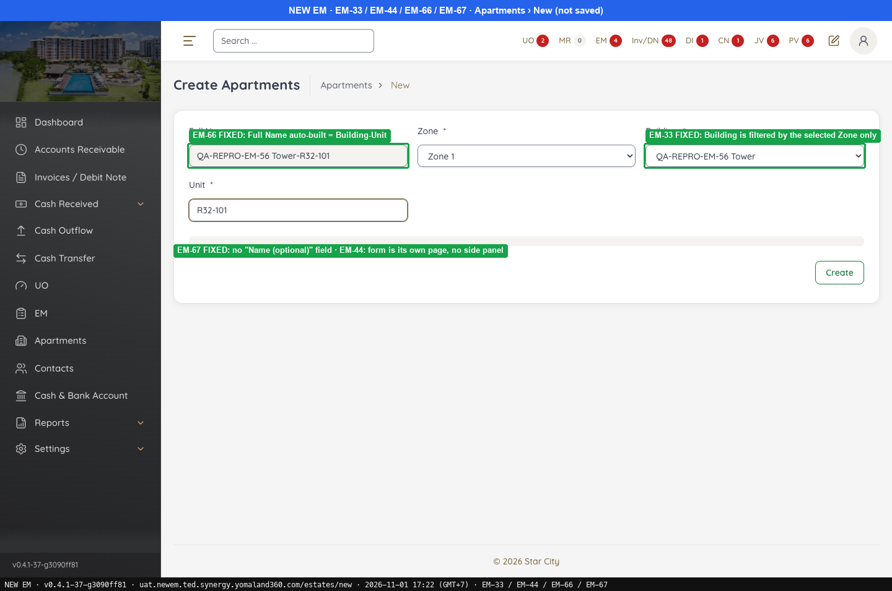 — EM-66 FIXED: Full Name auto-built = Building-Unit
-  — Old EM: Full Name auto-built = Building-Unit ("A1-R32-101")
---

### EM-67 · [Apartments > Create Apartment] Additional "Name (optional)" field should not be displayed

[EM-67](https://zeyalabs-team-a83df6me.atlassian.net/browse/EM-67) · Jira priority Medium · Status **Fixed**

**Reported:** An additional "Name (optional)" field is displayed in the apartment creation form.

#### SAN-EM67-001 · Create Apartment form has no "Name (optional)" field

| Priority | Suites | Automation | Status | Source |
|---|---|---|---|---|
| P2 | Sanity · Regression | Auto-UI | Active | EM-67 repro (TC-EM-67-01), 2026-11-01 |

**Preconditions:**

1. Logged in as Admin.
2. Pages: New EM `/estates/new`. Old EM `/apartments/new` (bundle `dd551ca9`).

**Steps:**

1. List the form fields.
2. Look for "Name (optional)".

**Expected result:**

1. Full Name, Zone*, Building*, Unit*, **Status*** (Enable/Disable).
2. No "Name (optional)" field.

**Result (build -37, 2026-11-01):**

| # | Old EM | New EM | |
|---|---|---|---|
| 1 | Full Name, Zone*, Building*, Unit*, **Status*** (Enable/Disable) | Full Name, Zone*, Building*, Unit* | ❌ Differs |
| 2 | None | **None** | ✅ Same |

**Conclusion:** Fixed for the reported field. Also noted: New EM **has no Status*** field (Old EM lets the user choose Enable/Disable at creation; New EM defaults to Enable).

**Evidence:**

-  — EM-66 FIXED: Full Name auto-built = Building-Unit
-  — Old EM: Full Name auto-built = Building-Unit ("A1-R32-101")
---
