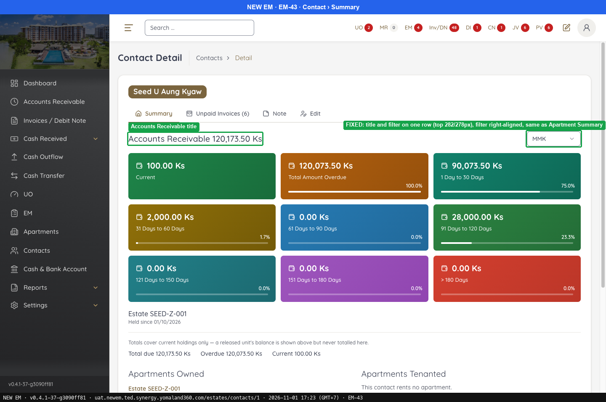
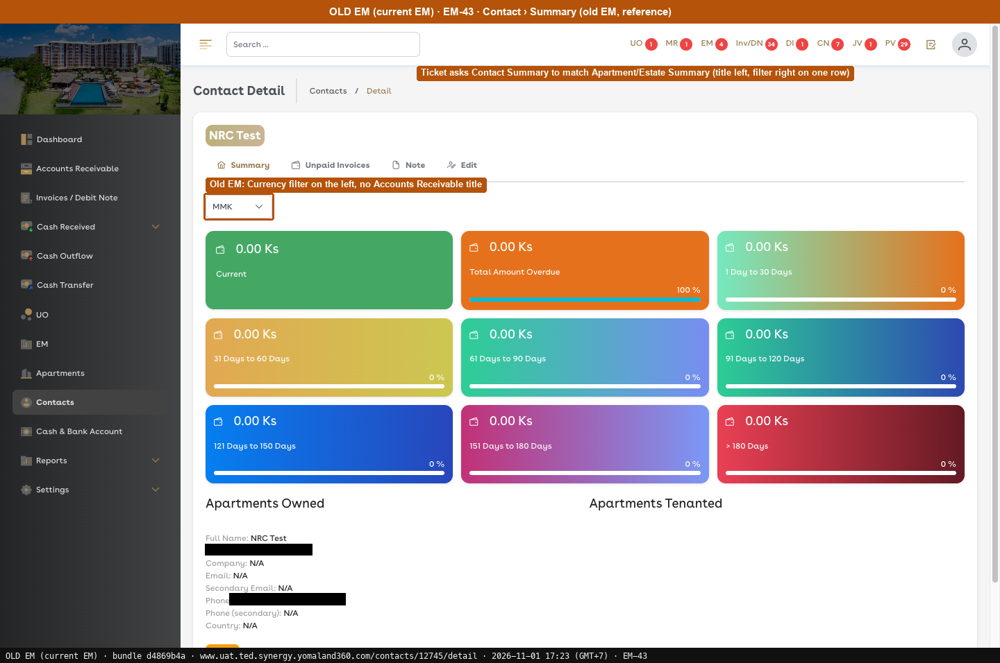
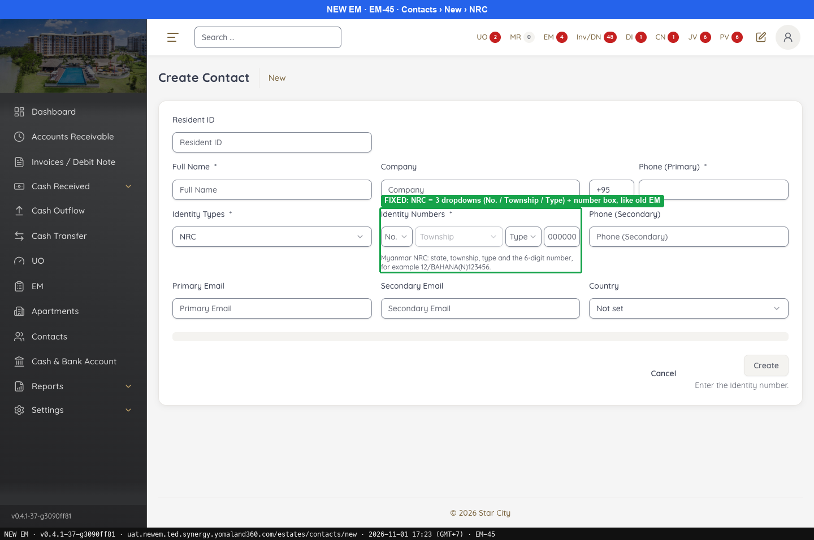
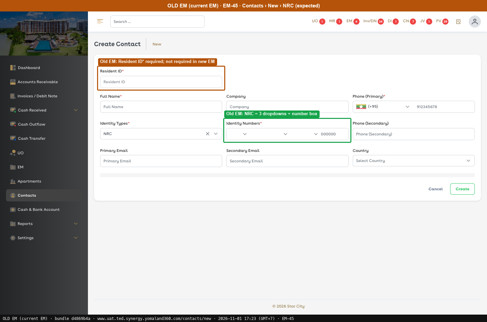

# Fixed · Contacts

[← Ticket index](README.md) · [Sanity index](../README.md)

**Tickets:** 2 · **Fixed:** 2

These tickets are fixed on build -37. Their cases are now regression checks.

## Summary

| Ticket | Title | Jira priority | Status (build -37) | Result | Case |
|---|---|---|---|---|---|
| [EM-43](https://zeyalabs-team-a83df6me.atlassian.net/browse/EM-43) | [Contact > Summary] Currency filter misaligned with Accounts Receivable header | Low | Fixed | Accounts Receivable title and Currency filter are on the same row | [SAN-EM43-001](#san-em43-001--contact-summary-currency-filter-is-aligned-with-the-accounts-receivable-title) |
| [EM-45](https://zeyalabs-team-a83df6me.atlassian.net/browse/EM-45) | [Contact > Side Panel] NRC field is free text instead of Myanmar NRC dropdowns | High | Fixed | NRC is 3 dropdowns + number field; Resident ID is not required on New EM, unlike Old EM | [SAN-EM45-001](#san-em45-001--nrc-identity-is-three-dropdowns-plus-a-number-field) |

## Tickets

### EM-43 · [Contact > Summary] Currency filter misaligned with Accounts Receivable header

[EM-43](https://zeyalabs-team-a83df6me.atlassian.net/browse/EM-43) · Jira priority Low · Status **Fixed**

**Reported:** The currency filter is misaligned with the Accounts Receivable summary, with excessive blank space between the title and the filter, unlike other summary pages.

#### SAN-EM43-001 · Contact Summary: Currency filter is aligned with the Accounts Receivable title

| Priority | Suites | Automation | Status | Source |
|---|---|---|---|---|
| P3 | Sanity · Regression | Auto-UI | Active | EM-43 repro (TC-EM-43-01), 2026-11-01 |

**Preconditions:**

1. Logged in as Admin; a contact exists.
2. Pages: New EM `/estates/contacts/1`. Old EM `/contacts/12745/detail` (bundle `d4869b4a`).

**Steps:**

1. Open a contact › Summary.
2. Compare with the New EM Apartment Summary.

**Expected result:**

1. Title `Accounts Receivable <total>` on the left, Currency filter on the right, same row, no extra blank space (ticket: consistent with Apartment/Estate Summary).
2. Same layout.

**Result (build -37, 2026-11-01):**

| # | Old EM | New EM | |
|---|---|---|---|
| 1 | Reference only: filter on the left, no AR title (the ticket takes the other Summary pages as the standard, not Old EM) | Title on the left (top 282px), MMK filter on the right (top 278px): **same row** | ✅ Same |
| 2 | — | Same layout | ✅ Same |

**Conclusion:** Fixed.

**Evidence:**

-  — Accounts Receivable title
-  — Old EM: Currency filter on the left, no Accounts Receivable title
---

### EM-45 · [Contact > Side Panel] NRC field is free text instead of Myanmar NRC dropdowns

[EM-45](https://zeyalabs-team-a83df6me.atlassian.net/browse/EM-45) · Jira priority High · Status **Fixed**

**Reported:** When an admin creates a contact, NRC is a single free-text field instead of three dropdowns plus a numeric field as in the current EM.

#### SAN-EM45-001 · NRC identity is three dropdowns plus a number field

| Priority | Suites | Automation | Status | Source |
|---|---|---|---|---|
| P1 | Sanity · Regression | Auto-UI | Active | EM-45 repro (TC-EM-45-01), 2026-11-01 |

**Preconditions:**

1. Logged in as Admin.
2. Pages: New EM `/estates/contacts/new`. Old EM `/contacts/new` (bundle `d4869b4a`).

**Steps:**

1. Contacts › New, Identity Types = NRC. Read Identity Numbers.

**Expected result:**

1. State number dropdown + township dropdown + type dropdown + 6-digit field.

**Result (build -37, 2026-11-01):**

| # | Old EM | New EM | |
|---|---|---|---|
| 1 | State number dropdown + township dropdown + type dropdown + 6-digit field | **No. (1–14) + Township + Type (N/P/E/C) + number field "000000"**, hint "for example 12/BAHANA(N)123456" | ✅ Same |

**Conclusion:** Fixed. Also noted: **Resident ID*** is required on Old EM and not required on New EM.

**Evidence:**

-  — FIXED: NRC = 3 dropdowns (No. / Township / Type) + number box, like old EM
-  — Old EM: NRC = 3 dropdowns + number box
---
