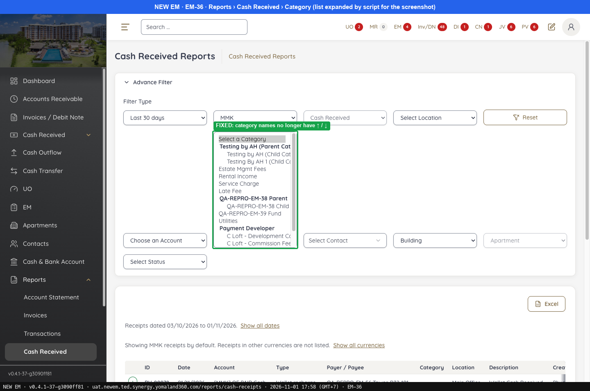
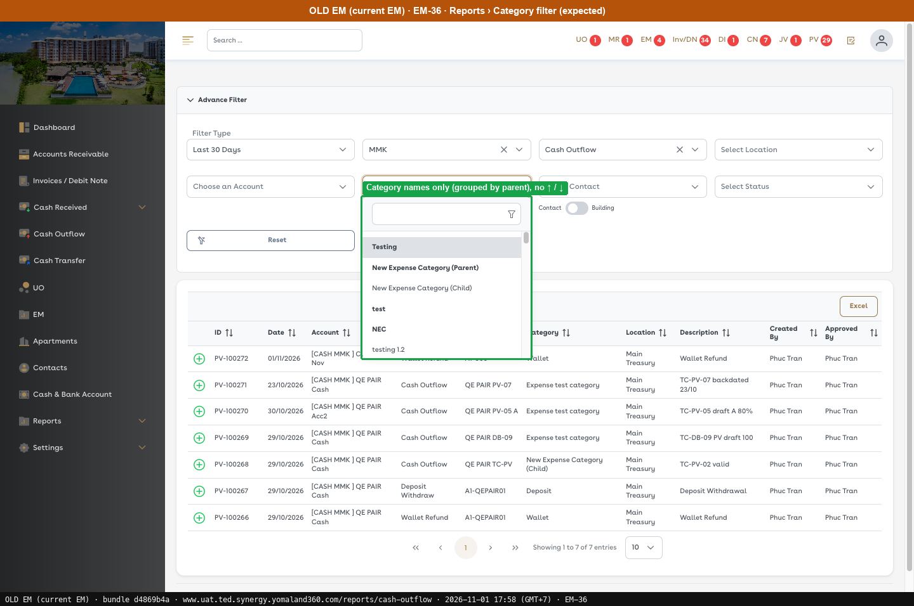
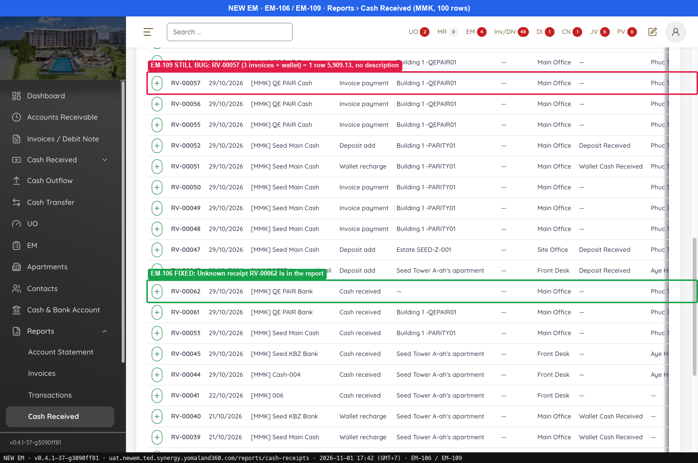
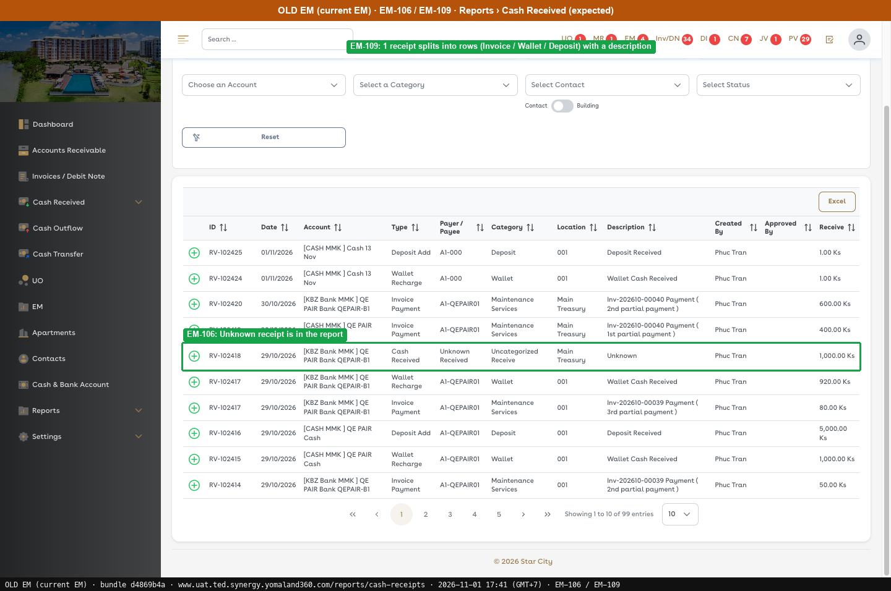

# Fixed · Reports

[← Ticket index](README.md) · [Sanity index](../README.md)

**Tickets:** 2 · **Fixed:** 2

These tickets are fixed on build -37. Their cases are now regression checks.

## Summary

| Ticket | Title | Jira priority | Status (build -37) | Result | Case |
|---|---|---|---|---|---|
| [EM-36](https://zeyalabs-team-a83df6me.atlassian.net/browse/EM-36) | [Reports > Transactions / Cash Received] Arrow symbols shown with names in Category filter | Low | Fixed | The Category filter has no ↑/↓ and is grouped by parent as in Old EM. | [SAN-EM36-001](#san-em36-001--reports-category-filter-has-no--symbols-and-groups-by-parent) |
| [EM-106](https://zeyalabs-team-a83df6me.atlassian.net/browse/EM-106) | [Reports > Cash Received] Unknown receipts are missing from the report | Medium | Fixed | Unknown receipts (RV-00061, RV-00062, RV-00073) are in Reports › Cash Received. | [SAN-EM106-001](#san-em106-001--cash-received-report-lists-assigned-and-unassigned-unknown-receipts) |

## Tickets

### EM-36 · [Reports > Transactions / Cash Received] Arrow symbols shown with names in Category filter

[EM-36](https://zeyalabs-team-a83df6me.atlassian.net/browse/EM-36) · Jira priority Low · Status **Fixed**

**Reported:** Up (↑) and down (↓) arrow symbols were displayed with category names in the Category filter of Reports > Transactions and Reports > Cash Received.

#### SAN-EM36-001 · Reports Category filter has no ↑/↓ symbols and groups by parent

| Priority | Suites | Automation | Status | Source |
|---|---|---|---|---|
| P3 | Sanity · Regression | Auto-UI | Active | EM-36 repro (TC-EM-36-01), 2026-11-01 |

**Preconditions:**

1. Logged in as an Admin user.
2. Parent and child categories exist (e.g. `QA-REPRO-EM-38 Parent` / `Child`, from EM-38).

**Steps:**

1. Open Reports › Cash Outflow (`/reports/cash-outflow`).
2. Open the Category dropdown.
3. Read the category names.

**Expected result:**

1. The report page and its filters open.
2. Category names are listed, parents in bold and children indented.
3. No ↑/↓ symbols.

**Result (build -37, 2026-11-01):**

| # | Old EM | New EM | |
|---|---|---|---|
| 1 | Report page and filters | Opens | ✅ Same |
| 2 | Category names, parents in bold, children indented | List grouped by parent (optgroup: Testing by AH Parent, QA-REPRO-EM-38 Parent, Payment Developer…) | ✅ Same |
| 3 | No ↑/↓ | **No ↑/↓** | ✅ Same |

**Conclusion:** Fixed. Category names used to carry a ↑/↓ prefix, unlike Old EM and confusing when filtering. Also noted: the repro's steps ran on Reports › Cash Outflow only; it states no separate result for Reports › Cash Received.

**Evidence:**

-  — FIXED: category names no longer have ↑ / ↓
-  — Category names only (grouped by parent), no ↑ / ↓
---

### EM-106 · [Reports > Cash Received] Unknown receipts are missing from the report

[EM-106](https://zeyalabs-team-a83df6me.atlassian.net/browse/EM-106) · Jira priority Medium · Status **Fixed**

**Reported:** Old EM's Cash Received report includes Unknown receipts (assigned and unassigned); New EM's report did not (RV-00061 and RV-00062 were missing).

#### SAN-EM106-001 · Cash Received report lists assigned and unassigned Unknown receipts

| Priority | Suites | Automation | Status | Source |
|---|---|---|---|---|
| P2 | Sanity · Regression | Auto-UI | Active | EM-106 repro (TC-EM-106-01), 2026-11-01 |

**Preconditions:**

1. Logged in as an Admin user.
2. Unassigned Unknown receipt (RV-00062) and assigned ones (RV-00061, RV-00073) exist.

**Steps:**

1. Open Reports › Cash Received (`/reports/cash-receipts`), Currency MMK (New: 100 rows per page; Old: Last 30 Days, Cash Received).

**Expected result:**

1. Unknown receipt rows are listed.

**Result (build -37, 2026-11-01):**

| # | Old EM | New EM | |
|---|---|---|---|
| 1 | RV-102418 "Cash Received · Unknown Received · Uncategorized Receive" | **RV-00062** (Payer "—"), **RV-00061**, **RV-00073**; Type "Cash received" | ✅ Same |

**Conclusion:** Fixed. Also noted: Category on New EM is "— Category not set", on Old EM "Uncategorized Receive" (see EM-74).

**Evidence:**

-  — EM-106 FIXED: Unknown receipt RV-00062 is in the report
-  — EM-106: Unknown receipt is in the report
---
