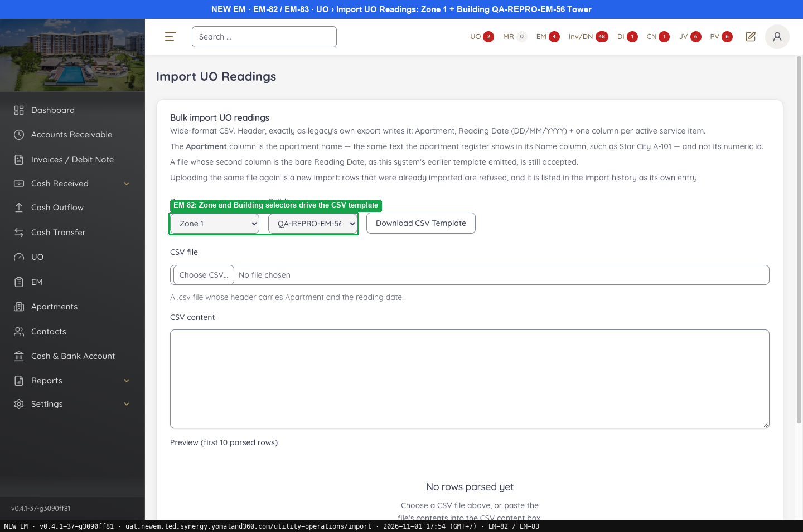
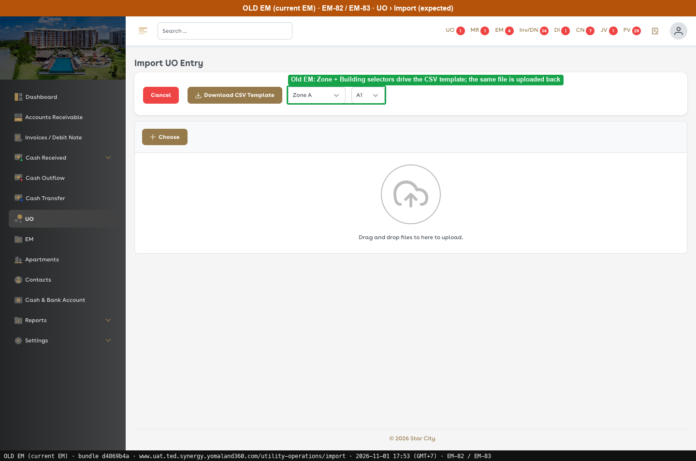
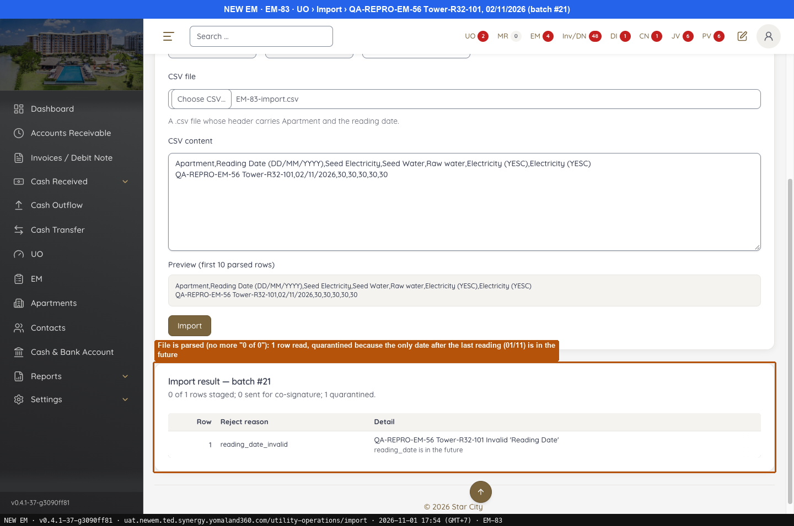

# Fixed · UO Import

[← Ticket index](README.md) · [Sanity index](../README.md)

**Tickets:** 2 · **Fixed:** 1 · **Fixed (partly verified):** 1

These tickets are fixed on build -37. Their cases are now regression checks.

## Summary

| Ticket | Title | Jira priority | Status (build -37) | Result | Case |
|---|---|---|---|---|---|
| [EM-82](https://zeyalabs-team-a83df6me.atlassian.net/browse/EM-82) | [UO > Import > Download CSV template] Apartments of selected Zone/Building not included | Highest | Fixed | Template contains the apartments of the selected building; header has a duplicate Electricity (YESC) column | [SAN-EM82-001](#san-em82-001--csv-template-contains-the-apartments-of-the-selected-zone-and-building) |
| [EM-83](https://zeyalabs-team-a83df6me.atlassian.net/browse/EM-83) | [UO > Import] Import with provided CSV template stages 0 rows | Highest | Fixed (partly verified) | File is read (batches #20 and #21: 1 row recognised, quarantined); no valid row has been imported yet, retry possible from 02/11 | [SAN-EM83-001](#san-em83-001--file-filled-from-the-csv-template-is-read-and-valid-rows-are-staged) |

## Tickets

### EM-82 · [UO > Import > Download CSV template] Apartments of selected Zone/Building not included

[EM-82](https://zeyalabs-team-a83df6me.atlassian.net/browse/EM-82) · Jira priority Highest · Status **Fixed**

**Reported:** Apartments of the selected Zone and Building are not included in the downloaded CSV template.

#### SAN-EM82-001 · CSV template contains the apartments of the selected Zone and Building

| Priority | Suites | Automation | Status | Source |
|---|---|---|---|---|
| P1 | Sanity · Regression | Auto-UI | Active | EM-82 repro (TC-EM-82-01), 2026-11-01 |

**Preconditions:**

1. Logged in as Admin; the Zone and Building have apartments.
2. Pages: New EM `/utility-operations/import` (template downloaded again on the re-run). Old EM: only the Import page was captured, no template downloaded; expected taken from the ticket.

**Steps:**

1. Select Zone 1 + Building QA-REPRO-EM-56 Tower, click [Download CSV Template].
2. Select Zone 1 + Building 1, click [Download CSV Template].
3. Read the header row.

**Expected result:**

1. The template contains the apartment of the building.
2. The template contains 4 apartments.
3. One column per meter type.

**Result (build -37, 2026-11-01):**

| # | Old EM | New EM | |
|---|---|---|---|
| 1 | Import page only, no template | `uo-import-template-building-31.csv`: row **QA-REPRO-EM-56 Tower-R32-101** (same on the re-run) | ✅ Same |
| 2 | Import page only, no template | Building 1 -PARITY01/02, -QEPAIR01/02 | ✅ Same |
| 3 | Import page only, no template | `…,Electricity (YESC),Electricity (YESC)`: **2 columns with the same name** (same on the re-run) | ❌ Differs |

**Conclusion:** Fixed for the reported problem. Also noted: duplicate "Electricity (YESC)" header (see EM-35).

**Evidence:**

-  — EM-82: Zone and Building selectors drive the CSV template
-  — Old EM: Zone + Building selectors drive the CSV template; the same file is uploaded back
---

### EM-83 · [UO > Import] Import with provided CSV template stages 0 rows

[EM-83](https://zeyalabs-team-a83df6me.atlassian.net/browse/EM-83) · Jira priority Highest · Status **Fixed (partly verified)**

**Reported:** UO data cannot be imported with the provided CSV template: nothing is imported and the system shows "0 of 0 rows staged".

#### SAN-EM83-001 · File filled from the CSV template is read and valid rows are staged

| Priority | Suites | Automation | Status | Source |
|---|---|---|---|---|
| P1 | Sanity · Regression | Auto-UI | Active | EM-83 repro (TC-EM-83-01), 2026-11-01 |

**Preconditions:**

1. Logged in as Admin.
2. Pages: New EM `/utility-operations/import`. Old EM: only the Import page was captured; expected taken from the ticket.

**Test data:**

1. Template of Zone 1 / QA-REPRO-EM-56 Tower, row `QA-REPRO-EM-56 Tower-R32-101,01/11/2026,10,10,10,10,10`.
2. Re-run: same apartment, which now has a reading dated 01/11, with reading date 02/11/2026.

**Steps:**

1. Fill in the template with the test data and click [Import].
2. Compare with the reported "0 of 0 rows staged".
3. Import for an apartment that has reading history (Building 1).
4. Re-run: import the same apartment again with reading date 02/11/2026.

**Expected result:**

1. The valid row is staged.
2. The file is read; the result is no longer "0 of 0".
3. The row is staged.
4. A row with a date after the last reading and not in the future is staged.

**Result (build -37, 2026-11-01):**

| # | Old EM | New EM | |
|---|---|---|---|
| 1 | Import page only | **batch #20: "0 of 1 rows staged; 1 quarantined"**, reason `no_prior_balance` (the apartment has no opening reading) | ❌ Differs |
| 2 | Import page only | The file **was read** (1 row recognised), no longer 0 of 0 | ✅ Same |
| 3 | Import page only | The attempt was **blocked by the test session's action permission**, so it did not run | ⛔ Not run |
| 4 | Import page only | **batch #21: "0 of 1 rows staged; 1 quarantined"**, reason `reading_date_invalid` (reading_date is in the future). `no_prior_balance` is gone and the file is still read | ⛔ Not run |

**Conclusion:** Fixed (partly verified). The file is parsed correctly, but no valid row has been imported successfully yet. The QA apartment already has a reading dated 01/11, so the date must be after 01/11, and 02/11 is rejected today as a future date. The import can be retried from 02/11 to confirm it.

**Test data created:** Import batches #20 and #21 (both quarantined, no reading created).

**Evidence:**

-  — EM-82: Zone and Building selectors drive the CSV template
-  — File is parsed (no more "0 of 0"): 1 row read, quarantined because the only date after the last reading (01/11) is in the future
-  — Old EM: Zone + Building selectors drive the CSV template; the same file is uploaded back
---
