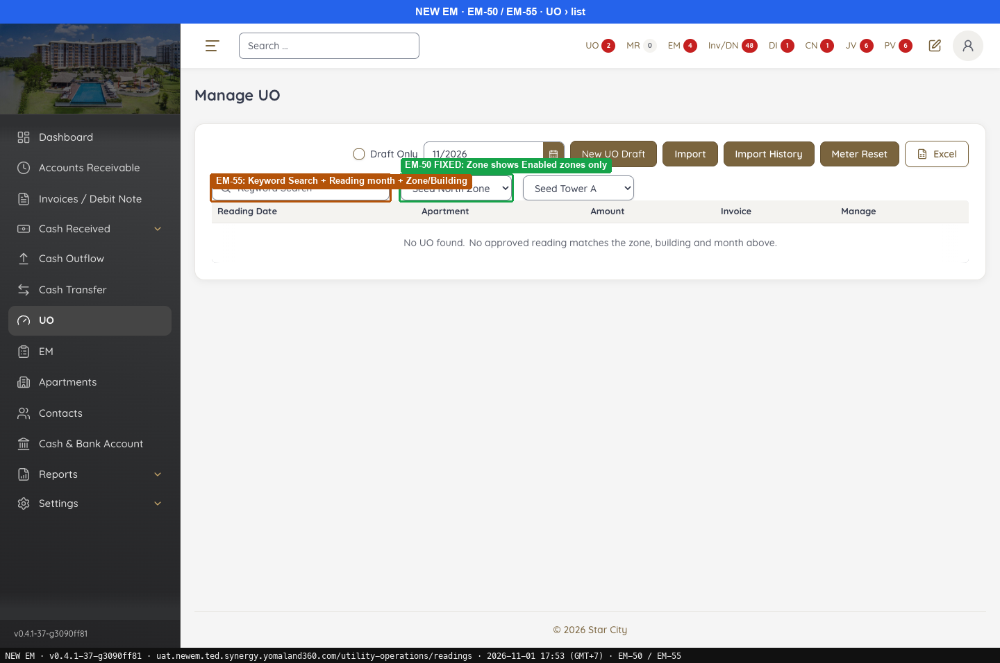
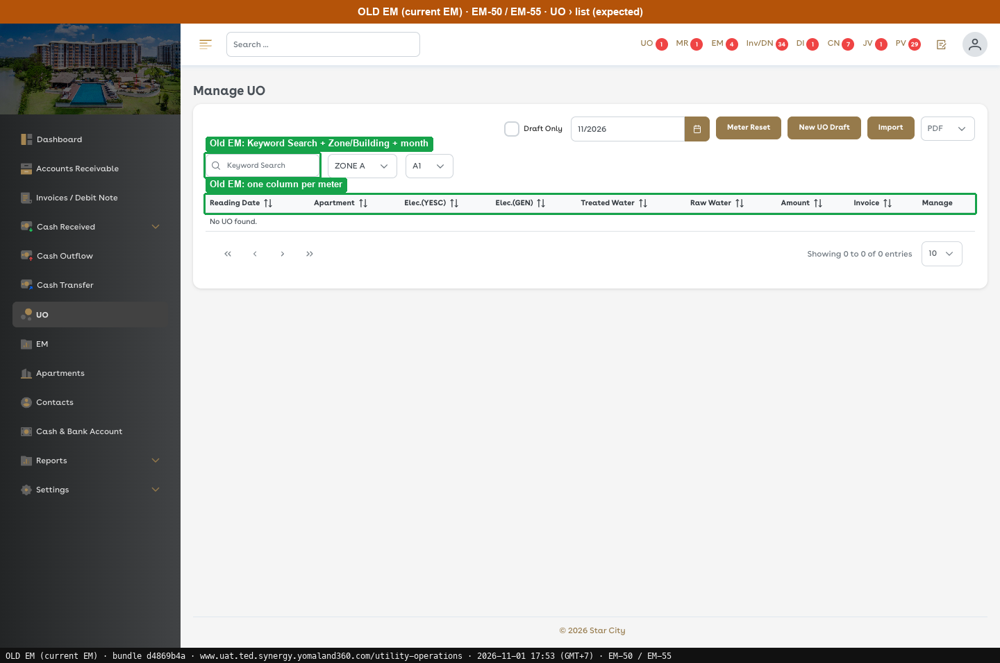
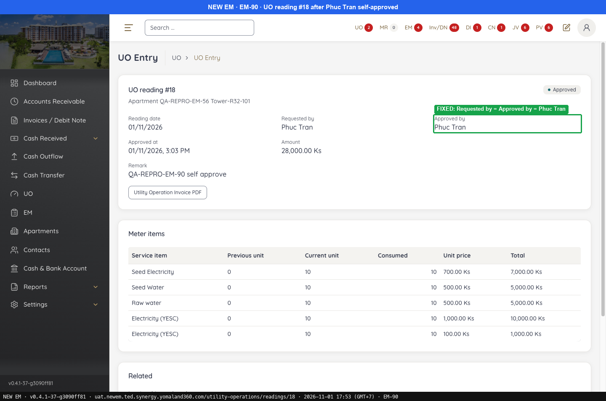
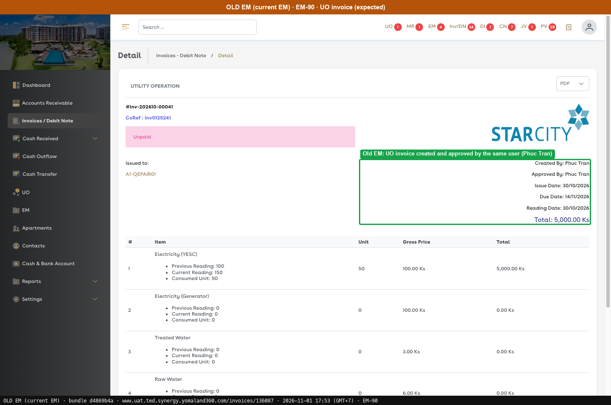

# Fixed · Utility Operations & Meter Reset

[← Ticket index](README.md) · [Sanity index](../README.md)

**Tickets:** 2 · **Fixed:** 2

These tickets are fixed on build -37. Their cases are now regression checks.

## Summary

| Ticket | Title | Jira priority | Status (build -37) | Result | Case |
|---|---|---|---|---|---|
| [EM-50](https://zeyalabs-team-a83df6me.atlassian.net/browse/EM-50) | [UO > Zone filter] Disabled zones are displayed | Medium | Fixed | UO Zone filter lists only Enable zones | [SAN-EM50-001](#san-em50-001--uo-zone-filter-does-not-list-disable-zones) |
| [EM-90](https://zeyalabs-team-a83df6me.atlassian.net/browse/EM-90) | [UO] Self-approve does not work; UO cannot be approved to generate invoices | Highest | Fixed | Self-approving UO #18 produces invoice #148 | [SAN-EM90-001](#-san-em90-001--same-user-can-approve-a-uo-draft-and-the-invoice-is-generated) |

## Tickets

### EM-50 · [UO > Zone filter] Disabled zones are displayed

[EM-50](https://zeyalabs-team-a83df6me.atlassian.net/browse/EM-50) · Jira priority Medium · Status **Fixed**

**Reported:** Disabled zones are displayed in the Zone filter list of UO.

#### SAN-EM50-001 · UO Zone filter does not list Disable zones

| Priority | Suites | Automation | Status | Source |
|---|---|---|---|---|
| P2 | Sanity · Regression | Auto-UI | Active | EM-50 repro (TC-EM-50-01), 2026-11-01 |

**Preconditions:**

1. Logged in as Admin; a Disable zone exists (10 "X0 …" zones).
2. Pages: New EM `/utility-operations/readings`. Old EM `/utility-operations` (bundle `dd551ca9`).

**Steps:**

1. UO › open Zone.

**Expected result:**

1. Only Enable zones are listed.

**Result (build -37, 2026-11-01):**

| # | Old EM | New EM | |
|---|---|---|---|
| 1 | Only Enable zones | Seed North Zone, Zone 1, Zone-A, Zone B, Commercial Units; **none of the 10 "X0 …" Disable zones** | ✅ Same |

**Conclusion:** Fixed.

**Evidence:**

-  — EM-50 FIXED: Zone shows Enabled zones only
-  — Old EM: Keyword Search + Zone/Building + month
---

### EM-90 · [UO] Self-approve does not work; UO cannot be approved to generate invoices

[EM-90](https://zeyalabs-team-a83df6me.atlassian.net/browse/EM-90) · Jira priority Highest · Status **Fixed**

**Reported:** UO cannot be approved to generate invoices: self-approve does not work although it is allowed, so another admin user is needed.

#### ★ SAN-EM90-001 · Same user can approve a UO draft and the invoice is generated

| Priority | Suites | Automation | Status | Source |
|---|---|---|---|---|
| P1 | Sanity · Regression | Auto-UI | Active | EM-90 repro (TC-EM-90-01), 2026-11-01 |

**Preconditions:**

1. Logged in with a user allowed to self-approve (ticket: Admin/Staff with INV/DN approval permission).
2. Pages: New EM `/utility-operations/readings/18`. Old EM not re-run; expected taken from the ticket.

**Test data:**

1. QA-REPRO-EM-56 Tower-R32-101, first reading: Previous 0 / Current 10 for the 5 meters, Date 01-11-2026, Remark `QA-REPRO-EM-90 self approve`.

**Steps:**

1. UO › New: enter the test data and click [Submit].
2. Click [Approve] › Confirm approve, with the same user.

**Expected result:**

1. A draft is created.
2. The draft is approved and an invoice is generated.

**Result (build -37, 2026-11-01):**

| # | Old EM | New EM | |
|---|---|---|---|
| 1 | Not re-run | **UO reading #18** Draft, 28,000 Ks | ✅ Same |
| 2 | Screenshot: UO invoice Inv-202610-00041 created and approved by the same user | **Approved**, approved by the same user, "Invoice this produced **#148**" | ✅ Same |

**Conclusion:** Fixed.

**Test data created:** UO #18, invoice #148 (28,000 Ks).

**Evidence:**

-  — FIXED: Requested by = Approved by (same user)
-  — Old EM: UO invoice created and approved by the same user
---
