# G4 · USD and Unknown payment allocation

[← Ticket index](README.md) · [Sanity index](../README.md)

**Tickets:** 5 · **Open:** 4 · **Partly open:** 1

Same receipt and allocation flow: rounding remainder, conversion description, the "short of" message, and filtering the wallet by currency.

## Summary

| Ticket | Title | Jira priority | Status (build -37) | Result | Case |
|---|---|---|---|---|---|
| [EM-116](https://zeyalabs-team-a83df6me.atlassian.net/browse/EM-116) | [Make Payment > USD] 1-cent difference across invoices (no rounding adjustment) | Medium | Open | $1 for 3 invoices of 1,000 Ks allocates 0.33 × 3 = $0.99 | [SAN-EM116-001](#san-em116-001--paying-1-for-3-invoices-of-1000-ks-at-rate-3000-allocates-100-in-total) |
| [EM-117](https://zeyalabs-team-a83df6me.atlassian.net/browse/EM-117) | [Cash Received > Unknown Receipt > Assign] USD to MMK invoice loses the conversion description | Medium | Open | Description is '—' in the log (Old EM writes the conversion) | [SAN-EM117-001](#san-em117-001--assigning-unknown-usd-to-an-mmk-invoice-writes-the-conversion-in-description) |
| [EM-114](https://zeyalabs-team-a83df6me.atlassian.net/browse/EM-114) | [Cash Received > Unknown Receipt > Assign] Wrong 'short of' amount in the error message | Medium | Open | Allocating 80.01 of 1,000 still says 'short of 1000.0000' (correct: 919.99) | [SAN-EM114-001](#san-em114-001--short-of-message-shows-the-remaining-amount-when-assigning-an-unknown-receipt) |
| [EM-115](https://zeyalabs-team-a83df6me.atlassian.net/browse/EM-115) | [Make Payment] Wallet still selectable when paying in USD | Medium | Open | Pay In USD still offers Wallet | [SAN-EM115-001](#san-em115-001--pay-in-currency-usd-does-not-offer-wallet-as-payment-method) |
| [EM-104](https://zeyalabs-team-a83df6me.atlassian.net/browse/EM-104) | [Make Payment > Wallet] Payment amount is not limited to wallet balance; ERR_UNKNOWN on confirm | Medium | Partly open | Clear "Insufficient wallet balance" message now; Received still not locked and line not capped to the wallet | [SAN-EM104-001](#san-em104-001--payment-by-wallet-is-limited-to-the-wallet-balance) |

## Tickets

### EM-116 · [Make Payment > USD] 1-cent difference across invoices (no rounding adjustment)

[EM-116](https://zeyalabs-team-a83df6me.atlassian.net/browse/EM-116) · Jira priority Medium · Status **Open**

**Reported:** Paying $1 for 3 invoices of 1,000 Ks at rate 3,000: current EM adds the rounding cent to the last invoice. New EM records 0.33 × 3 = 0.99.

#### SAN-EM116-001 · Paying $1 for 3 invoices of 1,000 Ks at rate 3,000 allocates $1.00 in total

| Priority | Suites | Automation | Status | Source |
|---|---|---|---|---|
| P2 | Sanity · Regression | Auto-UI | Active | EM-116 repro (TC-EM-116-01), 2026-11-01 |

**Preconditions:**

1. Logged in as Admin.
2. One apartment with 3 unpaid MMK invoices of 1,000 Ks; rate $1 = 3,000 Ks; a USD account.
3. Page: New EM `/accounts/inflows/70` (RV-00066).

**Steps:**

1. Go to Make Payment, select the apartment, Pay In Currency = USD.
2. Pay $1 for all 3 invoices and click [Confirm].
3. Open the receipt and read Description / allocation.

**Expected result:**

1. The 3 invoices are shown, converted at rate 3,000.
2. A receipt of $1.00 is created.
3. The allocation is 0.33 / 0.33 / **0.34** = $1.00.

**Result (build -37, 2026-11-01):**

| # | Old EM | New EM | |
|---|---|---|---|
| 1 | Not re-run | Not re-run on build -37; RV-00066 was created by the tester on 30/10 on build -31 | ⛔ Not run |
| 2 | RV-102422 $1.00 | RV-00066 $1.00 | ✅ Same |
| 3 | RV-102422: 0.34 + 0.33 + 0.33 = **$1.00** (ticket: 0.33 / 0.33 / 0.34) | 0.33 / 0.33 / **0.33** = **$0.99** | ❌ Differs |

**Conclusion:** Open. The customer pays $1.00 but only $0.99 is recorded against the invoices, so the receipt does not balance with the amount received. Limit: the receipt was read and captured on build -37 but created on build -31; 3 new invoices were not created so as not to change the shared rate setting on UAT.

**Evidence:**

- 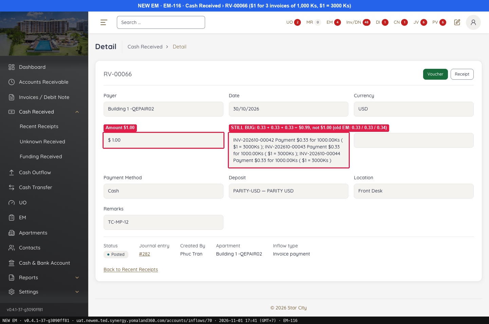 — STILL BUG: 0.33 + 0.33 + 0.33 = $0.99, not $1.00 (old EM: 0.33 / 0.33 / 0.34)
- 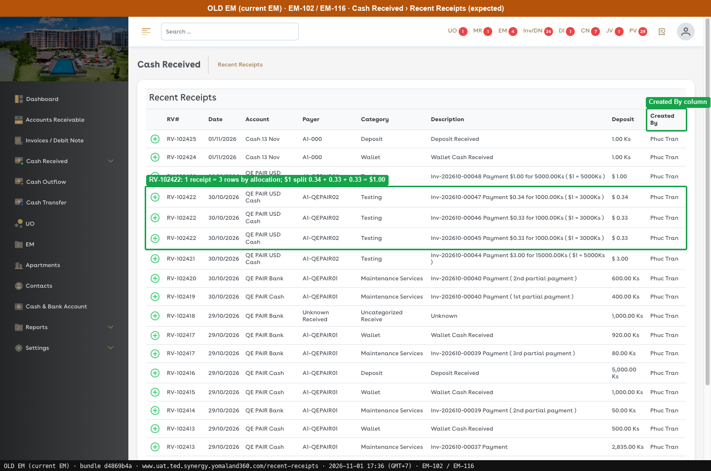 — Created By column
---

### EM-117 · [Cash Received > Unknown Receipt > Assign] USD to MMK invoice loses the conversion description

[EM-117](https://zeyalabs-team-a83df6me.atlassian.net/browse/EM-117) · Jira priority Medium · Status **Open**

**Reported:** Assigning an Unknown $1 to a 5,000 Ks invoice: current EM writes 'Payment $1.00 for 5000.00Ks ( $1 = 5000Ks )'. New EM leaves the description empty.

#### SAN-EM117-001 · Assigning Unknown USD to an MMK invoice writes the conversion in Description

| Priority | Suites | Automation | Status | Source |
|---|---|---|---|---|
| P2 | Sanity · Regression | Auto-UI | Active | EM-117 repro (TC-EM-117-01), 2026-11-01 |

**Preconditions:**

1. Logged in as Admin.
2. USD bank account; Unknown Receipt $1; MMK invoice 5,000 Ks; rate 5,000.
3. Pages: New EM `/accounts/assigned-unknown-received`, Old EM `/reports/assigned-unknown-received` (bundle `dd551ca9`).

**Steps:**

1. Unknown Received › Assign, allocate $1 to the 5,000 Ks invoice, click [Confirm].
2. Open Assigned Unknown Received Logs and read the Description column.
3. Read the Description of RV-00073 (assigned 01/11, MMK) on the same log.

**Expected result:**

1. The receipt is assigned.
2. Description is "Inv-… Payment $1.00 for 5000.00Ks ( $1 = 5000Ks )".
3. Description has "Inv-… Payment …".

**Result (build -37, 2026-11-01):**

| # | Old EM | New EM | |
|---|---|---|---|
| 1 | RV-93913 is assigned | Existing RV-00067 (TC-UNK-07) is assigned | ✅ Same |
| 2 | RV-93913: "Inv-… Payment $1.00 for 5000.00Ks ( $1 = 5000Ks )" | **"—"** | ❌ Differs |
| 3 | Not compared; expected value as above | **"—"** too | ❌ Differs |

**Conclusion:** Open. Description is the audit trail of the assignment (which invoice, what conversion); left empty the log cannot be read and differs from Old EM.

**Evidence:**

- 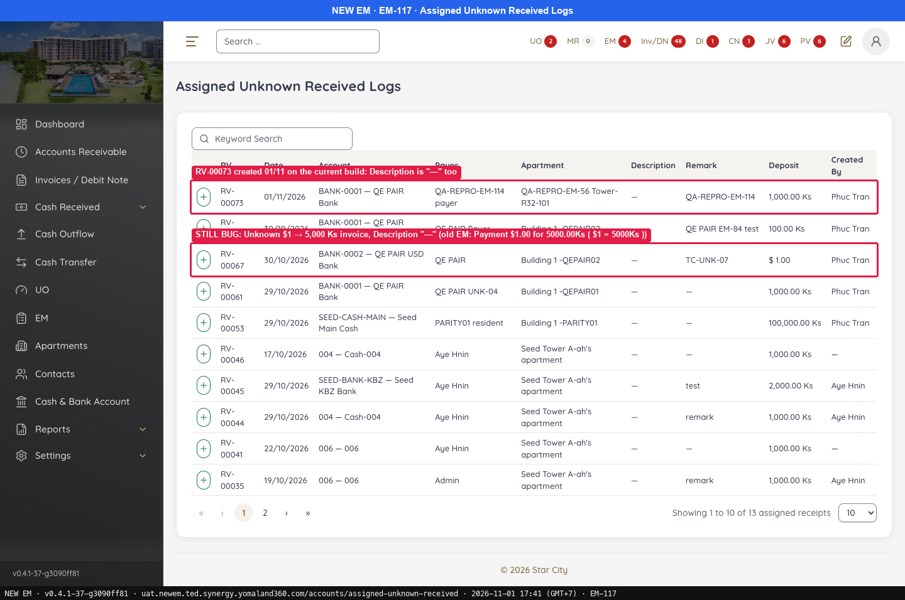 — STILL BUG: Unknown $1 → 5,000 Ks invoice, Description "—" (old EM: Payment $1.00 for 5000.00Ks ( $1 = 5000Ks ))
- 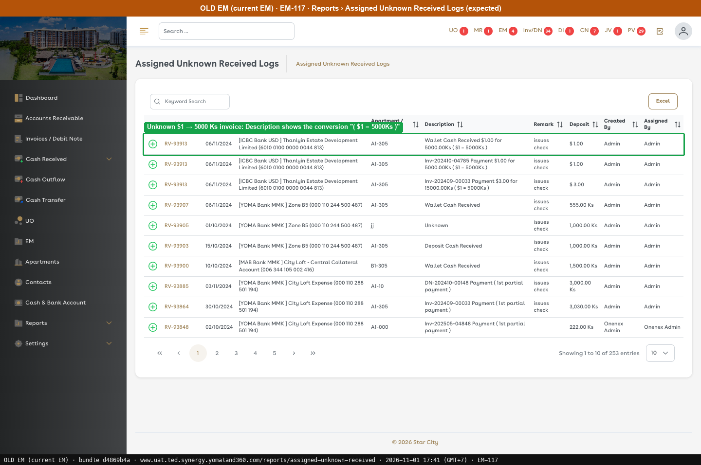 — Unknown $1 → 5000 Ks invoice: Description shows the conversion "( $1 = 5000Ks )"
---

### EM-114 · [Cash Received > Unknown Receipt > Assign] Wrong 'short of' amount in the error message

[EM-114](https://zeyalabs-team-a83df6me.atlassian.net/browse/EM-114) · Jira priority Medium · Status **Open**

**Reported:** Assigning an Unknown Receipt of 1,000 with 80.01 allocated, New EM says 'short of 1000.0000 MMK' while the real shortfall is 919.99.

#### SAN-EM114-001 · Short of message shows the remaining amount when assigning an Unknown Receipt

| Priority | Suites | Automation | Status | Source |
|---|---|---|---|---|
| P2 | Sanity · Regression | Auto-UI | Active | EM-114 repro (TC-EM-114-01), 2026-11-01 |

**Preconditions:**

1. Unknown Received RV-00073 = 1,000 Ks (first run, assigned). Re-run popup: RV-00076 (#77), not assigned.
2. Apartment QA-REPRO-EM-56 Tower-R32-101 has INV-202611-00001 due 1,050 Ks.
3. Page: New EM `/accounts/unknown-receive?tab=allocation` › Assign.

**Steps:**

1. Click Assign and select the apartment.
2. Change the invoice line to **80.01**.
3. Confirm the assignment with the remainder going to Wallet.

**Expected result:**

1. The INV-202611-00001 line is shown, prefilled with 1000.
2. The message shows the shortfall of **919.99**.

**Result (build -37, 2026-11-01):**

| # | Old EM | New EM | |
|---|---|---|---|
| 1 | Not compared | Line shown, prefilled with 1000 | — |
| 2 | Remainder computed as 919.99 (2 decimals), not "short of 1000"; not confirmed | **"Allocated lines are short of 1000.0000 MMK — the remainder goes to the wallet chosen below."** (same on the re-run with RV-00076, then Cancel) | ❌ Differs |
| 3 | Not confirmed | First run on RV-00073 succeeds: invoice has 969.99 left, wallet +919.99. Re-run not confirmed | ⛔ Old EM not run |

**Conclusion:** Open. The message no longer blocks (it is information and the remainder goes to the wallet), but the number is the whole receipt instead of the remainder (1000 − 80.01 = 919.99), and it has 4 decimals.

**Test data created:** RV-00073 assigned: 80.01 to INV-202611-00001, 919.99 to the wallet of apartment id 32.

**Evidence:**

- 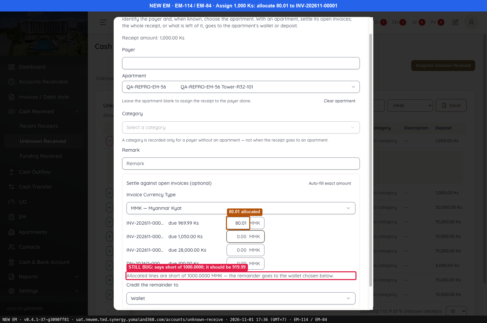 — 80.01 allocated
- 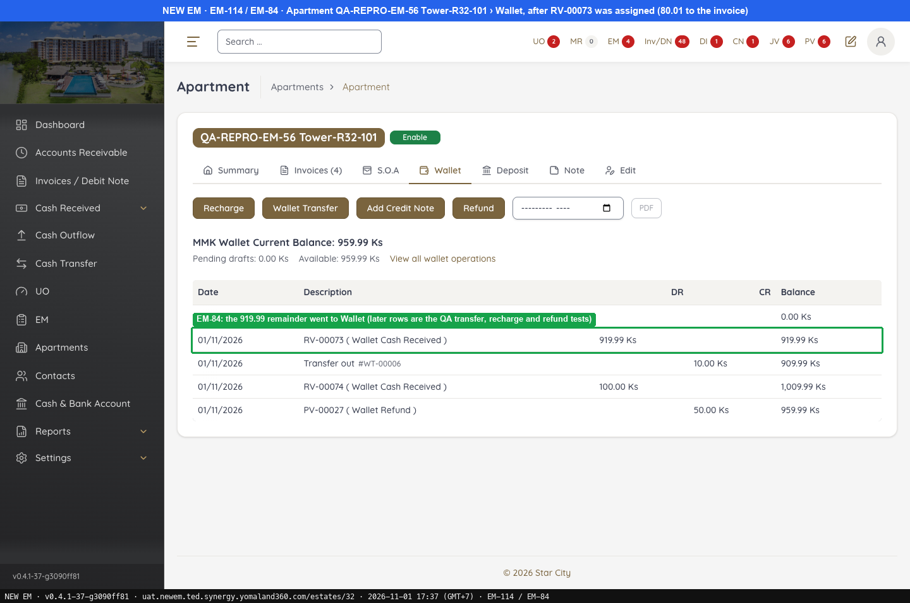 — EM-84: the 919.99 remainder went to Wallet (later rows are the QA transfer, recharge and refund tests)
- 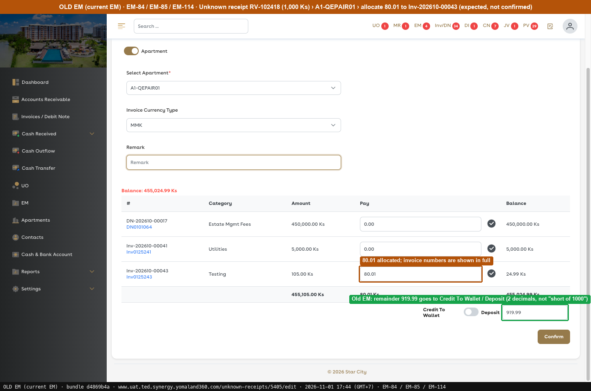 — 80.01 allocated; invoice numbers are shown in full
---

### EM-115 · [Make Payment] Wallet still selectable when paying in USD

[EM-115](https://zeyalabs-team-a83df6me.atlassian.net/browse/EM-115) · Jira priority Medium · Status **Open**

**Reported:** Paying an MMK invoice in USD: current EM removes Wallet from Payment Method; New EM still offers it.

#### SAN-EM115-001 · Pay In Currency USD does not offer Wallet as Payment Method

| Priority | Suites | Automation | Status | Source |
|---|---|---|---|---|
| P2 | Sanity · Regression | Auto-UI | Active | EM-115 repro (TC-EM-115-01), 2026-11-01 |

**Preconditions:**

1. Apartment QA-REPRO-EM-56 Tower-R32-101 has MMK invoice INV-202611-00001 and MMK wallet 919.99.
2. Page: New EM `/receivables/payments/make-payment?estate_id=32`.

**Steps:**

1. Go to Make Payment and set Pay In Currency = USD.
2. Open Payment Method.

**Expected result:**

1. The form switches to USD (Pay In Amount, Exchange Rate).
2. The list is Cash / Cheque / Bank transfer, **without Wallet**.

**Result (build -37, 2026-11-01):**

| # | Old EM | New EM | |
|---|---|---|---|
| 1 | Switches to USD | Switches to USD | ✅ Same |
| 2 | No Wallet with Pay in $ (Wallet is listed in MMK mode) | Cash / Cheque / **Wallet** | ❌ Differs |

**Conclusion:** Open. Wallet stays selectable when paying in USD. Also noted: "Bank transfer" is in the select but does not show in the opened list on New EM.

**Evidence:**

- 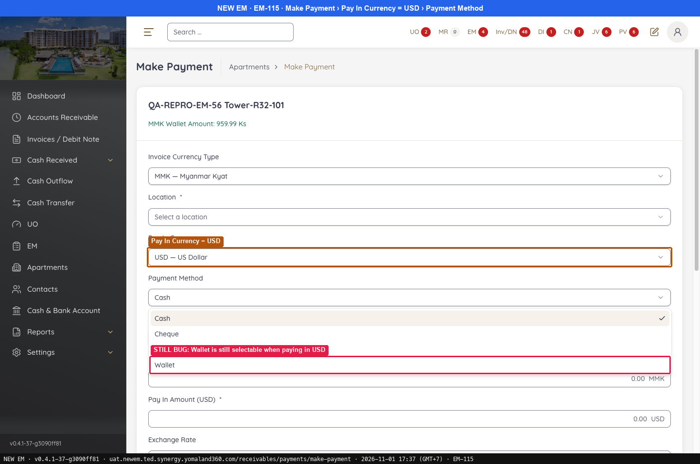 — Pay In Currency = USD
- 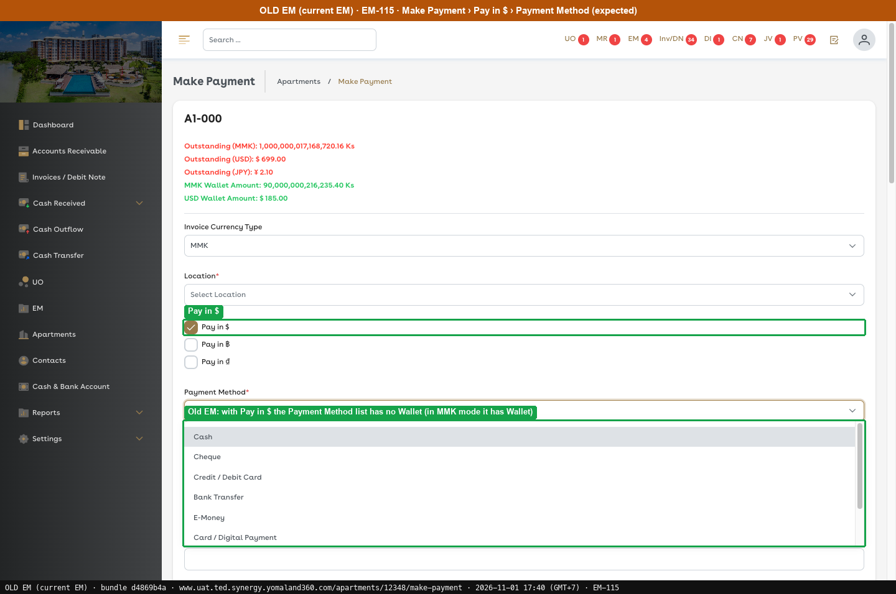 — Pay in $
---

### EM-104 · [Make Payment > Wallet] Payment amount is not limited to wallet balance; ERR_UNKNOWN on confirm

[EM-104](https://zeyalabs-team-a83df6me.atlassian.net/browse/EM-104) · Jira priority Medium · Status **Partly open**

**Reported:** With Payment Method = Wallet, current EM locks Received to the wallet balance and caps each line. New EM allows allocating more than the wallet and then shows a generic error.

#### SAN-EM104-001 · Payment by Wallet is limited to the wallet balance

| Priority | Suites | Automation | Status | Source |
|---|---|---|---|---|
| P2 | Sanity · Regression | Auto-UI | Active | EM-104 repro (TC-EM-104-01), 2026-11-01 |

**Preconditions:**

1. New EM: QA apartment with wallet **959.99** at the re-run (**919.99** at the first run) and invoice INV-202611-00001 due **969.99**.
2. Old EM: A1-QEPAIR01 with wallet **1,920 Ks** and line Inv-202610-00041.
3. Page: New EM `/receivables/payments/make-payment?estate_id=32`.

**Steps:**

1. Set Location = Main Office and Payment Method = Wallet.
2. Click Pay in full on the invoice line (Old EM: type 5,000 in the line).
3. Click [Confirm].

**Expected result:**

1. Received is locked to the wallet balance.
2. The line is capped at the wallet balance.
3. A payment of the capped amount succeeds (from the ticket).

**Result (build -37, 2026-11-01):**

| # | Old EM | New EM | |
|---|---|---|---|
| 1 | A1-QEPAIR01: Received is locked at **1,920.00** | Received is locked but shows **0.00** | ❌ Differs |
| 2 | Typing 5,000 in line Inv-202610-00041 **caps the line at 1,920.00** | Line = **969.9900** (4 decimals), Received = **969.99** | ❌ Differs |
| 3 | Not confirmed; expected from the ticket | Wallet 959.99, Pay in full 969.99: **"Insufficient wallet balance … ERR_WALLET_INSUFFICIENT_BALANCE"** (no more ERR_UNKNOWN), no receipt | ❌ Differs |

**Conclusion:** Partly open. A clear message replaces ERR_UNKNOWN, but Received is not locked to the wallet and the line is not capped as Old EM now shows on A1-QEPAIR01.

**Test data created:** none (New EM: no receipt, Confirm was blocked; Old EM: not confirmed).

**Evidence:**

- 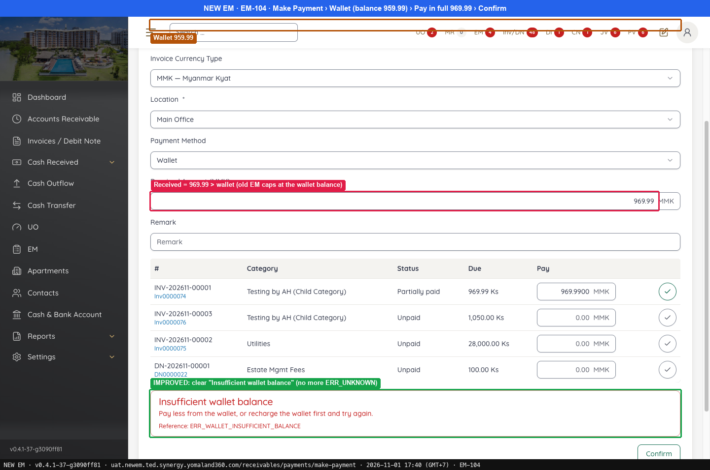 — Wallet 959.99
- 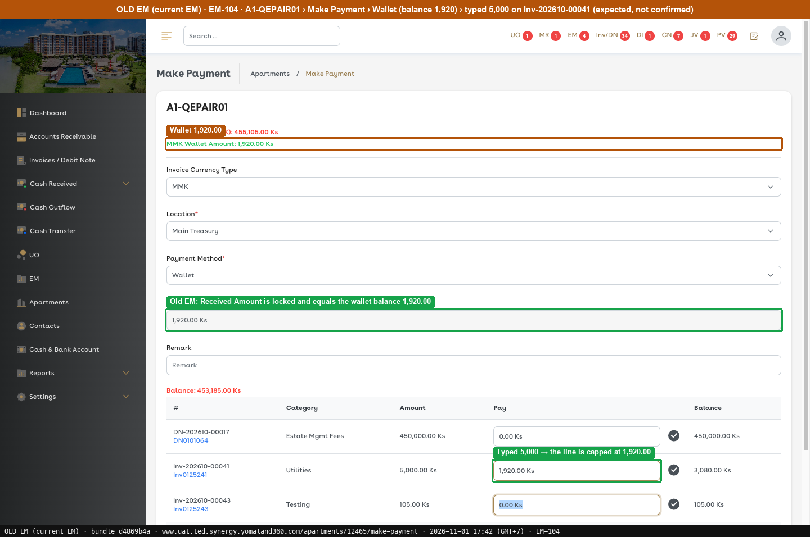 — Wallet 1,920.00
---
