# G6 · Reports and AR

[← Ticket index](README.md) · [Sanity index](../README.md)

**Tickets:** 5 · **Open:** 5

EM-107 and EM-108 are default filter fixes (approved only, date range). EM-95 is the per-currency snapshot.

## Summary

| Ticket | Title | Jira priority | Status (build -37) | Result | Case |
|---|---|---|---|---|---|
| [EM-107](https://zeyalabs-team-a83df6me.atlassian.net/browse/EM-107) | [Reports > Cash Outflow / Transactions] Unapproved drafts are included | Medium | Open | The Cash Outflow report still has 3 draft rows '— No voucher yet' at 100 rows/page. | [SAN-EM107-001](#san-em107-001--cash-outflow-report-lists-only-approved-vouchers) |
| [EM-108](https://zeyalabs-team-a83df6me.atlassian.net/browse/EM-108) | [Reports > Invoices] 'Last 30 days' starts one day later than current EM | Medium | Open | Last 30 days starts on 03/10 instead of 02/10 (Old EM: today − 30). | [SAN-EM108-001](#san-em108-001--reports-invoices-last-30-days-starts-at-today-minus-30-days) |
| [EM-99](https://zeyalabs-team-a83df6me.atlassian.net/browse/EM-99) | [Accounts Receivable / Reports > Invoices] Type filter 'Invoice' / 'Debit Note' excludes UO and EM documents | Medium | Open | Type still has 4 options; 'Invoice' leaves out UO (557,200.00 Ks under 'Utility operation') | [SAN-EM99-001](#san-em99-001--type-invoice-includes-uo-invoices-and-type-debit-note-includes-em-debit-notes) |
| [EM-95](https://zeyalabs-team-a83df6me.atlassian.net/browse/EM-95) | [Accounts Receivable > AR Snapshot] USD snapshot total does not match actual AR | Medium | Open | Snapshot USD for 01/11 is $200, AR USD is $550; $350 missing | [SAN-EM95-001](#san-em95-001--ar-snapshot-usd-equals-accounts-receivable-usd-for-the-same-day) |
| [EM-100](https://zeyalabs-team-a83df6me.atlassian.net/browse/EM-100) | [Invoices / Debit Note > List] Totals row is missing | Medium | Open | The Invoice / Debit Note list has no Totals row | [SAN-EM100-001](#san-em100-001--invoice-list-has-a-totals-row) |

## Tickets

### EM-107 · [Reports > Cash Outflow / Transactions] Unapproved drafts are included

[EM-107](https://zeyalabs-team-a83df6me.atlassian.net/browse/EM-107) · Jira priority Medium · Status **Open**

**Reported:** Cash Outflow and Transactions reports include drafts (ID '—', no approver), so totals are higher than real spending; only approved vouchers should be listed.

#### SAN-EM107-001 · Cash Outflow report lists only approved vouchers

| Priority | Suites | Automation | Status | Source |
|---|---|---|---|---|
| P2 | Sanity · Regression | Auto-UI | Active | EM-107 repro (TC-EM-107-01), 2026-11-01 |

**Preconditions:**

1. Logged in as an Admin user.
2. At least 1 unapproved Cash Outflow draft exists (draft QA-REPRO-EM-97 30,000 Ks, created in EM-97).

**Steps:**

1. Create a Cash Outflow, save it as a draft and do not approve it.
2. Open Reports › Cash Outflow (`/reports/cash-outflow`), keep the default Last 30 days.
3. Compare the totals.

**Expected result:**

1. The draft is in Cash Outflow with no PV number yet.
2. Only approved PV-… rows are listed and Approved By has a name.
3. Only approved vouchers are added to the total.

**Result (build -37, 2026-11-01):**

| # | Old EM | New EM | |
|---|---|---|---|
| 1 | Draft in Cash Outflow, no PV number yet | Draft exists, ID "—" | ✅ Same |
| 2 | Only approved PV-…, Approved By always filled | **3 rows "— No voucher yet"** (drafts) at 100 rows/page: QA-REPRO-EM-97 30,000 Ks and 2 rows dated 22/10; Approved By empty on draft rows | ❌ Differs |
| 3 | Only approved vouchers are added | The total includes drafts, higher than real spending | ❌ Differs |

**Conclusion:** Open. An unapproved draft is not a real transaction; including it makes the spending figure wrong and differs from Old EM. Also noted: the steps ran on Reports › Cash Outflow only; Reports › Transactions from the ticket has no stated result in this repro.

**Test data created:** Reuses draft outflow QA-REPRO-EM-97 (30,000 Ks) from EM-97.

**Evidence:**

- 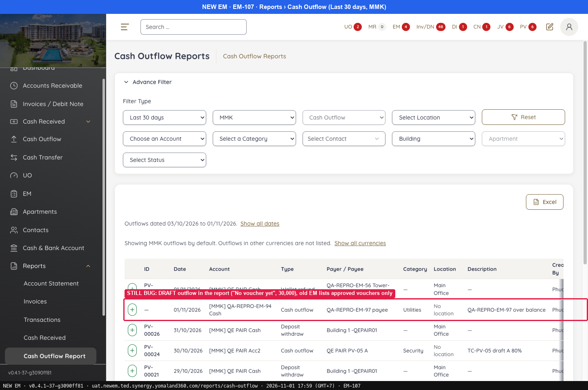 — STILL BUG: DRAFT outflow in the report ("No voucher yet", 30,000), old EM lists approved vouchers only
- 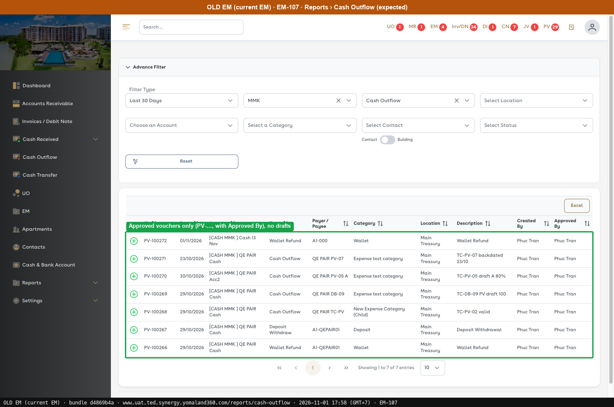 — Approved vouchers only (PV-…, with Approved By), no drafts
---

### EM-108 · [Reports > Invoices] 'Last 30 days' starts one day later than current EM

[EM-108](https://zeyalabs-team-a83df6me.atlassian.net/browse/EM-108) · Jira priority Medium · Status **Open**

**Reported:** 'Last 30 days' in Reports > Invoices starts one day later than current EM, so invoices on the 30th day back are missing. Run on 30/10/2026: Old 30/09, New 01/10.

#### SAN-EM108-001 · Reports Invoices Last 30 days starts at today minus 30 days

| Priority | Suites | Automation | Status | Source |
|---|---|---|---|---|
| P2 | Sanity · Regression | Auto-UI | Active | EM-108 repro (TC-EM-108-01), 2026-11-01 |

**Preconditions:**

1. Logged in as an Admin user.
2. Run on 01/11/2026.

**Steps:**

1. Open Reports › Invoices (`/reports/invoices`).
2. Read the From date.
3. Check an invoice dated 02/10.

**Expected result:**

1. Filter Type defaults to "Last 30 Days".
2. From = 01/11 − 30 days = **02/10/2026**.
3. An invoice dated 02/10 is in the report.

**Result (build -37, 2026-11-01):**

| # | Old EM | New EM | |
|---|---|---|---|
| 1 | Default "Last 30 Days" | Default Last 30 days | ✅ Same |
| 2 | From 02/10/2026 (today − 30; Old EM does not show the date on screen) | Summary line "Invoices dated **03/10/2026** to 01/11/2026" | ❌ Differs |
| 3 | In the report | Excluded | ❌ Differs |

**Conclusion:** Open. New EM counts 30 days including today, so the window is one day shorter than Old EM and the invoice on the 30th day back is lost from the report. Old EM does not show the date on screen, so its From date comes from the today − 30 rule, not from a reading on the page.

**Evidence:**

- 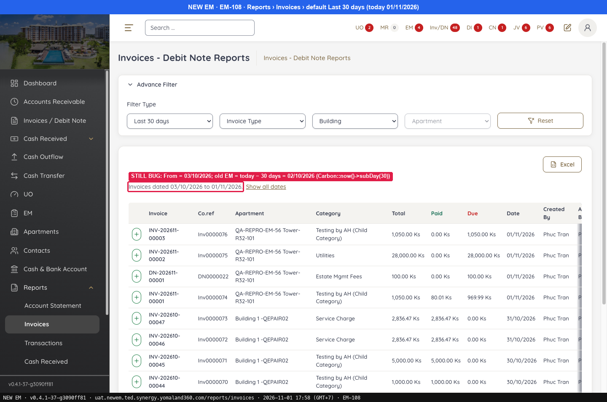 — STILL BUG: From = 03/10/2026; old EM = today − 30 days = 02/10/2026 (Carbon::now()->subDay(30))
- 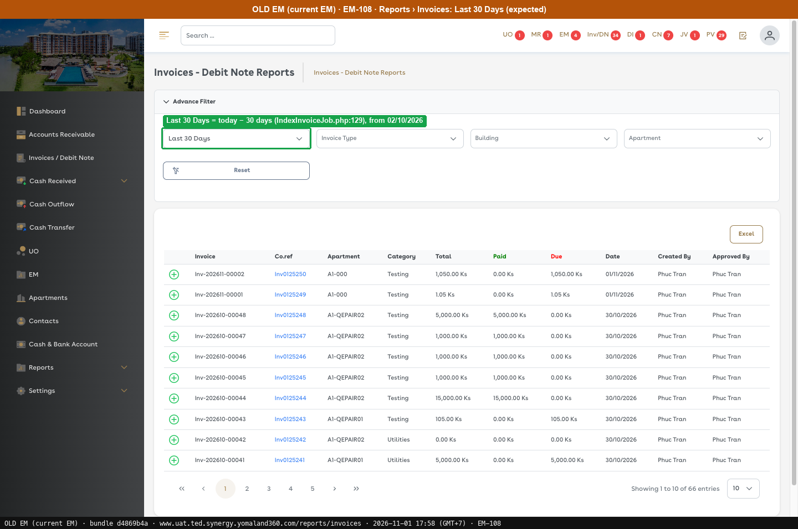 — Last 30 Days = today − 30 days, from 02/10/2026
---

### EM-99 · [Accounts Receivable / Reports > Invoices] Type filter 'Invoice' / 'Debit Note' excludes UO and EM documents

[EM-99](https://zeyalabs-team-a83df6me.atlassian.net/browse/EM-99) · Jira priority Medium · Status **Open**

**Reported:** In current EM, 'Invoice' includes Utility (UO) invoices and 'Debit Note' includes Estate Management (EM) debit notes. New EM splits them into 4 types, so 'Invoice' hides UO and 'Debit Note' hides EM.

#### SAN-EM99-001 · Type Invoice includes UO invoices and Type Debit Note includes EM debit notes

| Priority | Suites | Automation | Status | Source |
|---|---|---|---|---|
| P2 | Sanity · Regression | Auto-UI | Active | EM-99 repro (TC-EM-99-01), 2026-11-01 |

**Preconditions:**

1. Logged in as Admin, Currency MMK.
2. UO invoices exist (e.g. INV-202610-00011).
3. Pages: New EM `/receivables/worklist?type=INVOICE`, `?type=UTILITY_OPERATION`; Old EM `/account-receivables` (bundle `d4869b4a`).

**Steps:**

1. Open the Type filter.
2. Set Type = Invoice and look for INV-202610-00011.
3. Set Type = Utility operation (New EM only) and read the total.
4. Go to Reports › Invoices, Type = Debit Note, and look for the EM debit notes DN-202610-00001/05/07/08.

**Expected result:**

1. 2 options: Invoice, Debit Note.
2. Type = Invoice includes UO invoices.
3. No UO amount sits outside 'Invoice'.
4. Type = Debit Note includes the EM debit notes (from the ticket).

**Result (build -37, 2026-11-01):**

| # | Old EM | New EM | |
|---|---|---|---|
| 1 | 2: Invoice, Debit Note | **4**: Invoice, Debit note, Utility operation, Estate management | ❌ Differs |
| 2 | Includes UO invoices | Regular INV only; AR 1,037,909.21 Ks; **no** INV-202610-00011 | ❌ Differs |
| 3 | — | INV-202610-00001/07/08/09/10/**11**… total **557,200.00 Ks** (includes the extra UO invoice #148 of 28,000 Ks), left out of "Invoice" | ❌ Differs |
| 4 | Not run | Not run | ⛔ Not run |

**Conclusion:** Open. Type = Invoice at 1,037,909.21 Ks still excludes the 557,200.00 Ks of Utility operation. A user filtering "Invoice" as in Old EM misses the UO amount, so AR per type does not match Old EM. The Debit Note side in Reports › Invoices was not run.

**Evidence:**

- 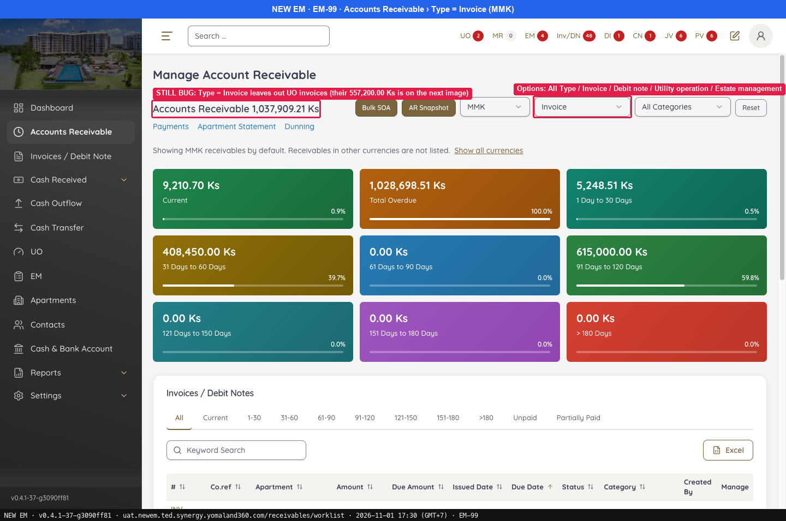 — STILL BUG: Type = Invoice leaves out UO invoices (their 557,200.00 Ks is on the next image)
- 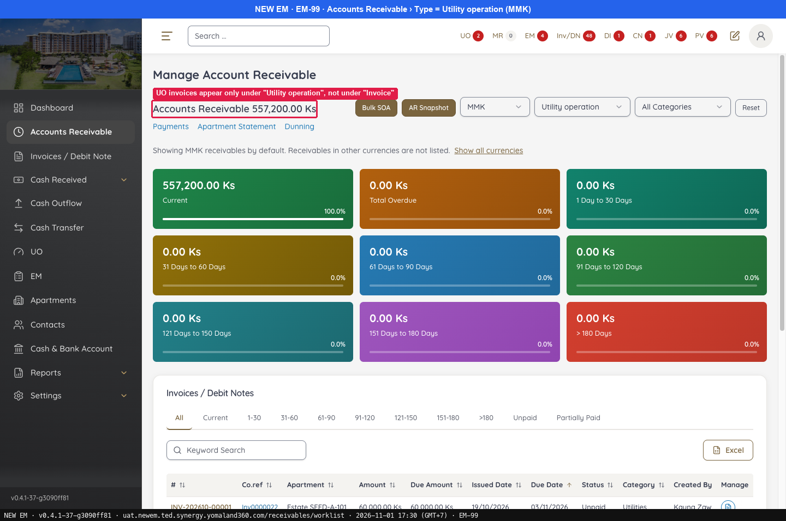 — UO invoices appear only under "Utility operation", not under "Invoice"
- 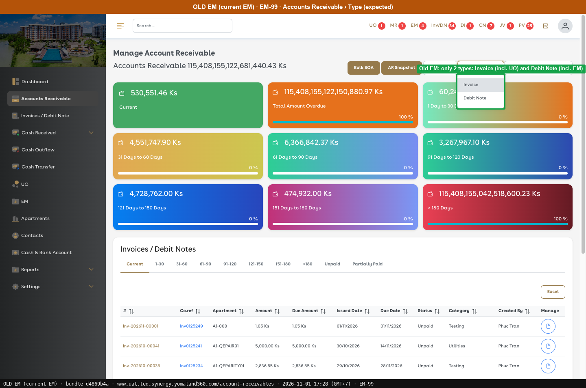 — Old EM: only 2 types: Invoice (incl. UO) and Debit Note (incl. EM)
---

### EM-95 · [Accounts Receivable > AR Snapshot] USD snapshot total does not match actual AR

[EM-95](https://zeyalabs-team-a83df6me.atlassian.net/browse/EM-95) · Jira priority Medium · Status **Open**

**Reported:** The AR Snapshot for USD on 29/10 shows $200 while Accounts Receivable for the same day shows $550. The MMK snapshot is correct.

#### SAN-EM95-001 · AR Snapshot USD equals Accounts Receivable USD for the same day

| Priority | Suites | Automation | Status | Source |
|---|---|---|---|---|
| P2 | Sanity · Regression | Auto-UI | Active | EM-95 repro (TC-EM-95-01), 2026-11-01 |

**Preconditions:**

1. Logged in as Admin.
2. USD invoices / debit notes with outstanding balance in several aging buckets.
3. Pages: New EM `/receivables/ar-snapshot`, Old EM `/account-receivables/snapshot` (bundle `dd551ca9`).

**Steps:**

1. Go to Accounts Receivable, Currency = USD, and note the total per bucket.
2. Go to AR Snapshot, Month = 11/2026, Currency = USD, and read the row for 01/11.
3. Read the per-apartment table for the same day.

**Expected result:**

1. Totals per bucket are noted.
2. The 01/11 row equals $550 with the same buckets as step 1.
3. Every apartment with USD receivables is listed.

**Result (build -37, 2026-11-01):**

| # | Old EM | New EM | |
|---|---|---|---|
| 1 | Not compared | **$550**: 31-60 $200, 61-90 $100, 91-120 $250 (INV-202609-0007 $200, DN-202609-0003 $50, DN-202609-00010 $100, INV-202609-00023 $200) | — |
| 2 | "No account receivable data found" (the snapshot does not run on Old UAT), so no number to compare; expected value taken from AR on the same day | 01/11 row: **Total $200**, 91-120 $200, other buckets $0 | ❌ Differs |
| 3 | No data | Only apartment #7 $200; B1-BB ($300) and Estate SEED-A-202 ($50) are missing | ❌ Differs |

**Conclusion:** Open. The snapshot should capture that day's AR, but $350 of USD receivables is missing, so historical receivables reporting is wrong. Per the ticket, MMK matches.

**Evidence:**

- 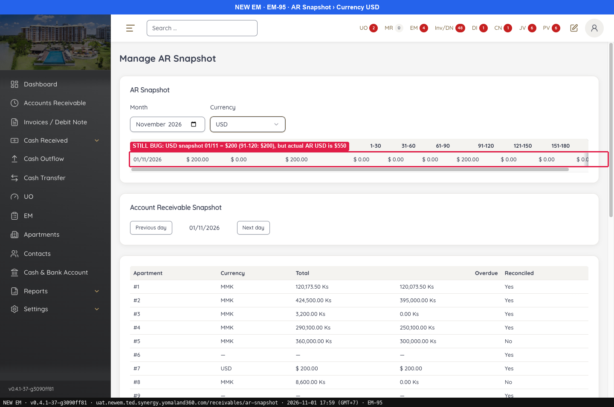 — STILL BUG: USD snapshot 01/11 = $200 (91-120: $200), but actual AR USD is $550
- 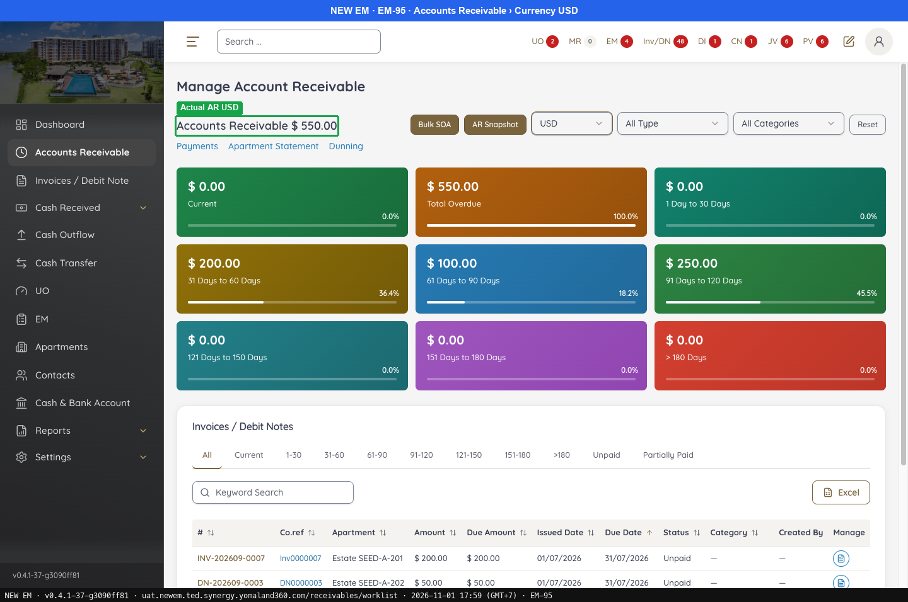 — Actual AR USD
- 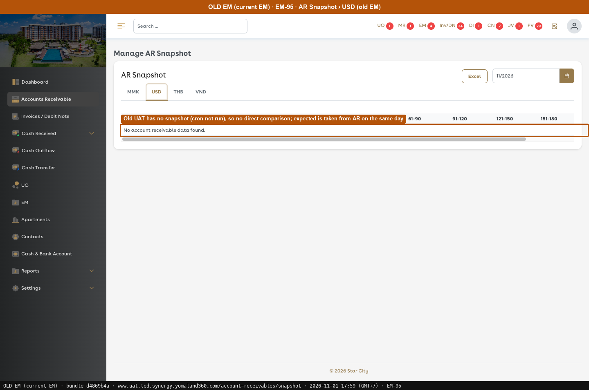 — Old UAT has no snapshot (cron not run), so no direct comparison; expected is taken from AR on the same day
---

### EM-100 · [Invoices / Debit Note > List] Totals row is missing

[EM-100](https://zeyalabs-team-a83df6me.atlassian.net/browse/EM-100) · Jira priority Medium · Status **Open**

**Reported:** Current EM shows a Totals row at the bottom of the invoice list. New EM has no totals.

#### SAN-EM100-001 · Invoice list has a Totals row

| Priority | Suites | Automation | Status | Source |
|---|---|---|---|---|
| P2 | Sanity · Regression | Auto-UI | Active | EM-100 repro (TC-EM-100-01), 2026-11-01 |

**Preconditions:**

1. Logged in as Admin; default filter Last 30 Days, MMK.
2. Pages: New EM `/receivables/invoices`, Old EM `/invoices` (bundle `dd551ca9`).

**Steps:**

1. Open the list and scroll to the bottom of the table.

**Expected result:**

1. A **Totals:** row with Total / Paid / Due is shown.

**Result (build -37, 2026-11-01):**

| # | Old EM | New EM | |
|---|---|---|---|
| 1 | **Totals:** 29,420.00 / 24,315.00 / 5,105.00 Ks for the current page | Row DN-202610-00010 is followed by pagination; **no Totals** | ❌ Differs |

**Conclusion:** Open. Accounting uses the Totals row to reconcile amounts quickly, and New EM does not have it.

**Evidence:**

- 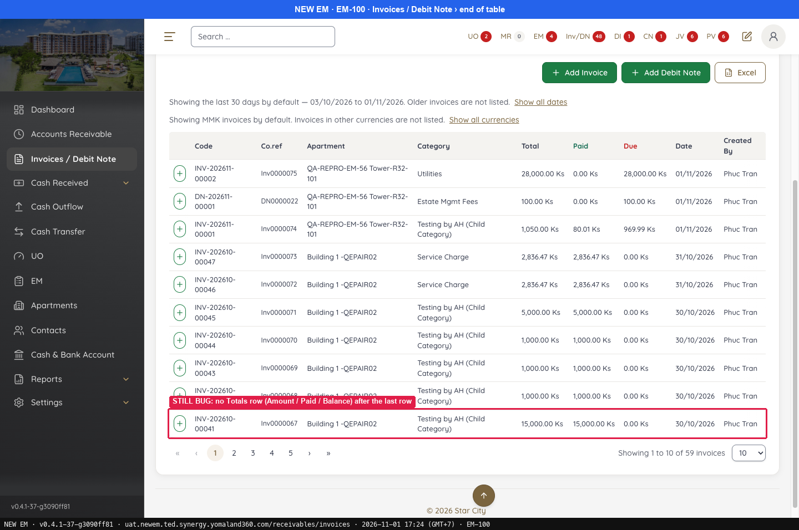 — STILL BUG: no Totals row (Amount / Paid / Balance) after the last row
- 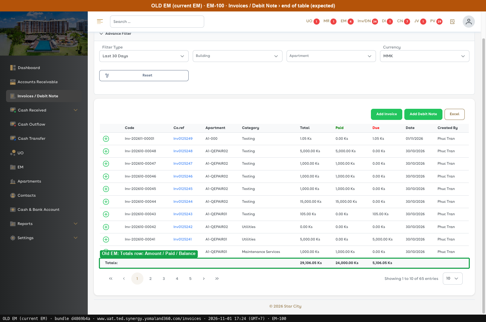 — Old EM: Totals row: Amount / Paid / Balance
---
