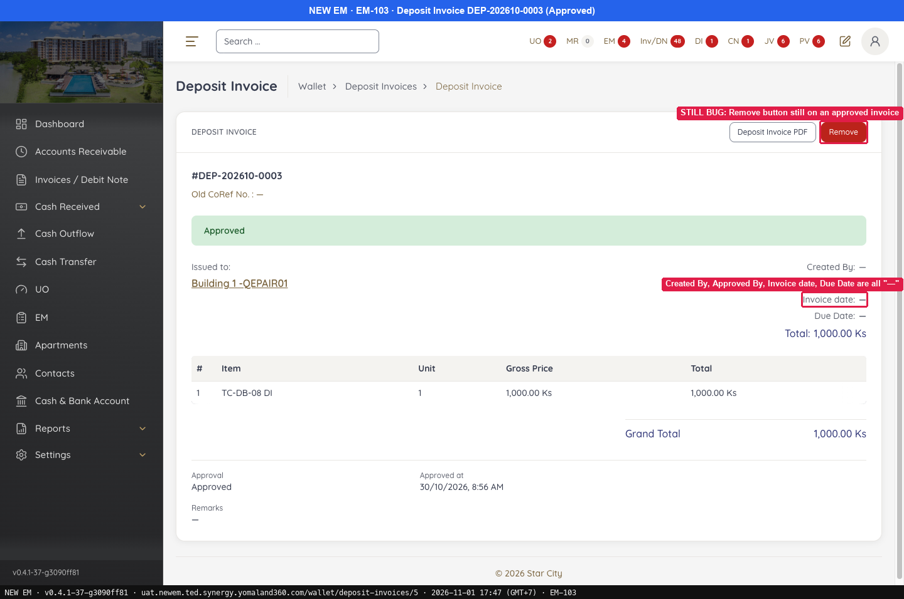
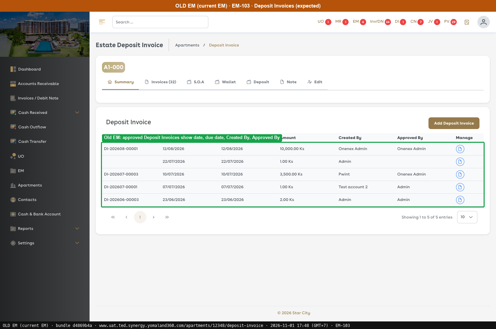
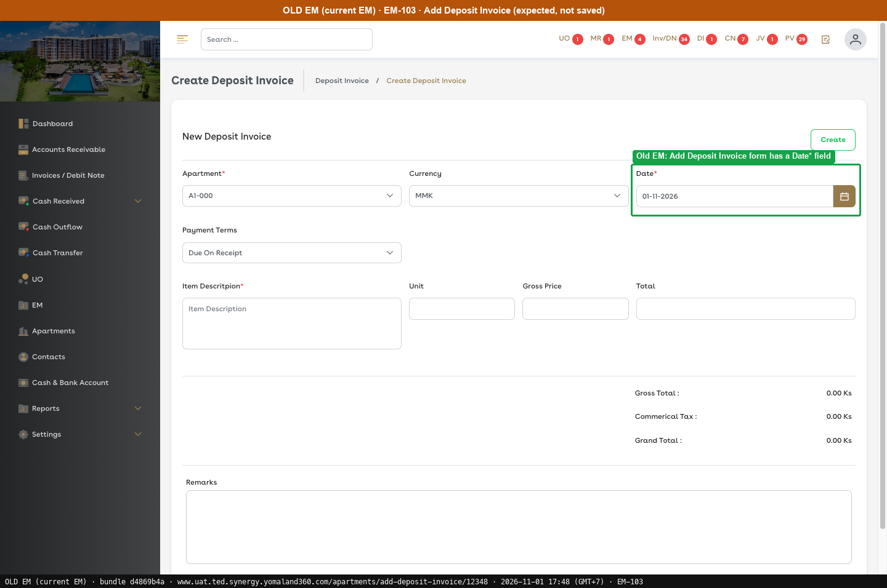
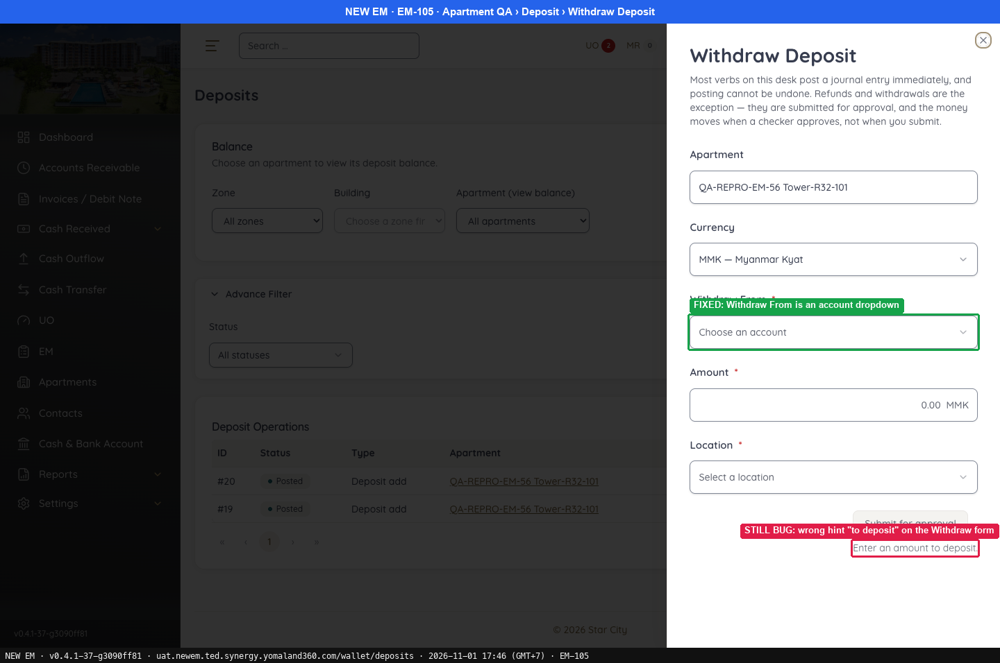
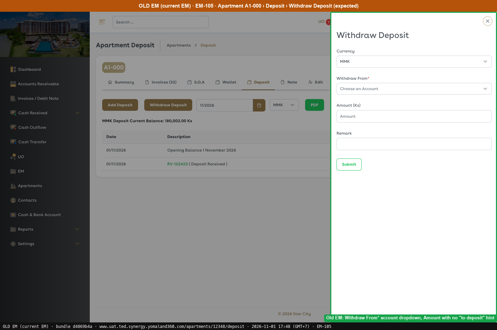

# G7 · Deposit

[← Ticket index](README.md) · [Sanity index](../README.md)

**Tickets:** 2 · **Open:** 1 · **Partly open:** 1

## Summary

| Ticket | Title | Jira priority | Status (build -37) | Result | Case |
|---|---|---|---|---|---|
| [EM-103](https://zeyalabs-team-a83df6me.atlassian.net/browse/EM-103) | [Deposit Invoice] No Date field; approved invoice shows no dates, creator or approver | Medium | Open | No Date field; approved invoice shows '—' for dates and users, and Remove is still shown. | [SAN-EM103-001](#san-em103-001--deposit-invoice-has-a-date-field-approved-invoice-shows-dates-and-users-with-no-remove) |
| [EM-105](https://zeyalabs-team-a83df6me.atlassian.net/browse/EM-105) | [Deposit > Withdraw] 'Withdraw From' is free text (account ID) instead of account dropdown | Medium | Partly open | Withdraw From is now a dropdown; the hint still says 'Enter an amount to deposit.' | [SAN-EM105-001](#san-em105-001--withdraw-from-is-an-account-dropdown-and-the-hint-refers-to-withdrawing) |

## Tickets

### EM-103 · [Deposit Invoice] No Date field; approved invoice shows no dates, creator or approver

[EM-103](https://zeyalabs-team-a83df6me.atlassian.net/browse/EM-103) · Jira priority Medium · Status **Open**

**Reported:** The Deposit Invoice form has no Date field. After approval, Issue Date, Due Date, Created By and Approved By all show '—', and the Remove button is still available.

#### SAN-EM103-001 · Deposit Invoice has a Date field; approved invoice shows dates and users with no Remove

| Priority | Suites | Automation | Status | Source |
|---|---|---|---|---|
| P2 | Sanity · Regression | Auto-UI | Active | EM-103 repro (TC-EM-103-01), 2026-11-01 |

**Preconditions:**

1. Logged in as an Admin user.
2. Approved deposit invoice DEP-202610-0003 exists (created by the tester on 30/10).

**Steps:**

1. Go to Deposit Invoice, click [New] (`/wallet/deposit-invoices/new`) and list the fields.
2. Open the Deposit Invoices list.
3. Open DEP-202610-0003 (Approved) (`/wallet/deposit-invoices/5`).

**Expected result:**

1. The form has a Date field.
2. The list shows date and creator.
3. Issue/Due date, Created By and Approved By have values; no Remove button.

**Result (build -37, 2026-11-01):**

| # | Old EM | New EM | |
|---|---|---|---|
| 1 | Add Deposit Invoice form has a Date* field | Apartment*, Currency*, Payment Terms, Item Description*, Unit*, Gross Price*, Remarks; **no Date** | ❌ Differs |
| 2 | Approved Deposit Invoices show date, due date, Created By, Approved By | DEP-202610-0001/0002/0003: date "—", "Name not on record" | ❌ Differs |
| 3 | Issue/Due date, Created By and Approved By have values; no Remove | Created By **—**, Approved By **—**, Invoice date **—**, Due Date **—**; **Remove** button still shown | ❌ Differs |

**Conclusion:** Open. The form has no Date, and an approved invoice shows no dates or users and still shows Remove. Old EM steps not re-run; the expected result is taken from the ticket, and the Old EM screenshots were captured separately.

**Evidence:**

-  — STILL BUG: Remove button still on an approved invoice
-  — Old EM: approved Deposit Invoices show date, due date, Created By, Approved By
-  — Old EM: Add Deposit Invoice form has a Date* field
---

### EM-105 · [Deposit > Withdraw] 'Withdraw From' is free text (account ID) instead of account dropdown

[EM-105](https://zeyalabs-team-a83df6me.atlassian.net/browse/EM-105) · Jira priority Medium · Status **Partly open**

**Reported:** Withdraw From was an empty text box where the internal account ID had to be typed, instead of a list of accounts, and the hint said 'Enter an amount to deposit'.

#### SAN-EM105-001 · Withdraw From is an account dropdown and the hint refers to withdrawing

| Priority | Suites | Automation | Status | Source |
|---|---|---|---|---|
| P2 | Sanity · Regression | Auto-UI | Active | EM-105 repro (TC-EM-105-01), 2026-11-01 |

**Preconditions:**

1. Logged in as an Admin user.
2. Apartment `QA-REPRO-EM-56 Tower-R32-101` (id 32) has deposit 500 Ks.

**Steps:**

1. Open the apartment, tab Deposit, click [Withdraw Deposit] (`/wallet/deposits?estate_id=32&type=WITHDRAW&new=1`) and look at "Withdraw From *".
2. Read the hint under the button.

**Expected result:**

1. "Withdraw From *" is a dropdown of cash/bank accounts.
2. The hint refers to withdrawing.

**Result (build -37, 2026-11-01):**

| # | Old EM | New EM | |
|---|---|---|---|
| 1 | Withdraw From* account dropdown | Dropdown **"Choose an account"** | ✅ Same |
| 2 | Amount with no "to deposit" hint | **"Enter an amount to deposit."** | ❌ Differs |

**Conclusion:** Partly open. The dropdown is in place, but the hint still says "to deposit" on the withdraw form. Old EM steps not re-run; the expected result is taken from the ticket, and the Old EM screenshot was captured separately. The form was not submitted.

**Evidence:**

-  — FIXED: Withdraw From is an account dropdown
-  — Old EM: Withdraw From* account dropdown, Amount with no "to deposit" hint
---
