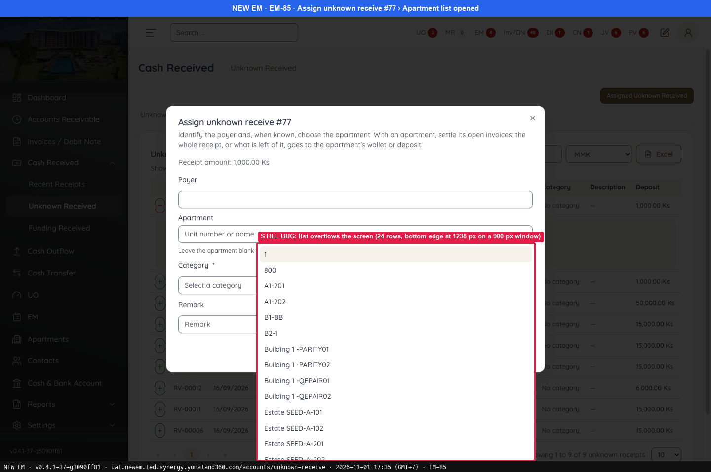
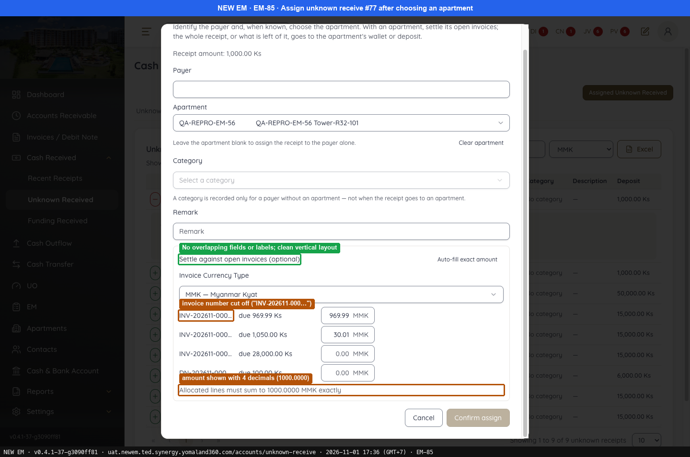
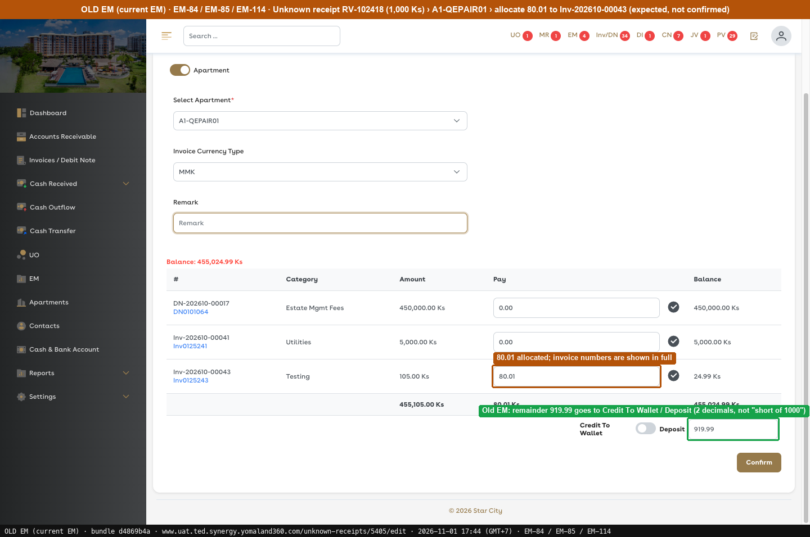
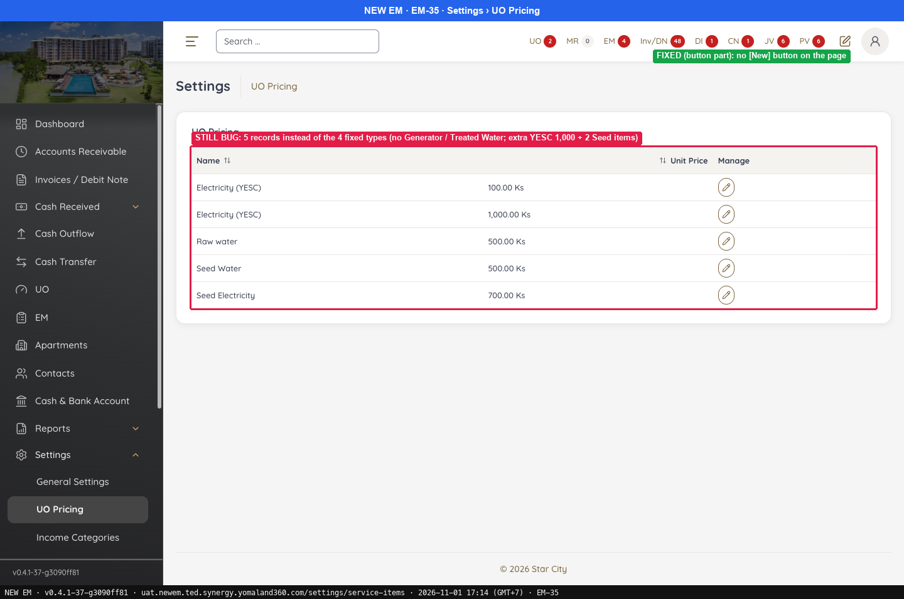
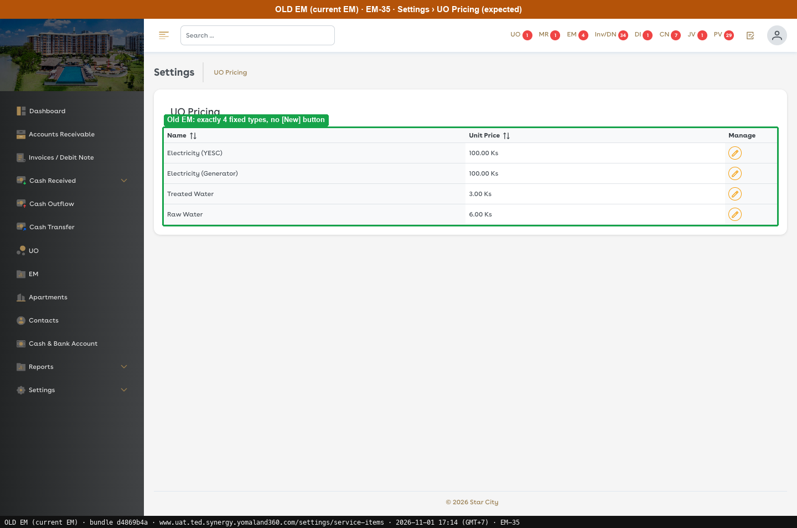

# G9 · UI and stray data

[← Ticket index](README.md) · [Sanity index](../README.md)

**Tickets:** 2 · **Partly open:** 2

EM-35 is seed data, not a screen defect.

## Summary

| Ticket | Title | Jira priority | Status (build -37) | Result | Case |
|---|---|---|---|---|---|
| [EM-85](https://zeyalabs-team-a83df6me.atlassian.net/browse/EM-85) | [Cash Received > Unknown Receipt Allocation] Assign popup has overlapping fields and misalignment | Medium | Partly open | Overlap is gone; Apartment dropdown overflows the screen and cannot be scrolled | [SAN-EM85-001](#san-em85-001--assign-unknown-receipt-popup-has-no-overlap-and-the-apartment-list-scrolls) |
| [EM-35](https://zeyalabs-team-a83df6me.atlassian.net/browse/EM-35) | [Settings > UO Pricing] New button allows creating extra UO Pricing records | High | Partly open | The New button is removed; the list still has 5 records (duplicate YESC, 2 Seed) and lacks Generator and Treated Water. | [SAN-EM35-001](#san-em35-001--uo-pricing-has-only-the-4-fixed-types-and-no-new-button) |

## Tickets

### EM-85 · [Cash Received > Unknown Receipt Allocation] Assign popup has overlapping fields and misalignment

[EM-85](https://zeyalabs-team-a83df6me.atlassian.net/browse/EM-85) · Jira priority Medium · Status **Partly open**

**Reported:** The Assign Unknown Receipt popup has layout issues: input fields and text overlap and the content is misaligned.

#### SAN-EM85-001 · Assign Unknown Receipt popup has no overlap and the Apartment list scrolls

| Priority | Suites | Automation | Status | Source |
|---|---|---|---|---|
| P2 | Sanity · Regression | Auto-UI | Active | EM-85 repro (TC-EM-85-01), 2026-11-01 |

**Preconditions:**

1. Logged in as Admin.
2. Unknown Received RV-00076 (#77, 1,000 Ks) exists and is not assigned; window 1440×900 (first run: RV-00073, screen 1568×776).
3. Page: New EM `/accounts/unknown-receive?tab=allocation`.

**Steps:**

1. Click + on RV-00076 › Assign.
2. Open the Apartment list.
3. Select an apartment and read the "Settle against open invoices" section.

**Expected result:**

1. The popup is tidy.
2. The list scrolls and does not overflow.
3. Fields and labels do not overlap.

**Result (build -37, 2026-11-01):**

| # | Old EM | New EM | |
|---|---|---|---|
| 1 | Assign is a full page with aligned fields | Tidy popup: Receipt amount, Payer, Apartment, Category*, Remark, Cancel/Confirm | ✅ Same |
| 2 | Assign is a full page; Apartment list overflow not checked | **Overflows the screen**: 24 rows, bottom edge at 1238px on a 900px window (first run: 1422px > window 1267px, `max-height: none`); the last items (including the QA apartment) **cannot be reached with the mouse** | ❌ Differs |
| 3 | A1-QEPAIR01 selected, 80.01 allocated, not confirmed; invoice numbers not cut | No overlap, but the apartment had to be selected by script; invoice number cut "INV-202611-000…", amount shown with 4 decimals "1000.0000 MMK" | ❌ Differs |

**Conclusion:** Partly open. The overlap is gone, but the Apartment dropdown in the popup overflows the screen and cannot be scrolled.

**Evidence:**

-  — STILL BUG: list overflows the screen (24 rows, bottom edge at 1238 px on a 900 px window)
-  — No overlapping fields or labels; clean vertical layout
-  — 80.01 allocated; invoice numbers are shown in full
---

### EM-35 · [Settings > UO Pricing] New button allows creating extra UO Pricing records

[EM-35](https://zeyalabs-team-a83df6me.atlassian.net/browse/EM-35) · Jira priority High · Status **Partly open**

**Reported:** A New button in UO Pricing allowed extra records, although UO Pricing should only contain 4 predefined master data types.

#### SAN-EM35-001 · UO Pricing has only the 4 fixed types and no New button

| Priority | Suites | Automation | Status | Source |
|---|---|---|---|---|
| P1 | Sanity · Regression | Auto-UI | Active | EM-35 repro (TC-EM-35-01), 2026-11-01 |

**Preconditions:**

1. Logged in as an Admin user.

**Steps:**

1. Open Settings › UO Pricing (`/settings/service-items`).
2. Look for [New].
3. Compare the list with the 4 master types.

**Expected result:**

1. The UO Pricing list opens.
2. No [New] button.
3. Exactly 4 rows: Electricity (YESC), Electricity (Generator), Treated Water, Raw Water; each with Edit only.

**Result (build -37, 2026-11-01):**

| # | Old EM | New EM | |
|---|---|---|---|
| 1 | List | Opens | ✅ Same |
| 2 | No [New] | **No [New]** | ✅ Same |
| 3 | 4 rows: Electricity (YESC), Electricity (Generator), Treated Water, Raw Water; Edit only | **5 rows**: Electricity (YESC) 100, Electricity (YESC) 1,000, Raw water, Seed Water, Seed Electricity; Generator and Treated Water missing | ❌ Differs |

**Conclusion:** Partly open. [New] is gone, but the catalogue is not back to the 4 master types: it keeps extra records (duplicate YESC, Seed) and lacks 2 master types, so UO is charged against the wrong list until the data is cleaned up. A direct API POST to create UO Pricing was not tried.

**Evidence:**

-  — STILL BUG: 5 records instead of the 4 fixed types (no Generator / Treated Water; extra YESC 1,000 + 2 Seed items)
-  — Old EM: exactly 4 fixed types, no [New] button
---
