# Fixed · Cash & Bank Account

[← Ticket index](../README.md) · [Sanity index](../../README.md)

**Tickets:** 6 · **Fixed:** 6

These tickets are fixed on build -37 (EM-72 and EM-73 on build -87, 2026-11-09). Their cases are now regression checks.

## Summary

| Ticket | Title | Jira priority | Status (build -37) | Result | Case |
|---|---|---|---|---|---|
| [EM-69](https://zeyalabs-team-a83df6me.atlassian.net/browse/EM-69) | [Cash & Bank Account > List] List does not match current EM UAT | Medium | Fixed | The list matches Old EM (columns, content, Edit Initial Balance). | [SAN-EM69-001](#san-em69-001--cash--bank-account-list-matches-old-em-columns-and-content) |
| [EM-70](https://zeyalabs-team-a83df6me.atlassian.net/browse/EM-70) | [Cash & Bank Account > New > Create New Cash Account] Create UI does not match current EM UAT | Highest | Fixed | Retest build -87 (11-09, automated) passed: CASH type settings checked first; no Code, fields match and Payment Method is now the "Select Payment Method" dropdown. | [SAN-EM70-001](#san-em70-001--new-account-with-type-cash-matches-old-em-fields-and-has-no-code) |
| [EM-71](https://zeyalabs-team-a83df6me.atlassian.net/browse/EM-71) | [Cash & Bank Account > New > Create New Bank Account] Create UI does not match current EM UAT | Highest | Fixed | Retest build -87 (11-09, automated) passed: BANK type settings checked first; no Code, fields match and Payment Method is now the "Select Payment Method" dropdown. | [SAN-EM71-001](#san-em71-001--new-account-with-type-bank-matches-old-em-fields-and-has-no-code) |
| [EM-72](https://zeyalabs-team-a83df6me.atlassian.net/browse/EM-72) | [Cash & Bank Account > Edit > Edit Cash Account] Edit UI does not match current EM UAT | Highest | Fixed (build -87) | Retest build -87 (11-09, automated) passed: CASH type settings checked first; fields match and Payment Method is now a dropdown showing the selected names. | [SAN-EM72-001](#san-em72-001--edit-cash-account-matches-old-em-fields-and-payment-method-control) |
| [EM-73](https://zeyalabs-team-a83df6me.atlassian.net/browse/EM-73) | [Cash & Bank Account > Edit > Edit Bank Account] Edit UI does not match current EM UAT | Highest | Fixed (build -87) | Retest build -87 (11-09, automated) passed: BANK type settings checked first; fields match and Payment Method is now a dropdown showing the selected names. | [SAN-EM73-001](#san-em73-001--edit-bank-account-matches-old-em-fields-and-payment-method-control) |
| [EM-88](https://zeyalabs-team-a83df6me.atlassian.net/browse/EM-88) | [Cash and Bank] Bank fields not shown when Type = Bank; Payment Method field missing | Highest | Fixed | Payment Method is present; BANK shows all bank fields. (automated, build -100) | [SAN-EM88-001](#san-em88-001--new-account-has-payment-method-type-bank-shows-bank-name-account-number-enable-overdraft) |

## Tickets

### EM-69 · [Cash & Bank Account > List] List does not match current EM UAT

[EM-69](https://zeyalabs-team-a83df6me.atlassian.net/browse/EM-69) · Jira priority Medium · Status **Fixed**

**Reported:** The Cash & Bank Account list columns and layout differed from the current EM UAT.

#### SAN-EM69-001 · Cash & Bank Account list matches Old EM columns and content

| Priority | Suites | Automation | Status | Source |
|---|---|---|---|---|
| P2 | Sanity · Regression | Auto-UI | Active | EM-69 repro (TC-EM-69-01), 2026-11-01 |

**Preconditions:**

1. Logged in as an Admin user.
2. CASH and BANK accounts exist.

**Steps:**

1. Open Cash & Bank Account (New `/settings/accounts`, Old `/cash-and-bank-accounts`).
2. Read the Account cell.
3. Read the Balance cell.
4. Read the Manage cell.
5. Check Keyword Search and pagination.

**Expected result:**

1. Columns Account / Balance / Manage.
2. Account shows name, TYPE label, bank (BANK) and currency.
3. Balance shows Account No (BANK), Initial Balance and Balance (Closing Balance).
4. Manage shows Edit Initial Balance, Edit and Delete.
5. Keyword Search and pagination are available.

**Result (build -37, 2026-11-01):**

| # | Old EM | New EM | |
|---|---|---|---|
| 1 | Account / Balance / Manage | Account / Balance / Manage | ✅ Same |
| 2 | Name, TYPE label, bank (BANK), currency | Name, TYPE label, bank, currency | ✅ Same |
| 3 | Account No (BANK), Initial Balance, Balance (Closing Balance) | Same as Old EM | ✅ Same |
| 4 | Edit Initial Balance + Edit + Delete | Edit Initial Balance + Edit + Delete | ✅ Same |
| 5 | Available | Available | ✅ Same |

**Conclusion:** Fixed. Also noted: the Edit Initial Balance button style differs (Old EM: solid brown button on a blue row; New EM: outlined button), with no change in function.

**Evidence:**

- 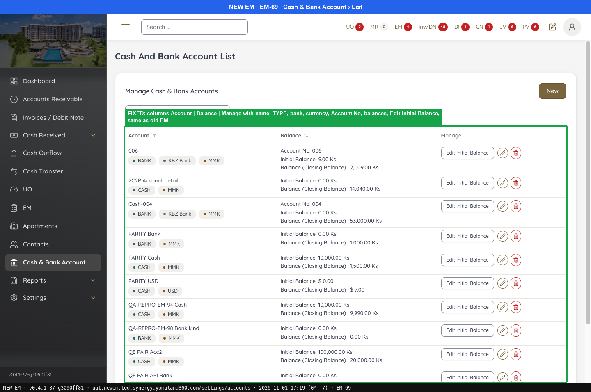 — FIXED: columns Account | Balance | Manage with name, TYPE, bank, currency, Account No, balances, Edit Initial Balance, same as old EM
- 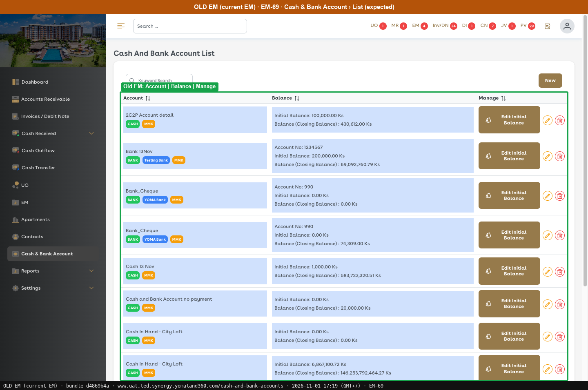 — Old EM: Account | Balance | Manage
---

### EM-70 · [Cash & Bank Account > New > Create New Cash Account] Create UI does not match current EM UAT

[EM-70](https://zeyalabs-team-a83df6me.atlassian.net/browse/EM-70) · Jira priority Highest · Status **Fixed**

**Reported:** The Code field was shown and the field set differed from the current EM UAT; the Code field should be removed and Type = Cash should show Name, Currency, Initial Balance, Payment Method and Description.

#### SAN-EM70-001 · New account with Type CASH matches Old EM fields and has no Code

| Priority | Suites | Automation | Status | Source |
|---|---|---|---|---|
| P1 | Sanity · Regression | Auto-UI | Active | EM-70 repro (TC-EM-70-01), 2026-11-01 |

**Preconditions:**

1. Logged in as an Admin user.

**Steps:**

1. Go to Cash & Bank Account › New (New `/settings/accounts/new`, Old `/cash-and-bank-accounts/new`).
2. Select Type = CASH.
3. Read the Payment Method control.

**Expected result:**

1. No Code field.
2. Name*, Currency, Initial Balance, Payment Method, Type*, Description.
3. Payment Method is the multiselect dropdown "Select Payment Method" as in Old EM.

**Automated test:** [`SAN-EM70-001` in fixed-accounts.spec.ts](../../../../tests/sanity/tickets/fixed/fixed-accounts.spec.ts) · tag `@sanity` `@EM-70` · run `APP=em npx playwright test --grep SAN-EM70-001` · first reads the CASH type settings in Manage Type and fails if any of Bank Name, Account Number, Enable Overdraft is ticked, then derives the expected fields from them; read-only: picks Type = CASH on the New form, opens the Payment Method popup and closes it with Escape, never ticks anything or clicks [Create].

**Result (build -37, 2026-11-01):**

| # | Old EM | New EM | |
|---|---|---|---|
| 1 | No Code | **No** Code | ✅ Same |
| 2 | Name*, Currency, Initial Balance, Payment Method, Type*, Description | Name*, Currency, Initial Balance, Payment Method, Type*, Description | ✅ Same |
| 3 | Multiselect dropdown "Select Payment Method" | Checkbox list (Select all, Cash, Bank Transfer, …) | ❌ Differs |

**Conclusion:** Fixed. The field set is correct and Code is gone; it used to be a bug because of the extra Code field and a field set that differed from Old EM. Also noted: the Payment Method control differs (checkbox list vs multiselect), tracked with EM-72 and EM-73. [Create] was not clicked.

**Retest (build -87, 2026-11-09, automated): passed** (Chromium and Firefox, build `v0.4.1-87-gacedf701`)

| # | Check | Old EM | New EM | |
|---|---|---|---|---|
| 0 | Manage Type › CASH carries | None of Bank Name, Account Number, Enable Overdraft | None ticked | ✅ Same |
| 1 | Code field | None | None | ✅ Same |
| 2 | Fields, order and required marks (Type = CASH) | Name*, Currency, Initial Balance, Payment Method, Type*, Description | Same | ✅ Same |
| 3 | Payment Method control | Multiselect dropdown "Select Payment Method" | Dropdown "Select Payment Method"; opens a checkbox list with nothing ticked | ✅ Same |

**Evidence:**

- 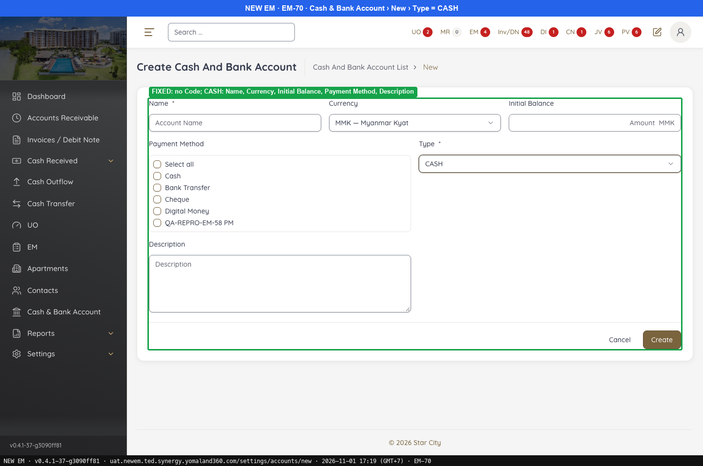 — FIXED: no Code; CASH: Name, Currency, Initial Balance, Payment Method, Description
- 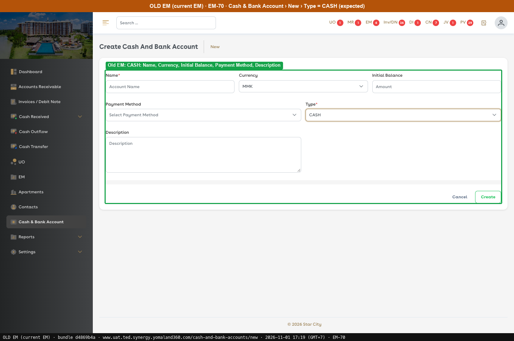 — Old EM: CASH: Name, Currency, Initial Balance, Payment Method, Description
- 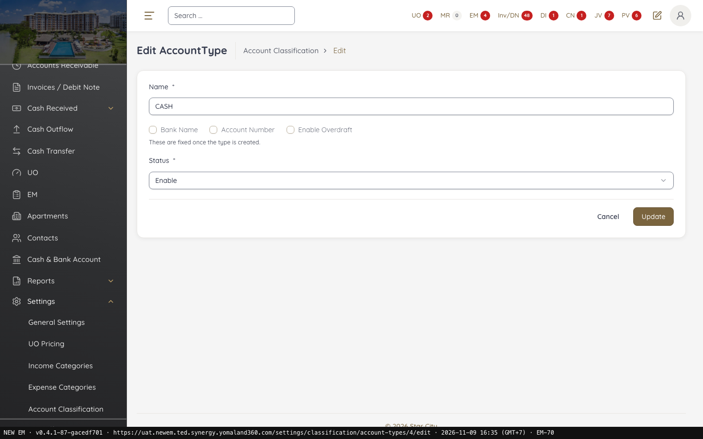 — RETEST build -87, precondition: Manage Type › CASH settings
-  — RETEST build -87, steps 1–2: no Code; same fields as Old EM
- 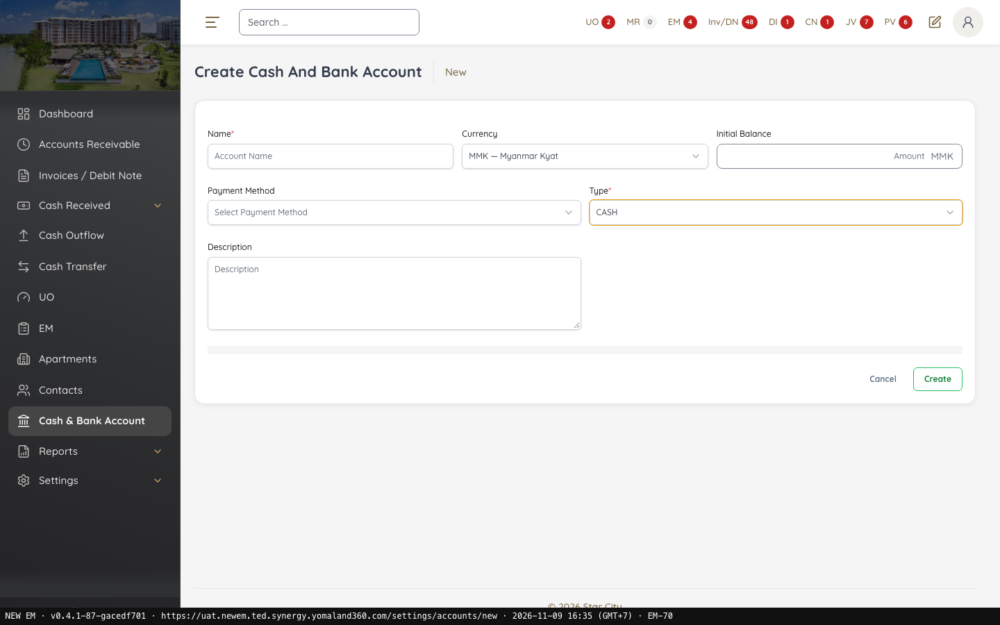 — RETEST build -87, step 3: Payment Method is the "Select Payment Method" dropdown
- 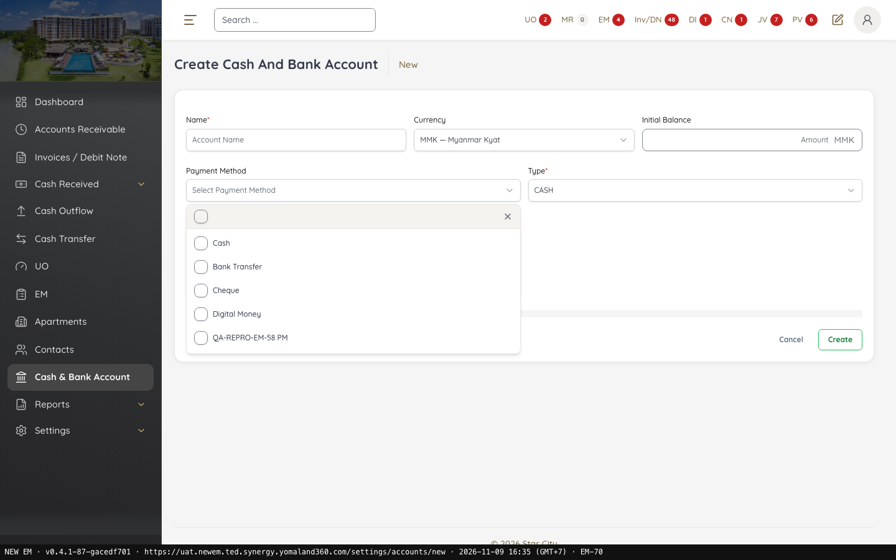 — RETEST build -87, step 3: the dropdown open, nothing ticked

**Jira:** retest posted on [EM-70](https://zeyalabs-team-a83df6me.atlassian.net/browse/EM-70?focusedCommentId=10366) as `VERIFIED_PASSED_v0.4.1-87-gacedf701` (comment 10366, 2026-11-09).
---

### EM-71 · [Cash & Bank Account > New > Create New Bank Account] Create UI does not match current EM UAT

[EM-71](https://zeyalabs-team-a83df6me.atlassian.net/browse/EM-71) · Jira priority Highest · Status **Fixed**

**Reported:** The Code field was shown and the bank fields differed from the current EM UAT; the Code field should be removed and Type = Bank should show the bank fields.

#### SAN-EM71-001 · New account with Type BANK matches Old EM fields and has no Code

| Priority | Suites | Automation | Status | Source |
|---|---|---|---|---|
| P1 | Sanity · Regression | Auto-UI | Active | EM-71 repro (TC-EM-71-01), 2026-11-01 |

**Preconditions:**

1. Logged in as an Admin user.

**Steps:**

1. Go to Cash & Bank Account › New (New `/settings/accounts/new`, Old `/cash-and-bank-accounts/new`).
2. Select Type = BANK.
3. Read the Payment Method control.

**Expected result:**

1. No Code field.
2. Name*, Currency, Initial Balance, Payment Method, Type*, Select Bank Name*, Account Number*, Enable Overdraft, Description.
3. Payment Method is the multiselect dropdown "Select Payment Method" as in Old EM.

**Automated test:** [`SAN-EM71-001` in fixed-accounts.spec.ts](../../../../tests/sanity/tickets/fixed/fixed-accounts.spec.ts) · tag `@sanity` `@EM-71` · run `APP=em npx playwright test --grep SAN-EM71-001` · first reads the BANK type settings in Manage Type and fails if they are not all ticked, then derives the expected fields from them; read-only: picks Type = BANK on the New form, opens the Payment Method popup and closes it with Escape, never ticks anything or clicks [Create].

**Result (build -37, 2026-11-01):**

| # | Old EM | New EM | |
|---|---|---|---|
| 1 | No Code | **No** Code | ✅ Same |
| 2 | Name*, Currency, Initial Balance, Payment Method, Type*, Select Bank Name*, Account Number*, Enable Overdraft, Description | Name*, Currency, Initial Balance, Payment Method, Type*, Select Bank Name*, Account Number*, Enable Overdraft, Description | ✅ Same |
| 3 | Multiselect dropdown "Select Payment Method" | Checkbox list (Select all, Cash, Bank Transfer, …) | ❌ Differs |

**Conclusion:** Fixed. The field set is correct and Code is gone; it used to be a bug because of the extra Code field and a field set that differed from Old EM. Also noted: the Payment Method control differs (checkbox list vs multiselect), tracked with EM-72 and EM-73. [Create] was not clicked.

**Retest (build -87, 2026-11-09, automated): passed** (Chromium and Firefox, build `v0.4.1-87-gacedf701`)

| # | Check | Old EM | New EM | |
|---|---|---|---|---|
| 0 | Manage Type › BANK carries | Bank Name, Account Number, Enable Overdraft | Bank Name, Account Number, Enable Overdraft (all ticked) | ✅ Same |
| 1 | Code field | None | None | ✅ Same |
| 2 | Fields, order and required marks (Type = BANK) | Name*, Currency, Initial Balance, Payment Method, Type*, Select Bank Name*, Account Number*, Enable Overdraft, Description | Same | ✅ Same |
| 3 | Payment Method control | Multiselect dropdown "Select Payment Method" | Dropdown "Select Payment Method"; opens a checkbox list with nothing ticked | ✅ Same |

**Evidence:**

- 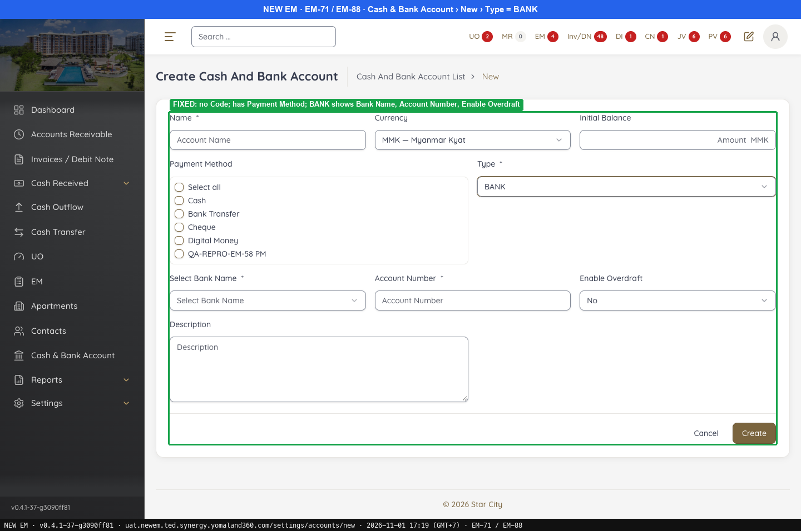 — FIXED: no Code; has Payment Method; BANK shows Bank Name, Account Number, Enable Overdraft
- 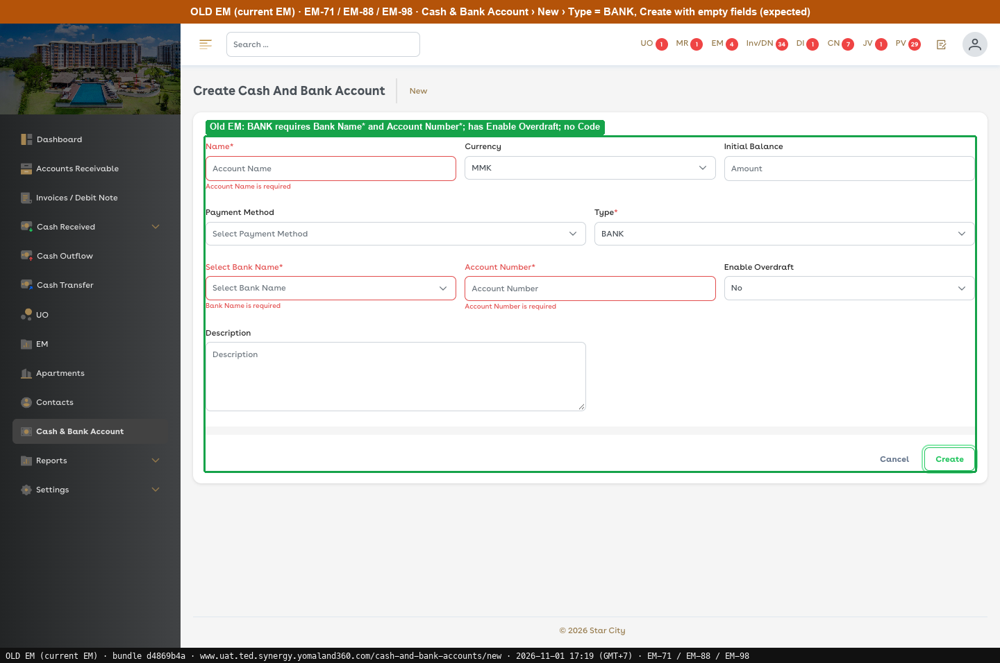 — Old EM: BANK requires Bank Name* and Account Number*; has Enable Overdraft; no Code
- 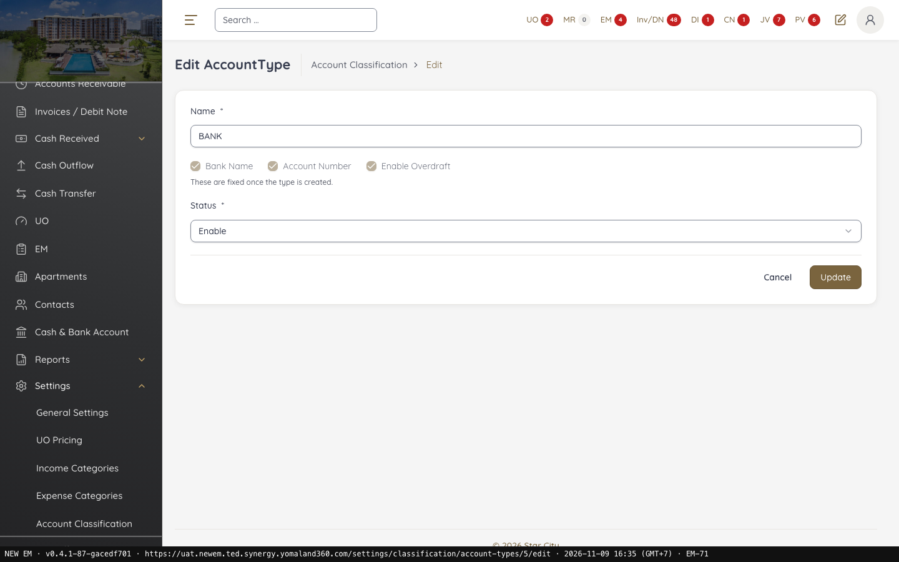 — RETEST build -87, precondition: Manage Type › BANK settings
-  — RETEST build -87, steps 1–2: no Code; same fields as Old EM
- 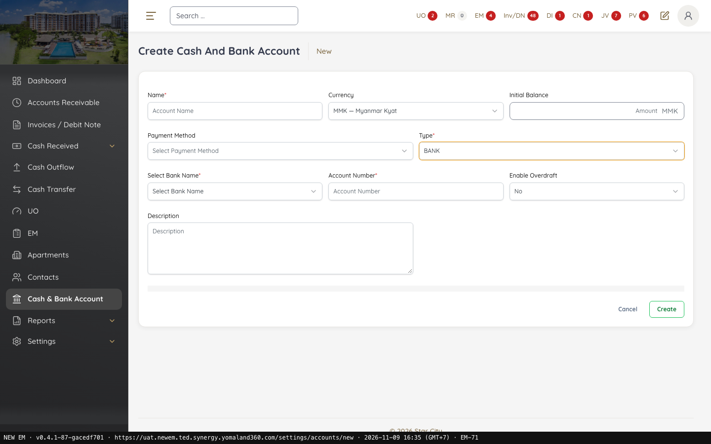 — RETEST build -87, step 3: Payment Method is the "Select Payment Method" dropdown
- 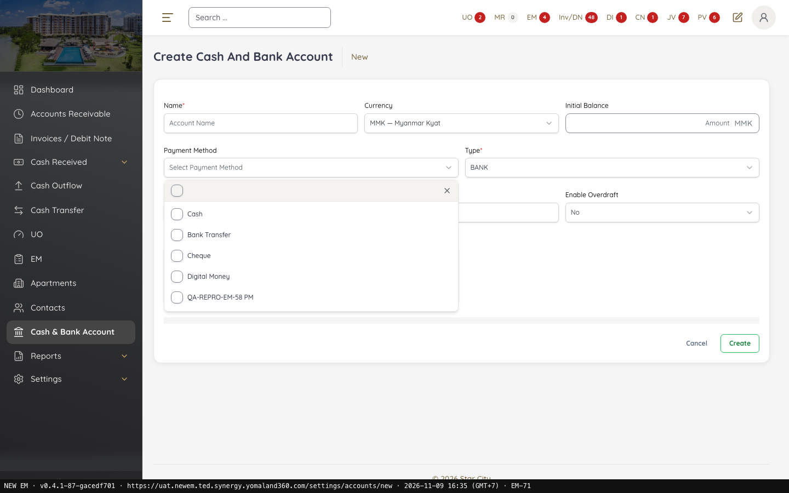 — RETEST build -87, step 3: the dropdown open, nothing ticked

**Jira:** retest posted on [EM-71](https://zeyalabs-team-a83df6me.atlassian.net/browse/EM-71?focusedCommentId=10367) as `VERIFIED_PASSED_v0.4.1-87-gacedf701` (comment 10367, 2026-11-09).
---

### EM-88 · [Cash and Bank] Bank fields not shown when Type = Bank; Payment Method field missing

[EM-88](https://zeyalabs-team-a83df6me.atlassian.net/browse/EM-88) · Jira priority Highest · Status **Fixed**

**Reported:** The Payment Method field was missing, and selecting Bank in Type did not show the bank information fields (Bank Name, Account Number, Enable Overdraft).

#### SAN-EM88-001 · New account has Payment Method; Type BANK shows Bank Name, Account Number, Enable Overdraft

| Priority | Suites | Automation | Status | Source |
|---|---|---|---|---|
| P1 | Sanity · Regression | Auto-UI | Active | EM-88 repro (TC-EM-88-01), 2026-11-01 |

**Preconditions:**

1. Logged in as an Admin user.

**Steps:**

1. Open Cash & Bank Account › New (New `/settings/accounts/new`, Old `/cash-and-bank-accounts/new`) and look for Payment Method.
2. Select Type = BANK.
3. Check whether Payment Method is marked as required.

**Expected result:**

1. Payment Method is present.
2. Select Bank Name*, Account Number* and Enable Overdraft (No/Yes) are displayed.
3. Payment Method has no * as in Old EM (the ticket says "required"; see Conclusion).

**Automated test:** [`SAN-EM88-001` in fixed-accounts.spec.ts](../../../../tests/sanity/tickets/fixed/fixed-accounts.spec.ts) · tag `@sanity` `@EM-88` · run `APP=em npx playwright test --grep SAN-EM88-001` · read-only: picks Type = BANK on the New form and opens Enable Overdraft, never clicks [Create].

**Result (build -37, 2026-11-01):**

| # | Old EM | New EM | |
|---|---|---|---|
| 1 | Present | **Present** (checkbox list) | ✅ Same |
| 2 | Select Bank Name*, Account Number*, Enable Overdraft (No/Yes) | **All 3 fields shown**, Bank Name and Account Number have * | ✅ Same |
| 3 | Label has no * | No *; same as Old EM | ✅ Same |

**Conclusion:** Fixed, matches Old EM. Also noted: the ticket's "Payment Method field is required" does not match Old EM, whose label has no *; BA confirmation is needed.

**Retest (build -100, 2026-11-10, automated): passed** (Chromium, build `v0.4.1-100-g1a97b9a6`)

| # | Check | Old EM | New EM | |
|---|---|---|---|---|
| 1 | Payment Method field | Present | Present (dropdown "Select Payment Method") | ✅ Same |
| 2 | Type = BANK shows | Select Bank Name*, Account Number*, Enable Overdraft (No/Yes) | Same | ✅ Same |
| 3 | Payment Method required mark | No * | No * | ✅ Same |

Also noted: Enable Overdraft lists Yes before No (default No); the case does not set an order.

**Evidence:**

-  — FIXED: no Code; has Payment Method; BANK shows Bank Name, Account Number, Enable Overdraft
-  — Old EM: BANK requires Bank Name* and Account Number*; has Enable Overdraft; no Code
---

### EM-72 · [Cash & Bank Account > Edit > Edit Cash Account] Edit UI does not match current EM UAT

[EM-72](https://zeyalabs-team-a83df6me.atlassian.net/browse/EM-72) · Jira priority Highest · Status **Fixed** (build -87, 2026-11-09)

**Reported:** The Cash Account edit UI differed from the current EM UAT.

#### SAN-EM72-001 · Edit cash account matches Old EM fields and Payment Method control

| Priority | Suites | Automation | Status | Source |
|---|---|---|---|---|
| P1 | Sanity · Regression | Auto-UI | Active | EM-72 repro (TC-EM-72-01), 2026-11-01 |

**Preconditions:**

1. Logged in as an Admin user.
2. A cash account exists (New: PARITY Cash, id 54; Old: 2C2P Account detail, id 100).
3. Settings › Account Classification › Manage Type › Edit CASH: "What accounts of this type carry" has none of Bank Name, Account Number, Enable Overdraft ticked. These settings decide which of those three fields the account Edit page shows, so read them first.

**Steps:**

1. From the list, click the pencil on a cash account (New `/settings/accounts/<id>/edit`, Old `/cash-and-bank-accounts/<id>/edit`).
2. Compare the fields.
3. Read the Payment Method control. Do not change anything and do not click [Update].

**Expected result:**

1. The page Edit Cash And Bank Account opens.
2. Name*, Currency (locked), Payment Method, Type (locked), Description.
3. Payment Method is a multiselect dropdown showing the names of the selected payment methods.

**Automated test:** [`SAN-EM72-001` in fixed-accounts.spec.ts](../../../../tests/sanity/tickets/fixed/fixed-accounts.spec.ts) · tag `@sanity` `@EM-72` · run `APP=em npx playwright test --grep SAN-EM72-001` · first reads the CASH type settings in Manage Type and fails if any of Bank Name, Account Number, Enable Overdraft is ticked, then derives the expected fields from them; cash account `PARITY Cash` (id 54); read-only: opens the Payment Method popup and closes it with Escape, never ticks anything or clicks [Update].

**Result (build -37, 2026-11-01):**

| # | Old EM | New EM | |
|---|---|---|---|
| 1 | Edit Cash And Bank Account page | Edit Cash And Bank Account page | ✅ Same |
| 2 | Name*, Currency (locked), Payment Method, Type (locked), Description | Name*, Currency (locked), Payment Method, Type (locked), Description | ✅ Same |
| 3 | Multiselect dropdown showing the selected names | **Checkbox list** | ❌ Differs |

**Conclusion:** Partly open. The ticket asks for the same Edit UI as Old EM; the field set matches, but Payment Method is still a different control.

**Retest (build -87, 2026-11-09, automated): passed** → **Fixed** (Chromium and Firefox, build `v0.4.1-87-gacedf701`)

| # | Check | Old EM | New EM | |
|---|---|---|---|---|
| 0 | Manage Type › CASH carries | None of Bank Name, Account Number, Enable Overdraft | None ticked | ✅ Same |
| 1 | Pencil on `PARITY Cash` opens the edit page | Edit Cash And Bank Account page | Edit Cash And Bank Account page (`/settings/accounts/54/edit`) | ✅ Same |
| 2 | Fields, order and required marks | Name*, Currency (locked), Payment Method, Type (locked), Description | Same | ✅ Same |
| 3 | Payment Method control | Multiselect dropdown showing the selected names | Dropdown showing "Cash"; it opens a checkbox list with only Cash ticked | ✅ Same |

**Evidence:**

- 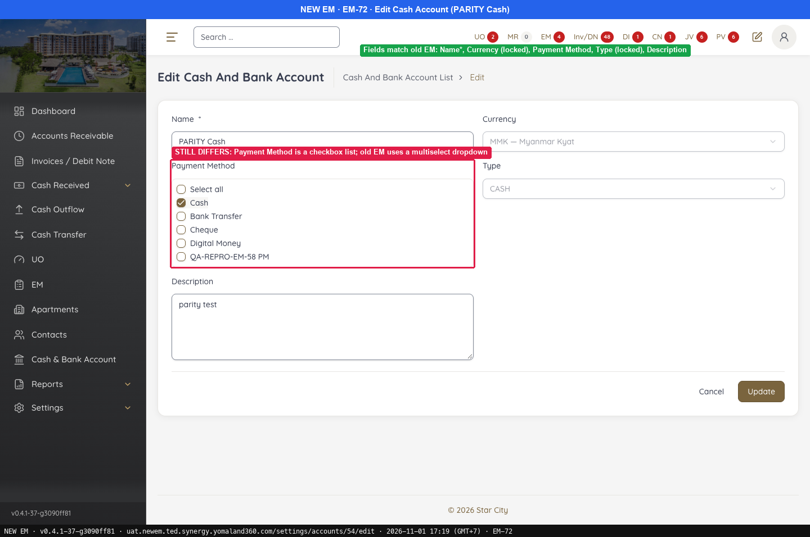 — STILL DIFFERS: Payment Method is a checkbox list; old EM uses a multiselect dropdown
- 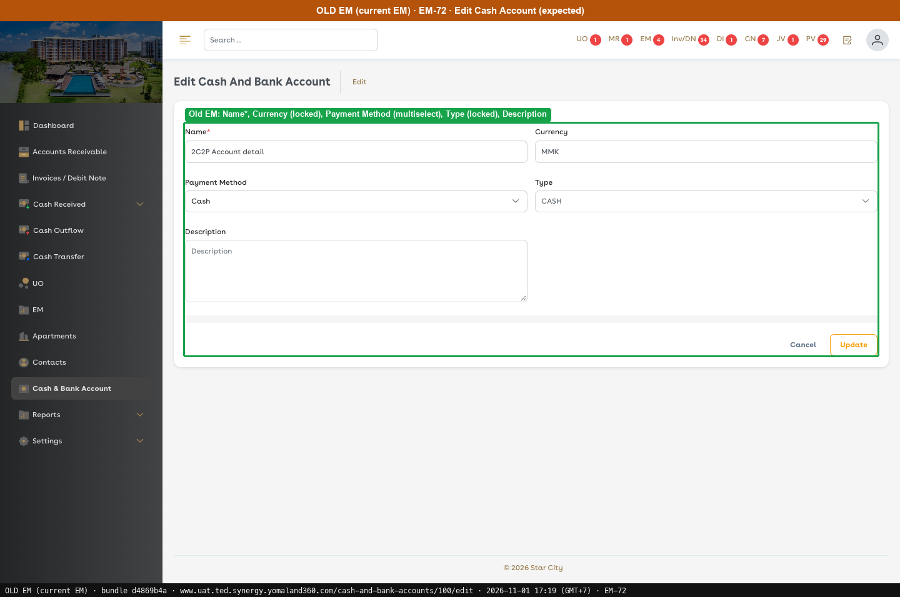 — Old EM: Name*, Currency (locked), Payment Method (multiselect), Type (locked), Description
- 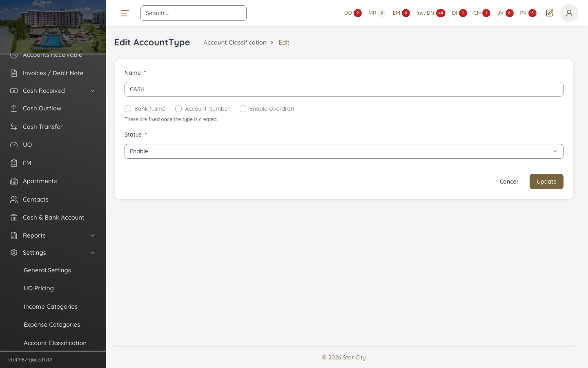 — RETEST build -87, precondition: Manage Type › CASH carries none of Bank Name, Account Number, Enable Overdraft
- 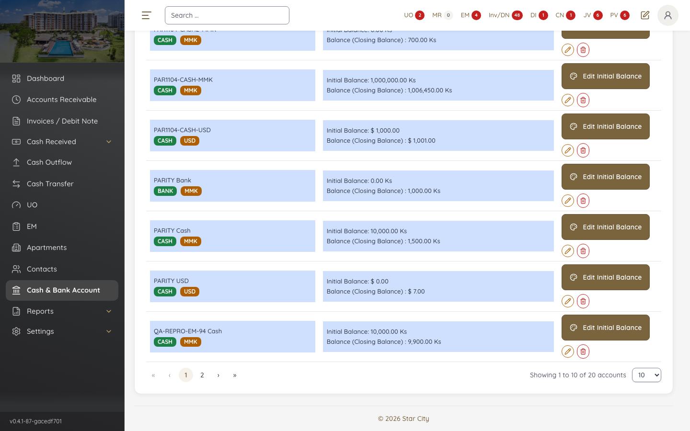 — RETEST build -87, step 1: account list with `PARITY Cash` before clicking its pencil
- 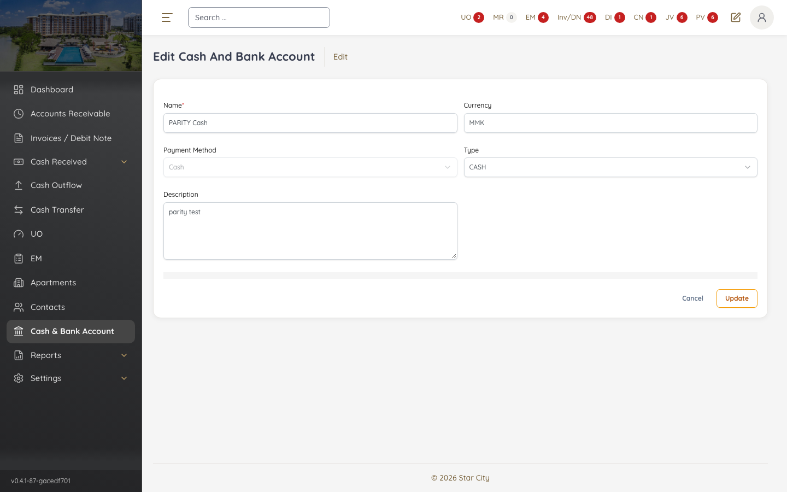 — RETEST build -87, step 2: same fields as Old EM
- 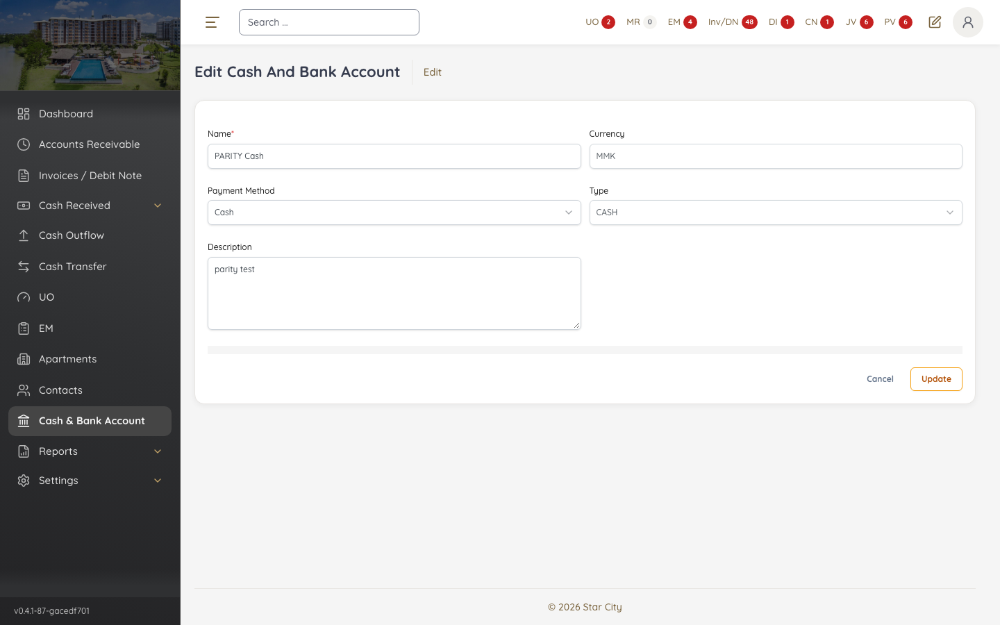 — RETEST build -87, step 3: Payment Method is a dropdown showing the selected name
- 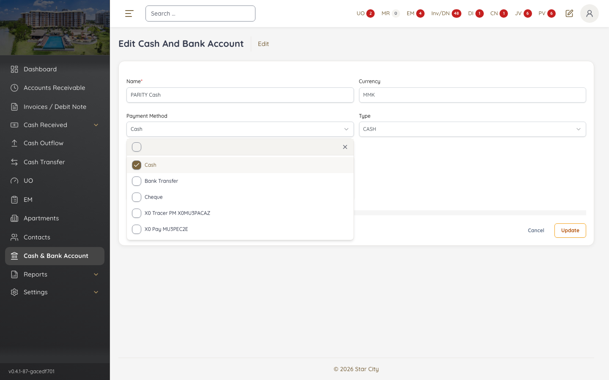 — RETEST build -87, step 3: the dropdown open, only Cash ticked
---

### EM-73 · [Cash & Bank Account > Edit > Edit Bank Account] Edit UI does not match current EM UAT

[EM-73](https://zeyalabs-team-a83df6me.atlassian.net/browse/EM-73) · Jira priority Highest · Status **Fixed** (build -87, 2026-11-09)

**Reported:** The Bank Account edit UI differed from the current EM UAT.

#### SAN-EM73-001 · Edit bank account matches Old EM fields and Payment Method control

| Priority | Suites | Automation | Status | Source |
|---|---|---|---|---|
| P1 | Sanity · Regression | Auto-UI | Active | EM-73 repro (TC-EM-73-01), 2026-11-01 |

**Preconditions:**

1. Logged in as an Admin user.
2. A bank account exists (New: 006, id 41; Old: Bank 13Nov, id 70).
3. Settings › Account Classification › Manage Type › Edit BANK: "What accounts of this type carry" has Bank Name, Account Number and Enable Overdraft ticked. These settings decide which of those three fields the account Edit page shows, so read them first.

**Steps:**

1. From the list, click the pencil on a bank account (New `/settings/accounts/<id>/edit`, Old `/cash-and-bank-accounts/<id>/edit`).
2. Compare the fields.
3. Read the Payment Method control. Do not change anything and do not click [Update].

**Expected result:**

1. The page Edit Cash And Bank Account opens.
2. Name*, Currency (locked), Payment Method, Type (locked), Select Bank Name*, Account Number*, Enable Overdraft, Description.
3. Payment Method is a multiselect dropdown showing the names of the selected payment methods.

**Automated test:** [`SAN-EM73-001` in fixed-accounts.spec.ts](../../../../tests/sanity/tickets/fixed/fixed-accounts.spec.ts) · tag `@sanity` `@EM-73` · run `APP=em npx playwright test --grep SAN-EM73-001` · first reads the BANK type settings in Manage Type and fails if they are not all ticked, then derives the expected fields from them; bank account `006` (id 41); read-only: opens the Payment Method popup and closes it with Escape, never ticks anything or clicks [Update].

**Result (build -37, 2026-11-01):**

| # | Old EM | New EM | |
|---|---|---|---|
| 1 | Edit Cash And Bank Account page | Edit Cash And Bank Account page | ✅ Same |
| 2 | Name*, Currency (locked), Payment Method, Type (locked), Select Bank Name*, Account Number*, Enable Overdraft, Description | Name*, Currency (locked), Payment Method, Type (locked), Select Bank Name*, Account Number*, Enable Overdraft, Description | ✅ Same |
| 3 | Multiselect dropdown showing the selected names | **Checkbox list**; the discontinued "Mobile Wallet (no longer offered)" is still shown, ticked | ❌ Differs |

**Conclusion:** Partly open. The ticket asks for the same Edit UI as Old EM; the field set matches, but Payment Method is still a different control.

**Retest (build -87, 2026-11-09, automated): passed** → **Fixed** (Chromium and Firefox, build `v0.4.1-87-gacedf701`; also passed on -83 the same day)

| # | Check | Old EM | New EM | |
|---|---|---|---|---|
| 0 | Manage Type › BANK carries | Bank Name, Account Number, Enable Overdraft | Bank Name, Account Number, Enable Overdraft (all ticked) | ✅ Same |
| 1 | Pencil on `006` opens the edit page | Edit Cash And Bank Account page | Edit Cash And Bank Account page (`/settings/accounts/41/edit`) | ✅ Same |
| 2 | Fields, order and required marks | Name*, Currency (locked), Payment Method, Type (locked), Select Bank Name*, Account Number*, Enable Overdraft, Description | Same | ✅ Same |
| 3 | Payment Method control | Multiselect dropdown showing the selected names | Dropdown showing "Bank Transfer, Cheque, Mobile Wallet"; it opens a checkbox list with exactly those three ticked | ✅ Same |

**Evidence:**

- 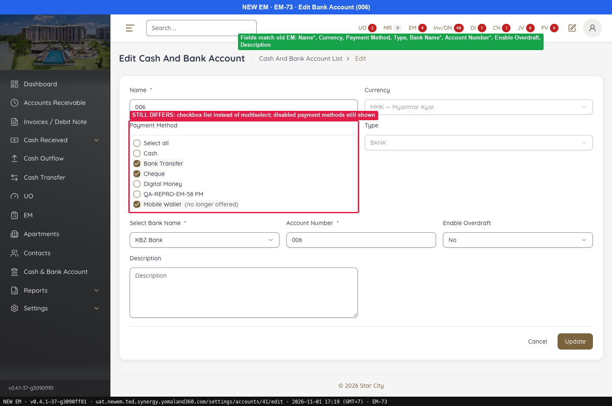 — STILL DIFFERS: checkbox list instead of multiselect; disabled payment methods still shown
- 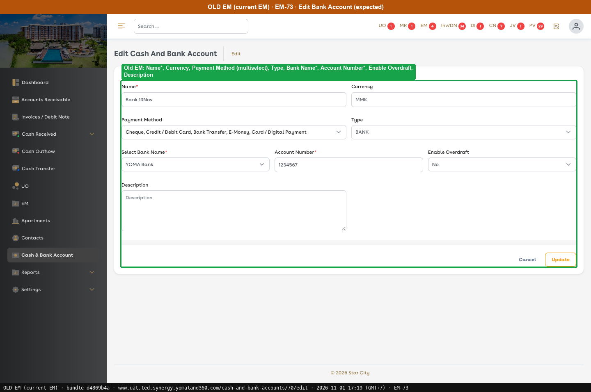 — Old EM: Name*, Currency, Payment Method (multiselect), Type, Bank Name*, Account Number*, Enable Overdraft, Description
- 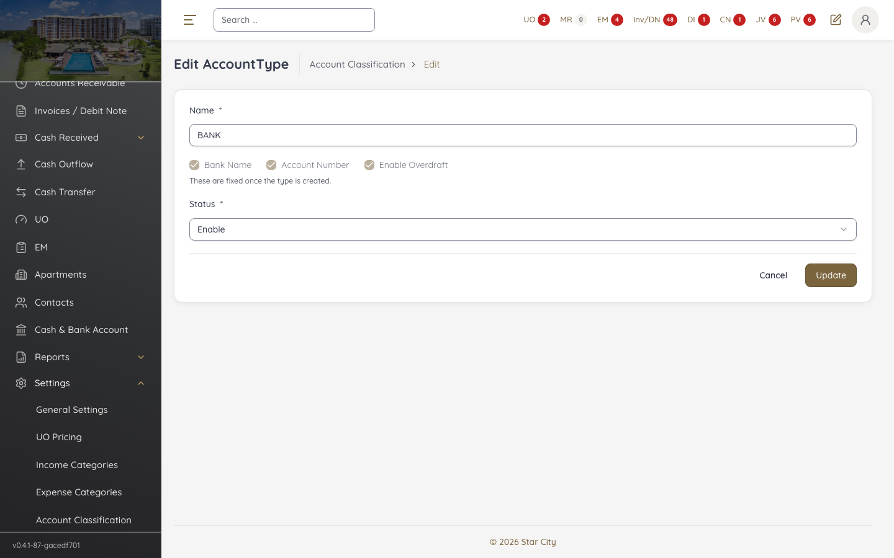 — RETEST build -87, precondition: Manage Type › BANK carries Bank Name, Account Number, Enable Overdraft
- 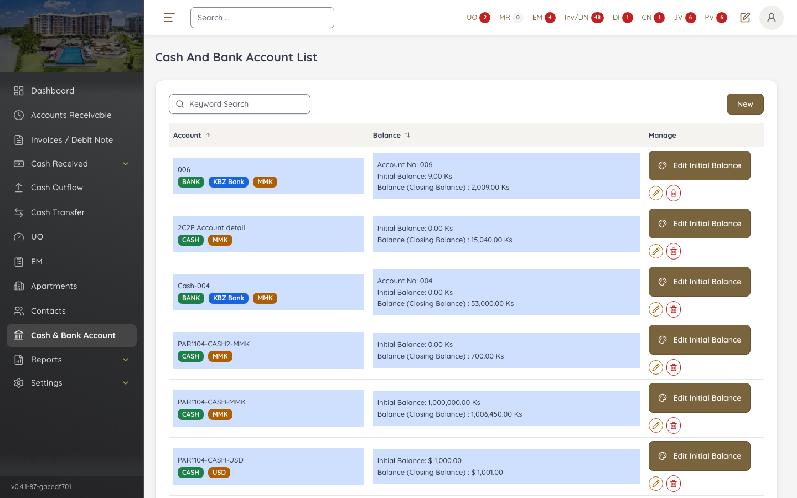 — RETEST build -87, step 1: account list with `006` before clicking its pencil
-  — RETEST build -87, step 2: same fields as Old EM
- 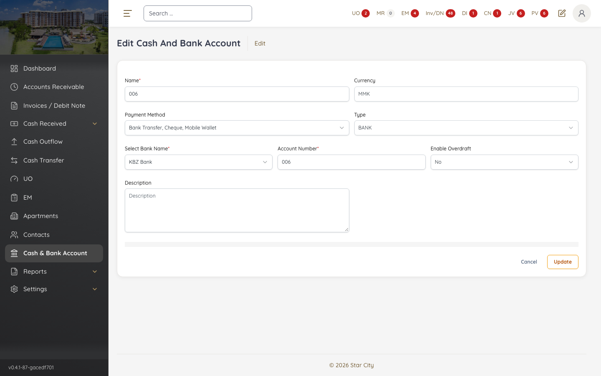 — RETEST build -87, step 3: Payment Method is a dropdown showing the selected names
- 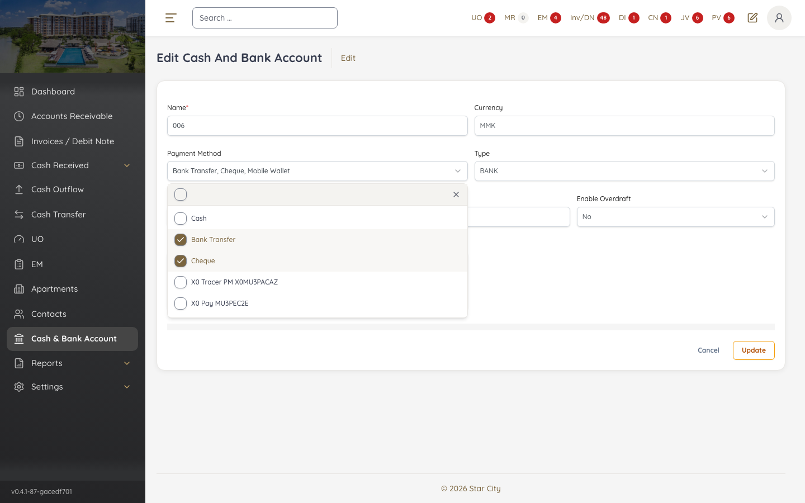 — RETEST build -87, step 3: the dropdown open, the selected methods ticked

**Jira:** retest posted on [EM-73](https://zeyalabs-team-a83df6me.atlassian.net/browse/EM-73?focusedCommentId=10364) as `VERIFIED_PASSED_v0.4.1-87-gacedf701` (comment 10364, 2026-11-09).
---
