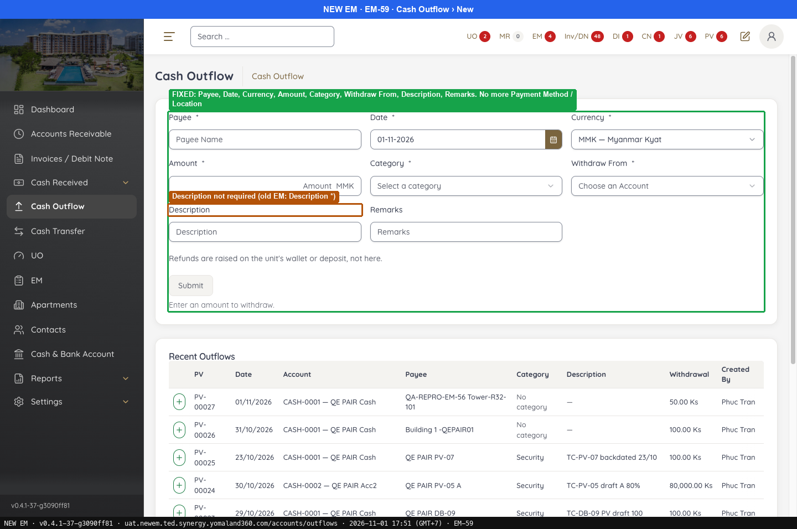
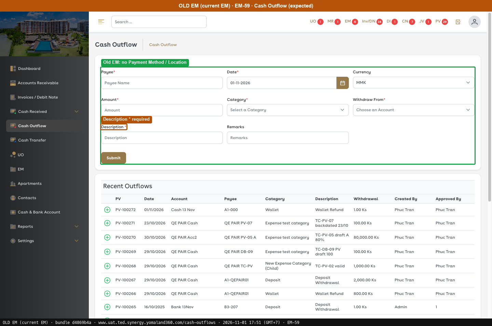

# Fixed · Cash Outflow

[← Ticket index](../README.md) · [Sanity index](../../README.md)

**Tickets:** 1 · **Fixed:** 1

These tickets are fixed on build -37. Their cases are now regression checks.

## Summary

| Ticket | Title | Jira priority | Status (build -37) | Result | Case |
|---|---|---|---|---|---|
| [EM-59](https://zeyalabs-team-a83df6me.atlassian.net/browse/EM-59) | [Cash Outflow] Extra Payment Method and Location fields not in current EM | High | Fixed | Form no longer has Payment Method / Location; fields and * match Old EM (automated, build -100) | [SAN-EM59-001](#san-em59-001--cash-outflow-form-has-no-payment-method-or-location-field) |

## Tickets

### EM-59 · [Cash Outflow] Extra Payment Method and Location fields not in current EM

[EM-59](https://zeyalabs-team-a83df6me.atlassian.net/browse/EM-59) · Jira priority High · Status **Fixed**

**Reported:** The Payment Method and Location fields do not exist in the current EM but exist on the new EM Cash Outflow form.

#### SAN-EM59-001 · Cash Outflow form has no Payment Method or Location field

| Priority | Suites | Automation | Status | Source |
|---|---|---|---|---|
| P1 | Sanity · Regression | Auto-UI | Active | EM-59 repro (TC-EM-59-01), 2026-11-01 |

**Preconditions:**

1. Logged in as Admin.
2. Pages: New EM `/accounts/outflows`, Old EM `/cash-outflows` (bundle `dd551ca9`).

**Steps:**

1. Open the new Cash Outflow form and list its fields.

**Expected result:**

1. Payee*, Date*, Currency, Amount*, Category*, Withdraw From*, **Description***, Remarks. No Payment Method and no Location.

**Automated test:** [`SAN-EM59-001` in fixed-cash-outflow.spec.ts](../../../../tests/sanity/tickets/fixed/fixed-cash-outflow.spec.ts) · tag `@sanity` `@EM-59` · run `APP=em npx playwright test --grep SAN-EM59-001` · read-only: opens the New cash outflow form, never fills or submits it.

**Result (build -37, 2026-11-01):**

| # | Old EM | New EM | |
|---|---|---|---|
| 1 | Payee*, Date*, Currency, Amount*, Category*, Withdraw From*, **Description***, Remarks | Payee*, Date*, Currency*, Amount*, Category*, Withdraw From*, Description, Remarks; **no Payment Method / Location** | ✅ Same |

**Conclusion:** Fixed. Also noted: Description is required on Old EM but not on New EM, and the New EM Recent Outflows list lacks the "Approved By" column.

**Retest (build -100, 2026-11-10, automated): passed** (Chromium, build `v0.4.1-100-g1a97b9a6`)

| # | Check | Old EM | New EM | |
|---|---|---|---|---|
| 1 | Payment Method / Location fields | None | None | ✅ Same |
| 1 | Fields, in order | Payee, Date, Currency, Amount, Category, Withdraw From, Description, Remarks | Same | ✅ Same |
| 1 | Required (*) | Payee, Date, Amount, Category, Withdraw From, Description | Same | ✅ Same |

Also noted: the side findings of build -37 are gone: Description is now required and Currency has no *, as in Old EM, and Recent Outflows has the "Approved By" column.

**Evidence:**

-  — FIXED: Payee, Date, Currency, Amount, Category, Withdraw From, Description, Remarks. No more Payment Method / Location
-  — Old EM: no Payment Method / Location
---
