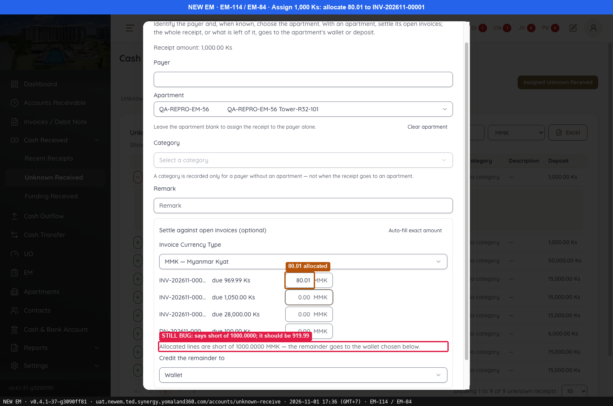
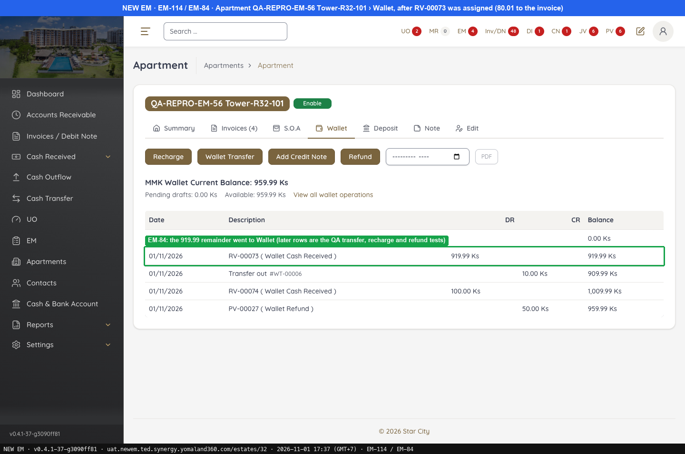
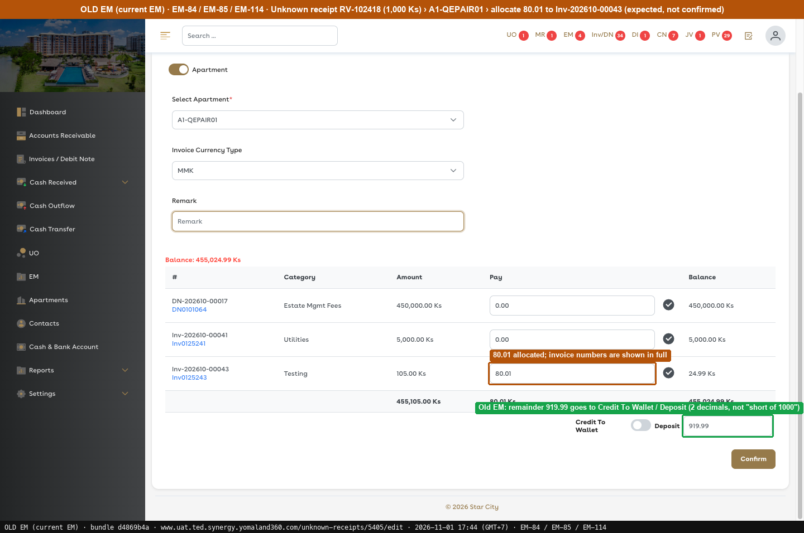

# Fixed · Cash Received

[← Ticket index](../README.md) · [Sanity index](../../README.md)

**Tickets:** 1 · **Fixed:** 1

These tickets are fixed on build -37. Their cases are now regression checks.

## Summary

| Ticket | Title | Jira priority | Status (build -37) | Result | Case |
|---|---|---|---|---|---|
| [EM-84](https://zeyalabs-team-a83df6me.atlassian.net/browse/EM-84) | [Cash Received > Unknown Receipt Allocation] Amount not credited to wallet when apartment has no open invoices | Highest | Fixed | Remainder 919.99 goes to the wallet (run with an apartment that has 1 open invoice) | [SAN-EM84-001](#-san-em84-001--part-of-an-unknown-receipt-not-allocated-to-invoices-is-credited-to-the-apartment-wallet) |

## Tickets

### EM-84 · [Cash Received > Unknown Receipt Allocation] Amount not credited to wallet when apartment has no open invoices

[EM-84](https://zeyalabs-team-a83df6me.atlassian.net/browse/EM-84) · Jira priority Highest · Status **Fixed**

**Reported:** When an Unknown Receipt is allocated to an apartment with no open invoices, the amount is not transferred to the apartment wallet.

#### ★ SAN-EM84-001 · Part of an Unknown Receipt not allocated to invoices is credited to the apartment wallet

| Priority | Suites | Automation | Status | Source |
|---|---|---|---|---|
| P1 | Sanity · Regression | Auto-UI | Active | EM-84 repro (TC-EM-84-01), 2026-11-01 |

**Preconditions:**

1. Unknown Received RV-00073 of 1,000 Ks (assigned on the first run, 15:08). Re-run popup: RV-00076 (#77), not assigned.
2. Apartment QA-REPRO-EM-56 Tower-R32-101 with wallet 0.
3. Pages: New EM `/accounts/unknown-receive` › Assign RV-00073; `/estates/32`.

**Steps:**

1. Assign RV-00073 to the apartment, allocating 80.01 to the invoice.
2. Confirm the assignment and open the apartment › Invoices.

**Expected result:**

1. The remainder goes to the wallet.
2. The wallet balance increases.

**Result (build -37, 2026-11-01):**

| # | Old EM | New EM | |
|---|---|---|---|
| 1 | Allocating 80.01 of 1,000 sends the remainder 919.99 to Credit To Wallet / Deposit (not confirmed) | Popup shows "Credit the remainder to: **Wallet**" (re-run on RV-00076: Cancel, not confirmed) | ✅ Same |
| 2 | Not confirmed, so the balance was not read | First run on RV-00073: **MMK Wallet Current Balance: 919.99 Ks**; invoice due 969.99. Re-run: wallet now 960.99 Ks after the test transfer, recharge and refund; the RV-00073 row of 919.99 is still on tab Wallet | ⛔ Old EM not run |

**Conclusion:** Fixed for the remainder going to the wallet. Limit: the ticket's exact scenario (apartment with **no** open invoices) was not run; this run used a variant with 1 open invoice. The re-run did not assign again.

**Test data created:** RV-00073 assignment: 80.01 to INV-202611-00001, 919.99 to the apartment wallet.

**Evidence:**

-  — 80.01 allocated
-  — EM-84: the 919.99 remainder went to Wallet (later rows are the QA transfer, recharge and refund tests)
-  — 80.01 allocated; invoice numbers are shown in full
---
