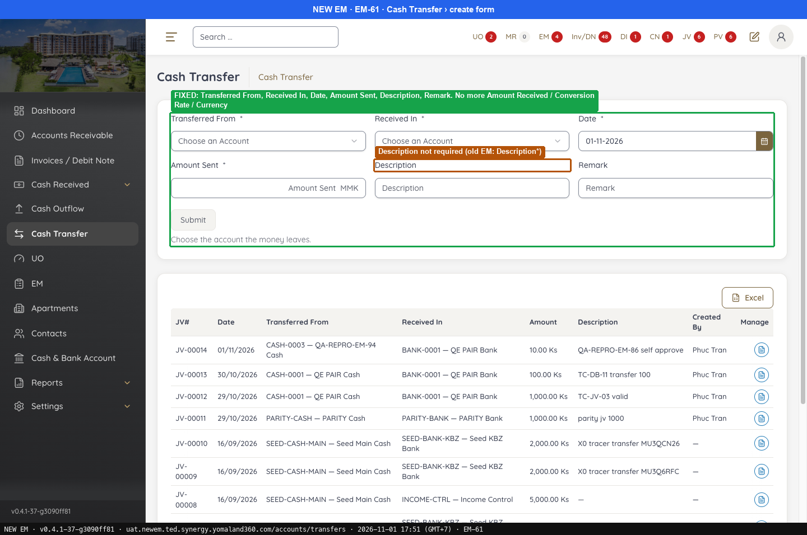
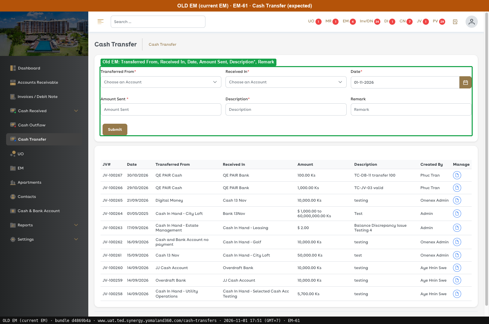
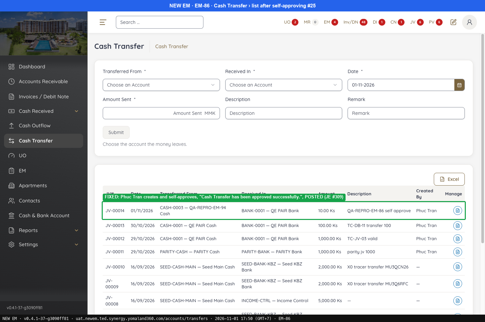
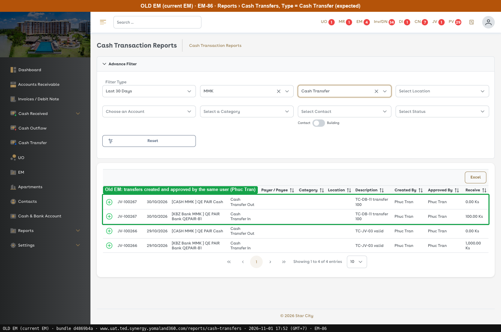
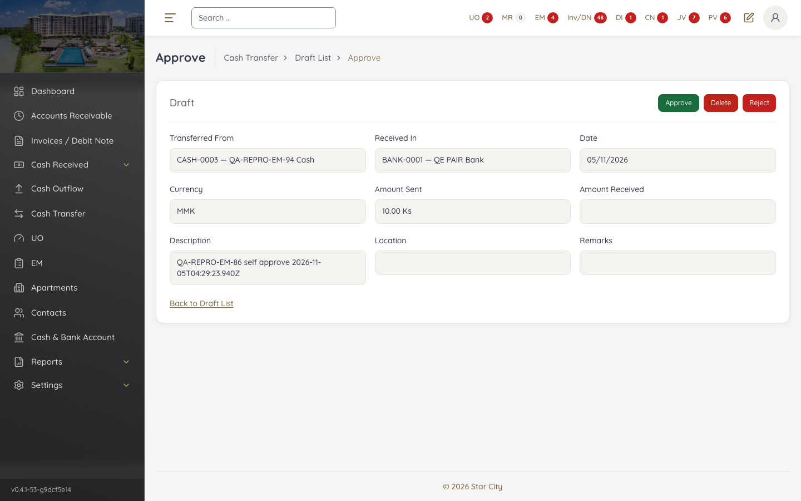
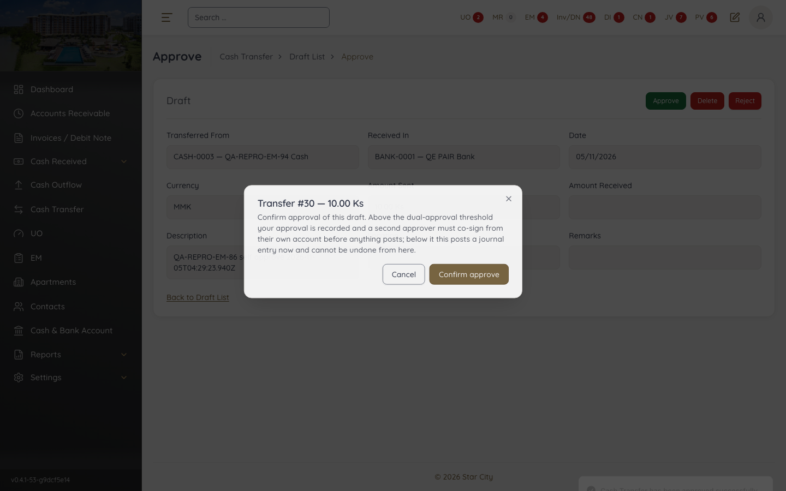
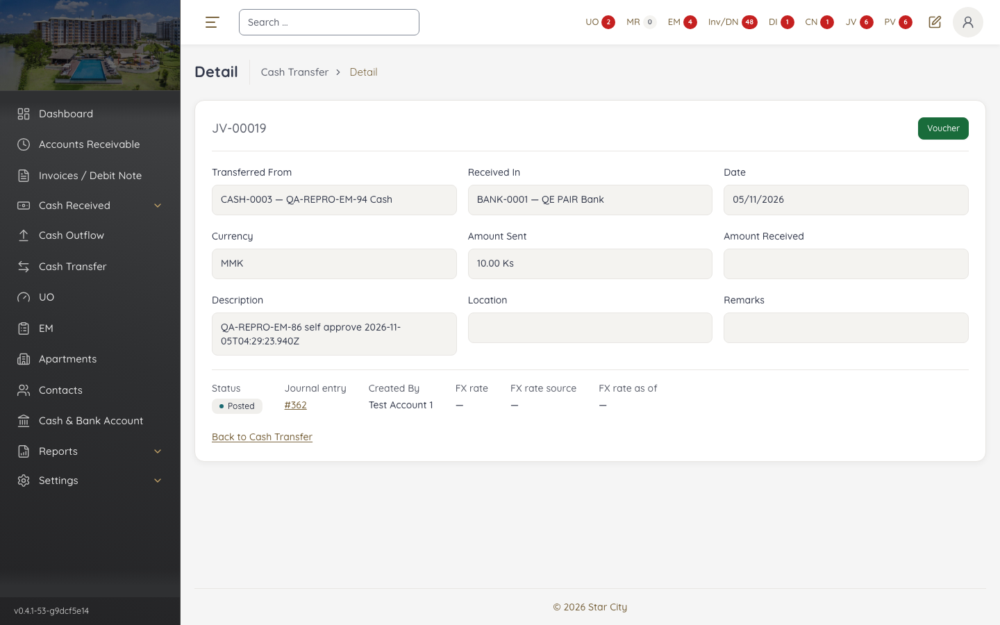
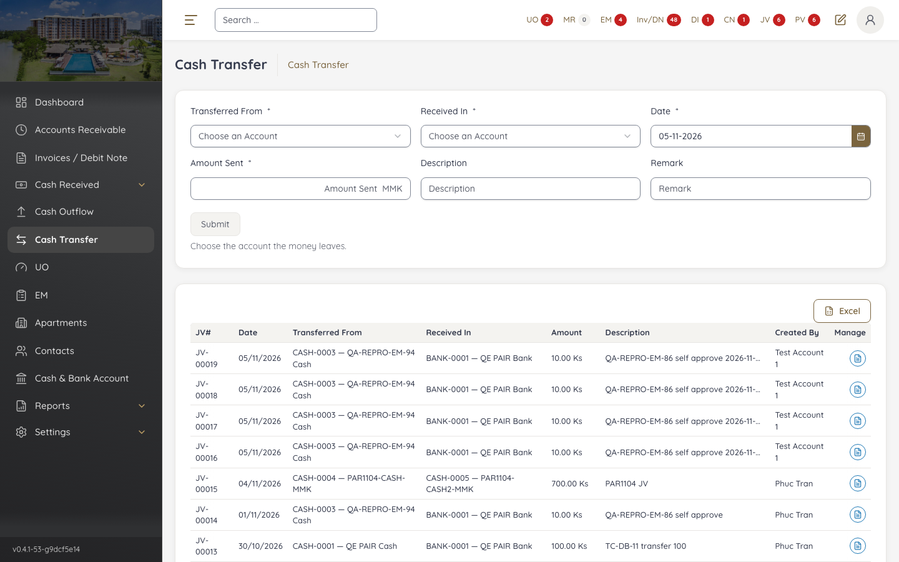

# Fixed · Cash Transfer

[← Ticket index](../README.md) · [Sanity index](../../README.md)

**Tickets:** 2 · **Fixed:** 2

These tickets are fixed on build -37. Their cases are now regression checks.

## Summary

| Ticket | Title | Jira priority | Status (build -37) | Result | Case |
|---|---|---|---|---|---|
| [EM-61](https://zeyalabs-team-a83df6me.atlassian.net/browse/EM-61) | [Cash Transfer] Extra fields (Amount Received MMK, Conversion Rate, Currency, Location) not in current EM | Highest | Fixed | The 4 extra fields are gone | [SAN-EM61-001](#san-em61-001--cash-transfer-form-has-no-amount-received-conversion-rate-currency-or-location-field) |
| [EM-86](https://zeyalabs-team-a83df6me.atlassian.net/browse/EM-86) | [Cash Transfer] User with self-approval permission cannot approve own transfer | High | Fixed | Self-approved transfer #25 is POSTED (JV-00014) | [SAN-EM86-001](#-san-em86-001--user-with-self-approve-can-approve-their-own-cash-transfer) |

## Tickets

### EM-61 · [Cash Transfer] Extra fields (Amount Received MMK, Conversion Rate, Currency, Location) not in current EM

[EM-61](https://zeyalabs-team-a83df6me.atlassian.net/browse/EM-61) · Jira priority Highest · Status **Fixed**

**Reported:** Amount Received (MMK), Conversion Rate, Currency and Location do not exist in the current EM but exist on the new EM Cash Transfer form.

#### SAN-EM61-001 · Cash Transfer form has no Amount Received, Conversion Rate, Currency or Location field

| Priority | Suites | Automation | Status | Source |
|---|---|---|---|---|
| P1 | Sanity · Regression | Auto-UI | Active | EM-61 repro (TC-EM-61-01), 2026-11-01 |

**Preconditions:**

1. Logged in as Admin.
2. Pages: New EM `/accounts/transfers`, Old EM `/cash-transfers` (bundle `dd551ca9`).

**Steps:**

1. Open the new Cash Transfer form and list its fields.

**Expected result:**

1. Transferred From*, Received In*, Date*, Amount Sent*, **Description***, Remark, without the 4 extra fields.

**Result (build -37, 2026-11-01):**

| # | Old EM | New EM | |
|---|---|---|---|
| 1 | Transferred From*, Received In*, Date*, Amount Sent*, **Description***, Remark | Transferred From*, Received In*, Date*, Amount Sent*, Description, Remark; the 4 extra fields are **gone** | ✅ Same |

**Conclusion:** Fixed. Also noted: Description is not required on New EM as it is on Old EM.

**Evidence:**

-  — FIXED: Transferred From, Received In, Date, Amount Sent, Description, Remark. No more Amount Received / Conversion Rate / Currency
-  — Old EM: Transferred From, Received In, Date, Amount Sent, Description*, Remark
---

### EM-86 · [Cash Transfer] User with self-approval permission cannot approve own transfer

[EM-86](https://zeyalabs-team-a83df6me.atlassian.net/browse/EM-86) · Jira priority High · Status **Fixed**

**Reported:** A Cash Transfer cannot be self-approved by a user who has self-approval permission.

#### ★ SAN-EM86-001 · User with Self Approve can approve their own Cash Transfer

| Priority | Suites | Automation | Status | Source |
|---|---|---|---|---|
| P1 | Sanity · Regression | Auto-UI+API | Active | EM-86 repro (TC-EM-86-01), 2026-11-01 |

**Preconditions:**

1. Logged in as a user with Self Approve.
2. CASH-0003 has a balance of 10,000.
3. Page: New EM `/accounts/transfers/25/approve`.

**Test data:**

1. Transfer CASH-0003 → BANK-0001, 10 Ks, description `QA-REPRO-EM-86 self approve`.

**Steps:**

1. Create the transfer from the test data.
2. Open the draft (header badge **JV** › Draft cash transfers › **Manage** icon of the row), click Approve › Confirm approve with the same user.

**Expected result:**

1. A draft is created.
2. The transfer is approved.

**Result (build -37, 2026-11-01):**

| # | Old EM | New EM | |
|---|---|---|---|
| 1 | Reports › Cash Transfers: JV-100266/100267 created and approved by the same user | Draft **#25** | ✅ Same |
| 2 | As above | **"Cash Transfer has been approved successfully."**; API `status POSTED`, JE #309; list shows **JV-00014** | ✅ Same |

**Conclusion:** Fixed. A user with Self Approve can approve their own transfer.

**Retest (build -53, 2026-11-05, automated):** ✅ Passed. Admin (Test Account 1) created draft #30 and self-approved it: "Cash Transfer has been approved successfully.", POSTED, JE #362, **JV-00019**. Posted on Jira as `VERIFIED_FIXED_v0.4.1-53-g9dcf5e14`.

**Test data created:** JV-00014 (10 Ks); 2026-11-05 test runs: JV-00016 … JV-00019 (10 Ks each).

**Automated:** [fixed-cash-transfer.spec.ts](../../../../tests/sanity/tickets/fixed/fixed-cash-transfer.spec.ts), tag `@EM-86`. Runs as Admin (`self-approve` + `approve-cash-transfer`). Each run posts a new 10 Ks JV from CASH-0003 to BANK-0001 that cannot be deleted, with description `QA-REPRO-EM-86 self approve <timestamp>`.

**Evidence:**

-  — FIXED: the same user creates and self-approves, "Cash Transfer has been approved successfully.", POSTED (JE #309)
-  — Old EM: transfers created and approved by the same user
-  — Retest -53: draft #30 opened by its creator, Approve enabled
-  — Retest -53: "Cash Transfer has been approved successfully."
-  — Retest -53: JV-00019 Posted, JE #362, Created By Test Account 1
-  — Retest -53: JV-00019 in the Cash Transfer register
---
