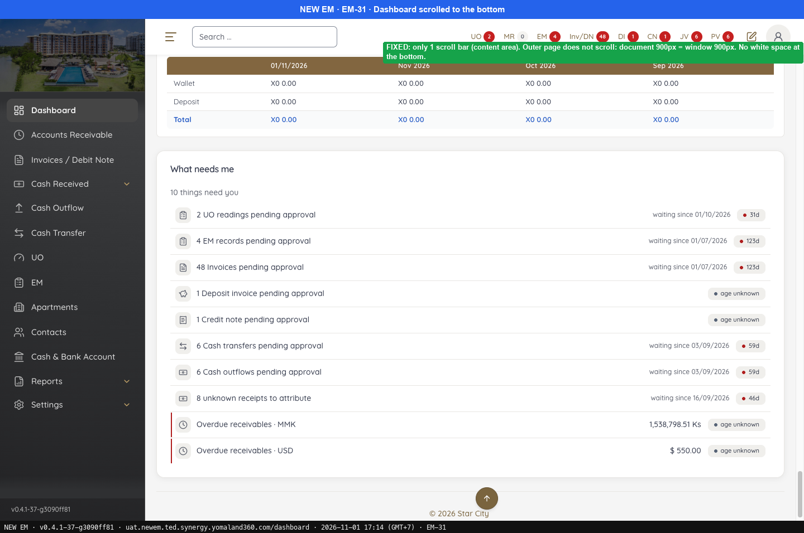
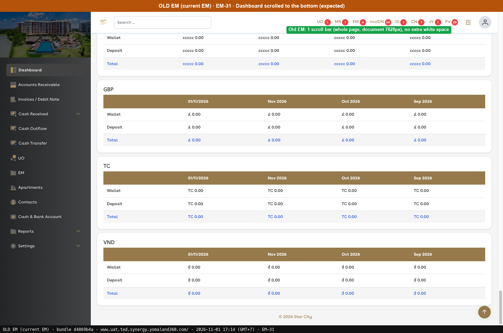

# Fixed · Dashboard

[← Ticket index](../README.md) · [Sanity index](../../README.md)

**Tickets:** 1 · **Fixed:** 1

These tickets are fixed on build -37. Their cases are now regression checks.

## Summary

| Ticket | Title | Jira priority | Status (build -37) | Result | Case |
|---|---|---|---|---|---|
| [EM-31](https://zeyalabs-team-a83df6me.atlassian.net/browse/EM-31) | [Dashboard] Page shows two scroll bars and large white space when scrolling | Medium | Fixed | One scroll bar, no white space at the bottom (automated, build -74) | [SAN-EM31-001](#san-em31-001--dashboard-has-one-scroll-bar-and-no-white-space-when-scrolled-to-the-bottom) |

## Tickets

### EM-31 · [Dashboard] Page shows two scroll bars and large white space when scrolling

[EM-31](https://zeyalabs-team-a83df6me.atlassian.net/browse/EM-31) · Jira priority Medium · Status **Fixed**

**Reported:** The Dashboard page has two scroll bars; scrolling with the outer one extends the page with a large white area.

#### SAN-EM31-001 · Dashboard has one scroll bar and no white space when scrolled to the bottom

| Priority | Suites | Automation | Status | Source |
|---|---|---|---|---|
| P2 | Sanity · Regression | Auto-UI | Active | EM-31 repro (TC-EM-31-01), 2026-11-01 |

**Preconditions:**

1. Logged in as Admin.
2. The dashboard has enough data to be longer than the screen.
3. Pages: New EM `/dashboard`, Old EM `/` (bundle `dd551ca9`).

**Steps:**

1. Open Dashboard.
2. Count the scrollable areas (elements with `overflow-y: auto/scroll` whose content is longer than the frame).
3. Scroll to the very bottom with the outer scroll bar or mouse wheel.

**Expected result:**

1. The page loads the AR, Cash & Bank and Wallet/Deposit cards.
2. There is 1 scrollable area.
3. Content ends at the footer "© 2026 Star City" with no white area.

**Automated test:** [`SAN-EM31-001` in fixed-dashboard.spec.ts](../../../../tests/sanity/tickets/fixed/fixed-dashboard.spec.ts) · tag `@sanity` `@EM-31` · run `APP=em npx playwright test --grep SAN-EM31-001` · waits for every card to load, counts scrollable areas and scrolls the content frame to the bottom; read-only.

**Result (build -37, 2026-11-01):**

| # | Old EM | New EM | |
|---|---|---|---|
| 1 | All cards load | All cards load | ✅ Same |
| 2 | 1 scrollable area (the whole page) | 1 scrollable area (content frame 1203/7792px); the outer page does not scroll (document 1267px = window 1267px) | ✅ Same |
| 3 | Ends at the footer, no white area | Ends at "What needs me" + footer, no white area | ✅ Same |

**Conclusion:** Fixed. New EM scrolls the content frame and Old EM the whole page, but the behaviour matches: one scroll bar and no white area.

**Retest (build -74, 2026-11-06, automated): passed** (Chromium and Firefox, build `v0.4.1-74-g77cbcadf`)

| # | Check | Old EM | New EM | |
|---|---|---|---|---|
| 1 | Cards load | All cards load | AR, Cash & Bank and Wallet & Deposits load | ✅ Same |
| 2 | Scrollable areas | 1 (the whole page) | 1 (`#main-content`); the window itself does not scroll | ✅ Same |
| 3 | Bottom of the page | Ends at the footer | Ends at "© 2026 Star City", no white area below | ✅ Same |

**Evidence:**

-  — Dashboard scrolled to the bottom
-  — Dashboard scrolled to the bottom (expected)
---
