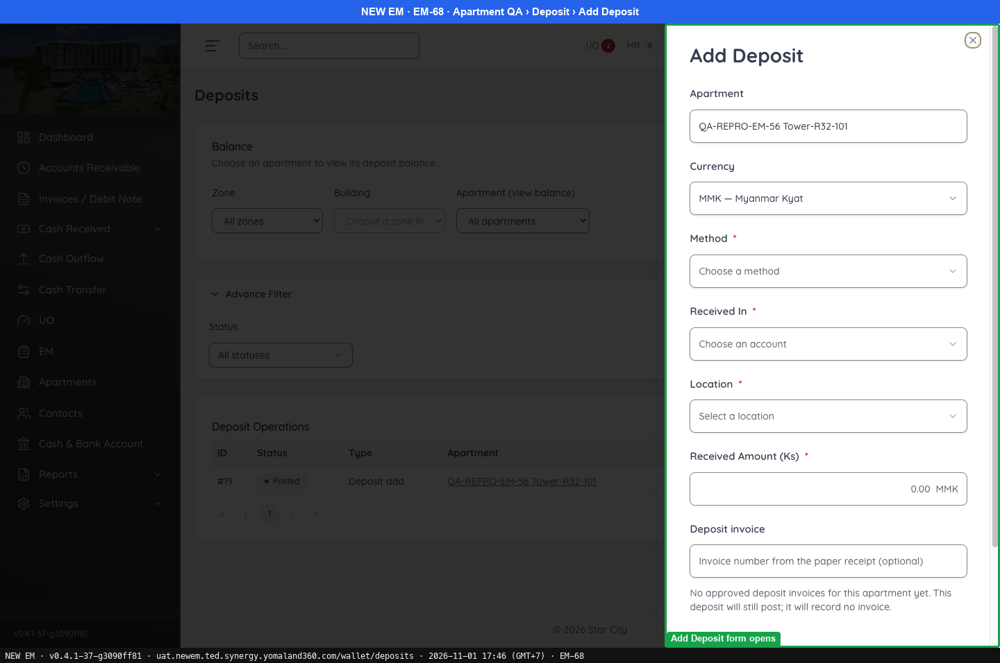
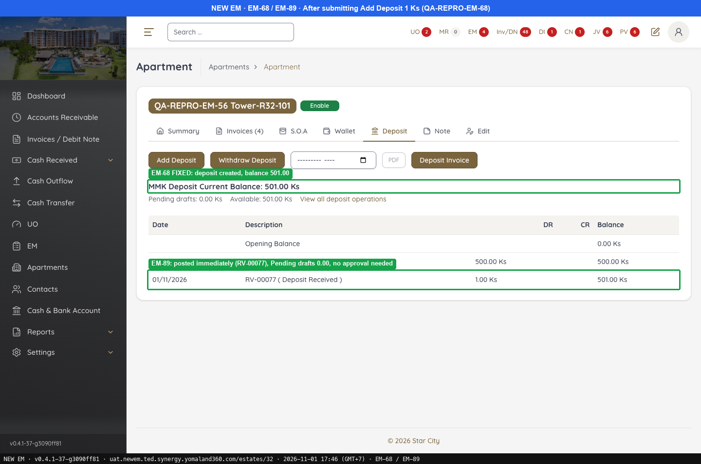
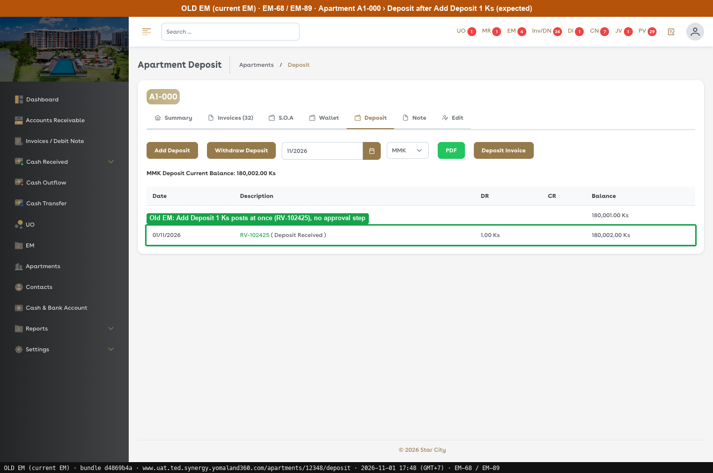

# Fixed · Deposit

[← Ticket index](../README.md) · [Sanity index](../../README.md)

**Tickets:** 1 · **Fixed:** 1

These tickets are fixed on build -37. Their cases are now regression checks.

## Summary

| Ticket | Title | Jira priority | Status (build -37) | Result | Case |
|---|---|---|---|---|---|
| [EM-68](https://zeyalabs-team-a83df6me.atlassian.net/browse/EM-68) | [Apartments > Deposit > Add Deposit] Error on Post; deposit is not created | Highest | Fixed | Add Deposit is created (RV-00075 500 Ks, RV-00077 1 Ks); balance 501.00. | [SAN-EM68-001](#-san-em68-001--add-deposit-with-all-required-fields-creates-the-deposit-and-updates-the-balance) |

## Tickets

### EM-68 · [Apartments > Deposit > Add Deposit] Error on Post; deposit is not created

[EM-68](https://zeyalabs-team-a83df6me.atlassian.net/browse/EM-68) · Jira priority Highest · Status **Fixed**

**Reported:** Add Deposit could not be created: after filling in all required fields and clicking Post, an error was displayed and no deposit was created.

#### ★ SAN-EM68-001 · Add Deposit with all required fields creates the deposit and updates the balance

| Priority | Suites | Automation | Status | Source |
|---|---|---|---|---|
| P1 | Sanity · Regression | Auto-UI | Active | EM-68 repro (TC-EM-68-01), 2026-11-01 |

**Preconditions:**

1. Logged in as an Admin user.
2. Apartment `QA-REPRO-EM-56 Tower-R32-101` (id 32) exists.

**Test data:**

1. Method Cash, Received In PARITY Cash, Location Main Office, Received Amount 500, Remark `QA-REPRO-EM-68`.
2. Re-run: Received Amount 1, same Remark.

**Steps:**

1. Open the apartment, tab Deposit, click [Add Deposit] (`/wallet/deposits?estate_id=32&type=ADD&new=1`).
2. Enter the test data and click [Submit].

**Expected result:**

1. The Add Deposit form opens.
2. The deposit is created and the balance is updated.

**Result (build -37, 2026-11-01):**

| # | Old EM | New EM | |
|---|---|---|---|
| 1 | Not re-run; ticket expects the form | Panel Add Deposit: Apartment, Currency, Method*, Received In*, Location*, Received Amount*, Deposit invoice, Remark | ✅ Same |
| 2 | Add Deposit 1 Ks posts at once (RV-102425), balance 180,002.00 Ks | Back on tab Deposit (`/estates/32?tab=deposit`). First run: 500 Ks, "MMK Deposit Current Balance: 500.00 Ks", row RV-00075 (Deposit Received). Re-run: 1 Ks, **RV-00077**, balance 501.00 | ✅ Same |

**Conclusion:** Fixed. The deposit is created. Old EM ran the post step only (RV-102425); the form step is taken from the ticket. Also noted: a Jira comment on build -31 reports that the TC_Deposit_001 check area (No. 2, Cash Received - Recent Receipt) did not work and that the UI and input fields differ; this repro does not state a result for either.

**Test data created:** Deposits RV-00075 (500 Ks) and RV-00077 (1 Ks).

**Evidence:**

-  — Add Deposit form opens
-  — EM-68 FIXED: deposit created, balance 501.00
-  — Old EM: Add Deposit 1 Ks posts at once (RV-102425), no approval step
---
