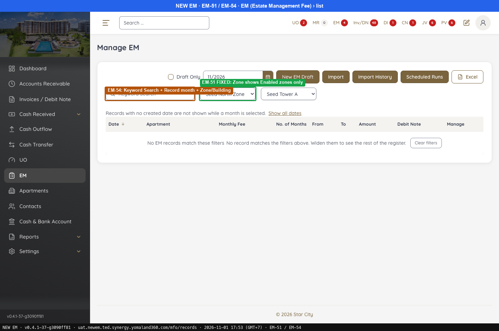
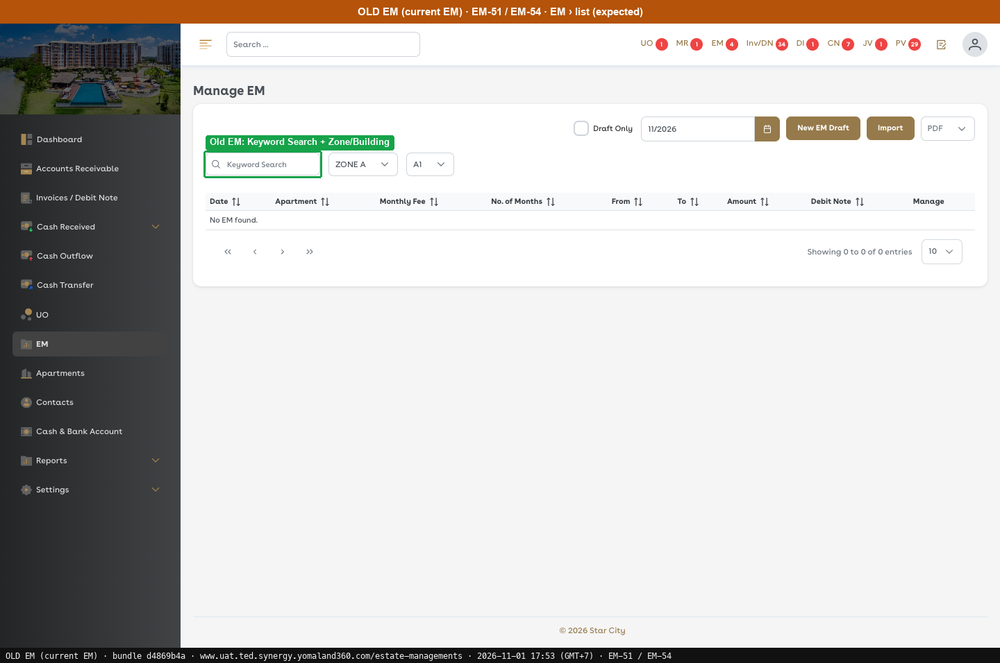
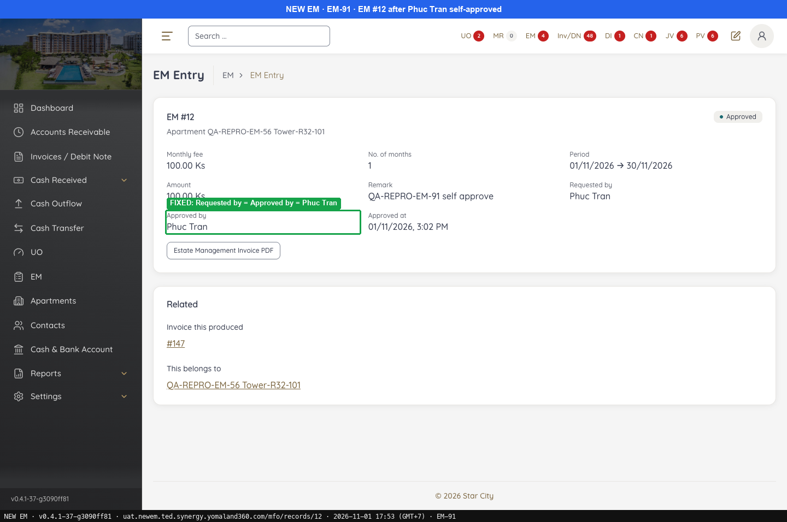
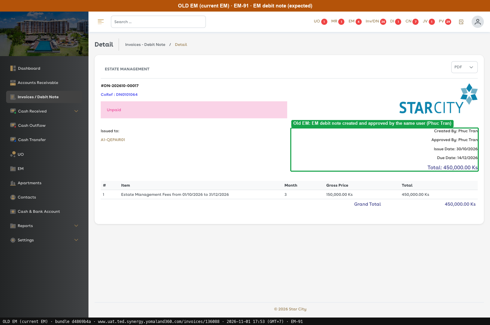

# Fixed · Estate Management fee

[← Ticket index](../README.md) · [Sanity index](../../README.md)

**Tickets:** 3 · **Fixed:** 3

These tickets are fixed on build -37. Their cases are now regression checks.

## Summary

| Ticket | Title | Jira priority | Status (build -37) | Result | Case |
|---|---|---|---|---|---|
| [EM-51](https://zeyalabs-team-a83df6me.atlassian.net/browse/EM-51) | [EM > Zone filter] Disabled zones are displayed | Medium | Fixed | EM Zone filter lists only Enable zones | [SAN-EM51-001](#san-em51-001--em-zone-filter-does-not-list-disable-zones) |
| [EM-54](https://zeyalabs-team-a83df6me.atlassian.net/browse/EM-54) | [EM > Search] Search behaviour and UI differ from current EM | Medium | Fixed | Filter bar and columns match; the extra buttons differ; keyword search not tried (no data for 11/2026) | [SAN-EM54-001](#san-em54-001--em-page-search-and-list-layout-match-old-em) |
| [EM-91](https://zeyalabs-team-a83df6me.atlassian.net/browse/EM-91) | [MFO] Self-approve does not work for Estate Management Fee (MFO) | Highest | Fixed | Self-approving EM #12 produces invoice #147 | [SAN-EM91-001](#-san-em91-001--same-user-can-approve-an-em-draft-and-the-document-is-generated) |

## Tickets

### EM-51 · [EM > Zone filter] Disabled zones are displayed

[EM-51](https://zeyalabs-team-a83df6me.atlassian.net/browse/EM-51) · Jira priority Medium · Status **Fixed**

**Reported:** Disabled zones are displayed in the Zone filter list of EM.

#### SAN-EM51-001 · EM Zone filter does not list Disable zones

| Priority | Suites | Automation | Status | Source |
|---|---|---|---|---|
| P2 | Sanity · Regression | Auto-UI | Active | EM-51 repro (TC-EM-51-01), 2026-11-01 |

**Preconditions:**

1. Logged in as Admin; a Disable zone exists.
2. Pages: New EM `/mfo/records`. Old EM `/estate-managements` (bundle `dd551ca9`).

**Steps:**

1. EM › open Zone.

**Expected result:**

1. Only Enable zones are listed.

**Result (build -37, 2026-11-01):**

| # | Old EM | New EM | |
|---|---|---|---|
| 1 | Only Enable zones | Seed North Zone, Zone 1, Zone-A, Zone B, Commercial Units; **no Disable zone** | ✅ Same |

**Conclusion:** Fixed.

**Evidence:**

-  — EM-51 FIXED: Zone shows Enabled zones only
-  — Old EM: Keyword Search + Zone/Building
---

### EM-54 · [EM > Search] Search behaviour and UI differ from current EM

[EM-54](https://zeyalabs-team-a83df6me.atlassian.net/browse/EM-54) · Jira priority Medium · Status **Fixed**

**Reported:** Search functionality and UI behaviour in EM are inconsistent with the current EM.

#### SAN-EM54-001 · EM page search and list layout match Old EM

| Priority | Suites | Automation | Status | Source |
|---|---|---|---|---|
| P2 | Sanity · Regression | Auto-UI | Active | EM-54 repro (TC-EM-54-01), 2026-11-01 |

**Preconditions:**

1. Logged in as Admin.
2. Pages: New EM `/mfo/records`. Old EM `/estate-managements` (bundle `dd551ca9`).

**Steps:**

1. Read the filter bar.
2. Read the list columns.
3. Read the buttons.
4. Type a keyword and search.

**Expected result:**

1. Keyword Search, Zone, Building, Draft Only, month (11/2026).
2. Date, Apartment, Monthly Fee, No. of Months, From, To, Amount, Debit Note, Manage.
3. New EM Draft, Import, PDF.

**Result (build -37, 2026-11-01):**

| # | Old EM | New EM | |
|---|---|---|---|
| 1 | Keyword Search, Zone, Building, Draft Only, month (11/2026) | Keyword Search, Zone, Building, Draft Only, Record month (11/2026) | ✅ Same |
| 2 | Date, Apartment, Monthly Fee, No. of Months, From, To, Amount, Debit Note, Manage | Same | ✅ Same |
| 3 | New EM Draft, Import, PDF | New EM Draft, Import, **Import History, Scheduled Runs, Excel** (no PDF) | ❌ Differs |
| 4 | Not run | Not run (11/2026 has no data on either side) | ⛔ Not run |

**Conclusion:** Fixed (layout and filters match). Also noted: the extra buttons differ.

**Evidence:**

-  — EM-51 FIXED: Zone shows Enabled zones only
-  — Old EM: Keyword Search + Zone/Building
---

### EM-91 · [MFO] Self-approve does not work for Estate Management Fee (MFO)

[EM-91](https://zeyalabs-team-a83df6me.atlassian.net/browse/EM-91) · Jira priority Highest · Status **Fixed**

**Reported:** Estate Management Fee (MFO) cannot be approved: self-approve does not work although it is allowed, so another admin user is needed.

#### ★ SAN-EM91-001 · Same user can approve an EM draft and the document is generated

| Priority | Suites | Automation | Status | Source |
|---|---|---|---|---|
| P1 | Sanity · Regression | Auto-UI | Active | EM-91 repro (TC-EM-91-01), 2026-11-01 |

**Preconditions:**

1. Logged in with a user allowed to self-approve (ticket: Admin/Staff with INV/DN approval permission).
2. Pages: New EM `/mfo/records/12`. Old EM not re-run; expected taken from the ticket.

**Test data:**

1. QA-REPRO-EM-56 Tower-R32-101, 100 Ks × 1, From 01-11-2026 (To auto-fills 30-11-2026), Remark `QA-REPRO-EM-91 self approve`.

**Steps:**

1. EM › New: enter the test data and click [Submit].
2. Click [Approve] › Confirm approve, with the same user.

**Expected result:**

1. A draft is created.
2. The draft is approved and a debit note is generated.

**Result (build -37, 2026-11-01):**

| # | Old EM | New EM | |
|---|---|---|---|
| 1 | Not re-run | **EM #12** Draft | ✅ Same |
| 2 | Screenshot: EM debit note DN-202610-00017 created and approved by the same user | **Approved**, approved by the same user, "Invoice this produced **#147**" | ✅ Same |

**Conclusion:** Fixed.

**Test data created:** EM #12, invoice #147 (100 Ks).

**Evidence:**

-  — FIXED: Requested by = Approved by (same user)
-  — Old EM: EM debit note created and approved by the same user
---
