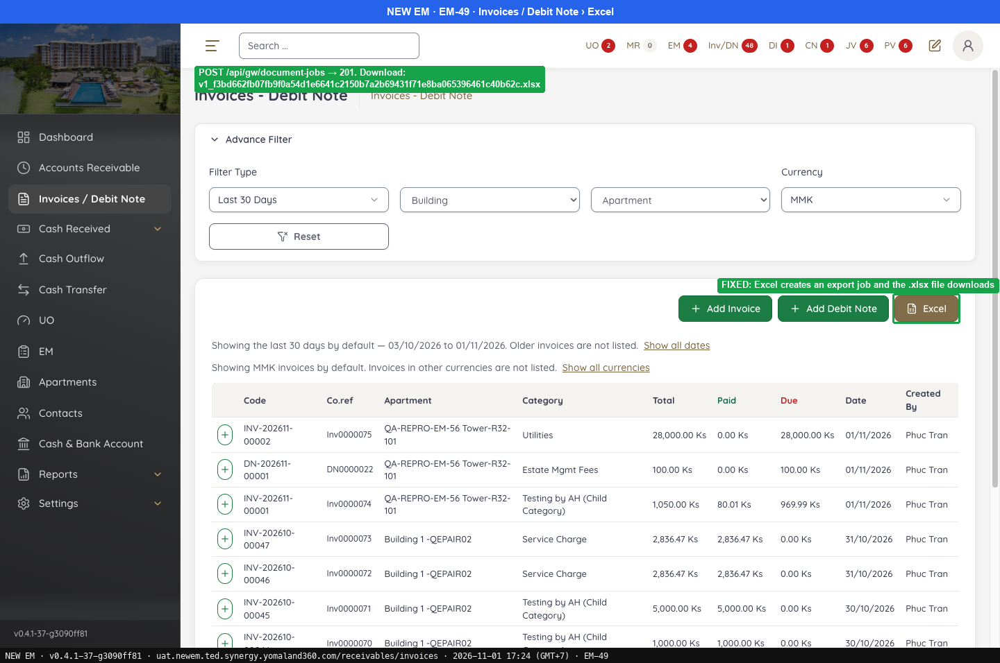
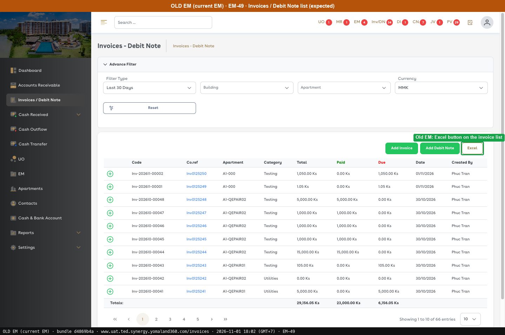
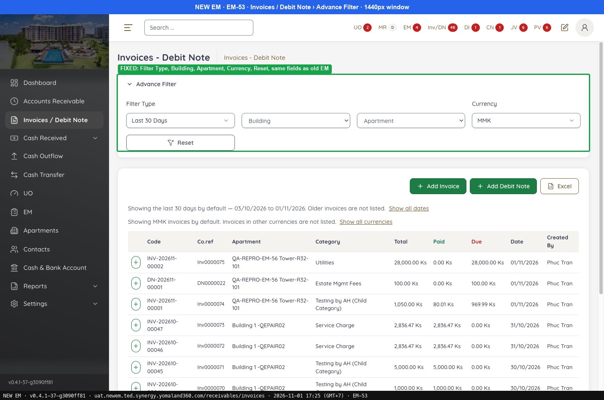
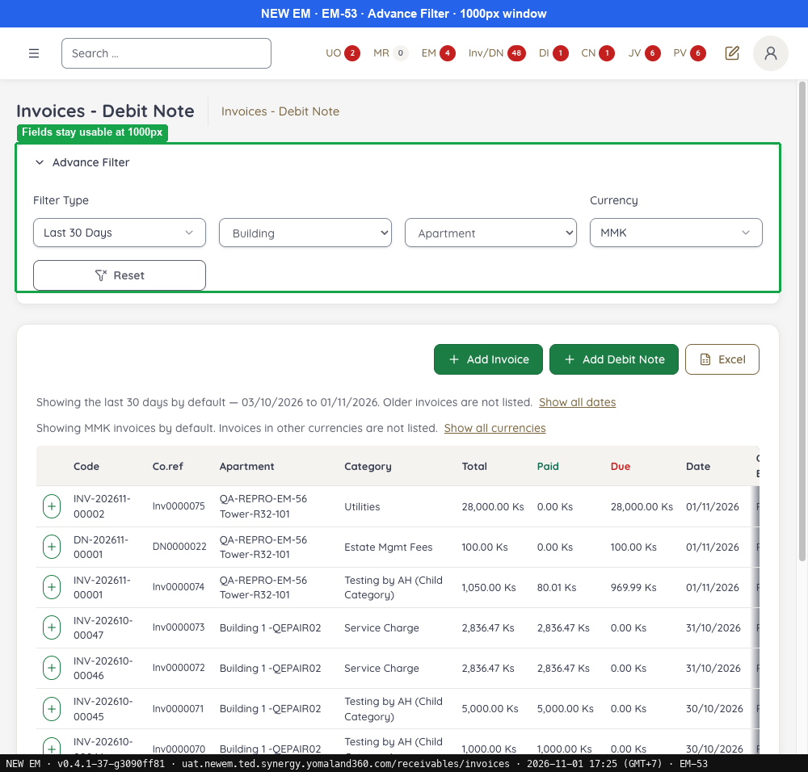
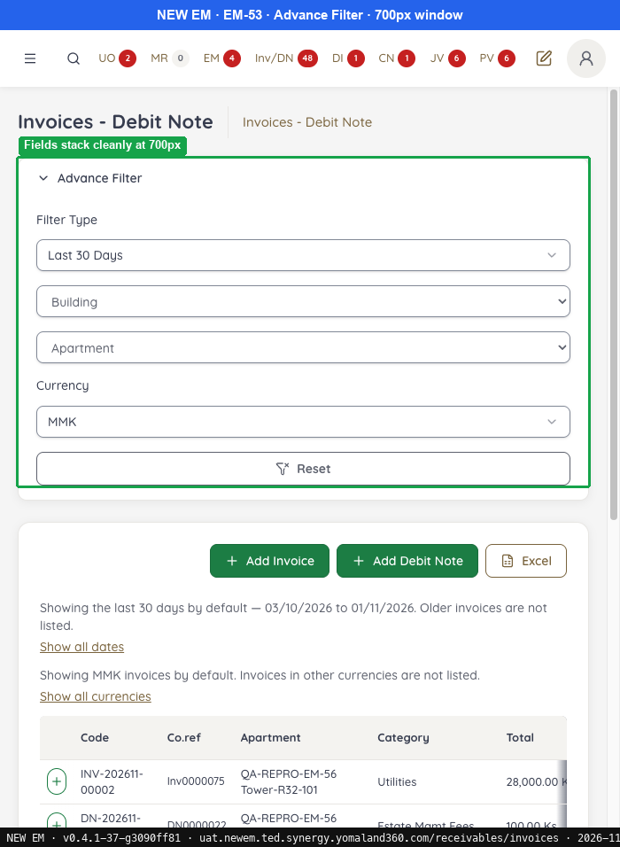
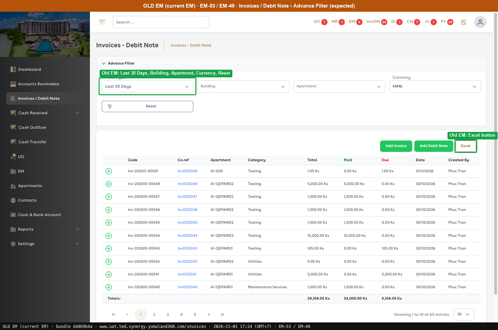

# Fixed · Invoices / Debit Note

[← Ticket index](../README.md) · [Sanity index](../../README.md)

**Tickets:** 2 · **Fixed:** 2

These tickets are fixed on build -37. Their cases are now regression checks.

## Summary

| Ticket | Title | Jira priority | Status (build -37) | Result | Case |
|---|---|---|---|---|---|
| [EM-49](https://zeyalabs-team-a83df6me.atlassian.net/browse/EM-49) | [Invoices / Debit Note] Excel export of list does not work | Highest | Fixed | Excel creates a DONE job with a `presigned_url`; download works through the S3 link (file content not opened) | [SAN-EM49-001](#san-em49-001--excel-on-the-invoice--debit-note-list-exports-a-file) |
| [EM-53](https://zeyalabs-team-a83df6me.atlassian.net/browse/EM-53) | [Invoices / Debit Note > Advance filter] Layout and fields differ from current EM | Medium | Fixed | Advance Filter matches Old EM; no overlap at 1000px / 700px | [SAN-EM53-001](#san-em53-001--advance-filter-matches-old-em-and-fields-do-not-overlap-in-a-smaller-window) |

## Tickets

### EM-49 · [Invoices / Debit Note] Excel export of list does not work

[EM-49](https://zeyalabs-team-a83df6me.atlassian.net/browse/EM-49) · Jira priority Highest · Status **Fixed**

**Reported:** Admin cannot export the Invoice/Debit Note list after clicking "Excel".

#### SAN-EM49-001 · Excel on the Invoice / Debit Note list exports a file

| Priority | Suites | Automation | Status | Source |
|---|---|---|---|---|
| P1 | Sanity · Regression | Auto-UI+API | Active | EM-49 repro (TC-EM-49-01), 2026-11-01 |

**Preconditions:**

1. Logged in as Admin; default filter (Last 30 Days, MMK).
2. Pages: New EM `/receivables/invoices`, Old EM `/invoices` (bundle `d4869b4a`).

**Steps:**

1. Click [Excel].
2. Read the job through the API.
3. Download the file.

**Expected result:**

1. An Excel file of the filtered list is downloaded.
2. The job ends `DONE` with no error and a download link.
3. An .xlsx file is downloaded.

**Result (build -37, 2026-11-01):**

| # | Old EM | New EM | |
|---|---|---|---|
| 1 | Excel button downloads the filtered list | Creates job `INVOICE_REGISTER_XLSX` | ✅ Same |
| 2 | — | `POST /api/gw/document-jobs` → 201 id 51; `GET /document-jobs/51` → 200 `status=DONE`, `last_error=null`, with `presigned_url` (S3) | — |
| 3 | .xlsx file | The blob fetch to S3 is blocked by CORS; the app then opens the link directly and the browser downloads the file (downloaded again on the re-run) | ✅ Same |

**Conclusion:** Fixed. The export creates a file and returns a link. Limit: the file content was not opened to compare columns and rows with Old EM. Also noted: the UAT bucket is named `em-dev-documents-…`, and the blob step always fails on CORS, so the download only works through the direct link.

**Test data created:** export job #51 (not business data).

**Evidence:**

-  — FIXED: Excel creates an export job and the .xlsx file downloads
-  — Old EM: Excel button on the invoice list
---

### EM-53 · [Invoices / Debit Note > Advance filter] Layout and fields differ from current EM

[EM-53](https://zeyalabs-team-a83df6me.atlassian.net/browse/EM-53) · Jira priority Medium · Status **Fixed**

**Reported:** The Invoice/Debit Note advance filter layout and fields are inconsistent with the current EM. A later Jira comment adds that fields overlap when the browser window is made smaller.

#### SAN-EM53-001 · Advance Filter matches Old EM and fields do not overlap in a smaller window

| Priority | Suites | Automation | Status | Source |
|---|---|---|---|---|
| P2 | Sanity · Regression | Auto-UI | Active | EM-53 repro (TC-EM-53-01), 2026-11-01 |

**Preconditions:**

1. Logged in as Admin.
2. Pages: New EM `/receivables/invoices`, Old EM `/invoices` (bundle `d4869b4a`).

**Steps:**

1. Open Advance Filter (viewport 1440px on the re-run; window 2560px on the first run).
2. Set the width to 1000px.
3. Set the width to 700px.

**Expected result:**

1. Row 1: Filter Type (Last 30 Days) · Building · Apartment · Currency (MMK); row 2: Reset.
2. No overlap.
3. No overlap.

**Result (build -37, 2026-11-01):**

| # | Old EM | New EM | |
|---|---|---|---|
| 1 | Filter Type · Building · Apartment · Currency; Reset | **Same**: same order, same labels | ✅ Same |
| 2 | No overlap (expected) | 4 fields in one row, each 214px, **no overlap** | ✅ Same |
| 3 | No overlap (expected) | Fields stacked full width, **no overlap** (measured: 0 intersecting pairs) | ✅ Same |

**Conclusion:** Fixed. The re-run captured widths 1440, 1000 and 700px without resizing the browser window. Also noted: New EM adds 2 lines of explanation "Showing the last 30 days by default…" under the filter.

**Evidence:**

-  — FIXED: Filter Type, Building, Apartment, Currency, Reset, same fields as old EM
-  — Fields stay usable at 1000px
-  — Fields stack cleanly at 700px
-  — Old EM: Last 30 Days, Building, Apartment, Currency, Reset
---
