# Fixed · Invoices / Debit Note

[← Ticket index](../README.md) · [Sanity index](../../README.md)

**Tickets:** 5 · **Fixed:** 5

EM-49 and EM-53 are fixed on build -37; EM-92 on build -43 and EM-75 and EM-76 on build -74 (moved from [G3](../open/g3-invoice-amounts.md) on 2026-11-06). Their cases are now regression checks.

## Summary

| Ticket | Title | Jira priority | Status (build -37) | Result | Case |
|---|---|---|---|---|---|
| [EM-49](https://zeyalabs-team-a83df6me.atlassian.net/browse/EM-49) | [Invoices / Debit Note] Excel export of list does not work | Highest | Fixed | Excel creates a DONE job with a `presigned_url`; download works through the S3 link (file content not opened) | [SAN-EM49-001](#san-em49-001--excel-on-the-invoice--debit-note-list-exports-a-file) |
| [EM-53](https://zeyalabs-team-a83df6me.atlassian.net/browse/EM-53) | [Invoices / Debit Note > Advance filter] Layout and fields differ from current EM | Medium | Fixed | Advance Filter matches Old EM; no overlap at 1000px / 700px | [SAN-EM53-001](#san-em53-001--advance-filter-matches-old-em-and-fields-do-not-overlap-in-a-smaller-window) |
| [EM-92](https://zeyalabs-team-a83df6me.atlassian.net/browse/EM-92) | [Invoices / Debit Note > Add Invoice] Create Invoice – line amounts and Payment Terms differ from old EM (Disc. Price, line Total, Payment Terms) | High | Fixed | Retest build -74 (2026-11-06, automated): all 4 cases pass — Disc. Price, line Total without tax, Payment Terms optional and preset | [SAN-EM92-001](#-san-em92-001--create-invoice-opens-with-payment-terms-optional-and-preset-to-due-on-receipt), [SAN-EM92-002](#-san-em92-002--line-1--1000-with-5-tax-and-discount-0-shows-disc-price-1000000-and-total-1000000), [SAN-EM92-003](#-san-em92-003--line-1--1000-with-5-tax-and-discount-10-shows-disc-price-900000-and-total-900000), [SAN-EM92-004](#-san-em92-004--changing-tax-type-clears-the-line-as-in-old-em) |
| [EM-75](https://zeyalabs-team-a83df6me.atlassian.net/browse/EM-75) | [Invoices / Debit Note > Add Invoice] Inclusive Tax 5%/3% UI differs and allows discount | Highest | Fixed | Retest build -74 (2026-11-06, automated): passed — Discount locked, line and footer match Old EM for Incl. 5% and 3% | [SAN-EM75-001](#-san-em75-001--inclusive-tax-5-and-3-matches-the-old-em-form-and-does-not-allow-discount) |
| [EM-76](https://zeyalabs-team-a83df6me.atlassian.net/browse/EM-76) | [Apartments > Add Invoice] Inclusive Tax 5%/3% UI differs and allows discount | Highest | Fixed | Retest build -74 (2026-11-06, automated): passed — from an apartment, Discount locked, line and footer match Old EM for Incl. 5% and 3% | [SAN-EM76-001](#-san-em76-001--inclusive-tax-from-an-apartment-add-invoice-matches-old-em-and-blocks-discount) |

## Tickets

### EM-49 · [Invoices / Debit Note] Excel export of list does not work

[EM-49](https://zeyalabs-team-a83df6me.atlassian.net/browse/EM-49) · Jira priority Highest · Status **Fixed**

**Reported:** Admin cannot export the Invoice/Debit Note list after clicking "Excel".

#### SAN-EM49-001 · Excel on the Invoice / Debit Note list exports a file

| Priority | Suites | Automation | Status | Source |
|---|---|---|---|---|
| P1 | Sanity · Regression | Auto-UI+API | Active | EM-49 repro (TC-EM-49-01), 2026-11-01 |

**Preconditions:**

1. Logged in as Admin; default filter (Last 30 Days, MMK).
2. Pages: New EM `/receivables/invoices`, Old EM `/invoices` (bundle `d4869b4a`).

**Steps:**

1. Click [Excel].
2. Read the job through the API.
3. Download the file.

**Expected result:**

1. An Excel file of the filtered list is downloaded.
2. The job ends `DONE` with no error and a download link.
3. An .xlsx file is downloaded.

**Result (build -37, 2026-11-01):**

| # | Old EM | New EM | |
|---|---|---|---|
| 1 | Excel button downloads the filtered list | Creates job `INVOICE_REGISTER_XLSX` | ✅ Same |
| 2 | — | `POST /api/gw/document-jobs` → 201 id 51; `GET /document-jobs/51` → 200 `status=DONE`, `last_error=null`, with `presigned_url` (S3) | — |
| 3 | .xlsx file | The blob fetch to S3 is blocked by CORS; the app then opens the link directly and the browser downloads the file (downloaded again on the re-run) | ✅ Same |

**Conclusion:** Fixed. The export creates a file and returns a link. Limit: the file content was not opened to compare columns and rows with Old EM. Also noted: the UAT bucket is named `em-dev-documents-…`, and the blob step always fails on CORS, so the download only works through the direct link.

**Test data created:** export job #51 (not business data).

**Evidence:**

-  — FIXED: Excel creates an export job and the .xlsx file downloads
-  — Old EM: Excel button on the invoice list
---

### EM-53 · [Invoices / Debit Note > Advance filter] Layout and fields differ from current EM

[EM-53](https://zeyalabs-team-a83df6me.atlassian.net/browse/EM-53) · Jira priority Medium · Status **Fixed**

**Reported:** The Invoice/Debit Note advance filter layout and fields are inconsistent with the current EM. A later Jira comment adds that fields overlap when the browser window is made smaller.

#### SAN-EM53-001 · Advance Filter matches Old EM and fields do not overlap in a smaller window

| Priority | Suites | Automation | Status | Source |
|---|---|---|---|---|
| P2 | Sanity · Regression | Auto-UI | Active | EM-53 repro (TC-EM-53-01), 2026-11-01 |

**Preconditions:**

1. Logged in as Admin.
2. Pages: New EM `/receivables/invoices`, Old EM `/invoices` (bundle `d4869b4a`).

**Steps:**

1. Open Advance Filter (viewport 1440px on the re-run; window 2560px on the first run).
2. Set the width to 1000px.
3. Set the width to 700px.

**Expected result:**

1. Row 1: Filter Type (Last 30 Days) · Building · Apartment · Currency (MMK); row 2: Reset.
2. No overlap.
3. No overlap.

**Result (build -37, 2026-11-01):**

| # | Old EM | New EM | |
|---|---|---|---|
| 1 | Filter Type · Building · Apartment · Currency; Reset | **Same**: same order, same labels | ✅ Same |
| 2 | No overlap (expected) | 4 fields in one row, each 214px, **no overlap** | ✅ Same |
| 3 | No overlap (expected) | Fields stacked full width, **no overlap** (measured: 0 intersecting pairs) | ✅ Same |

**Conclusion:** Fixed. The re-run captured widths 1440, 1000 and 700px without resizing the browser window. Also noted: New EM adds 2 lines of explanation "Showing the last 30 days by default…" under the filter.

**Evidence:**

-  — FIXED: Filter Type, Building, Apartment, Currency, Reset, same fields as old EM
-  — Fields stay usable at 1000px
-  — Fields stack cleanly at 700px
-  — Old EM: Last 30 Days, Building, Apartment, Currency, Reset
---

### EM-92 · [Invoices / Debit Note > Add Invoice] Create Invoice – line amounts and Payment Terms differ from old EM (Disc. Price, line Total, Payment Terms)

[EM-92](https://zeyalabs-team-a83df6me.atlassian.net/browse/EM-92) · Jira priority High · Status **Fixed** (build -43, verified again on -74)

**Reported:** On new EM Create Invoice, line "Disc. Price" shows 0.00 instead of the price after discount, line "Total" includes tax, and Payment Terms is required with no default.

**Retest (build `v0.4.1-74-g77cbcadf`, 2026-11-06, automated): passed.** All 4 cases pass on Chromium and Firefox, so the ticket moved from G3 to this file. Jira comment `VERIFIED_PASSED_v0.4.1-74-g77cbcadf` posted. Also noted: typing Discount 0 now empties the field and shows "Discount must be from 1 to 99." (on -43 the 0 stayed, with no message); the amounts are correct.

-  — Payment Terms optional, "Due on receipt".
- 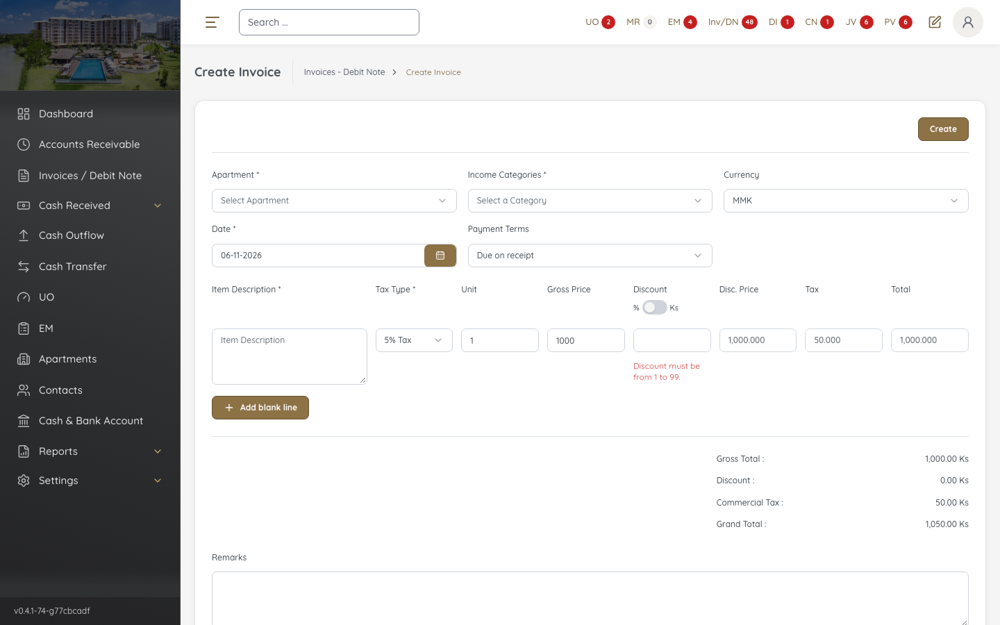 — 1 × 1000, 5% Tax, discount 0 (note the new "1 to 99" message).
- 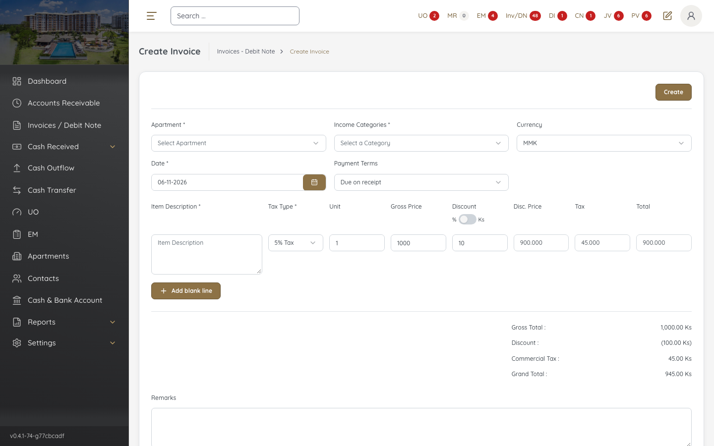 — 1 × 1000, 5% Tax, discount 10%.
- 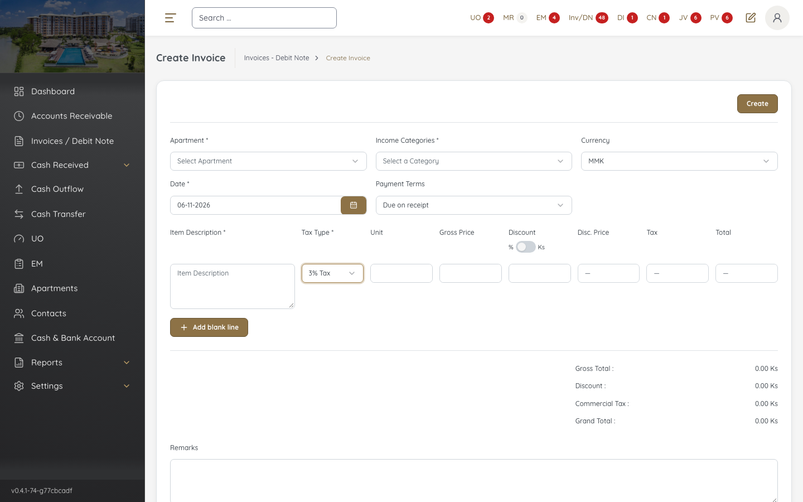 — Tax Type 5% → 3% clears the line.

**Retest 2026-11-02, build `v0.4.1-43-ga03414c2` (Jira status QA): all 4 cases pass, by hand and by the automated tests, so the fix is on UAT.** Results per case below are the earlier failing runs, kept as history. No invoice was saved.

| Case | New EM on build -43 | Manual | Auto test |
|---|---|---|---|
| SAN-EM92-001 | Payment Terms has no `*`, preset to "Due on receipt" | ✅ Pass | [✅ Pass](../../../../tests/sanity/tickets/fixed/fixed-invoices.spec.ts#L43) |
| SAN-EM92-002 | Disc. Price 1,000.000 Ks · Tax 50.000 Ks · Total 1,000.000 Ks · Grand Total 1,050.00 Ks | ✅ Pass | [✅ Pass](../../../../tests/sanity/tickets/fixed/fixed-invoices.spec.ts#L24) |
| SAN-EM92-003 | Disc. Price 900.000 Ks · Tax 45.000 Ks · Total 900.000 Ks · Grand Total 945.00 Ks | ✅ Pass | [✅ Pass](../../../../tests/sanity/tickets/fixed/fixed-invoices.spec.ts#L30) |
| SAN-EM92-004 | 5% → 3% clears Unit and Gross Price, Discount back to 0 | ✅ Pass | [✅ Pass](../../../../tests/sanity/tickets/fixed/fixed-invoices.spec.ts#L66) |

Notes: line values recalculate only after leaving the Discount field. Line cells now show 3 decimals, as in Old EM.

- 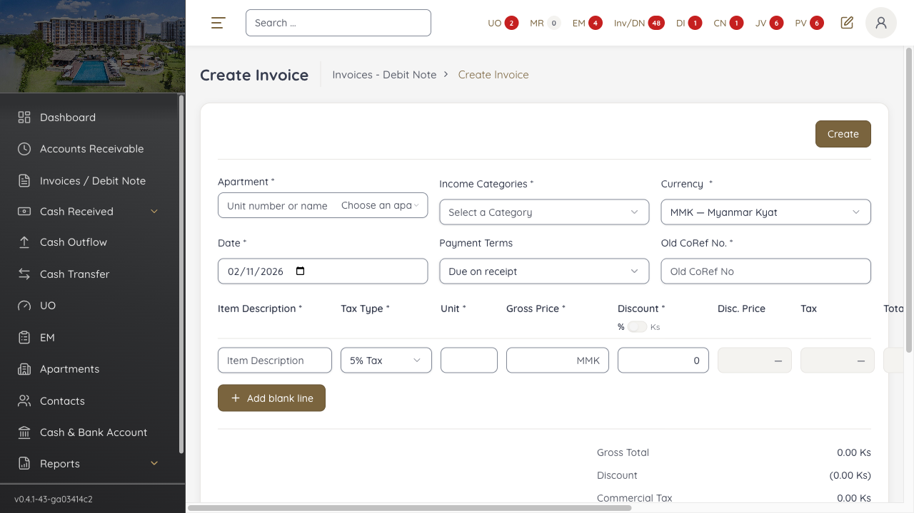 — Payment Terms optional, "Due on receipt".
- 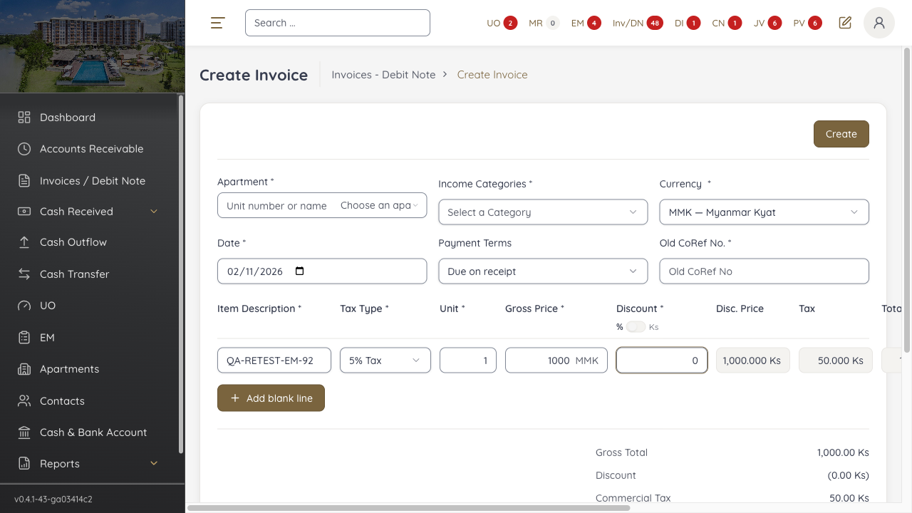 — 1 × 1000, 5% Tax, discount 0.
- 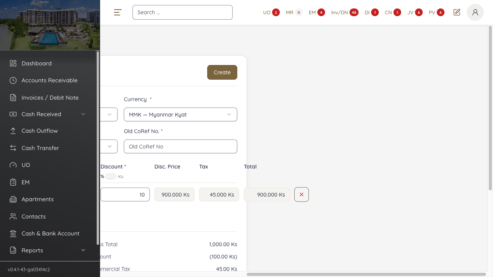 — 1 × 1000, 5% Tax, discount 10%.
-  — Tax Type 5% → 3% clears the line.

#### ★ SAN-EM92-001 · Create Invoice opens with Payment Terms optional and preset to Due On Receipt

| Priority | Suites | Automation | Status | Source |
|---|---|---|---|---|
| P1 | Sanity · Regression | Auto-UI | Active | EM-92 repro (scenario: open form), 2026-10-31, rechecked 2026-11-01 |

**Automated test:** [`SAN-EM92-001` in fixed-invoices.spec.ts](../../../../tests/sanity/tickets/fixed/fixed-invoices.spec.ts#L43) · tag `@sanity` · run `APP=em npx playwright test --grep SAN-EM92-001` · last run 2026-11-06, build -74: ✅ pass

**Preconditions:**

1. Logged in to EM.
2. Pages: New EM `/receivables/invoices/new`, Old EM `/invoices/add-invoice`.

**Steps:**

1. Go to Receivables → Invoices - Debit Note → Create Invoice.
2. Check the Payment Terms field.

**Expected result:**

1. The form opens.
2. Payment Terms has no `*` and defaults to "Due On Receipt".

**Result (build -37, 2026-10-31; rechecked 2026-11-01):**

| # | Old EM | New EM | |
|---|---|---|---|
| 1 | Form opens | Form opens | ✅ Same |
| 2 | No `*`, default "Due On Receipt" | "Payment Terms *", empty | ❌ Differs |

**Conclusion:** Open. Payment Terms is required and empty on New EM. A fix exists but is not deployed to UAT.

**Evidence:**

-  — New EM form on open.
-  — "Payment Terms *" required and empty.
- 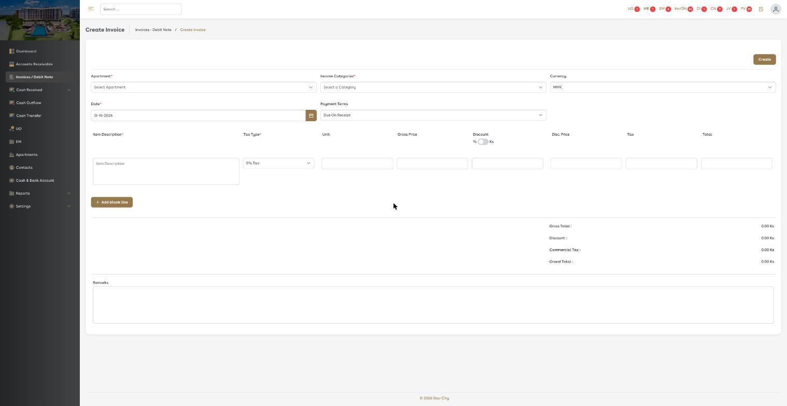 — Old EM preset to "Due On Receipt".
- [06_new-EM_UAT_repro.gif](../img/EM-92/06_new-EM_UAT_repro.gif)
- [16_old-EM_UAT_reference.gif](../img/EM-92/16_old-EM_UAT_reference.gif)

---

#### ★ SAN-EM92-002 · Line 1 × 1000 with 5% Tax and Discount 0 shows Disc. Price 1,000.000 and Total 1,000.000

| Priority | Suites | Automation | Status | Source |
|---|---|---|---|---|
| P1 | Sanity · Regression | Auto-UI | Active | EM-92 repro (scenario: 1×1000, 5% Tax, disc 0), 2026-10-31, rechecked 2026-11-01 |

**Automated test:** [`SAN-EM92-002` in fixed-invoices.spec.ts](../../../../tests/sanity/tickets/fixed/fixed-invoices.spec.ts#L24) · tag `@sanity` · run `APP=em npx playwright test --grep SAN-EM92-002` · last run 2026-11-06, build -74: ✅ pass

**Preconditions:**

1. Logged in to EM.
2. Pages: New EM `/receivables/invoices/new`, Old EM `/invoices/add-invoice`.

**Test data:**

1. Line: Tax Type = 5% Tax, Unit 1, Gross Price 1000, Discount 0.

**Steps:**

1. Go to Create Invoice and enter the line from the test data.
2. Read the Disc. Price, Tax, Total and Grand Total.

**Expected result:**

1. The line is accepted.
2. Disc. Price 1,000.000; Tax 50.000; Total 1,000.000; Grand Total 1,050.00.

**Result (build -37, 2026-10-31; rechecked 2026-11-01):**

| # | Old EM | New EM | |
|---|---|---|---|
| 2 | Disc. Price 1,000.000 | Disc. Price 0.00 Ks | ❌ Differs |
| 2 | Tax 50.000 | Tax 50.00 Ks | ✅ Same |
| 2 | Total 1,000.000 | Total 1,050.00 Ks | ❌ Differs |
| 2 | Grand Total 1,050.00 | Grand Total 1,050.00 | ✅ Same |

**Conclusion:** Open. The recheck on 2026-11-01 gives the same Disc. Price 0.00 Ks and Total 1,050.00 Ks. A fix exists but is not deployed to UAT. Also noted: Old EM shows 3 decimals in line cells, New EM 2 decimals + "Ks"; the ticket does not mention this.

**Evidence:**

- 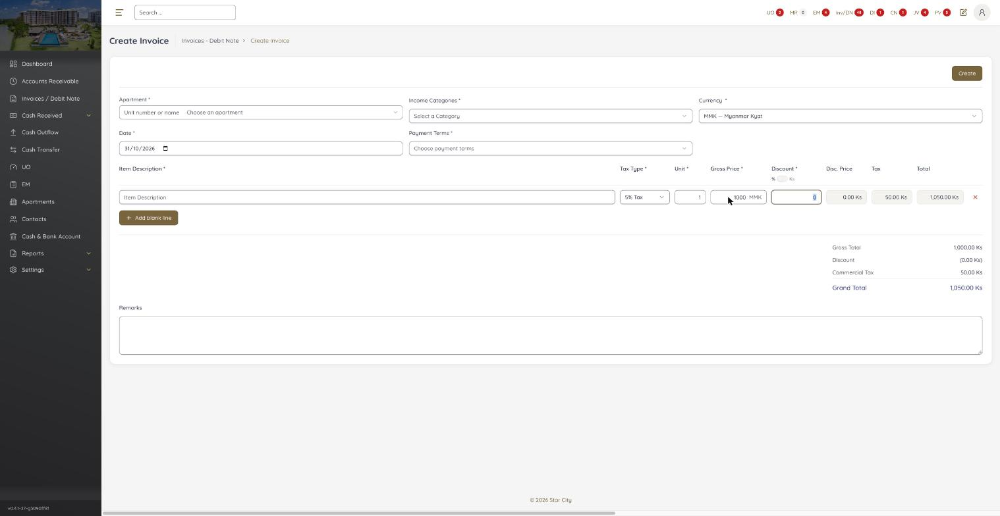 — New EM Disc. Price 0.00 Ks, Total 1,050.00 Ks.
- 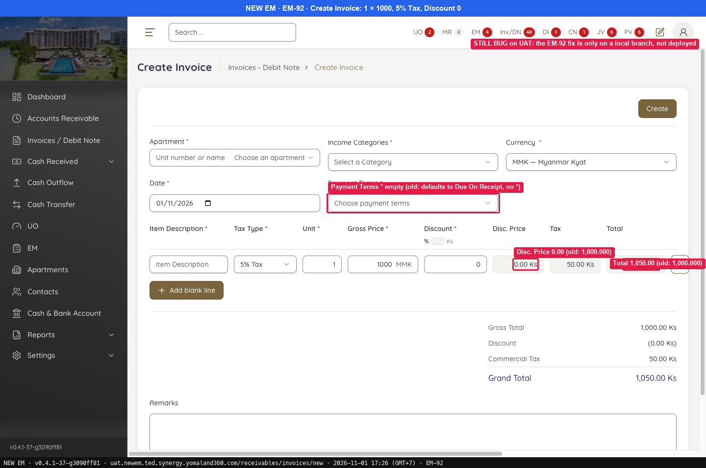 — Recheck on 2026-11-01: same values.
-  — Old EM Disc. Price 1,000.000, Total 1,000.000.

---

#### ★ SAN-EM92-003 · Line 1 × 1000 with 5% Tax and Discount 10% shows Disc. Price 900.000 and Total 900.000

| Priority | Suites | Automation | Status | Source |
|---|---|---|---|---|
| P1 | Sanity · Regression | Auto-UI | Active | EM-92 repro (scenario: 1×1000, 5% Tax, disc 10%), 2026-10-31 |

**Automated test:** [`SAN-EM92-003` in fixed-invoices.spec.ts](../../../../tests/sanity/tickets/fixed/fixed-invoices.spec.ts#L30) · tag `@sanity` · run `APP=em npx playwright test --grep SAN-EM92-003` · last run 2026-11-06, build -74: ✅ pass

**Preconditions:**

1. Logged in to EM.
2. Pages: New EM `/receivables/invoices/new`, Old EM `/invoices/add-invoice`.

**Test data:**

1. Line: Tax Type = 5% Tax, Unit 1, Gross Price 1000, Discount 10%.

**Steps:**

1. Go to Create Invoice and enter the line from the test data.
2. Read the Disc. Price, Tax, Total and Grand Total.

**Expected result:**

1. The line is accepted.
2. Disc. Price 900.000; Tax 45.000; Total 900.000; Grand Total 945.00.

**Result (build -37, 2026-10-31):**

| # | Old EM | New EM | |
|---|---|---|---|
| 2 | Disc. Price 900.000 | Disc. Price 100.00 Ks (= the discount amount) | ❌ Differs |
| 2 | Tax 45.000 | Tax 45.00 Ks | ✅ Same |
| 2 | Total 900.000 | Total 945.00 Ks | ❌ Differs |
| 2 | Grand Total 945.00 | Grand Total 945.00 | ✅ Same |

**Conclusion:** Open. Disc. Price shows the discount amount and line Total includes tax. A fix exists but is not deployed to UAT.

**Evidence:**

- 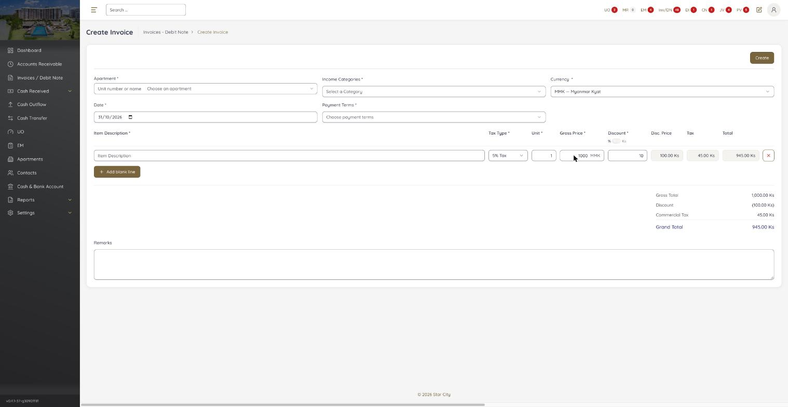 — New EM Disc. Price 100.00 Ks, Total 945.00 Ks.
- 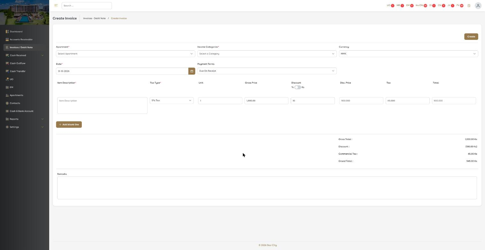 — Old EM Disc. Price 900.000, Total 900.000.

---

#### ★ SAN-EM92-004 · Changing Tax Type clears the line, as in Old EM

| Priority | Suites | Automation | Status | Source |
|---|---|---|---|---|
| P1 | Sanity · Regression | Auto-UI | Active | EM-92 repro (scenario: change Tax Type 5% → 3%), 2026-10-31 |

**Automated test:** [`SAN-EM92-004` in fixed-invoices.spec.ts](../../../../tests/sanity/tickets/fixed/fixed-invoices.spec.ts#L66) · tag `@sanity` · run `APP=em npx playwright test --grep SAN-EM92-004` · last run 2026-11-06, build -74: ✅ pass

**Preconditions:**

1. Logged in to EM.
2. Pages: New EM `/receivables/invoices/new`, Old EM `/invoices/add-invoice`.

**Steps:**

1. Go to Create Invoice and enter a line with Tax Type = 5% Tax.
2. Change Tax Type to 3%.

**Expected result:**

1. The line is filled in.
2. Unit, Gross Price and Discount are cleared.

**Result (build -37, 2026-10-31):**

| # | Old EM | New EM | |
|---|---|---|---|
| 2 | Unit / Gross / Discount cleared | Unit / Gross / Discount cleared | ✅ Same |

**Conclusion:** This scenario matches and is not a bug; a Jira comment confirms New EM keeps the Old EM behaviour. It stays as a regression check within the open ticket.

**Evidence:**

- 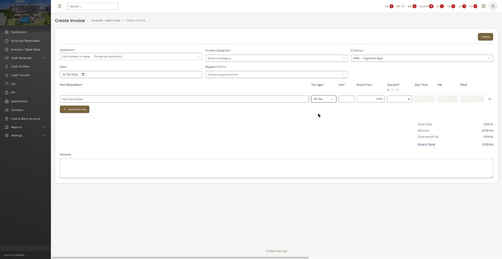 — New EM clears the line.
- 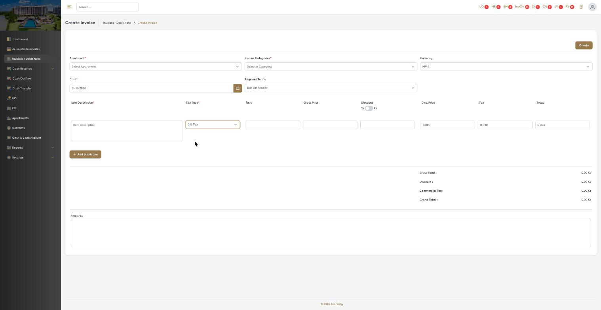 — Old EM clears the line.

---

### EM-75 · [Invoices / Debit Note > Add Invoice] Inclusive Tax 5%/3% UI differs and allows discount

[EM-75](https://zeyalabs-team-a83df6me.atlassian.net/browse/EM-75) · Jira priority Highest · Status **Fixed** (build -74)

**Reported:** With Inclusive Tax 5% or 3%, the Invoice create UI differs from the current EM UAT and a discount (% or amount) is still accepted.

#### ★ SAN-EM75-001 · Inclusive Tax 5% and 3% matches the Old EM form and does not allow Discount

| Priority | Suites | Automation | Status | Source |
|---|---|---|---|---|
| P1 | Sanity · Regression | Auto-UI | Active | EM-75 repro (TC-EM-75-01), 2026-11-01 |

**Preconditions:**

1. Logged in as Admin.
2. Pages: New EM `/receivables/invoices/new`, Old EM `/invoices/add-invoice` (bundle `dd551ca9`).

**Test data:**

1. Line: Incl. 5% Tax, Unit 1, Gross Price (with tax) 1050.
2. Line for step 6: Incl. 3% Tax, Unit 1, Gross Price (with tax) 1030.

**Steps:**

1. Fill a line with 5% Tax, then select Tax Type = Incl. 5% Tax.
2. Enter the line from the test data.
3. Try to type in Discount.
4. Click the % / Ks switch ("Discount in Ks").
5. Read the footer.
6. Select Tax Type = Incl. 3% Tax and enter the step 6 line. Do not click [Create].

**Expected result:**

1. The line is cleared and Gross Price splits into 2 fields (locked price before tax + input for price with tax).
2. Gross 1,000 (locked) + 1,050.00; Discount locked; Disc. Price **1,000.000**; Tax 50.000; Total **1,000.000**.
3. Discount cannot be typed.
4. The switch can still be clicked, with no effect.
5. Gross 1,000.00 · Discount 0.00 · Tax 50.00 · Grand 1,050.00.
6. The line is cleared; Gross 1,000 (locked); Discount locked; Disc. Price 1,000.000; Tax 30.000; Total 1,000.000; Grand 1,030.00.

**Automated test:** [`SAN-EM75-001` in fixed-invoices.spec.ts](../../../../tests/sanity/tickets/fixed/fixed-invoices.spec.ts#L84) · tag `@sanity` `@EM-75` · run `APP=em npx playwright test --grep SAN-EM75-001` · read-only, nothing is saved (Create is never clicked)

**Result (build -37, 2026-11-01):**

| # | Old EM | New EM | |
|---|---|---|---|
| 1 | Line cleared, Gross Price split | Same | ✅ Same |
| 2 | Gross 1,000 + 1,050.00; Discount locked (blank); Disc. Price **1,000.000**; Tax 50.000; Total **1,000.000** | Gross 1,000.00 Ks (locked) + field 1050; Discount **locked = 0**; Disc. Price **0.00 Ks**; Tax 50.00; Total **1,050.00 Ks** | ❌ Differs |
| 3 | Cannot be typed | **Cannot be typed** | ✅ Same |
| 4 | Can be clicked | Can be clicked | ✅ Same |
| 5 | Gross 1,000.00 · Discount 0.00 · Tax 50.00 · Grand 1,050.00 | Matches (at the corresponding %) | ✅ Same |

**Conclusion (build -37):** Partly open. "No discount" is fixed, but the line Disc. Price and Total still differ from Old EM (0.00 and the price with tax). The ticket is blocked by EM-92, and this part waits for the EM-92 fix to reach UAT.

**Retest (build `v0.4.1-74-g77cbcadf`, 2026-11-06, automated): passed** (Chromium and Firefox)

| # | Check | Old EM | New EM | |
|---|---|---|---|---|
| 1 | Incl. 5% clears the line, Gross Price split | Cleared, split | Cleared, "Gross Price before tax" shown, Discount disabled | ✅ |
| 2 | Line 1 × 1050 | Gross 1,000 + 1,050.00; Disc. Price 1,000.000; Tax 50.000; Total 1,000.000 | Gross 1,000.00 (locked) + 1050; Disc. Price 1,000.000; Tax 50.000; Total 1,000.000 | ✅ |
| 3 | Discount cannot be typed | Locked | Disabled, empty | ✅ |
| 4 | % / Ks switch | Clickable, no effect | Toggles, Discount stays disabled, line unchanged | ✅ |
| 5 | Footer | 1,000.00 · 0.00 · 50.00 · 1,050.00 | 1,000.00 · 0.00 · 50.00 · 1,050.00 | ✅ |
| 6 | Incl. 3%, 1 × 1030 | — (not run on Old EM) | Line cleared; 1,000.00 (locked); Disc. Price 1,000.000; Tax 30.000; Total 1,000.000; Grand 1,030.00 | ✅ |

The line Disc. Price / Total part is now fixed, together with EM-92 (fixed on build -43). Also noted: the line figures are calculated only after leaving the Gross Price field. Jira comment `VERIFIED_PASSED_v0.4.1-74-g77cbcadf` posted.

-  — Incl. 5%, 1 × 1050: 1,000.00 locked, Discount locked, Disc. Price / Total 1,000.000.
-  — Footer 1,000.00 · 0.00 · 50.00 · 1,050.00.
-  — Incl. 3%, 1 × 1030: Tax 30.000, Grand 1,030.00.

**Evidence:**

- 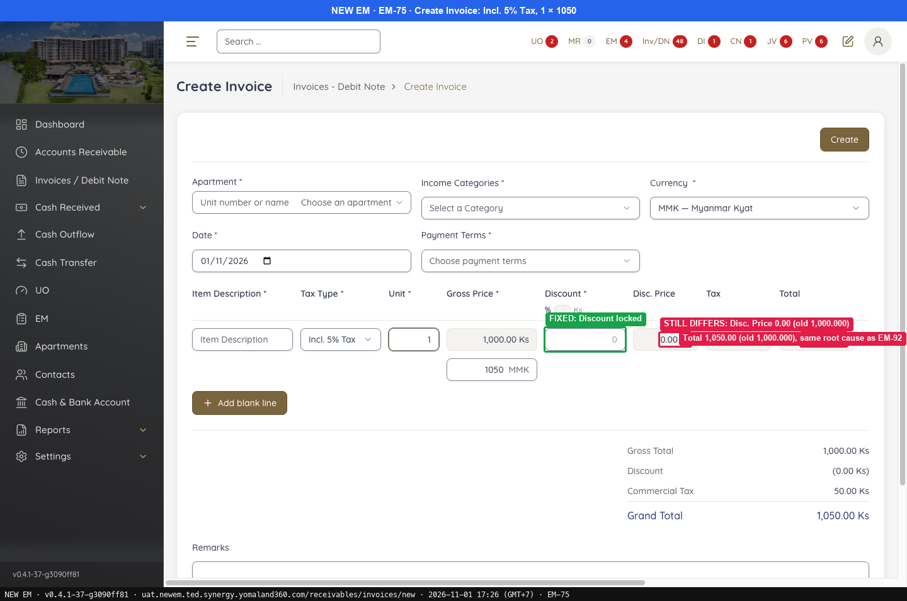 — FIXED: Discount locked
- 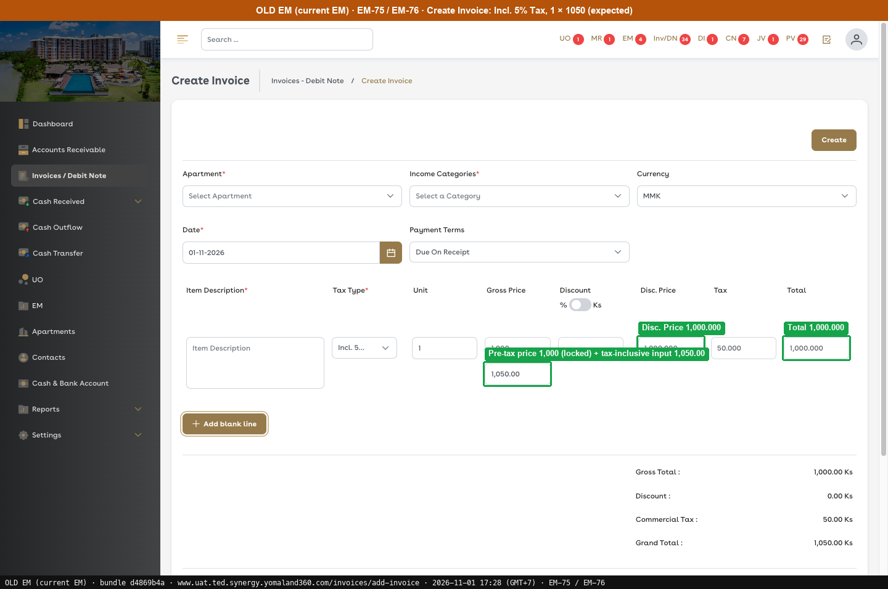 — Pre-tax price 1,000 (locked) + tax-inclusive input 1,050.00
---

### EM-76 · [Apartments > Add Invoice] Inclusive Tax 5%/3% UI differs and allows discount

[EM-76](https://zeyalabs-team-a83df6me.atlassian.net/browse/EM-76) · Jira priority Highest · Status **Fixed (retest 2026-11-06, build -74)**

**Reported:** When Inclusive Tax 5% or 3% is selected in Add Invoice from an apartment, the create UI differs from the current EM and a discount (% or amount) is still accepted.

#### ★ SAN-EM76-001 · Inclusive Tax from an apartment: Add Invoice matches Old EM and blocks Discount

| Priority | Suites | Automation | Status | Source |
|---|---|---|---|---|
| P1 | Sanity · Regression | Auto-UI | Active | EM-76 repro (TC-EM-76-01), 2026-11-01 |

**Preconditions:**

1. Logged in as Admin.
2. Pages: New EM `/receivables/invoices/new?estate_id=1` (from Apartment Estate SEED-Z-001 › Invoices › Add Invoice). Old EM `/invoices/add-invoice` (bundle `dd551ca9`).

**Test data:**

1. New EM line: Incl. 3% Tax, Unit 1, Gross Price (including tax) 1030.
2. Old EM reference line: Incl. 5%, 1 × 1050.

**Steps:**

1. Select Tax Type = Incl. (5% / 3%).
2. Enter the line from the test data.
3. Try to type in Discount.
4. Click the % / Ks switch.
5. Read the footer. Do not click [Create].

**Expected result:**

1. The line is cleared; Gross Price splits into 2 fields (locked pre-tax price + input for the tax-inclusive price).
2. Gross 1,000 (locked) + 1,050.00; Discount locked (empty); Disc. Price **1,000.000**; Tax 50.000; Total **1,000.000** (Incl. 5% line).
3. Discount cannot be typed in.
4. The switch can still be clicked, with no effect.
5. Gross 1,000.00 · Discount 0.00 · Tax 50.00 · Grand 1,050.00 (Incl. 5% line).

**Automated test:** [`SAN-EM76-001` in fixed-invoices.spec.ts](../../../../tests/sanity/tickets/fixed/fixed-invoices.spec.ts) · tag `@sanity` `@EM-76` · run `APP=em npx playwright test --grep SAN-EM76-001` · opens Add Invoice from apartment 32 (QA-REPRO-EM-56 Tower-R32-101, Enable) › Invoices; Estate SEED-Z-001 from the repro is Disable since 11-06 and has no [Add Invoice]. Read-only, [Create] is never clicked.

**Result (build -37, 2026-11-01):**

| # | Old EM | New EM | |
|---|---|---|---|
| 1 | Line cleared; Gross Price splits into 2 fields | Same | ✅ Same |
| 2 | Gross 1,000 (locked) + 1,050.00; Discount locked (empty); Disc. Price **1,000.000**; Tax 50.000; Total **1,000.000** | Apartment preselected; Gross 1,000.00 Ks (locked) + field 1030; Discount **locked = 0**; Disc. Price **0.00 Ks**; Tax 30.00; Total **1,030.00 Ks** | ❌ Differs |
| 3 | Cannot be typed in | **Cannot be typed in** | ✅ Same |
| 4 | Can be clicked (no effect) | Can be clicked | ✅ Same |
| 5 | Gross 1,000.00 · Discount 0.00 · Tax 50.00 · Grand 1,050.00 | Matches (at the corresponding %) | ✅ Same |

**Conclusion (build -37):** Partly open. "Discount not allowed" is fixed, but the line's Disc. Price / Total columns still show 0.00 and the tax-inclusive price, unlike Old EM. It is the same line-column difference as EM-92, and it stays open until the EM-92 fix reaches UAT.

**Retest (build `v0.4.1-74-g77cbcadf`, 2026-11-06, automated): passed** (Chromium and Firefox)

| # | Check | Old EM | New EM | |
|---|---|---|---|---|
| 0 | Add Invoice from the apartment | Apartment preselected | `/receivables/invoices/new?estate_id=32`, Apartment = QA-REPRO-EM-56 Tower-R32-101 | ✅ |
| 1 | Incl. 5% clears the line, Gross Price split | Cleared, split | Cleared, "Gross Price before tax" shown, Discount disabled | ✅ |
| 2 | Line 1 × 1050 | Gross 1,000 + 1,050.00; Disc. Price 1,000.000; Tax 50.000; Total 1,000.000 | Gross 1,000.00 (locked) + 1050; Disc. Price 1,000.000; Tax 50.000; Total 1,000.000 | ✅ |
| 3 | Discount cannot be typed | Locked | Disabled, empty | ✅ |
| 4 | % / Ks switch | Clickable, no effect | Toggles, Discount stays disabled, line unchanged | ✅ |
| 5 | Footer | 1,000.00 · 0.00 · 50.00 · 1,050.00 | 1,000.00 · 0.00 · 50.00 · 1,050.00 | ✅ |
| 6 | Incl. 3%, 1 × 1030 (the 11-01 repro line) | At the corresponding % | Line cleared; 1,000.00 (locked); Disc. Price 1,000.000; Tax 30.000; Total 1,000.000; Grand 1,030.00 | ✅ |

The line Disc. Price / Total part is fixed together with EM-92 and EM-75. Jira comment not posted yet.

**Evidence:**

- 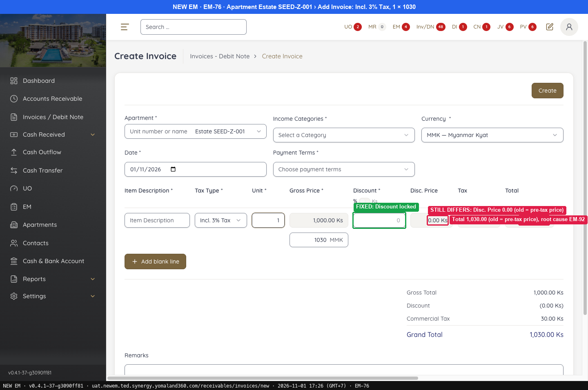 — FIXED: Discount locked
-  — Pre-tax price 1,000 (locked) + tax-inclusive input 1,050.00
---
