# Fixed · Settings

[← Ticket index](../README.md) · [Sanity index](../../README.md)

**Tickets:** 14 · **Fixed:** 14

These tickets are fixed on build -37. Their cases are now regression checks.

## Summary

| Ticket | Title | Jira priority | Status (build -37) | Result | Case |
|---|---|---|---|---|---|
| [EM-34](https://zeyalabs-team-a83df6me.atlassian.net/browse/EM-34) | [Settings > General Setting] Extra CoRef-related fields are displayed | High | Fixed | General Settings has only Old CoRef No., as in Old EM. (automated, build -74) | [SAN-EM34-001](#san-em34-001--general-settings-shows-only-old-coref-no) |
| [EM-35](https://zeyalabs-team-a83df6me.atlassian.net/browse/EM-35) | [Settings > UO Pricing] New button allows creating extra UO Pricing records | High | Fixed | No [New]; exactly the 4 fixed types with Edit only. (automated, build -100) | [SAN-EM35-001](#san-em35-001--uo-pricing-has-only-the-4-fixed-types-and-no-new-button) |
| [EM-38](https://zeyalabs-team-a83df6me.atlassian.net/browse/EM-38) | [TC_Setting_08][TC_Setting_15] Parent-child hierarchy not shown in Category filter | High | Fixed | A new parent/child pair is shown as a hierarchy in the AR Category filter (parent as group heading). | [SAN-EM38-001](#-san-em38-001--category-filter-shows-the-parent-and-child-hierarchy-tc_setting_08-tc_setting_15) |
| [EM-39](https://zeyalabs-team-a83df6me.atlassian.net/browse/EM-39) | [TC_Setting_07] Created Fund Category is not available in related filters and forms | High | Fixed | A newly created Fund Category is in the Funding Received form. | [SAN-EM39-001](#san-em39-001--new-fund-category-is-available-in-the-funding-received-form-tc_setting_07) |
| [EM-40](https://zeyalabs-team-a83df6me.atlassian.net/browse/EM-40) | [TC_Setting_14] New parent expense category not displayed in Categories filter | High | Fixed | A newly created parent expense category is shown in the AR Category filter. | [SAN-EM40-001](#-san-em40-001--new-parent-expense-category-is-listed-in-the-ar-categories-filter-tc_setting_14) |
| [EM-46](https://zeyalabs-team-a83df6me.atlassian.net/browse/EM-46) | [Settings > Zone and Building] Delete button should not exist | Medium | Fixed | Zones and Buildings have Edit only, no Delete, as in Old EM. | [SAN-EM46-001](#san-em46-001--zones-and-buildings-have-no-delete-action) |
| [EM-56](https://zeyalabs-team-a83df6me.atlassian.net/browse/EM-56) | [Settings > Building] Duplicate building records can be created | High | Fixed | A duplicate building name in the same zone is blocked: Building Name Already Exists. (automated, build -74) | [SAN-EM56-001](#san-em56-001--duplicate-building-name-in-the-same-zone-is-blocked) |
| [EM-57](https://zeyalabs-team-a83df6me.atlassian.net/browse/EM-57) | [Settings > Currency] Required fields missing in currency creation (e.g. Currency Status) | Medium | Fixed | Create Currency has Currencies, Name, Code, Symbol, Status, as in Old EM. | [SAN-EM57-001](#san-em57-001--create-currency-form-has-all-required-fields-including-status) |
| [EM-58](https://zeyalabs-team-a83df6me.atlassian.net/browse/EM-58) | [TC_Setting_28] Check areas fail after creating a new payment method | High | Fixed | A newly created payment method is listed in the Cash & Bank Account form. | [SAN-EM58-001](#san-em58-001--new-payment-method-is-available-in-the-cash--bank-account-form-tc_setting_28) |
| [EM-60](https://zeyalabs-team-a83df6me.atlassian.net/browse/EM-60) | [Settings > Account Classification] Manage Type section is missing | High | Fixed | Account Classification has Manage Type (noted: New EM also has Delete on Payment Method and Bank). (automated, build -74) | [SAN-EM60-001](#san-em60-001--account-classification-has-a-manage-type-section) |
| [EM-62](https://zeyalabs-team-a83df6me.atlassian.net/browse/EM-62) | [Side Panel] Roles, Cash & Bank Account, Currency, Payment Method, Staff forms should be page views | High | Fixed | Roles, Cash & Bank, Currency, Payment Method and Staff all open as pages. | [SAN-EM62-001](#san-em62-001--five-forms-open-as-page-views-instead-of-side-panels) |
| [EM-63](https://zeyalabs-team-a83df6me.atlassian.net/browse/EM-63) | [Settings > Staff] Phone number field missing in staff creation form | Medium | Fixed | Create Staff has Phone (code +95). | [SAN-EM63-001](#san-em63-001--create-staff-form-has-a-phone-field) |
| [EM-64](https://zeyalabs-team-a83df6me.atlassian.net/browse/EM-64) | [Settings > Staff] Status shown as Enable/Disable instead of Activate/Deactivate | Low | Fixed | Staff status is displayed as Activate / Deactivate. | [SAN-EM64-001](#san-em64-001--staff-status-is-displayed-as-activate--deactivate) |
| [EM-65](https://zeyalabs-team-a83df6me.atlassian.net/browse/EM-65) | [Settings > Staff] Reset Password flow differs from current EM | Medium | Fixed | Edit Staff uses 'Click to change password', as in Old EM. | [SAN-EM65-001](#san-em65-001--edit-staff-changes-the-password-through-click-to-change-password) |

## Tickets

### EM-34 · [Settings > General Setting] Extra CoRef-related fields are displayed

[EM-34](https://zeyalabs-team-a83df6me.atlassian.net/browse/EM-34) · Jira priority High · Status **Fixed**

**Reported:** Additional CoRef-related fields were displayed in General Settings; only "Old CoRef No." should be available.

#### SAN-EM34-001 · General Settings shows only Old CoRef No.

| Priority | Suites | Automation | Status | Source |
|---|---|---|---|---|
| P1 | Sanity · Regression | Auto-UI | Active | EM-34 repro (TC-EM-34-01), 2026-11-01 |

**Preconditions:**

1. Logged in as an Admin user.

**Steps:**

1. Open Settings › General Settings (`/settings/general`).
2. List the configuration fields.
3. Look for other CoRef fields (CoRef prefix / format / next no.).

**Expected result:**

1. The configuration form opens.
2. Only 1 field "Old CoRef No." (Enable/Disable) and Submit.
3. None.

**Automated test:** [`SAN-EM34-001` in fixed-settings.spec.ts](../../../../tests/sanity/tickets/fixed/fixed-settings.spec.ts) · tag `@sanity` `@EM-34` · run `APP=em npx playwright test --grep SAN-EM34-001` · reads `/settings/general`; read-only.

**Result (build -37, 2026-11-01):**

| # | Old EM | New EM | |
|---|---|---|---|
| 1 | Form opens | Opens | ✅ Same |
| 2 | Only "Old CoRef No." (Enable/Disable) + Submit | Only "Old CoRef No." (Enable/Disable) + Submit | ✅ Same |
| 3 | None | None | ✅ Same |

**Conclusion:** Fixed. New EM used to display extra CoRef fields that Old EM does not have.

**Retest (build -74, 2026-11-06, automated): passed** (Chromium and Firefox, build `v0.4.1-74-g77cbcadf`)

| # | Check | Old EM | New EM | |
|---|---|---|---|---|
| 1 | Fields | Only "Old CoRef No." (Enable/Disable) + Submit | Only "Old CoRef No." (Enable/Disable) + Submit | ✅ Same |
| 2 | Other CoRef fields | None | None | ✅ Same |

**Evidence:**

- 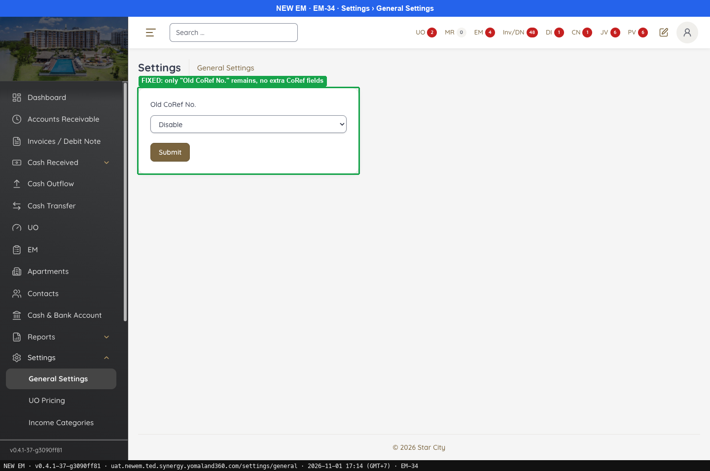 — FIXED: only "Old CoRef No." remains, no extra CoRef fields
- 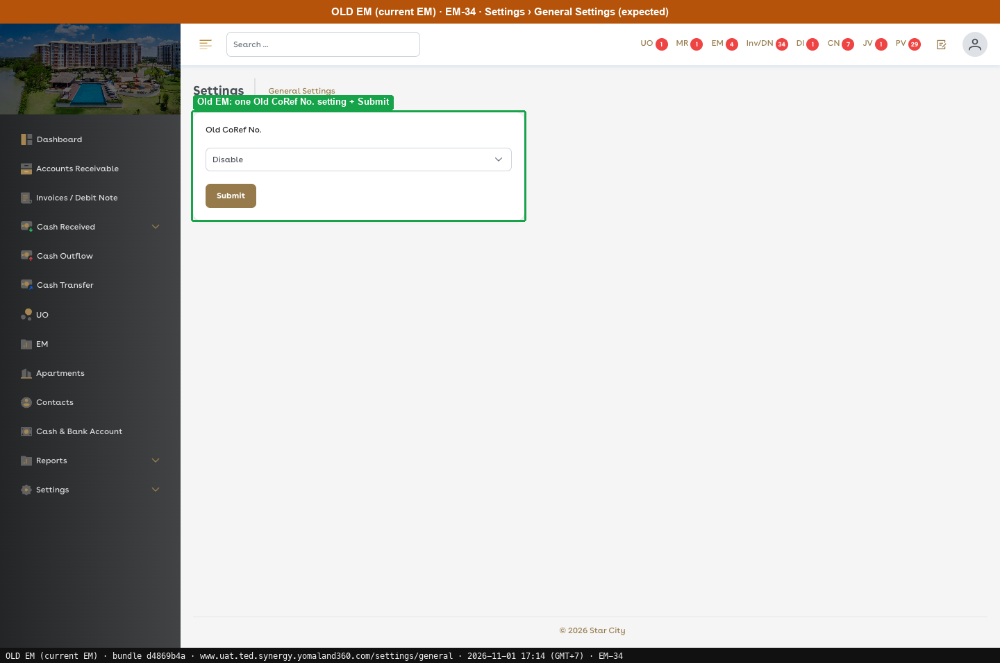 — Old EM: one Old CoRef No. setting + Submit
---

### EM-35 · [Settings > UO Pricing] New button allows creating extra UO Pricing records

[EM-35](https://zeyalabs-team-a83df6me.atlassian.net/browse/EM-35) · Jira priority High · Status **Fixed** (build -100)

**Reported:** A New button in UO Pricing allowed extra records, although UO Pricing should only contain 4 predefined master data types.

#### SAN-EM35-001 · UO Pricing has only the 4 fixed types and no New button

| Priority | Suites | Automation | Status | Source |
|---|---|---|---|---|
| P1 | Sanity · Regression | Auto-UI | Active | EM-35 repro (TC-EM-35-01), 2026-11-01 |

**Preconditions:**

1. Logged in as an Admin user.

**Steps:**

1. Open Settings › UO Pricing (`/settings/service-items`).
2. Look for [New].
3. Compare the list with the 4 master types.

**Expected result:**

1. The UO Pricing list opens.
2. No [New] button.
3. Exactly 4 rows: Electricity (YESC), Electricity (Generator), Treated Water, Raw Water; each with Edit only.

**Automated test:** [`SAN-EM35-001` in fixed-settings.spec.ts](../../../../tests/sanity/tickets/fixed/fixed-settings.spec.ts) · tag `@sanity` `@EM-35` · run `APP=em npx playwright test --grep SAN-EM35-001` · read-only: opens Settings › UO Pricing, never clicks Edit.

**Result (build -37, 2026-11-01):**

| # | Old EM | New EM | |
|---|---|---|---|
| 1 | List | Opens | ✅ Same |
| 2 | No [New] | **No [New]** | ✅ Same |
| 3 | 4 rows: Electricity (YESC), Electricity (Generator), Treated Water, Raw Water; Edit only | **5 rows**: Electricity (YESC) 100, Electricity (YESC) 1,000, Raw water, Seed Water, Seed Electricity; Generator and Treated Water missing | ❌ Differs |

**Conclusion:** Partly open. [New] is gone, but the catalogue is not back to the 4 master types: it keeps extra records (duplicate YESC, Seed) and lacks 2 master types, so UO is charged against the wrong list until the data is cleaned up. A direct API POST to create UO Pricing was not tried.

**Retest (build -100, 2026-11-10, automated): passed** (Chromium, build `v0.4.1-100-g1a97b9a6`)

| # | Check | Old EM | New EM | |
|---|---|---|---|---|
| 1 | UO Pricing list | Opens | Opens | ✅ Same |
| 2 | [New] button | None | None | ✅ Same |
| 3 | Rows | Electricity (YESC), Electricity (Generator), Treated Water, Raw Water; Edit only | Electricity (YESC) 100, Electricity (Generator) 100, Raw Water 6, Treated Water 3; Edit only | ✅ Same |

**Conclusion (build -100):** Fixed. The extra records (second YESC, Seed Water, Seed Electricity) are gone and Generator / Treated Water are back. Not checked: a direct API POST to create UO Pricing, and the UO import template's duplicate YESC column (see EM-82 / EM-83).

**Evidence:**

- 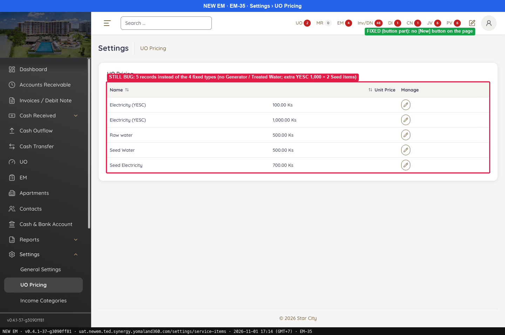 — STILL BUG: 5 records instead of the 4 fixed types (no Generator / Treated Water; extra YESC 1,000 + 2 Seed items)
- 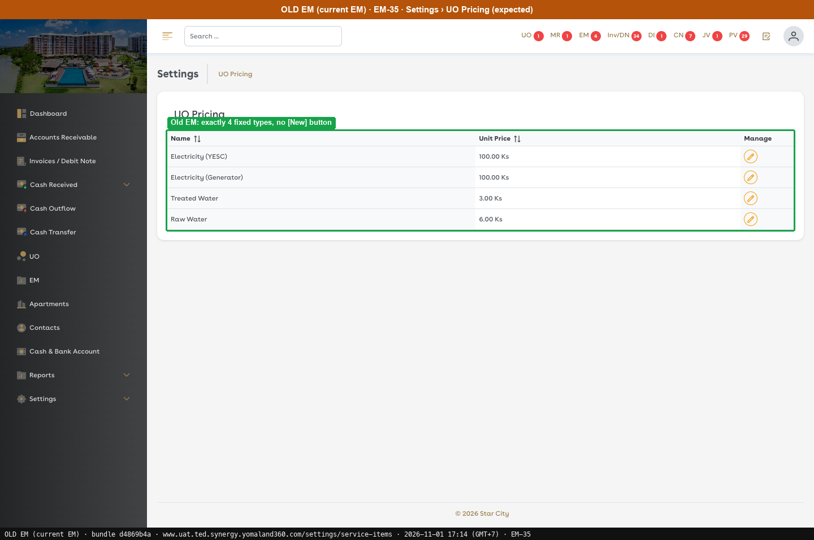 — Old EM: exactly 4 fixed types, no [New] button
---

### EM-38 · [TC_Setting_08][TC_Setting_15] Parent-child hierarchy not shown in Category filter

[EM-38](https://zeyalabs-team-a83df6me.atlassian.net/browse/EM-38) · Jira priority High · Status **Fixed**

**Reported:** Parent and child income categories appeared as separate flat items in the Category filter, so the check areas of TC_Setting_08 and TC_Setting_15 failed.

#### ★ SAN-EM38-001 · Category filter shows the parent and child hierarchy (TC_Setting_08, TC_Setting_15)

| Priority | Suites | Automation | Status | Source |
|---|---|---|---|---|
| P1 | Sanity · Regression | Auto-UI | Active | EM-38 repro (TC-EM-38-01), 2026-11-01 |

**Preconditions:**

1. Logged in as an Admin user.

**Steps:**

1. Settings › Income Categories (`/settings/income-categories`): create `QA-REPRO-EM-38 Parent`.
2. Create `QA-REPRO-EM-38 Child`, open Edit (pencil), set Parent Category = `QA-REPRO-EM-38 Parent`, click [Submit].
3. Open Accounts Receivable (New `/receivables/worklist`, Old `/account-receivables`), open the filter "All Categories".
4. TC_Setting_15: check the existing expense parent/child pair "Payment Developer" › C Loft – ….

**Expected result:**

1. Saved, at the end of the list.
2. Child is indented under Parent.
3. Parent is a bold group heading that cannot be selected; children are listed directly under it.
4. Parent group and children.

**Result (build -37, 2026-11-01):**

| # | Old EM | New EM | |
|---|---|---|---|
| 1 | Saved, at the end of the list | Saved ("Category has been updated successfully") | ✅ Same |
| 2 | Child indented under Parent | Child indented under Parent (own sequence number 1) | ✅ Same |
| 3 | Parent is a bold group heading, not selectable; children directly under it | Parent is a group heading (`role=group`, font 600 vs 500), children directly under it; also for the existing pair "Testing by AH" | ✅ Same |
| 4 | Parent group and children | Parent group and children | ✅ Same |

**Conclusion:** Fixed on the Accounts Receivable Category filter. The filter used to be flat, so a child could not be tied to its parent and TC_Setting_08/15 failed. Also noted: the Parent Category dropdown on the Edit page also lists **Disabled** categories (X0 …), not compared with Old EM; the Reports Category filter is covered in EM-36.

**Test data created:** New EM income categories `QA-REPRO-EM-38 Parent` (id 24) and `QA-REPRO-EM-38 Child` (id 25, child of 24).

**Evidence:**

-  — EM-38 FIXED: new parent is a header, child indented
- 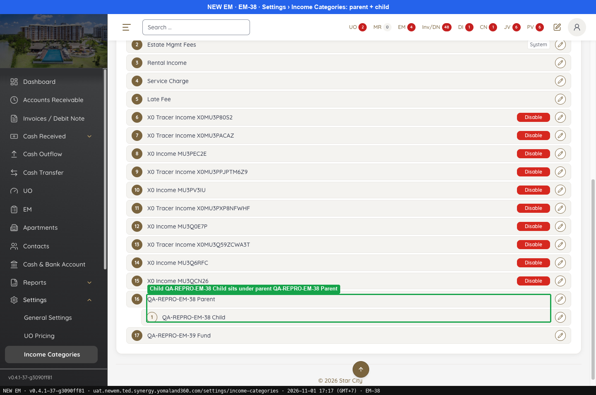 — Child QA-REPRO-EM-38 Child sits under parent QA-REPRO-EM-38 Parent
- 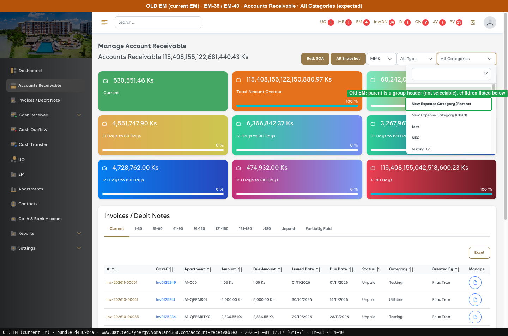 — Old EM: parent is a group header (not selectable), children listed below
---

### EM-39 · [TC_Setting_07] Created Fund Category is not available in related filters and forms

[EM-39](https://zeyalabs-team-a83df6me.atlassian.net/browse/EM-39) · Jira priority High · Status **Fixed**

**Reported:** A newly created Fund Category was not available in the related filters and forms, so the TC_Setting_07 check area failed.

#### SAN-EM39-001 · New Fund Category is available in the Funding Received form (TC_Setting_07)

| Priority | Suites | Automation | Status | Source |
|---|---|---|---|---|
| P1 | Sanity · Regression | Auto-UI | Active | EM-39 repro (TC-EM-39-01), 2026-11-01 |

**Preconditions:**

1. Logged in as an Admin user.

**Steps:**

1. Settings › Income Categories: create `QA-REPRO-EM-39 Fund`.
2. Open Edit (`/settings/income-categories/27/edit`), switch on **Fund**, click [Submit].
3. Go to Cash Received › Funding Received (New `/accounts/funding-received`, Old `/inter-company`) and open Category.

**Expected result:**

1. Saved.
2. Saved as a Fund Category.
3. Only Fund categories are listed, including the new one.

**Result (build -37, 2026-11-01):**

| # | Old EM | New EM | |
|---|---|---|---|
| 1 | Saved | Saved | ✅ Same |
| 2 | Saved as a Fund Category | Saved (`aria-checked=true`) | ✅ Same |
| 3 | Fund categories only: Funding Category, Dummy/Child Dummy, Intercompany Remittance/ITCR – In | **Has** `QA-REPRO-EM-39 Fund`; no non-Fund category (only 1 item, the one just created) | ✅ Same |

**Conclusion:** Fixed. Without this a Fund Category could not be used to record funding received. Not checked: the Category filter of Reports › Cash Received with a Fund Category.

**Test data created:** New EM income category `QA-REPRO-EM-39 Fund` (id 27, Fund = on).

**Evidence:**

- 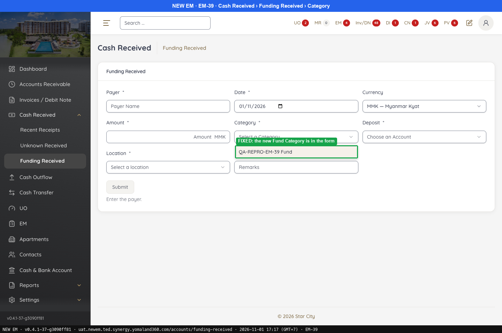 — FIXED: the new Fund Category is in the form
- 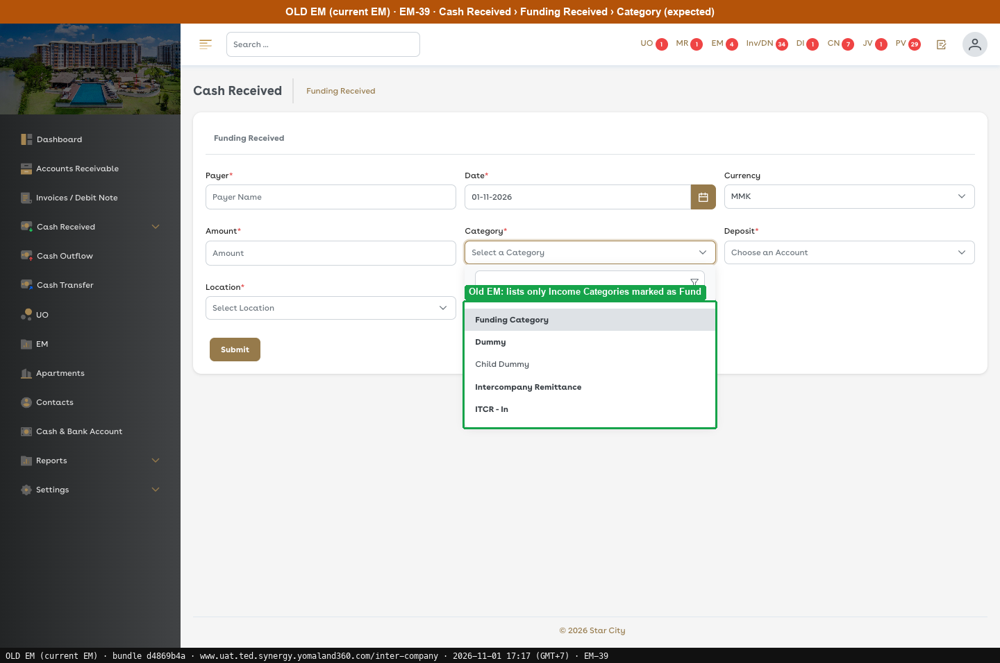 — Old EM: lists only Income Categories marked as Fund
---

### EM-40 · [TC_Setting_14] New parent expense category not displayed in Categories filter

[EM-40](https://zeyalabs-team-a83df6me.atlassian.net/browse/EM-40) · Jira priority High · Status **Fixed**

**Reported:** A newly created parent expense category ("Payment Developer") was not displayed in the Accounts Receivable Categories filter (TC_Setting_14).

#### ★ SAN-EM40-001 · New parent expense category is listed in the AR Categories filter (TC_Setting_14)

| Priority | Suites | Automation | Status | Source |
|---|---|---|---|---|
| P1 | Sanity · Regression | Auto-UI | Active | EM-40 repro (TC-EM-40-01), 2026-11-01 |

**Preconditions:**

1. Logged in as an Admin user.

**Steps:**

1. Settings › Expense Categories (`/settings/expense-categories`): create parent `QA-REPRO-EM-40 Payment Developer`, click [Submit].
2. Open Accounts Receivable (New `/receivables/worklist`, Old `/account-receivables`), open "All Categories".
3. Look for "Payment Developer" (the ticket's name, created earlier by the tester).

**Expected result:**

1. Saved.
2. The new category is listed.
3. It is listed.

**Result (build -37, 2026-11-01):**

| # | Old EM | New EM | |
|---|---|---|---|
| 1 | Saved | Saved | ✅ Same |
| 2 | New category is listed | **Has** `QA-REPRO-EM-40 Payment Developer` (end of list) | ✅ Same |
| 3 | Listed | Listed, as a group heading with 2 children C Loft – … | ✅ Same |

**Conclusion:** Fixed. A parent expense category missing from the filter could not be used to filter AR.

**Test data created:** New EM expense category `QA-REPRO-EM-40 Payment Developer`.

**Evidence:**

- 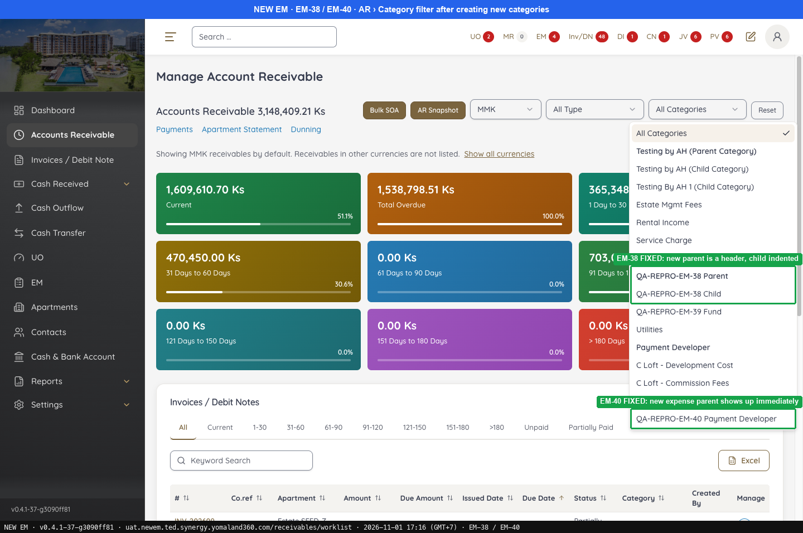 — EM-38 FIXED: new parent is a header, child indented
- 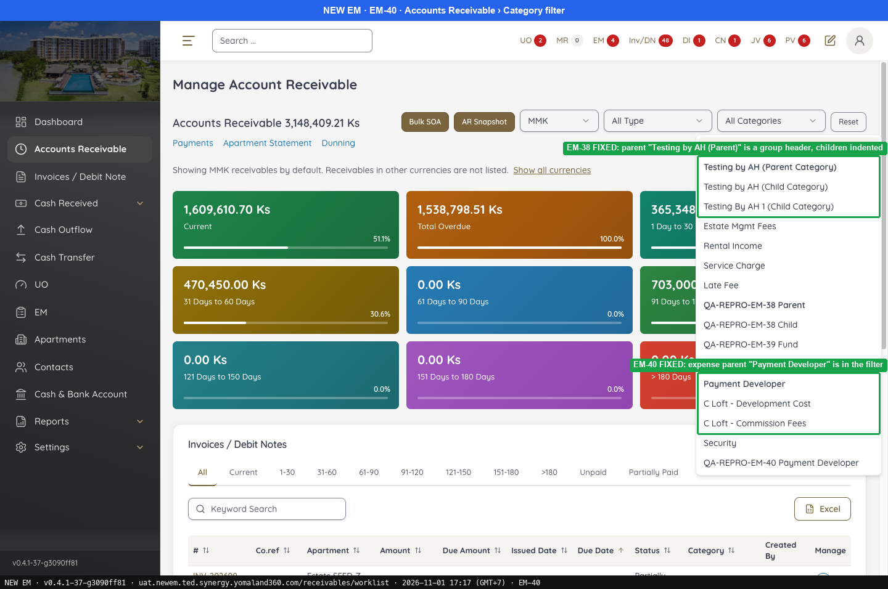 — EM-38 FIXED: parent "Testing by AH (Parent)" is a group header, children indented
-  — Old EM: parent is a group header (not selectable), children listed below
---

### EM-46 · [Settings > Zone and Building] Delete button should not exist

[EM-46](https://zeyalabs-team-a83df6me.atlassian.net/browse/EM-46) · Jira priority Medium · Status **Fixed**

**Reported:** A Delete action was available for zones and buildings, and it should not exist.

#### SAN-EM46-001 · Zones and Buildings have no Delete action

| Priority | Suites | Automation | Status | Source |
|---|---|---|---|---|
| P2 | Sanity · Regression | Auto-UI | Active | EM-46 repro (TC-EM-46-01), 2026-11-01 |

**Preconditions:**

1. Logged in as an Admin user.
2. At least 1 zone and 1 building exist.

**Steps:**

1. Open Settings › Zones (New `/settings/areas`, Old `/settings/zones`) and read the Manage column.
2. Open Edit on a zone and look for Delete in the panel.
3. Open Settings › Buildings (`/settings/buildings`) and read the Manage column.
4. Check Status for removing an item from use.

**Expected result:**

1. Edit button only.
2. No Delete.
3. Edit button only.
4. Status Enable/Disable is available.

**Result (build -37, 2026-11-01):**

| # | Old EM | New EM | |
|---|---|---|---|
| 1 | Edit only | Edit only (aria-label "Edit <zone>") | ✅ Same |
| 2 | None | None | ✅ Same |
| 3 | Edit only | Edit only | ✅ Same |
| 4 | Enable/Disable | Enable/Disable | ✅ Same |

**Conclusion:** Fixed. Deleting a zone or building would orphan the apartments and invoices attached to it; Old EM only allows Disable.

**Evidence:**

- 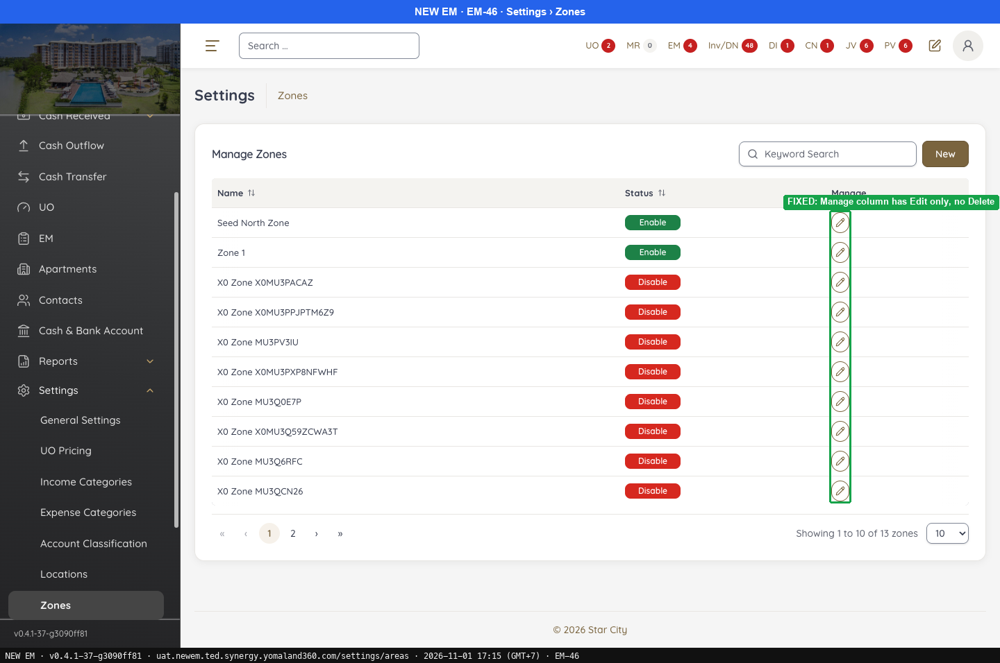 — FIXED: Manage column has Edit only, no Delete
- 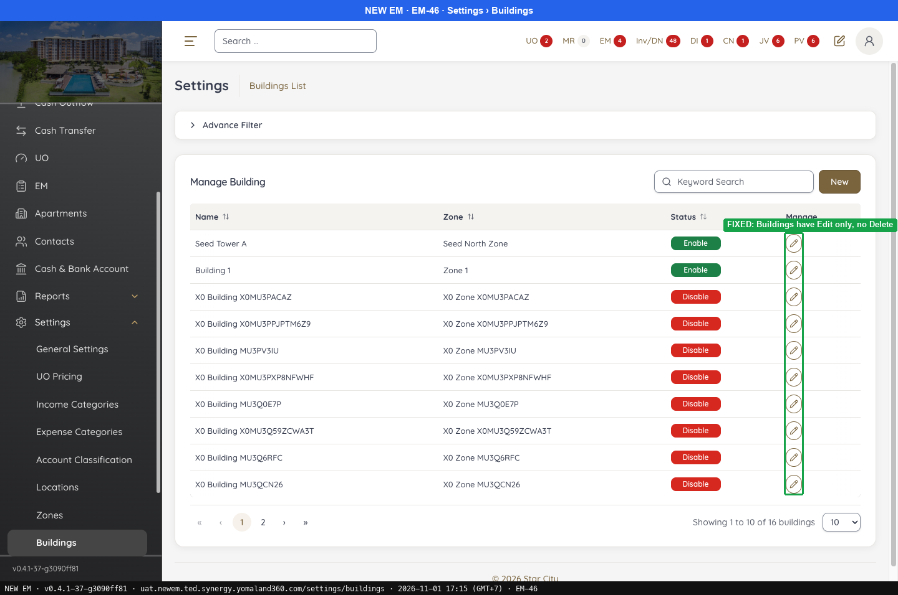 — FIXED: Buildings have Edit only, no Delete
- 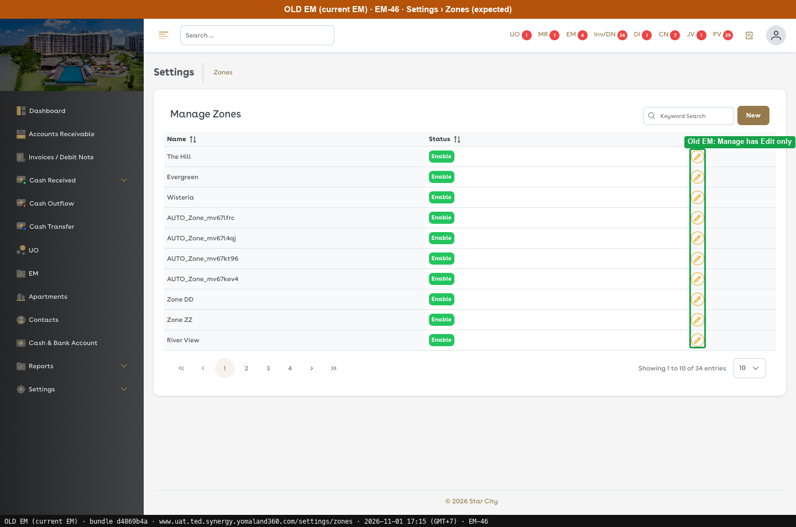 — Old EM: Manage has Edit only
- 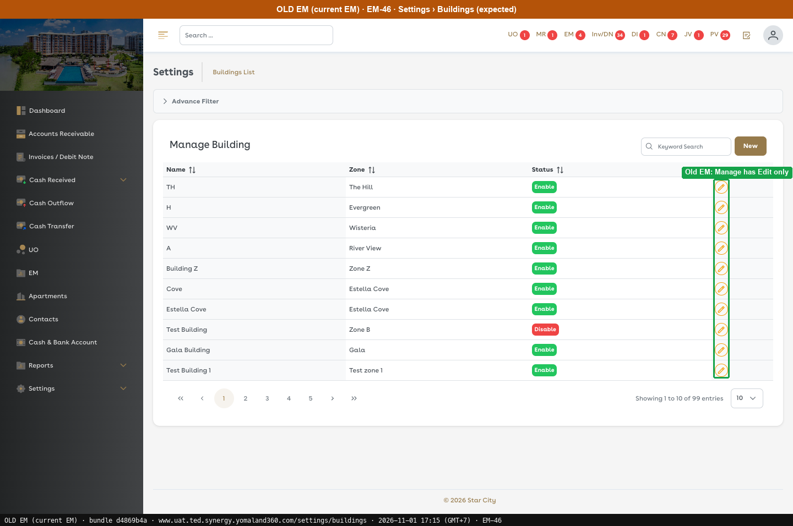 — Old EM: Manage has Edit only
---

### EM-56 · [Settings > Building] Duplicate building records can be created

[EM-56](https://zeyalabs-team-a83df6me.atlassian.net/browse/EM-56) · Jira priority High · Status **Fixed**

**Reported:** A building with the same name in the same zone could be saved as a duplicate record.

#### SAN-EM56-001 · Duplicate building name in the same zone is blocked

| Priority | Suites | Automation | Status | Source |
|---|---|---|---|---|
| P1 | Sanity · Regression | Auto-UI | Active | EM-56 repro (TC-EM-56-01), 2026-11-01 |

**Preconditions:**

1. Logged in as an Admin user.
2. An enabled zone exists (New: "Zone 1"; Old: "The Hill").

**Test data:**

1. Name `QA-REPRO-EM-56 Tower`, Zone `Zone 1`, Status Enable.

**Steps:**

1. Settings › Buildings (`/settings/buildings`), click [New], enter the test data and click [Create].
2. Click [New] again, enter the same Name and Zone and click [Create].
3. On Old EM: try the duplicate "TH" / The Hill.

**Expected result:**

1. Saved.
2. Blocked with "Building Name Already Exists."
3. Blocked with the same message.

**Automated test:** [`SAN-EM56-001` in fixed-settings.spec.ts](../../../../tests/sanity/tickets/fixed/fixed-settings.spec.ts) · tag `@sanity` `@EM-56` · run `APP=em npx playwright test --grep SAN-EM56-001` · picks an existing Enable building of an Enable zone from `/api/gw/areas` and clicks [Create] with the same Name and Zone. Chromium only. **Writes data only if the bug is back** (a duplicate building); the test then fails and names it.

**Result (build -37, 2026-11-01):**

| # | Old EM | New EM | |
|---|---|---|---|
| 1 | Saved | Saved (1 row) | ✅ Same |
| 2 | Blocked: "Building Name Already Exists." | **Blocked**: "Building Name Already Exists", the panel stays open, the list still has 1 row | ✅ Same |
| 3 | Blocked with the same message | Not applicable (Old EM only) | ⛔ Not run |

**Conclusion:** Fixed; the only difference is the trailing full stop. Duplicates would cause the wrong building to be picked when creating an apartment. Not tried: duplicates differing only by case or by leading/trailing spaces.

**Test data created:** New EM building `QA-REPRO-EM-56 Tower` (Zone 1, Enable). Old EM: none (the duplicate was blocked).

**Retest (build -74, 2026-11-06, automated): passed** (Chromium and Firefox, build `v0.4.1-74-g77cbcadf`)

| # | Check | Old EM | New EM | |
|---|---|---|---|---|
| 1 | Same Name and Zone | Blocked: "Building Name Already Exists." | Blocked: "Building Name Already Exists" under Name (B2, Zone B), the panel stays open | ✅ Same |
| 2 | Buildings after the try | No duplicate | Still one B2 in Zone B (`/api/gw/areas`) | ✅ Same |

**Evidence:**

- 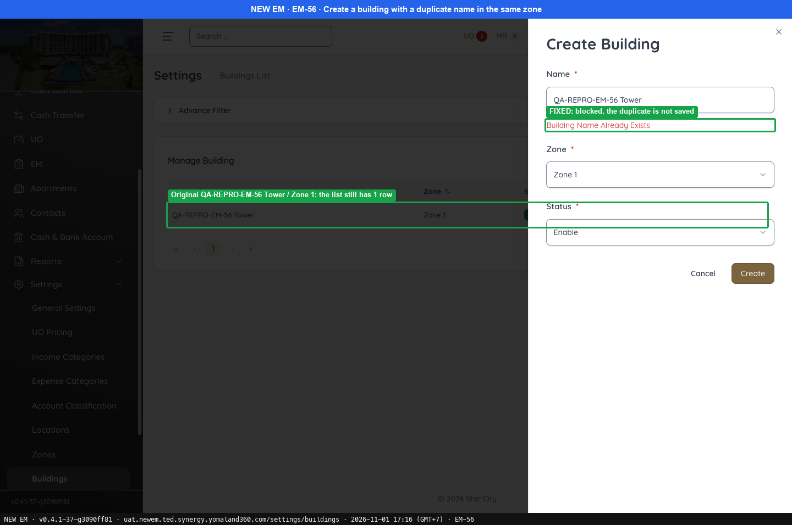 — FIXED: blocked, the duplicate is not saved
- 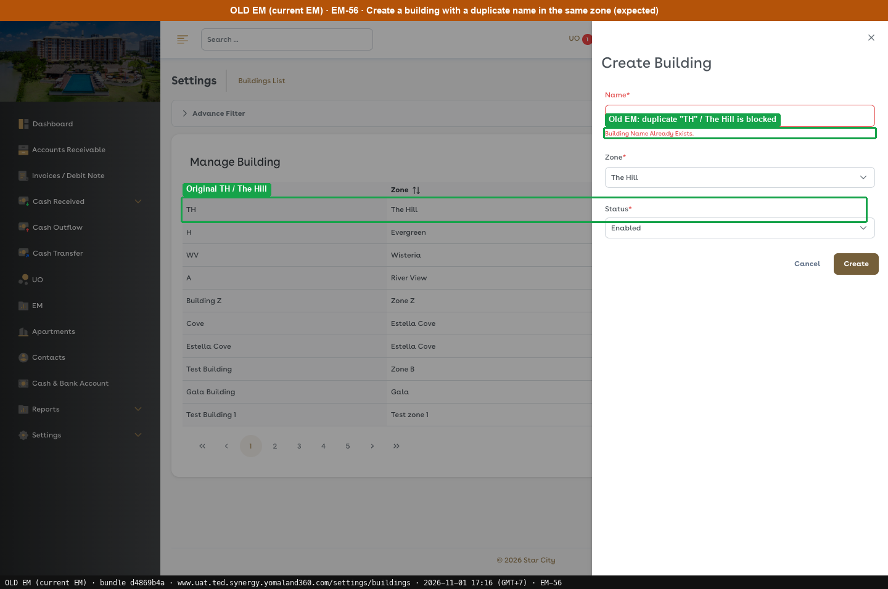 — Old EM: duplicate "TH" / The Hill is blocked
---

### EM-57 · [Settings > Currency] Required fields missing in currency creation (e.g. Currency Status)

[EM-57](https://zeyalabs-team-a83df6me.atlassian.net/browse/EM-57) · Jira priority Medium · Status **Fixed**

**Reported:** Required fields such as Currency Status were not available in the currency creation form.

#### SAN-EM57-001 · Create Currency form has all required fields including Status

| Priority | Suites | Automation | Status | Source |
|---|---|---|---|---|
| P2 | Sanity · Regression | Auto-UI | Active | EM-57 repro (TC-EM-57-01), 2026-11-01 |

**Preconditions:**

1. Logged in as an Admin user.

**Steps:**

1. Go to Account Classification › Manage Currency › New (New `/settings/classification/currencies/new`, Old `/settings/currencies/new`).
2. List the fields.
3. Read the buttons.

**Expected result:**

1. The Create Currency page opens.
2. Currencies*, Name*, Code*, Symbol*, Status* (default Enable).
3. Cancel / Create.

**Result (build -37, 2026-11-01):**

| # | Old EM | New EM | |
|---|---|---|---|
| 1 | Create Currency page | Create Currency page | ✅ Same |
| 2 | Currencies*, Name*, Code*, Symbol*, Status* (default Enable) | Currencies*, Name*, Code*, Symbol*, **Status*** (default Enable) | ✅ Same |
| 3 | Cancel / Create | Cancel / Create | ✅ Same |

**Conclusion:** Fixed. Also noted: the layout differs (Old EM 2 columns, New EM 1 column), outside this ticket. [Create] was not clicked.

**Evidence:**

- 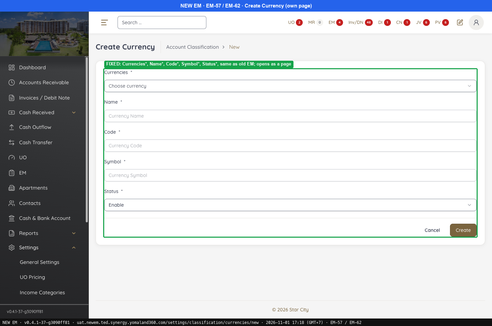 — FIXED: Currencies*, Name*, Code*, Symbol*, Status*, same as old EM; opens as a page
- 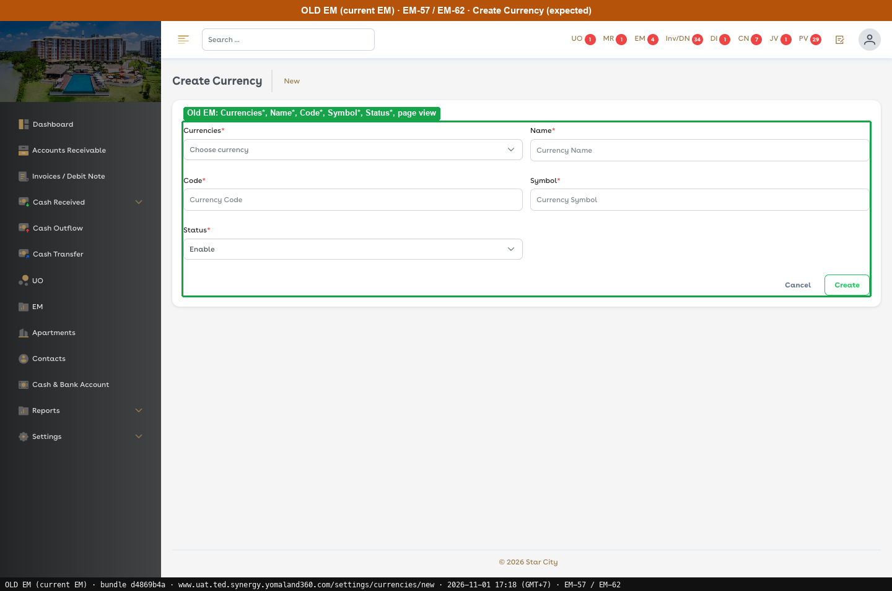 — Old EM: Currencies*, Name*, Code*, Symbol*, Status*, page view
---

### EM-58 · [TC_Setting_28] Check areas fail after creating a new payment method

[EM-58](https://zeyalabs-team-a83df6me.atlassian.net/browse/EM-58) · Jira priority High · Status **Fixed**

**Reported:** After creating a new payment method in Account Classification, the TC_Setting_28 check areas failed.

#### SAN-EM58-001 · New payment method is available in the Cash & Bank Account form (TC_Setting_28)

| Priority | Suites | Automation | Status | Source |
|---|---|---|---|---|
| P1 | Sanity · Regression | Auto-UI | Active | EM-58 repro (TC-EM-58-01), 2026-11-01 |

**Preconditions:**

1. Logged in as an Admin user.

**Test data:**

1. Name `QA-REPRO-EM-58 PM`, Status Enable.

**Steps:**

1. Go to Manage Payment Method › New (`/settings/classification/payment-methods/new`), enter the test data and click [Create].
2. Go to Cash & Bank Account › New (New `/settings/accounts/new`, Old `/cash-and-bank-accounts/new`) and read Payment Method.

**Expected result:**

1. Saved, back on Account Classification, the new method is in the list.
2. The list contains every enabled payment method.

**Result (build -37, 2026-11-01):**

| # | Old EM | New EM | |
|---|---|---|---|
| 1 | Saved, back on Account Classification, in the list | Saved, back on `/settings/classification`, row "QA-REPRO-EM-58 PM · Enable" | ✅ Same |
| 2 | Lists every enabled payment method | **Has** `QA-REPRO-EM-58 PM` | ✅ Same |

**Conclusion:** Fixed. Also noted: Old EM uses the multiselect "Select Payment Method", New EM a checkbox list (see EM-70, EM-71). Not checked: Make Payment / Cash Received showing only the payment methods ticked on the account (needs an account with this method ticked).

**Test data created:** New EM payment method `QA-REPRO-EM-58 PM` (Enable).

**Evidence:**

- 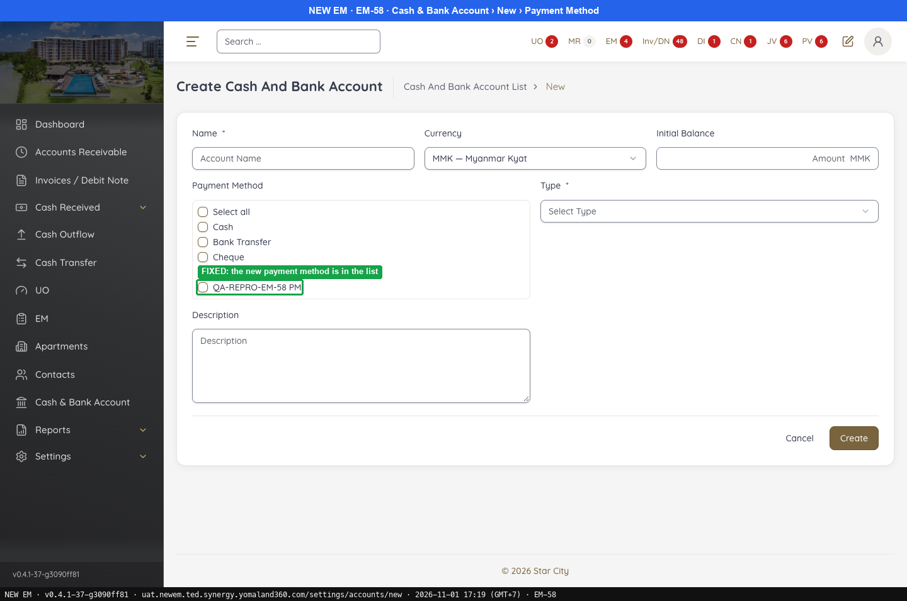 — FIXED: the new payment method is in the list
- 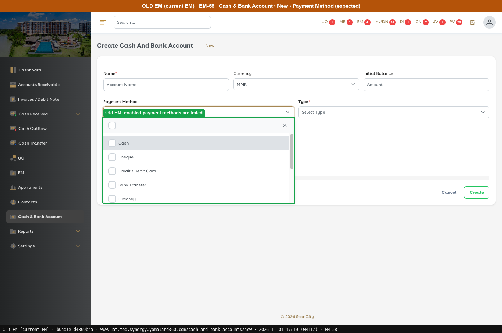 — Old EM: enabled payment methods are listed
---

### EM-60 · [Settings > Account Classification] Manage Type section is missing

[EM-60](https://zeyalabs-team-a83df6me.atlassian.net/browse/EM-60) · Jira priority High · Status **Fixed**

**Reported:** The Manage Type section was missing from Account Classification.

#### SAN-EM60-001 · Account Classification has a Manage Type section

| Priority | Suites | Automation | Status | Source |
|---|---|---|---|---|
| P1 | Sanity · Regression | Auto-UI | Active | EM-60 repro (TC-EM-60-01), 2026-11-01 |

**Preconditions:**

1. Logged in as an Admin user.

**Steps:**

1. Open Account Classification (New `/settings/classification`, Old `/settings/account-classification`) and list the sections.
2. In Manage Type, look for New, the list and Edit.

**Expected result:**

1. Manage Currency, Manage Payment Method, Manage Type, Manage Bank.
2. New, the list and Edit are available.

**Automated test:** [`SAN-EM60-001` in fixed-settings.spec.ts](../../../../tests/sanity/tickets/fixed/fixed-settings.spec.ts) · tag `@sanity` `@EM-60` · run `APP=em npx playwright test --grep SAN-EM60-001` · reads `/settings/classification`; read-only.

**Result (build -37, 2026-11-01):**

| # | Old EM | New EM | |
|---|---|---|---|
| 1 | Manage Currency, Manage Payment Method, Manage Type, Manage Bank | Manage Currency, Manage Payment Method, **Manage Type**, Manage Bank | ✅ Same |
| 2 | Available | Available (BANK, CASH, Petty Cash, Escrow, Operating) | ✅ Same |

**Conclusion:** Fixed. Without Manage Type, account types cannot be managed (Type* is required when creating a Cash & Bank Account). Also noted: Manage on Payment Method and Bank is Edit only on Old EM, but Edit **+ Delete** (trash icon) on New EM; no ticket yet.

**Retest (build -74, 2026-11-06, automated): passed** (Chromium and Firefox, build `v0.4.1-74-g77cbcadf`)

| # | Check | Old EM | New EM | |
|---|---|---|---|---|
| 1 | Sections | Manage Currency, Payment Method, Type, Bank | Manage Currency, Manage Payment Method, **Manage Type**, Manage Bank | ✅ Same |
| 2 | Manage Type | New, list, Edit | [New], list BANK, CASH, Petty Cash, Escrow, Operating, Edit on each row | ✅ Same |

**Evidence:**

- 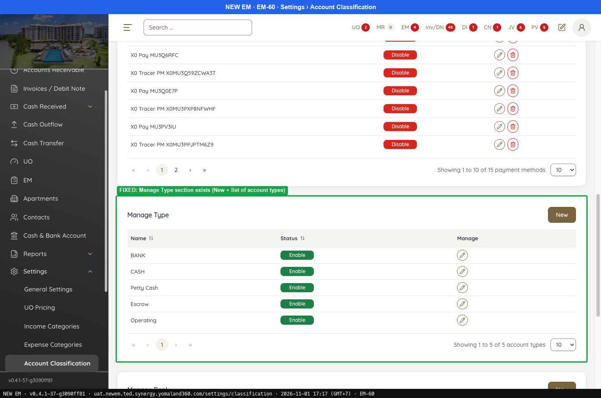 — FIXED: Manage Type section exists (New + list of account types)
- 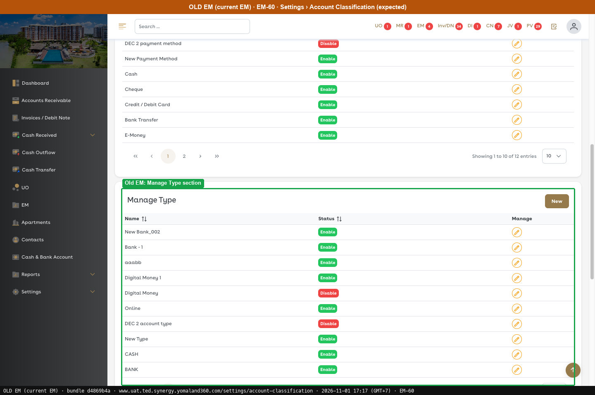 — Old EM: Manage Type section
---

### EM-62 · [Side Panel] Roles, Cash & Bank Account, Currency, Payment Method, Staff forms should be page views

[EM-62](https://zeyalabs-team-a83df6me.atlassian.net/browse/EM-62) · Jira priority High · Status **Fixed**

**Reported:** Roles, Cash & Bank Account, Create Currency, Create Payment Method and Create Staff opened as side panels, causing UI and usability issues; they should be page views.

#### SAN-EM62-001 · Five forms open as page views instead of side panels

| Priority | Suites | Automation | Status | Source |
|---|---|---|---|---|
| P1 | Sanity · Regression | Auto-UI | Active | EM-62 repro (TC-EM-62-01), 2026-11-01 |

**Preconditions:**

1. Logged in as an Admin user.

**Steps:**

1. Settings › Roles › New.
2. Cash & Bank Account › New.
3. Account Classification › Manage Currency › New.
4. Account Classification › Manage Payment Method › New.
5. Settings › Staff › New.
6. Open Edit of Roles, Cash & Bank and Staff.

**Expected result:**

1. Each form opens as a separate page, not a side panel.

**Result (build -37, 2026-11-01):**

| # | Old EM | New EM | |
|---|---|---|---|
| 1 | Separate page | `/settings/roles/new`, no `[role=dialog]` | ✅ Same |
| 2 | Separate page | `/settings/accounts/new`, no dialog | ✅ Same |
| 3 | Separate page (`/settings/currencies/new`) | `/settings/classification/currencies/new` | ✅ Same |
| 4 | Separate page | `/settings/classification/payment-methods/new` | ✅ Same |
| 5 | Separate page (`/settings/staffs/new`) | `/settings/staff/new` | ✅ Same |
| 6 | Separate page | Links `/…/<id>/edit` (separate page) | ✅ Same |

**Conclusion:** Fixed. Long forms in a side panel were cut off and hard to use, unlike Old EM. Old EM screenshots cover Create Currency and Create Staff. Also noted, outside this ticket and not checked: Manage Bank › New is still a button that opens a panel.

**Evidence:**

-  — FIXED: Currencies*, Name*, Code*, Symbol*, Status*, same as old EM; opens as a page
- 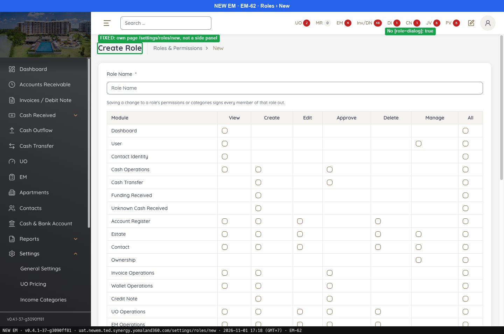 — FIXED: own page /settings/roles/new, not a side panel
- 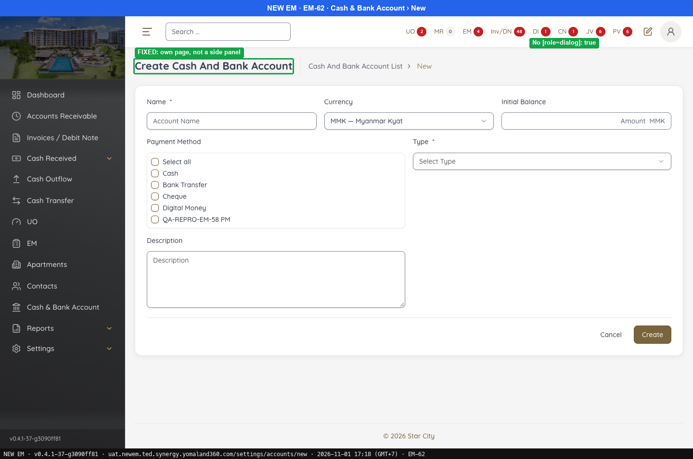 — FIXED: own page, not a side panel
- 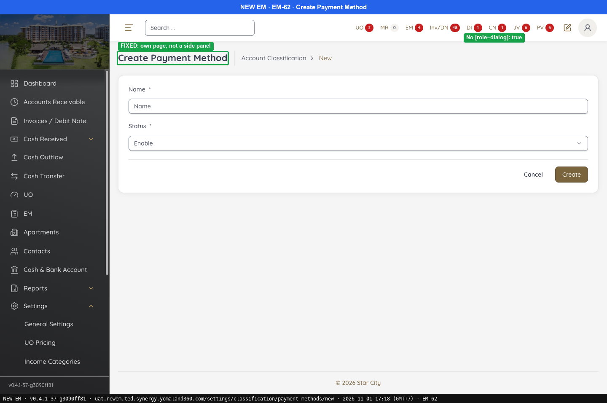 — FIXED: own page, not a side panel
-  — EM-62 FIXED: own page
-  — Old EM: Currencies*, Name*, Code*, Symbol*, Status*, page view
-  — Old EM: Phone (country code + number); own page
---

### EM-63 · [Settings > Staff] Phone number field missing in staff creation form

[EM-63](https://zeyalabs-team-a83df6me.atlassian.net/browse/EM-63) · Jira priority Medium · Status **Fixed**

**Reported:** The Phone number field was missing in the staff creation form.

#### SAN-EM63-001 · Create Staff form has a Phone field

| Priority | Suites | Automation | Status | Source |
|---|---|---|---|---|
| P2 | Sanity · Regression | Auto-UI | Active | EM-63 repro (TC-EM-63-01), 2026-11-01 |

**Preconditions:**

1. Logged in as an Admin user.

**Steps:**

1. Open Staff › New (New `/settings/staff/new`, Old `/settings/staffs/new`) and list the fields.

**Expected result:**

1. Name*, Email*, Phone (country code +95 + number), Staff Type*, Password*, Confirm Password*.

**Result (build -37, 2026-11-01):**

| # | Old EM | New EM | |
|---|---|---|---|
| 1 | Name*, Email*, Phone (flag + code +95 + number), Staff Type*, Password*, Confirm Password* | Name*, Email*, **Phone (Country code +95 + number)**, Staff Type*, Password*, Confirm Password* | ✅ Same |

**Conclusion:** Fixed. The staff phone number could not be entered before, unlike Old EM.

**Evidence:**

- 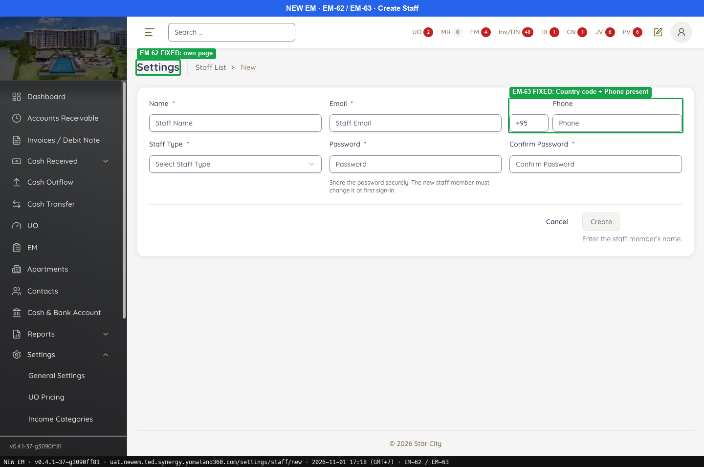 — EM-62 FIXED: own page
- 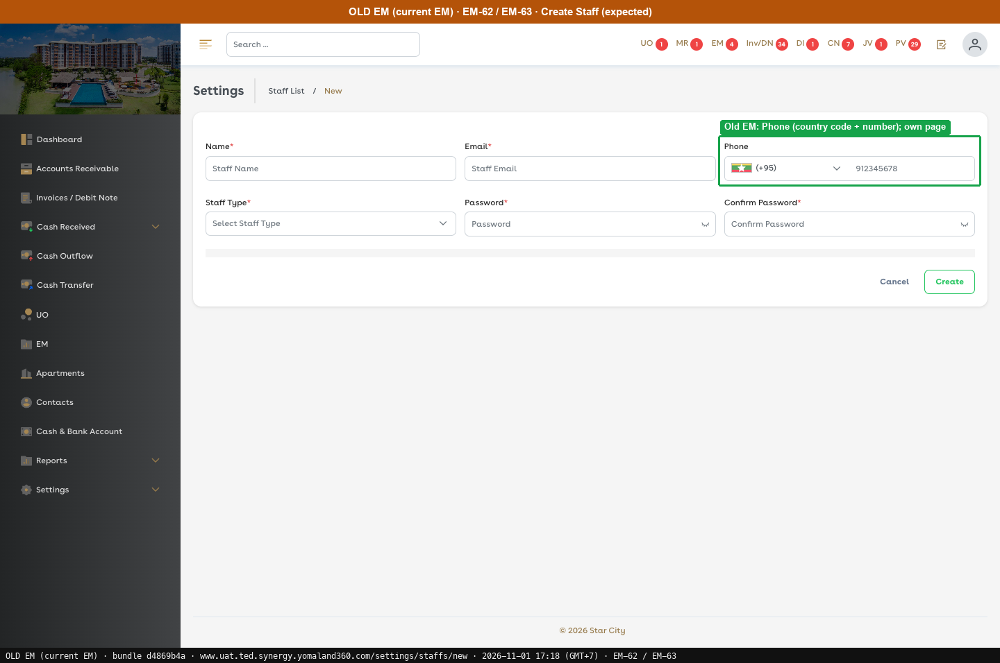 — Old EM: Phone (country code + number); own page
---

### EM-64 · [Settings > Staff] Status shown as Enable/Disable instead of Activate/Deactivate

[EM-64](https://zeyalabs-team-a83df6me.atlassian.net/browse/EM-64) · Jira priority Low · Status **Fixed**

**Reported:** Staff status was displayed as Enable/Disable, inconsistent with the current EM.

#### SAN-EM64-001 · Staff status is displayed as Activate / Deactivate

| Priority | Suites | Automation | Status | Source |
|---|---|---|---|---|
| P3 | Sanity · Regression | Auto-UI | Active | EM-64 repro (TC-EM-64-01), 2026-11-01 |

**Preconditions:**

1. Logged in as an Admin user.
2. Staff exist in both statuses.

**Steps:**

1. Open Settings › Staff (New `/settings/staff`, Old `/settings/staffs`) and read the Status column.
2. Open Edit Staff and read Status.

**Expected result:**

1. Activate / Deactivate.
2. Activate / Deactivate.

**Result (build -37, 2026-11-01):**

| # | Old EM | New EM | |
|---|---|---|---|
| 1 | Activate / Deactivate | **Activate / Deactivate** | ✅ Same |
| 2 | Activate / Deactivate | Activate / Deactivate | ✅ Same |

**Conclusion:** Fixed. Also noted, outside this ticket: Manage is Edit only on Old EM, Edit **+ toggle button** on New EM.

**Evidence:**

- 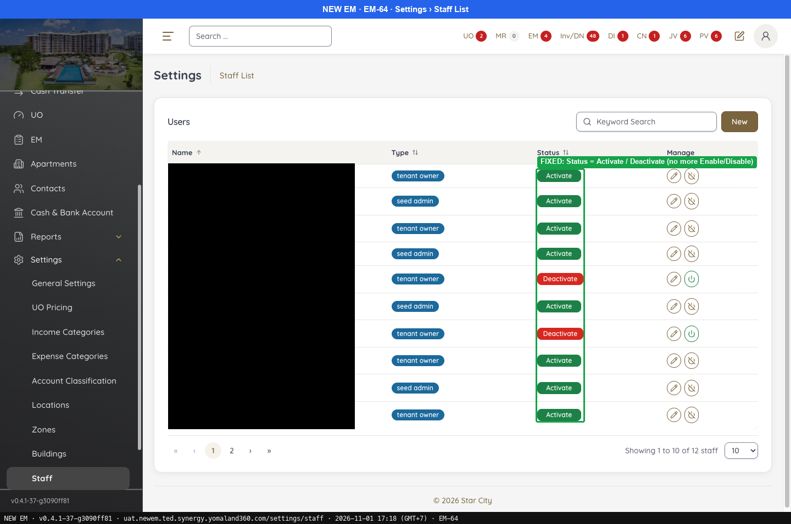 — FIXED: Status = Activate / Deactivate (no more Enable/Disable)
- 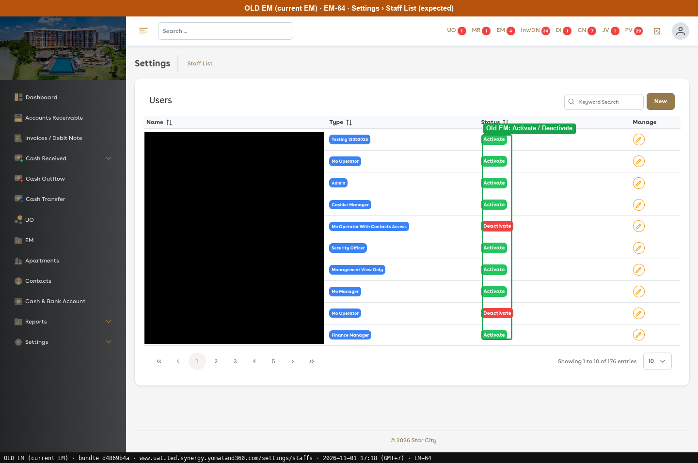 — Old EM: Activate / Deactivate
---

### EM-65 · [Settings > Staff] Reset Password flow differs from current EM

[EM-65](https://zeyalabs-team-a83df6me.atlassian.net/browse/EM-65) · Jira priority Medium · Status **Fixed**

**Reported:** The reset password flow differed from the current EM: New EM used a reset icon and password fields in Edit Staff.

#### SAN-EM65-001 · Edit Staff changes the password through Click to change password

| Priority | Suites | Automation | Status | Source |
|---|---|---|---|---|
| P2 | Sanity · Regression | Auto-UI | Active | EM-65 repro (TC-EM-65-01), 2026-11-01 |

**Preconditions:**

1. Logged in as an Admin user.
2. A staff record exists.

**Steps:**

1. Open Staff › Edit on a staff record (New `/settings/staff/5/edit`, Old `/settings/staffs/271/edit`).
2. Click "Click to change password". Do not click [Update], so no real password is changed.

**Expected result:**

1. Password* is a button "Click to change password".
2. Password*, Confirm Password* and "Cancel change password" are displayed.

**Result (build -37, 2026-11-01):**

| # | Old EM | New EM | |
|---|---|---|---|
| 1 | Button "Click to change password" | Button **"Click to change password"** | ✅ Same |
| 2 | Password* + Confirm Password* + "Cancel change password" | Password* + Confirm Password* + "Cancel change password" (+ hint "at least 8 characters") | ✅ Same |

**Conclusion:** Fixed. New EM used to have a reset icon and always-visible password fields in Edit Staff.

**Evidence:**

- 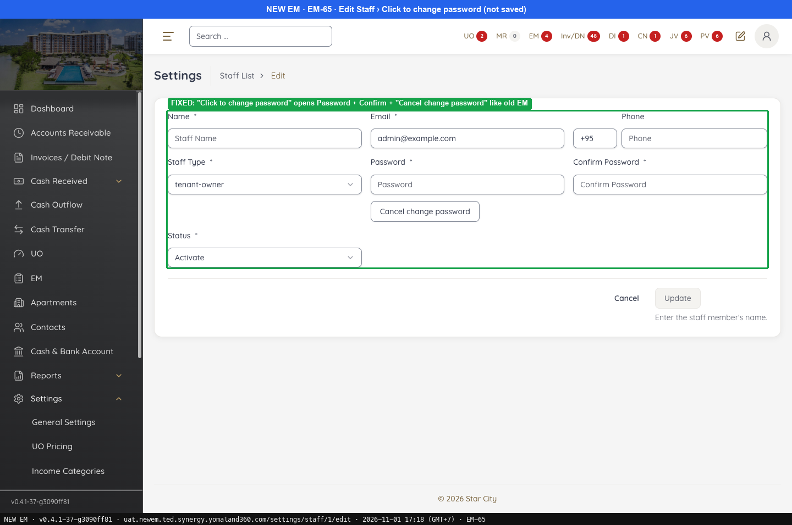 — FIXED: "Click to change password" opens Password + Confirm + "Cancel change password" like old EM
- 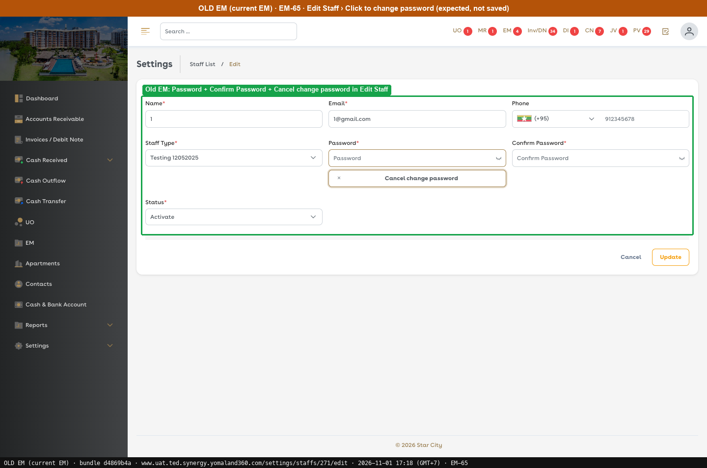 — Old EM: Password + Confirm Password + Cancel change password in Edit Staff
---
