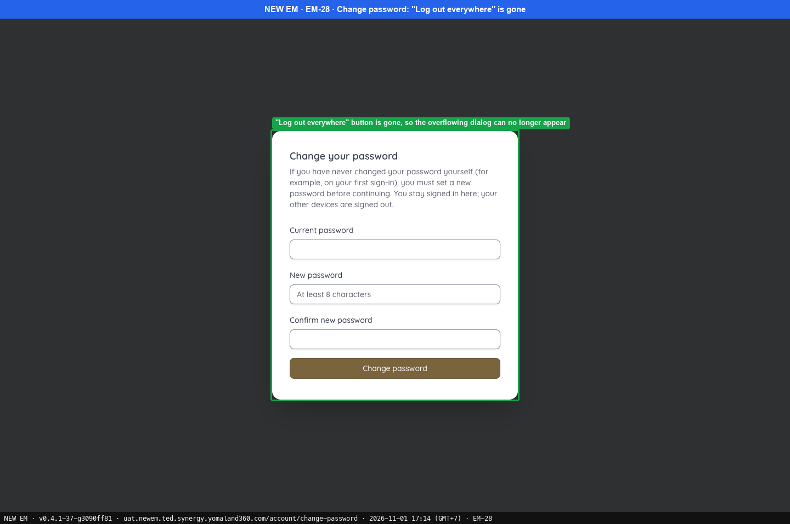
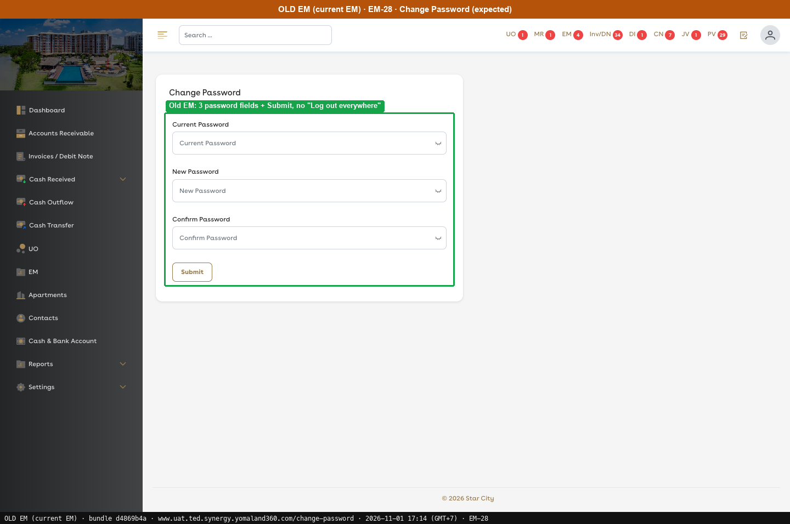
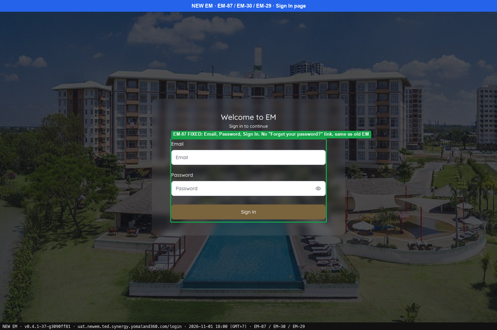
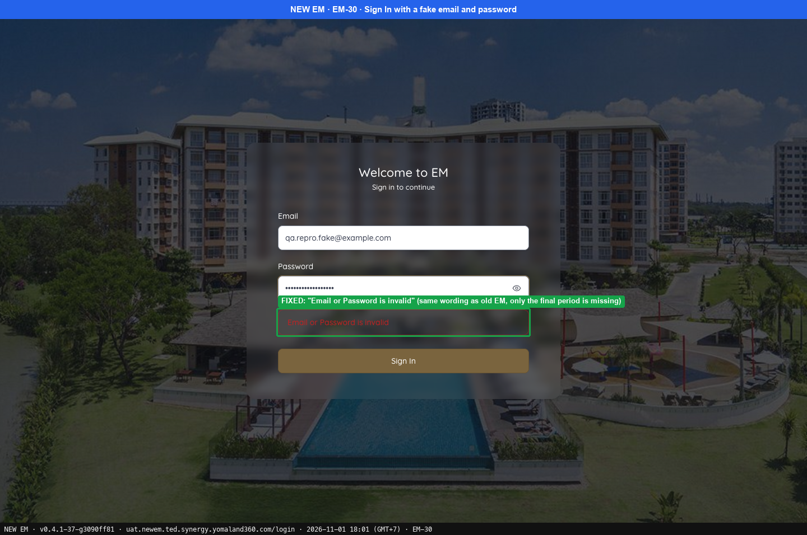
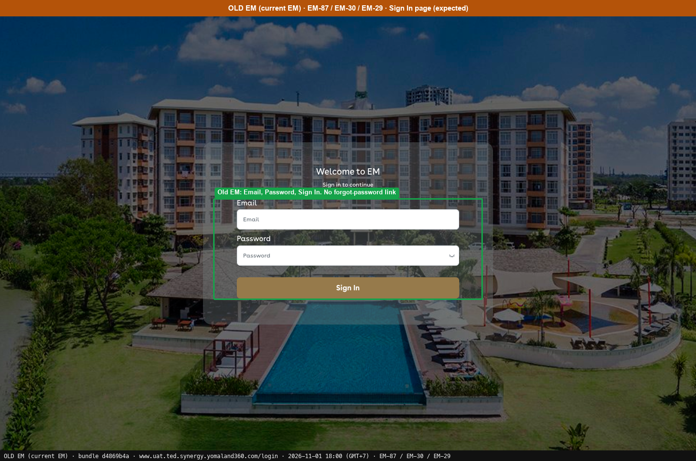
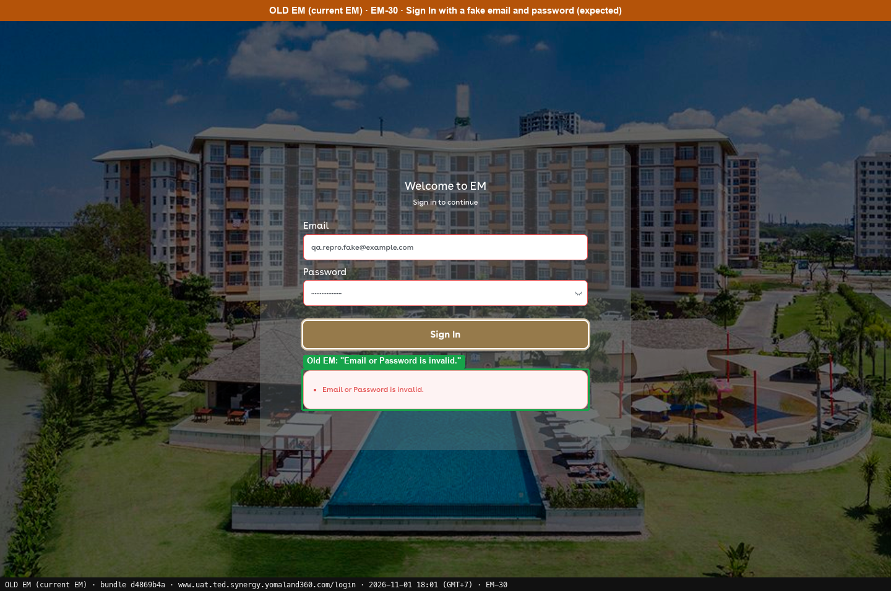

# Fixed · Sign In & Account

[← Ticket index](../README.md) · [Sanity index](../../README.md)

**Tickets:** 3 · **Fixed:** 3

These tickets are fixed on build -37. Their cases are now regression checks.

## Summary

| Ticket | Title | Jira priority | Status (build -37) | Result | Case |
|---|---|---|---|---|---|
| [EM-28](https://zeyalabs-team-a83df6me.atlassian.net/browse/EM-28) | [Change Password] “Log out of every device?” dialog content overflows outside the modal | Medium | Fixed | "Log out everywhere" button and dialog removed; page matches Old EM | [SAN-EM28-001](#san-em28-001--change-password-page-has-no-log-out-everywhere-button-so-the-dialog-cannot-overflow) |
| [EM-30](https://zeyalabs-team-a83df6me.atlassian.net/browse/EM-30) | [Sign In] Invalid email/password alert message is incorrect | Low | Fixed | Shows "Email or Password is invalid"; only the final period differs from Old EM | [SAN-EM30-001](#san-em30-001--invalid-email-or-password-shows-email-or-password-is-invalid) |
| [EM-87](https://zeyalabs-team-a83df6me.atlassian.net/browse/EM-87) | [Sign In > Forgot Your Password] Feature shown but not supported in current EM | Low | Fixed | Sign In page no longer has the link | [SAN-EM87-001](#san-em87-001--sign-in-page-has-no-forgot-your-password-link) |

## Tickets

### EM-28 · [Change Password] “Log out of every device?” dialog content overflows outside the modal

[EM-28](https://zeyalabs-team-a83df6me.atlassian.net/browse/EM-28) · Jira priority Medium · Status **Fixed**

**Reported:** On the Change your password page, the title, message and "Yes, log out everywhere" button of the "Log out of every device?" dialog extend past the right edge of the modal.

#### SAN-EM28-001 · Change Password page has no Log out everywhere button, so the dialog cannot overflow

| Priority | Suites | Automation | Status | Source |
|---|---|---|---|---|
| P2 | Sanity · Regression | Auto-UI | Active | EM-28 repro (TC-EM-28-01), 2026-11-01 |

**Preconditions:**

1. Logged in as Admin.
2. Pages: New EM `/account/change-password`, Old EM `/change-password` (bundle `d4869b4a`).

**Steps:**

1. Open the Change Password page (avatar menu › Change Password, or the URL).
2. Look for the "Log out everywhere" button.
3. Compare the page with Old EM.

**Expected result:**

1. The change password page opens with Current / New / Confirm fields.
2. There is no "Log out everywhere" button and no "Log out of every device?" dialog, as in Old EM. If a dialog ever exists, its content stays inside the modal.

**Result (build -37, 2026-11-01):**

| # | Old EM | New EM | |
|---|---|---|---|
| 1 | Current / New / Confirm + Submit | Current / New / Confirm + "Change password" | ✅ Same |
| 2 | No "Log out everywhere" button | No "Log out everywhere" button, dialog cannot be opened | ✅ Same |
| 3 | No dialog "Log out of every device?" | No dialog; the note "your other devices are signed out" describes automatic behaviour on password change | ✅ Same |

**Conclusion:** Fixed. The feature was removed, which matches Old EM, so the overflow can no longer occur.

**Evidence:**

-  — "Log out everywhere" button is gone, so the overflowing dialog can no longer appear
-  — Old EM: 3 password fields + Submit, no "Log out everywhere"
---

### EM-30 · [Sign In] Invalid email/password alert message is incorrect

[EM-30](https://zeyalabs-team-a83df6me.atlassian.net/browse/EM-30) · Jira priority Low · Status **Fixed**

**Reported:** Signing in with an invalid email or password shows "Check the email and password, then try again." instead of the required message.

#### SAN-EM30-001 · Invalid email or password shows Email or Password is invalid

| Priority | Suites | Automation | Status | Source |
|---|---|---|---|---|
| P3 | Sanity · Regression | Auto-UI | Active | EM-30 repro (TC-EM-30-01), 2026-11-01 |

**Preconditions:**

1. Signed out, on the Sign In page.
2. Pages: New EM `/login`, Old EM `/login` (bundle `d4869b4a`).

**Test data:**

1. A fake email and a fake password, not a real account.

**Steps:**

1. Enter an invalid email (or a valid email with an invalid password) and click [Sign In].

**Expected result:**

1. The alert reads "Email or Password is invalid" (text from the ticket).

**Result (build -37, 2026-11-01):**

| # | Old EM | New EM | |
|---|---|---|---|
| 1 | "Email or Password is invalid." | **"Email or Password is invalid"** (same wording, only the final period differs) | ✅ Same |

**Conclusion:** Fixed. The reported wrong text ("Check the email and password, then try again.") no longer appears. Tested once on each UAT in a separate signed-out context with a fake email and password. Also noted: New EM omits the final period that Old EM shows.

**Evidence:**

-  — EM-87 FIXED: Email, Password, Sign In. No "Forgot your password?" link, same as old EM
-  — FIXED: "Email or Password is invalid" (same wording as old EM, only the final period is missing)
-  — Old EM: Email, Password, Sign In. No forgot-password link
-  — Old EM: "Email or Password is invalid."
---

### EM-87 · [Sign In > Forgot Your Password] Feature shown but not supported in current EM

[EM-87](https://zeyalabs-team-a83df6me.atlassian.net/browse/EM-87) · Jira priority Low · Status **Fixed**

**Reported:** "Forgot Your Password" is shown on the new EM Sign In page, while the current EM does not support this feature.

#### SAN-EM87-001 · Sign In page has no Forgot Your Password link

| Priority | Suites | Automation | Status | Source |
|---|---|---|---|---|
| P3 | Sanity · Regression | Auto-UI | Active | EM-87 repro (TC-EM-87-01), 2026-11-01 |

**Preconditions:**

1. The `/login` page is open.
2. Pages: New EM `/login`, Old EM `/login` (bundle `d4869b4a`).

**Steps:**

1. Open the Sign In page.
2. Look for the "Forgot Your Password" link.

**Expected result:**

1. The page shows Email, Password and Sign In.
2. There is no "Forgot Your Password" link.

**Result (build -37, 2026-11-01):**

| # | Old EM | New EM | |
|---|---|---|---|
| 1 | Page not seen: `/login` redirects to Dashboard while signed in | Email, Password, Sign In | ⛔ Old EM not run |
| 2 | Per the ticket, current EM does not support this feature; not seen on screen in this run | No link | ✅ Same |

**Conclusion:** Fixed. The link is gone from the New EM Sign In page. The Old EM side rests on the ticket, not on this run.

**Evidence:**

-  — EM-87 FIXED: Email, Password, Sign In. No "Forgot your password?" link, same as old EM
-  — Old EM: Email, Password, Sign In. No forgot-password link
---
