# Fixed · Wallet

[← Ticket index](../README.md) · [Sanity index](../../README.md)

**Tickets:** 6 · **Fixed:** 6

These tickets are fixed on build -37. Their cases are now regression checks.

## Summary

| Ticket | Title | Jira priority | Status (build -37) | Result | Case |
|---|---|---|---|---|---|
| [EM-77](https://zeyalabs-team-a83df6me.atlassian.net/browse/EM-77) | [Apartments > Wallet > Wallet Recharge] Redirects to Wallet Operations instead of apartment wallet | Medium | Fixed | After Recharge the user returns to Apartment › Wallet with the updated balance (RV-00078, 960.99 Ks). | [SAN-EM77-001](#san-em77-001--wallet-recharge-returns-to-the-apartment-wallet-and-shows-the-updated-balance) |
| [EM-78](https://zeyalabs-team-a83df6me.atlassian.net/browse/EM-78) | [Apartments > Wallet > Wallet Transfer] "Transfer To" is free text instead of apartment dropdown | Medium | Fixed | "Transfer to *" is an apartment dropdown. | [SAN-EM78-001](#san-em78-001--wallet-transfer-transfer-to-is-a-dropdown-of-enabled-apartments) |
| [EM-79](https://zeyalabs-team-a83df6me.atlassian.net/browse/EM-79) | [Apartments > Wallet > Wallet Transfer] Transfer fails with a valid destination apartment | Highest | Fixed | Transfer of 10 Ks succeeds (WT-00006). | [SAN-EM79-001](#-san-em79-001--wallet-transfer-to-a-valid-apartment-posts-and-reduces-the-source-wallet) |
| [EM-80](https://zeyalabs-team-a83df6me.atlassian.net/browse/EM-80) | [Apartments > Wallet > Wallet Transfer] Location field should not be displayed | Medium | Fixed | The Wallet Transfer form has no Location field. | [SAN-EM80-001](#san-em80-001--wallet-transfer-form-has-no-location-field) |
| [EM-81](https://zeyalabs-team-a83df6me.atlassian.net/browse/EM-81) | [Apartments > Wallet > Wallet Refund] Admin with self-approval cannot approve refund | High | Fixed | Refund is self-approved (PV-00027) and the wallet is reduced by 50. | [SAN-EM81-001](#-san-em81-001--admin-with-self-approval-approves-their-own-wallet-refund-and-the-wallet-is-reduced) |
| [EM-89](https://zeyalabs-team-a83df6me.atlassian.net/browse/EM-89) | [Wallet / Deposit] Business logic not aligned with current EM; approval state should not be required | Highest | Fixed | Recharge and Add Deposit post immediately, with no approval. | [SAN-EM89-001](#-san-em89-001--wallet-recharge-and-add-deposit-post-immediately-with-no-approval-state) |

## Tickets

### EM-77 · [Apartments > Wallet > Wallet Recharge] Redirects to Wallet Operations instead of apartment wallet

[EM-77](https://zeyalabs-team-a83df6me.atlassian.net/browse/EM-77) · Jira priority Medium · Status **Fixed**

**Reported:** After a successful wallet recharge the user was redirected to the Wallet Operations page, instead of the Apartment Detail / Wallet Detail page with the updated balance.

#### SAN-EM77-001 · Wallet Recharge returns to the apartment wallet and shows the updated balance

| Priority | Suites | Automation | Status | Source |
|---|---|---|---|---|
| P2 | Sanity · Regression | Auto-UI | Active | EM-77 repro (TC-EM-77-01), 2026-11-01 |

**Preconditions:**

1. Logged in as an Admin user.
2. Apartment `QA-REPRO-EM-56 Tower-R32-101` (id 32) exists; wallet balance 919.99 Ks at the start of the repro session.

**Test data:**

1. Method Cash, Received In CASH-0001, Location Main Office, Amount 100, Remark `QA-REPRO-EM-77`.
2. Re-run: Amount 1, same Remark.

**Steps:**

1. Open the apartment, tab Wallet, click [Recharge] (`/wallet/operations?estate_id=32&type=RECHARGE&new=1`).
2. Enter the test data and click [Post].

**Expected result:**

1. The recharge form opens.
2. After Post the user is back on Apartment › Wallet (`/estates/32?tab=wallet`) and the new balance is displayed.

**Result (build -37, 2026-11-01):**

| # | Old EM | New EM | |
|---|---|---|---|
| 1 | Not re-run; ticket expects the recharge form | Panel "Recharge Wallet" (opens over the Wallet Operations page) | ✅ Same |
| 2 | Recharge 1 Ks (RV-102424) stays on Apartment › Wallet and posts immediately, no approval | Back on `/estates/32?tab=wallet`. First run: 100 Ks, "MMK Wallet Current Balance: 1,009.99 Ks", row RV-00074. Re-run: 1 Ks, **RV-00078**, balance **960.99** | ✅ Same |

**Conclusion:** Fixed. The user returns to the apartment wallet with the new balance. Old EM ran the post step only (RV-102424); the form step is taken from the ticket. Also noted: 1,009.99 Ks includes the 10.00 Ks transfer out WT-00006 from EM-79, made earlier in the same session; 960.99 Ks also includes the 50.00 Ks refund PV-00027 from EM-81.

**Test data created:** Recharges RV-00074 (100 Ks) and RV-00078 (1 Ks).

**Evidence:**

- 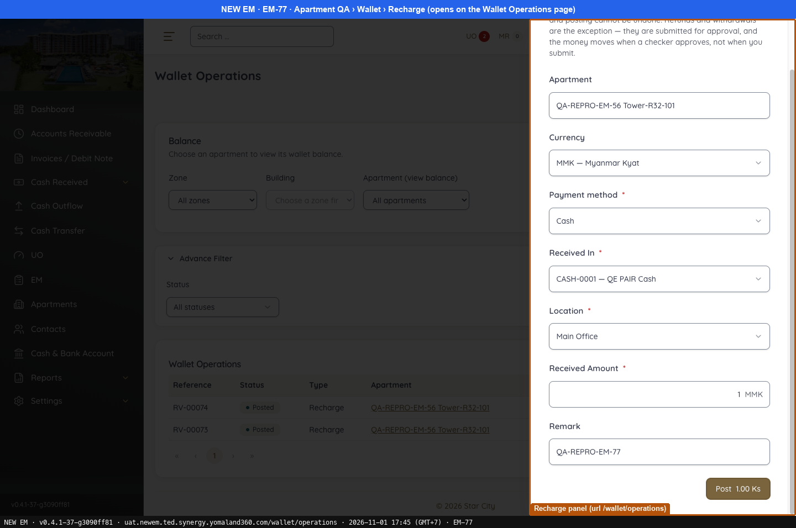 — Recharge panel (url /wallet/operations)
-  — EM-77 FIXED: returns to Apartment › Wallet, new balance 960.99
- 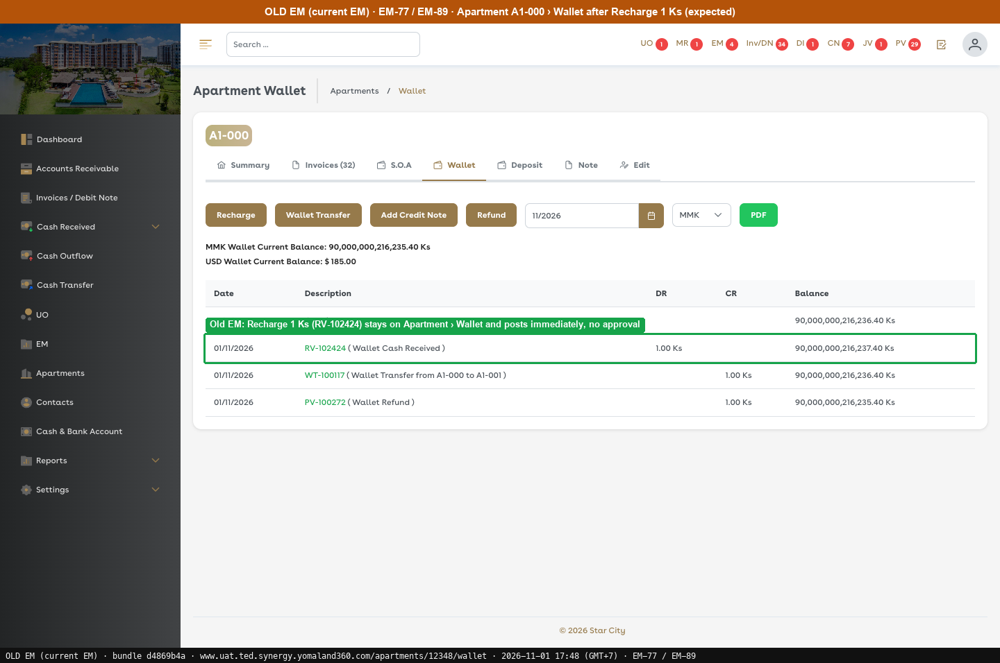 — Old EM: Recharge 1 Ks (RV-102424) stays on Apartment › Wallet and posts immediately, no approval
---

### EM-78 · [Apartments > Wallet > Wallet Transfer] "Transfer To" is free text instead of apartment dropdown

[EM-78](https://zeyalabs-team-a83df6me.atlassian.net/browse/EM-78) · Jira priority Medium · Status **Fixed**

**Reported:** The "Transfer To" field was a free-text input where the apartment name or number had to be typed; it should be a dropdown of all Active/Enabled apartments.

#### SAN-EM78-001 · Wallet Transfer "Transfer to" is a dropdown of enabled apartments

| Priority | Suites | Automation | Status | Source |
|---|---|---|---|---|
| P2 | Sanity · Regression | Auto-UI | Active | EM-78 repro (TC-EM-78-01), 2026-11-01 |

**Preconditions:**

1. Logged in as an Admin user.
2. Apartment `QA-REPRO-EM-56 Tower-R32-101` (id 32) exists with a wallet balance.

**Steps:**

1. Open the apartment, tab Wallet, click [Wallet Transfer] (`/wallet/transfers?from_estate_id=32&new=1`).
2. Open the "Transfer to *" field.

**Expected result:**

1. The Wallet Transfer panel opens.
2. "Transfer to *" is a dropdown of enabled apartments.

**Result (build -37, 2026-11-01):**

| # | Old EM | New EM | |
|---|---|---|---|
| 1 | Not re-run; ticket expects the Wallet Transfer form | Panel opens on the Wallet Transfers page | ✅ Same |
| 2 | Transfer to* is an apartment dropdown | Dropdown "Choose an apartment" (23 items, with a scrollbar) | ✅ Same |

**Conclusion:** Fixed. "Transfer to" is a dropdown. Old EM steps not re-run; the expected result is taken from the ticket, and the Old EM screenshot was captured separately.

**Evidence:**

- 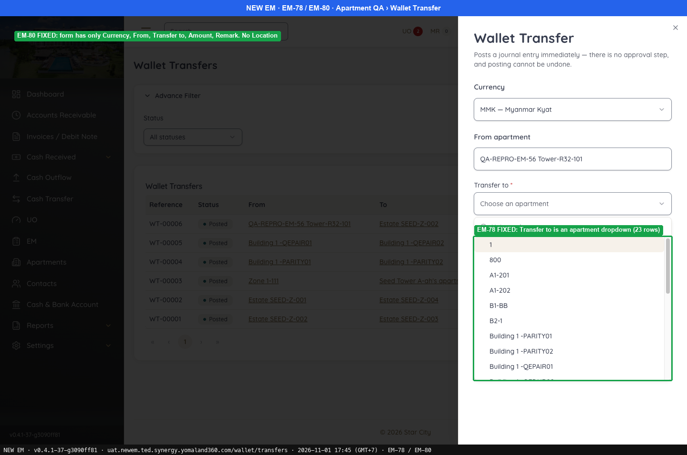 — EM-78 FIXED: Transfer to is an apartment dropdown (23 rows)
- 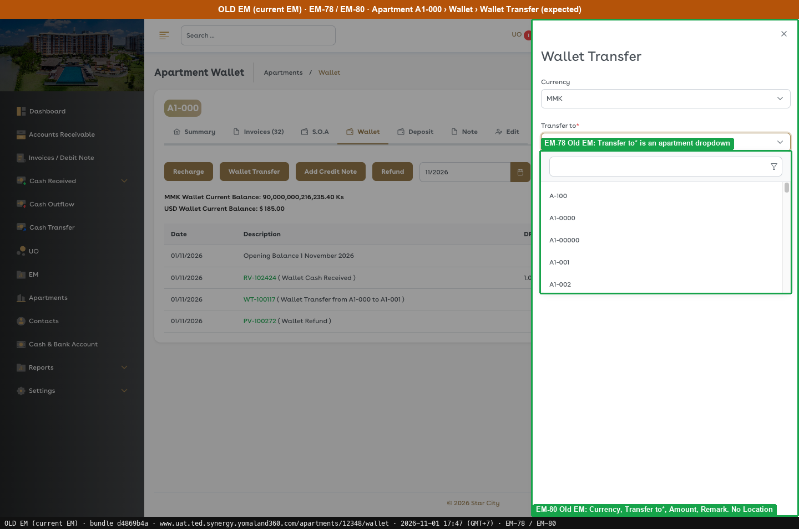 — EM-78 Old EM: Transfer to* is an apartment dropdown
---

### EM-79 · [Apartments > Wallet > Wallet Transfer] Transfer fails with a valid destination apartment

[EM-79](https://zeyalabs-team-a83df6me.atlassian.net/browse/EM-79) · Jira priority Highest · Status **Fixed**

**Reported:** A wallet balance could not be transferred even though a valid destination apartment and all required fields were entered.

#### ★ SAN-EM79-001 · Wallet Transfer to a valid apartment posts and reduces the source wallet

| Priority | Suites | Automation | Status | Source |
|---|---|---|---|---|
| P1 | Sanity · Regression | Auto-UI | Active | EM-79 repro (TC-EM-79-01), 2026-11-01 |

**Preconditions:**

1. Logged in as an Admin user.
2. Source apartment `QA-REPRO-EM-56 Tower-R32-101` (id 32) with wallet balance 919.99 Ks.
3. Destination apartment `Estate SEED-Z-002` exists.

**Test data:**

1. Transfer to Estate SEED-Z-002, Amount 10, Remark `QA-REPRO-EM-79`.

**Steps:**

1. Open the source apartment, tab Wallet, click [Wallet Transfer] (`/wallet/transfers`).
2. Enter the test data and click [Post 10.00 Ks].
3. Open the source apartment wallet.

**Expected result:**

1. The transfer completes successfully.
2. The source wallet is reduced by 10.

**Result (build -37, 2026-11-01):**

| # | Old EM | New EM | |
|---|---|---|---|
| 1 | Wallet Transfer 1 Ks A1-000 → A1-001 succeeds (WT-100117) | **WT-00006 Posted** QA-REPRO-EM-56 Tower-R32-101 → Estate SEED-Z-002, 10.00 Ks, JE #305 (re-captured, no new transfer) | ✅ Same |
| 2 | Not re-run; ticket does not state this check | "Transfer out #WT-00006 · 10.00" | ⛔ Not run |

**Conclusion:** Fixed. The transfer posts and the source wallet shows the transfer out. The re-run created no new transfer and re-captured WT-00006, still Posted. Old EM ran the transfer only (WT-100117).

**Test data created:** Wallet transfer WT-00006 (10 Ks).

**Evidence:**

- 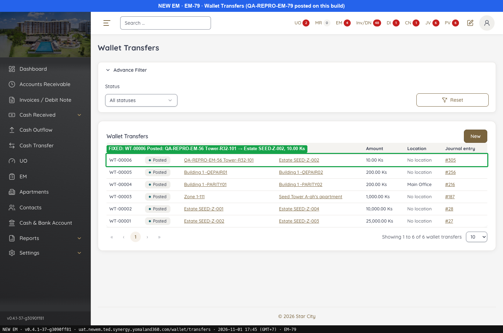 — FIXED: WT-00006 Posted: QA-REPRO-EM-56 Tower-R32-101 → Estate SEED-Z-002, 10.00 Ks
- 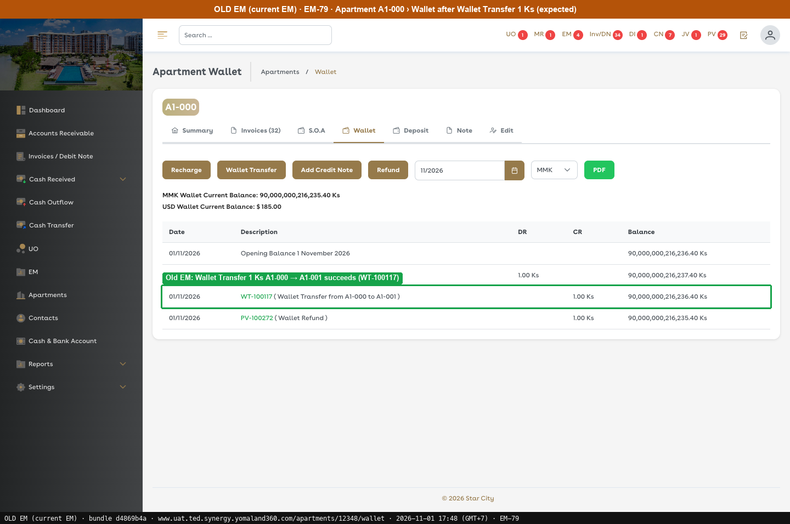 — Old EM: Wallet Transfer 1 Ks A1-000 → A1-001 succeeds (WT-100117)
---

### EM-80 · [Apartments > Wallet > Wallet Transfer] Location field should not be displayed

[EM-80](https://zeyalabs-team-a83df6me.atlassian.net/browse/EM-80) · Jira priority Medium · Status **Fixed**

**Reported:** A Location field was displayed in the Wallet Transfer form and should not be.

#### SAN-EM80-001 · Wallet Transfer form has no Location field

| Priority | Suites | Automation | Status | Source |
|---|---|---|---|---|
| P2 | Sanity · Regression | Auto-UI | Active | EM-80 repro (TC-EM-80-01), 2026-11-01 |

**Preconditions:**

1. Logged in as an Admin user.
2. Apartment `QA-REPRO-EM-56 Tower-R32-101` (id 32) exists with a wallet balance.

**Steps:**

1. Open the apartment, tab Wallet, click [Wallet Transfer] (`/wallet/transfers?from_estate_id=32&new=1`).
2. List the form fields.

**Expected result:**

1. No Location field is displayed.

**Result (build -37, 2026-11-01):**

| # | Old EM | New EM | |
|---|---|---|---|
| 2 | Currency, Transfer to*, Amount, Remark; no Location | Currency, From apartment, Transfer to*, Amount*, Remark; **no Location** | ✅ Same |

**Conclusion:** Fixed. Old EM steps not re-run; the expected result is taken from the ticket, and the Old EM screenshot was captured separately. Also noted: the Wallet Transfers list still has a Location column showing "No location".

**Evidence:**

-  — EM-78 FIXED: Transfer to is an apartment dropdown (23 rows)
-  — EM-78 Old EM: Transfer to* is an apartment dropdown
---

### EM-81 · [Apartments > Wallet > Wallet Refund] Admin with self-approval cannot approve refund

[EM-81](https://zeyalabs-team-a83df6me.atlassian.net/browse/EM-81) · Jira priority High · Status **Fixed**

**Reported:** A wallet refund could not be approved by an admin with self-approval permission; the refund stayed in Draft/Pending.

#### ★ SAN-EM81-001 · Admin with self-approval approves their own Wallet Refund and the wallet is reduced

| Priority | Suites | Automation | Status | Source |
|---|---|---|---|---|
| P1 | Sanity · Regression | Auto-UI | Active | EM-81 repro (TC-EM-81-01), 2026-11-01 |

**Preconditions:**

1. Logged in as an Admin user with self-approval permission.
2. Apartment `QA-REPRO-EM-56 Tower-R32-101` (id 32) with wallet balance 1,009.99 Ks at the time of this test.

**Test data:**

1. Refund: From CASH-0001, Amount 50, Location Main Office.

**Steps:**

1. Open the apartment, tab Wallet, click [Refund] (`/wallet/operations?...type=REFUND`), enter the test data and click [Submit for approval].
2. Open Cash Outflow #39 (`/accounts/outflows/39/approve`), go to Approve or remove › Approve › Confirm approve with the same user.
3. Open Apartment › Wallet.

**Expected result:**

1. The refund enters the approval queue.
2. The same user can approve it.
3. The wallet is reduced by 50.

**Result (build -37, 2026-11-01):**

| # | Old EM | New EM | |
|---|---|---|---|
| 1 | Wallet Refund 1 Ks created as draft #5430 | "Submitted for approval — 50 MMK … (outflow #39)" | ✅ Same |
| 2 | Wallet Refund 1 Ks created and self-approved by the same user → PV-100272 | **"Cash Outflow has been approved successfully."** | ✅ Same |
| 3 | Not re-run | **959.99 Ks**, row PV-00027 (Wallet Refund) 50.00 (row re-captured, no new refund) | ⛔ Not run |

**Conclusion:** Fixed. Self-approval works and the wallet is reduced by the refund amount. The re-run created no new refund and re-captured PV-00027 on tab Wallet. Old EM ran the create and self-approve steps only (PV-100272).

**Test data created:** Refund outflow #39 / PV-00027 (50 Ks).

**Evidence:**

- 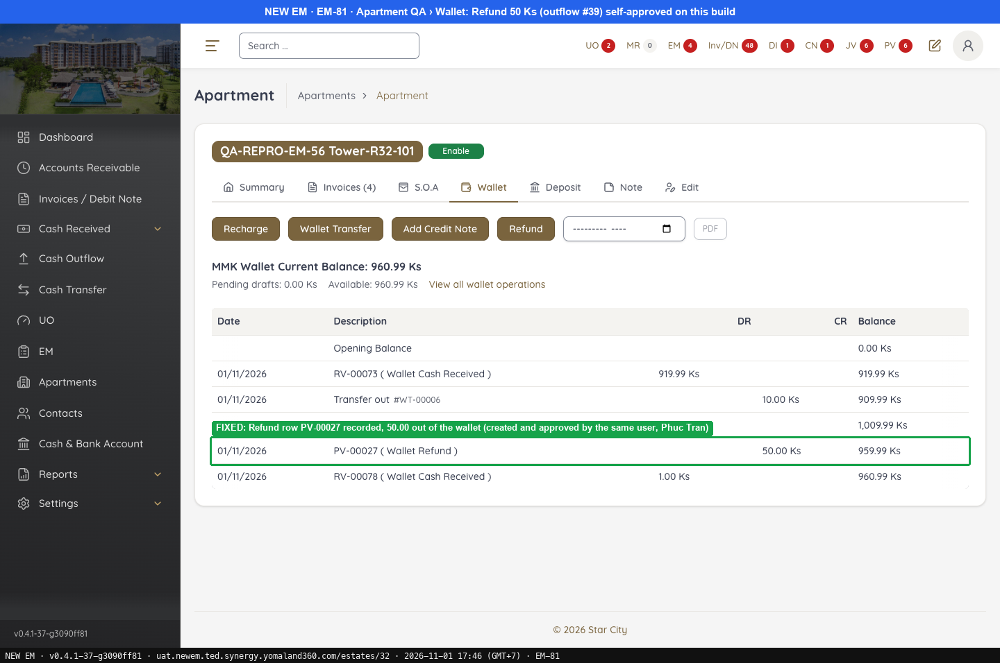 — FIXED: Refund row PV-00027 recorded, 50.00 out of the wallet (created and approved by the same user)
- 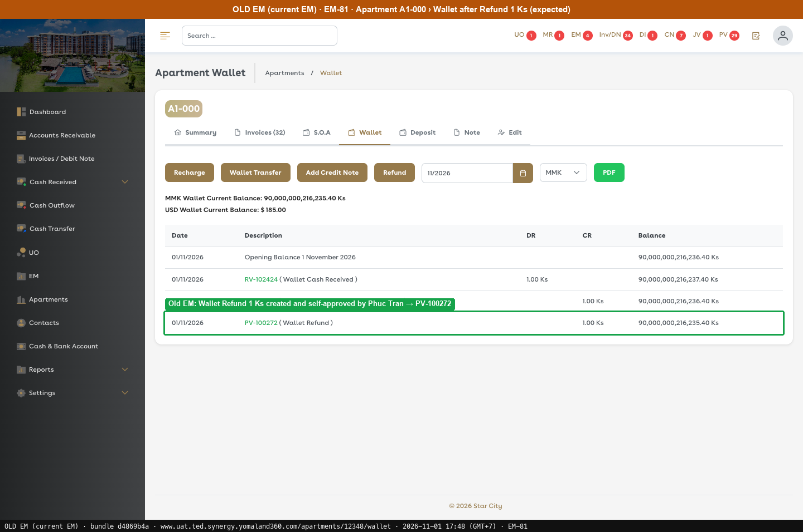 — Old EM: Wallet Refund 1 Ks created and self-approved by the same user → PV-100272
---

### EM-89 · [Wallet / Deposit] Business logic not aligned with current EM; approval state should not be required

[EM-89](https://zeyalabs-team-a83df6me.atlassian.net/browse/EM-89) · Jira priority Highest · Status **Fixed**

**Reported:** Wallet and Deposit logic did not match the current EM: Wallet Recharge and Add Deposit should not need an approval state, and Add Deposit could not be tested.

#### ★ SAN-EM89-001 · Wallet Recharge and Add Deposit post immediately with no approval state

| Priority | Suites | Automation | Status | Source |
|---|---|---|---|---|
| P1 | Sanity · Regression | Auto-UI | Active | EM-89 repro (TC-EM-89-01), 2026-11-01 |

**Preconditions:**

1. Logged in as an Admin user.
2. Apartment `QA-REPRO-EM-56 Tower-R32-101` (id 32) with a wallet balance.

**Test data:**

1. Recharge 100 (re-run: 1).
2. Add Deposit 500 (re-run: 1).

**Steps:**

1. Open the apartment, tab Wallet (`/estates/32?tab=wallet`), Recharge, click [Post].
2. Open tab Deposit (`/estates/32?tab=deposit`), Add Deposit, click [Submit].
3. Open Refund and Withdraw, and read the submit button.

**Expected result:**

1. Recharge posts immediately, no Draft.
2. Add Deposit posts immediately, no Draft.
3. Refund and Withdraw still need approval, as in Old EM.

**Result (build -37, 2026-11-01):**

| # | Old EM | New EM | |
|---|---|---|---|
| 1 | Recharge 1 Ks (RV-102424) posts immediately, no approval | Re-run: **RV-00078** (1 Ks) posted immediately, no approval. First run: **RV-00074 Posted** immediately, Pending drafts 0.00 | ✅ Same |
| 2 | Add Deposit 1 Ks posts at once (RV-102425), no approval step | Re-run: **RV-00077** (1 Ks) posted immediately, no approval, deposit balance 501.00. First run: **RV-00075 (Deposit Received)** immediately, deposit balance 500.00, Pending drafts 0.00 | ✅ Same |
| 3 | Refund / Withdraw need approval | "Submit for approval": still goes through approval | ✅ Same |

**Conclusion:** Fixed. Recharge and Add Deposit no longer have an approval state. Old EM results reuse RV-102424 and RV-102425.

**Test data created:** Recharges RV-00074 and RV-00078 (see EM-77), deposits RV-00075 and RV-00077 (see EM-68).

**Evidence:**

- 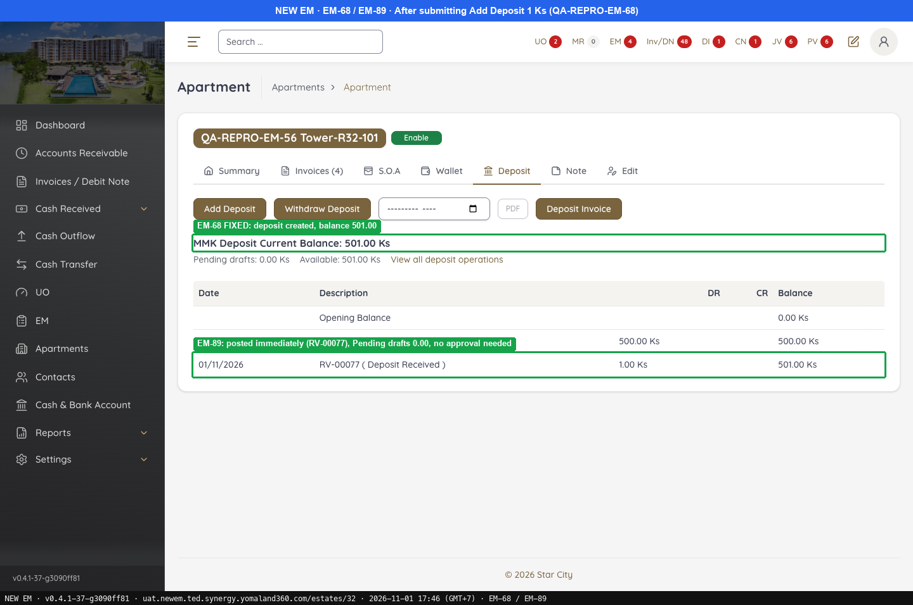 — EM-68 FIXED: deposit created, balance 501.00
- 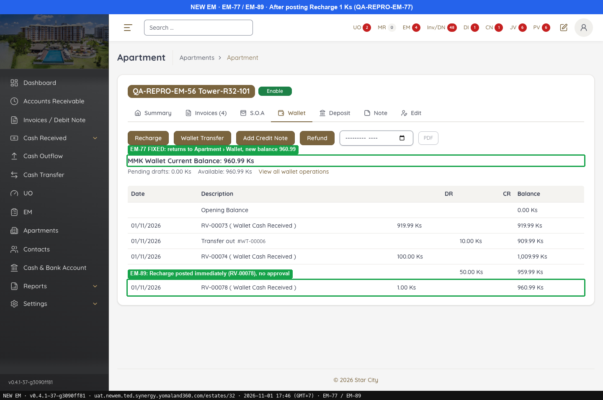 — EM-77 FIXED: returns to Apartment › Wallet, new balance 960.99
- 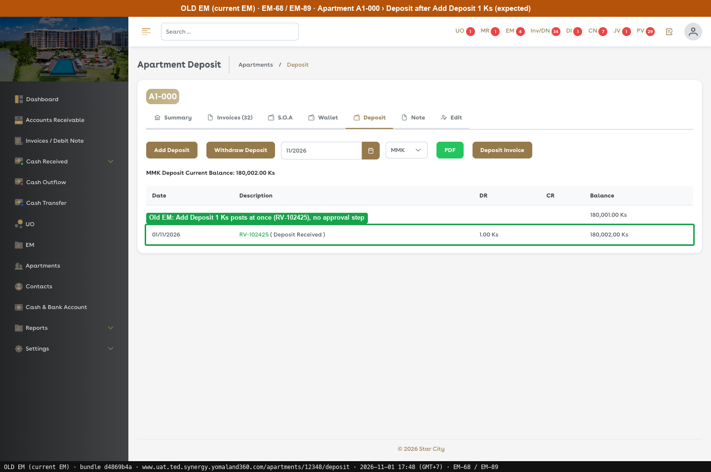 — Old EM: Add Deposit 1 Ks posts at once (RV-102425), no approval step
-  — Old EM: Recharge 1 Ks (RV-102424) stays on Apartment › Wallet and posts immediately, no approval
---
