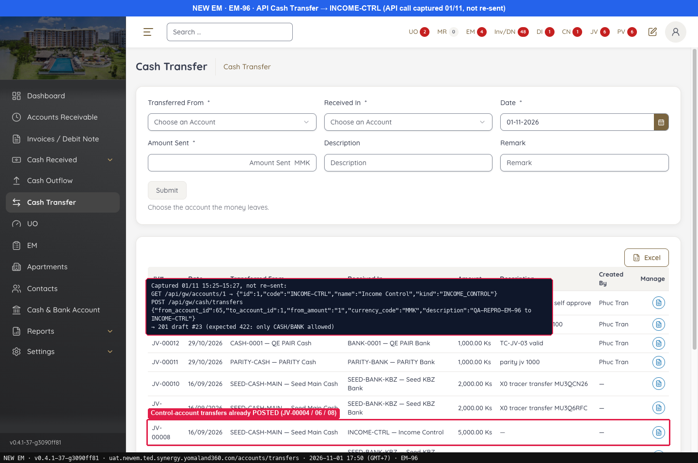
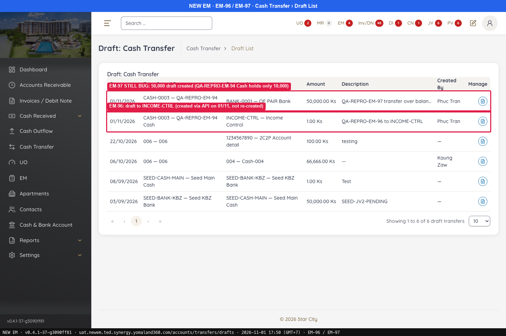
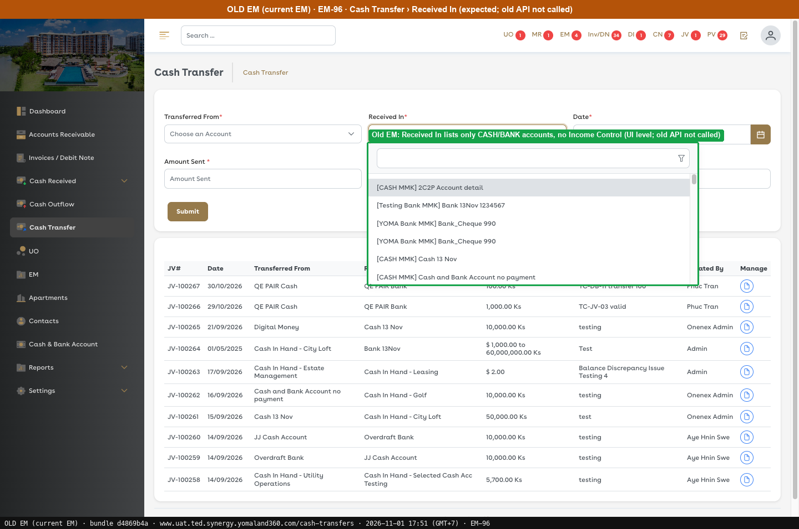
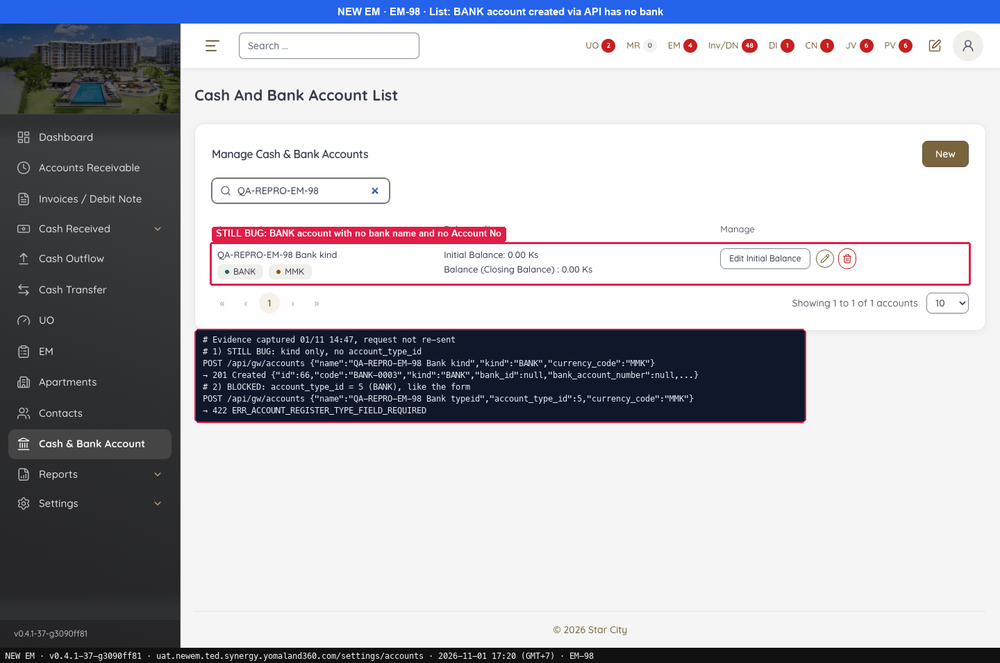
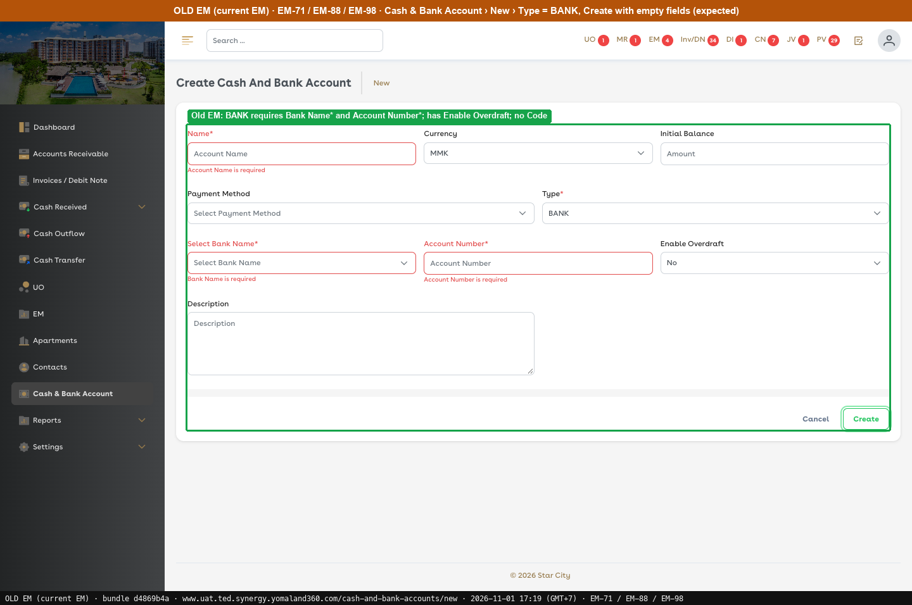
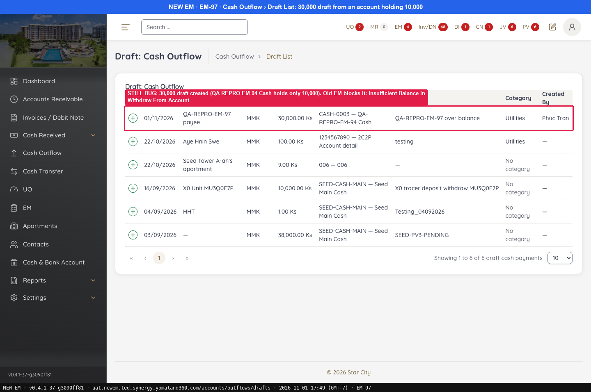
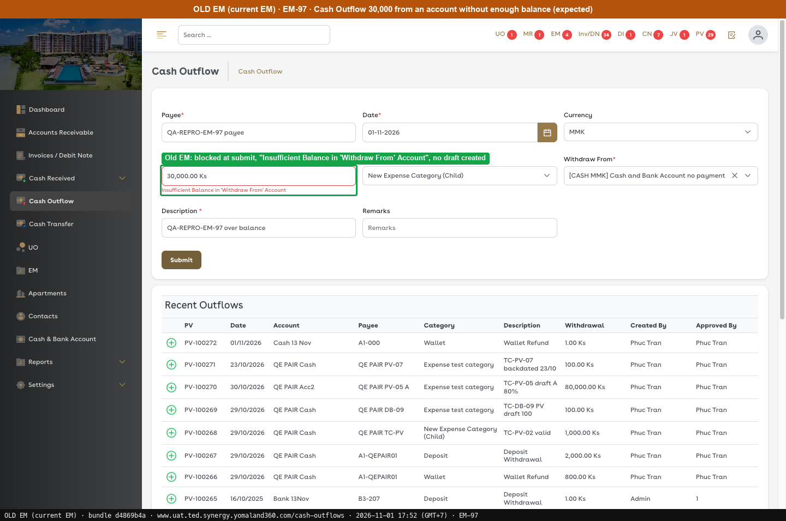

# G1 · API validation: Cash & Bank, Cash Transfer, Cash Outflow

[← Ticket index](../README.md) · [Sanity index](../../README.md)

**Tickets:** 3 · **Open:** 2 · **Partly open:** 1

Same area: add one shared check on the server, not only in the form. Fix this group first.

## Summary

| Ticket | Title | Jira priority | Status (build -37) | Result | Case |
|---|---|---|---|---|---|
| [EM-96](https://zeyalabs-team-a83df6me.atlassian.net/browse/EM-96) | [Cash Transfer > API] Transfer can be created to the internal control account INCOME-CTRL | Medium | Open | Hard stop: API creates a transfer to INCOME-CTRL (201, draft #23) | [SAN-EM96-001](#san-em96-001--cash-transfer-api-rejects-the-internal-control-account-as-destination) |
| [EM-98](https://zeyalabs-team-a83df6me.atlassian.net/browse/EM-98) | [Cash & Bank Account > API] Bank account can be created without Bank Name and Account Number | Medium | Partly open | API with `kind=BANK` only still creates a BANK account with no bank (id 66); `account_type_id` is now blocked. | [SAN-EM98-001](#san-em98-001--api-rejects-creating-a-bank-account-without-bank-name-and-account-number) |
| [EM-97](https://zeyalabs-team-a83df6me.atlassian.net/browse/EM-97) | [Cash Outflow / Cash Transfer] Draft can be created for an amount above the account balance | Medium | Open | Outflow 30,000 and Transfer 50,000 above a 10,000 balance still create drafts; Old EM blocks at the Amount field | [SAN-EM97-001](#san-em97-001--cash-outflow-and-cash-transfer-above-the-account-balance-cannot-be-created) |

## Tickets

### EM-96 · [Cash Transfer > API] Transfer can be created to the internal control account INCOME-CTRL

[EM-96](https://zeyalabs-team-a83df6me.atlassian.net/browse/EM-96) · Jira priority Medium · Status **Open**

**Reported:** The Cash Transfer API accepts an internal ledger (control) account as the destination. The screen does not list it, but the API does not block it.

> **Hard stop (ledger integrity / business permissions):** the API allows a transfer to an internal control account that the UI does not offer.

#### SAN-EM96-001 · Cash Transfer API rejects the internal control account as destination

| Priority | Suites | Automation | Status | Source |
|---|---|---|---|---|
| P2 | Sanity · Regression | Auto-API | Active | EM-96 repro (TC-EM-96-01), 2026-11-01 |

**Preconditions:**

1. Logged in as Admin; the API is called with the browser session.
2. Endpoint: New EM `POST /api/gw/cash/transfers`.

**Test data:**

1. Request body: `{"from_account_id":65,"to_account_id":1,"from_amount":"1","currency_code":"MMK","description":"QA-REPRO-EM-96 to INCOME-CTRL"}`

**Steps:**

1. Call `GET /api/gw/accounts/1`.
2. Call `POST /api/gw/cash/transfers` with the test data.
3. Open the Cash Transfer list.

**Expected result:**

1. Account 1 is the control account.
2. **422**: only CASH/BANK accounts can be source or destination.
3. No transaction to a control account is listed.

**Result (build -37, 2026-11-01):**

| # | Old EM | New EM | |
|---|---|---|---|
| 1 | Not called | `{"id":1,"code":"INCOME-CTRL","name":"Income Control","kind":"INCOME_CONTROL"}` | — |
| 2 | Old API not called; 422 is taken from the ticket | **201** `{"id":23,"status":"DRAFT","approval_request_id":250,...}` (recorded at 15:25–15:27; not called again on the re-run) | ❌ Differs |
| 3 | Received In lists only CASH/BANK accounts, no Income Control (UI level) | **JV-00004 / 06 / 08** (16/09) Seed Main Cash → INCOME-CTRL 5,000 Ks are already POSTED | ❌ Differs |

**Conclusion:** Open (hard stop). The API accepts a destination the UI does not allow, and posted transfers to INCOME-CTRL already exist in the list. The re-run made no new API call and created no new draft to the control account; the request and response in the image are from 15:25–15:27. Old EM was checked at UI level only.

**Test data created:** draft transfer **#23** (1 Ks → INCOME-CTRL), **not deleted**, still in the Draft List. Someone with permission must Remove it so it is not approved by mistake.

**Evidence:**

-  — Control-account transfers already POSTED (JV-00004 / 06 / 08)
-  — EM-97 STILL BUG: 50,000 draft created (QA-REPRO-EM-94 Cash holds only 10,000)
-  — Old EM: Received In lists only CASH/BANK accounts, no Income Control (UI level; old API not called)
---

### EM-98 · [Cash & Bank Account > API] Bank account can be created without Bank Name and Account Number

[EM-98](https://zeyalabs-team-a83df6me.atlassian.net/browse/EM-98) · Jira priority Medium · Status **Partly open**

**Reported:** The form requires Bank Name and Account No for Type = Bank, but calling the API directly created a BANK account without both.

#### SAN-EM98-001 · API rejects creating a BANK account without Bank Name and Account Number

| Priority | Suites | Automation | Status | Source |
|---|---|---|---|---|
| P2 | Sanity · Regression | Auto-UI+API | Active | EM-98 repro (TC-EM-98-01), 2026-11-01 |

**Preconditions:**

1. Logged in as an Admin user; the API is called with the browser session.

**Steps:**

1. `POST /api/gw/accounts` `{"name":"QA-REPRO-EM-98 Bank typeid","account_type_id":5,"currency_code":"MMK"}` (5 = BANK, as the form sends it).
2. `POST /api/gw/accounts` `{"name":"QA-REPRO-EM-98 Bank kind","kind":"BANK","currency_code":"MMK"}` (no `account_type_id`).
3. Open the Cash & Bank Account list.

**Expected result:**

1. The request is rejected.
2. The request is rejected: Bank Name and Account Number are required for BANK accounts.

**Result (build -37, 2026-11-01):**

| # | Old EM | New EM | |
|---|---|---|---|
| 1 | Form New requires Bank Name*, Account Number*; Old EM API not called | **422** `ERR_ACCOUNT_REGISTER_TYPE_FIELD_REQUIRED` | ✅ Same |
| 2 | Form New requires Bank Name*, Account Number*; Old EM API not called | **201 Created** id 66, `bank_id=null`, `bank_account_number=null` | ❌ Differs |
| 3 | Not run | Row "QA-REPRO-EM-98 Bank kind · BANK · MMK", no bank, no Account No | ⛔ Not run |

**Conclusion:** Partly open. The `account_type_id` route is blocked, but sending only `kind` still creates a BANK account with no bank or account number, which bypasses the rule the form enforces and leaves wrong data for bank-based reports.

**Test data created:** New EM account `QA-REPRO-EM-98 Bank kind` (id 66, BANK-0003). The `account_type_id` call was blocked, so it created nothing.

**Evidence:**

-  — STILL BUG: BANK account with no bank name and no Account No
-  — Old EM: BANK requires Bank Name* and Account Number*; has Enable Overdraft; no Code
---

### EM-97 · [Cash Outflow / Cash Transfer] Draft can be created for an amount above the account balance

[EM-97](https://zeyalabs-team-a83df6me.atlassian.net/browse/EM-97) · Jira priority Medium · Status **Open**

**Reported:** Current EM blocks a Cash Outflow or Cash Transfer larger than the account balance at creation. New EM creates the draft and only blocks it at approval.

#### SAN-EM97-001 · Cash Outflow and Cash Transfer above the account balance cannot be created

| Priority | Suites | Automation | Status | Source |
|---|---|---|---|---|
| P2 | Sanity · Regression | Auto-UI | Active | EM-97 repro (TC-EM-97-01), 2026-11-01 |

**Preconditions:**

1. Account **QA-REPRO-EM-94 Cash** (CASH-0003) with balance **10,000 Ks** (created under EM-94).
2. Pages: New EM `/accounts/outflows`, `/accounts/transfers`.

**Test data:**

1. Cash Outflow: Payee `QA-REPRO-EM-97 payee`, Amount 30,000, Category Utilities, Withdraw From CASH-0003.
2. Cash Transfer: CASH-0003 → BANK-0001, Amount Sent 50,000.

**Steps:**

1. Go to Cash Outflow, enter the outflow from the test data and click [Submit].
2. Go to Cash Transfer, enter the transfer from the test data and click [Submit].

**Expected result:**

1. Blocked at the Amount field with "Insufficient Balance in 'Withdraw From' Account"; no draft is created.
2. Blocked in the same way; no draft is created.

**Result (build -37, 2026-11-01):**

| # | Old EM | New EM | |
|---|---|---|---|
| 1 | Cash Outflow 30,000 from "Cash and Bank Account no payment" is **blocked at the Amount field** with "Insufficient Balance in 'Withdraw From' Account", no draft (also blocked from QA-REPRO-EM-94 Cash) | **"Cash Outflow has been successfully created."** (first run); draft 30,000 still in the Draft List, re-captured | ❌ Differs |
| 2 | Not re-run; expected from the ticket | **"Cash Transfer has been successfully created."** (first run); draft #24 50,000 still in the Draft List, re-captured | ❌ Differs |

**Conclusion:** Open, on both Outflow and Transfer. The re-run created no new New EM drafts and re-captured the Draft List. The creator is not told at creation and the approval queue fills with drafts that cannot be approved. Approval itself was not run here; the ticket says the error only appears at that point.

**Test data created:** outflow draft 30,000 (`QA-REPRO-EM-97 payee`) and transfer draft #24 50,000, both still DRAFT.

**Evidence:**

-  — STILL BUG: 30,000 draft created (QA-REPRO-EM-94 Cash holds only 10,000). Old EM blocks it: Insufficient Balance in Withdraw From Account
-  — EM-97 STILL BUG: 50,000 draft created (QA-REPRO-EM-94 Cash holds only 10,000)
-  — Old EM: blocked at the Amount field, "Insufficient Balance in 'Withdraw From' Account", no draft created
---
