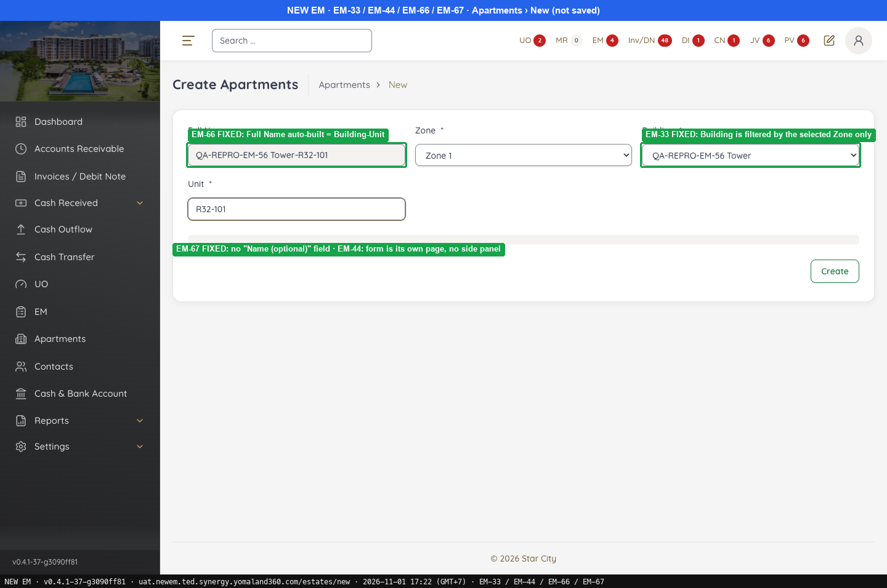
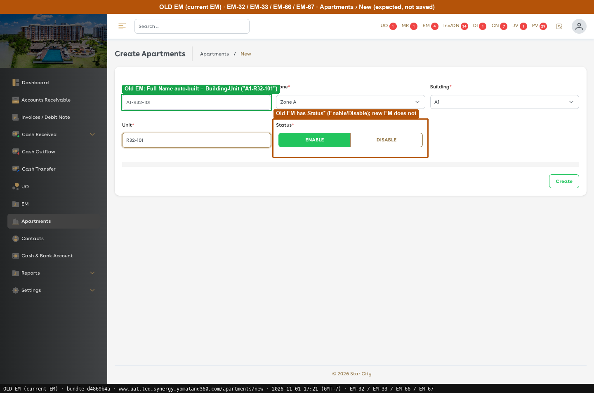
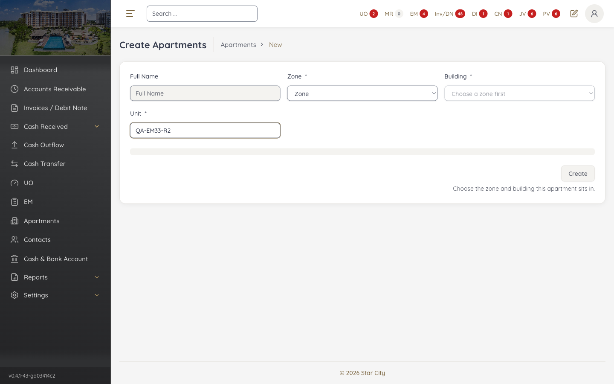
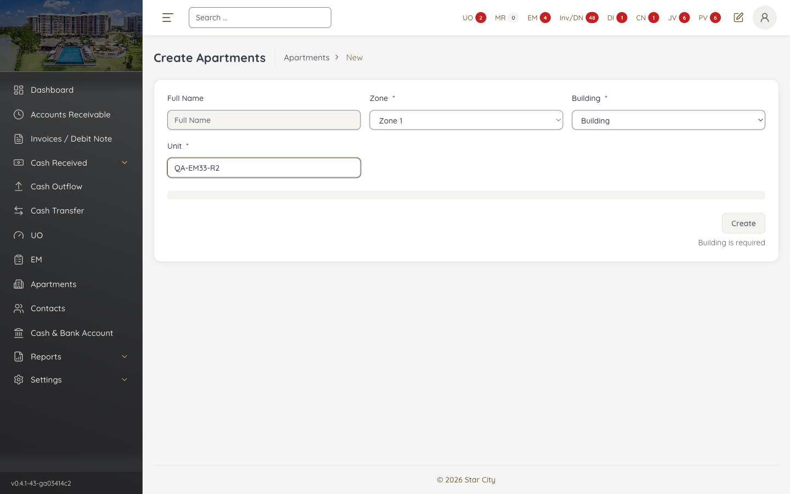

# G10 · Apartment form

[← Ticket index](../README.md) · [Sanity index](../../README.md)

**Tickets:** 1 · **Reopened:** 1

EM-33 was fixed on build -37 (2026-11-01) and reopened after the retest on build -43 (2026-11-02): the Zone and Building lists offer an empty option that can be selected, and the Create form has no Status.

## Summary

| Ticket | Title | Jira priority | Status (build -43) | Result | Case |
|---|---|---|---|---|---|
| [EM-33](https://zeyalabs-team-a83df6me.atlassian.net/browse/EM-33) | [Apartments] Apartment can be created without selecting a Building linked to a Zone | High | Reopened (11-02) | Zone/Building lists offer the selectable options "Zone"/"Building"; Status Enable/Disable missing on Create | [SAN-EM33-001](#san-em33-001--apartment-can-only-be-created-in-a-building-of-the-selected-zone) |

## Tickets

### EM-33 · [Apartments] Apartment can be created without selecting a Building linked to a Zone

[EM-33](https://zeyalabs-team-a83df6me.atlassian.net/browse/EM-33) · Jira priority High · Status **Reopened (retest 2026-11-02)**

**Reported:** Admin can create an apartment without choosing a building assigned to a specific zone, so the apartment has no valid Zone/Building relationship.

#### SAN-EM33-001 · Apartment can only be created in a building of the selected zone

| Priority | Suites | Automation | Status | Source |
|---|---|---|---|---|
| P1 | Sanity · Regression | Auto-UI | Active | EM-33 repro (TC-EM-33-01), 2026-11-01 |

**Preconditions:**

1. Logged in as Admin.
2. Zone "Zone 1" (Enable) contains building "QA-REPRO-EM-56 Tower" (created under EM-56).
3. Pages: New EM `/estates/new`. Old EM `/apartments/new` (bundle `dd551ca9`).

**Steps:**

1. Open New and look at Building before choosing another Zone.
2. Select Zone = Zone 1.
3. Check the Zone, Building and Unit fields, leaving Unit empty.
4. Open the Zone list.
5. Look for an empty option (e.g. "Zone") in the Zone list.
6. Look for an empty option (e.g. "Building") in the Building list.
7. Look for the Status field.

**Expected result:**

1. Building follows the default zone.
2. Building lists only the buildings of Zone 1.
3. Zone, Building and Unit are marked * and required.
4. The Zone list shows only Enable zones.
5. The Zone list has only real zones; no empty option can be selected.
6. The Building list has only real buildings; no empty option can be selected.
7. **Status*** with [ENABLE] [DISABLE] is on the Create form.

**Automated test:** [`SAN-EM33-001` in fixed-apartments.spec.ts](../../../../tests/sanity/tickets/open/g10-apartment-form.spec.ts#L20) · tag `@sanity` `@EM-33` · run `APP=em npx playwright test --grep SAN-EM33-001` · one test step per expected result; checks 2–7 are soft, so one run lists every check that still fails. The test never clicks [Create].

**Result (build -37, 2026-11-01):**

| # | Old EM | New EM | |
|---|---|---|---|
| 1 | Building follows the default zone | Building follows the default zone | ✅ Same |
| 2 | Only buildings of Zone 1 | Building = [Building 1, QA-REPRO-EM-56 Tower], only those of Zone 1 | ✅ Same |
| 3 | Required | Required ([Create] is locked when Unit is missing, hint "Enter the unit number") | ✅ Same |
| 4 | Only Enable zones | Only Enable zones (no "X0 …" Disable zones) | ✅ Same |

**Conclusion:** Fixed. Not run: calling the create-apartment API with a building that is not in the zone.

**Test data created:** Apartment id 32 (see EM-32).

**Evidence:**

-  — EM-66 FIXED: Full Name auto-built = Building-Unit
-  — Old EM: Full Name auto-built = Building-Unit ("A1-R32-101")

**Retest (build -43, 2026-11-02): still failing, commented on Jira**

| # | Check | Old EM | New EM | |
|---|---|---|---|---|
| 1 | Zone list options | Real zones only | Has a selectable option **"Zone"** (the field name, empty value, not disabled). Picking it disables Building and locks [Create] | ❌ Bug |
| 2 | Building list options | Real buildings only | Has a selectable option **"Building"** (empty value, not disabled). Picking it clears Full Name and locks [Create] ("Building is required") | ❌ Bug |
| 3 | Status on Create | **Status*** with [ENABLE] [DISABLE] buttons | No Status field and no Enable/Disable buttons. Saved as Enable; it can only be changed later from the Edit tab dropdown | ❌ Missing |

Not run: the create-apartment API with an empty building or a building outside the zone. Old EM was not re-checked on 11-02 because the `.env` admin login does not work there; row 3 uses the 11-01 Old EM screenshot.

-  — New EM: Zone = "Zone" can be selected
-  — New EM: Building = "Building" can be selected
-  — Old EM: Status* ENABLE / DISABLE on Create Apartment
