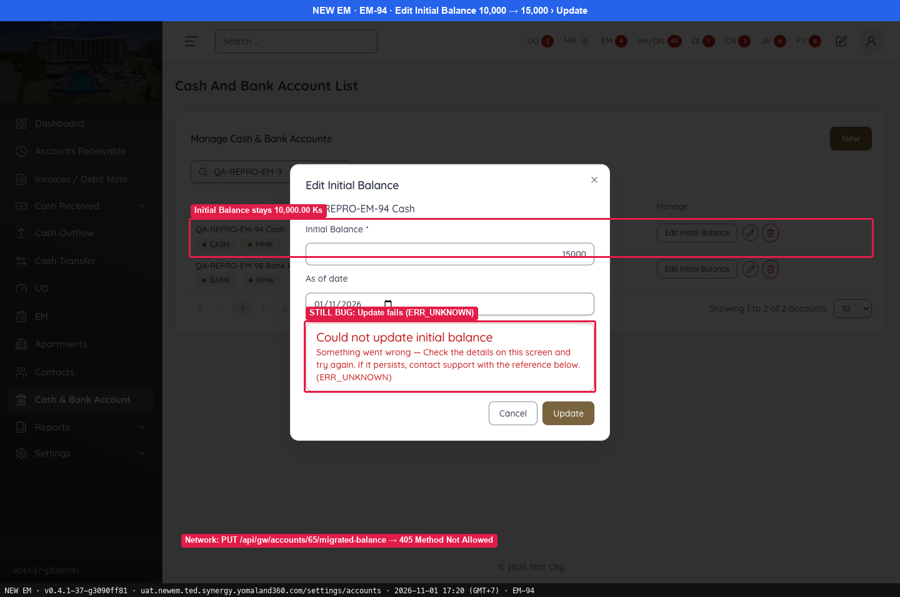
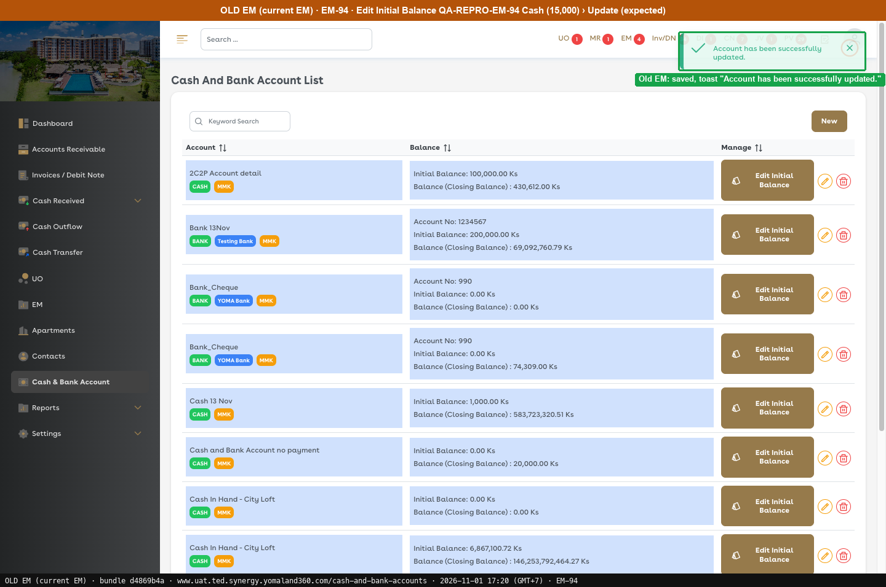

# G2 · Cash & Bank Account screens

[← Ticket index](../README.md) · [Sanity index](../../README.md)

**Tickets:** 1 · **Open:** 1

## Summary

| Ticket | Title | Jira priority | Status (build -37) | Result | Case |
|---|---|---|---|---|---|
| [EM-94](https://zeyalabs-team-a83df6me.atlassian.net/browse/EM-94) | [Cash & Bank Account > Edit Initial Balance] Update fails with 'Could not update initial balance' | Medium | Open | Update Initial Balance fails with ERR_UNKNOWN; `PUT .../migrated-balance` returns 405. | [SAN-EM94-001](#san-em94-001--edit-initial-balance-saves-the-value-and-updates-closing-balance) |

## Tickets

### EM-94 · [Cash & Bank Account > Edit Initial Balance] Update fails with 'Could not update initial balance'

[EM-94](https://zeyalabs-team-a83df6me.atlassian.net/browse/EM-94) · Jira priority Medium · Status **Open**

**Reported:** Editing the Initial Balance of a cash or bank account always fails with 'Could not update initial balance'; the balance stays unchanged and the API returns 405 Method Not Allowed.

#### SAN-EM94-001 · Edit Initial Balance saves the value and updates Closing Balance

| Priority | Suites | Automation | Status | Source |
|---|---|---|---|---|
| P2 | Sanity · Regression | Auto-UI+API | Active | EM-94 repro (TC-EM-94-01), 2026-11-01 |

**Preconditions:**

1. Logged in as an Admin user.
2. CASH account `QA-REPRO-EM-94 Cash` exists on both sides: MMK, Initial Balance 10,000, Payment Method Cash.

**Test data:**

1. New Initial Balance 15,000.

**Steps:**

1. In the list, click [Edit Initial Balance] on the test account (New `/settings/accounts`, Old `/initial-balance/148/edit`).
2. Change 10,000 to 15,000 and click [Update].
3. Read the account row again.
4. On New EM, read the request in the browser Network tab.

**Expected result:**

1. The Edit Initial Balance page opens.
2. "Account has been successfully updated."
3. Initial 15,000.00 / Closing 15,000.00.

**Result (build -37, 2026-11-01):**

| # | Old EM | New EM | |
|---|---|---|---|
| 1 | Edit Initial Balance page | **Dialog** (with an extra "As of date" field) | ❌ Differs |
| 2 | "Account has been successfully updated." | **"Could not update initial balance … (ERR_UNKNOWN)"** | ❌ Differs |
| 3 | Initial 15,000.00 / Closing 15,000.00 | Initial **10,000.00** / Closing 10,000.00 | ❌ Differs |
| 4 | Not run | `PUT /api/gw/accounts/65/migrated-balance` → **405 Method Not Allowed** | ⛔ Not run |

**Conclusion:** Open. The opening balance, used for data migration, cannot be corrected, so the account balance stays wrong.

**Test data created:** New EM account `QA-REPRO-EM-94 Cash` (id 65, 10,000); Old EM account `QA-REPRO-EM-94 Cash` (initial-balance id 148, now 15,000).

**Evidence:**

-  — STILL BUG: Update fails (ERR_UNKNOWN)
-  — Old EM: saved, toast "Account has been successfully updated."
---

