# G3 · Invoice line amounts and precision

[← Ticket index](../README.md) · [Sanity index](../../README.md)

**Tickets:** 6 · **Open:** 4 · **Partly open:** 2

Deploy EM-92 first, then recheck EM-75 and EM-76, which share its cause. EM-93 and EM-112 are both about money rounding.

## Summary

| Ticket | Title | Jira priority | Status (build -37) | Result | Case |
|---|---|---|---|---|---|
| [EM-92](https://zeyalabs-team-a83df6me.atlassian.net/browse/EM-92) | [Invoices / Debit Note > Add Invoice] Create Invoice – line amounts and Payment Terms differ from old EM (Disc. Price, line Total, Payment Terms) | High | Open | Disc. Price, line Total and Payment Terms still differ; a fix exists but is not deployed to UAT | [SAN-EM92-001](#-san-em92-001--create-invoice-opens-with-payment-terms-optional-and-preset-to-due-on-receipt), [SAN-EM92-002](#-san-em92-002--line-1--1000-with-5-tax-and-discount-0-shows-disc-price-1000000-and-total-1000000), [SAN-EM92-003](#-san-em92-003--line-1--1000-with-5-tax-and-discount-10-shows-disc-price-900000-and-total-900000), [SAN-EM92-004](#-san-em92-004--changing-tax-type-clears-the-line-as-in-old-em) |
| [EM-75](https://zeyalabs-team-a83df6me.atlassian.net/browse/EM-75) | [Invoices / Debit Note > Add Invoice] Inclusive Tax 5%/3% UI differs and allows discount | Highest | Partly open | Discount is locked; line Disc. Price / Total still differ from Old EM | [SAN-EM75-001](#-san-em75-001--inclusive-tax-5-and-3-matches-the-old-em-form-and-does-not-allow-discount) |
| [EM-76](https://zeyalabs-team-a83df6me.atlassian.net/browse/EM-76) | [Apartments > Add Invoice] Inclusive Tax 5%/3% UI differs and allows discount | Highest | Partly open | Discount is locked; line Disc. Price / Total still differ from Old EM, waiting for the EM-92 fix on UAT | [SAN-EM76-001](#-san-em76-001--inclusive-tax-from-an-apartment-add-invoice-matches-old-em-and-blocks-discount) |
| [EM-112](https://zeyalabs-team-a83df6me.atlassian.net/browse/EM-112) | [Invoices / Debit Note > Add Invoice] 100% discount shows generic 'ERR_UNKNOWN' instead of the real reason | Medium | Open | Discount 100% still gives 'Could not calculate the total / ERR_UNKNOWN'; Old EM clears the field | [SAN-EM112-001](#san-em112-001--discount-100-does-not-give-the-generic-err_unknown-error) |
| [EM-93](https://zeyalabs-team-a83df6me.atlassian.net/browse/EM-93) | [Invoices / Debit Note > Add Invoice] Invoice stays Partially Paid after paying the full displayed amount (3-decimal unit price) | Medium | Open | INV-202610-00047 stays PARTIALLY_PAID with due 0.0042 (screen shows 0.00) | [SAN-EM93-001](#san-em93-001--paying-exactly-the-displayed-balance-due-makes-the-invoice-paid) |
| [EM-113](https://zeyalabs-team-a83df6me.atlassian.net/browse/EM-113) | [Invoices / Debit Note > Approve] No message when approving an already approved invoice | Medium | Open | Second Approve from a stale tab shows no 'Invoice has been already approved.' | [SAN-EM113-001](#san-em113-001--approving-an-invoice-already-approved-in-another-tab-shows-invoice-has-been-already-approved) |

## Tickets

### EM-92 · [Invoices / Debit Note > Add Invoice] Create Invoice – line amounts and Payment Terms differ from old EM (Disc. Price, line Total, Payment Terms)

[EM-92](https://zeyalabs-team-a83df6me.atlassian.net/browse/EM-92) · Jira priority High · Status **Open**

**Reported:** On new EM Create Invoice, line "Disc. Price" shows 0.00 instead of the price after discount, line "Total" includes tax, and Payment Terms is required with no default.

**Retest 2026-11-02, build `v0.4.1-43-ga03414c2` (Jira status QA): all 4 cases pass, by hand and by the automated tests, so the fix is on UAT.** Results per case below are the earlier failing runs, kept as history. No invoice was saved.

| Case | New EM on build -43 | Manual | Auto test |
|---|---|---|---|
| SAN-EM92-001 | Payment Terms has no `*`, preset to "Due on receipt" | ✅ Pass | [✅ Pass](../../../../tests/sanity/tickets/open/g3-invoice-amounts.spec.ts#L41) |
| SAN-EM92-002 | Disc. Price 1,000.000 Ks · Tax 50.000 Ks · Total 1,000.000 Ks · Grand Total 1,050.00 Ks | ✅ Pass | [✅ Pass](../../../../tests/sanity/tickets/open/g3-invoice-amounts.spec.ts#L21) |
| SAN-EM92-003 | Disc. Price 900.000 Ks · Tax 45.000 Ks · Total 900.000 Ks · Grand Total 945.00 Ks | ✅ Pass | [✅ Pass](../../../../tests/sanity/tickets/open/g3-invoice-amounts.spec.ts#L27) |
| SAN-EM92-004 | 5% → 3% clears Unit and Gross Price, Discount back to 0 | ✅ Pass | [✅ Pass](../../../../tests/sanity/tickets/open/g3-invoice-amounts.spec.ts#L62) |

Notes: line values recalculate only after leaving the Discount field. Line cells now show 3 decimals, as in Old EM.

- 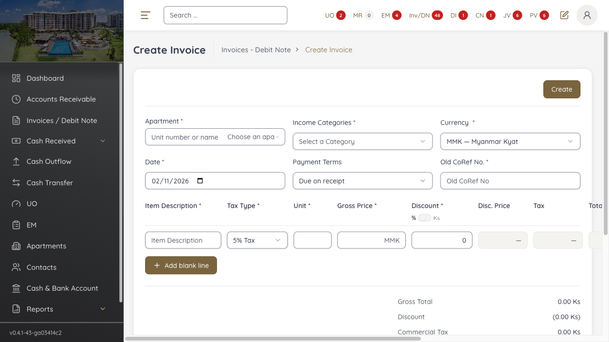 — Payment Terms optional, "Due on receipt".
- 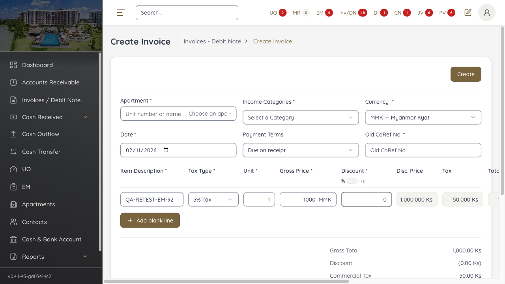 — 1 × 1000, 5% Tax, discount 0.
- 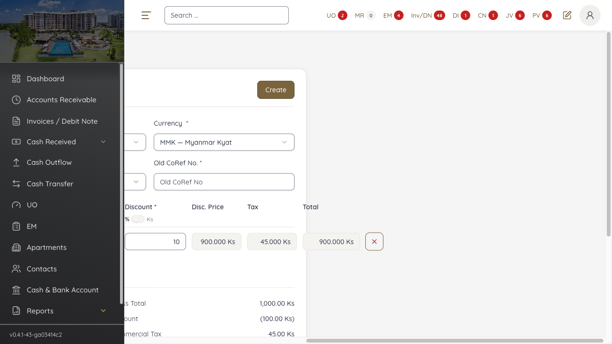 — 1 × 1000, 5% Tax, discount 10%.
-  — Tax Type 5% → 3% clears the line.

#### ★ SAN-EM92-001 · Create Invoice opens with Payment Terms optional and preset to Due On Receipt

| Priority | Suites | Automation | Status | Source |
|---|---|---|---|---|
| P1 | Sanity · Regression | Auto-UI | Active | EM-92 repro (scenario: open form), 2026-10-31, rechecked 2026-11-01 |

**Automated test:** [`SAN-EM92-001` in g3-invoice-amounts.spec.ts](../../../../tests/sanity/tickets/open/g3-invoice-amounts.spec.ts#L41) · tag `@sanity` · run `APP=em npx playwright test --grep SAN-EM92-001` · last run 2026-11-02, build -43: ✅ pass

**Preconditions:**

1. Logged in to EM.
2. Pages: New EM `/receivables/invoices/new`, Old EM `/invoices/add-invoice`.

**Steps:**

1. Go to Receivables → Invoices - Debit Note → Create Invoice.
2. Check the Payment Terms field.

**Expected result:**

1. The form opens.
2. Payment Terms has no `*` and defaults to "Due On Receipt".

**Result (build -37, 2026-10-31; rechecked 2026-11-01):**

| # | Old EM | New EM | |
|---|---|---|---|
| 1 | Form opens | Form opens | ✅ Same |
| 2 | No `*`, default "Due On Receipt" | "Payment Terms *", empty | ❌ Differs |

**Conclusion:** Open. Payment Terms is required and empty on New EM. A fix exists but is not deployed to UAT.

**Evidence:**

-  — New EM form on open.
-  — "Payment Terms *" required and empty.
- 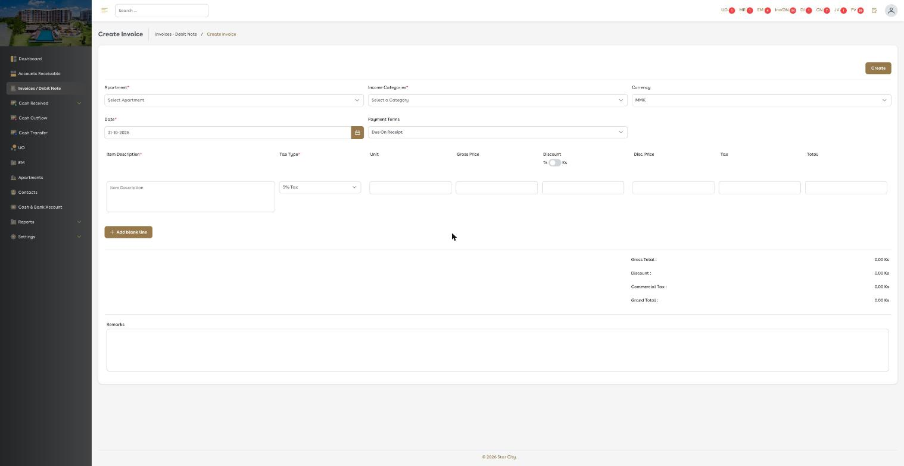 — Old EM preset to "Due On Receipt".
- [06_new-EM_UAT_repro.gif](../img/EM-92/06_new-EM_UAT_repro.gif)
- [16_old-EM_UAT_reference.gif](../img/EM-92/16_old-EM_UAT_reference.gif)

---

#### ★ SAN-EM92-002 · Line 1 × 1000 with 5% Tax and Discount 0 shows Disc. Price 1,000.000 and Total 1,000.000

| Priority | Suites | Automation | Status | Source |
|---|---|---|---|---|
| P1 | Sanity · Regression | Auto-UI | Active | EM-92 repro (scenario: 1×1000, 5% Tax, disc 0), 2026-10-31, rechecked 2026-11-01 |

**Automated test:** [`SAN-EM92-002` in g3-invoice-amounts.spec.ts](../../../../tests/sanity/tickets/open/g3-invoice-amounts.spec.ts#L21) · tag `@sanity` · run `APP=em npx playwright test --grep SAN-EM92-002` · last run 2026-11-02, build -43: ✅ pass

**Preconditions:**

1. Logged in to EM.
2. Pages: New EM `/receivables/invoices/new`, Old EM `/invoices/add-invoice`.

**Test data:**

1. Line: Tax Type = 5% Tax, Unit 1, Gross Price 1000, Discount 0.

**Steps:**

1. Go to Create Invoice and enter the line from the test data.
2. Read the Disc. Price, Tax, Total and Grand Total.

**Expected result:**

1. The line is accepted.
2. Disc. Price 1,000.000; Tax 50.000; Total 1,000.000; Grand Total 1,050.00.

**Result (build -37, 2026-10-31; rechecked 2026-11-01):**

| # | Old EM | New EM | |
|---|---|---|---|
| 2 | Disc. Price 1,000.000 | Disc. Price 0.00 Ks | ❌ Differs |
| 2 | Tax 50.000 | Tax 50.00 Ks | ✅ Same |
| 2 | Total 1,000.000 | Total 1,050.00 Ks | ❌ Differs |
| 2 | Grand Total 1,050.00 | Grand Total 1,050.00 | ✅ Same |

**Conclusion:** Open. The recheck on 2026-11-01 gives the same Disc. Price 0.00 Ks and Total 1,050.00 Ks. A fix exists but is not deployed to UAT. Also noted: Old EM shows 3 decimals in line cells, New EM 2 decimals + "Ks"; the ticket does not mention this.

**Evidence:**

- 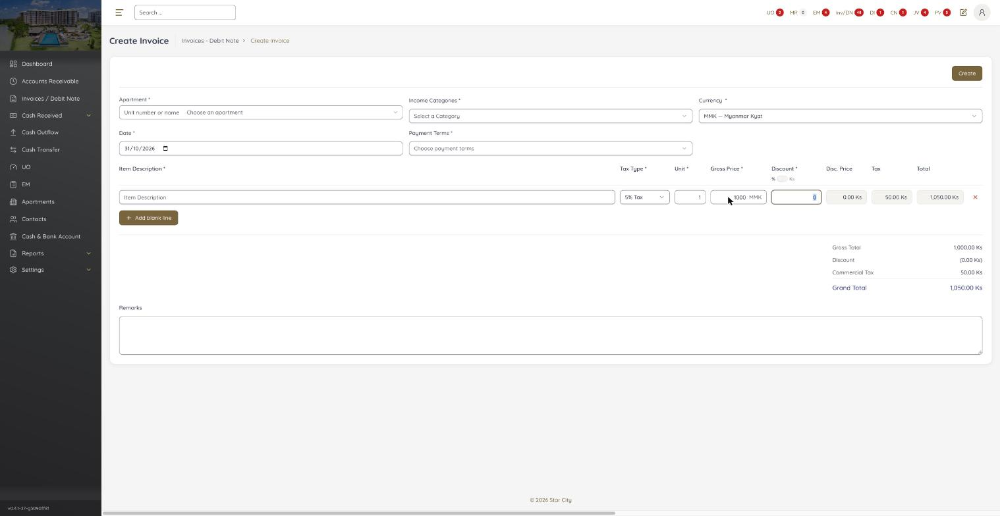 — New EM Disc. Price 0.00 Ks, Total 1,050.00 Ks.
- 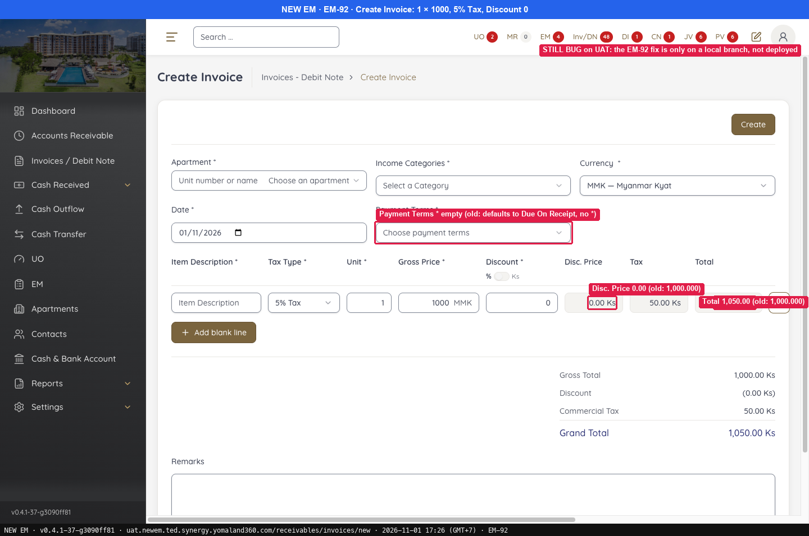 — Recheck on 2026-11-01: same values.
-  — Old EM Disc. Price 1,000.000, Total 1,000.000.

---

#### ★ SAN-EM92-003 · Line 1 × 1000 with 5% Tax and Discount 10% shows Disc. Price 900.000 and Total 900.000

| Priority | Suites | Automation | Status | Source |
|---|---|---|---|---|
| P1 | Sanity · Regression | Auto-UI | Active | EM-92 repro (scenario: 1×1000, 5% Tax, disc 10%), 2026-10-31 |

**Automated test:** [`SAN-EM92-003` in g3-invoice-amounts.spec.ts](../../../../tests/sanity/tickets/open/g3-invoice-amounts.spec.ts#L27) · tag `@sanity` · run `APP=em npx playwright test --grep SAN-EM92-003` · last run 2026-11-02, build -43: ✅ pass

**Preconditions:**

1. Logged in to EM.
2. Pages: New EM `/receivables/invoices/new`, Old EM `/invoices/add-invoice`.

**Test data:**

1. Line: Tax Type = 5% Tax, Unit 1, Gross Price 1000, Discount 10%.

**Steps:**

1. Go to Create Invoice and enter the line from the test data.
2. Read the Disc. Price, Tax, Total and Grand Total.

**Expected result:**

1. The line is accepted.
2. Disc. Price 900.000; Tax 45.000; Total 900.000; Grand Total 945.00.

**Result (build -37, 2026-10-31):**

| # | Old EM | New EM | |
|---|---|---|---|
| 2 | Disc. Price 900.000 | Disc. Price 100.00 Ks (= the discount amount) | ❌ Differs |
| 2 | Tax 45.000 | Tax 45.00 Ks | ✅ Same |
| 2 | Total 900.000 | Total 945.00 Ks | ❌ Differs |
| 2 | Grand Total 945.00 | Grand Total 945.00 | ✅ Same |

**Conclusion:** Open. Disc. Price shows the discount amount and line Total includes tax. A fix exists but is not deployed to UAT.

**Evidence:**

- 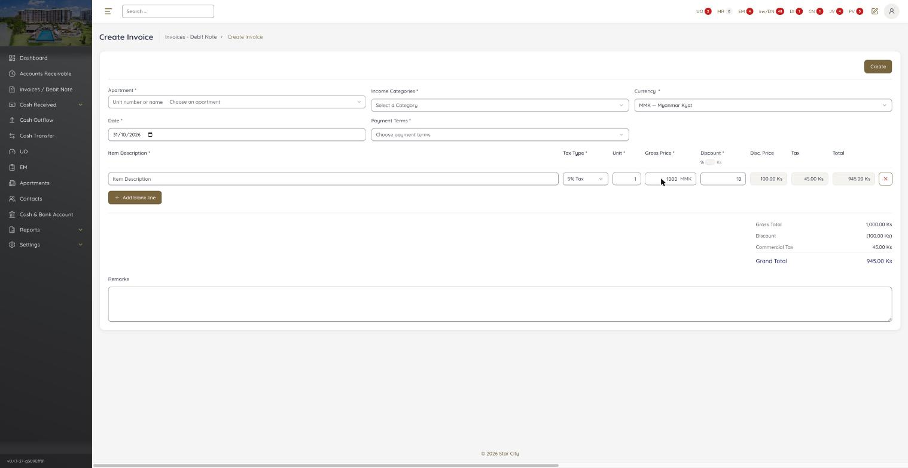 — New EM Disc. Price 100.00 Ks, Total 945.00 Ks.
- 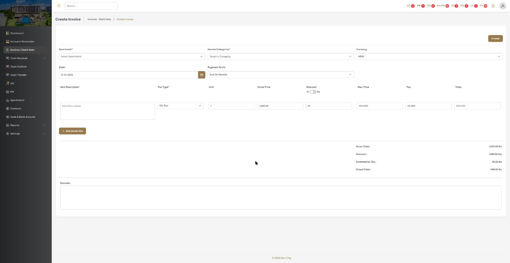 — Old EM Disc. Price 900.000, Total 900.000.

---

#### ★ SAN-EM92-004 · Changing Tax Type clears the line, as in Old EM

| Priority | Suites | Automation | Status | Source |
|---|---|---|---|---|
| P1 | Sanity · Regression | Auto-UI | Active | EM-92 repro (scenario: change Tax Type 5% → 3%), 2026-10-31 |

**Automated test:** [`SAN-EM92-004` in g3-invoice-amounts.spec.ts](../../../../tests/sanity/tickets/open/g3-invoice-amounts.spec.ts#L62) · tag `@sanity` · run `APP=em npx playwright test --grep SAN-EM92-004` · last run 2026-11-02, build -43: ✅ pass

**Preconditions:**

1. Logged in to EM.
2. Pages: New EM `/receivables/invoices/new`, Old EM `/invoices/add-invoice`.

**Steps:**

1. Go to Create Invoice and enter a line with Tax Type = 5% Tax.
2. Change Tax Type to 3%.

**Expected result:**

1. The line is filled in.
2. Unit, Gross Price and Discount are cleared.

**Result (build -37, 2026-10-31):**

| # | Old EM | New EM | |
|---|---|---|---|
| 2 | Unit / Gross / Discount cleared | Unit / Gross / Discount cleared | ✅ Same |

**Conclusion:** This scenario matches and is not a bug; a Jira comment confirms New EM keeps the Old EM behaviour. It stays as a regression check within the open ticket.

**Evidence:**

- 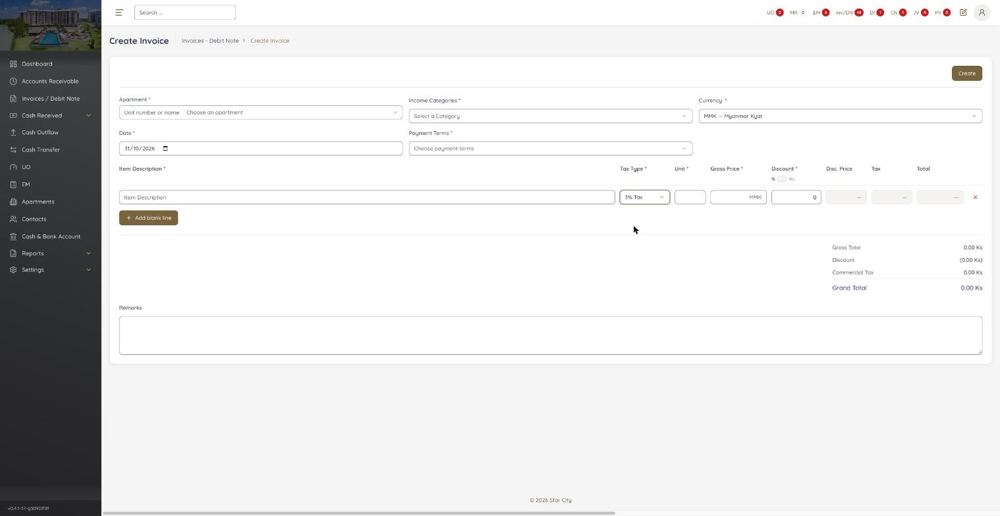 — New EM clears the line.
- 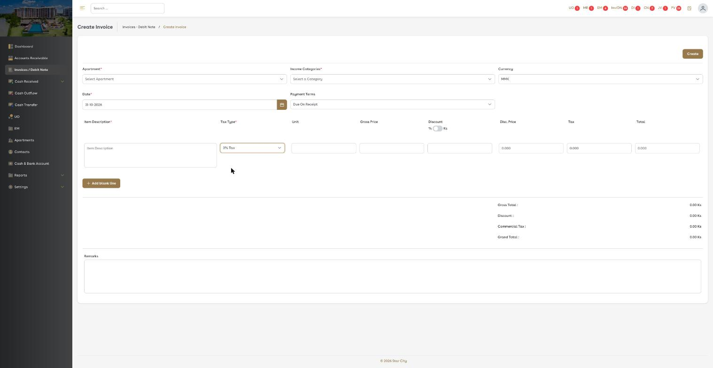 — Old EM clears the line.

---

### EM-75 · [Invoices / Debit Note > Add Invoice] Inclusive Tax 5%/3% UI differs and allows discount

[EM-75](https://zeyalabs-team-a83df6me.atlassian.net/browse/EM-75) · Jira priority Highest · Status **Partly open**

**Reported:** With Inclusive Tax 5% or 3%, the Invoice create UI differs from the current EM UAT and a discount (% or amount) is still accepted.

#### ★ SAN-EM75-001 · Inclusive Tax 5% and 3% matches the Old EM form and does not allow Discount

| Priority | Suites | Automation | Status | Source |
|---|---|---|---|---|
| P1 | Sanity · Regression | Auto-UI | Active | EM-75 repro (TC-EM-75-01), 2026-11-01 |

**Preconditions:**

1. Logged in as Admin.
2. Pages: New EM `/receivables/invoices/new`, Old EM `/invoices/add-invoice` (bundle `dd551ca9`).

**Test data:**

1. Line: Incl. 5% Tax, Unit 1, Gross Price (with tax) 1050.

**Steps:**

1. Select Tax Type = Incl. (5% / 3%).
2. Enter the line from the test data.
3. Try to type in Discount.
4. Click the % / Ks switch.
5. Read the footer.

**Expected result:**

1. The line is cleared and Gross Price splits into 2 fields (locked price before tax + input for price with tax).
2. Gross 1,000 (locked) + 1,050.00; Discount locked; Disc. Price **1,000.000**; Tax 50.000; Total **1,000.000**.
3. Discount cannot be typed.
4. The switch can still be clicked, with no effect.
5. Gross 1,000.00 · Discount 0.00 · Tax 50.00 · Grand 1,050.00.

**Result (build -37, 2026-11-01):**

| # | Old EM | New EM | |
|---|---|---|---|
| 1 | Line cleared, Gross Price split | Same | ✅ Same |
| 2 | Gross 1,000 + 1,050.00; Discount locked (blank); Disc. Price **1,000.000**; Tax 50.000; Total **1,000.000** | Gross 1,000.00 Ks (locked) + field 1050; Discount **locked = 0**; Disc. Price **0.00 Ks**; Tax 50.00; Total **1,050.00 Ks** | ❌ Differs |
| 3 | Cannot be typed | **Cannot be typed** | ✅ Same |
| 4 | Can be clicked | Can be clicked | ✅ Same |
| 5 | Gross 1,000.00 · Discount 0.00 · Tax 50.00 · Grand 1,050.00 | Matches (at the corresponding %) | ✅ Same |

**Conclusion:** Partly open. "No discount" is fixed, but the line Disc. Price and Total still differ from Old EM (0.00 and the price with tax). The ticket is blocked by EM-92, and this part waits for the EM-92 fix to reach UAT.

**Evidence:**

- 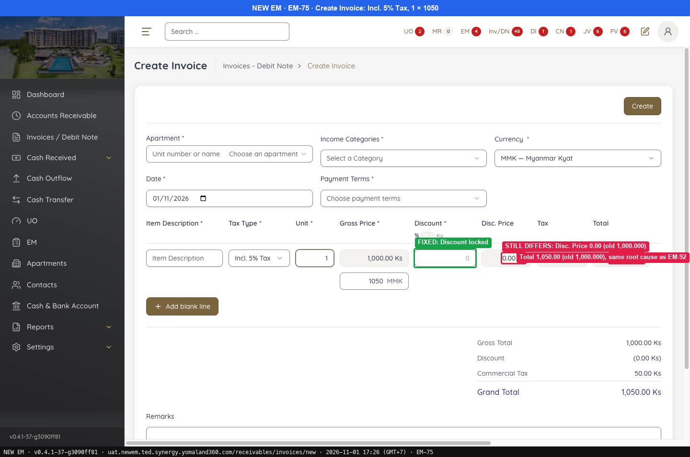 — FIXED: Discount locked
- 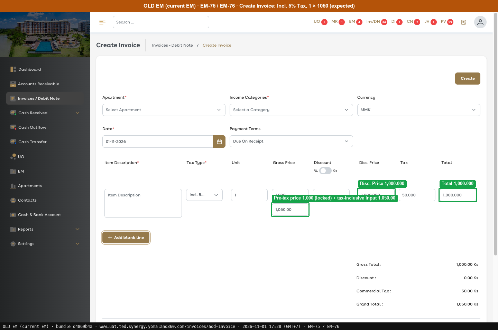 — Pre-tax price 1,000 (locked) + tax-inclusive input 1,050.00
---

### EM-76 · [Apartments > Add Invoice] Inclusive Tax 5%/3% UI differs and allows discount

[EM-76](https://zeyalabs-team-a83df6me.atlassian.net/browse/EM-76) · Jira priority Highest · Status **Partly open**

**Reported:** When Inclusive Tax 5% or 3% is selected in Add Invoice from an apartment, the create UI differs from the current EM and a discount (% or amount) is still accepted.

#### ★ SAN-EM76-001 · Inclusive Tax from an apartment: Add Invoice matches Old EM and blocks Discount

| Priority | Suites | Automation | Status | Source |
|---|---|---|---|---|
| P1 | Sanity · Regression | Auto-UI | Active | EM-76 repro (TC-EM-76-01), 2026-11-01 |

**Preconditions:**

1. Logged in as Admin.
2. Pages: New EM `/receivables/invoices/new?estate_id=1` (from Apartment Estate SEED-Z-001 › Invoices › Add Invoice). Old EM `/invoices/add-invoice` (bundle `dd551ca9`).

**Test data:**

1. New EM line: Incl. 3% Tax, Unit 1, Gross Price (including tax) 1030.
2. Old EM reference line: Incl. 5%, 1 × 1050.

**Steps:**

1. Select Tax Type = Incl. (5% / 3%).
2. Enter the line from the test data.
3. Try to type in Discount.
4. Click the % / Ks switch.
5. Read the footer. Do not click [Create].

**Expected result:**

1. The line is cleared; Gross Price splits into 2 fields (locked pre-tax price + input for the tax-inclusive price).
2. Gross 1,000 (locked) + 1,050.00; Discount locked (empty); Disc. Price **1,000.000**; Tax 50.000; Total **1,000.000** (Incl. 5% line).
3. Discount cannot be typed in.
4. The switch can still be clicked, with no effect.
5. Gross 1,000.00 · Discount 0.00 · Tax 50.00 · Grand 1,050.00 (Incl. 5% line).

**Result (build -37, 2026-11-01):**

| # | Old EM | New EM | |
|---|---|---|---|
| 1 | Line cleared; Gross Price splits into 2 fields | Same | ✅ Same |
| 2 | Gross 1,000 (locked) + 1,050.00; Discount locked (empty); Disc. Price **1,000.000**; Tax 50.000; Total **1,000.000** | Apartment preselected; Gross 1,000.00 Ks (locked) + field 1030; Discount **locked = 0**; Disc. Price **0.00 Ks**; Tax 30.00; Total **1,030.00 Ks** | ❌ Differs |
| 3 | Cannot be typed in | **Cannot be typed in** | ✅ Same |
| 4 | Can be clicked (no effect) | Can be clicked | ✅ Same |
| 5 | Gross 1,000.00 · Discount 0.00 · Tax 50.00 · Grand 1,050.00 | Matches (at the corresponding %) | ✅ Same |

**Conclusion:** Partly open. "Discount not allowed" is fixed, but the line's Disc. Price / Total columns still show 0.00 and the tax-inclusive price, unlike Old EM. It is the same line-column difference as EM-92, and it stays open until the EM-92 fix reaches UAT.

**Evidence:**

- 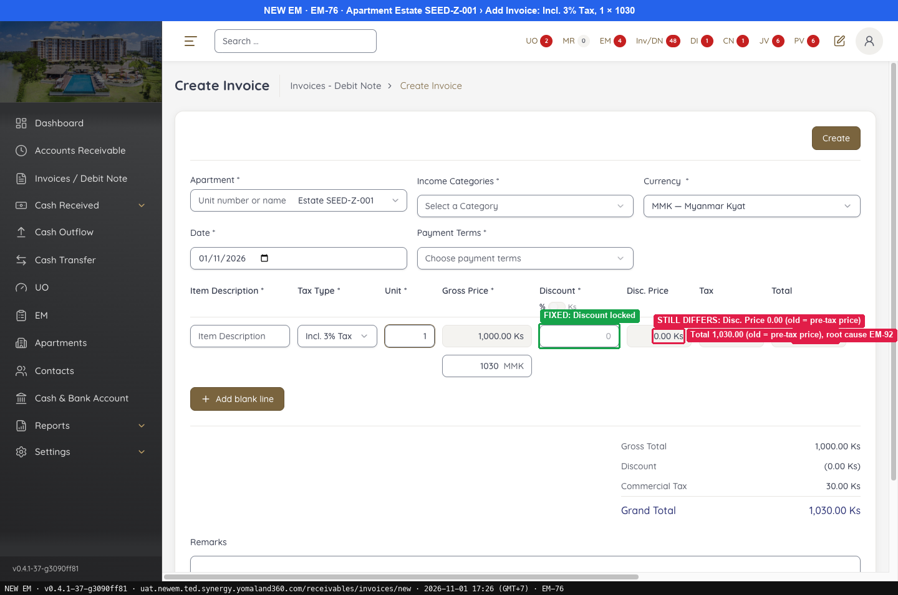 — FIXED: Discount locked
-  — Pre-tax price 1,000 (locked) + tax-inclusive input 1,050.00
---

### EM-112 · [Invoices / Debit Note > Add Invoice] 100% discount shows generic 'ERR_UNKNOWN' instead of the real reason

[EM-112](https://zeyalabs-team-a83df6me.atlassian.net/browse/EM-112) · Jira priority Medium · Status **Open**

**Reported:** Both systems allow at most 99% discount. Current EM clears the field; New EM keeps 100 and shows 'Could not calculate the total / ERR_UNKNOWN'.

#### SAN-EM112-001 · Discount 100% does not give the generic ERR_UNKNOWN error

| Priority | Suites | Automation | Status | Source |
|---|---|---|---|---|
| P2 | Sanity · Regression | Auto-UI | Active | EM-112 repro (TC-EM-112-01), 2026-11-01 |

**Preconditions:**

1. Logged in as Admin.
2. Pages: New EM `/receivables/invoices/new`, Old EM `/invoices/add-invoice` (bundle `dd551ca9`).

**Test data:**

1. Line: Unit 1, Gross Price 1000, Tax 5%.

**Steps:**

1. Enter the line from the test data.
2. Set Discount (%) = 100 and click outside.
3. Set Discount (Ks) = 1,000 (equal to the price).

**Expected result:**

1. Disc. Price 1,000.000 · Total 1,000.000.
2. The Discount field is **cleared**, totals are calculated as with discount 0, and there is no error.

**Result (build -37, 2026-11-01):**

| # | Old EM | New EM | |
|---|---|---|---|
| 1 | Disc. Price 1,000.000 · Total 1,000.000 | See EM-92 | — |
| 2 | Field **cleared**, no error | Field keeps **100**; red box "Could not calculate the total · Something went wrong · Reference: **ERR_UNKNOWN**"; all totals "—" | ❌ Differs |
| 3 | Not run | Not run | ⛔ Not run |

**Conclusion:** Open. The user is not told what is wrong (the 99% limit), and the generic message suggests the system is broken.

**Evidence:**

- 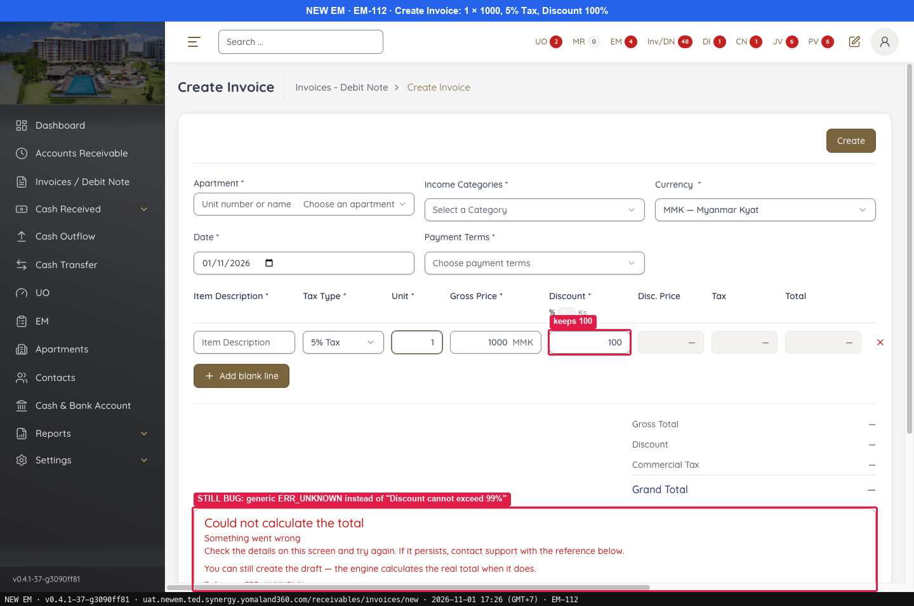 — keeps 100
- 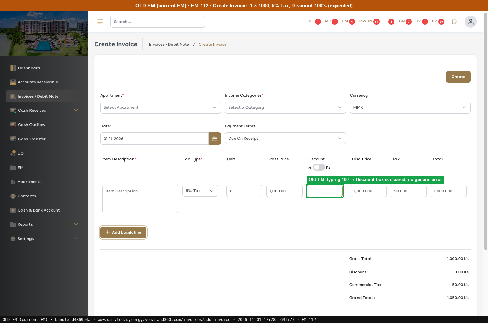 — Old EM: typing 100 → Discount box is cleared, no generic error
---

### EM-93 · [Invoices / Debit Note > Add Invoice] Invoice stays Partially Paid after paying the full displayed amount (3-decimal unit price)

[EM-93](https://zeyalabs-team-a83df6me.atlassian.net/browse/EM-93) · Jira priority Medium · Status **Open**

**Reported:** Amounts are stored with 4 decimals but shown with 2, so a customer who pays exactly the amount on screen still owes a few thousandths and the invoice never becomes PAID. The ticket's retest on build -37 reproduces it with a 2-decimal Gross Price of 1000.52.

#### SAN-EM93-001 · Paying exactly the displayed Balance Due makes the invoice PAID

| Priority | Suites | Automation | Status | Source |
|---|---|---|---|---|
| P2 | Sanity · Regression | Auto-UI+API | Active | EM-93 repro (TC-EM-93-01), 2026-11-01 |

**Preconditions:**

1. Invoice INV-202610-00047 (id 145), created by the tester on build -37 on 31/10: 3 × 1,000.52, Discount 10%, Tax 5%.
2. Paid 400 (RV-00071) and 2,436.47 (RV-00072).
3. Page: New EM `/receivables/invoices/145`, API `GET /api/gw/invoices/145`.

**Steps:**

1. Create the invoice as in the preconditions.
2. Pay 400, then pay exactly the displayed Balance Due (2,436.47).
3. Call `GET /api/gw/invoices/145`.

**Expected result:**

1. Amounts are rounded to 2 decimals.
2. The invoice is PAID, Due 0.00, and disappears from Make Payment.

**Result (build -37, 2026-11-01):**

| # | Old EM | New EM | |
|---|---|---|---|
| 1 | Not re-run. Ticket: rounds to 2 decimals, Grand Total **2,836.55** for its 1000.555 example | Stores **2836.4742**, shows 2,836.47 | ❌ Differs |
| 2 | Inv-202610-00036 (3 × 1,000.55, disc 10%, tax 5%): Paid after 2 payments, Amount Due 0.00 | Detail page: **Partially paid**, Total Paid 2,836.47, **Amount Due 0.00 Ks** | ❌ Differs |
| 3 | — | `status PARTIALLY_PAID`, `total 2836.4742`, `paid 2836.4700`, **`due 0.0042`** | ❌ Differs |

**Conclusion:** Open. Discount, tax and total are stored with 4 decimals but shown with 2, so paying the amount on screen leaves 0.0042 due and the invoice can never close. A 3-decimal Gross Price is now refused; rounding and the PAID threshold are not fixed.

**Test data created:** none. Uses the tester's existing invoices INV-202610-00046 / 00047, which the ticket asks to clean up.

**Evidence:**

- 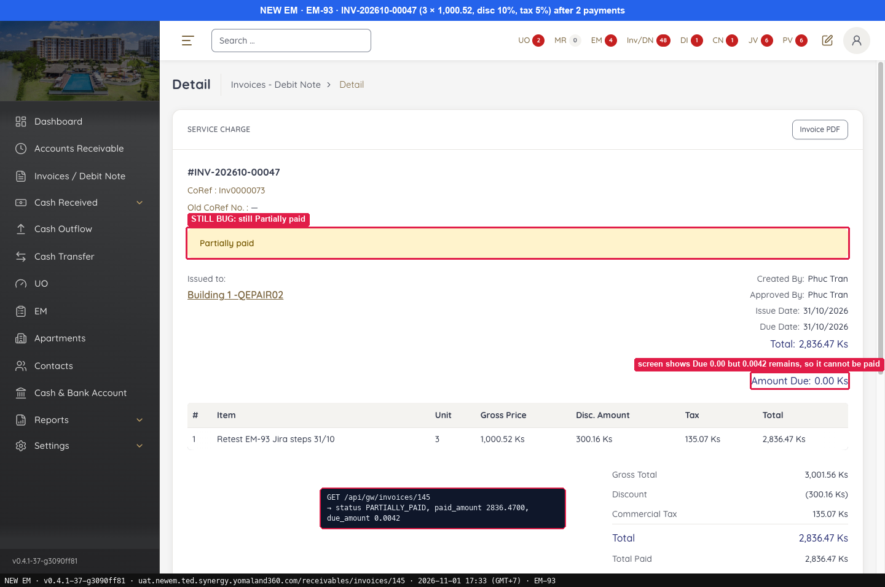 — STILL BUG: still Partially paid
- 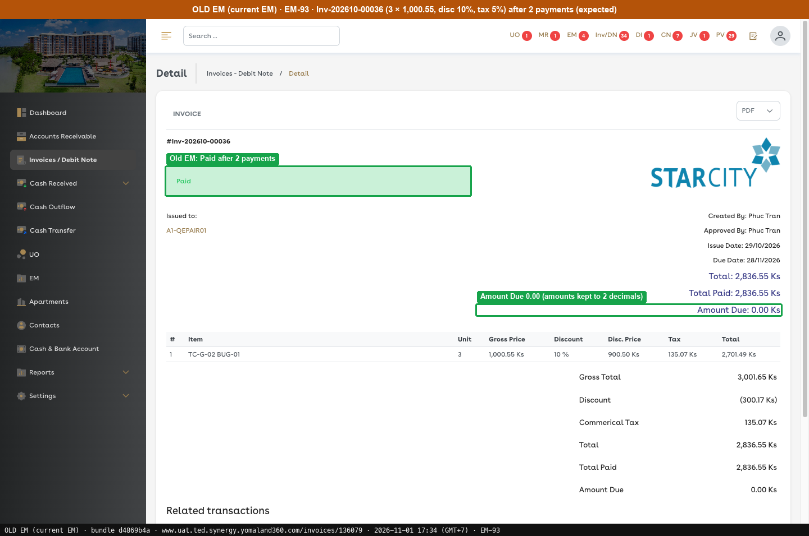 — Old EM: Paid after 2 payments
---

### EM-113 · [Invoices / Debit Note > Approve] No message when approving an already approved invoice

[EM-113](https://zeyalabs-team-a83df6me.atlassian.net/browse/EM-113) · Jira priority Medium · Status **Open**

**Reported:** With the same draft open in 2 tabs, approving in tab 2 after tab 1 shows a message in current EM, but nothing in New EM.

#### SAN-EM113-001 · Approving an invoice already approved in another tab shows Invoice has been already approved

| Priority | Suites | Automation | Status | Source |
|---|---|---|---|---|
| P2 | Sanity · Regression | Auto-UI | Active | EM-113 repro (TC-EM-113-01), 2026-11-01 |

**Preconditions:**

1. Logged in as Admin.
2. A separate draft: apartment QA-REPRO-EM-56 Tower-R32-101, item "QA-REPRO-EM-113 approve twice", 1 × 1000, 5% Tax, Due On Receipt → draft **#146** (1,050.00 Ks, first run). Re-run: draft **#149** (1,050 Ks, same apartment).
   Old EM: draft **#136097** (A1-000, 1,050 Ks, item "QA-REPRO-EM-113 approve twice").
3. Page: New EM `/receivables/invoices/149` (first run `/receivables/invoices/146`).

**Steps:**

1. Open the draft in tab 1 and tab 2.
2. Tab 1: click Approve › Confirm approve.
3. Tab 2 (not reloaded): click Approve › Confirm approve.

**Expected result:**

1. Both tabs show Approve.
2. The invoice is approved and gets a number.
3. The message **"Invoice has been already approved."** is shown.

**Result (build -37, 2026-11-01):**

| # | Old EM | New EM | |
|---|---|---|---|
| 1 | Draft #136097 open in 2 tabs; the Approve button state is not recorded | Both show Approve | — |
| 2 | Draft #136097 approved; the invoice number is not recorded | Re-run: draft #149 approved → **INV-202611-00003**. First run: draft #146 → **INV-202611-00001**, Unpaid, JE #300 | ✅ Same |
| 3 | Approving draft #136097 again from tab 2 shows the toast **"Invoice has been already approved."** | The dialog closes and the page shows the approved invoice; **no message at all** (toast/alert watched for 3 s, both runs) | ❌ Differs |

**Conclusion:** Open. Both sides were re-run with the same outcome. The approver in tab 2 believes they just approved it, while Old EM states someone else already did. Also noted: the Payment Terms dropdown has 2 near-duplicate entries, "Due on receipt" and "Due On Receipt".

**Test data created:** invoices **INV-202611-00001** (id 146, 1,050.00 Ks, Unpaid) and **INV-202611-00003** (id 149, 1,050 Ks) for apartment QA-REPRO-EM-56 Tower-R32-101; Old EM invoice #136097 (A1-000, 1,050 Ks), approved.

**Evidence:**

- 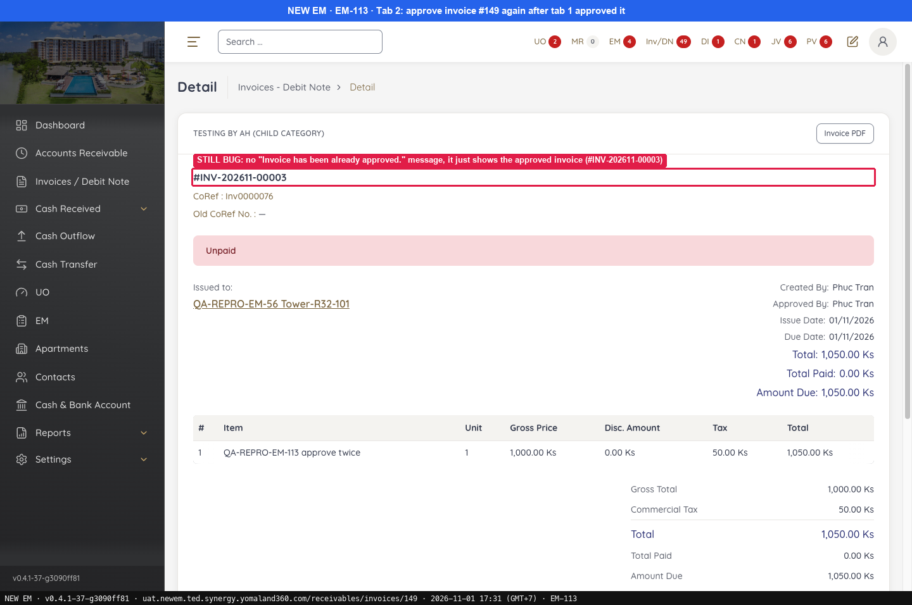 — STILL BUG: no "Invoice has been already approved." message, it just shows the approved invoice (#INV-202611-00003)
- 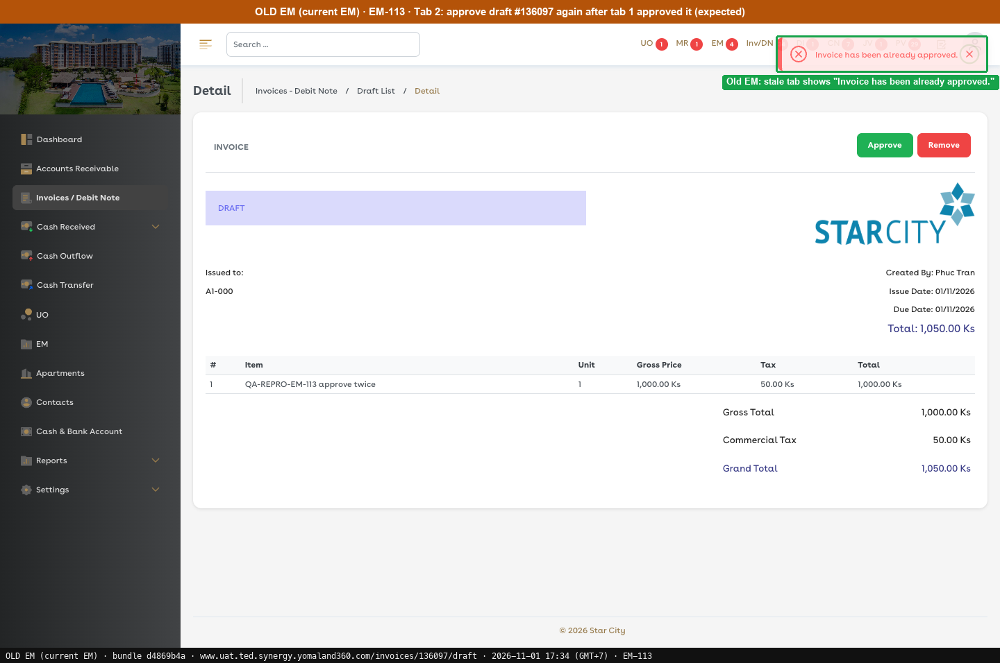 — Old EM: stale tab shows "Invoice has been already approved."
---
