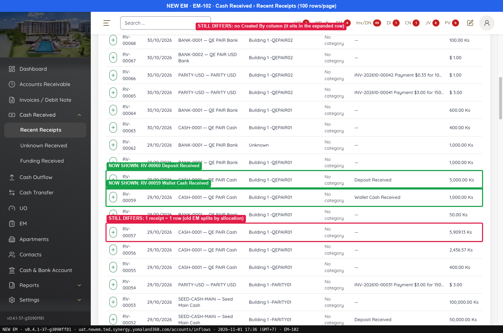
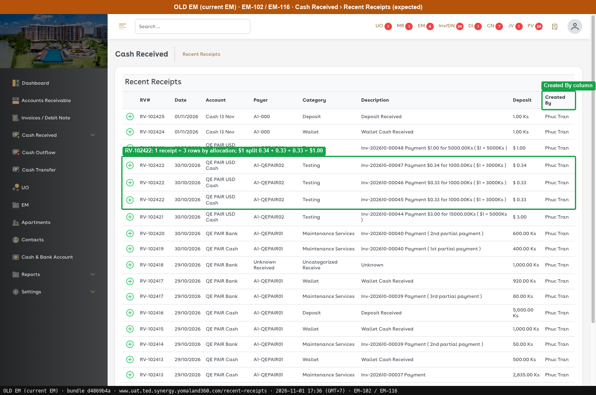
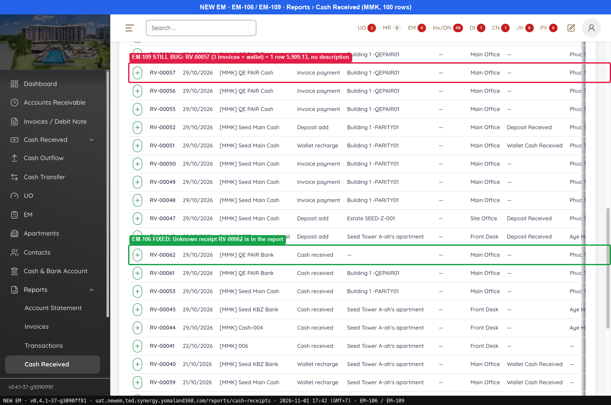
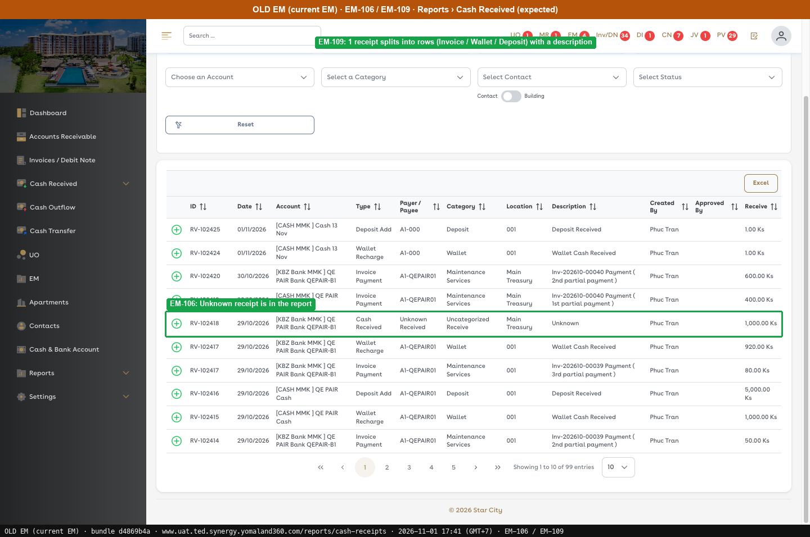
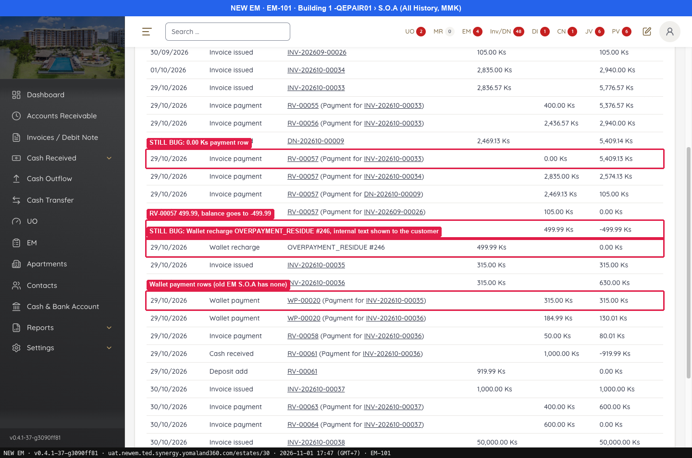
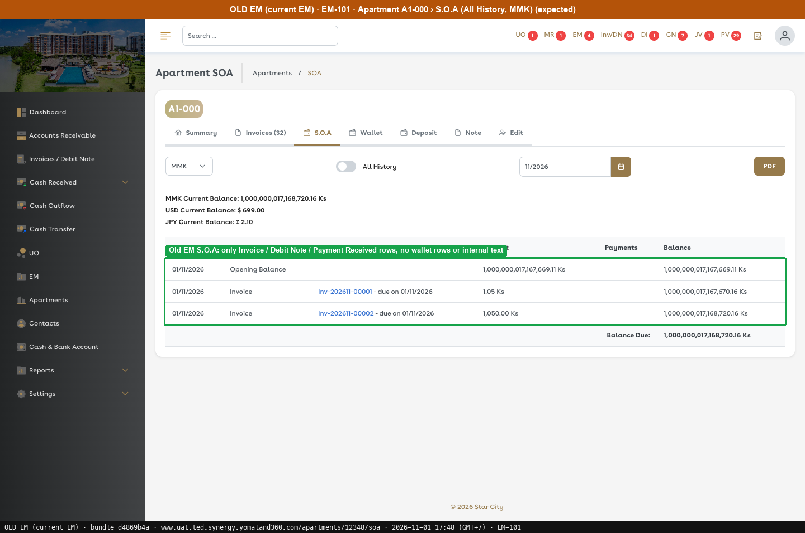
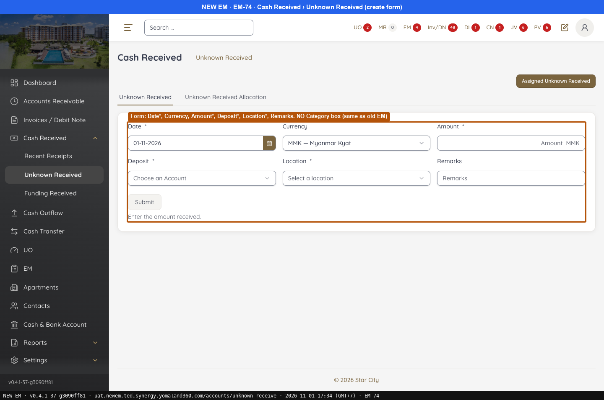
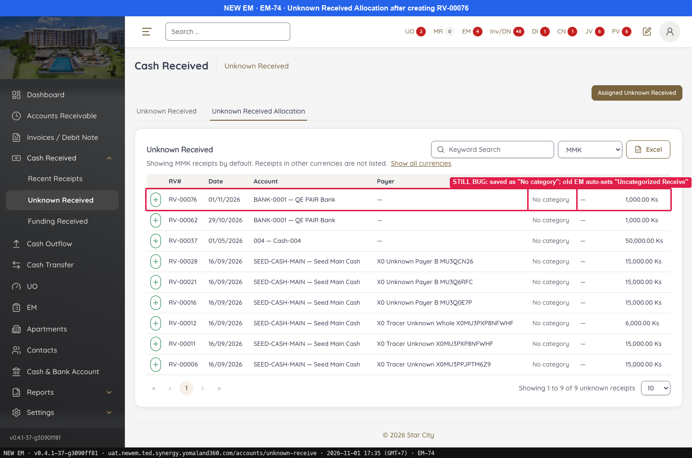
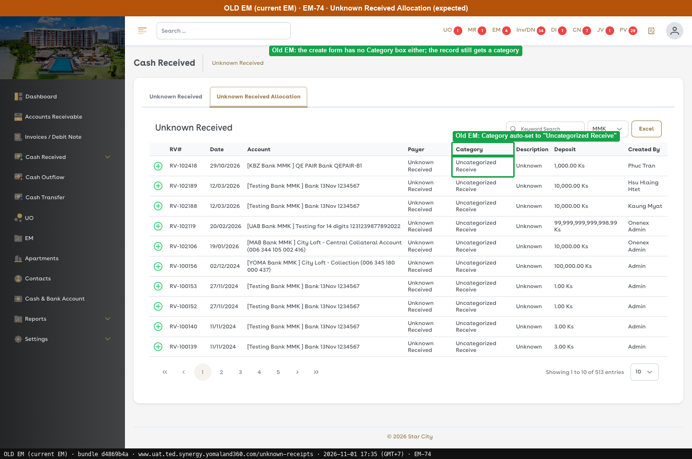

# G5 · How receipts show in lists, reports and S.O.A

[← Ticket index](../README.md) · [Sanity index](../../README.md)

**Tickets:** 4 · **Open:** 2 · **Partly open:** 2

Old EM splits a receipt by allocation line. Lists, reports and S.O.A need the same per-line view.

## Summary

| Ticket | Title | Jira priority | Status (build -37) | Result | Case |
|---|---|---|---|---|---|
| [EM-102](https://zeyalabs-team-a83df6me.atlassian.net/browse/EM-102) | [Cash Received > Recent Receipts] Wallet recharge and deposit receipts are not listed | Medium | Partly open | Wallet/deposit receipts are listed; still 1 row per receipt, no Created By column | [SAN-EM102-001](#san-em102-001--recent-receipts-lists-wallet-and-deposit-receipts-one-row-per-allocation-with-created-by) |
| [EM-109](https://zeyalabs-team-a83df6me.atlassian.net/browse/EM-109) | [Reports > Cash Received] One receipt shown as a single row without allocation details | Medium | Open | RV-00057 (3 invoices + wallet) is still 1 row with no description. | [SAN-EM109-001](#san-em109-001--cash-received-report-splits-a-receipt-for-several-invoices-and-wallet-into-described-rows) |
| [EM-101](https://zeyalabs-team-a83df6me.atlassian.net/browse/EM-101) | [Apartments > S.O.A] Statement shows wallet rows and internal text 'OVERPAYMENT_RESIDUE' | Medium | Open | S.O.A still has OVERPAYMENT_RESIDUE, a 0.00 row and wallet rows | [SAN-EM101-001](#san-em101-001--soa-shows-no-wallet-rows-or-internal-text-after-an-overpayment) |
| [EM-74](https://zeyalabs-team-a83df6me.atlassian.net/browse/EM-74) | [Cash Received > Unknown Received] Category field is not mandatory | Low | Partly open | Form matches Old EM (no Category field) but saves "No category" instead of "Uncategorized Receive" | [SAN-EM74-001](#san-em74-001--unknown-received-is-saved-with-a-default-category-never-empty) |

## Tickets

### EM-102 · [Cash Received > Recent Receipts] Wallet recharge and deposit receipts are not listed

[EM-102](https://zeyalabs-team-a83df6me.atlassian.net/browse/EM-102) · Jira priority Medium · Status **Partly open**

**Reported:** Recent Receipts in New EM does not show wallet recharge and deposit receipts, has one row per receipt and no Created By column. Current EM lists all receipts.

#### SAN-EM102-001 · Recent Receipts lists wallet and deposit receipts, one row per allocation, with Created By

| Priority | Suites | Automation | Status | Source |
|---|---|---|---|---|
| P2 | Sanity · Regression | Auto-UI | Active | EM-102 repro (TC-EM-102-01), 2026-11-01 |

**Preconditions:**

1. Logged in as Admin.
2. RV-00059 (wallet), RV-00060 (deposit) and RV-00057 (several invoices + wallet) exist.
3. Pages: New EM `/accounts/inflows` (100 rows per page), Old EM `/recent-receipts` (bundle `dd551ca9`).

**Steps:**

1. Look for RV-00059 and RV-00060.
2. Look at RV-00057 (5,909.13).
3. Read the table columns.
4. Read the Category column.

**Expected result:**

1. Both receipts are listed.
2. Each allocation has its own row with a description "Inv-… Payment".
3. RV#, Date, Account, Payer, Category, Description, Deposit, **Created By**.
4. Category follows the invoice category (Testing, Maintenance Services…).

**Result (build -37, 2026-11-01):**

| # | Old EM | New EM | |
|---|---|---|---|
| 1 | Listed | **Listed** (Wallet Cash Received 1,000 / Deposit Received 5,000) | ✅ Same |
| 2 | One row per allocation with "Inv-… Payment" | **1 row**, Description "—" | ❌ Differs |
| 3 | RV#, Date, Account, Payer, Category, Description, Deposit, **Created By** | Details, RV#, Date, Account, Payer, Category, Description, Deposit; Created By only when a row is expanded (+) | ❌ Differs |
| 4 | Testing, Maintenance Services… | All "No category" | ❌ Differs |

**Conclusion:** Partly open. Wallet and deposit receipts are now listed, but there is still 1 row per receipt, no Created By column and an empty category.

**Evidence:**

-  — NOW SHOWN: RV-00059 Wallet Cash Received
-  — Created By column
---

### EM-109 · [Reports > Cash Received] One receipt shown as a single row without allocation details

[EM-109](https://zeyalabs-team-a83df6me.atlassian.net/browse/EM-109) · Jira priority Medium · Status **Open**

**Reported:** A receipt paying 3 invoices plus a wallet recharge is 4 rows with descriptions in Old EM, but 1 row with an empty description in New EM.

#### SAN-EM109-001 · Cash Received report splits a receipt for several invoices and wallet into described rows

| Priority | Suites | Automation | Status | Source |
|---|---|---|---|---|
| P2 | Sanity · Regression | Auto-UI | Active | EM-109 repro (TC-EM-109-01), 2026-11-01 |

**Preconditions:**

1. Logged in as an Admin user.
2. RV-00057 = 5,909.13 Ks pays 3 invoices and a wallet recharge (created by the tester on 29/10).

**Steps:**

1. Open Reports › Cash Received (`/reports/cash-receipts`) and find the receipt.

**Expected result:**

1. 4 rows: 3 × Invoice Payment and 1 × Wallet Recharge, with descriptions "Inv-… Payment".

**Result (build -37, 2026-11-01):**

| # | Old EM | New EM | |
|---|---|---|---|
| 1 | RV-102417 is split into 2 rows, RV-102413 is split into 2 rows | **RV-00057: 1 row** "Invoice payment" 5,909.13 Ks, Description "—" | ❌ Differs |

**Conclusion:** Open. The receipt is not split by allocation and has no description. The Old EM rows are other receipts (RV-102417, RV-102413), as evidence of the splitting behaviour.

**Evidence:**

-  — EM-106 FIXED: Unknown receipt RV-00062 is in the report
-  — EM-106: Unknown receipt is in the report
---

### EM-101 · [Apartments > S.O.A] Statement shows wallet rows and internal text 'OVERPAYMENT_RESIDUE'

[EM-101](https://zeyalabs-team-a83df6me.atlassian.net/browse/EM-101) · Jira priority Medium · Status **Open**

**Reported:** When the customer overpays, the New EM S.O.A adds wallet rows with technical text and a "Payment … 0.00 Ks" row, while the current EM shows only invoices and payments.

#### SAN-EM101-001 · S.O.A shows no wallet rows or internal text after an overpayment

| Priority | Suites | Automation | Status | Source |
|---|---|---|---|---|
| P2 | Sanity · Regression | Auto-UI | Active | EM-101 repro (TC-EM-101-01), 2026-11-01 |

**Preconditions:**

1. Logged in as Admin.
2. Apartment Building 1 -QEPAIR01 has an overpayment (RV-00057 5,909.13 Ks) and a wallet payment (WP-00020), created by the tester on 29/10.
3. Pages: New EM `/estates/30?tab=soa` (Building 1 -QEPAIR01, MMK, All History). Old EM not re-run on this data; expected taken from the ticket.

**Steps:**

1. Apartment › S.O.A, MMK. Read the rows.
2. Select October and compare the closing balance with the ticket (80.00 vs 80.01).

**Expected result:**

1. Only Opening, Invoice issued and Payment Received rows.
2. Closing balance 80.00.

**Result (build -37, 2026-11-01):**

| # | Old EM | New EM | |
|---|---|---|---|
| 1 | Screenshot (All History): only Invoice / Debit Note / Payment Received rows, no wallet rows or internal text | Extra rows: **"Invoice payment RV-00057 (Payment for INV-202610-00033) 0.00 Ks"**, **"RV-00057 499.99 → balance -499.99"**, **"Wallet recharge OVERPAYMENT_RESIDUE #246 499.99"**, **"Wallet payment WP-00020 …"** (2 rows), "Deposit add RV-00061 919.99" | ❌ Differs |
| 2 | Ticket: 80.00 | Viewed in All History only, closing 500,105.00 (includes newer invoices); October not reconciled separately | ⛔ Not run |

**Conclusion:** Open. The customer's statement carries a technical code (OVERPAYMENT_RESIDUE), a 0.00 row and wallet rows, which differs from Old EM and is misleading.

**Evidence:**

-  — STILL BUG: 0.00 Ks payment row
-  — Old EM S.O.A: only Invoice / Debit Note / Payment Received rows, no wallet rows or internal text
---

### EM-74 · [Cash Received > Unknown Received] Category field is not mandatory

[EM-74](https://zeyalabs-team-a83df6me.atlassian.net/browse/EM-74) · Jira priority Low · Status **Partly open**

**Reported:** The Category field is not mandatory in the Unknown Received create UI; a record is saved without a Category.

#### SAN-EM74-001 · Unknown Received is saved with a default Category, never empty

| Priority | Suites | Automation | Status | Source |
|---|---|---|---|---|
| P3 | Sanity · Regression | Auto-UI | Active | EM-74 repro (TC-EM-74-01), 2026-11-01 |

**Preconditions:**

1. Logged in as Admin.
2. Pages: New EM `/accounts/unknown-receive`, Old EM `/unknown-receipts` (bundle `d4869b4a`).

**Test data:**

1. 1,000 MMK, Deposit BANK-0001 QE PAIR Bank, Location Main Office, Remarks `QA-REPRO-EM-114`.

**Steps:**

1. Open the Unknown Received form.
2. Enter the test data and click [Submit].
3. Open the Assign popup.

**Expected result:**

1. Date*, Currency, Amount*, Deposit*, Location*, Remarks; **no Category field**.
2. The record is saved and Category is set automatically to **"Uncategorized Receive"**.

**Result (build -37, 2026-11-01):**

| # | Old EM | New EM | |
|---|---|---|---|
| 1 | No Category field | No Category field | ✅ Same |
| 2 | Category **"Uncategorized Receive"** | Re-run: saved as RV-00076 (#77), Category = **"No category"** (empty). First run: RV-00073, same result | ❌ Differs |
| 3 | — | Has Category*, required only when **no** apartment is chosen ("A category is recorded only for a payer without an apartment") | — |

**Conclusion:** Partly open. The form matches Old EM (no Category field), but Old EM always has a category, so category reports are complete, while New EM saves it empty.

**Test data created:** Unknown Received **RV-00073** (#76, 1,000 Ks, BANK-0001) and **RV-00076** (#77, 1,000 Ks, BANK-0001), which is **not assigned** and stays in the Unknown list.

**Evidence:**

-  — Form: Date*, Currency, Amount*, Deposit*, Location*, Remarks. NO Category box (same as old EM)
-  — STILL BUG: saved as "No category"; old EM auto-sets "Uncategorized Receive"
-  — Old EM: Category auto-set to "Uncategorized Receive"
---
