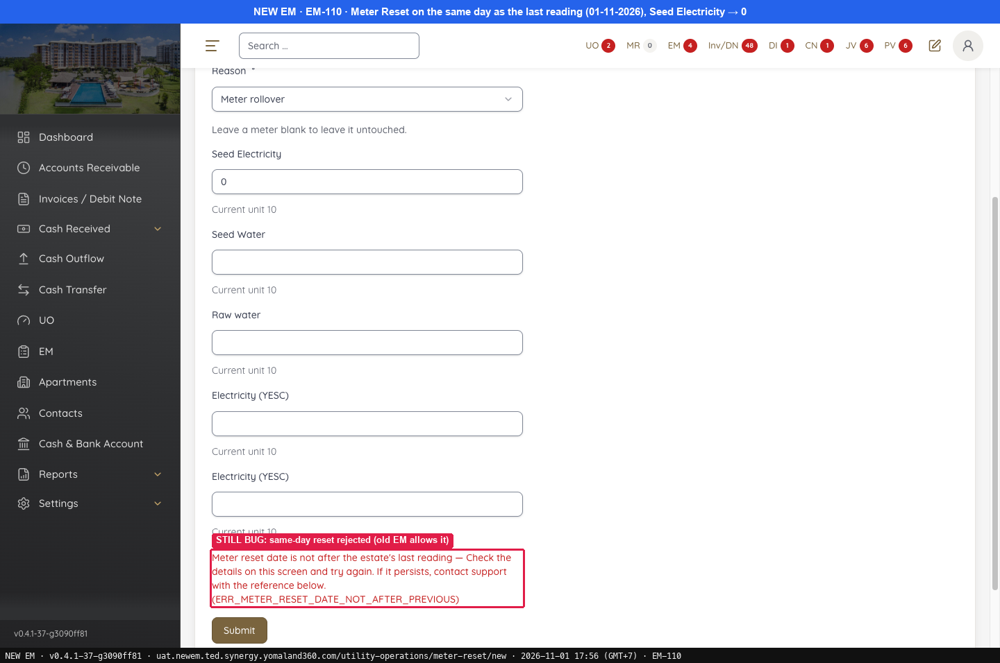
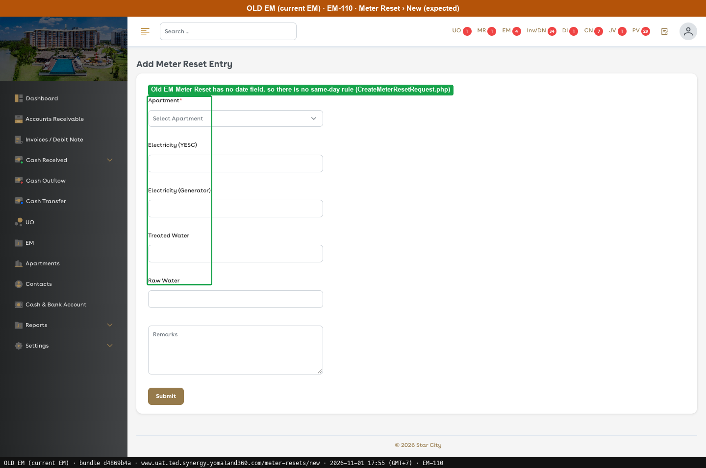
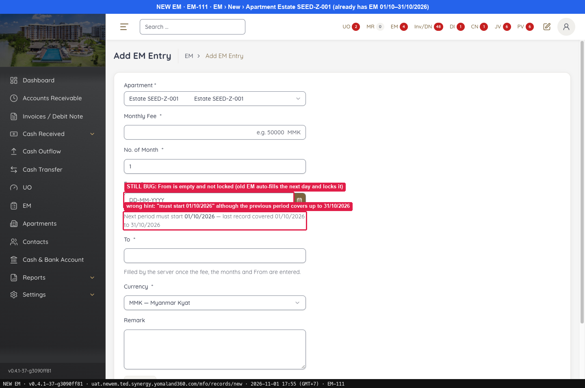
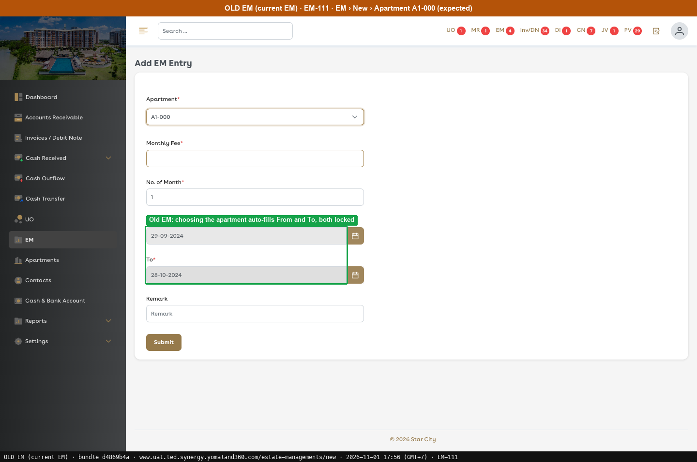
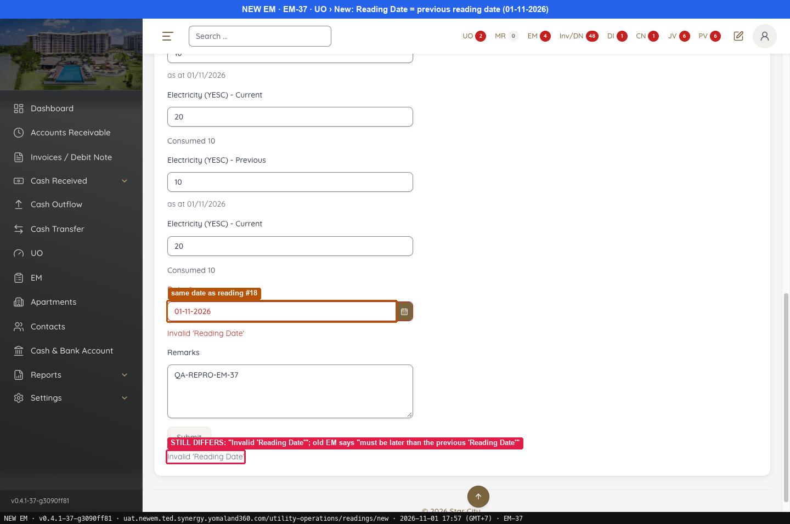
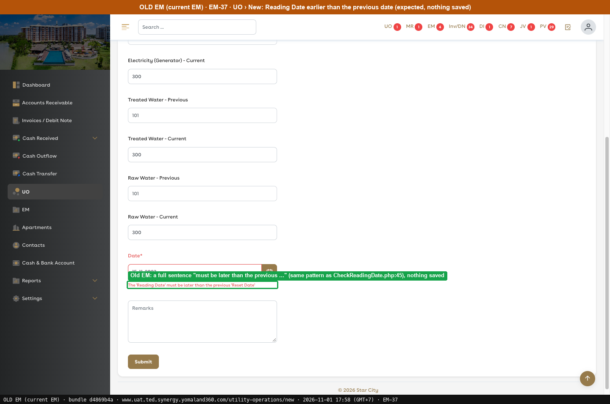
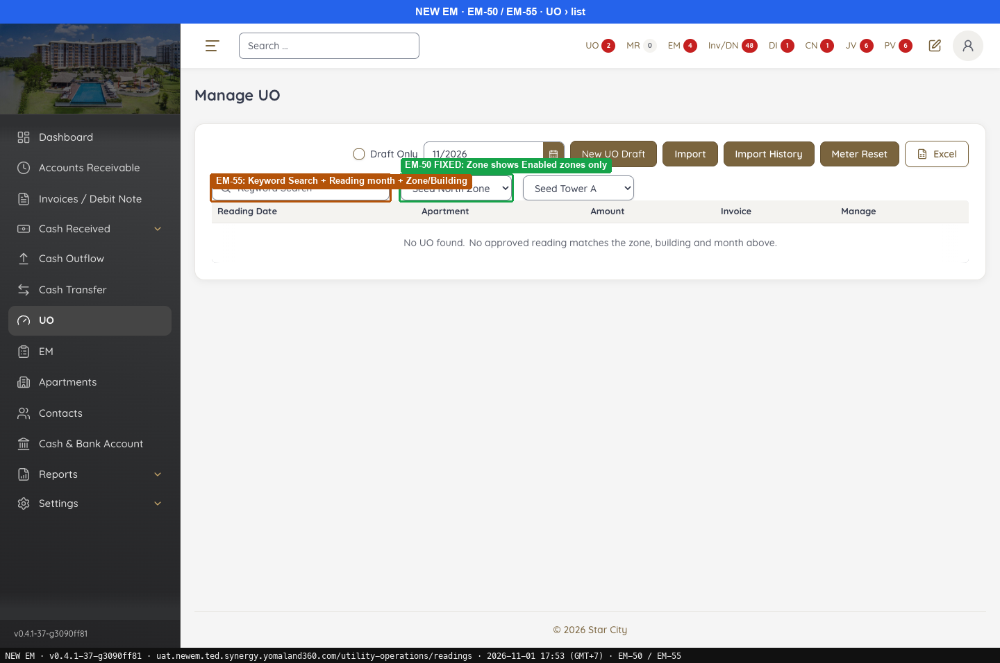
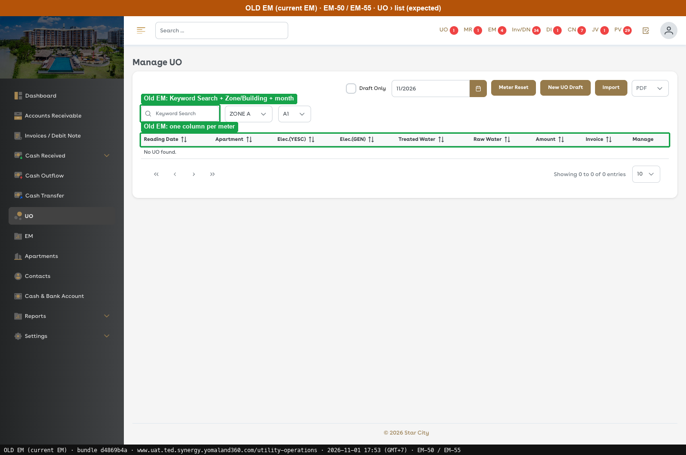

# G8 · UO, EM and reading dates

[← Ticket index](../README.md) · [Sanity index](../../README.md)

**Tickets:** 4 · **Open:** 2 · **Partly open:** 2

EM-110, EM-111 and EM-37 all compare a date with the previous period.

## Summary

| Ticket | Title | Jira priority | Status (build -37) | Result | Case |
|---|---|---|---|---|---|
| [EM-110](https://zeyalabs-team-a83df6me.atlassian.net/browse/EM-110) | [UO > Meter Reset] Reset is rejected on the same day as the last reading | Medium | Open | Same-day reset is rejected with ERR_METER_RESET_DATE_NOT_AFTER_PREVIOUS | [SAN-EM110-001](#san-em110-001--meter-reset-on-the-same-day-as-the-last-reading-can-be-saved) |
| [EM-111](https://zeyalabs-team-a83df6me.atlassian.net/browse/EM-111) | [EM > New] 'From' date is not auto-filled from the previous period | Medium | Open | From stays empty and unlocked; the hint gives the wrong date (01/10 instead of 01/11) | [SAN-EM111-001](#san-em111-001--from-date-is-auto-filled-with-the-next-period-and-locked) |
| [EM-37](https://zeyalabs-team-a83df6me.atlassian.net/browse/EM-37) | [UO] Incorrect error message when meter reading date equals the previous reading date | Medium | Partly open | Technical code is gone, but New EM shows "Invalid 'Reading Date'" instead of the Old EM sentence | [SAN-EM37-001](#san-em37-001--reading-date-equal-to-the-previous-reading-shows-the-old-em-message) |
| [EM-55](https://zeyalabs-team-a83df6me.atlassian.net/browse/EM-55) | [UO > Search] Search behaviour and UI differ from current EM | Medium | Partly open | Filter bar matches; the default list has no per-meter columns | [SAN-EM55-001](#san-em55-001--uo-page-search-and-list-layout-match-old-em) |

## Tickets

### EM-110 · [UO > Meter Reset] Reset is rejected on the same day as the last reading

[EM-110](https://zeyalabs-team-a83df6me.atlassian.net/browse/EM-110) · Jira priority Medium · Status **Open**

**Reported:** After a meter reading, resetting it to 0 on the same day works in the current EM but is rejected in New EM. The ticket says this also blocks TC-MR-03 and TC-MR-04.

#### SAN-EM110-001 · Meter Reset on the same day as the last reading can be saved

| Priority | Suites | Automation | Status | Source |
|---|---|---|---|---|
| P2 | Sanity · Regression | Auto-UI | Active | EM-110 repro (TC-EM-110-01), 2026-11-01 |

**Preconditions:**

1. Apartment QA-REPRO-EM-56 Tower-R32-101 has a reading dated 01/11/2026 with Seed Electricity = 10.
2. Pages: New EM `/utility-operations/meter-reset/new`. Old EM Meter Reset form opened, no real reset created; the same-day result is taken from the ticket.

**Test data:**

1. QA-REPRO-EM-56 Tower-R32-101, Reset date 01-11-2026, Reason Meter rollover, Seed Electricity = 0.

**Steps:**

1. Meter Reset: enter the test data and click [Submit].

**Expected result:**

1. The reset is saved and can be approved; the next UO uses Previous = 0.

**Result (build -37, 2026-11-01):**

| # | Old EM | New EM | |
|---|---|---|---|
| 1 | The form has no date field, so there is no same-day rule; no real reset created. Ticket: saved and approved, next UO uses Previous = 0 | **"Meter reset date is not after the estate's last reading … (ERR_METER_RESET_DATE_NOT_AFTER_PREVIOUS)"**, nothing saved (same on the re-run) | ❌ Differs |

**Conclusion:** Open. The reset is rejected, so it cannot be saved. Also noted: New EM has a Reset date field; Old EM has none.

**Evidence:**

-  — STILL BUG: same-day reset rejected (old EM allows it)
-  — Old EM Meter Reset has no date field
---

### EM-111 · [EM > New] 'From' date is not auto-filled from the previous period

[EM-111](https://zeyalabs-team-a83df6me.atlassian.net/browse/EM-111) · Jira priority Medium · Status **Open**

**Reported:** When the apartment already has an EM period, the current EM auto-fills From with the next period and locks it. New EM leaves it empty with only a hint.

#### SAN-EM111-001 · From date is auto-filled with the next period and locked

| Priority | Suites | Automation | Status | Source |
|---|---|---|---|---|
| P2 | Sanity · Regression | Auto-UI | Active | EM-111 repro (TC-EM-111-01), 2026-11-01 |

**Preconditions:**

1. Estate SEED-Z-001 has EM 01/10–31/10/2026; Estate SEED-A-101 has no EM.
2. Pages: New EM `/mfo/records/new`. Old EM not re-run on these apartments; expected taken from the ticket (From auto-filled and locked).

**Steps:**

1. EM › New, Apartment = Estate SEED-Z-001. Read From.
2. Read the hint.
3. Select an apartment with no EM (Estate SEED-A-101).

**Expected result:**

1. From = **01-11-2026**, locked.
2. If a hint is shown, it gives the next period start, 01/11/2026.
3. From is free.

**Result (build -37, 2026-11-01):**

| # | Old EM | New EM | |
|---|---|---|---|
| 1 | Screenshot on another apartment: From (29-09-2024) and To auto-filled, both locked | From **empty**, not locked | ❌ Differs |
| 2 | — | "Next period must start **01/10/2026** — last record covered 01/10/2026 to 31/10/2026": **wrong date** | ❌ Differs |
| 3 | From free | "No approved record … any start date is contiguous." | ✅ Same |

**Conclusion:** Open. From is neither filled nor locked, and in addition the suggested start date is wrong.

**Evidence:**

-  — STILL BUG: From is empty and not locked (old EM auto-fills the next day and locks it)
-  — Old EM: choosing the apartment auto-fills From and To, both locked
---

### EM-37 · [UO] Incorrect error message when meter reading date equals the previous reading date

[EM-37](https://zeyalabs-team-a83df6me.atlassian.net/browse/EM-37) · Jira priority Medium · Status **Partly open**

**Reported:** Choosing a Reading Date equal to the previous approved reading shows a technical error (ERR_UO_READING_DATE_NOT_AFTER_PREVIOUS) instead of "The 'Reading Date' must be later than the previous 'Reading Date'".

#### SAN-EM37-001 · Reading Date equal to the previous reading shows the Old EM message

| Priority | Suites | Automation | Status | Source |
|---|---|---|---|---|
| P2 | Sanity · Regression | Auto-UI | Active | EM-37 repro (TC-EM-37-01), 2026-11-01 |

**Preconditions:**

1. Apartment QA-REPRO-EM-56 Tower-R32-101 has an approved reading dated 01/11/2026 (UO #18, see EM-90).
2. Pages: New EM `/utility-operations/readings/new`. Old EM: A1-QEPARITY01, date 15-11-2023.

**Test data:**

1. Same apartment, Current 20, Date 01-11-2026.

**Steps:**

1. UO › New: enter the test data and try [Submit].

**Expected result:**

1. **"The 'Reading Date' must be later than the previous 'Reading Date'"**; nothing is saved.

**Result (build -37, 2026-11-01):**

| # | Old EM | New EM | |
|---|---|---|---|
| 1 | A1-QEPARITY01, date 15-11-2023: "The 'Reading Date' must be later than the previous 'Reset Date'", nothing saved | Blocked on the form: [Submit] is disabled with **"Invalid 'Reading Date'"**, no request is sent (the technical code ERR_UO_READING_DATE_NOT_AFTER_PREVIOUS no longer appears) | ❌ Differs |

**Conclusion:** Partly open. The technical error is gone, but the wording does not match Old EM. Also noted: the Old EM message reads "previous 'Reset Date'", while the ticket's expected text reads "previous 'Reading Date'".

**Evidence:**

-  — STILL DIFFERS: "Invalid 'Reading Date'"; old EM says "must be later than the previous 'Reading Date'"
-  — Old EM: a full sentence "must be later than the previous ...", nothing saved
---

### EM-55 · [UO > Search] Search behaviour and UI differ from current EM

[EM-55](https://zeyalabs-team-a83df6me.atlassian.net/browse/EM-55) · Jira priority Medium · Status **Partly open**

**Reported:** Search functionality and UI behaviour in UO are inconsistent with the current EM.

#### SAN-EM55-001 · UO page search and list layout match Old EM

| Priority | Suites | Automation | Status | Source |
|---|---|---|---|---|
| P2 | Sanity · Regression | Auto-UI | Active | EM-55 repro (TC-EM-55-01), 2026-11-01 |

**Preconditions:**

1. Logged in as Admin.
2. Pages: New EM `/utility-operations/readings`. Old EM `/utility-operations` (bundle `dd551ca9`).

**Steps:**

1. Read the filter bar.
2. Read the list columns.
3. Read the buttons.

**Expected result:**

1. Keyword Search, Zone, Building, Draft Only, month.
2. Reading Date, Apartment, **Elec.(YESC), Elec.(GEN), Treated Water, Raw Water**, Amount, Invoice, Manage.
3. Meter Reset, New UO Draft, Import, PDF.

**Result (build -37, 2026-11-01):**

| # | Old EM | New EM | |
|---|---|---|---|
| 1 | Keyword Search, Zone, Building, Draft Only, month | Same | ✅ Same |
| 2 | Reading Date, Apartment, **Elec.(YESC), Elec.(GEN), Treated Water, Raw Water**, Amount, Invoice, Manage | Reading Date, Apartment, Amount, Invoice, Manage; **no per-meter columns** (they appear only when Draft Only is on) | ❌ Differs |
| 3 | Meter Reset, New UO Draft, Import, PDF | New UO Draft, Import, Import History, Meter Reset, Excel | ❌ Differs |

**Conclusion:** Partly open. The filter bar matches, but the default list has no reading column per meter.

**Evidence:**

-  — EM-50 FIXED: Zone shows Enabled zones only
-  — Old EM: Keyword Search + Zone/Building + month
---
