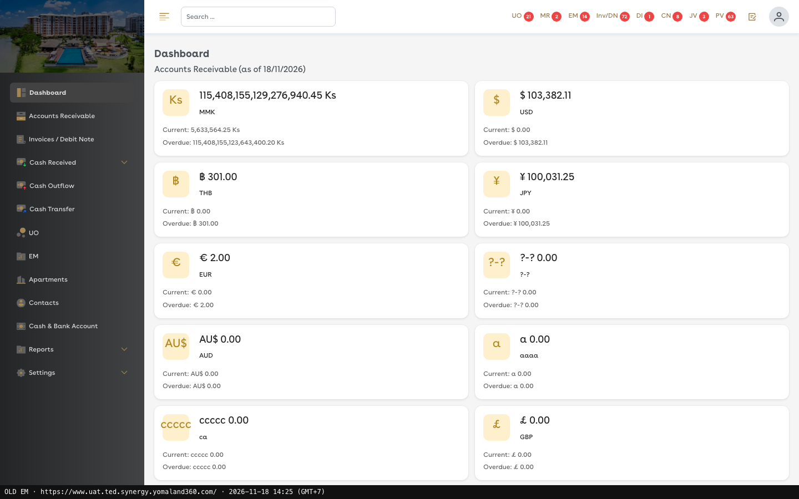
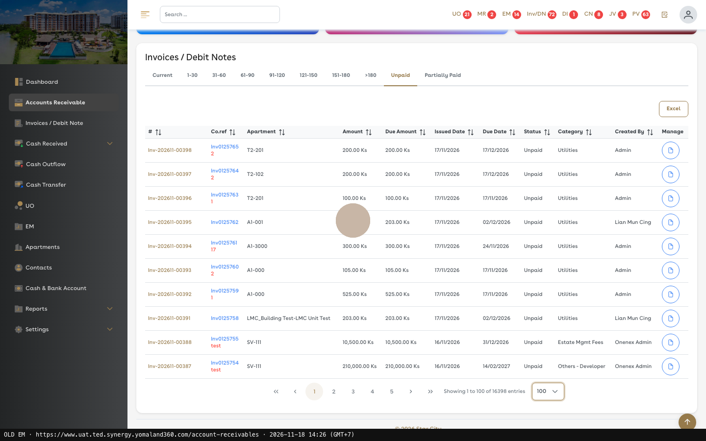

# Old EM: bug candidates (to review)

Things noticed on **Old EM UAT** while testing, that are **not yet decided** as bugs.
Review each one and choose: **create a bug**, **not a bug**, or **check more**.
Confirmed bugs go to [old-em-bugs.md](old-em-bugs.md); this file is only the waiting list.

| ID | Module | Seen while | Candidate | Confirmed? | Decision |
|---|---|---|---|---|---|
| [OEM-C1](#oem-c1) | Dashboard | INV-001 check areas | Dashboard AR (MMK) shows an unrealistic amount: 115,408,155,129,276,940.45 Ks | Seen, cause unknown | ☐ Bug ☐ Not a bug ☐ Check more |
| [OEM-C2](#oem-c2) | Dashboard / Accounts Receivable | INV-001 check areas | Dashboard AR total and Accounts Receivable page total differ | **Not confirmed** (page was filtered) | ☐ Bug ☐ Not a bug ☐ Check more |
| [OEM-C3](#oem-c3) | Accounts Receivable | INV-001 check areas | "Rows per page" = 100 and "Showing 1 to 100 of 16398 entries", but the table shows 10 rows | **Not confirmed** (one screenshot) | ☐ Bug ☐ Not a bug ☐ Check more |
| [OEM-C4](#oem-c4) | Dashboard | INV-001 check areas | Currencies with junk names on the Dashboard: `?-?`, `aaaa`, `ccccc` | Seen | ☐ Bug ☐ Not a bug ☐ Check more |

---

## OEM-C1 · Dashboard AR (MMK) shows an unrealistic amount

- **Where:** Dashboard › Accounts Receivable (as of 18/11/2026) › MMK card.
- **Seen:** 18 Nov 2026, 14:25 (GMT+7), user Test Account 1.
- **Actual:** total **115,408,155,129,276,940.45 Ks** (about 115 quadrillion), Current 5,633,564.25 Ks,
  Overdue 115,408,155,123,643,400.20 Ks.
- **Why it may be a bug:** an AR total this size cannot come from real billing. Either some saved
  invoice amounts are wrong, or the Dashboard adds them up wrongly.
- **Why it may not be a bug:** UAT holds data from max-amount tests (e.g. INV-012: gross price with 14
  integer digits), which can add up to such a number.
- **To decide:** find the apartments / invoices behind the overdue MMK amount (Accounts Receivable ›
  sort by Amount) and check whether their amounts are real test data.
- **Impact on our tests:** none. We compare the Dashboard **before / after** an action, not its absolute value.

## OEM-C2 · Dashboard AR total and Accounts Receivable page total differ

- **Where:** Dashboard › AR (MMK) vs Accounts Receivable page heading.
- **Seen:** 18 Nov 2026, same minute, nothing changed in between.
- **Actual:**
  - Dashboard AR (MMK): **115,408,155,129,276,940.45 Ks**
  - Accounts Receivable page: **115,260,006,505,542,720.99 Ks**
  - Difference: about 148,148,623,734,219.46 Ks
- **Not confirmed:** the page had the filter **Type = Invoice** and tab **Unpaid** selected. The
  heading may count only invoices (no debit notes), or only one currency, which would explain the
  difference.
- **To decide:** open Accounts Receivable with no filter and compare its total with the Dashboard MMK card.
  The two should be equal if both mean "all unpaid MMK documents".

## OEM-C3 · Accounts Receivable shows 10 rows while "Rows per page" is 100

- **Where:** Accounts Receivable › tab Unpaid › Type Invoice.
- **Actual:** after choosing **100** in the rows-per-page dropdown, the footer says
  *"Showing 1 to 100 of 16398 entries"*, but the table lists **10 rows** (Inv-202611-00398 … 00387).
- **Not confirmed:** seen in one screenshot taken right after changing the dropdown; the table may not
  have refreshed yet.
- **To decide:** choose 100 rows per page by hand, wait for the list, count the rows.

## OEM-C4 · Currencies with junk names on the Dashboard

- **Where:** Dashboard › Accounts Receivable cards.
- **Actual:** cards for currencies named `?-?`, `aaaa` (symbol `α`) and `ccccc` (code `ca`), all 0.00.
- **Probably not a bug:** test data created in Settings by testers. It could be a bug only if Settings
  should refuse such currency names (no test case says so).
- **To decide:** remove the test currencies, or add a case for currency name validation.

---

**Environment note (not a candidate):** on Old EM UAT another tester had turned on
*Settings › General › "Old CoRef No."*, so the invoice form required an extra field. Tests fill it in
automatically and record it.
