# Old EM: bug list

Checked on **Old EM UAT** (https://www.uat.ted.synergy.yomaland360.com) on **12–13 Nov 2026** by running the GT test cases in [projects/em/docs/test-cases/](../../em/docs/test-cases/README.md) automatically.

**Rule:** the test cases are the reference. A failing case means **the system is wrong** and needs a fix.

Vietnamese version: [old-em-bugs.vi.md](old-em-bugs.vi.md).

## Summary

- **122 test runs**: 92 pass, 28 fail, 2 unstable (pass in some runs only; check by hand).
- The 28 failures come down to the **11 bugs** below.

| # | Bug | Severity | Test cases |
|---|---|---|---|
| 1 | Two users pay the same invoice at the same moment → money taken twice | 🔴 High | 1.1–1.3: 1Inv 2RV rows 4, 18, 20 · 1.4: Wallet - OB & CB row 128 · 1.5: Acc Statement - OB & CB row 225 |
| 2 | UO import file with 2 rows for the same apartment and month → 2 invoices | 🔴 High | Uo import rows 20, 22, 32, 33 |
| 3 | SOA: next month's opening balance is wrong (UO Bulk Approve, then paid from Wallet) | 🔴 High | SOA - OB & CB row 259 |
| 4 | Editing an account's initial balance → tomorrow still opens at the old balance | 🔴 High | TC_Cash_Bank_Acc_015 |
| 5 | Wallet: next month's opening balance misses a Wallet Payment made after a Credit Note | 🔴 High | Wallet - OB & CB row 124 |
| 6 | Invoice form wipes the typed Gross Price / Discount | 🔴 High | TC_Inv_001 · INV-038 (not in the Excel) |
| 7 | Some lists do not show "Created By" / "Approved By" | 🟠 Medium | RPT-036 (not in the Excel) |
| 8 | Unknown Received does not offer cash accounts | 🟠 Medium | TC_CR_002 |
| 9 | Paying an invoice from the Wallet creates no RV in Cash Received | 🟠 Medium | TC_MPM_006 |
| 10 | Cash Outflow approver cannot see drafts of categories not assigned to the role | 🟠 Medium | TC_Role&Permission_065 |
| 11 | New account: Type is not "Cash" by default | 🟢 Low | TC_Cash_Bank_Acc_001 |

Severity is QE's suggestion; PMs may change it.

**Test case IDs** are those in the Excel file *ZL_TED EM Test Case for Round Testing (2026)_19082026.xlsx*. Sheets without an ID column (1Inv 2RV, Uo import, the OB & CB sheets) are referenced by sheet name and row. INV-038 and RPT-036 are not in the Excel: they were added for reported issues (invoice calculation, missing audit trail). They are **Old EM only**, kept in `projects/old-em/docs/test-cases/extra-cases.md`, not in New EM's test cases.

> **Note for developers:** bugs 3, 4 and 5 follow the same pattern. The current period is right; only the **next period's opening balance** (tomorrow or next month) is wrong. Old EM seems to store the opening balance and not recalculate it after some actions, so all three may share one cause.

How the tests were run:

- Every test creates its own apartment, accounts and documents (names start with `QE OLD`), so other testers' data cannot change the results.
- Old EM UAT has one test account. Where a bug needs **two users**, the tests used **two sessions of the same admin**, and the same admin created and approved documents.
- Full test output and all screenshots: [old-em-issues.md](old-em-issues.md).

---

## 🔴 Bug 1 · Two users pay the same invoice at the same moment

**What happens:** two users click **Confirm** on Make Payment for the same invoice at almost the same moment. Old EM can **accept both payments**: the invoice is paid twice, overpaid, or its due amount is overwritten. Other times one user gets **"Internal Server Error"** instead of a clear message. The result depends on timing.

**Expected:** the second user is refused with "This invoice has already been paid in full" (or "Please refresh and try again").

**Impact:** wrong collections, wrong receivables (AR), wrong account balance.

Paying one after the other (not at the same moment) is handled correctly.

**Cases in this bug:**

| # | Test case (Excel) | Situation | What Old EM does wrong |
|---|---|---|---|
| [1.1](#11) | 1Inv 2RV row 4 | 2 users both pay a 1,000 invoice **in full** | Both accepted → overpaid by 1,000 |
| [1.2](#12) | 1Inv 2RV row 18 | 2 users both pay part (400 + 500) | Both accepted, but the Invoices tab and AR show 500 due instead of 100 |
| [1.3](#13) | 1Inv 2RV row 20 | 2 users pay 500 + 600, **above** the invoice | Both accepted → overpaid by 100; screens show different amounts |
| [1.4](#14) | Wallet - OB & CB row 128 | 2 users both refund the full wallet balance | Both drafts are created (approval still blocks the second) |
| [1.5](#15) | Acc Statement - OB & CB row 225 | 2 users both approve a Cash Outflow of the full account balance | "Internal Server Error" instead of "Insufficient Balance" |

**Why does one test case fail in 2 ways?** In 1.1, 1.2 and 1.3 the result depends on how close together the two clicks reach the server. Running the same test several times, Old EM fails in **2 ways**:

- **Type A:** both payments are accepted (money taken twice, or the due amount overwritten).
- **Type B:** one user gets **"Internal Server Error"** and only one payment is accepted.

Both are failures of **the same test case**, not separate bugs. The screenshots below are grouped by type, with the run they come from.

### Test case

#### ❌ 1.1 · Sheet `1Inv 2RV`, row 4 · Two users both pay a 1,000 Ks invoice in full

- **Expected:** one payment is accepted; the other user sees "This invoice has already been paid in full".
- **Actual:** 6 runs: 4 failed as type A, 2 as type B.

**Type A: both payments accepted** (4 of 6 runs; screenshots from the 13 Nov 15:33 run, Inv-202611-00381)

*1.1 · Image 1: SOA shows two payments, RV-102721 and RV-102722, 1,000 each, Balance Due −1,000; the second user also saw "Payment has been approved successfully"*

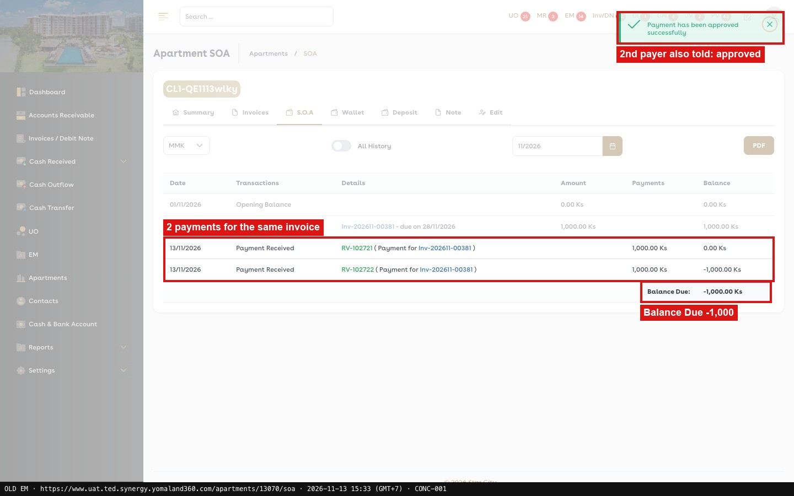

*1.1 · Image 2: the Invoices tab only shows the invoice as "PAID", Due 0; nothing shows it was overpaid by 1,000*

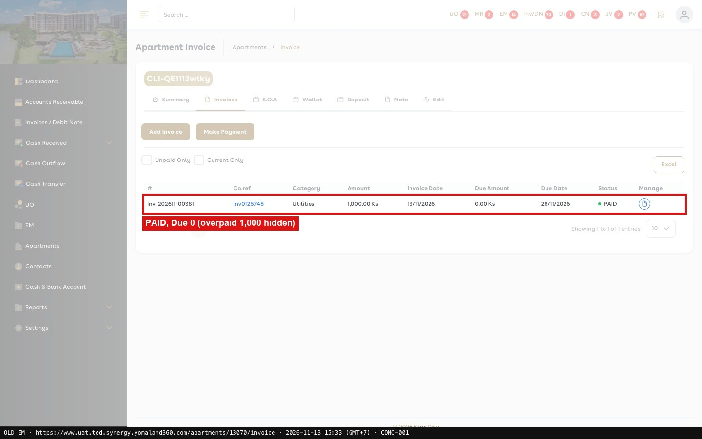

**Type B: "Internal Server Error"** (2 of 6 runs; screenshot from the 13 Nov 10:54 run, a different invoice)

*1.1 · Image 3: one user clicks Confirm → "Internal Server Error" (expected "already been paid in full")*

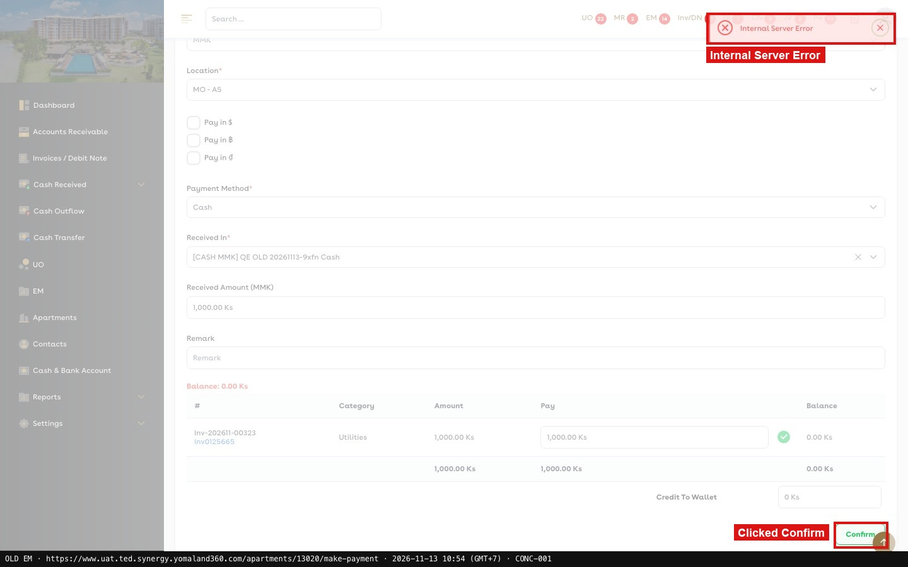

#### ❌ 1.2 · Sheet `1Inv 2RV`, row 18 · Two users both pay part (400 and 500) of a 1,000 Ks invoice

- **Expected:** both payments are accepted, 100 still due on every screen.
- **Actual:** some runs failed as type A, some as type B.

**Type A: both payments accepted, but the due amount is overwritten** (screenshots from the 16 Nov 11:10 run, Inv-202611-00385). The SOA shows 400 + 500 and Balance Due 100, but the Invoices tab, AR and the "Current Balance" line still show **500 due**.

*1.2 · Image 1: SOA shows two payments, 400 (RV-102726) and 500 (RV-102727), Balance Due 100; but the "Current Balance" line above says 500*

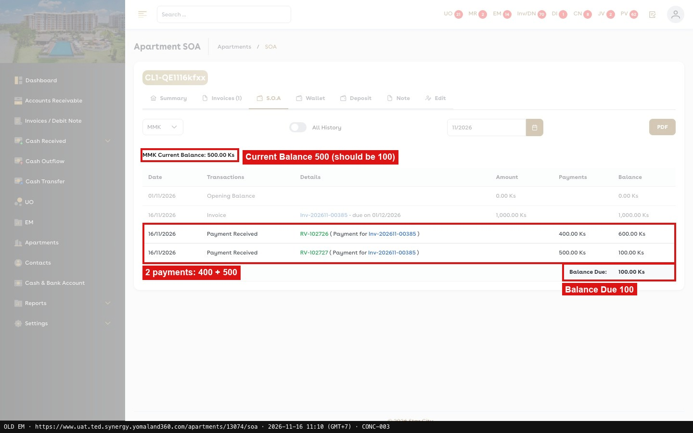

*1.2 · Image 2: the same invoice on the Invoices tab shows 500 due, "PARTIALLY PAID" (should be 100)*

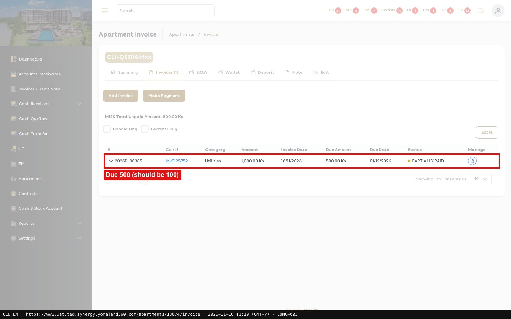

*1.2 · Image 3: the apartment's AR is 500 (should be 100)*

**Type B: "Internal Server Error"** (screenshot from the 13 Nov 10:55 run, a different invoice). The 400 payment fails, only 500 is accepted.

*1.2 · Image 4: the user paying 400 clicks Confirm → "Internal Server Error"*

#### ❌ 1.3 · Sheet `1Inv 2RV`, row 20 · Two users pay 500 and 600 of a 1,000 Ks invoice (total above the invoice)

- **Expected:** the second user sees "This invoice has already been partially paid. Please refresh and try again".
- **Actual:** 5 runs: 4 failed as type A, 1 as type B.

**Type A: both payments accepted, overpaid by 100** (4 of 5 runs; screenshots from the 13 Nov 15:31 run, Inv-202611-00380). The screens also **disagree**: the SOA shows both payments, but the Invoices tab and AR count only one (500 still due).

*1.3 · Image 1: SOA shows two payments, 600 (RV-102718) and 500 (RV-102719), Balance Due −100*

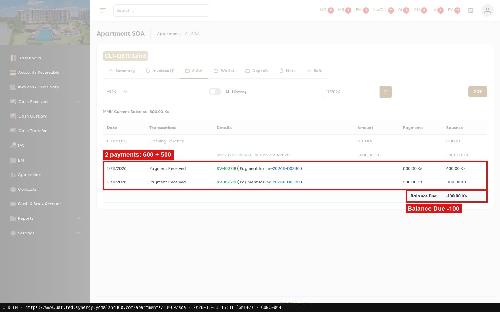

*1.3 · Image 2: the same invoice on the Invoices tab shows 500 still due, "PARTIALLY PAID" (the 600 payment was overwritten)*

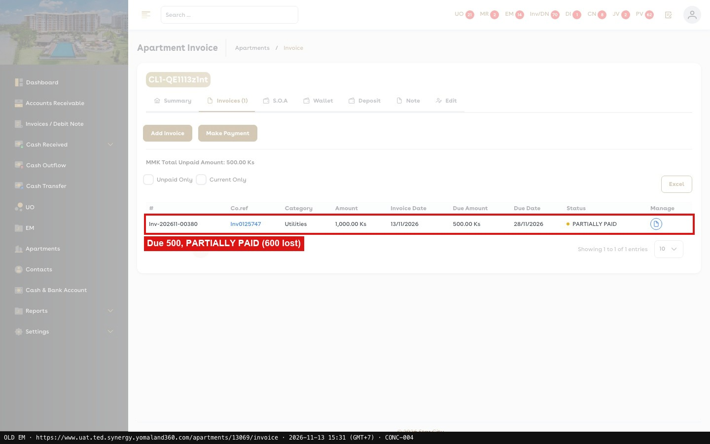

*1.3 · Image 3: the apartment's AR is 500, while the SOA shows −100*

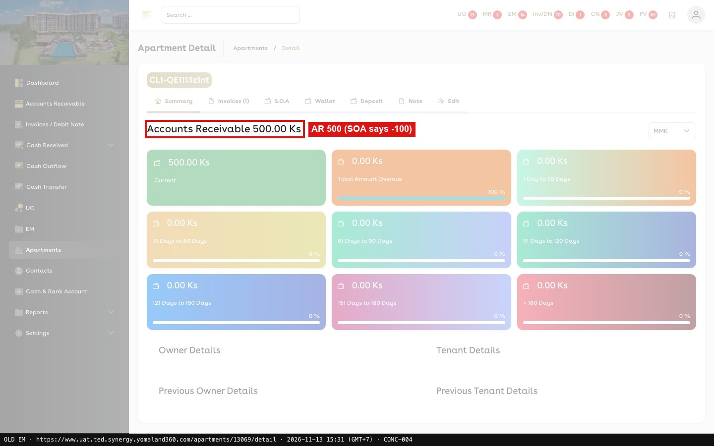

**Type B: "Internal Server Error"** (1 of 5 runs; screenshot from the 13 Nov 10:55 run, a different invoice)

*1.3 · Image 4: the user paying 500 clicks Confirm → "Internal Server Error" (expected "Please refresh and try again")*

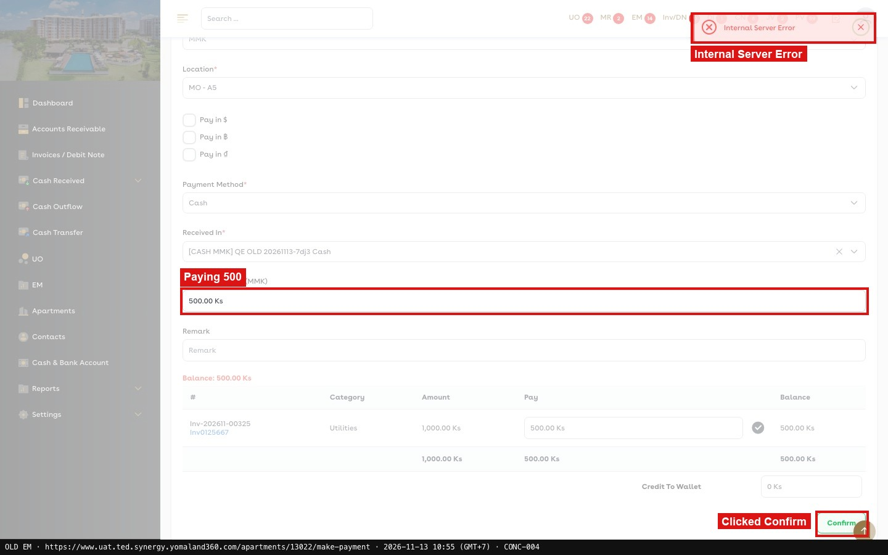

#### ❌ 1.4 · Sheet `Wallet - OB & CB`, row 128 · Two users both create a Wallet Refund of the full wallet balance (100,000)

- **Expected:** the second draft is refused when it is created.
- **Actual:** **both drafts** are created. At approval only one can be approved, so the wallet does not go below 0.

*1.4 · Image 1: Cash Outflow draft list, the last 2 rows are two 100,000 Wallet Refunds created at 10:56 for CL1-QE11132mtw (the second row is cut off at the bottom edge)*

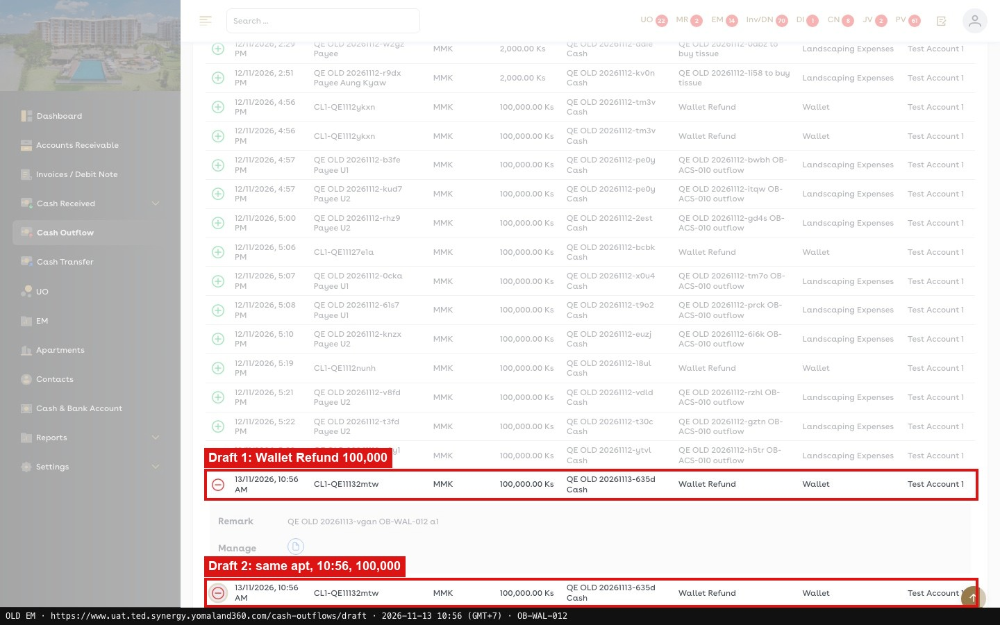

*1.4 · Image 2: Wallet tab, only one PV-100328 is approved, the balance goes to 0 (not negative)*

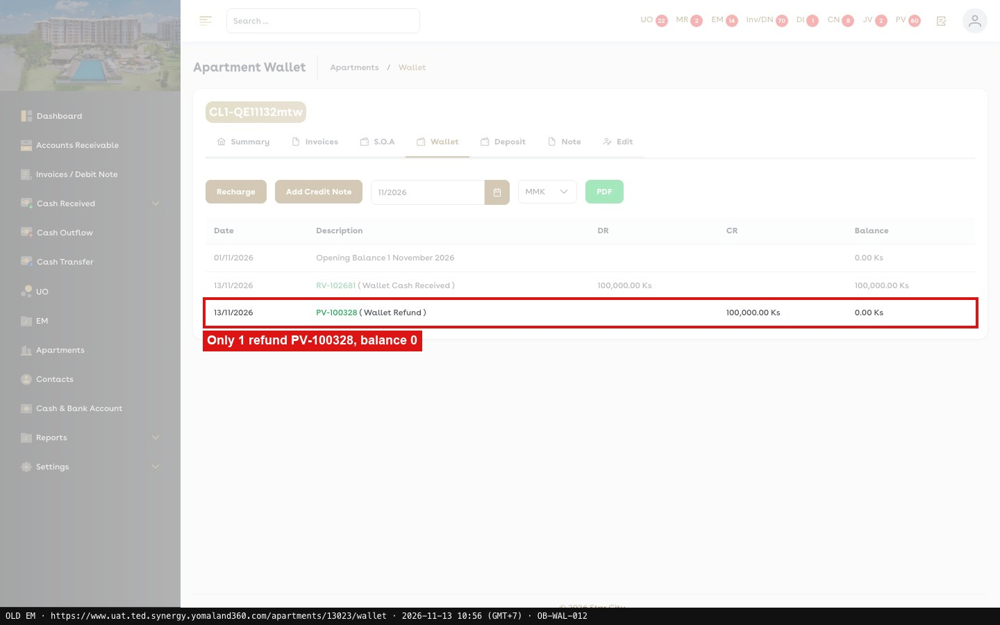

#### ❌ 1.5 · Sheet `Acc Statement - OB & CB`, row 225 · Two users both approve a Cash Outflow of the full account balance (100,000)

- **Expected:** the second user is refused with "Insufficient Balance".
- **Actual:** money is safe (only one can be approved), but **sometimes "Internal Server Error"** instead of "Insufficient Balance".

**Bug:** "Internal Server Error" (13 Nov 10:57 run)

*1.5 · Image 1: approving the second draft → "Internal Server Error"*

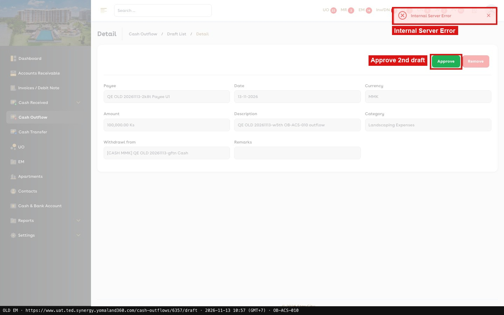

**For comparison (not a bug):** in another try during the same run, Old EM showed the right message. This is the expected result, shown only to compare with image 1.

*1.5 · Image 2: the right message, "Insufficient Balance"*

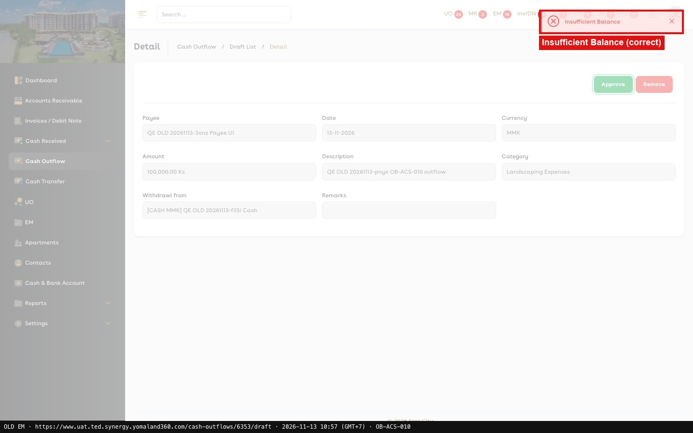

*1.5 · Image 3: the cash book has only one PV-100330, balance 0 (money is safe)*

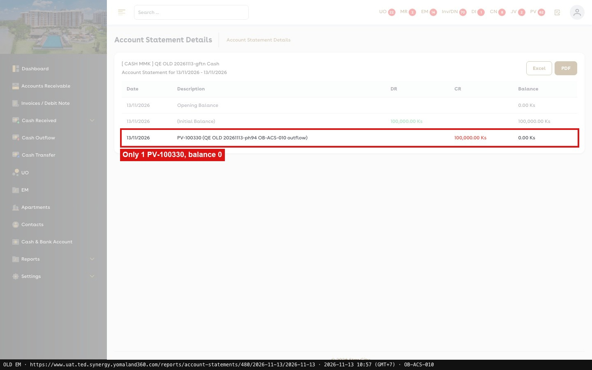

Steps to reproduce by hand (1Inv 2RV row 4)

You need two browser windows logged in at the same time (two users, or the same user in normal Chrome and a private window).

1. Create an apartment; create and approve an invoice of **1,000 Ks**.
2. In **both** windows: Apartments › the apartment › **Invoices** tab › **Make Payment**.
3. Fill both the same way: MMK, Payment Method Cash, Received In = a cash account, pay **1,000** in full.
4. Click **Confirm** in both windows **at the same moment** (two people counting down).
5. Check the **S.O.A** tab, the invoice status and the account balance.

- **Expected:** one payment of 1,000; the other window shows "already been paid in full"; Balance Due 0; account +1,000.
- **Bug:** two payments of 1,000, Balance Due −1,000, account +2,000; or "Internal Server Error".
- It may need several tries: both clicks must reach the server at almost the same moment.

---

## 🔴 Bug 2 · UO import: 2 rows for the same apartment and month → 2 invoices

**What happens:** the import file has **two rows for the same apartment in the same month**. Old EM imports both ("2 UO Entry imported.") with no error. The apartment gets **2 UO entries and 2 invoices**. The second row is also calculated from the old reading (e.g. "18 − 10 = 8" next to "15 − 10 = 5"), so **the same usage is billed twice**.

**Expected:** the second row is rejected because the month is already taken.

**Impact:** residents are billed twice for electricity/water.

Other ways of creating duplicates are already blocked by Old EM:

- Uploading **the same file again**: rejected.
- Two uploads **at the same moment**: usually blocked, but with "Internal Server Error". In one manual try both went through (Inv-202611-00134 and -00135).
- **Bulk Approve** of UO drafts: exactly one invoice per draft.

### Test case

In all 4 runs, the Invoices tab also has a **2,030** invoice from last month's reading (a setup step). That invoice is not part of the bug.

#### ❌ Sheet `Uo import`, row 20 · 2 rows with the same reading date and the same reading (15)

- **Expected:** row 1 is imported, row 2 is rejected.
- **Actual:** "2 UO Entry imported.", 2 UO entries and 2 invoices of 1,015.

*Image 1: the import ends with "2 UO Entry imported."*

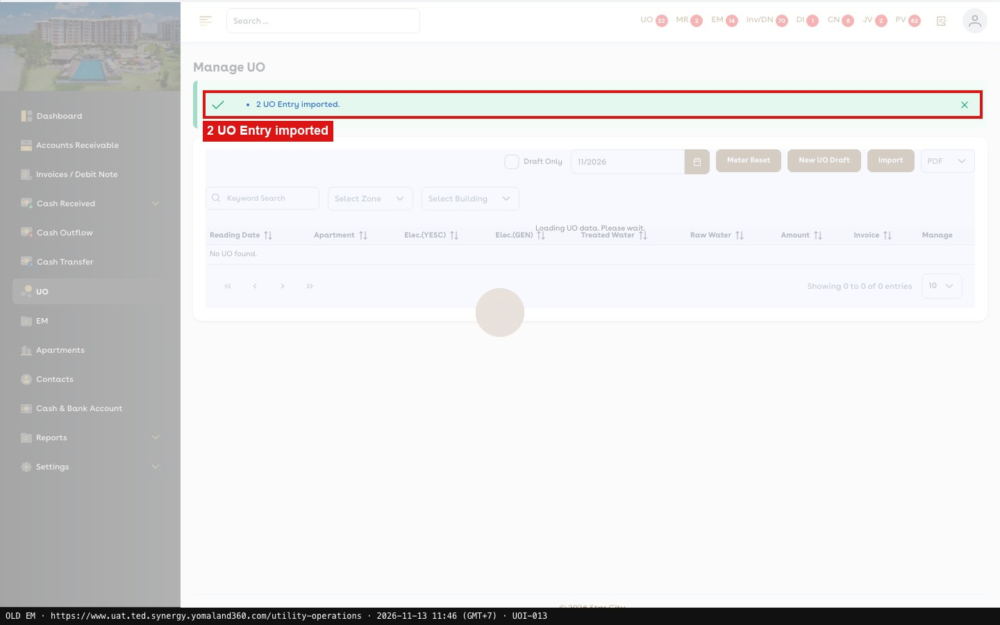

*Image 2: UO list for CL1-QE1113a0mz: 2 entries on 13 Nov, both "15 − 10 = 5", giving 2 invoices -00364 and -00365*

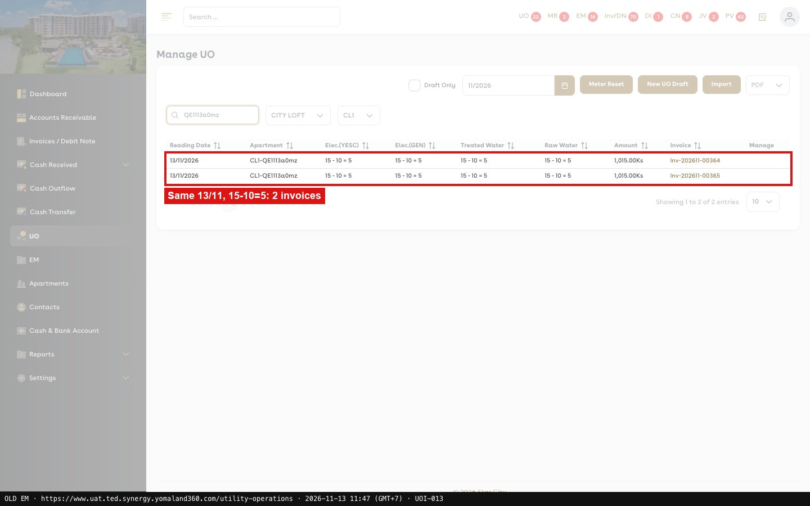

*Image 3: Invoices tab: 2 extra identical invoices of 1,015*

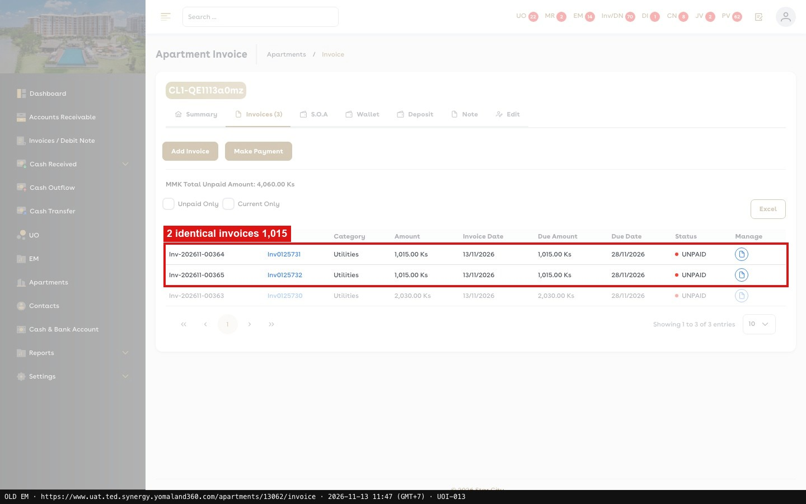

#### ❌ Sheet `Uo import`, row 22 · Same reading date, different readings

- **Expected:** row 2 is rejected.
- **Actual:** both are imported: readings 15 and 18 on the same day, 13 Nov, giving 2 invoices of 1,015 and 1,624.

*Image 1: UO list: same day 13 Nov, "15 − 10 = 5" and "18 − 10 = 8" are both imported*

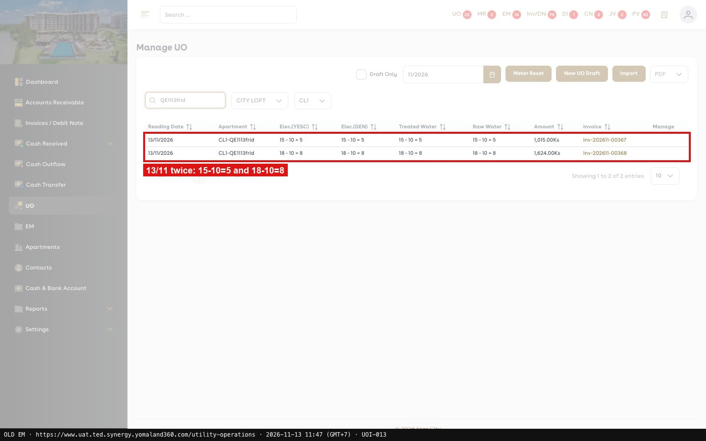

*Image 2: Invoices tab: 2 invoices of 1,015 and 1,624 for the same month*

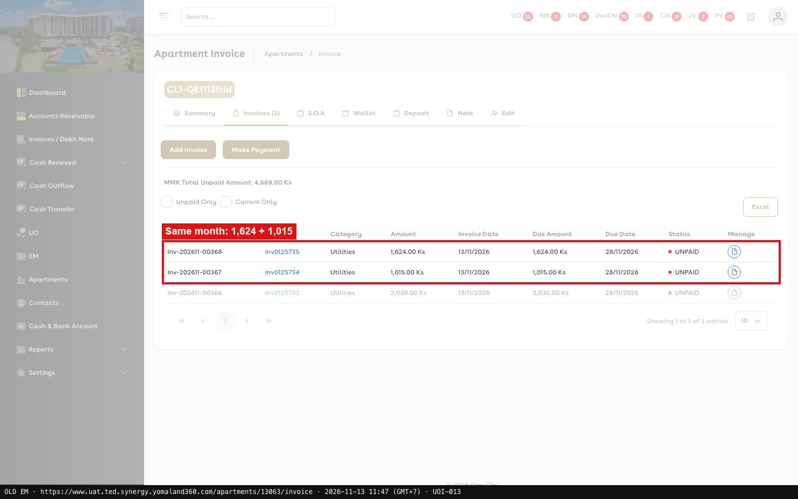

#### ❌ Sheet `Uo import`, row 32 · Same month, different dates

- **Expected:** row 2 is rejected.
- **Actual:** 01 Nov and 13 Nov are both imported, both "15 − 10 = 5", giving 2 invoices of 1,015.

*Image 1: UO list: 01 Nov and 13 Nov, "15 − 10 = 5" twice*

*Image 2: Invoices tab: 2 duplicate invoices of 1,015*

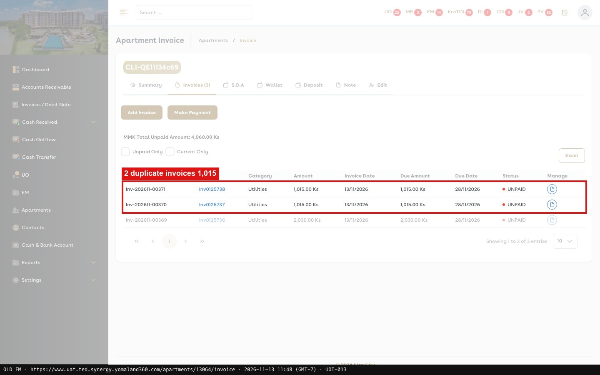

#### ❌ Sheet `Uo import`, row 33 · Same month, different readings

- **Expected:** row 2 is rejected.
- **Actual:** row 2 is imported and **calculated from the old reading**: "18 − 10 = 8" next to "15 − 10 = 5", so 5 units are billed twice.

*Image 1: UO list: 01 Nov "15 − 10 = 5" and 13 Nov "18 − 10 = 8"*

*Image 2: SOA: 2 extra invoices 1,015 + 1,624, Balance Due 4,669*

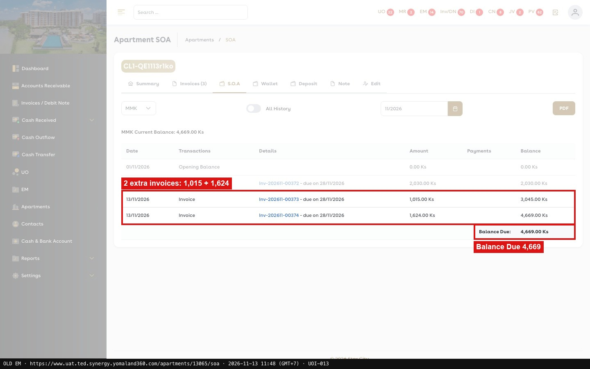

Steps to reproduce by hand (Uo import row 20)

1. Create an apartment and enter + approve a UO reading for **last month** (UO › New, reading 10). Old EM refuses an import for an apartment with no earlier reading.
2. UO › **Import** › download the template.
3. Fill **2 rows for the same apartment** with reading dates in **this month**: row 1 = 15 on the 1st, row 2 = 18 today.
4. Upload the file.
5. Check the message, the UO list, and the apartment's **Invoices** and **S.O.A** tabs.

- **Expected:** row 1 imported, row 2 rejected, 1 new invoice.
- **Bug:** "2 UO Entry imported.", 2 UO entries, 2 new invoices.

---

## 🔴 Bug 3 · SOA: next month's opening balance is wrong

**What happens:** a UO invoice is created by **Bulk Approve**, then paid from the **Wallet**. This month's SOA is right (opens 2,100, +1,218, −1,218, closes 2,100). But **next month opens at 882.00 instead of 2,100.00**: next month subtracts the payment (−1,218) but does not add the invoice (+1,218).

**Expected:** next month's opening balance = this month's closing balance.

**Impact:** the statement (SOA) sent to residents shows the wrong amount owed.

8 other sequences were all correct (Invoice → UO import, UO import → Make Payment, UO import → Wallet Payment, manual UO → UO import, Make Payment → Wallet Payment, Wallet Payment → Invoice, Wallet Payment → UO import…). Only **UO Bulk Approve → Wallet Payment** is wrong.

### Test case

#### ❌ Sheet `SOA - OB & CB`, row 259 · UO Bulk Approve → Wallet Payment

- **Expected:** the December SOA opens at 2,100.00 (equal to the November closing balance).
- **Actual:** December opens at **882.00**.

*Image 1: November SOA: opens 2,100, invoice +1,218, Wallet Payment −1,218, closes 2,100*

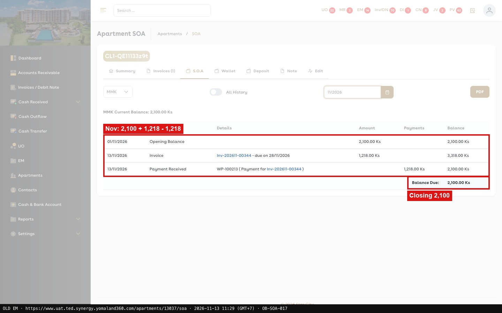

*Image 2: December SOA: Opening Balance 882.00 instead of 2,100.00 (the "Current Balance" line above still shows 2,100)*

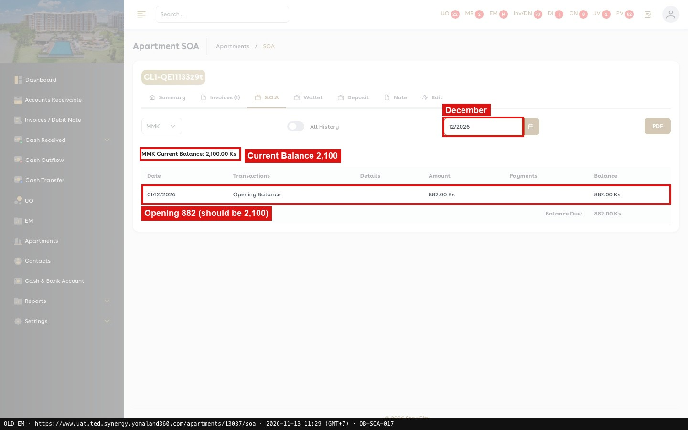

*Image 3: SOA All History: the real balance is still 2,100*

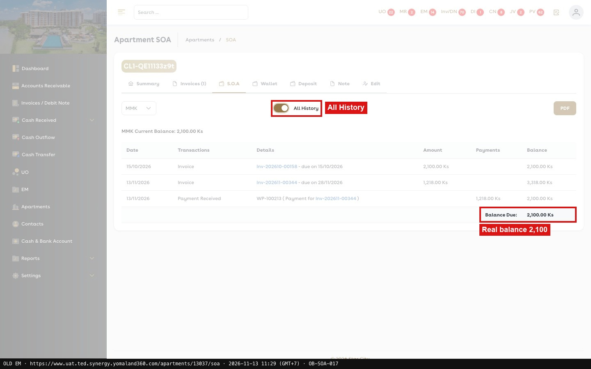

Steps to reproduce by hand (SOA - OB & CB row 259)

1. Create an apartment; create and approve an invoice dated **last month** so this month has an opening balance.
2. Recharge the apartment's wallet (Wallet tab › Recharge), e.g. 5,000 Ks.
3. Create a **UO draft** for the apartment (UO › New).
4. Approve it with **Bulk Approve**: UO draft list › tick the draft › Bulk Approve. Note the invoice amount.
5. Make Payment for that UO invoice, Payment Method **Wallet**.
6. Open the **S.O.A for this month**: note the closing balance.
7. Switch to **next month**: read the Opening Balance.

- **Expected:** equal to this month's closing balance (2,100.00).
- **Bug:** 882.00 (= 2,100 − 1,218).

---

## 🔴 Bug 4 · Editing an account's initial balance: tomorrow still opens at the old balance

**What happens:** the account **already has transactions**; its initial balance is edited. The account list and **today's** Account Statement both show the new balance (51,100). But **tomorrow's** Account Statement still opens at the **old balance (11,100)**.

**Expected:** tomorrow's opening balance = today's closing balance = 51,100.

**Impact:** the cash / bank book is off by 40,000 from the next day on.

Editing the initial balance before the account has any transaction is correct (TC_Cash_Bank_Acc_014).

### Test case

#### ❌ TC_Cash_Bank_Acc_015 · Edit the initial balance after the account has transactions

- **Expected:** tomorrow's statement (14 Nov) opens at 51,100.00.
- **Actual:** it opens at **11,100.00**.

*Image 1: account list after the edit: initial 50,000, closing 51,100*

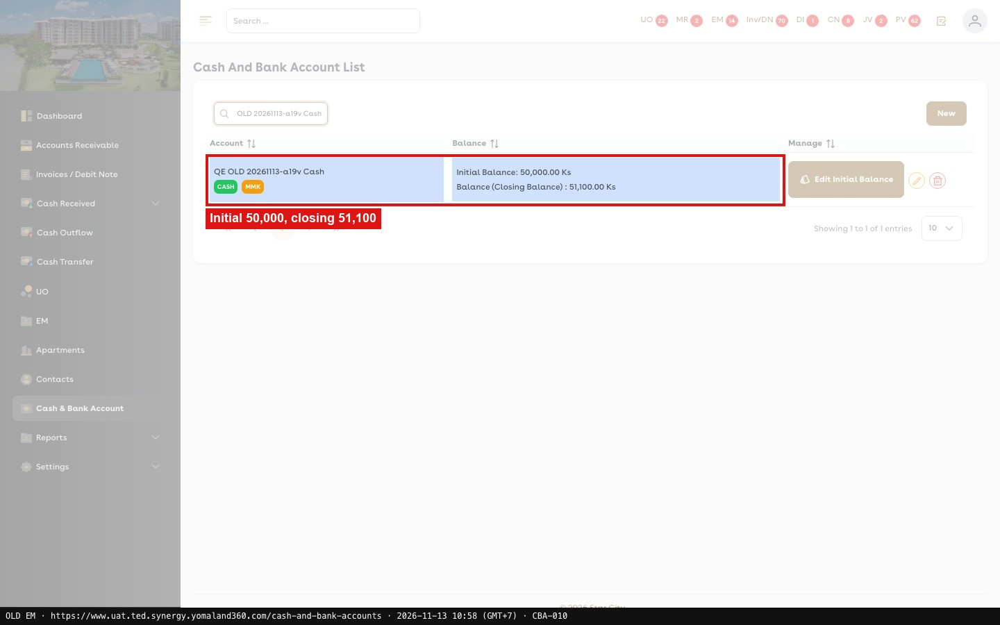

*Image 2: today's statement (13 Nov): closing 51,100, correct*

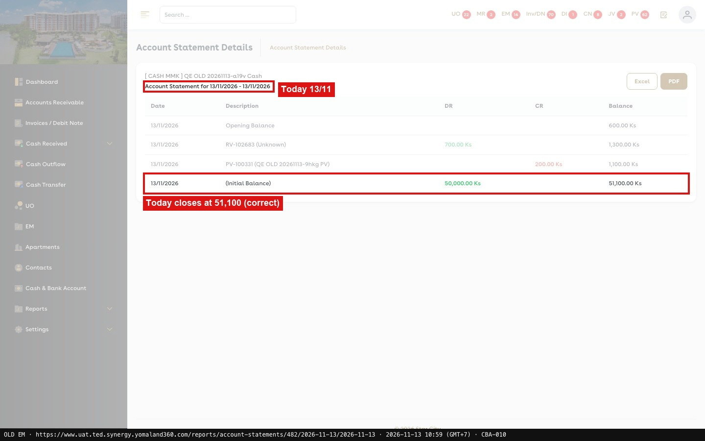

*Image 3: tomorrow's statement (14 Nov) opens at 11,100 instead of 51,100*

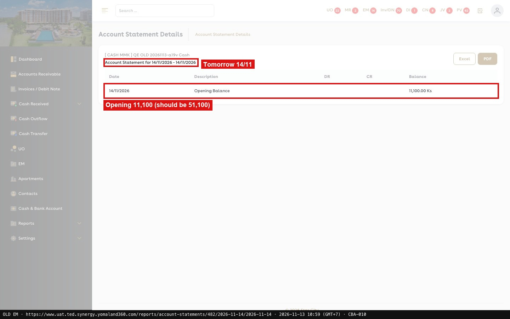

Steps to reproduce by hand (TC_Cash_Bank_Acc_015)

1. Cash & Bank Account › **New**: Cash, MMK, initial balance **10,000**.
2. Record a few receipts/payments into the account (e.g. receive 600 + 700, pay 200) → balance 11,100.
3. Edit the account, change the initial balance to **50,000**, save. The list shows 51,100.
4. Reports › **Account Statement** › the account › **today**: closing 51,100.
5. Open the statement for **tomorrow** (the date picker blocks future days; change the address bar: `/reports/account-statements/<account id>/<tomorrow>/<tomorrow>`).

- **Expected:** Opening Balance 51,100.00.
- **Bug:** 11,100.00.

---

## 🔴 Bug 5 · Wallet: next month's opening balance misses a Wallet Payment

**What happens:** Credit Note **+50,000**, then an invoice paid from the wallet **−10,500**. This month is right (closes at 39,500). But **next month opens at 50,000** instead of 39,500: the payment is lost.

**Expected:** next month opens at 39,500.

**Impact:** the resident's wallet gains 10,500 that can be used to pay other invoices.

### Test case

#### ❌ Sheet `Wallet - OB & CB`, row 124 · Credit Note → Wallet Payment

- **Expected:** the December wallet opens at 39,500.00.
- **Actual:** it opens at **50,000.00**.

*Image 1: November wallet: Credit Note +50,000, Wallet Payment −10,500, closes 39,500*

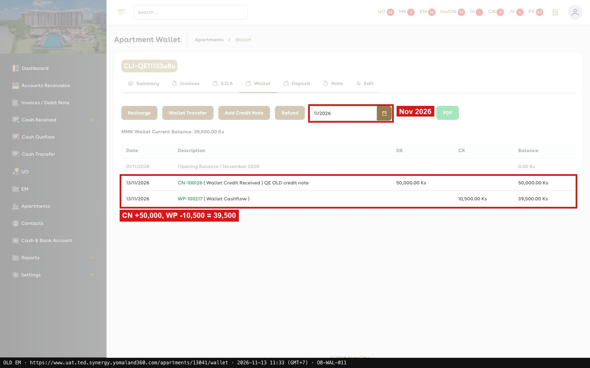

*Image 2: December wallet opens at 50,000 instead of 39,500 (the "Current Balance" line still shows 39,500)*

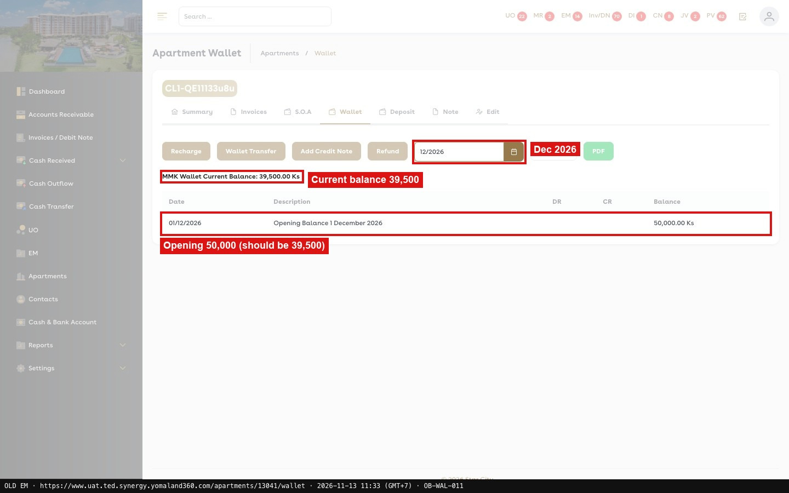

The other sequences on the same sheet pass: Wallet Transfer → Wallet Payment (rows 112, 118), RV → Wallet Transfer (rows 94, 95).

Steps to reproduce by hand (Wallet - OB & CB row 124)

1. Create an apartment (wallet 0).
2. **Wallet** tab › add a **Credit Note** of 50,000 Ks; approve it (top bar **CN** › draft › Approve). The wallet shows 50,000.
3. Create and approve an invoice of **10,500 Ks** for the apartment.
4. Make Payment, Payment Method **Wallet**.
5. Wallet tab, **this month**: closing 39,500.
6. Switch to **next month**: read the Opening Balance.

- **Expected:** 39,500.00.
- **Bug:** 50,000.00.

---

## 🔴 Bug 6 · Invoice form wipes typed values

**What happens:** this is **not a rounding error** (rounding is correct). Each time the user changes Unit, Discount or Gross Price, the form asks the server to recalculate the totals, and the answer **overwrites the field the user just typed**. When the answers come back out of order, **Gross Price is wiped** ("The Gross Price field is required" under a field that shows a value, or Total 0), **Gross Price is changed** (100.10 becomes 10.00) or **the discount is lost**. Some invoices are refused; some are **saved with the wrong amount**.

**Expected:** typed values stay; the totals are calculated once and saved exactly as shown.

**Impact:** an invoice can be saved with the wrong amount without the creator noticing. It happens at random: in the final run, each variant had **3 of 5** creations refused, and 4 invoices were saved with the wrong amount.

Wrong saved amounts: 3,090.00 instead of 2,781.00 · 1,029.99 instead of 926.99 · **10.30** instead of 103.05 · 103.10 instead of 103.05.

When an invoice is saved correctly, the draft, approved invoice, AR, SOA, report and PDF all agree.

### Test case

#### ❌ TC_Inv_001 · Create an invoice (Unit 2, Gross Price 1,500, Discount 10 %)

- **Expected:** the invoice is created, Grand Total 2,781.00.
- **Actual:** clicking Create is refused with "The Gross Price field is required" (12 Nov).

*Image 1: Gross Price and Discount are wiped by themselves, Total goes to 0*

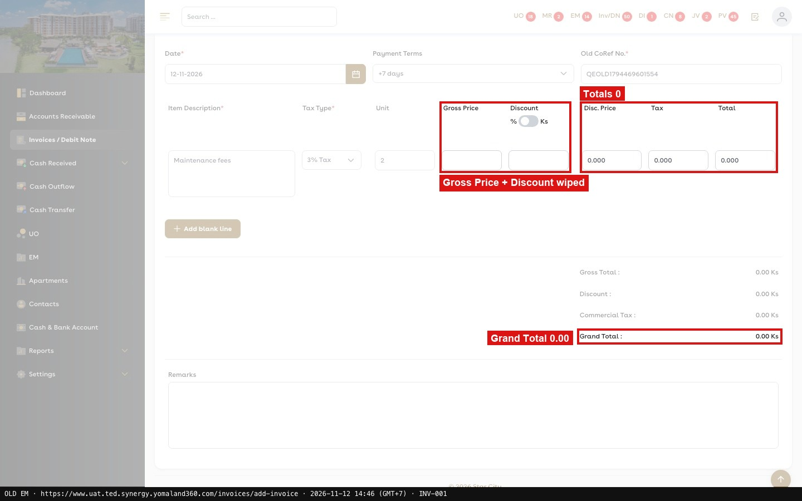

*Image 2: the Gross Price field shows 1,500.00 but still says "The Gross Price field is required", cannot save*

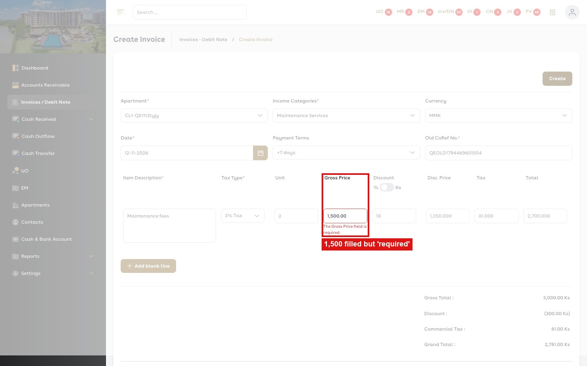

#### ❌ INV-038 (not in the Excel) · Unit 2, Gross Price 1,500, Discount 10 % → expected 2,781.00

- **Actual:** 3 of 5 tries refused (Gross Price required); 2 of 5 saved as **3,090.00** (discount lost). The approved invoice is 3,090.00 on every screen.

*Image 1: Gross Price is wiped empty, Discount is still 10, Total 0, "The Gross Price field is required"*

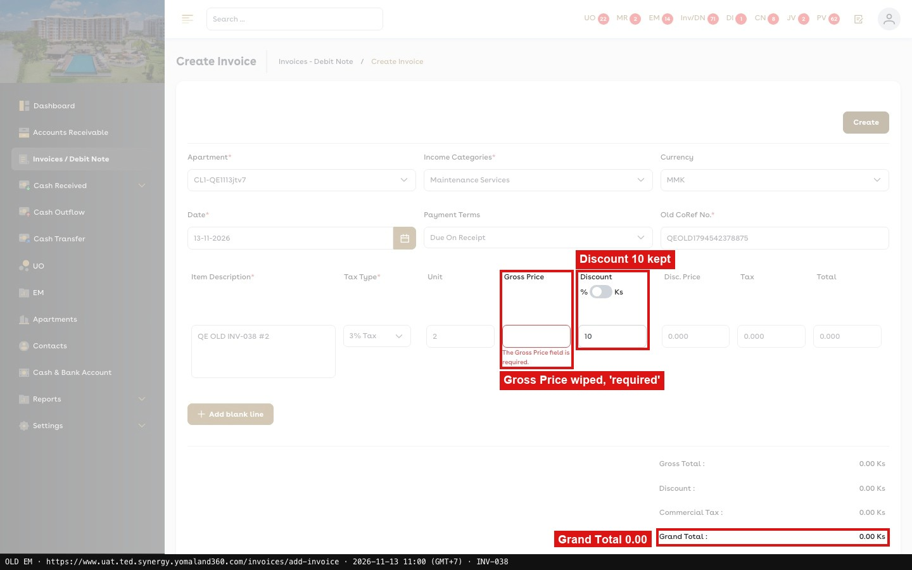

*Image 2: Discount is wiped, the form calculates Grand Total 3,090.00*

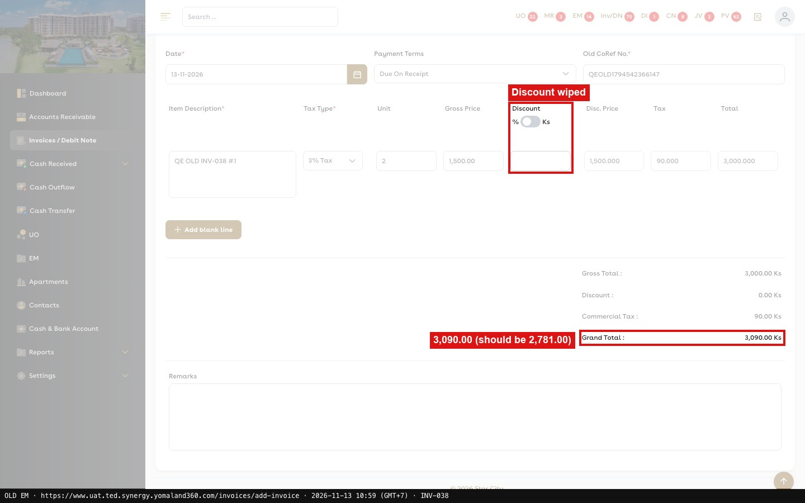

*Image 3: the draft is saved as 3,090.00 instead of 2,781.00*

*Image 4: Invoices report: Inv-202611-00326 approved, Total 3,090.00*

#### ❌ INV-038 (not in the Excel) [Unit 3, Gross Price 333.33, Discount 10 % → expected 926.99]

- **Actual:** 1 try saved as **1,029.99** (discount lost); 2 tries refused; 1 try showed the right 926.99 on the form but was still refused; 1 try saved the right 926.99.

*Image 1: the draft is saved as 1,029.99 instead of 926.99 (10 % discount lost)*

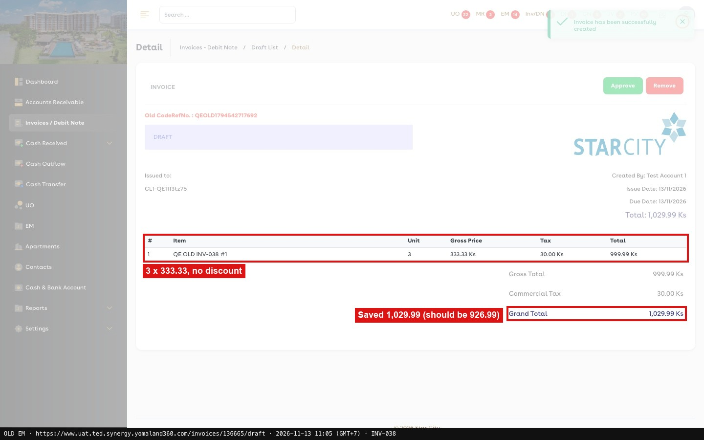

*Image 2: the form shows the right 926.99 and Gross Price shows 333.33, but it still says "required", cannot save*

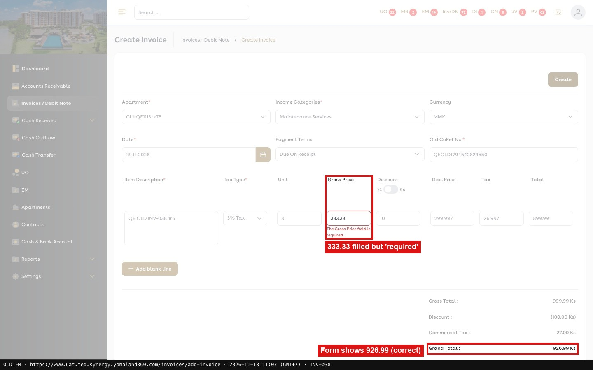

#### ❌ INV-038 (not in the Excel) [Unit 7, Gross Price 0.15, Discount 0 → expected 1.08]

- **Actual:** 3 of 5 tries refused because Gross Price was wiped; 2 tries saved the right 1.08.

*Image 1: Gross Price 0.15 is wiped empty, Total 0, "required"*

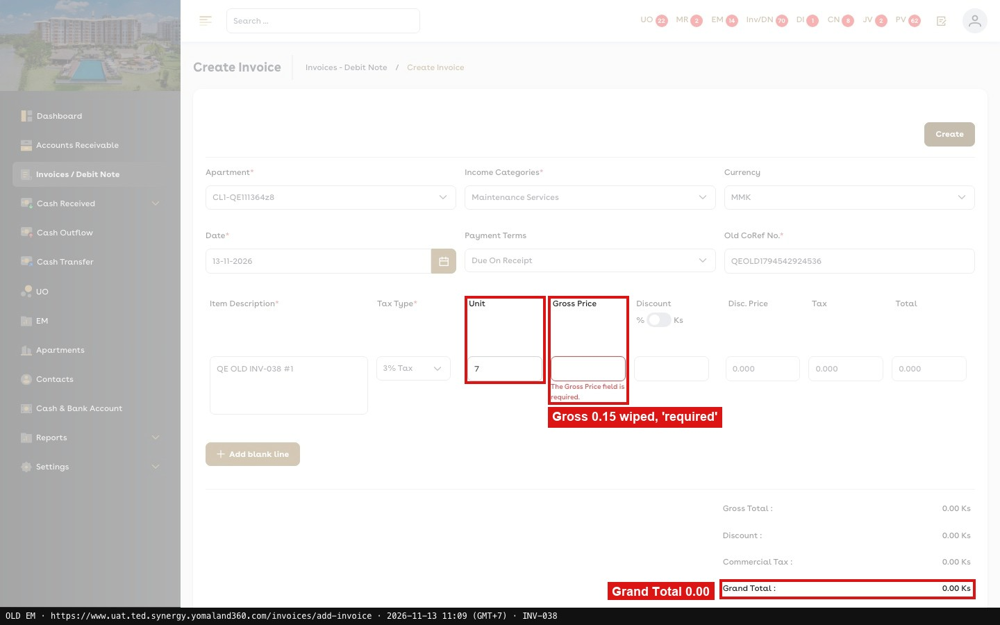

#### ❌ INV-038 (not in the Excel) [Unit 1, Gross Price 100.10, Discount 0.05 Ks → expected 103.05]

- **Actual:** 1 try saved as **10.30** (Gross Price changed to 10.00) and was approved; 1 try saved as **103.10** (discount lost); 3 tries refused (one with "The selected Gross Price is invalid").

*Image 1: the draft is saved with Gross Price 10.00, Grand Total 10.30 instead of 103.05*

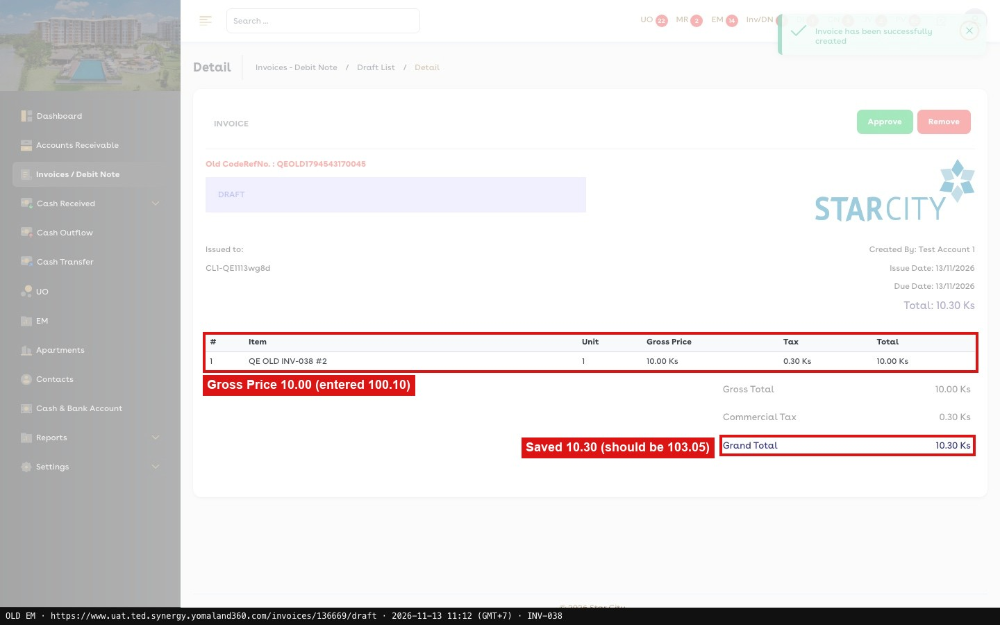

*Image 2: another draft is saved as 103.10 (0.05 Ks discount lost)*

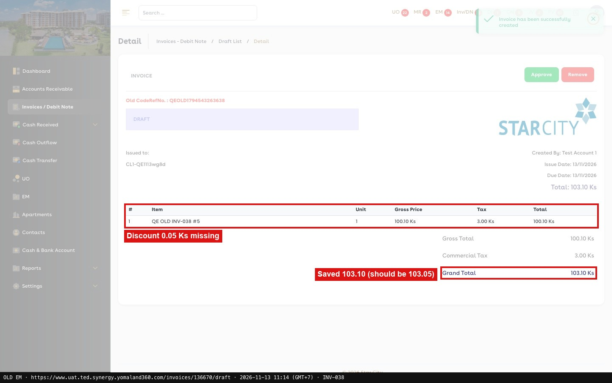

*Image 3: Invoices report: Inv-202611-00329 approved with Total 10.30*

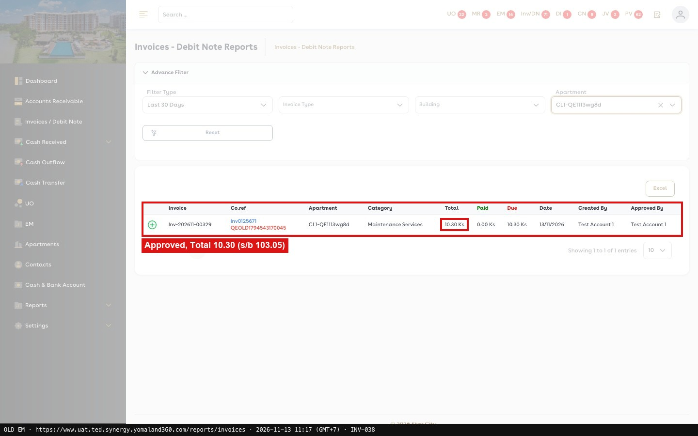

Steps to reproduce by hand (INV-038)

1. Invoices / Debit Note › **Create Invoice**; select an apartment, an income category, MMK.
2. Item: Tax Type "3% Tax", Unit **2**, Gross Price **1,500**, Discount **10 %**. Type at a normal speed, then click outside.
3. **Watch for a few seconds without touching anything.** Expected: Disc. Price 1,350, Total 2,700, Tax 81, Grand Total 2,781.00.
4. Click **Create**; open the draft and compare its total with the form.
5. Repeat 5 times.

- **Bug:** Gross Price empties by itself, or "Gross Price field is required" under a filled field, or Total goes to 0, or the discount disappears; or the draft is saved as 3,090.00.

---

## 🟠 Bug 7 · Some lists do not show "Created By" / "Approved By"

**What happens:** the creator / approver names are always in the **reports** and on the **voucher (PDF)**, but some **lists** do not show them. The Invoice / Debit Note detail page shows both names; the Cash Transfer, Credit Note and Wallet Transfer detail pages show no names at all.

**Expected:** every money document shows Created By (and Approved By when it needs approval).

**Impact:** to see who approved a document, users must open the voucher or run a report.

| Document | List | Missing |
|---|---|---|
| Invoice, Debit Note, UO invoice, EM debit note | Invoices / Debit Note | **Approved By** |
| Cash Transfer (JV) | Cash Transfer › Recent Transfers | **Approved By** |
| Credit Note (CN) | Apartment › Wallet tab | **Created By and Approved By** |
| Wallet Transfer (WT) | Apartment › Wallet tab | **Created By** |
| RV (Make Payment, Unknown Received), PV (Cash Outflow, Wallet Refund, Deposit Withdraw) | Their lists | Nothing missing ✅ |

### Test case

#### ❌ RPT-036 (not in the Excel) [Invoice]

- **Actual:** the Invoices / Debit Note list has Created By but **no Approved By column**. The detail page and the report have both.

*Image 1: Invoices / Debit Note list: Created By is there, no Approved By column*

*Image 2: the invoice detail page has Created By and Approved By*

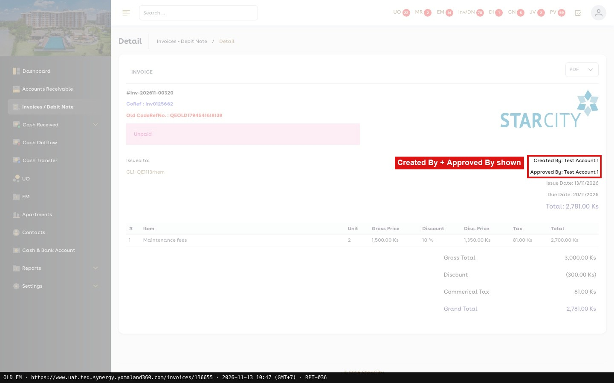

#### ❌ RPT-036 (not in the Excel) [Debit Note]

*Image 1: the list shows only DN-202611-00065, no Approved By column*

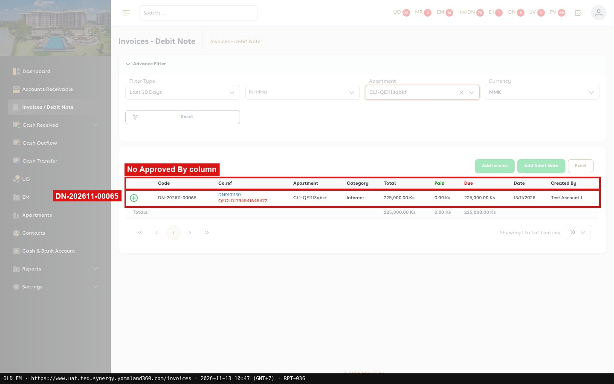

*Image 2: DN-202611-00065 detail has Approved By: Test Account 1*

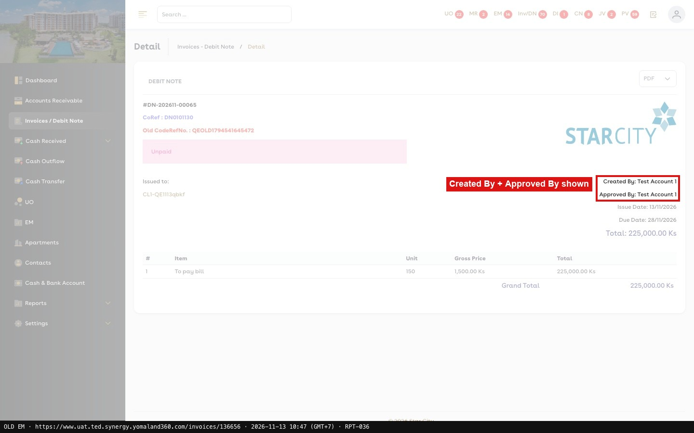

#### ❌ RPT-036 (not in the Excel) [UO invoice]

*Image 1: Inv-202611-00321 (UO) in the list, no Approved By column*

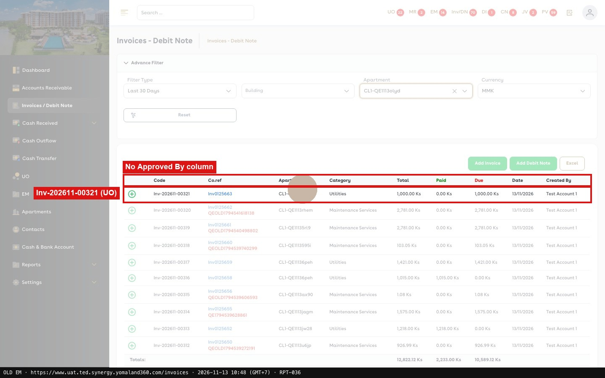

*Image 2: the UO invoice detail has Created By and Approved By*

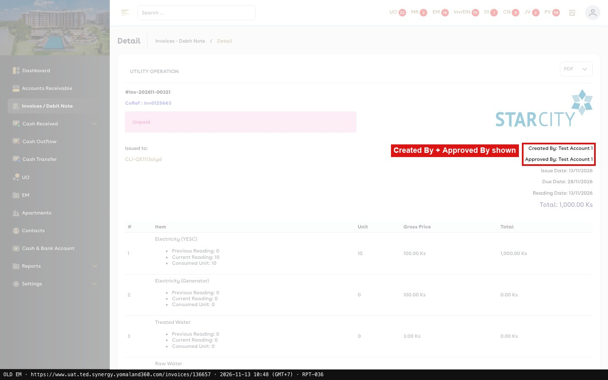

#### ❌ RPT-036 (not in the Excel) [EM debit note]

*Image 1: the list shows only DN-202611-00066 (EM), no Approved By column*

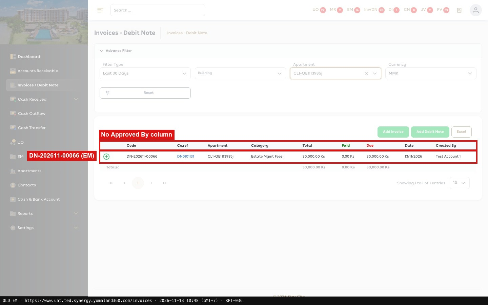

*Image 2: the EM debit note detail has Approved By*

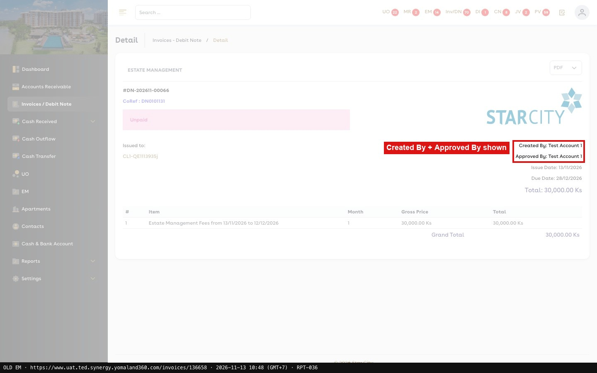

#### ❌ RPT-036 (not in the Excel) [Cash Transfer JV]

*Image 1: Cash Transfer list: JV-100294 has Created By, no Approved By column*

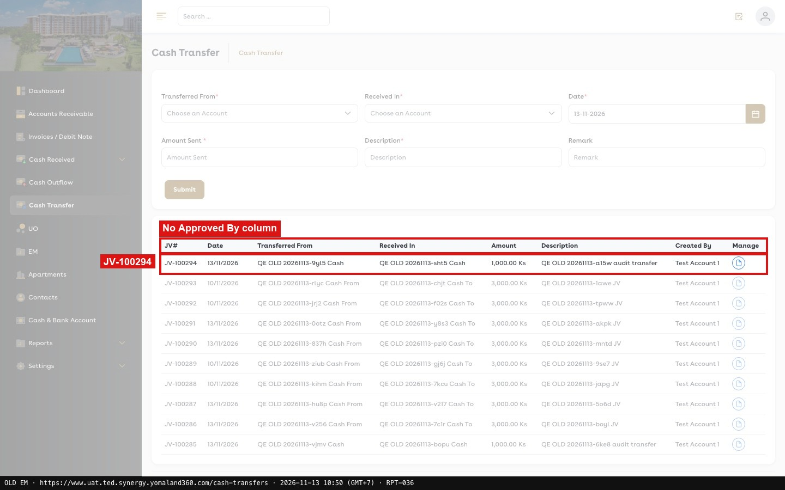

*Image 2: voucher JV-100294 shows "Created by" and "Approved by" Test Account 1*

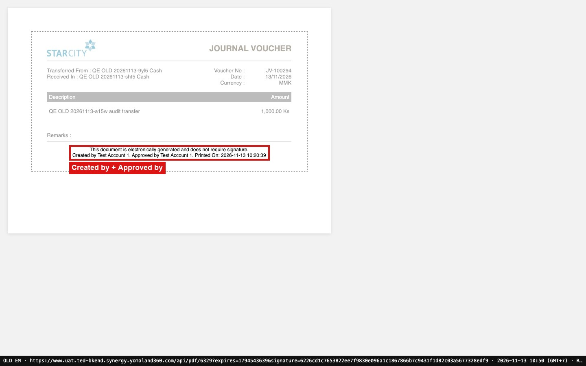

#### ❌ RPT-036 (not in the Excel) [Credit Note CN]

*Image 1: Wallet tab: the CN-100125 row has neither Created By nor Approved By*

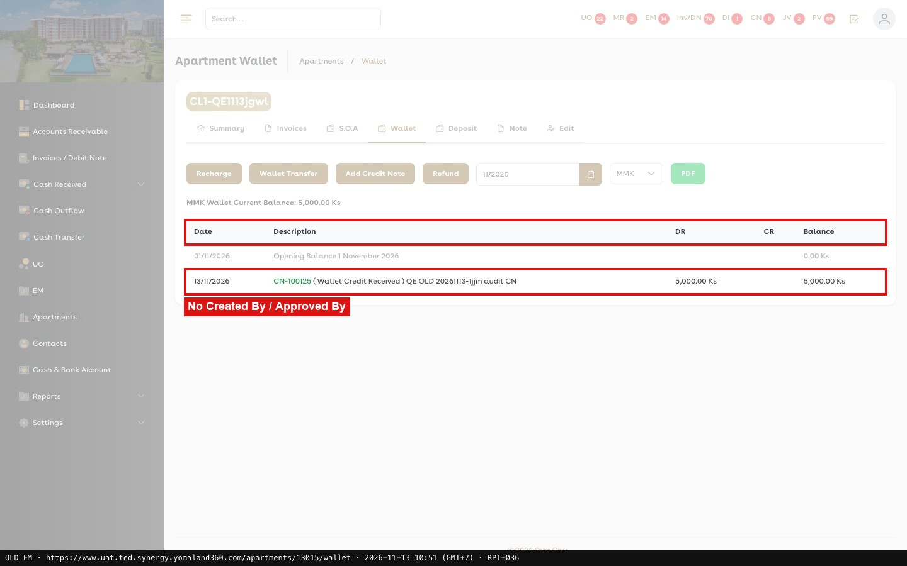

*Image 2: Credit Note Reports has both Created By and Approved By for CN-100125*

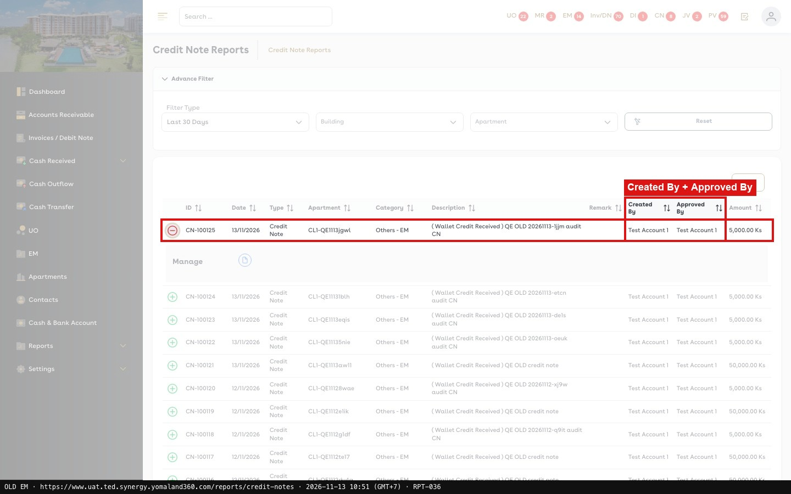

#### ❌ RPT-036 (not in the Excel) [Wallet Transfer WT]

*Image 1: Wallet tab: the WT-100142 row has no Created By*

*Image 2: voucher WT-100142 shows "Created by Test Account 1"*

#### ✅ RPT-036 (not in the Excel) [Make Payment RV, Unknown Received RV, Cash Outflow PV, Wallet Refund PV, Deposit Withdraw PV]

The lists show both Created By and Approved By.

Steps to reproduce by hand (RPT-036)

For each document type in the table:

1. Create the document; approve it if needed.
2. Open its **list** (see the table) and look for Created By / Approved By on its row.

- **Bug:** missing in the lists marked in the table.

---

## 🟠 Bug 8 · Unknown Received does not offer cash accounts

**What happens:** on the **Unknown Received** form, the *Deposit In* field **offers only bank accounts** (0 cash accounts out of 101 in the 13 Nov rerun), even for a cash account with every payment method enabled. The test case records into "[Cash MMK] 2C2P Account", so it cannot be done.

**Expected:** cash accounts can be selected.

**Impact:** cash received from an unknown payer cannot be recorded into a cash-in-hand account.

### Test case

#### ❌ TC_CR_002 · Record an Unknown Received (MMK) into a cash account

- **Expected:** "[Cash MMK] 2C2P Account" can be selected in the Deposit In field.
- **Actual:** the Deposit In list has 101 accounts, **0 cash accounts**. With a bank account the rest is correct: the RV is in the list waiting for allocation, account +10,000.

*Image 1: the Deposit field open: bank accounts only ([Testing Bank MMK], [YOMA Bank MMK]…)*

*Image 2: typing the new cash account's name ("QE OLD 20261113-z7e7 Cash") into the filter → "No results found"*

*Image 3: with a bank account, RV-102517 is created and is in the list waiting for allocation*

*Image 4: the bank account goes up by 10,000 Ks*

---

## 🟠 Bug 9 · Paying an invoice from the Wallet creates no RV

**What happens:** Make Payment with Payment Method **Wallet** creates a `WP-…` voucher in the SOA and the Wallet tab, but **no new RV in the Cash Received list**, which the test case requires.

**Expected:** a new RV in Cash Received.

**Impact:** Cash Received and the receipt reports miss invoices paid from the wallet.

### Test case

#### ❌ TC_MPM_006 · Pay an invoice from the wallet balance

- **Expected:** a new RV in Cash Received for Inv-202611-00118.
- **Actual:** no RV. The rest is correct: a WP row in the SOA and the Wallet tab, the invoice is paid, the wallet balance and AR go down correctly. (Case TC_Wallet_026 also expects an "RV in SOA", where Old EM shows the WP.)

*Image 1: Make Payment form: Payment Method = Wallet, paying 10,000 for Inv-202611-00118*

*Image 2: Cash Received › Recent Receipts: no RV for Inv-202611-00118 (the top row is the wallet recharge RV)*

*Image 3: the SOA records the payment as WP-100168, not an RV*

*Image 4: Wallet tab: WP-100168 takes 10,000 from the wallet*

---

## 🟠 Bug 10 · Cash Outflow approver cannot see drafts of categories not assigned to the role

**What happens:** the role has exactly what the test case lists: Cash Outflow **Menu + View + Approve**. The PV draft list shows only **Wallet / Deposit** drafts; the **Landscaping Expenses** drafts (the test's drafts) **are hidden**. They appear (and can then be approved or removed) only after the role is also given the expense category "Payment - Estate Management" under *Settings › Roles › Assign Categories*. Nothing on screen explains this.

**Expected:** with the Approve permission, the user sees and can approve the drafts.

**Impact:** an approver set up exactly as the permission matrix says cannot approve payments of categories not assigned to the role.

### Test case

#### ❌ TC_Role&Permission_065 · Cash Outflow Approve permission allows approving / removing drafts

- **Expected:** the user sees the Landscaping Expenses draft and can approve / remove it.
- **Actual:** the Landscaping Expenses draft is hidden until the category is assigned to the role.

*Image 1: user with only Cash Outflow permissions: the first page of the draft list has only Wallet / Deposit drafts; the test's Landscaping Expenses drafts are not there*

*Image 2: after the category is assigned to the role, the draft can be removed ("Cash Outflow has been deleted successfully")*

---

## 🟢 Bug 11 · New account: Type is not "Cash" by default

**What happens:** the New Account form shows "Select Type" with no default. The test case (step 5) requires the default to be **"Cash"**.

**Impact:** low; the user has one more field to choose.

### Test case

#### ❌ TC_Cash_Bank_Acc_001 · Create a Cash account with an initial balance

- **Expected:** the Type field defaults to "Cash"; the new account shows a balance of 100,000.
- **Actual:** the Type field shows "Select Type". The main result is still correct: Initial and Closing Balance 100,000.00 Ks.

*Image 1: the Type field shows "Select Type", not Cash by default*

*Image 2: the new account has Initial and Closing Balance of 100,000.00 Ks*

