# Old EM: danh sách lỗi (bản tiếng Việt)

Kiểm tra trên **Old EM UAT** (https://www.uat.ted.synergy.yomaland360.com) ngày **12–13/11/2026**, bằng cách chạy tự động các test case GT trong [projects/em/docs/test-cases/](../../em/docs/test-cases/README.md).

**Nguyên tắc:** test case là chuẩn. Case nào fail nghĩa là **hệ thống làm sai**, cần sửa.

Bản tiếng Anh: [old-em-bugs.md](old-em-bugs.md).

## Tóm tắt

- Chạy **122 lượt test**: 92 đạt, 28 không đạt, 2 lúc đạt lúc không (cần kiểm tra tay).
- 28 lượt không đạt gom lại thành **11 lỗi** bên dưới.

| # | Lỗi | Mức độ | Test case |
|---|---|---|---|
| 1 | Hai người trả cùng một invoice cùng lúc → bị nhận tiền 2 lần | 🔴 Cao | 1.1–1.3: 1Inv 2RV dòng 4, 18, 20 · 1.4: Wallet - OB & CB dòng 128 · 1.5: Acc Statement - OB & CB dòng 225 |
| 2 | File import UO có 2 dòng cùng apartment, cùng tháng → tạo 2 invoice | 🔴 Cao | Uo import dòng 20, 22, 32, 33 |
| 3 | SOA: số dư đầu tháng sau sai (UO Bulk Approve rồi trả bằng Wallet) | 🔴 Cao | SOA - OB & CB dòng 259 |
| 4 | Sửa số dư ban đầu của account → số dư đầu ngày mai vẫn là số cũ | 🔴 Cao | TC_Cash_Bank_Acc_015 |
| 5 | Wallet: số dư đầu tháng sau bỏ sót khoản Wallet Payment sau Credit Note | 🔴 Cao | Wallet - OB & CB dòng 124 |
| 6 | Form tạo invoice tự xoá Gross Price / Discount đã nhập | 🔴 Cao | TC_Inv_001 · INV-038 (không có trong Excel) |
| 7 | Một số danh sách thiếu "Created By" / "Approved By" | 🟠 Trung bình | RPT-036 (không có trong Excel) |
| 8 | Unknown Received không cho chọn tài khoản tiền mặt (cash account) | 🟠 Trung bình | TC_CR_002 |
| 9 | Trả invoice bằng Wallet không tạo RV trong Cash Received | 🟠 Trung bình | TC_MPM_006 |
| 10 | Người có quyền Approve Cash Outflow không thấy draft của category chưa được gán | 🟠 Trung bình | TC_Role&Permission_065 |
| 11 | Tạo account mới: Type không mặc định là "Cash" | 🟢 Thấp | TC_Cash_Bank_Acc_001 |

Mức độ là đề xuất của QE, PM có thể điều chỉnh.

**Mã test case** lấy theo file Excel *ZL_TED EM Test Case for Round Testing (2026)_19082026.xlsx*. Sheet nào không có cột mã (1Inv 2RV, Uo import, các sheet OB & CB) thì ghi tên sheet và số dòng. INV-038 và RPT-036 không có trong Excel: đây là case bổ sung cho các lỗi được báo (tính toán invoice, thiếu audit trail). Hai case này **chỉ dùng cho Old EM**, nằm trong `projects/old-em/docs/test-cases/extra-cases.md`, không thuộc bộ test case của New EM.

> **Gợi ý cho dev:** lỗi 3, 4 và 5 có cùng một kiểu. Kỳ hiện tại thì đúng, chỉ **số dư đầu kỳ sau** (ngày mai hoặc tháng sau) bị sai. Có vẻ Old EM lưu sẵn số dư đầu kỳ và không tính lại sau một số thao tác, nên có thể cả ba chung một nguyên nhân.

Cách chạy test:

- Mỗi test tự tạo apartment, account, chứng từ riêng (tên bắt đầu bằng `QE OLD`), nên dữ liệu của người khác không ảnh hưởng kết quả.
- Old EM UAT chỉ có 1 tài khoản test. Lỗi nào cần **2 người** thì dùng **2 phiên đăng nhập của cùng admin**, và admin tự tạo, tự duyệt chứng từ.
- Kết quả test chi tiết và toàn bộ ảnh (tiếng Anh): [old-em-issues.md](old-em-issues.md).

---

## 🔴 Lỗi 1 · Hai người trả cùng một invoice cùng lúc

**Chuyện gì xảy ra:** hai người bấm **Confirm** trên Make Payment cho cùng một invoice gần như cùng lúc. Old EM có thể **nhận cả hai khoản**: invoice bị trả 2 lần, trả dư, hoặc số còn nợ bị ghi đè sai. Có lúc thì một người bị lỗi **"Internal Server Error"** thay vì một thông báo rõ ràng. Kết quả phụ thuộc vào thời điểm bấm.

**Đúng ra phải:** người thứ hai bị từ chối với thông báo "This invoice has already been paid in full" (hoặc "Please refresh and try again").

**Ảnh hưởng:** sai tiền thu, sai công nợ (AR), sai số dư account.

Nếu trả lần lượt (không cùng lúc) thì Old EM xử lý đúng.

**Các trường hợp trong lỗi này:**

| # | Test case (Excel) | Tình huống | Old EM làm sai thế nào |
|---|---|---|---|
| [1.1](#11) | 1Inv 2RV dòng 4 | 2 người cùng trả **đủ** invoice 1,000 | Nhận cả 2 → trả dư 1,000 |
| [1.2](#12) | 1Inv 2RV dòng 18 | 2 người cùng trả một phần (400 + 500) | Nhận cả 2, nhưng tab Invoices và AR ghi còn nợ 500 thay vì 100 |
| [1.3](#13) | 1Inv 2RV dòng 20 | 2 người cùng trả 500 + 600, **vượt** invoice | Nhận cả 2 → trả dư 100; các màn hình ghi số khác nhau |
| [1.4](#14) | Wallet - OB & CB dòng 128 | 2 người cùng Wallet Refund toàn bộ số dư wallet | Tạo được 2 draft (lúc duyệt thì chặn được) |
| [1.5](#15) | Acc Statement - OB & CB dòng 225 | 2 người cùng duyệt Cash Outflow toàn bộ số dư account | Báo "Internal Server Error" thay vì "Insufficient Balance" |

**Vì sao một test case có 2 kiểu sai?** Ở 1.1, 1.2 và 1.3, kết quả phụ thuộc vào việc hai cú bấm tới server sát nhau đến đâu. Chạy cùng một test nhiều lần, Old EM sai theo **2 kiểu**:

- **Kiểu A:** nhận cả hai khoản (tiền bị nhận 2 lần, hoặc số còn nợ bị ghi đè).
- **Kiểu B:** một người bị **"Internal Server Error"**, chỉ một khoản được nhận.

Cả hai kiểu đều là lỗi của **cùng một test case**, không phải lỗi khác. Ảnh bên dưới được chia theo từng kiểu, có ghi lần chạy.

### Test case

#### ❌ 1.1 · Sheet `1Inv 2RV`, dòng 4 · Hai người cùng trả đủ invoice 1,000 Ks

- **Mong đợi:** một khoản được nhận; người kia thấy "This invoice has already been paid in full".
- **Thực tế:** chạy 6 lần: 4 lần sai kiểu A, 2 lần sai kiểu B.

**Kiểu A: nhận cả hai khoản** (4/6 lần; ảnh của lần chạy 13/11 15:33, Inv-202611-00381)

*1.1 · Ảnh 1: SOA có 2 khoản RV-102721 và RV-102722, mỗi khoản 1,000, Balance Due −1,000; người thứ hai cũng thấy "Payment has been approved successfully"*

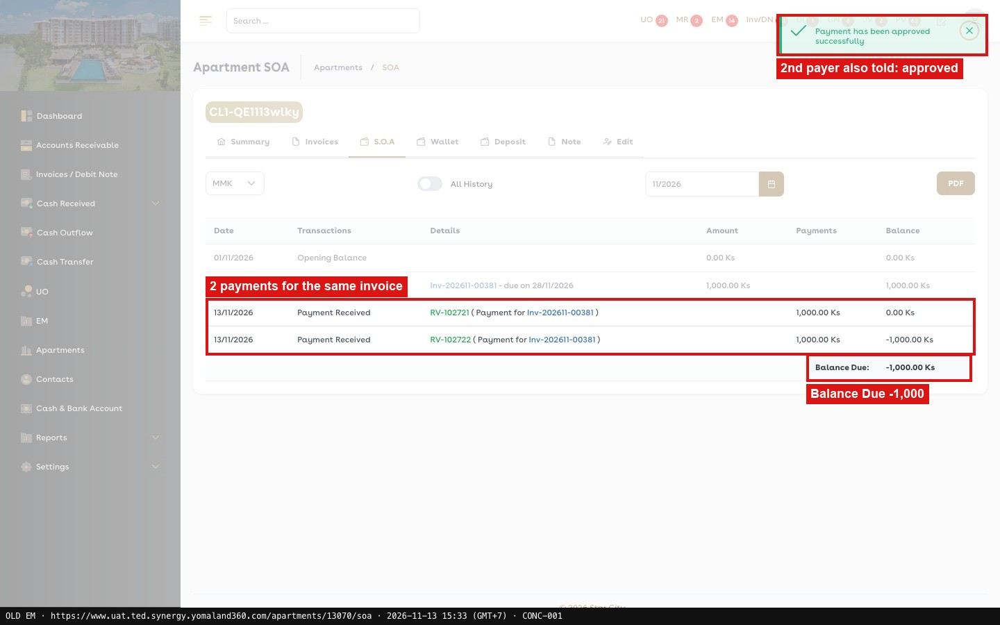

*1.1 · Ảnh 2: tab Invoices vẫn chỉ ghi invoice "PAID", Due 0, không cho thấy là đã trả dư 1,000*

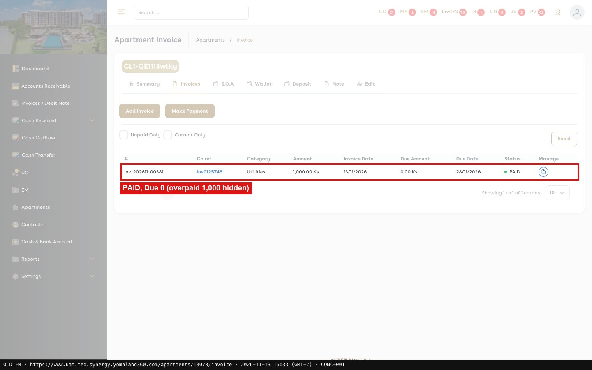

**Kiểu B: "Internal Server Error"** (2/6 lần; ảnh của lần chạy 13/11 10:54, invoice khác)

*1.1 · Ảnh 3: một người bấm Confirm → "Internal Server Error" (đúng ra là "already been paid in full")*

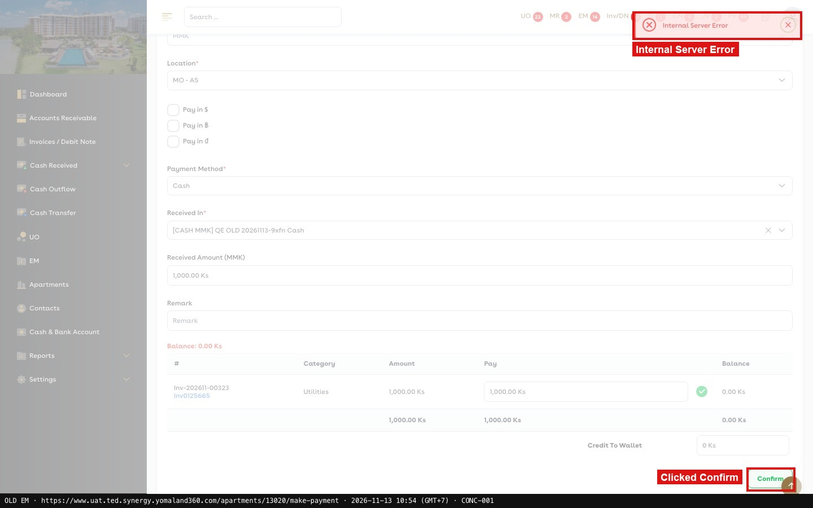

#### ❌ 1.2 · Sheet `1Inv 2RV`, dòng 18 · Hai người cùng trả một phần (400 và 500) invoice 1,000 Ks

- **Mong đợi:** cả hai khoản được nhận, còn nợ 100 ở mọi màn hình.
- **Thực tế:** có lần sai kiểu A, có lần sai kiểu B.

**Kiểu A: nhận cả hai khoản nhưng số còn nợ bị ghi đè** (ảnh của lần chạy 16/11 11:10, Inv-202611-00385). SOA có đủ 400 + 500 và Balance Due 100, nhưng tab Invoices, AR và dòng "Current Balance" vẫn ghi **còn nợ 500**.

*1.2 · Ảnh 1: SOA có 2 khoản 400 (RV-102726) và 500 (RV-102727), Balance Due 100; nhưng dòng "Current Balance" phía trên lại ghi 500*

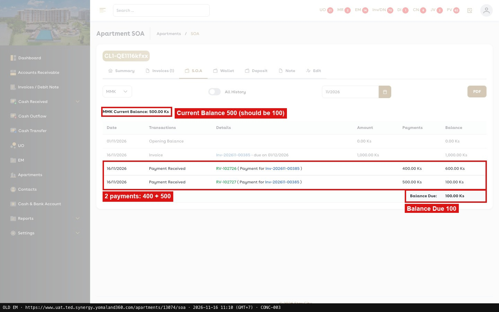

*1.2 · Ảnh 2: cùng invoice đó, tab Invoices ghi còn nợ 500, "PARTIALLY PAID" (đúng ra là 100)*

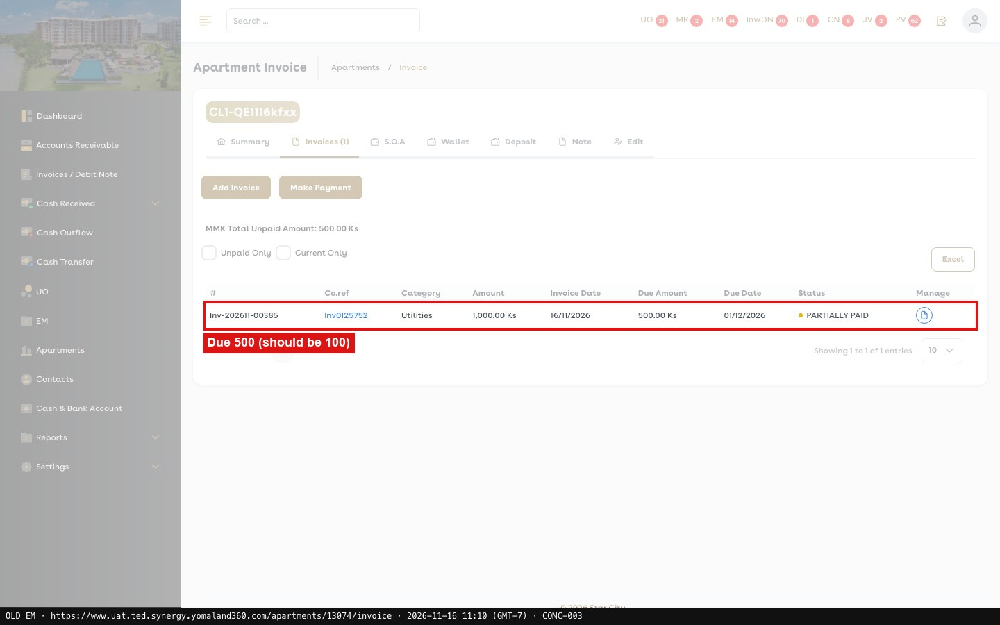

*1.2 · Ảnh 3: AR của apartment là 500 (đúng ra là 100)*

**Kiểu B: "Internal Server Error"** (ảnh của lần chạy 13/11 10:55, invoice khác). Khoản 400 không vào được, chỉ nhận 500.

*1.2 · Ảnh 4: người trả 400 bấm Confirm → "Internal Server Error"*

#### ❌ 1.3 · Sheet `1Inv 2RV`, dòng 20 · Hai người cùng trả 500 và 600 cho invoice 1,000 Ks (tổng vượt invoice)

- **Mong đợi:** người thứ hai được báo "This invoice has already been partially paid. Please refresh and try again".
- **Thực tế:** chạy 5 lần: 4 lần sai kiểu A, 1 lần sai kiểu B.

**Kiểu A: nhận cả hai khoản, trả dư 100** (4/5 lần; ảnh của lần chạy 13/11 15:31, Inv-202611-00380). Các màn hình còn **không khớp nhau**: SOA thấy cả hai khoản, nhưng tab Invoices và AR chỉ tính một khoản (còn nợ 500).

*1.3 · Ảnh 1: SOA có 2 khoản 600 (RV-102718) và 500 (RV-102719), Balance Due −100*

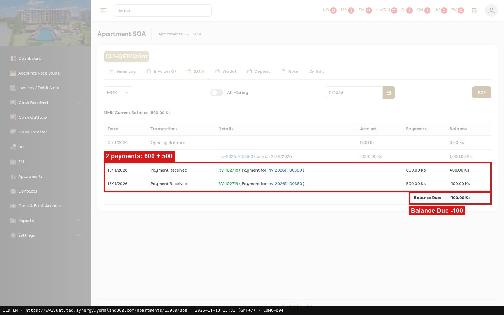

*1.3 · Ảnh 2: cùng invoice đó, tab Invoices lại ghi còn nợ 500, "PARTIALLY PAID" (khoản 600 bị ghi đè)*

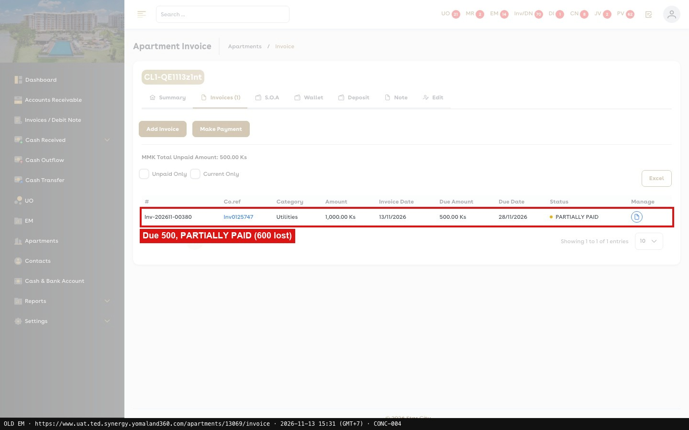

*1.3 · Ảnh 3: AR của apartment là 500, trong khi SOA là −100*

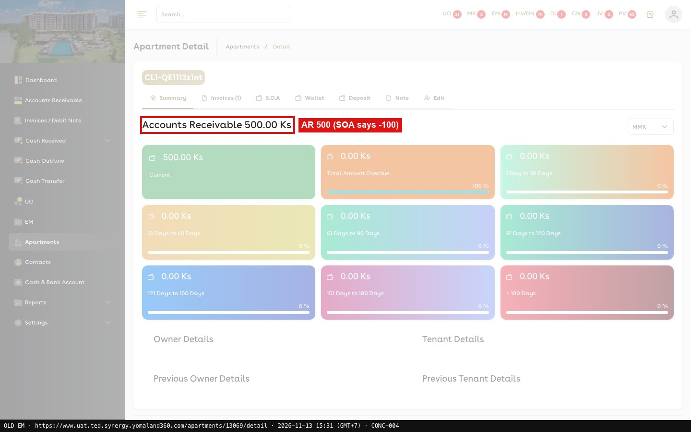

**Kiểu B: "Internal Server Error"** (1/5 lần; ảnh của lần chạy 13/11 10:55, invoice khác)

*1.3 · Ảnh 4: người trả 500 bấm Confirm → "Internal Server Error" (đúng ra là "Please refresh and try again")*

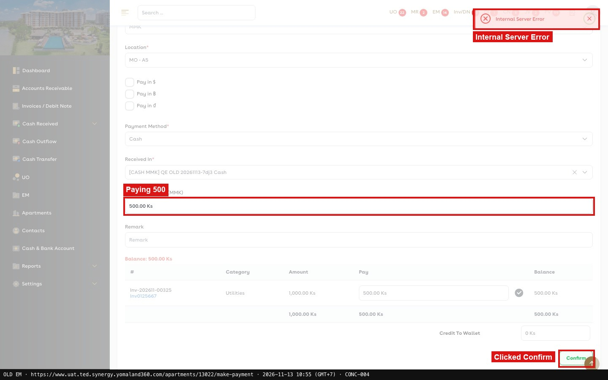

#### ❌ 1.4 · Sheet `Wallet - OB & CB`, dòng 128 · Hai người cùng tạo Wallet Refund bằng toàn bộ số dư wallet (100,000)

- **Mong đợi:** draft thứ hai bị từ chối ngay khi tạo.
- **Thực tế:** tạo được **cả hai draft**. Lúc duyệt thì chỉ duyệt được một, wallet không bị âm.

*1.4 · Ảnh 1: danh sách draft Cash Outflow, 2 dòng cuối là 2 Wallet Refund 100,000 cùng lúc 10:56 cho CL1-QE11132mtw (dòng thứ hai bị cắt ở mép dưới)*

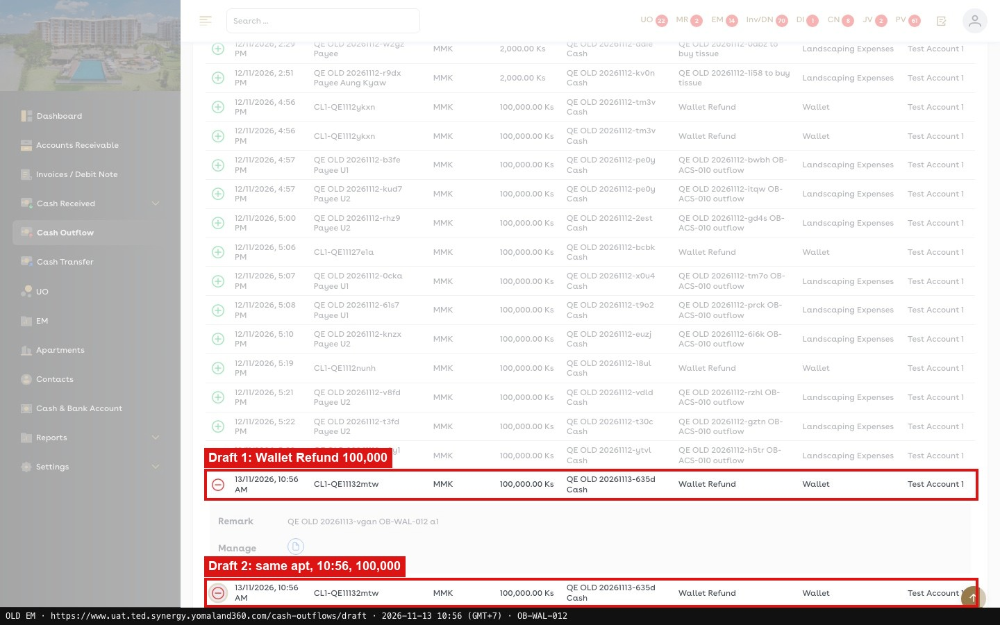

*1.4 · Ảnh 2: tab Wallet, chỉ một PV-100328 được duyệt, số dư về 0 (không âm)*

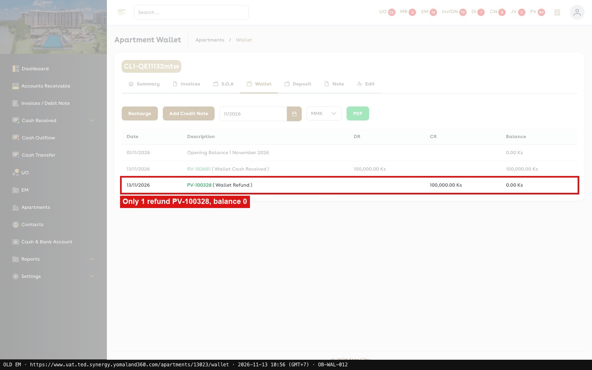

#### ❌ 1.5 · Sheet `Acc Statement - OB & CB`, dòng 225 · Hai người cùng duyệt Cash Outflow bằng toàn bộ số dư account (100,000)

- **Mong đợi:** người thứ hai bị từ chối với "Insufficient Balance".
- **Thực tế:** tiền an toàn (chỉ duyệt được một), nhưng **đôi khi báo "Internal Server Error"** thay vì "Insufficient Balance".

**Lỗi:** "Internal Server Error" (lần chạy 13/11 10:57)

*1.5 · Ảnh 1: duyệt draft thứ hai → "Internal Server Error"*

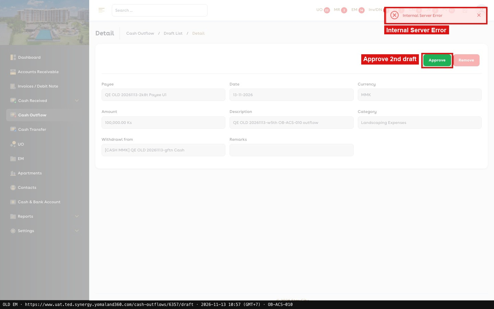

**Để so sánh (không phải lỗi):** ở một lần thử khác trong cùng lần chạy, Old EM báo đúng. Đây là kết quả mong đợi, chỉ để đối chiếu với ảnh 1.

*1.5 · Ảnh 2: thông báo đúng "Insufficient Balance"*

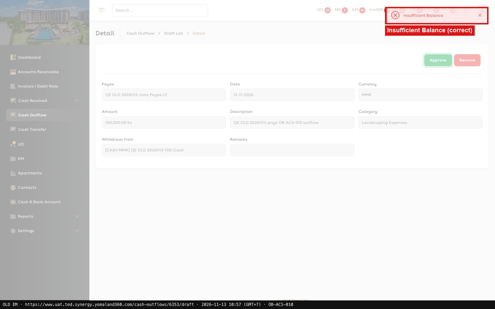

*1.5 · Ảnh 3: sổ quỹ chỉ có một PV-100330, số dư 0 (tiền an toàn)*

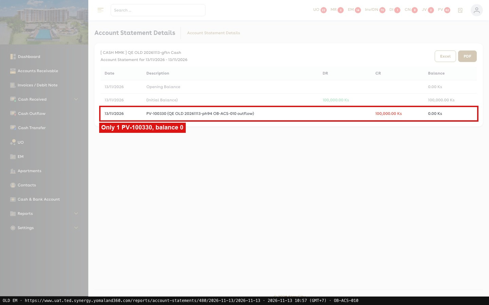

Cách tái hiện bằng tay (1Inv 2RV dòng 4)

Cần 2 cửa sổ trình duyệt cùng đăng nhập (2 user, hoặc cùng user trên Chrome thường và Chrome ẩn danh).

1. Tạo apartment, tạo và approve một invoice **1,000 Ks**.
2. Ở **cả hai** cửa sổ: Apartments › apartment đó › tab **Invoices** › **Make Payment**.
3. Điền giống nhau: MMK, Payment Method Cash, Received In = một cash account, chọn trả đủ **1,000**.
4. Bấm **Confirm** ở hai cửa sổ **cùng lúc** (hai người đếm ngược).
5. Xem tab **S.O.A**, trạng thái invoice, số dư account.

- **Đúng:** một khoản 1,000; cửa sổ kia báo "already been paid in full"; Balance Due 0; account +1,000.
- **Lỗi:** hai khoản 1,000, Balance Due −1,000, account +2,000; hoặc "Internal Server Error".
- Có thể phải thử nhiều lần vì hai cú bấm phải tới server gần như cùng một lúc.

---

## 🔴 Lỗi 2 · Import UO: 2 dòng cùng apartment, cùng tháng → 2 invoice

**Chuyện gì xảy ra:** file import có **hai dòng cho cùng một apartment trong cùng tháng**. Old EM nhận cả hai ("2 UO Entry imported."), không báo lỗi. Apartment có **2 UO entry và 2 invoice**. Dòng thứ hai lại tính từ chỉ số cũ (ví dụ "18 − 10 = 8" bên cạnh "15 − 10 = 5"), nên **cùng một lượng tiêu thụ bị tính tiền 2 lần**.

**Đúng ra phải:** dòng thứ hai bị từ chối vì trùng tháng.

**Ảnh hưởng:** cư dân bị tính tiền điện/nước 2 lần.

Các cách tạo trùng khác thì Old EM đã chặn:

- Upload **lại cùng một file**: bị từ chối.
- Hai lần upload **cùng lúc**: thường bị chặn, nhưng bằng thông báo "Internal Server Error". Có một lần thử tay cả hai đều qua (Inv-202611-00134 và -00135).
- **Bulk Approve** UO draft: mỗi draft ra đúng một invoice.

### Test case

Ở cả 4 lượt, tab Invoices có thêm một invoice **2,030** của chỉ số tháng trước (bước chuẩn bị). Invoice đó không phải lỗi.

#### ❌ Sheet `Uo import`, dòng 20 · 2 dòng cùng ngày đọc, cùng chỉ số (15)

- **Mong đợi:** dòng 1 được nhập, dòng 2 bị từ chối.
- **Thực tế:** "2 UO Entry imported.", 2 UO entry và 2 invoice 1,015.

*Ảnh 1: import xong báo "2 UO Entry imported."*

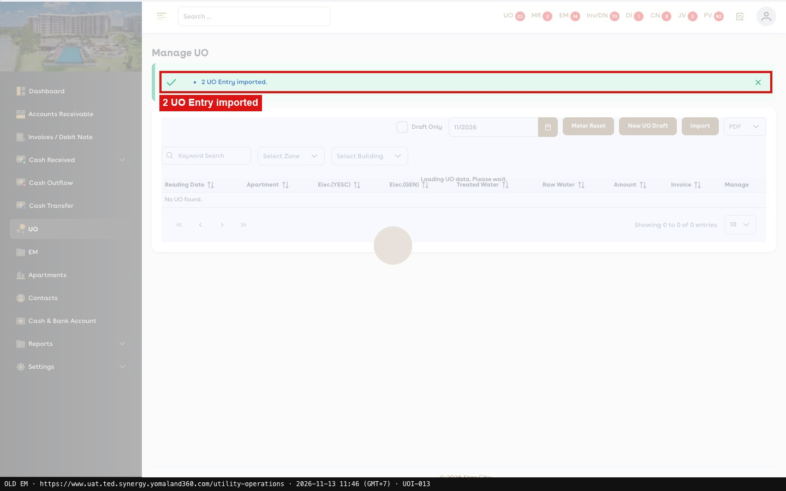

*Ảnh 2: danh sách UO của CL1-QE1113a0mz: 2 entry cùng ngày 13/11, cùng "15 − 10 = 5", ra 2 invoice -00364 và -00365*

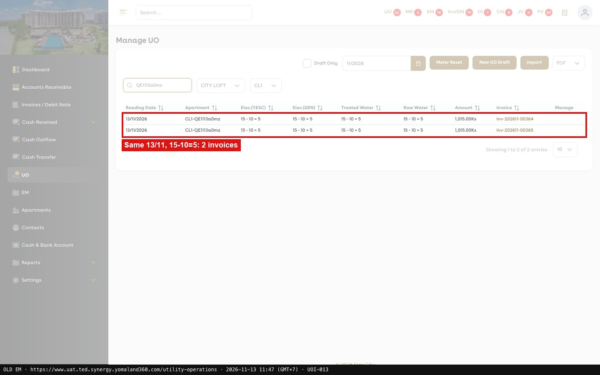

*Ảnh 3: tab Invoices: thêm 2 invoice 1,015 giống nhau*

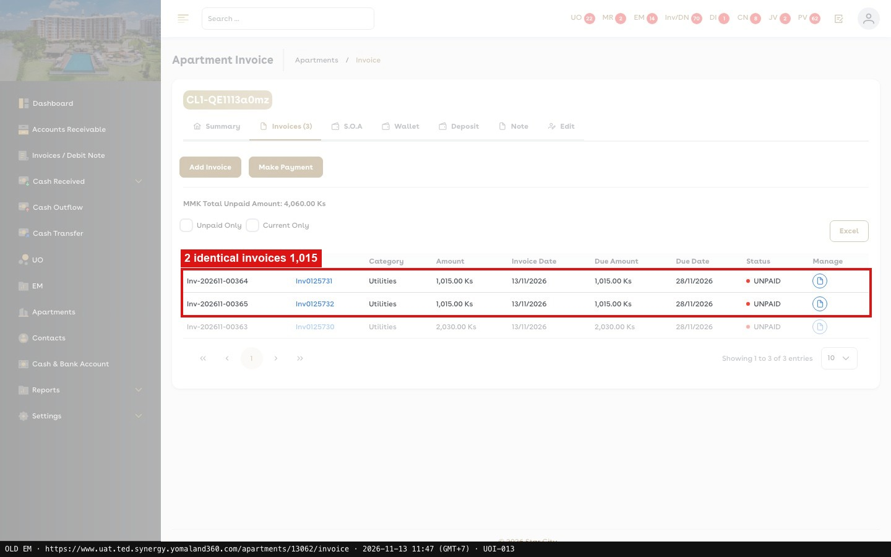

#### ❌ Sheet `Uo import`, dòng 22 · Cùng ngày đọc, khác chỉ số

- **Mong đợi:** dòng 2 bị từ chối.
- **Thực tế:** cả hai được nhập: chỉ số 15 và 18 cùng ngày 13/11, ra 2 invoice 1,015 và 1,624.

*Ảnh 1: danh sách UO: cùng ngày 13/11, "15 − 10 = 5" và "18 − 10 = 8" đều được nhập*

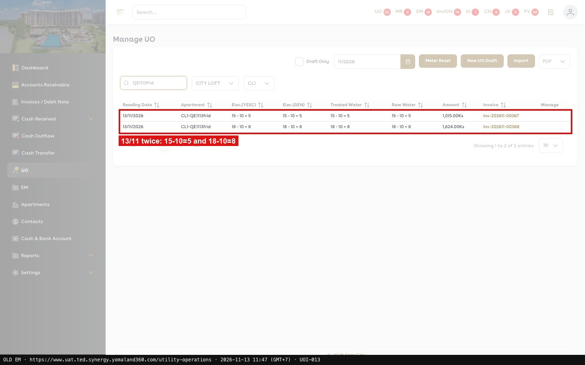

*Ảnh 2: tab Invoices: 2 invoice 1,015 và 1,624 cho cùng tháng*

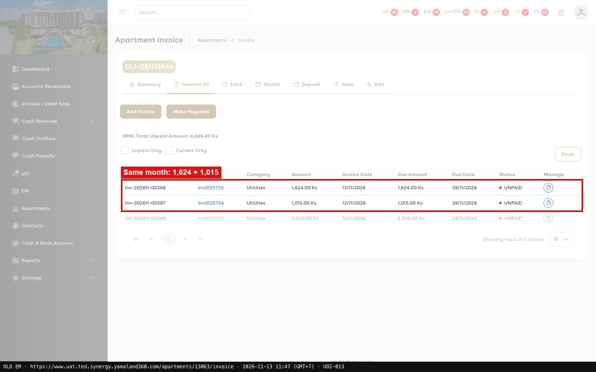

#### ❌ Sheet `Uo import`, dòng 32 · Cùng tháng, khác ngày

- **Mong đợi:** dòng 2 bị từ chối.
- **Thực tế:** ngày 01/11 và 13/11 đều được nhập, cùng "15 − 10 = 5", ra 2 invoice 1,015.

*Ảnh 1: danh sách UO: ngày 01/11 và 13/11, hai lần "15 − 10 = 5"*

*Ảnh 2: tab Invoices: 2 invoice 1,015 trùng nhau*

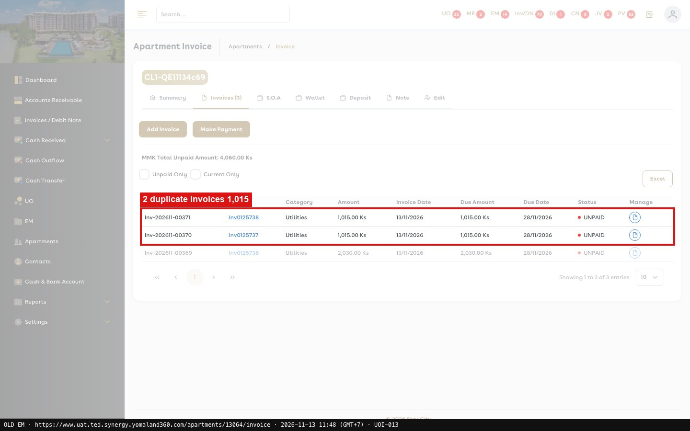

#### ❌ Sheet `Uo import`, dòng 33 · Cùng tháng, khác chỉ số

- **Mong đợi:** dòng 2 bị từ chối.
- **Thực tế:** dòng 2 được nhập và **tính từ chỉ số cũ**: "18 − 10 = 8" bên cạnh "15 − 10 = 5", nên 5 đơn vị bị tính tiền 2 lần.

*Ảnh 1: danh sách UO: 01/11 "15 − 10 = 5" và 13/11 "18 − 10 = 8"*

*Ảnh 2: SOA: thêm 2 invoice 1,015 + 1,624, Balance Due 4,669*

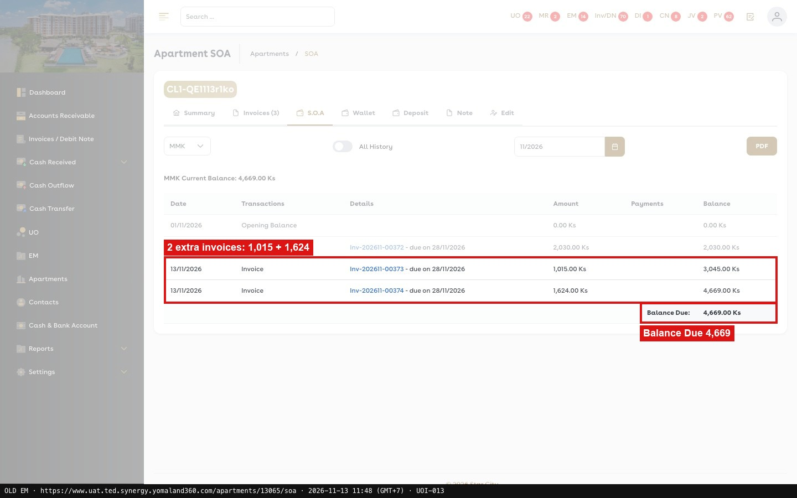

Cách tái hiện bằng tay (Uo import dòng 20)

1. Tạo apartment và nhập + approve một chỉ số UO cho **tháng trước** (UO › New, chỉ số 10). Old EM không cho import nếu apartment chưa có chỉ số trước đó.
2. UO › **Import** › tải file mẫu.
3. Điền **2 dòng cho cùng apartment**, ngày đọc trong **tháng này**: dòng 1 = 15 ngày 1, dòng 2 = 18 hôm nay.
4. Upload file.
5. Xem thông báo, danh sách UO, tab **Invoices** và **S.O.A** của apartment.

- **Đúng:** dòng 1 được nhập, dòng 2 bị từ chối, có 1 invoice mới.
- **Lỗi:** "2 UO Entry imported.", 2 UO entry, 2 invoice mới.

---

## 🔴 Lỗi 3 · SOA: số dư đầu tháng sau sai

**Chuyện gì xảy ra:** UO invoice được tạo bằng **Bulk Approve**, rồi trả bằng **Wallet**. SOA tháng này đúng (mở 2,100, +1,218, −1,218, đóng 2,100). Nhưng **tháng sau mở ở 882.00 thay vì 2,100.00**: tháng sau trừ khoản thanh toán (−1,218) mà không cộng invoice (+1,218).

**Đúng ra phải:** số dư đầu tháng sau = số dư cuối tháng này.

**Ảnh hưởng:** sao kê (SOA) gửi cư dân sai số nợ.

8 thứ tự giao dịch khác đều đúng (Invoice → UO import, UO import → Make Payment, UO import → Wallet Payment, UO thủ công → UO import, Make Payment → Wallet Payment, Wallet Payment → Invoice, Wallet Payment → UO import…). Chỉ riêng **UO Bulk Approve → Wallet Payment** bị sai.

### Test case

#### ❌ Sheet `SOA - OB & CB`, dòng 259 · UO Bulk Approve → Wallet Payment

- **Mong đợi:** SOA tháng 12 mở ở 2,100.00 (bằng số dư cuối tháng 11).
- **Thực tế:** tháng 12 mở ở **882.00**.

*Ảnh 1: SOA tháng 11: mở 2,100, invoice +1,218, Wallet Payment −1,218, cuối kỳ 2,100*

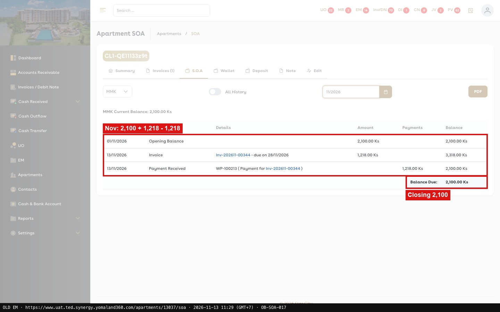

*Ảnh 2: SOA tháng 12: Opening Balance 882.00 thay vì 2,100.00 (dòng "Current Balance" phía trên vẫn là 2,100)*

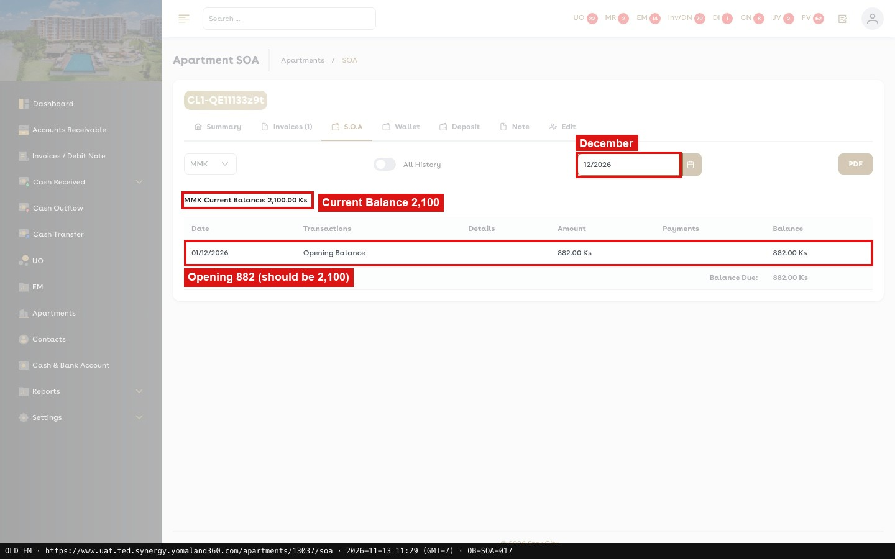

*Ảnh 3: SOA All History: số dư thật vẫn là 2,100*

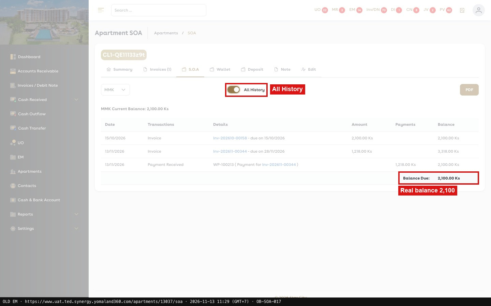

Cách tái hiện bằng tay (SOA - OB & CB dòng 259)

1. Tạo apartment, tạo và approve một invoice ngày **tháng trước** để tháng này có số dư đầu kỳ.
2. Nạp wallet cho apartment (tab Wallet › Recharge), ví dụ 5,000 Ks.
3. Tạo **UO draft** cho apartment (UO › New).
4. Duyệt bằng **Bulk Approve**: danh sách UO draft › tick draft › Bulk Approve. Ghi lại số tiền invoice.
5. Make Payment cho UO invoice đó, Payment Method **Wallet**.
6. Mở **S.O.A tháng này**: ghi lại số dư cuối kỳ.
7. Chuyển sang **tháng sau**: xem Opening Balance.

- **Đúng:** bằng số dư cuối tháng này (2,100.00).
- **Lỗi:** 882.00 (= 2,100 − 1,218).

---

## 🔴 Lỗi 4 · Sửa số dư ban đầu của account, ngày mai vẫn mở bằng số cũ

**Chuyện gì xảy ra:** account **đã có giao dịch**, sửa initial balance. Danh sách account và Account Statement **hôm nay** đều hiện số mới (51,100). Nhưng Account Statement **ngày mai** vẫn mở bằng **số cũ (11,100)**.

**Đúng ra phải:** số dư đầu ngày mai = số dư cuối hôm nay = 51,100.

**Ảnh hưởng:** sổ quỹ/sổ ngân hàng lệch 40,000 từ ngày hôm sau trở đi.

Sửa initial balance khi account **chưa có giao dịch** thì đúng (TC_Cash_Bank_Acc_014).

### Test case

#### ❌ TC_Cash_Bank_Acc_015 · Sửa initial balance sau khi account đã có giao dịch

- **Mong đợi:** statement ngày mai (14/11) mở ở 51,100.00.
- **Thực tế:** mở ở **11,100.00**.

*Ảnh 1: danh sách account sau khi sửa: initial 50,000, closing 51,100*

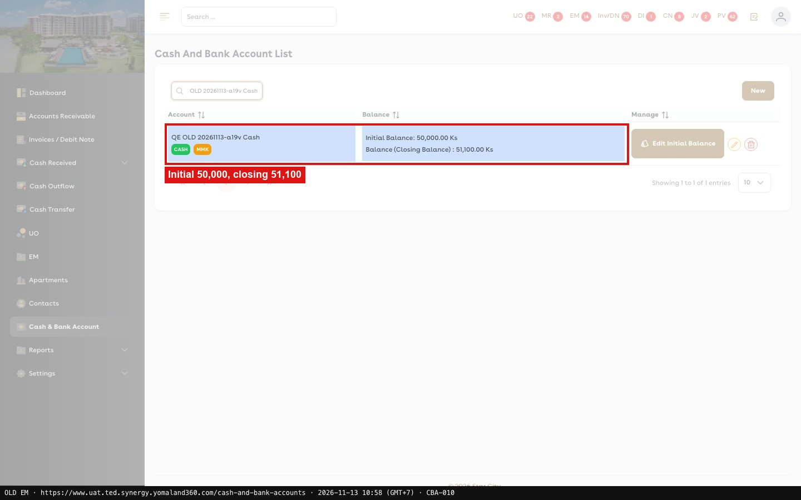

*Ảnh 2: statement hôm nay (13/11): cuối kỳ 51,100, đúng*

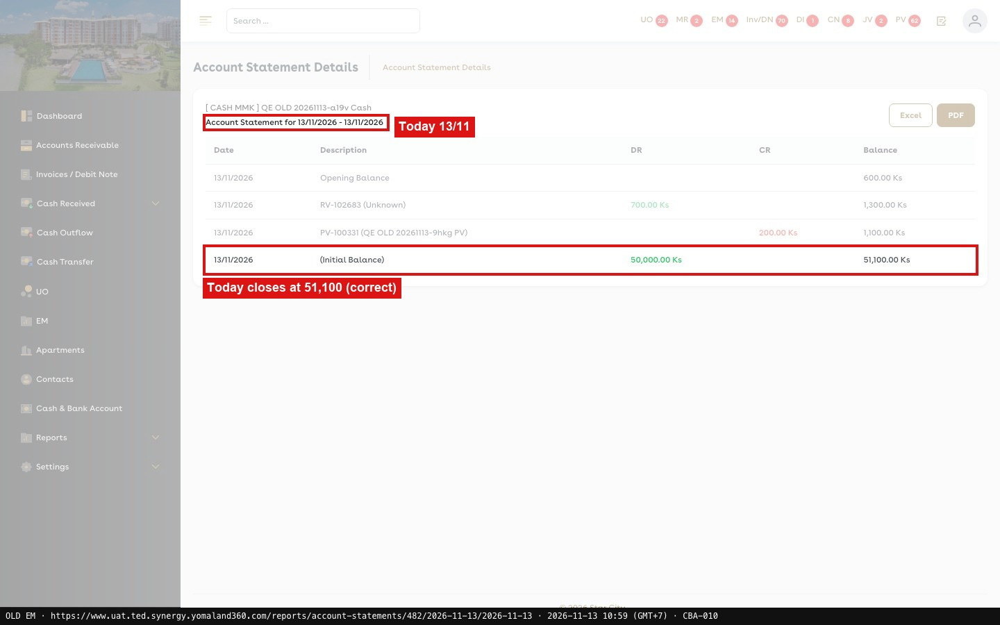

*Ảnh 3: statement ngày mai (14/11) mở ở 11,100 thay vì 51,100*

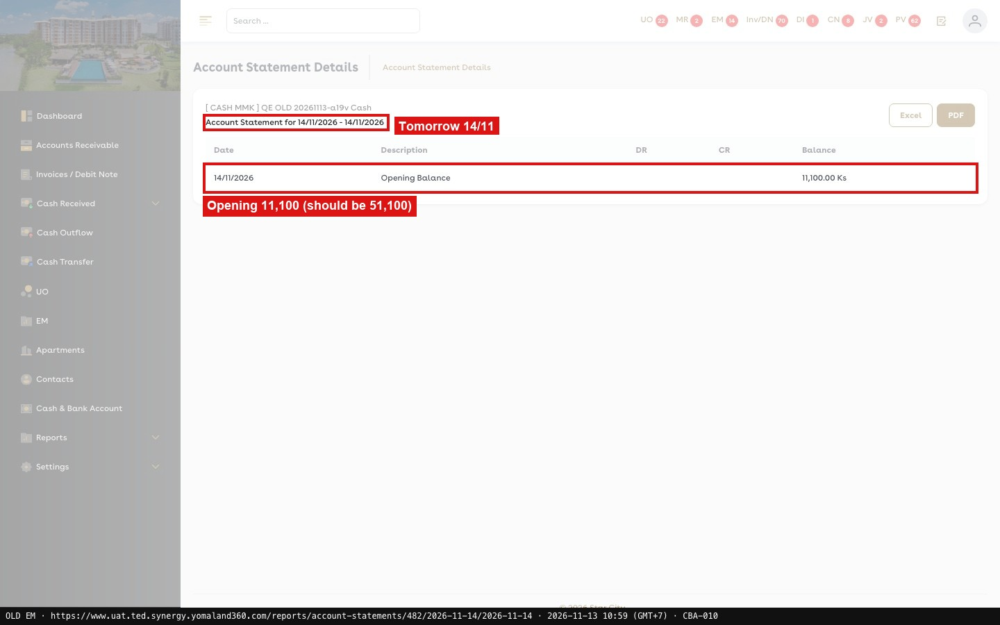

Cách tái hiện bằng tay (TC_Cash_Bank_Acc_015)

1. Cash & Bank Account › **New**: Cash, MMK, initial balance **10,000**.
2. Ghi vài khoản thu/chi vào account (ví dụ thu 600 + 700, chi 200) → số dư 11,100.
3. Sửa account, đổi initial balance thành **50,000**, lưu. Danh sách hiện 51,100.
4. Reports › **Account Statement** › account › **hôm nay**: cuối kỳ 51,100.
5. Mở statement **ngày mai** (ô chọn ngày chặn ngày tương lai, nên sửa trên thanh địa chỉ: `/reports/account-statements/<id account>/<ngày mai>/<ngày mai>`).

- **Đúng:** Opening Balance 51,100.00.
- **Lỗi:** 11,100.00.

---

## 🔴 Lỗi 5 · Wallet: số dư đầu tháng sau bỏ sót Wallet Payment

**Chuyện gì xảy ra:** Credit Note **+50,000**, rồi trả invoice bằng wallet **−10,500**. Tháng này đúng (cuối kỳ 39,500). Nhưng **tháng sau mở ở 50,000** thay vì 39,500: khoản thanh toán bị mất.

**Đúng ra phải:** tháng sau mở ở 39,500.

**Ảnh hưởng:** số dư wallet của cư dân bị cộng thêm 10,500, có thể bị dùng để trả invoice khác.

### Test case

#### ❌ Sheet `Wallet - OB & CB`, dòng 124 · Credit Note → Wallet Payment

- **Mong đợi:** wallet tháng 12 mở ở 39,500.00.
- **Thực tế:** mở ở **50,000.00**.

*Ảnh 1: wallet tháng 11: Credit Note +50,000, Wallet Payment −10,500, cuối kỳ 39,500*

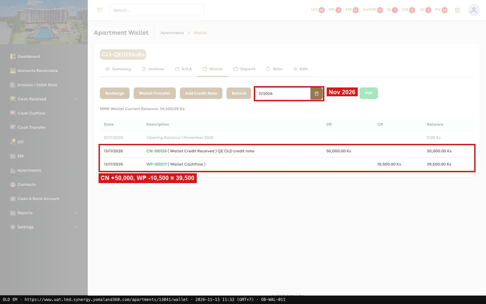

*Ảnh 2: wallet tháng 12 mở ở 50,000 thay vì 39,500 (dòng "Current Balance" vẫn là 39,500)*

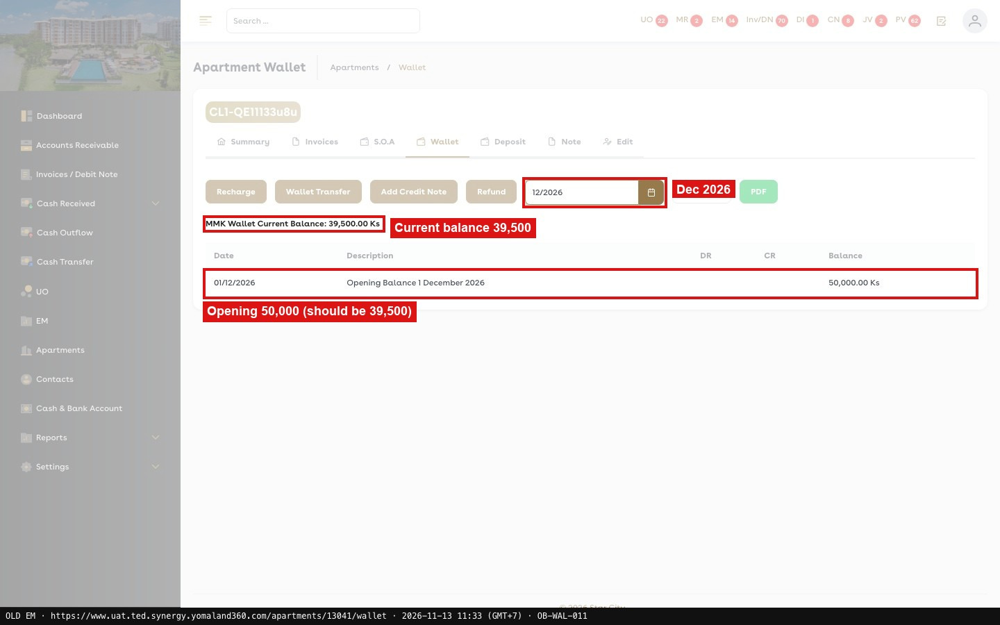

Các thứ tự khác trong cùng sheet đều đạt: Wallet Transfer → Wallet Payment (dòng 112, 118), RV → Wallet Transfer (dòng 94, 95).

Cách tái hiện bằng tay (Wallet - OB & CB dòng 124)

1. Tạo apartment (wallet 0).
2. Tab **Wallet** › thêm **Credit Note** 50,000 Ks; duyệt (thanh trên cùng **CN** › draft › Approve). Wallet hiện 50,000.
3. Tạo và approve invoice **10,500 Ks** cho apartment.
4. Make Payment, Payment Method **Wallet**.
5. Tab Wallet **tháng này**: cuối kỳ 39,500.
6. Chuyển sang **tháng sau**: xem Opening Balance.

- **Đúng:** 39,500.00.
- **Lỗi:** 50,000.00.

---

## 🔴 Lỗi 6 · Form tạo invoice tự xoá giá trị đã nhập

**Chuyện gì xảy ra:** đây **không phải lỗi làm tròn** (làm tròn vẫn đúng). Mỗi lần người dùng sửa Unit, Discount hoặc Gross Price, form gửi lên server để tính lại tổng, và kết quả trả về **ghi đè lên ô người dùng vừa nhập**. Khi các kết quả về không đúng thứ tự thì **Gross Price bị xoá** (báo "The Gross Price field is required" dù ô vẫn có số, hoặc Total = 0), **Gross Price bị đổi** (100.10 thành 10.00) hoặc **Discount bị mất**. Có invoice bị từ chối, có invoice được **lưu sai tiền**.

**Đúng ra phải:** giá trị đã nhập giữ nguyên; tổng được tính một lần và lưu đúng như hiển thị.

**Ảnh hưởng:** invoice có thể bị lưu sai tiền mà người tạo không để ý. Xảy ra ngẫu nhiên: trong lần chạy cuối, mỗi biến thể có **3/5** lần tạo bị từ chối, và 4 invoice được lưu sai tiền.

Số bị lưu sai: 3,090.00 thay vì 2,781.00 · 1,029.99 thay vì 926.99 · **10.30** thay vì 103.05 · 103.10 thay vì 103.05.

Khi invoice được lưu đúng thì draft, invoice đã duyệt, AR, SOA, report và PDF đều khớp nhau.

### Test case

#### ❌ TC_Inv_001 · Tạo invoice (Unit 2, Gross Price 1,500, Discount 10 %)

- **Mong đợi:** invoice được tạo, Grand Total 2,781.00.
- **Thực tế:** bấm Create bị từ chối "The Gross Price field is required" (ngày 12/11).

*Ảnh 1: Gross Price và Discount tự bị xoá, Total về 0*

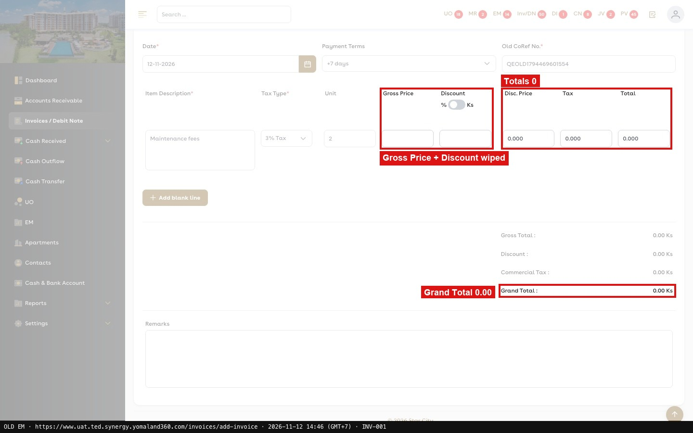

*Ảnh 2: ô Gross Price có 1,500.00 nhưng vẫn báo "The Gross Price field is required", không lưu được*

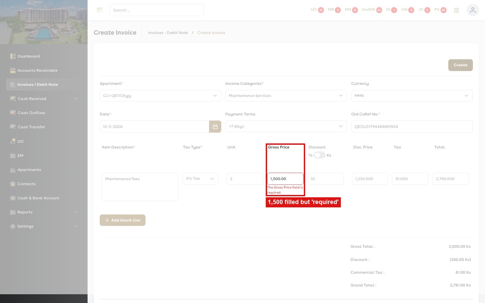

#### ❌ INV-038 (không có trong Excel) · Unit 2, Gross Price 1,500, Discount 10 % → mong đợi 2,781.00

- **Thực tế:** 3/5 lần bị từ chối (Gross Price required); 2/5 lần lưu **3,090.00** (mất discount). Invoice đã duyệt là 3,090.00 ở mọi màn hình.

*Ảnh 1: Gross Price bị xoá trống, Discount vẫn 10, Total 0, báo "The Gross Price field is required"*

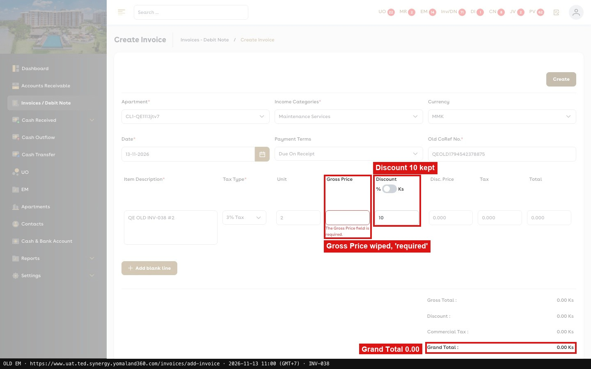

*Ảnh 2: Discount bị xoá, form tự tính Grand Total 3,090.00*

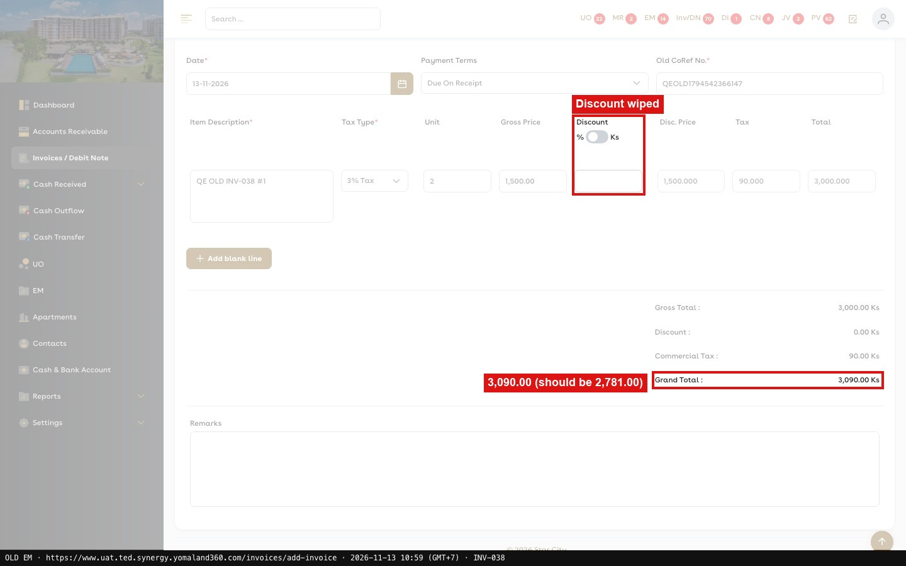

*Ảnh 3: draft lưu 3,090.00 thay vì 2,781.00*

*Ảnh 4: report Invoices: Inv-202611-00326 đã duyệt, Total 3,090.00*

#### ❌ INV-038 (không có trong Excel) [Unit 3, Gross Price 333.33, Discount 10 % → mong đợi 926.99]

- **Thực tế:** 1 lần lưu **1,029.99** (mất discount); 2 lần bị từ chối; 1 lần form hiện đúng 926.99 nhưng vẫn bị từ chối; 1 lần lưu đúng 926.99.

*Ảnh 1: draft lưu 1,029.99 thay vì 926.99 (mất discount 10 %)*

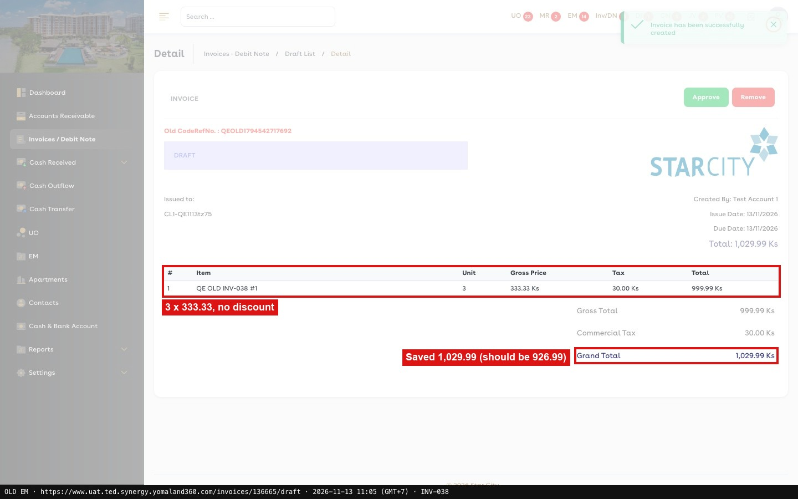

*Ảnh 2: form hiện đúng 926.99, ô Gross Price có 333.33 nhưng vẫn báo "required", không lưu được*

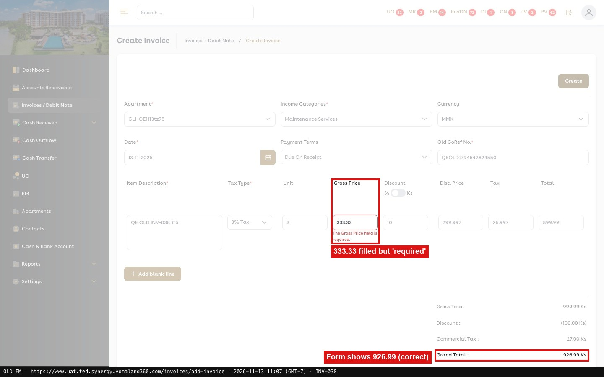

#### ❌ INV-038 (không có trong Excel) [Unit 7, Gross Price 0.15, Discount 0 → mong đợi 1.08]

- **Thực tế:** 3/5 lần bị từ chối vì Gross Price bị xoá; 2 lần lưu đúng 1.08.

*Ảnh 1: Gross Price 0.15 bị xoá trống, Total 0, báo "required"*

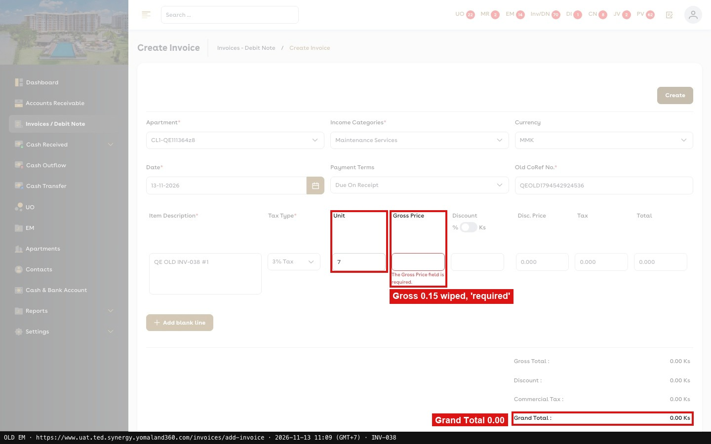

#### ❌ INV-038 (không có trong Excel) [Unit 1, Gross Price 100.10, Discount 0.05 Ks → mong đợi 103.05]

- **Thực tế:** 1 lần lưu **10.30** (Gross Price bị đổi thành 10.00) và đã được duyệt; 1 lần lưu **103.10** (mất discount); 3 lần bị từ chối (một lần báo "The selected Gross Price is invalid").

*Ảnh 1: draft lưu Gross Price 10.00, Grand Total 10.30 thay vì 103.05*

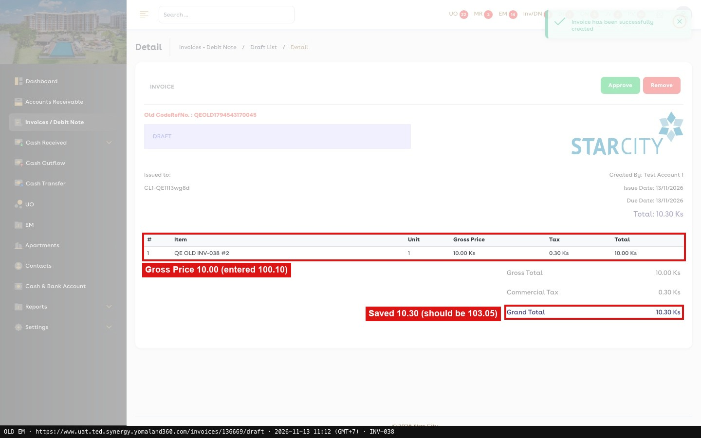

*Ảnh 2: draft khác lưu 103.10 (mất discount 0.05 Ks)*

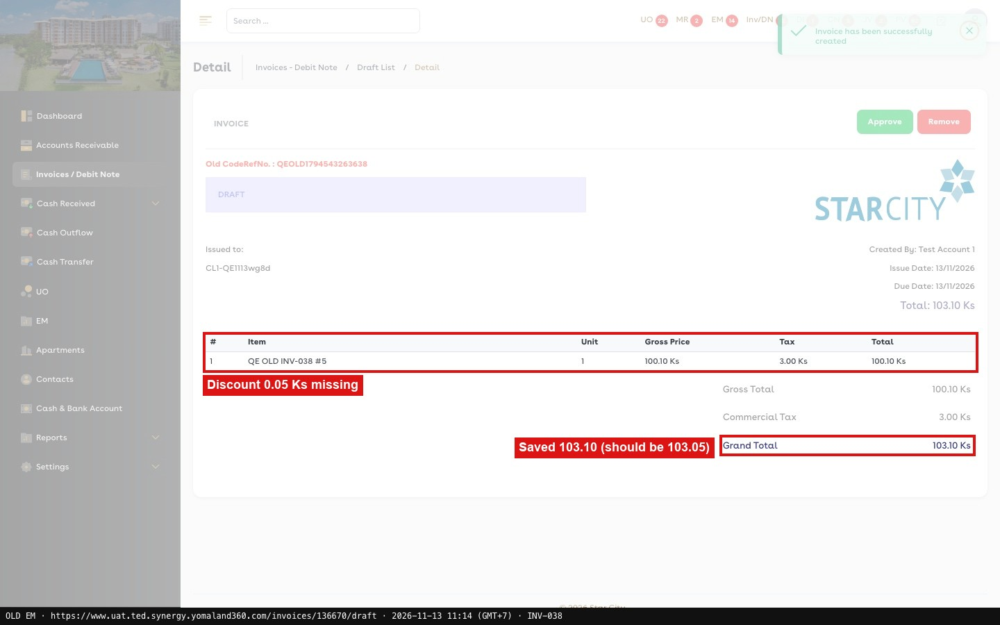

*Ảnh 3: report Invoices: Inv-202611-00329 đã duyệt với Total 10.30*

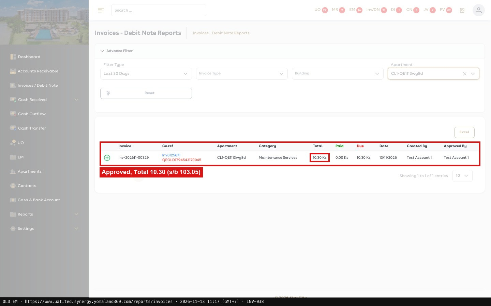

Cách tái hiện bằng tay (INV-038)

1. Invoices / Debit Note › **Create Invoice**; chọn apartment, income category, MMK.
2. Dòng hàng: Tax Type "3% Tax", Unit **2**, Gross Price **1,500**, Discount **10 %**. Gõ với tốc độ bình thường rồi bấm ra ngoài.
3. **Không chạm vào gì, quan sát vài giây.** Đúng: Disc. Price 1,350, Total 2,700, Tax 81, Grand Total 2,781.00.
4. Bấm **Create**; mở draft, so tổng với form.
5. Lặp lại 5 lần.

- **Lỗi:** Gross Price tự mất, hoặc báo "Gross Price field is required" dưới ô có số, hoặc Total về 0, hoặc mất discount; hoặc draft lưu thành 3,090.00.

---

## 🟠 Lỗi 7 · Một số danh sách thiếu "Created By" / "Approved By"

**Chuyện gì xảy ra:** tên người tạo / người duyệt luôn có trong **report** và trên **voucher (PDF)**, nhưng một số **danh sách** không hiện. Trang chi tiết của Invoice / Debit Note có đủ hai tên; trang chi tiết của Cash Transfer, Credit Note và Wallet Transfer thì không có tên nào.

**Đúng ra phải:** mọi chứng từ tiền đều hiện Created By (và Approved By nếu có bước duyệt).

**Ảnh hưởng:** muốn biết ai duyệt thì phải mở voucher hoặc chạy report.

| Chứng từ | Danh sách | Thiếu |
|---|---|---|
| Invoice, Debit Note, UO invoice, EM debit note | Invoices / Debit Note | **Approved By** |
| Cash Transfer (JV) | Cash Transfer › Recent Transfers | **Approved By** |
| Credit Note (CN) | Apartment › tab Wallet | **Created By và Approved By** |
| Wallet Transfer (WT) | Apartment › tab Wallet | **Created By** |
| RV (Make Payment, Unknown Received), PV (Cash Outflow, Wallet Refund, Deposit Withdraw) | Danh sách tương ứng | Đủ ✅ |

### Test case

#### ❌ RPT-036 (không có trong Excel) [Invoice]

- **Thực tế:** danh sách Invoices / Debit Note có Created By, **không có cột Approved By**. Trang chi tiết và report có đủ.

*Ảnh 1: danh sách Invoices / Debit Note: có Created By, không có cột Approved By*

*Ảnh 2: trang chi tiết invoice có Created By và Approved By*

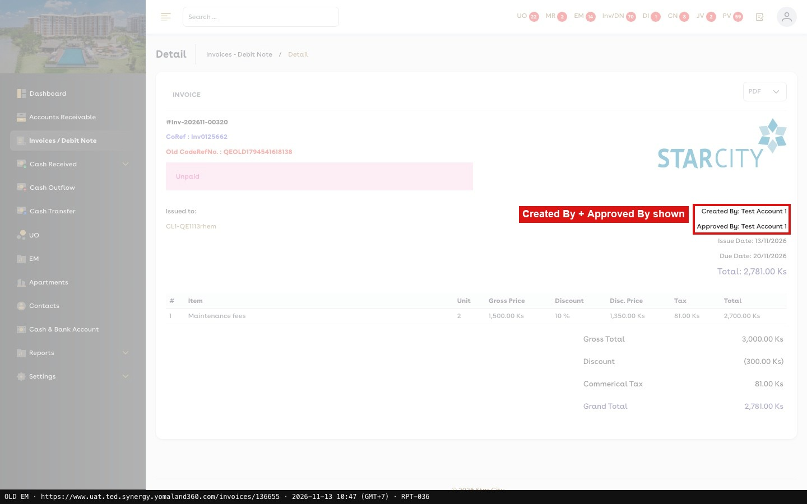

#### ❌ RPT-036 (không có trong Excel) [Debit Note]

*Ảnh 1: danh sách chỉ có DN-202611-00065, không có cột Approved By*

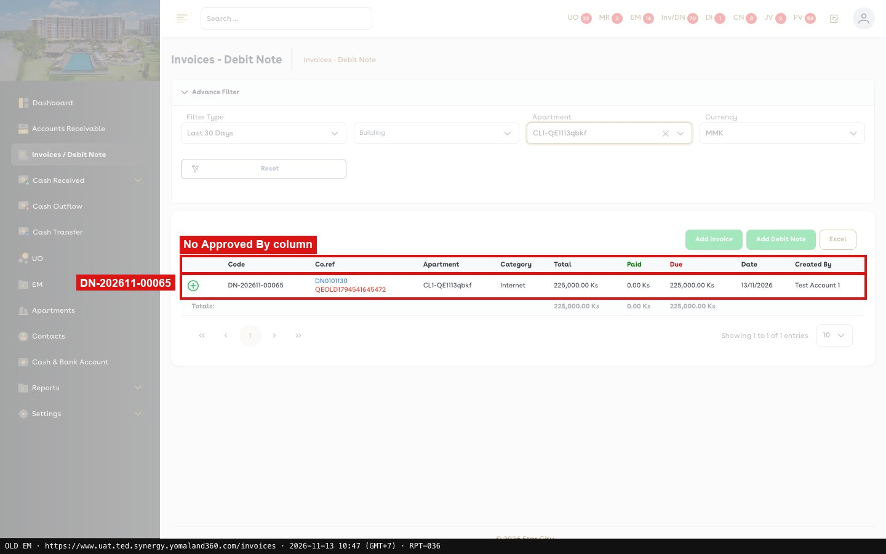

*Ảnh 2: chi tiết DN-202611-00065 có Approved By: Test Account 1*

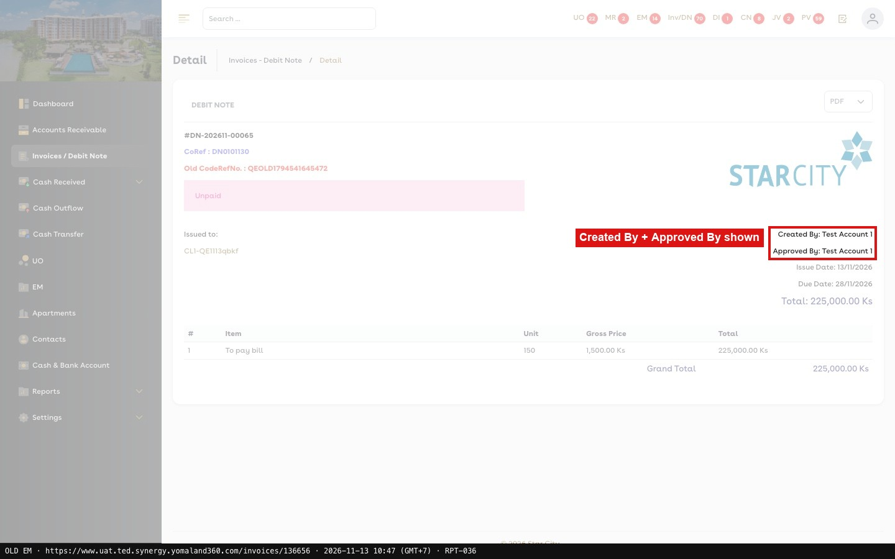

#### ❌ RPT-036 (không có trong Excel) [UO invoice]

*Ảnh 1: Inv-202611-00321 (UO) trong danh sách, không có cột Approved By*

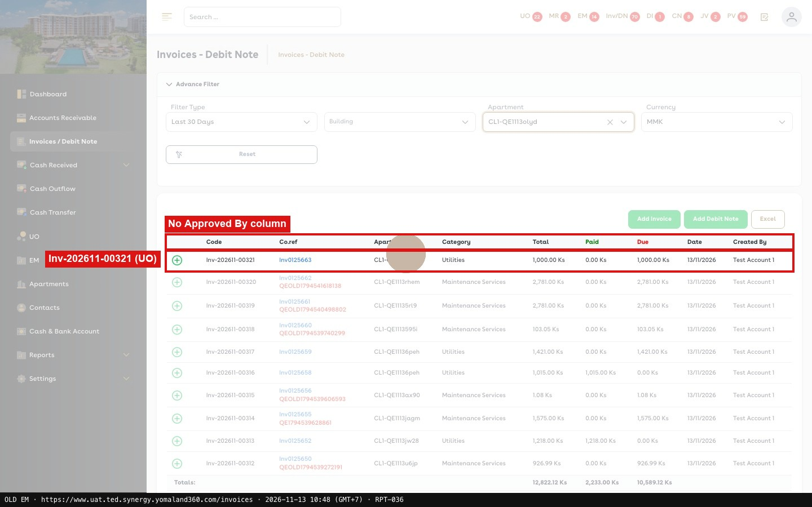

*Ảnh 2: chi tiết UO invoice có Created By và Approved By*

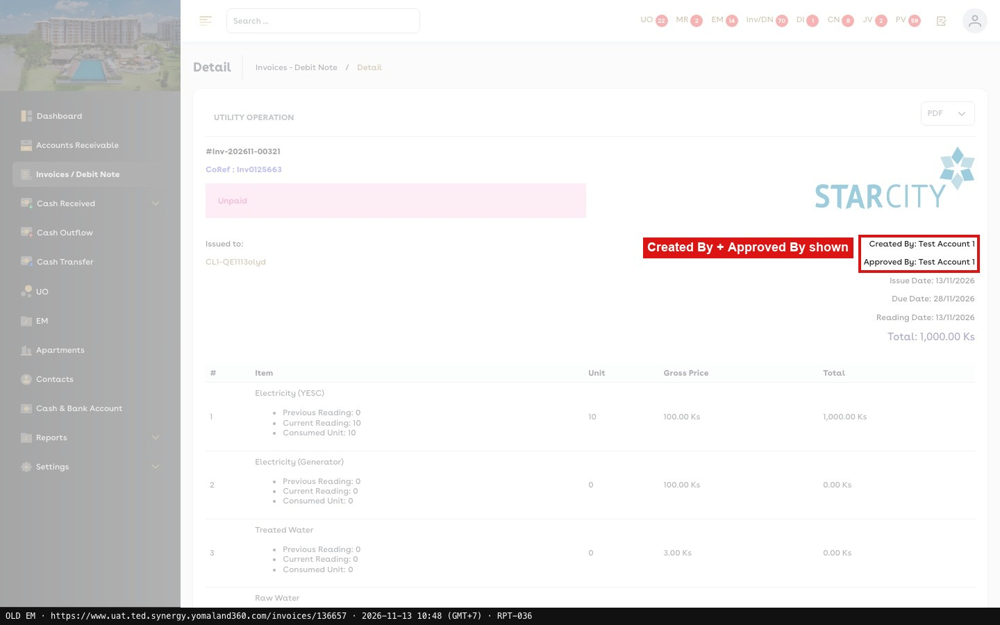

#### ❌ RPT-036 (không có trong Excel) [EM debit note]

*Ảnh 1: danh sách chỉ có DN-202611-00066 (EM), không có cột Approved By*

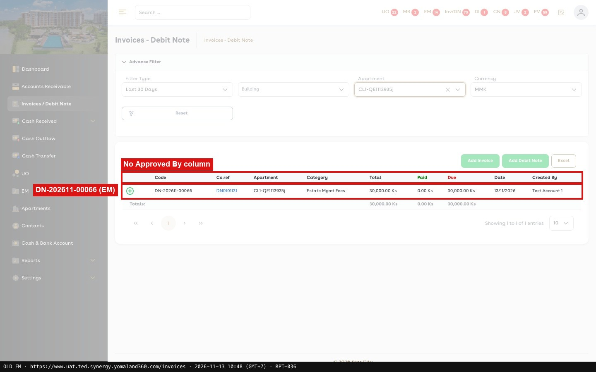

*Ảnh 2: chi tiết EM debit note có Approved By*

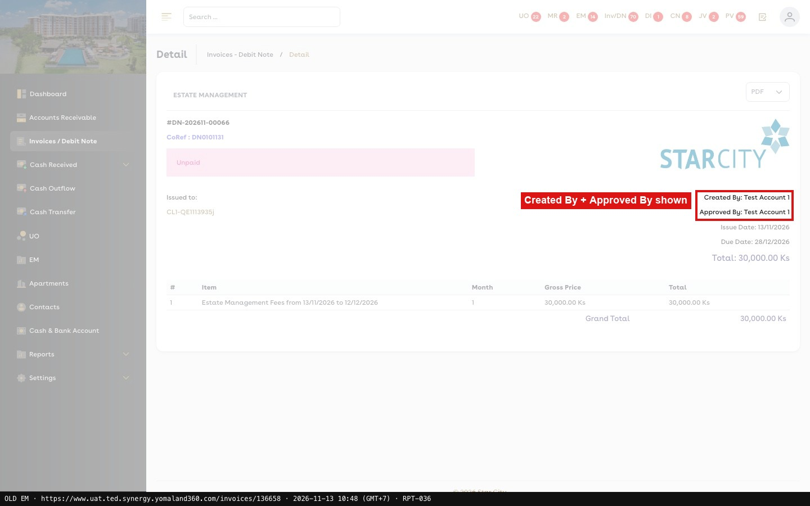

#### ❌ RPT-036 (không có trong Excel) [Cash Transfer JV]

*Ảnh 1: danh sách Cash Transfer: JV-100294 có Created By, không có cột Approved By*

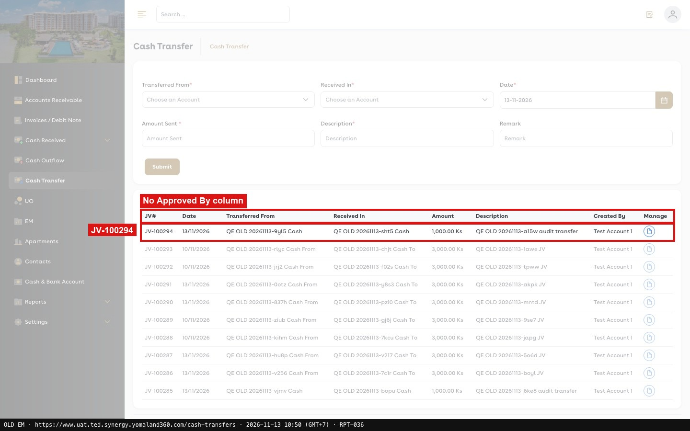

*Ảnh 2: voucher JV-100294 ghi "Created by" và "Approved by" Test Account 1*

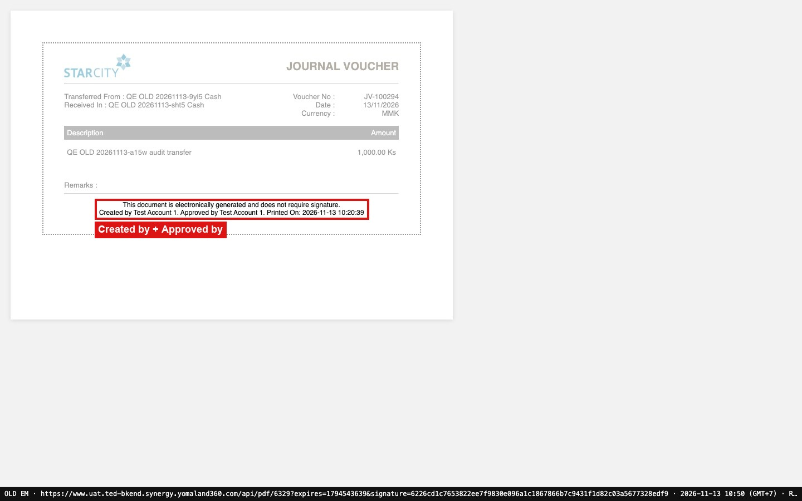

#### ❌ RPT-036 (không có trong Excel) [Credit Note CN]

*Ảnh 1: tab Wallet: dòng CN-100125 không có Created By lẫn Approved By*

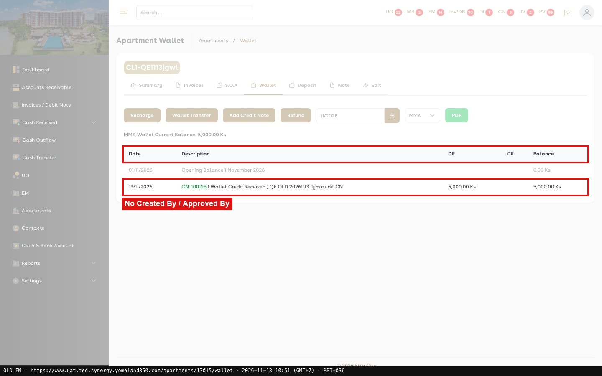

*Ảnh 2: Credit Note Reports có đủ Created By và Approved By cho CN-100125*

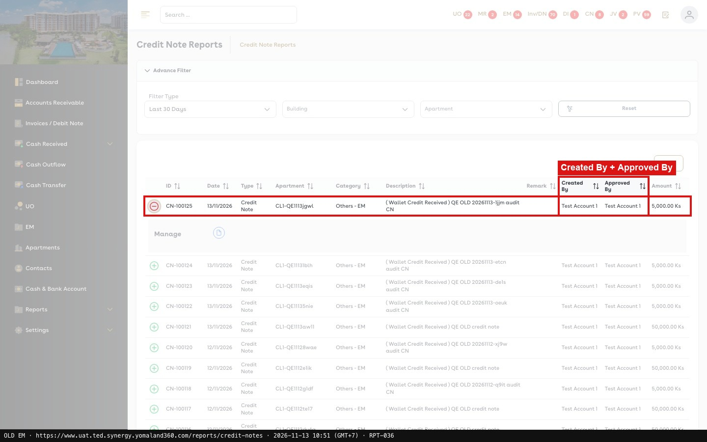

#### ❌ RPT-036 (không có trong Excel) [Wallet Transfer WT]

*Ảnh 1: tab Wallet: dòng WT-100142 không có Created By*

*Ảnh 2: voucher WT-100142 ghi "Created by Test Account 1"*

#### ✅ RPT-036 (không có trong Excel) [Make Payment RV, Unknown Received RV, Cash Outflow PV, Wallet Refund PV, Deposit Withdraw PV]

Danh sách có đủ Created By và Approved By.

Cách tái hiện bằng tay (RPT-036)

Với từng loại chứng từ trong bảng:

1. Tạo chứng từ, duyệt nếu cần.
2. Mở **danh sách** của nó (xem bảng), tìm Created By / Approved By trên dòng đó.

- **Lỗi:** thiếu ở các danh sách đánh dấu trong bảng.

---

## 🟠 Lỗi 8 · Unknown Received không cho chọn cash account

**Chuyện gì xảy ra:** form **Unknown Received**, ô *Deposit In* **chỉ có tài khoản ngân hàng** (0 cash account trong 101 account, chạy lại ngày 13/11), kể cả với cash account đã bật mọi phương thức thanh toán. Test case ghi vào "[Cash MMK] 2C2P Account", nên không làm được.

**Đúng ra phải:** chọn được cash account.

**Ảnh hưởng:** tiền mặt thu từ người trả không xác định không ghi được vào quỹ tiền mặt.

### Test case

#### ❌ TC_CR_002 · Ghi nhận Unknown Received (MMK) vào cash account

- **Mong đợi:** chọn được "[Cash MMK] 2C2P Account" ở ô Deposit In.
- **Thực tế:** danh sách Deposit In có 101 account, **0 cash account**. Khi dùng tài khoản ngân hàng thì phần còn lại đều đúng: RV có trong danh sách chờ phân bổ, account +10,000.

*Ảnh 1: ô Deposit đang mở: chỉ có tài khoản ngân hàng ([Testing Bank MMK], [YOMA Bank MMK]…)*

*Ảnh 2: gõ tên cash account vừa tạo ("QE OLD 20261113-z7e7 Cash") vào ô lọc → "No results found"*

*Ảnh 3: dùng tài khoản ngân hàng thì tạo được RV-102517, nằm trong danh sách chờ phân bổ*

*Ảnh 4: tài khoản ngân hàng tăng 10,000 Ks*

---

## 🟠 Lỗi 9 · Trả invoice bằng Wallet không tạo RV

**Chuyện gì xảy ra:** Make Payment với Payment Method **Wallet** tạo phiếu `WP-…` trong SOA và tab Wallet, nhưng **không có RV mới trong danh sách Cash Received** như test case yêu cầu.

**Đúng ra phải:** có RV mới trong Cash Received.

**Ảnh hưởng:** Cash Received và các report thu tiền thiếu các invoice được trả bằng wallet.

### Test case

#### ❌ TC_MPM_006 · Trả invoice bằng số dư wallet

- **Mong đợi:** có RV mới trong Cash Received cho Inv-202611-00118.
- **Thực tế:** không có RV. Phần còn lại đều đúng: có dòng WP trong SOA và tab Wallet, invoice đã trả, số dư wallet và AR giảm đúng. (Case TC_Wallet_026 cũng mong có "RV trong SOA", trong khi Old EM hiện WP.)

*Ảnh 1: form Make Payment: Payment Method = Wallet, trả 10,000 cho Inv-202611-00118*

*Ảnh 2: Cash Received › Recent Receipts: không có RV cho Inv-202611-00118 (dòng trên cùng là RV nạp wallet)*

*Ảnh 3: SOA ghi nhận thanh toán bằng WP-100168, không phải RV*

*Ảnh 4: tab Wallet: WP-100168 trừ 10,000 khỏi wallet*

---

## 🟠 Lỗi 10 · Có quyền Approve Cash Outflow nhưng không thấy draft của category khác

**Chuyện gì xảy ra:** role được cấp đúng như test case: Cash Outflow **Menu + View + Approve**. Mở danh sách PV draft thì chỉ thấy draft **Wallet / Deposit**; các draft **Landscaping Expenses** (draft của test) **bị ẩn**. Chúng chỉ hiện ra (và mới duyệt / xoá được) sau khi role được gán thêm expense category "Payment - Estate Management" ở *Settings › Roles › Assign Categories*. Màn hình không có gợi ý nào về điều này.

**Đúng ra phải:** có quyền Approve là thấy và duyệt được draft.

**Ảnh hưởng:** người duyệt được cấp quyền đúng theo ma trận phân quyền vẫn không duyệt được phiếu chi của category chưa được gán.

### Test case

#### ❌ TC_Role&Permission_065 · Quyền Approve Cash Outflow cho phép duyệt / xoá draft

- **Mong đợi:** user thấy draft Landscaping Expenses và duyệt / xoá được.
- **Thực tế:** draft Landscaping Expenses bị ẩn cho đến khi gán category cho role.

*Ảnh 1: user chỉ có quyền Cash Outflow: trang đầu danh sách draft chỉ có Wallet / Deposit, không thấy draft Landscaping Expenses của test*

*Ảnh 2: sau khi gán category cho role, xoá được draft ("Cash Outflow has been deleted successfully")*

---

## 🟢 Lỗi 11 · Tạo account mới: Type không mặc định là "Cash"

**Chuyện gì xảy ra:** form New Account hiện "Select Type", không có giá trị mặc định. Test case (bước 5) yêu cầu mặc định là **"Cash"**.

**Ảnh hưởng:** thấp, người dùng phải chọn thêm một ô.

### Test case

#### ❌ TC_Cash_Bank_Acc_001 · Tạo Cash account với initial balance

- **Mong đợi:** ô Type mặc định là "Cash"; account mới hiện balance 100,000.
- **Thực tế:** ô Type hiện "Select Type". Kết quả chính vẫn đúng: Initial và Closing Balance 100,000.00 Ks.

*Ảnh 1: ô Type hiện "Select Type", không mặc định là Cash*

*Ảnh 2: account mới có Initial và Closing Balance 100,000.00 Ks*

