# Old EM: areas that fail their own test cases

Old EM UAT (https://www.uat.ted.synergy.yomaland360.com), run on **2026-11-12** by the `old-em` Playwright suite.
Requirements: the GT test cases in [projects/em/docs/test-cases/](../../em/docs/test-cases/README.md) (83 cases, 122 test runs incl. data variants).

**Why this report.** New EM is tested against the GT test cases, which describe how Old EM should behave. When a New EM test fails, we need to know whether Old EM passes the same case. If Old EM fails it too, the failure is an existing Old EM issue (or the case is wrong), not a regression of the rebuild. Each failure below needs a decision: **fix it in New EM** (Old EM is wrong), or **update the test case** (the case is wrong and Old EM is right).

**Scope.** Two runs. (1) The 61 smoke cases, the P1 happy paths across all 7 business stages: access, master data, billing, collection, wallet and deposit, cash management, balances and reports, plus access control. Every test creates its own data (`QE OLD …` apartments, contacts and accounts) and checks only that data, so other testers on UAT do not change the results. The full run took 33 minutes; the unstable cases were rerun twice more. (2) 22 cases that target the Old EM issues reported by the IT solution manager and testers (see *Reported issues* below), 62 test runs with their data variants.

## Summary

| | Test runs |
|---|---|
| Run | 122 |
| ✅ Pass | 92 |
| ❌ Fail (Old EM does not do what the case expects) | 28 |
| ⚠️ Unstable (failed in some runs only; check by hand) | 2 |
| ⛔ Blocked (could not be checked on this environment) | 0 |

| Area | Pass | Fail | Unstable | Blocked | Focus |
|---|---|---|---|---|---|
| [Reports](#reports) | 7 | 7 | 0 | 0 | **Yes** |
| [Invoice & Debit Note](#invoice--debit-note) | 3 | 5 | 0 | 0 | **Yes** |
| [UO Import (bulk meter readings)](#uo-import-bulk-meter-readings) | 6 | 4 | 0 | 0 | **Yes** |
| [Payment Concurrency (1 Inv × 2 RV, 1 RV × 2 Inv)](#payment-concurrency-1-inv--2-rv-1-rv--2-inv) | 0 | 3 | 0 | 0 | **Yes** |
| [Cash & Bank Account](#cash--bank-account) | 1 | 2 | 0 | 0 | **Yes** |
| [Wallet — Opening / Closing Balance](#wallet--opening--closing-balance) | 9 | 2 | 0 | 0 | **Yes** |
| [Account Statement — Opening / Closing Balance](#account-statement--opening--closing-balance) | 6 | 1 | 0 | 0 | **Yes** |
| [Cash Received (RV / Unknown / Funding)](#cash-received-rv--unknown--funding) | 1 | 1 | 0 | 0 | **Yes** |
| [Make Payment](#make-payment) | 3 | 1 | 0 | 0 | **Yes** |
| [Role & Permission](#role--permission) | 4 | 1 | 0 | 0 | **Yes** |
| [SOA — Opening / Closing Balance](#soa--opening--closing-balance) | 14 | 1 | 0 | 0 | **Yes** |
| Accounts Receivable | 2 | 0 | 0 | 0 |  |
| Apartments | 3 | 0 | 0 | 0 |  |
| Cash Outflow (PV) | 2 | 0 | 0 | 0 |  |
| Cash Transfer (JV) | 1 | 0 | 0 | 0 |  |
| Contacts | 1 | 0 | 0 | 0 |  |
| Dashboard | 2 | 0 | 1 | 0 | Check |
| Deposit | 3 | 0 | 0 | 0 |  |
| Deposit — Opening / Closing Balance | 1 | 0 | 0 | 0 |  |
| Estate Management Fee (EM) | 3 | 0 | 0 | 0 |  |
| External API | 4 | 0 | 0 | 0 |  |
| Login & Authentication | 1 | 0 | 0 | 0 |  |
| Settings (master data & configuration) | 6 | 0 | 0 | 0 |  |
| Utility Operations (UO) — manual entry | 3 | 0 | 0 | 0 |  |
| Wallet | 6 | 0 | 1 | 0 | Check |

## Reported issues: checked on Old EM

Issues reported by the IT solution manager and testers (not sure whether they are real), each checked by running the test cases that target it.

| Reported issue | Verdict | Tests (✅ pass · ❌ fail · ⚠️ unstable · ⛔ blocked) |
|---|---|---|
| Account Statement: error when Cash Transfer is the first transaction of the day (code fixed, data not corrected) | **NOT REPRODUCED** | ✅ OB-ACS-005<br>✅ OB-ACS-005 [Type=Create Cash Transfer JV (Cash Out); Date=Current date; Time=first/mid/last of day] |
| Balance issue: backdated transaction | **NOT REPRODUCED** | ✅ OB-ACS-006<br>✅ OB-ACS-006 [Type=Create Cash Transfer JV (Cash Out); Date=Back date; Time=first/mid/last of day]<br>✅ OB-WAL-002<br>✅ OB-WAL-002 [Type=Convert other currency unknown RV to wallet RV direct to wallet; Date=Back date (1st/mid/last day of month)]<br>✅ OB-WAL-002 [Type=When assigning the unknown RV, it overflows and goes into the wallet.; Date=Back date (1st/mid/last day of month)]<br>✅ OB-WAL-002 [Type=When assigning the other currency unknown RV, it overflows and goes into the wallet.; Date=Back date (1st/mid/last day of month)] |
| Missing audit trails (Created By / Approved By) | **CONFIRMED** | ❌ RPT-036<br>❌ RPT-036 [Document=Debit Note (approved)]<br>❌ RPT-036 [Document=UO invoice (approved UO draft)]<br>❌ RPT-036 [Document=EM debit note (approved EM draft)]<br>✅ RPT-036 [Document=Make Payment RV]<br>✅ RPT-036 [Document=Unknown Received RV]<br>✅ RPT-036 [Document=Cash Outflow PV (approved)]<br>❌ RPT-036 [Document=Cash Transfer JV (approved)]<br>❌ RPT-036 [Document=Credit Note CN (approved)]<br>❌ RPT-036 [Document=Wallet Transfer WT]<br>✅ RPT-036 [Document=Wallet Refund PV (approved)]<br>✅ RPT-036 [Document=Deposit Withdraw PV (approved)] |
| Balance issue: concurrency | **CONFIRMED** | ❌ CONC-001<br>❌ CONC-003<br>❌ CONC-004<br>❌ OB-WAL-012<br>❌ OB-ACS-010 |
| Balance issue: initial balance edit | **CONFIRMED** | ✅ CBA-009<br>❌ CBA-010 |
| Invoice calculation (decimal/rounding) | **CONFIRMED** | ❌ INV-038<br>❌ INV-038 [Unit=3; Gross Price=333.33; Discount=10 %; Grand Total=926.99]<br>❌ INV-038 [Unit=7; Gross Price=0.15; Discount=0; Grand Total=1.08]<br>❌ INV-038 [Unit=1; Gross Price=100.10; Discount=0.05 Ks (fixed); Grand Total=103.05] |
| SOA periodic balances are wrong / OB-CB mismatch / backdated transaction | **NOT REPRODUCED** | ✅ OB-SOA-003<br>✅ OB-SOA-003 [Category=Utilities; Date=Back date (1st/mid/last day)]<br>✅ OB-SOA-003 [Category=Estate Mgmt Fees; Date=Back date (1st/mid/last day)] |
| SOA periodic balances are wrong / OB-CB mismatch | **CONFIRMED** | ✅ OB-SOA-010<br>✅ OB-SOA-010 [Mode=Multiple]<br>✅ OB-SOA-017 [1st=Invoice (Inv); 2nd=UO (import)]<br>✅ OB-SOA-017 [1st=UO (import); 2nd=Make Payment (RV)]<br>✅ OB-SOA-017 [1st=UO (import); 2nd=Wallet Payment (WP)]<br>✅ OB-SOA-017 [1st=UO(manual); 2nd=UO (import)]<br>❌ OB-SOA-017 [1st=UO(bulk approve); 2nd=Wallet Payment (WP)]<br>✅ OB-SOA-017 [1st=Make Payment (RV); 2nd=Wallet Payment (WP)]<br>✅ OB-SOA-017 [1st=Wallet Payment (WP); 2nd=Invoice (Inv)]<br>✅ OB-SOA-017 [1st=Wallet Payment (WP); 2nd=UO (import)] |
| UO invoice duplication when bulk upload / UO Bulk Issue | **CONFIRMED** | ✅ UOI-029<br>✅ UOI-029 [Different user; 1st in progress]<br>✅ UOI-029 [Different user; 1st completed]<br>✅ UOI-028<br>✅ UOI-028 [Same user; different file]<br>❌ UOI-013<br>❌ UOI-013 [Same reading date, different data]<br>❌ UOI-013 [Same month, different dates]<br>❌ UOI-013 [Same month 25/02, different units]<br>✅ UO-008 |
| Wallet: Wallet Payment after Credit Note (can reproduce) | **CONFIRMED** | ❌ OB-WAL-011 [1st=Credit Note(CN); then 2nd=Wallet Payment(WP)] |
| Wallet: Wallet Payment after Wallet Transfer (cannot reproduce) | **NOT REPRODUCED** | ✅ OB-WAL-011 [1st=Wallet Transfer WT (Cash In); then 2nd=Wallet Payment(WP)]<br>✅ OB-WAL-011 [1st=Wallet Transfer WT (Cash out); then 2nd=Wallet Payment(WP)] |
| Wallet: Wallet Transfer after RV (cannot reproduce) | **NOT REPRODUCED** | ✅ OB-WAL-011 [1st=Wallet Recharge(RV); then 2nd=Wallet Transfer WT (Cash In)]<br>✅ OB-WAL-011 [1st=Wallet Recharge(RV); then 2nd=Wallet Transfer WT (Cash out)] |
| Incomplete deletion on rejection (credit note) | **NOT REPRODUCED (on screen)** | ✅ WAL-017<br>✅ WAL-033 |

### Account Statement: error when Cash Transfer is the first transaction of the day (code fixed, data not corrected)

On new accounts the statement opens without error and stays continuous (consistent with "code fixed"). Existing data created before the fix was not checked; the data correction script is still needed.

### Balance issue: backdated transaction

Back-dated cash transfers (JV) and back-dated wallet recharges keep the Account Statement and the wallet continuous.

### Missing audit trails (Created By / Approved By)

Missing on lists: Invoices - Debit Note (no Approved By), Recent Transfers (no Approved By), apartment Wallet tab (no names for credit notes, no Created By for wallet transfers). Vouchers and reports show both names.

- ❌ RPT-036: see [Reports](#reports) below
- ❌ RPT-036 [Document=Debit Note (approved)]: see [Reports](#reports) below
- ❌ RPT-036 [Document=UO invoice (approved UO draft)]: see [Reports](#reports) below
- ❌ RPT-036 [Document=EM debit note (approved EM draft)]: see [Reports](#reports) below
- ❌ RPT-036 [Document=Cash Transfer JV (approved)]: see [Reports](#reports) below
- ❌ RPT-036 [Document=Credit Note CN (approved)]: see [Reports](#reports) below
- ❌ RPT-036 [Document=Wallet Transfer WT]: see [Reports](#reports) below

### Balance issue: concurrency

Paying the same invoice from two sessions at the same moment is not handled safely. In 8 races on 12–13 Nov, both payments were accepted (invoice paid twice, overpaid, or due amount overwritten). In the final run the losing payment failed with HTTP 500 "Internal Server Error" instead of a proper message. The result depends on timing. Approving cash outflows and wallet refunds is protected (second approval refused, sometimes with HTTP 500 instead of "Insufficient Balance"). The tests used two sessions of the same admin, because no second Old EM account was available.

- ❌ CONC-001: see [Payment Concurrency (1 Inv × 2 RV, 1 RV × 2 Inv)](#payment-concurrency-1-inv--2-rv-1-rv--2-inv) below
- ❌ CONC-003: see [Payment Concurrency (1 Inv × 2 RV, 1 RV × 2 Inv)](#payment-concurrency-1-inv--2-rv-1-rv--2-inv) below
- ❌ CONC-004: see [Payment Concurrency (1 Inv × 2 RV, 1 RV × 2 Inv)](#payment-concurrency-1-inv--2-rv-1-rv--2-inv) below
- ❌ OB-WAL-012: see [Wallet — Opening / Closing Balance](#wallet--opening--closing-balance) below
- ❌ OB-ACS-010: see [Account Statement — Opening / Closing Balance](#account-statement--opening--closing-balance) below

### Balance issue: initial balance edit

Editing the initial balance after transactions is not carried into the next day's Account Statement opening balance. Editing before any transaction is fine.

- ❌ CBA-010: see [Cash & Bank Account](#cash--bank-account) below

### Invoice calculation (decimal/rounding)

Not a rounding error: the rounding is correct. The invoice form's server-side recalculation overwrites typed values when answers arrive out of order, so Gross Price is wiped or the discount is dropped, at random (30 to 50 % of creations).

- ❌ INV-038: see [Invoice & Debit Note](#invoice--debit-note) below
- ❌ INV-038 [Unit=3; Gross Price=333.33; Discount=10 %; Grand Total=926.99]: see [Invoice & Debit Note](#invoice--debit-note) below
- ❌ INV-038 [Unit=7; Gross Price=0.15; Discount=0; Grand Total=1.08]: see [Invoice & Debit Note](#invoice--debit-note) below
- ❌ INV-038 [Unit=1; Gross Price=100.10; Discount=0.05 Ks (fixed); Grand Total=103.05]: see [Invoice & Debit Note](#invoice--debit-note) below

### SOA periodic balances are wrong / OB-CB mismatch / backdated transaction

Back-dated invoices (first, middle and last day of last month, 3 categories) keep the SOA continuous.

### SOA periodic balances are wrong / OB-CB mismatch

For a UO invoice made by Bulk Approve and then paid from the wallet, the next month's Opening Balance leaves out the invoice. 9 other sequences were correct. **Pattern across today's findings:** all three balance errors are in the *next period's* Opening Balance (SOA next month, wallet next month, account statement next day) while the current period is right. Old EM seems to keep a stored opening balance that is not recalculated after some changes; worth checking in the code.

- ❌ OB-SOA-017 [1st=UO(bulk approve); 2nd=Wallet Payment (WP)]: see [SOA — Opening / Closing Balance](#soa--opening--closing-balance) below

### UO invoice duplication when bulk upload / UO Bulk Issue

Main cause: a single import file with two rows for the same apartment and month creates two UO entries and two invoices. Re-uploading the same file is blocked; two simultaneous uploads are usually blocked (with an HTTP 500 error message), but once both went through in a manual try.

- ❌ UOI-013: see [UO Import (bulk meter readings)](#uo-import-bulk-meter-readings) below
- ❌ UOI-013 [Same reading date, different data]: see [UO Import (bulk meter readings)](#uo-import-bulk-meter-readings) below
- ❌ UOI-013 [Same month, different dates]: see [UO Import (bulk meter readings)](#uo-import-bulk-meter-readings) below
- ❌ UOI-013 [Same month 25/02, different units]: see [UO Import (bulk meter readings)](#uo-import-bulk-meter-readings) below

### Wallet: Wallet Payment after Credit Note (can reproduce)

The next month's wallet Opening Balance ignores a wallet payment made after a credit note.

- ❌ OB-WAL-011 [1st=Credit Note(CN); then 2nd=Wallet Payment(WP)]: see [Wallet — Opening / Closing Balance](#wallet--opening--closing-balance) below

### Wallet: Wallet Payment after Wallet Transfer (cannot reproduce)

Both Wallet Transfer in and out, followed by a Wallet Payment, keep both wallets and the SOA correct.

### Wallet: Wallet Transfer after RV (cannot reproduce)

A wallet recharge followed by a Wallet Transfer in or out keeps both wallets correct.

### Incomplete deletion on rejection (credit note)

After a draft credit note is removed, nothing is left in the wallet, SOA or Credit Note report, and a wallet payment uses only the real balance. A leftover row in the cash transaction table that does not affect any balance or report cannot be seen from the UI: a developer should check the database.

## Areas to focus on

### Reports

Created By / Approved By are missing from some lists (Invoices - Debit Note, Recent Transfers, apartment Wallet tab).

#### ❌ [RPT-036](../../em/docs/test-cases/features/18-reports.md#-rpt-036--created-by-and-approved-by-are-recorded-for-every-money-document--by-document-type) · Created By and Approved By are recorded for every money document — by document type

Priority P1 · ★ critical business flow · test: [issues/audit-trail.spec.ts](../tests/issues/audit-trail.spec.ts)

**Why it fails:** Created By / Approved By are missing on some lists: the Invoices - Debit Note list has no Approved By column (invoice, debit note, UO invoice, EM debit note); Recent Transfers has no Approved By column (Cash Transfer JV); the apartment Wallet tab shows neither name for a Credit Note and no Created By for a Wallet Transfer. The document detail / voucher and the reports (Invoices, Transactions, Credit Note) always show both names. Receipts (RV) and payment vouchers (PV) pass.

**Impact:** Users cannot see from the lists who approved a document; they must open each voucher or a report.

**Decision needed:** Confirm which lists must show Created By / Approved By, then add them in New EM. Note: no second Old EM account was available, so maker and approver are the same user.

<details><summary>Test output</summary>

```text
Error: Expected 2: Invoices - Debit Note list shows Approved By "Test Account 1" for Inv-202611-00320; Old EM shows no Approved By field

expect(received).toBe(expected) // Object.is equality

Expected: true
Received: false
```

</details>

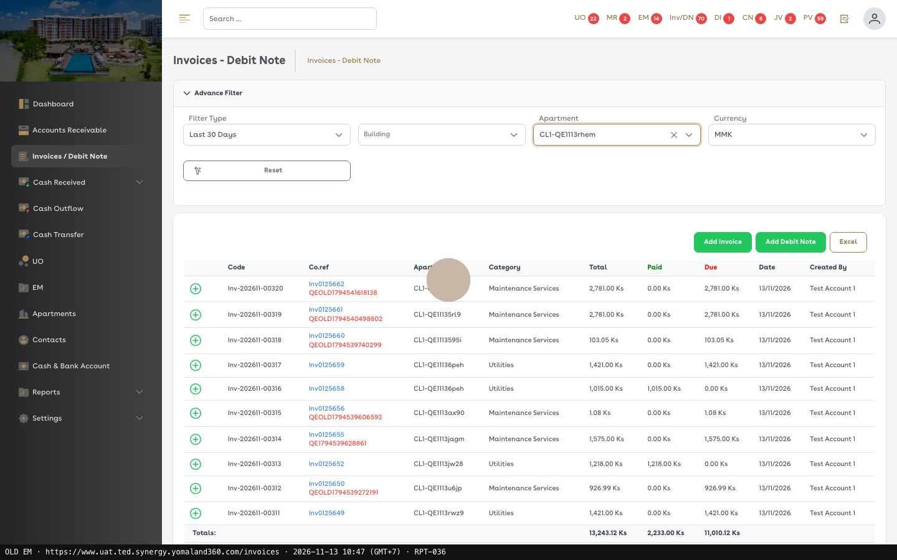

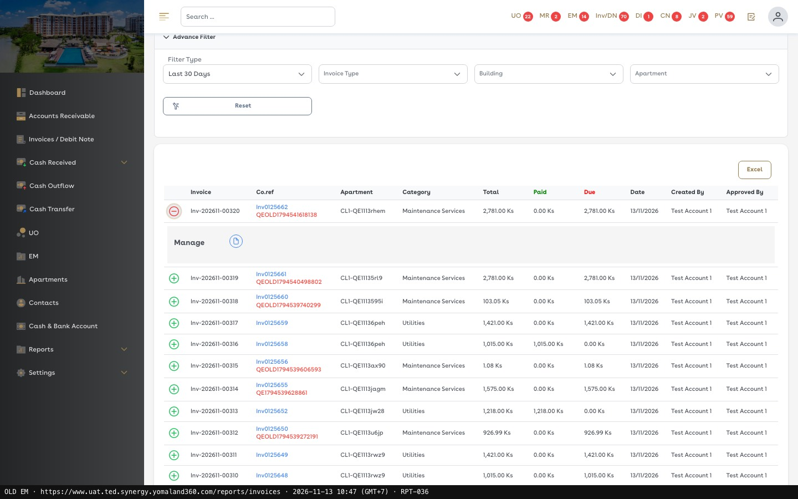

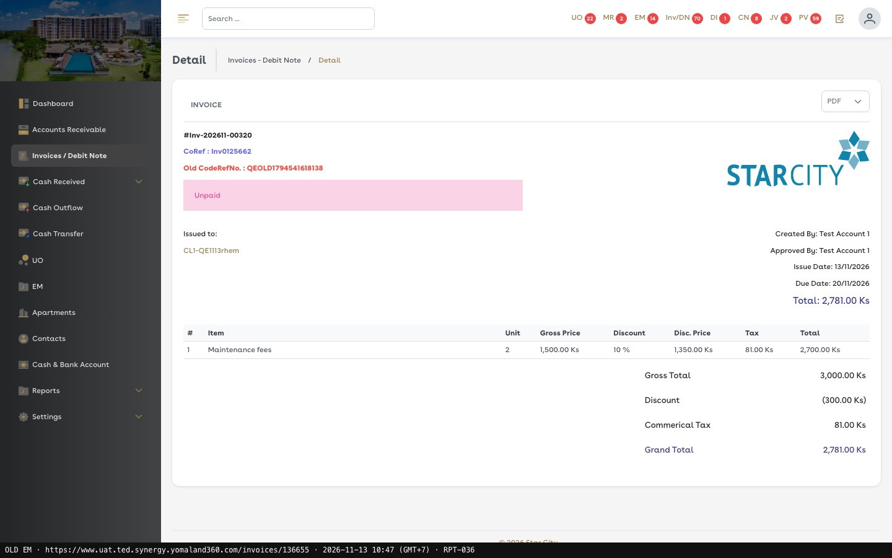

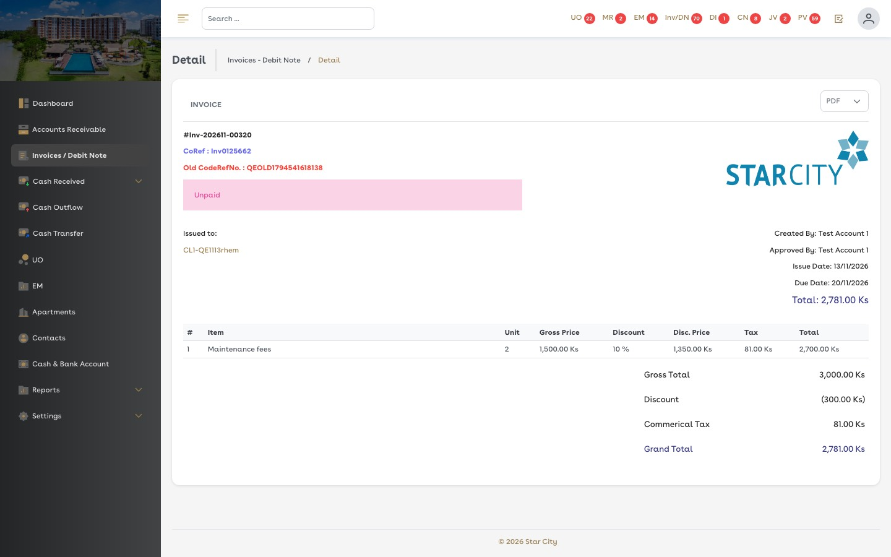

#### ❌ [RPT-036](../../em/docs/test-cases/features/18-reports.md#-rpt-036--created-by-and-approved-by-are-recorded-for-every-money-document--by-document-type) [Document=Debit Note (approved)] · Created By and Approved By are recorded for every money document — by document type

Priority P1 · ★ critical business flow · test: [issues/audit-trail.spec.ts](../tests/issues/audit-trail.spec.ts)

**Why it fails:** Created By / Approved By are missing on some lists: the Invoices - Debit Note list has no Approved By column (invoice, debit note, UO invoice, EM debit note); Recent Transfers has no Approved By column (Cash Transfer JV); the apartment Wallet tab shows neither name for a Credit Note and no Created By for a Wallet Transfer. The document detail / voucher and the reports (Invoices, Transactions, Credit Note) always show both names. Receipts (RV) and payment vouchers (PV) pass.

**Impact:** Users cannot see from the lists who approved a document; they must open each voucher or a report.

**Decision needed:** Confirm which lists must show Created By / Approved By, then add them in New EM. Note: no second Old EM account was available, so maker and approver are the same user.

<details><summary>Test output</summary>

```text
Error: Expected 2: Invoices - Debit Note list shows Approved By "Test Account 1" for DN-202611-00065; Old EM shows no Approved By field

expect(received).toBe(expected) // Object.is equality

Expected: true
Received: false
```

</details>

![RPT-036 [Document=Debit Note (approved)] · DN-202611-00065_list](img/RPT-036_Document_Debit_Note_approved-1.jpg)

![RPT-036 [Document=Debit Note (approved)] · DN-202611-00065_report](img/RPT-036_Document_Debit_Note_approved-2.jpg)

![RPT-036 [Document=Debit Note (approved)] · DN-202611-00065_detail](img/RPT-036_Document_Debit_Note_approved-3.jpg)

![RPT-036 [Document=Debit Note (approved)] · Screen at failure](img/RPT-036_Document_Debit_Note_approved-4.jpg)

#### ❌ [RPT-036](../../em/docs/test-cases/features/18-reports.md#-rpt-036--created-by-and-approved-by-are-recorded-for-every-money-document--by-document-type) [Document=UO invoice (approved UO draft)] · Created By and Approved By are recorded for every money document — by document type

Priority P1 · ★ critical business flow · test: [issues/audit-trail.spec.ts](../tests/issues/audit-trail.spec.ts)

**Why it fails:** Created By / Approved By are missing on some lists: the Invoices - Debit Note list has no Approved By column (invoice, debit note, UO invoice, EM debit note); Recent Transfers has no Approved By column (Cash Transfer JV); the apartment Wallet tab shows neither name for a Credit Note and no Created By for a Wallet Transfer. The document detail / voucher and the reports (Invoices, Transactions, Credit Note) always show both names. Receipts (RV) and payment vouchers (PV) pass.

**Impact:** Users cannot see from the lists who approved a document; they must open each voucher or a report.

**Decision needed:** Confirm which lists must show Created By / Approved By, then add them in New EM. Note: no second Old EM account was available, so maker and approver are the same user.

<details><summary>Test output</summary>

```text
Error: Expected 2: Invoices - Debit Note list shows Approved By "Test Account 1" for Inv-202611-00321; Old EM shows no Approved By field

expect(received).toBe(expected) // Object.is equality

Expected: true
Received: false
```

</details>

![RPT-036 [Document=UO invoice (approved UO draft)] · Inv-202611-00321_list](img/RPT-036_Document_UO_invoice_approved_UO_draft-1.jpg)

![RPT-036 [Document=UO invoice (approved UO draft)] · Inv-202611-00321_report](img/RPT-036_Document_UO_invoice_approved_UO_draft-2.jpg)

![RPT-036 [Document=UO invoice (approved UO draft)] · Inv-202611-00321_detail](img/RPT-036_Document_UO_invoice_approved_UO_draft-3.jpg)

![RPT-036 [Document=UO invoice (approved UO draft)] · Screen at failure](img/RPT-036_Document_UO_invoice_approved_UO_draft-4.jpg)

#### ❌ [RPT-036](../../em/docs/test-cases/features/18-reports.md#-rpt-036--created-by-and-approved-by-are-recorded-for-every-money-document--by-document-type) [Document=EM debit note (approved EM draft)] · Created By and Approved By are recorded for every money document — by document type

Priority P1 · ★ critical business flow · test: [issues/audit-trail.spec.ts](../tests/issues/audit-trail.spec.ts)

**Why it fails:** Created By / Approved By are missing on some lists: the Invoices - Debit Note list has no Approved By column (invoice, debit note, UO invoice, EM debit note); Recent Transfers has no Approved By column (Cash Transfer JV); the apartment Wallet tab shows neither name for a Credit Note and no Created By for a Wallet Transfer. The document detail / voucher and the reports (Invoices, Transactions, Credit Note) always show both names. Receipts (RV) and payment vouchers (PV) pass.

**Impact:** Users cannot see from the lists who approved a document; they must open each voucher or a report.

**Decision needed:** Confirm which lists must show Created By / Approved By, then add them in New EM. Note: no second Old EM account was available, so maker and approver are the same user.

<details><summary>Test output</summary>

```text
Error: Expected 2: Invoices - Debit Note list shows Approved By "Test Account 1" for DN-202611-00066; Old EM shows no Approved By field

expect(received).toBe(expected) // Object.is equality

Expected: true
Received: false
```

</details>

![RPT-036 [Document=EM debit note (approved EM draft)] · DN-202611-00066_list](img/RPT-036_Document_EM_debit_note_approved_EM_draft-1.jpg)

![RPT-036 [Document=EM debit note (approved EM draft)] · DN-202611-00066_report](img/RPT-036_Document_EM_debit_note_approved_EM_draft-2.jpg)

![RPT-036 [Document=EM debit note (approved EM draft)] · DN-202611-00066_detail](img/RPT-036_Document_EM_debit_note_approved_EM_draft-3.jpg)

![RPT-036 [Document=EM debit note (approved EM draft)] · Screen at failure](img/RPT-036_Document_EM_debit_note_approved_EM_draft-4.jpg)

#### ❌ [RPT-036](../../em/docs/test-cases/features/18-reports.md#-rpt-036--created-by-and-approved-by-are-recorded-for-every-money-document--by-document-type) [Document=Cash Transfer JV (approved)] · Created By and Approved By are recorded for every money document — by document type

Priority P1 · ★ critical business flow · test: [issues/audit-trail.spec.ts](../tests/issues/audit-trail.spec.ts)

**Why it fails:** Created By / Approved By are missing on some lists: the Invoices - Debit Note list has no Approved By column (invoice, debit note, UO invoice, EM debit note); Recent Transfers has no Approved By column (Cash Transfer JV); the apartment Wallet tab shows neither name for a Credit Note and no Created By for a Wallet Transfer. The document detail / voucher and the reports (Invoices, Transactions, Credit Note) always show both names. Receipts (RV) and payment vouchers (PV) pass.

**Impact:** Users cannot see from the lists who approved a document; they must open each voucher or a report.

**Decision needed:** Confirm which lists must show Created By / Approved By, then add them in New EM. Note: no second Old EM account was available, so maker and approver are the same user.

<details><summary>Test output</summary>

```text
Error: Expected 2: Cash Transfer › Recent Transfers shows Approved By "Test Account 1" for JV-100294; Old EM shows no Approved By field

expect(received).toBe(expected) // Object.is equality

Expected: true
Received: false
```

</details>

![RPT-036 [Document=Cash Transfer JV (approved)] · JV-100294_report](img/RPT-036_Document_Cash_Transfer_JV_approved-1.jpg)

![RPT-036 [Document=Cash Transfer JV (approved)] · JV-100294_voucher](img/RPT-036_Document_Cash_Transfer_JV_approved-2.jpg)

![RPT-036 [Document=Cash Transfer JV (approved)] · JV-100294_detail](img/RPT-036_Document_Cash_Transfer_JV_approved-3.jpg)

![RPT-036 [Document=Cash Transfer JV (approved)] · Screen at failure](img/RPT-036_Document_Cash_Transfer_JV_approved-4.jpg)

#### ❌ [RPT-036](../../em/docs/test-cases/features/18-reports.md#-rpt-036--created-by-and-approved-by-are-recorded-for-every-money-document--by-document-type) [Document=Credit Note CN (approved)] · Created By and Approved By are recorded for every money document — by document type

Priority P1 · ★ critical business flow · test: [issues/audit-trail.spec.ts](../tests/issues/audit-trail.spec.ts)

**Why it fails:** Created By / Approved By are missing on some lists: the Invoices - Debit Note list has no Approved By column (invoice, debit note, UO invoice, EM debit note); Recent Transfers has no Approved By column (Cash Transfer JV); the apartment Wallet tab shows neither name for a Credit Note and no Created By for a Wallet Transfer. The document detail / voucher and the reports (Invoices, Transactions, Credit Note) always show both names. Receipts (RV) and payment vouchers (PV) pass.

**Impact:** Users cannot see from the lists who approved a document; they must open each voucher or a report.

**Decision needed:** Confirm which lists must show Created By / Approved By, then add them in New EM. Note: no second Old EM account was available, so maker and approver are the same user.

<details><summary>Test output</summary>

```text
Error: Expected 1: Apartment Wallet tab shows Created By "Test Account 1" for CN-100125; Old EM shows no Created By field

expect(received).toBe(expected) // Object.is equality

Expected: true
Received: false

Error: Expected 2: Apartment Wallet tab shows Approved By "Test Account 1" for CN-100125; Old EM shows no Approved By field

expect(received).toBe(expected) // Object.is equality

Expected: true
Received: false
```

</details>

![RPT-036 [Document=Credit Note CN (approved)] · CN-100125_list](img/RPT-036_Document_Credit_Note_CN_approved-1.jpg)

![RPT-036 [Document=Credit Note CN (approved)] · CN-100125_report](img/RPT-036_Document_Credit_Note_CN_approved-2.jpg)

![RPT-036 [Document=Credit Note CN (approved)] · CN-100125_detail](img/RPT-036_Document_Credit_Note_CN_approved-3.jpg)

![RPT-036 [Document=Credit Note CN (approved)] · Screen at failure](img/RPT-036_Document_Credit_Note_CN_approved-4.jpg)

#### ❌ [RPT-036](../../em/docs/test-cases/features/18-reports.md#-rpt-036--created-by-and-approved-by-are-recorded-for-every-money-document--by-document-type) [Document=Wallet Transfer WT] · Created By and Approved By are recorded for every money document — by document type

Priority P1 · ★ critical business flow · test: [issues/audit-trail.spec.ts](../tests/issues/audit-trail.spec.ts)

**Why it fails:** Created By / Approved By are missing on some lists: the Invoices - Debit Note list has no Approved By column (invoice, debit note, UO invoice, EM debit note); Recent Transfers has no Approved By column (Cash Transfer JV); the apartment Wallet tab shows neither name for a Credit Note and no Created By for a Wallet Transfer. The document detail / voucher and the reports (Invoices, Transactions, Credit Note) always show both names. Receipts (RV) and payment vouchers (PV) pass.

**Impact:** Users cannot see from the lists who approved a document; they must open each voucher or a report.

**Decision needed:** Confirm which lists must show Created By / Approved By, then add them in New EM. Note: no second Old EM account was available, so maker and approver are the same user.

<details><summary>Test output</summary>

```text
Error: Expected 1: Apartment Wallet tab shows Created By "Test Account 1" for WT-100142; Old EM shows no Created By field

expect(received).toBe(expected) // Object.is equality

Expected: true
Received: false
```

</details>

![RPT-036 [Document=Wallet Transfer WT] · WT-100142_report](img/RPT-036_Document_Wallet_Transfer_WT-1.jpg)

![RPT-036 [Document=Wallet Transfer WT] · WT-100142_voucher](img/RPT-036_Document_Wallet_Transfer_WT-2.jpg)

![RPT-036 [Document=Wallet Transfer WT] · WT-100142_detail](img/RPT-036_Document_Wallet_Transfer_WT-3.jpg)

![RPT-036 [Document=Wallet Transfer WT] · Screen at failure](img/RPT-036_Document_Wallet_Transfer_WT-4.jpg)

### Invoice & Debit Note

The invoice form randomly loses the typed Gross Price or discount, so invoices are refused or saved without the discount.

#### ❌ [INV-001](../../em/docs/test-cases/features/04-invoice-debit-note.md#-inv-001--create-generic-invoice-mmk-dated-last-month-to-today-as-draft) · Create generic invoice (MMK, dated last month to today) as draft

Priority P1 · ★ critical business flow · test: [billing/invoices.spec.ts](../tests/billing/invoices.spec.ts)

**Why it fails:** The invoice form loses typed values. The totals are calculated by the server (`POST /api/invoices/amount`) after every change of Unit or Discount and when leaving Gross Price, and each answer overwrites the Gross Price and Discount fields. When answers come back out of order, Gross Price is wiped ("The Gross Price field is required" under a field that shows a value, or line Total 0) or the discount is dropped. What is saved depends on the moment Create is clicked. Reproduced in 3 of 10 and 5 of 10 repeated runs; one draft was saved as 3,090.00 Ks while the form showed 2,781.00 Ks.

**Impact:** A resident can be billed without the discount, or the user has to retype the invoice. Nothing on screen warns about the wrong amount.

**Decision needed:** Old EM defect (reported as "Invoice Calculation"). New EM must calculate the totals so that a late answer can never overwrite what the user typed. INV-038 covers it.

<details><summary>Test output</summary>

```text
Error: success message (case: "Invoice is successfully issued")

expect(locator).toBeVisible() failed

Locator: locator('.p-toast').getByRole('alert').filter({ hasText: /Invoice .*successfully/i }).first()
Expected: visible
Timeout: 15000ms
Error: element(s) not found
```

</details>

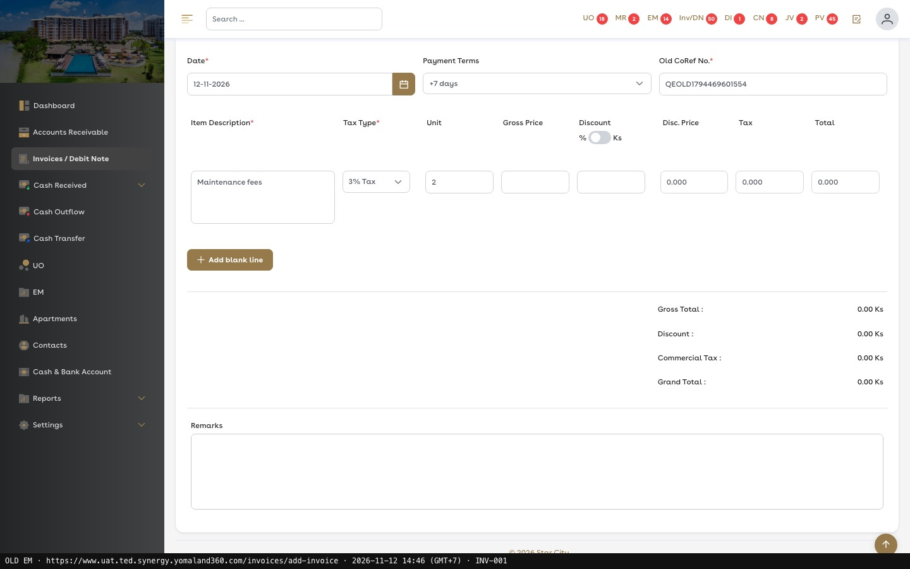

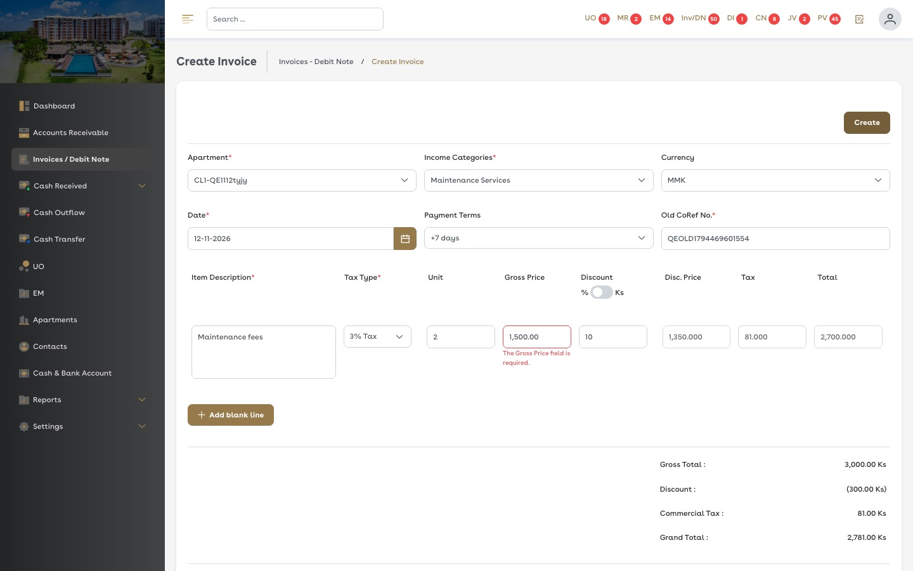

#### ❌ [INV-038](../../em/docs/test-cases/features/04-invoice-debit-note.md#-inv-038--invoice-totals-with-discount-and-tax-are-calculated-once-and-saved-exactly-as-shown-on-the-form) · Invoice totals with discount and tax are calculated once and saved exactly as shown on the form

Priority P1 · ★ critical business flow · test: [issues/invoice-calculation.spec.ts](../tests/issues/invoice-calculation.spec.ts)

**Why it fails:** Same cause as INV-001. In every run, typed Gross Price / Discount were wiped within 0.3 to 4 seconds without any input; per variant 1 to 5 of the 5 creations were refused ("Gross Price field is required") and some drafts were saved without the discount: 3,090.00 instead of 2,781.00, 1,029.99 instead of 926.99, 103.10 instead of 103.05. The rounding itself is correct: when a draft is saved with the right inputs, 926.99, 1.08 and 103.05 come out right and the draft, approved invoice, AR, SOA, contact, Invoices report and PDF all agree.

**Impact:** Wrong invoice amounts (discount lost) and refused invoices, at random.

**Decision needed:** Old EM defect: fix in New EM. The case is in Review only for the rounding rule, which Old EM applies correctly (round the total to 2 decimals).

<details><summary>Test output</summary>

```text
Error: #1 Expected 2: Unit/Gross Price/Discount stay as typed (2 / 1500 / 10) and Total is not 0 after typing. Old EM changed them in 23 of 23 samples over 6 s, first 16 ms after typing: Gross Price "", Total "0.000"

expect(received).toBe(expected) // Object.is equality

Expected: true
Received: false

Error: #1 Disc. Price: expected 1350 (≈ 1350), form shows "1,500.000"

expect(received).toBe(expected) // Object.is equality

Expected: true
Received: false

Error: #1 line Total: expected 2700 (≈ 2700), form shows "3,000.000"

expect(received).toBe(expected) // Object.is equality

Expected: true
Received: false

Error: #1 Tax (3 % of line Total): expected 81 (≈ 81), form shows "90.000"

expect(received).toBe(expected) // Object.is equality

Expected: true
Received: false

Error: #1 footer Discount (form: Gross Total : 3,000.00 Ks Discount : 0.00 Ks Commercial Tax : 90.00 Ks Grand Total : 3,090.00 Ks)

expect(received).toBe(expected) // Object.is equality

Expected: 300
Received: 0

Error: #1 footer Commercial Tax (form: Gross Total : 3,000.00 Ks Discount : 0.00 Ks Commercial Tax : 90.00 Ks Grand Total : 3,090.00 Ks)

expect(received).toBe(expected) // Object.is equality

Expected: 81
Received: 90

Error: #1 footer Grand Total (form: Gross Total : 3,000.00 Ks Discount : 0.00 Ks Commercial Tax : 90.00 Ks Grand Total : 3,090.00 Ks)

expect(received).toBe(expected) // Object.is equality

Expected: 2781
Received: 3090

Error: #1 Expected 1: saved draft Total = 2,781.00 Ks

expect(received).toBe(expected) // Object.is equality

Expected: 2781
Received: 3090

Error: #2 Expected 2: Unit/Gross Price/Discount stay as typed (2 / 1500 / 10) and Total is not 0 after typing. Old EM changed them in 23 of 23 samples over 6 s, first 10 ms after typing: Gross Price "", Total "0.000"

expect(received).toBe(expected) // Object.is equality

Expected: true
Received: false

Error: #2 Disc. Price: expected 1350 (≈ 1350), form shows "1,500.000"

expect(received).toBe(expected) // Object.is equality

Expected: true
Received: false

Error: #2 line Total: expected 2700 (≈ 2700), form shows "3,000.000"

expect(received).toBe(expected) // Object.is equality

Expected: true
Received: false

Error: #2 Tax (3 % of line Total): expected 81 (≈ 81), form shows "90.000"

expect(received).toBe(expected) // Object.is equality

Expected: true
Received: false

Error: #2 footer Discount (form: Gross Total : 3,000.00 Ks Discount : 0.00 Ks Commercial Tax : 90.00 Ks Grand Total : 3,090.00 Ks)

expect(received).toBe(expected) // Object.is equality

Expected: 300
Received: 0

Error: #2 footer Commercial Tax (form: Gross Total : 3,000.00 Ks Discount : 0.00 Ks Commercial Tax : 90.00 Ks Grand Total : 3,090.00 Ks)

expect(received).toBe(expected) // Object.is equality

Expected: 81
Received: 90

Error: #2 footer Grand Total (form: Gross Total : 3,000.00 Ks Discount : 0.00 Ks Commercial Tax : 90.00 Ks Grand Total : 3,090.00 Ks)

expect(received).toBe(expected) // Object.is equality

Expected: 2781
Received: 3090

Error: #2 Expected 1-3: Create saves the draft. Create did not save the invoice (form: Disc. Price 1,500.000 · Tax 90.000 · Total 3,000.000 · Gross Total : 3,000.00 Ks Discount : 0.00 Ks Commercial Tax : 90.00 Ks Grand Total : 3,090.00 Ks; messages: The Gross Price field is required.)

expect(received).toBe(expected) // Object.is equality

Expected: true
Received: false

Error: #3 Expected 2: Unit/Gross Price/Discount stay as typed (2 / 1500 / 10) and Total is not 0 after typing. Old EM changed them in 23 of 23 samples over 6 s, first 13 ms after typing: Gross Price "", Total "0.000"

expect(received).toBe(expected) // Object.is equality

Expected: true
Received: false

Error: #3 Disc. Price: expected 1350 (≈ 1350), form shows "1,500.000"

expect(received).toBe(expected) // Object.is equality

Expected: true
Received: false

Error: #3 line Total: expected 2700 (≈ 2700), form shows "3,000.000"

expect(received).toBe(expected) // Object.is equality

Expected: true
Received: false

Error: #3 Tax (3 % of line Total): expected 81 (≈ 81), form shows "90.000"

expect(received).toBe(expected) // Object.is equality

Expected: true
Received: false

Error: #3 footer Discount (form: Gross Total : 3,000.00 Ks Discount : 0.00 Ks Commercial Tax : 90.00 Ks Grand Total : 3,090.00 Ks)

expect(received).toBe(expected) // Object.is equality

Expected: 300
Received: 0

Error: #3 footer Commercial Tax (form: Gross Total : 3,000.00 Ks Discount : 0.00 Ks Commercial Tax : 90.00 Ks Grand Total : 3,090.00 Ks)

expect(received).toBe(expected) // Object.is equality

Expected: 81
Received: 90

Error: #3 footer Grand Total (form: Gross Total : 3,000.00 Ks Discount : 0.00 Ks Commercial Tax : 90.00 Ks Grand Total : 3,090.00 Ks)

expect(received).toBe(expected) // Object.is equality

Expected: 2781
Received: 3090

Error: #3 Expected 1-3: Create saves the draft. Create did not save the invoice (form: Disc. Price 1,500.000 · Tax 90.000 · Total 3,000.000 · Gross Total : 3,000.00 Ks Discount : 0.00 Ks Commercial Tax : 90.00 Ks Grand Total : 3,090.00 Ks; messages: The Gross Price field is required.)

expect(received).toBe(expected) // Object.is equality

Expected: true
Received: false

Error: #4 Expected 2: Unit/Gross Price/Discount stay as typed (2 / 1500 / 10) and Total is not 0 after typing. Old EM changed them in 23 of 23 samples over 6 s, first 22 ms after typing: Gross Price "", Total "0.000"

expect(received).toBe(expected) // Object.is equality

Expected: true
Received: false

Error: #4 Disc. Price: expected 1350 (≈ 1350), form shows "1,500.000"

expect(received).toBe(expected) // Object.is equality

Expected: true
Received: false

Error: #4 line Total: expected 2700 (≈ 2700), form shows "3,000.000"

expect(received).toBe(expected) // Object.is equality

Expected: true
Received: false

Error: #4 Tax (3 % of line Total): expected 81 (≈ 81), form shows "90.000"

expect(received).toBe(expected) // Object.is equality

Expected: true
Received: false

Error: #4 footer Discount (form: Gross Total : 3,000.00 Ks Discount : 0.00 Ks Commercial Tax : 90.00 Ks Grand Total : 3,090.00 Ks)

expect(received).toBe(expected) // Object.is equality

Expected: 300
Received: 0

Error: #4 footer Commercial Tax (form: Gross Total : 3,000.00 Ks Discount : 0.00 Ks Commercial Tax : 90.00 Ks Grand Total : 3,090.00 Ks)

expect(received).toBe(expected) // Object.is equality

Expected: 81
Received: 90

Error: #4 footer Grand Total (form: Gross Total : 3,000.00 Ks Discount : 0.00 Ks Commercial Tax : 90.00 Ks Grand Total : 3,090.00 Ks)

expect(received).toBe(expected) // Object.is equality

Expected: 2781
Received: 3090

Error: #4 Expected 1: saved draft Total = 2,781.00 Ks

expect(received).toBe(expected) // Object.is equality

Expected: 2781
Received: 3090

Error: #5 Expected 2: Unit/Gross Price/Discount stay as typed (2 / 1500 / 10) and Total is not 0 after typing. Old EM changed them in 23 of 23 samples over 6 s, first 11 ms after typing: Gross Price "", Total "0.000"

expect(received).toBe(expected) // Object.is equality

Expected: true
Received: false

Error: #5 Disc. Price: expected 1350 (≈ 1350), form shows "1,500.000"

expect(received).toBe(expected) // Object.is equality

Expected: true
Received: false

Error: #5 line Total: expected 2700 (≈ 2700), form shows "3,000.000"

expect(received).toBe(expected) // Object.is equality

Expected: true
Received: false

Error: #5 Tax (3 % of line Total): expected 81 (≈ 81), form shows "90.000"

expect(received).toBe(expected) // Object.is equality

Expected: true
Received: false

Error: #5 footer Discount (form: Gross Total : 3,000.00 Ks Discount : 0.00 Ks Commercial Tax : 90.00 Ks Grand Total : 3,090.00 Ks)

expect(received).toBe(expected) // Object.is equality

Expected: 300
Received: 0

Error: #5 footer Commercial Tax (form: Gross Total : 3,000.00 Ks Discount : 0.00 Ks Commercial Tax : 90.00 Ks Grand Total : 3,090.00 Ks)

expect(received).toBe(expected) // Object.is equality

Expected: 81
Received: 90

Error: #5 footer Grand Total (form: Gross Total : 3,000.00 Ks Discount : 0.00 Ks Commercial Tax : 90.00 Ks Grand Total : 3,090.00 Ks)

expect(received).toBe(expected) // Object.is equality

Expected: 2781
Received: 3090

Error: #5 Expected 1-3: Create saves the draft. Create did not save the invoice (form: Disc. Price 1,500.000 · Tax 90.000 · Total 3,000.000 · Gross Total : 3,000.00 Ks Discount : 0.00 Ks Commercial Tax : 90.00 Ks Grand Total : 3,090.00 Ks; messages: The Gross Price field is required.)

expect(received).toBe(expected) // Object.is equality

Expected: true
Received: false

Error: Expected 4: 5 × 2,781.00 Ks (#1: form 3090 → saved 3090; #2: form 3090 → saved not saved (Create did not save the invoice (form: Disc. Price 1,500.000 · Tax 90.000 · Total 3,000.000 · Gross Total : 3,000.00 Ks Discount : 0.00 Ks Commercial Tax : 90.00 Ks Grand Total : 3,090.00 Ks; messages: The Gross Price field is required.)); #3: form 3090 → saved not saved (Create did not save the invoice (form: Disc. Price 1,500.000 · Tax 90.000 · Total 3,000.000 · Gross Total : 3,000.00 Ks Discount : 0.00 Ks Commercial Tax : 90.00 Ks Grand Total : 3,090.00 Ks; messages: The Gross Price field is required.)); #4: form 3090 → saved 3090; #5: form 3090 → saved not saved (Create did not save the invoice (form: Disc. Price 1,500.000 · Tax 90.000 · Total 3,000.000 · Gross Total : 3,000.00 Ks Discount : 0.00 Ks Commercial Tax : 90.00 Ks Grand Total : 3,090.00 Ks; messages: The Gross Price field is re

Error: draft list row: Total 2,781.00 Ks

expect(received).toContain(expected) // indexOf

Expected substring: "2,781.00 Ks"
Received string:    "13/11/2026, 11:01 AM CL1-QE1113jtv7 INVOICE Maintenance Services 3,090.00 Ks Test Account 1 "

Error: draft list row: Total 2,781.00 Ks

expect(received).toContain(expected) // indexOf

Expected substring: "2,781.00 Ks"
Received string:    "13/11/2026, 10:59 AM CL1-QE1113jtv7 INVOICE Maintenance Services 3,090.00 Ks Test Account 1 "

Error: approved invoice Total

expect(locator).toHaveText(expected) failed

Locator:  getByRole('heading', { name: /^Total:/ })
Expected: "Total: 2,781.00 Ks"
Received: "Total: 3,090.00 Ks"
Timeout:  15000ms

    34 × locator resolved to <h5 data-v-a9764ac8="">Total: 3,090.00 Ks</h5>

Error: approved invoice Grand Total (#Inv-202611-00326 CoRef : Inv0125668 Old CodeRefNo. : QEOLD1794542366147 Unpaid Issued to: CL1-QE1113jtv7 Created By: Test Account 1 Approved By: Test Account 1 Issue Date: 13/11/2026 Due Date: 13/11/2026 Total: 3,090.00 Ks # Item Unit Gross Price Tax Total 1 QE OLD INV-038 #1 2 1,500.00 Ks 90.00 Ks 3,000.00 Ks Gross Total 3,000.00 Ks Commerical Tax 90.00 Ks Grand Total 3,090.00 Ks )

expect(received).toBe(expected) // Object.is equality

Expected: 2781
Received: 3090

Error: approved invoice Discount (#Inv-202611-00326 CoRef : Inv0125668 Old CodeRefNo. : QEOLD1794542366147 Unpaid Issued to: CL1-QE1113jtv7 Created By: Test Account 1 Approved By: Test Account 1 Issue Date: 13/11/2026 Due Date: 13/11/2026 Total: 3,090.00 Ks # Item Unit Gross Price Tax Total 1 QE OLD INV-038 #1 2 1,500.00 Ks 90.00 Ks 3,000.00 Ks Gross Total 3,000.00 Ks Commerical Tax 90.00 Ks Grand Total 3,090.00 Ks )

expect(received).toBe(expected) // Object.is equality

Expected: 300
Received: 0

Error: approved invoice Commercial Tax (#Inv-202611-00326 CoRef : Inv0125668 Old CodeRefNo. : QEOLD1794542366147 Unpaid Issued to: CL1-QE1113jtv7 Created By: Test Account 1 Approved By: Test Account 1 Issue Date: 13/11/2026 Due Date: 13/11/2026 Total: 3,090.00 Ks # Item Unit Gross Price Tax Total 1 QE OLD INV-038 #1 2 1,500.00 Ks 90.00 Ks 3,000.00 Ks Gross Total 3,000.00 Ks Commerical Tax 90.00 Ks Grand Total 3,090.00 Ks )

expect(received).toBe(expected) // Object.is equality

Expected: 81
Received: 90

Error: approved invoice line: Disc. Price · Tax · Total

expect(received).toContain(expected) // indexOf

Expected substring: "1,350.00 Ks 81.00 Ks 2,700.00 Ks"
Received string:    "1 QE OLD INV-038 #1 2 1,500.00 Ks 90.00 Ks 3,000.00 Ks"

Error: PDF Grand Total 2,781.00 Ks

expect(received).toContain(expected) // indexOf

Expected substring: "2,781.00"
Received string:    "INVOICE Unit No.: CL1-QE1113jtv7Owner: QE OLD 20261113-sqm4 OwnerInvoice No. : #Inv-202611-00326 Status : Unpaid Date : 13/11/2026 Due Date : 13/11/2026 Amount Due : 3,090.00 Ks CoRef : Inv0125668 DescriptionUnitPriceTaxTotalQE OLD INV-038 #121,500.00 Ks90.00 Ks3,000.00 KsSub Total3,000.00 KsCommercial Tax90.00 KsGrand Total3,090.00 KsTHREE THOUSAND AND NINETY KYATSRemarks: Info:Please settle the invoice immediately.Please indicate the invoice number & propertyaddress in your payment.Bank transfer transaction fees (if any) shall beborne by the payer.For any questions please contact EstateManagement Offices telephone 09 765444682OR Credit Control Department – 09 765444587.This document is electronically generated and does not requir

Error: Inv-202611-00326 total in Invoices - Debit Note list

expect(locator).toContainText(expected) failed

Locator: getByRole('table').getByRole('rowgroup').nth(1).getByRole('row').filter({ hasText: 'Inv-202611-00326' })
Expected substring: "2,781.00 Ks"
Received string:    "Inv-202611-00326Inv0125668QEOLD1794542366147CL1-QE1113jtv7Maintenance Services3,090.00 Ks0.00 Ks3,090.00 Ks13/11/2026Test Account 1"
Timeout: 15000ms

    34 × locator resolved to <tr class="" role="row" tabindex="-1" data-pc-section="bodyrow" data-p-selectable-row="false">…</tr>

Error: Inv-202611-00326 due amount / status in Accounts Receivable

expect(locator).toContainText(expected) failed

Locator: getByRole('table').getByRole('rowgroup').nth(1).getByRole('row').filter({ has: getByRole('cell', { name: 'Inv-202611-00326', exact: true }) })
Expected pattern: /2,781.00 Ks.*Unpaid/i
Received string:  "Inv-202611-00326Inv0125668QEOLD1794542366147CL1-QE1113jtv73,090.00 Ks3,090.00 Ks13/11/202613/11/2026UnpaidMaintenance ServicesTest Account 1 "
Timeout: 15000ms

    32 × locator resolved to <tr class="" role="row" tabindex="-1" data-pc-section="bodyrow" data-p-selectable-row="false">…</tr>

Error: Apartment › Summary › Accounts Receivable

expect(locator).toHaveText(expected) failed

Locator:  getByRole('heading', { name: /^Accounts Receivable/, level: 3 })
Expected: "Accounts Receivable 2,781.00 Ks"
Received: "Accounts Receivable 3,090.00 Ks"
Timeout:  15000ms

    7 × locator resolved to <h3 data-v-ed65969b="" class="block text-start">Accounts Receivable 0.00 Ks</h3>
    27 × locator resolved to <h3 data-v-ed65969b="" class="block text-start">Accounts Receivable 3,090.00 Ks</h3>

Error: Inv-202611-00326 amount

expect(locator).toHaveText(expected) failed

Locator:  getByRole('table').getByRole('rowgroup').nth(1).getByRole('row').filter({ has: getByRole('cell', { name: 'Inv-202611-00326', exact: true }) }).getByRole('cell').nth(3)
Expected: "2,781.00 Ks"
Received: "3,090.00 Ks"
Timeout:  15000ms

    34 × locator resolved to <td class="" role="cell" data-pc-name="bodycell" data-pc-section="bodycell" data-p-cell-editing="false" data-p-editable-column="false" data-p-selection-column="false">…</td>

Error: Inv-202611-00326 due amount

expect(locator).toHaveText(expected) failed

Locator:  getByRole('table').getByRole('rowgroup').nth(1).getByRole('row').filter({ has: getByRole('cell', { name: 'Inv-202611-00326', exact: true }) }).getByRole('cell').nth(5)
Expected: "2,781.00 Ks"
Received: "3,090.00 Ks"
Timeout:  15000ms

    34 × locator resolved to <td class="" role="cell" data-pc-name="bodycell" data-pc-section="bodycell" data-p-cell-editing="false" data-p-editable-column="false" data-p-selection-column="false">…</td>

Error: Inv-202611-00326 amount in S.O.A

expect(locator).toContainText(expected) failed

Locator: getByRole('table').getByRole('row').filter({ hasText: 'Inv-202611-00326' })
Expected substring: "2,781.00 Ks"
Received string:    "13/11/2026InvoiceInv-202611-00326 - due on 13/11/20263,090.00 Ks3,090.00 Ks"
Timeout: 15000ms

    34 × locator resolved to <tr class="" role="row" tabindex="-1" data-pc-section="bodyrow" data-p-selectable-row="false">…</tr>

Error: S.O.A Balance Due

expect(locator).toContainText(expected) failed

Locator: getByRole('row', { name: /^Balance Due:/ })
Expected substring: "2,781.00 Ks"
Received string:    " Balance Due: 3,090.00 Ks"
Timeout: 15000ms

    34 × locator resolved to <tr role="row" data-pc-section="root" data-pc-name="tablefooter">…</tr>

Error: Contact › Summary › Current

expect(locator).toHaveText(expected) failed

Locator:  locator('div').filter({ has: getByRole('heading', { name: 'Current', exact: true, level: 6 }) }).filter({ has: getByRole('heading', { level: 4 }) }).last().getByRole('heading', { level: 4 })
Expected: "2,781.00 Ks"
Received: " 3,090.00 Ks"
Timeout:  15000ms

    7 × locator resolved to <h4 data-v-c019d35f="">…</h4>
    26 × locator resolved to <h4 data-v-c019d35f="">…</h4>

Error: Inv-202611-00326 total in Reports › Invoices

expect(locator).toContainText(expected) failed

Locator: getByRole('table').getByRole('rowgroup').nth(1).getByRole('row').filter({ hasText: 'Inv-202611-00326' })
Expected substring: "2,781.00 Ks"
Received string:    "Inv-202611-00326Inv0125668QEOLD1794542366147CL1-QE1113jtv7Maintenance Services3,090.00 Ks0.00 Ks3,090.00 Ks13/11/2026Test Account 1Test Account 1"
Timeout: 15000ms

    34 × locator resolved to <tr class="" role="row" tabindex="-1" data-pc-section="bodyrow" data-p-selectable-row="false">…</tr>
```

</details>

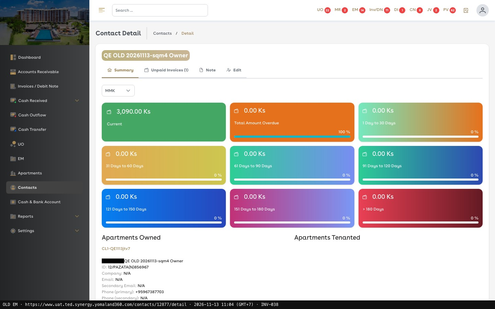

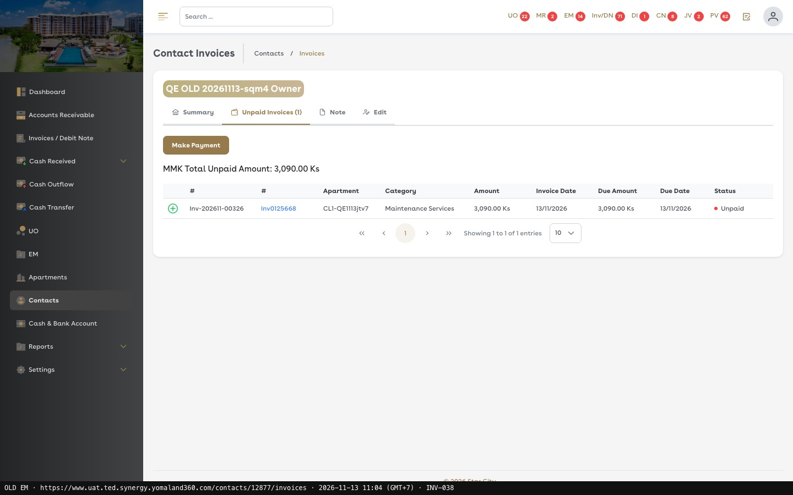

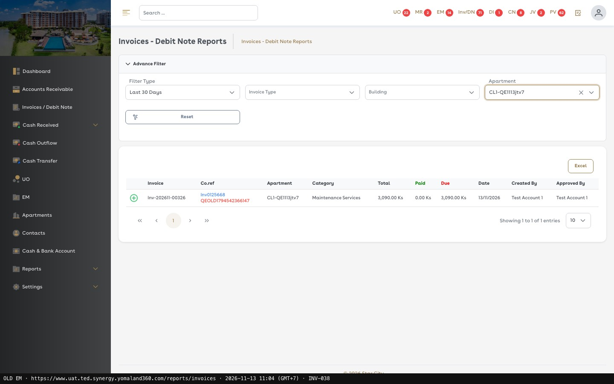

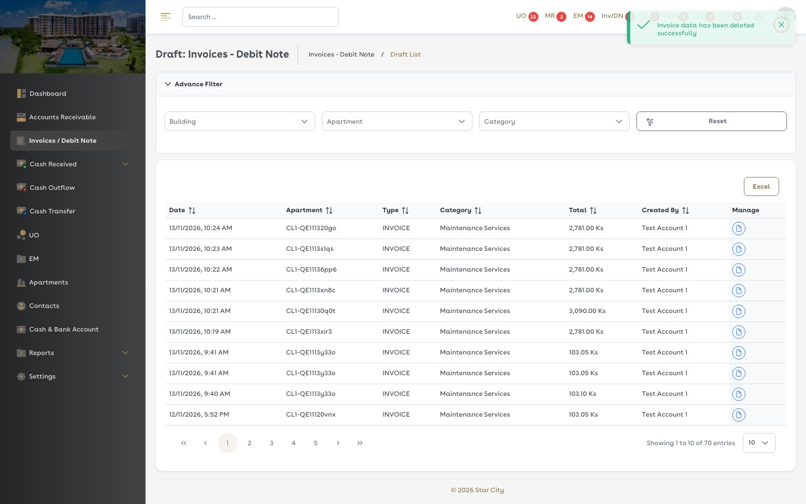

#### ❌ [INV-038](../../em/docs/test-cases/features/04-invoice-debit-note.md#-inv-038--invoice-totals-with-discount-and-tax-are-calculated-once-and-saved-exactly-as-shown-on-the-form) [Unit=3; Gross Price=333.33; Discount=10 %; Grand Total=926.99] · Invoice totals with discount and tax are calculated once and saved exactly as shown on the form

Priority P1 · ★ critical business flow · test: [issues/invoice-calculation.spec.ts](../tests/issues/invoice-calculation.spec.ts)

**Why it fails:** Same cause as INV-001. In every run, typed Gross Price / Discount were wiped within 0.3 to 4 seconds without any input; per variant 1 to 5 of the 5 creations were refused ("Gross Price field is required") and some drafts were saved without the discount: 3,090.00 instead of 2,781.00, 1,029.99 instead of 926.99, 103.10 instead of 103.05. The rounding itself is correct: when a draft is saved with the right inputs, 926.99, 1.08 and 103.05 come out right and the draft, approved invoice, AR, SOA, contact, Invoices report and PDF all agree.

**Impact:** Wrong invoice amounts (discount lost) and refused invoices, at random.

**Decision needed:** Old EM defect: fix in New EM. The case is in Review only for the rounding rule, which Old EM applies correctly (round the total to 2 decimals).

<details><summary>Test output</summary>

```text
Error: #1 Expected 2: Unit/Gross Price/Discount stay as typed (3 / 333.33 / 10) and Total is not 0 after typing. Old EM changed them in 23 of 23 samples over 6 s, first 12 ms after typing: Gross Price "", Total "0.000"

expect(received).toBe(expected) // Object.is equality

Expected: true
Received: false

Error: #1 Disc. Price: expected 299.997 (≈ 300), form shows "333.330"

expect(received).toBe(expected) // Object.is equality

Expected: true
Received: false

Error: #1 line Total: expected 899.991 (≈ 899.99), form shows "999.990"

expect(received).toBe(expected) // Object.is equality

Expected: true
Received: false

Error: #1 Tax (3 % of line Total): expected 26.99973 (≈ 27), form shows "29.997"

expect(received).toBe(expected) // Object.is equality

Expected: true
Received: false

Error: #1 footer Discount (form: Gross Total : 999.99 Ks Discount : 0.00 Ks Commercial Tax : 30.00 Ks Grand Total : 1,029.99 Ks)

expect(received).toBe(expected) // Object.is equality

Expected: 100
Received: 0

Error: #1 footer Commercial Tax (form: Gross Total : 999.99 Ks Discount : 0.00 Ks Commercial Tax : 30.00 Ks Grand Total : 1,029.99 Ks)

expect(received).toBe(expected) // Object.is equality

Expected: 27
Received: 30

Error: #1 footer Grand Total (form: Gross Total : 999.99 Ks Discount : 0.00 Ks Commercial Tax : 30.00 Ks Grand Total : 1,029.99 Ks)

expect(received).toBe(expected) // Object.is equality

Expected: 926.99
Received: 1029.99

Error: #1 Expected 1: saved draft Total = 926.99 Ks

expect(received).toBe(expected) // Object.is equality

Expected: 926.99
Received: 1029.99

Error: #2 Expected 2: Unit/Gross Price/Discount stay as typed (3 / 333.33 / 10) and Total is not 0 after typing. Old EM changed them in 23 of 23 samples over 6 s, first 12 ms after typing: Gross Price "", Total "0.000"

expect(received).toBe(expected) // Object.is equality

Expected: true
Received: false

Error: #2 Disc. Price: expected 299.997 (≈ 300), form shows "333.330"

expect(received).toBe(expected) // Object.is equality

Expected: true
Received: false

Error: #2 line Total: expected 899.991 (≈ 899.99), form shows "999.990"

expect(received).toBe(expected) // Object.is equality

Expected: true
Received: false

Error: #2 Tax (3 % of line Total): expected 26.99973 (≈ 27), form shows "29.997"

expect(received).toBe(expected) // Object.is equality

Expected: true
Received: false

Error: #2 footer Gross Total (form: Gross Total : 0.00 Ks Discount : 0.00 Ks Commercial Tax : 0.00 Ks Grand Total : 0.00 Ks)

expect(received).toBe(expected) // Object.is equality

Expected: 999.99
Received: 0

Error: #2 footer Discount (form: Gross Total : 0.00 Ks Discount : 0.00 Ks Commercial Tax : 0.00 Ks Grand Total : 0.00 Ks)

expect(received).toBe(expected) // Object.is equality

Expected: 100
Received: 0

Error: #2 footer Commercial Tax (form: Gross Total : 0.00 Ks Discount : 0.00 Ks Commercial Tax : 0.00 Ks Grand Total : 0.00 Ks)

expect(received).toBe(expected) // Object.is equality

Expected: 27
Received: 0

Error: #2 footer Grand Total (form: Gross Total : 0.00 Ks Discount : 0.00 Ks Commercial Tax : 0.00 Ks Grand Total : 0.00 Ks)

expect(received).toBe(expected) // Object.is equality

Expected: 926.99
Received: 0

Error: #2 Expected 1-3: Create saves the draft. Create did not save the invoice (form: Disc. Price 333.330 · Tax 29.997 · Total 999.990 · Gross Total : 0.00 Ks Discount : 0.00 Ks Commercial Tax : 0.00 Ks Grand Total : 0.00 Ks; messages: The Gross Price field is required.)

expect(received).toBe(expected) // Object.is equality

Expected: true
Received: false

Error: #3 Expected 2: Unit/Gross Price/Discount stay as typed (3 / 333.33 / 10) and Total is not 0 after typing. Old EM changed them in 14 of 23 samples over 6 s, first 282 ms after typing: Gross Price "", Discount "", Total "0.000"

expect(received).toBe(expected) // Object.is equality

Expected: true
Received: false

Error: #4 Expected 2: Unit/Gross Price/Discount stay as typed (3 / 333.33 / 10) and Total is not 0 after typing. Old EM changed them in 23 of 23 samples over 6 s, first 11 ms after typing: Gross Price "", Total "0.000"

expect(received).toBe(expected) // Object.is equality

Expected: true
Received: false

Error: #4 Disc. Price: expected 299.997 (≈ 300), form shows "0.000"

expect(received).toBe(expected) // Object.is equality

Expected: true
Received: false

Error: #4 line Total: expected 899.991 (≈ 899.99), form shows "0.000"

expect(received).toBe(expected) // Object.is equality

Expected: true
Received: false

Error: #4 Tax (3 % of line Total): expected 26.99973 (≈ 27), form shows "0.000"

expect(received).toBe(expected) // Object.is equality

Expected: true
Received: false

Error: #4 footer Gross Total (form: Gross Total : 0.00 Ks Discount : 0.00 Ks Commercial Tax : 0.00 Ks Grand Total : 0.00 Ks)

expect(received).toBe(expected) // Object.is equality

Expected: 999.99
Received: 0

Error: #4 footer Discount (form: Gross Total : 0.00 Ks Discount : 0.00 Ks Commercial Tax : 0.00 Ks Grand Total : 0.00 Ks)

expect(received).toBe(expected) // Object.is equality

Expected: 100
Received: 0

Error: #4 footer Commercial Tax (form: Gross Total : 0.00 Ks Discount : 0.00 Ks Commercial Tax : 0.00 Ks Grand Total : 0.00 Ks)

expect(received).toBe(expected) // Object.is equality

Expected: 27
Received: 0

Error: #4 footer Grand Total (form: Gross Total : 0.00 Ks Discount : 0.00 Ks Commercial Tax : 0.00 Ks Grand Total : 0.00 Ks)

expect(received).toBe(expected) // Object.is equality

Expected: 926.99
Received: 0

Error: #4 Expected 1-3: Create saves the draft. Create did not save the invoice (form: Disc. Price 0.000 · Tax 0.000 · Total 0.000 · Gross Total : 0.00 Ks Discount : 0.00 Ks Commercial Tax : 0.00 Ks Grand Total : 0.00 Ks; messages: The Gross Price field is required.)

expect(received).toBe(expected) // Object.is equality

Expected: true
Received: false

Error: #5 Expected 2: Unit/Gross Price/Discount stay as typed (3 / 333.33 / 10) and Total is not 0 after typing. Old EM changed them in 13 of 23 samples over 6 s, first 559 ms after typing: Discount ""

expect(received).toBe(expected) // Object.is equality

Expected: true
Received: false

Error: #5 Expected 1-3: Create saves the draft. Create did not save the invoice (form: Disc. Price 299.997 · Tax 26.997 · Total 899.991 · Gross Total : 999.99 Ks Discount : (100.00 Ks) Commercial Tax : 27.00 Ks Grand Total : 926.99 Ks; messages: The Gross Price field is required.)

expect(received).toBe(expected) // Object.is equality

Expected: true
Received: false

Error: Expected 4: 5 × 926.99 Ks (#1: form 1029.99 → saved 1029.99; #2: form 0 → saved not saved (Create did not save the invoice (form: Disc. Price 333.330 · Tax 29.997 · Total 999.990 · Gross Total : 0.00 Ks Discount : 0.00 Ks Commercial Tax : 0.00 Ks Grand Total : 0.00 Ks; messages: The Gross Price field is required.)); #3: form 926.99 → saved 926.99; #4: form 0 → saved not saved (Create did not save the invoice (form: Disc. Price 0.000 · Tax 0.000 · Total 0.000 · Gross Total : 0.00 Ks Discount : 0.00 Ks Commercial Tax : 0.00 Ks Grand Total : 0.00 Ks; messages: The Gross Price field is required.)); #5: form 926.99 → saved not saved (Create did not save the invoice (form: Disc. Price 299.997 · Tax 26.997 · Total 899.991 · Gross Total : 999.99 Ks Discount : (100.00 Ks) Commercial Tax : 27.00 Ks Grand Total : 926.99 Ks; messages: The Gross Price field is required.)))

expect(received).to

Error: draft list row: Total 926.99 Ks

expect(received).toContain(expected) // indexOf

Expected substring: "926.99 Ks"
Received string:    "13/11/2026, 11:05 AM CL1-QE1113tz75 INVOICE Maintenance Services 1,029.99 Ks Test Account 1 "
```

</details>

![INV-038 [Unit=3; Gross Price=333.33; Discount=10 %; Grand Total=926.99] · INV-038-v2_contact-summary](img/INV-038_Unit_3_Gross_Price_333_33_Discount_10_Grand_Total_926_99-1.jpg)

![INV-038 [Unit=3; Gross Price=333.33; Discount=10 %; Grand Total=926.99] · INV-038-v2_contact-unpaid](img/INV-038_Unit_3_Gross_Price_333_33_Discount_10_Grand_Total_926_99-2.jpg)

![INV-038 [Unit=3; Gross Price=333.33; Discount=10 %; Grand Total=926.99] · INV-038-v2_report-invoices](img/INV-038_Unit_3_Gross_Price_333_33_Discount_10_Grand_Total_926_99-3.jpg)

![INV-038 [Unit=3; Gross Price=333.33; Discount=10 %; Grand Total=926.99] · Screen at failure](img/INV-038_Unit_3_Gross_Price_333_33_Discount_10_Grand_Total_926_99-4.jpg)

#### ❌ [INV-038](../../em/docs/test-cases/features/04-invoice-debit-note.md#-inv-038--invoice-totals-with-discount-and-tax-are-calculated-once-and-saved-exactly-as-shown-on-the-form) [Unit=7; Gross Price=0.15; Discount=0; Grand Total=1.08] · Invoice totals with discount and tax are calculated once and saved exactly as shown on the form

Priority P1 · ★ critical business flow · test: [issues/invoice-calculation.spec.ts](../tests/issues/invoice-calculation.spec.ts)

**Why it fails:** Same cause as INV-001. In every run, typed Gross Price / Discount were wiped within 0.3 to 4 seconds without any input; per variant 1 to 5 of the 5 creations were refused ("Gross Price field is required") and some drafts were saved without the discount: 3,090.00 instead of 2,781.00, 1,029.99 instead of 926.99, 103.10 instead of 103.05. The rounding itself is correct: when a draft is saved with the right inputs, 926.99, 1.08 and 103.05 come out right and the draft, approved invoice, AR, SOA, contact, Invoices report and PDF all agree.

**Impact:** Wrong invoice amounts (discount lost) and refused invoices, at random.

**Decision needed:** Old EM defect: fix in New EM. The case is in Review only for the rounding rule, which Old EM applies correctly (round the total to 2 decimals).

<details><summary>Test output</summary>

```text
Error: #1 Expected 2: Unit/Gross Price/Discount stay as typed (7 / 0.15 / 0) and Total is not 0 after typing. Old EM changed them in 21 of 23 samples over 6 s, first 295 ms after typing: Gross Price "", Total "0.000"

expect(received).toBe(expected) // Object.is equality

Expected: true
Received: false

Error: #1 Disc. Price: expected 0.15 (≈ 0.15), form shows "0.000"

expect(received).toBe(expected) // Object.is equality

Expected: true
Received: false

Error: #1 line Total: expected 1.05 (≈ 1.05), form shows "0.000"

expect(received).toBe(expected) // Object.is equality

Expected: true
Received: false

Error: #1 Tax (3 % of line Total): expected 0.0315 (≈ 0.03), form shows "0.000"

expect(received).toBe(expected) // Object.is equality

Expected: true
Received: false

Error: #1 footer Gross Total (form: Gross Total : 0.00 Ks Discount : 0.00 Ks Commercial Tax : 0.00 Ks Grand Total : 0.00 Ks)

expect(received).toBe(expected) // Object.is equality

Expected: 1.05
Received: 0

Error: #1 footer Commercial Tax (form: Gross Total : 0.00 Ks Discount : 0.00 Ks Commercial Tax : 0.00 Ks Grand Total : 0.00 Ks)

expect(received).toBe(expected) // Object.is equality

Expected: 0.03
Received: 0

Error: #1 footer Grand Total (form: Gross Total : 0.00 Ks Discount : 0.00 Ks Commercial Tax : 0.00 Ks Grand Total : 0.00 Ks)

expect(received).toBe(expected) // Object.is equality

Expected: 1.08
Received: 0

Error: #1 Expected 1-3: Create saves the draft. Create did not save the invoice (form: Disc. Price 0.000 · Tax 0.000 · Total 0.000 · Gross Total : 0.00 Ks Discount : 0.00 Ks Commercial Tax : 0.00 Ks Grand Total : 0.00 Ks; messages: The Gross Price field is required.)

expect(received).toBe(expected) // Object.is equality

Expected: true
Received: false

Error: #2 Expected 2: Unit/Gross Price/Discount stay as typed (7 / 0.15 / 0) and Total is not 0 after typing. Old EM changed them in 2 of 23 samples over 6 s, first 12 ms after typing: Gross Price "", Total "0.000"

expect(received).toBe(expected) // Object.is equality

Expected: true
Received: false

Error: #3 Expected 2: Unit/Gross Price/Discount stay as typed (7 / 0.15 / 0) and Total is not 0 after typing. Old EM changed them in 22 of 23 samples over 6 s, first 281 ms after typing: Gross Price "", Total "0.000"

expect(received).toBe(expected) // Object.is equality

Expected: true
Received: false

Error: #3 Disc. Price: expected 0.15 (≈ 0.15), form shows "0.000"

expect(received).toBe(expected) // Object.is equality

Expected: true
Received: false

Error: #3 line Total: expected 1.05 (≈ 1.05), form shows "0.000"

expect(received).toBe(expected) // Object.is equality

Expected: true
Received: false

Error: #3 Tax (3 % of line Total): expected 0.0315 (≈ 0.03), form shows "0.000"

expect(received).toBe(expected) // Object.is equality

Expected: true
Received: false

Error: #3 footer Gross Total (form: Gross Total : 0.00 Ks Discount : 0.00 Ks Commercial Tax : 0.00 Ks Grand Total : 0.00 Ks)

expect(received).toBe(expected) // Object.is equality

Expected: 1.05
Received: 0

Error: #3 footer Commercial Tax (form: Gross Total : 0.00 Ks Discount : 0.00 Ks Commercial Tax : 0.00 Ks Grand Total : 0.00 Ks)

expect(received).toBe(expected) // Object.is equality

Expected: 0.03
Received: 0

Error: #3 footer Grand Total (form: Gross Total : 0.00 Ks Discount : 0.00 Ks Commercial Tax : 0.00 Ks Grand Total : 0.00 Ks)

expect(received).toBe(expected) // Object.is equality

Expected: 1.08
Received: 0

Error: #3 Expected 1-3: Create saves the draft. Create did not save the invoice (form: Disc. Price 0.000 · Tax 0.000 · Total 0.000 · Gross Total : 0.00 Ks Discount : 0.00 Ks Commercial Tax : 0.00 Ks Grand Total : 0.00 Ks; messages: The Gross Price field is required.)

expect(received).toBe(expected) // Object.is equality

Expected: true
Received: false

Error: #4 Expected 2: Unit/Gross Price/Discount stay as typed (7 / 0.15 / 0) and Total is not 0 after typing. Old EM changed them in 2 of 23 samples over 6 s, first 12 ms after typing: Gross Price "", Total "0.000"

expect(received).toBe(expected) // Object.is equality

Expected: true
Received: false

Error: #5 Expected 2: Unit/Gross Price/Discount stay as typed (7 / 0.15 / 0) and Total is not 0 after typing. Old EM changed them in 22 of 23 samples over 6 s, first 285 ms after typing: Gross Price "", Total "0.000"

expect(received).toBe(expected) // Object.is equality

Expected: true
Received: false

Error: #5 Disc. Price: expected 0.15 (≈ 0.15), form shows "0.000"

expect(received).toBe(expected) // Object.is equality

Expected: true
Received: false

Error: #5 line Total: expected 1.05 (≈ 1.05), form shows "0.000"

expect(received).toBe(expected) // Object.is equality

Expected: true
Received: false

Error: #5 Tax (3 % of line Total): expected 0.0315 (≈ 0.03), form shows "0.000"

expect(received).toBe(expected) // Object.is equality

Expected: true
Received: false

Error: #5 footer Gross Total (form: Gross Total : 0.00 Ks Discount : 0.00 Ks Commercial Tax : 0.00 Ks Grand Total : 0.00 Ks)

expect(received).toBe(expected) // Object.is equality

Expected: 1.05
Received: 0

Error: #5 footer Commercial Tax (form: Gross Total : 0.00 Ks Discount : 0.00 Ks Commercial Tax : 0.00 Ks Grand Total : 0.00 Ks)

expect(received).toBe(expected) // Object.is equality

Expected: 0.03
Received: 0

Error: #5 footer Grand Total (form: Gross Total : 0.00 Ks Discount : 0.00 Ks Commercial Tax : 0.00 Ks Grand Total : 0.00 Ks)

expect(received).toBe(expected) // Object.is equality

Expected: 1.08
Received: 0

Error: #5 Expected 1-3: Create saves the draft. Create did not save the invoice (form: Disc. Price 0.000 · Tax 0.000 · Total 0.000 · Gross Total : 0.00 Ks Discount : 0.00 Ks Commercial Tax : 0.00 Ks Grand Total : 0.00 Ks; messages: The Gross Price field is required.)

expect(received).toBe(expected) // Object.is equality

Expected: true
Received: false

Error: Expected 4: 5 × 1.08 Ks (#1: form 0 → saved not saved (Create did not save the invoice (form: Disc. Price 0.000 · Tax 0.000 · Total 0.000 · Gross Total : 0.00 Ks Discount : 0.00 Ks Commercial Tax : 0.00 Ks Grand Total : 0.00 Ks; messages: The Gross Price field is required.)); #2: form 1.08 → saved 1.08; #3: form 0 → saved not saved (Create did not save the invoice (form: Disc. Price 0.000 · Tax 0.000 · Total 0.000 · Gross Total : 0.00 Ks Discount : 0.00 Ks Commercial Tax : 0.00 Ks Grand Total : 0.00 Ks; messages: The Gross Price field is required.)); #4: form 1.08 → saved 1.08; #5: form 0 → saved not saved (Create did not save the invoice (form: Disc. Price 0.000 · Tax 0.000 · Total 0.000 · Gross Total : 0.00 Ks Discount : 0.00 Ks Commercial Tax : 0.00 Ks Grand Total : 0.00 Ks; messages: The Gross Price field is required.)))

expect(received).toEqual(expected) // deep equality

- 
```

</details>

![INV-038 [Unit=7; Gross Price=0.15; Discount=0; Grand Total=1.08] · INV-038-v3_contact-summary](img/INV-038_Unit_7_Gross_Price_0_15_Discount_0_Grand_Total_1_08-1.jpg)

![INV-038 [Unit=7; Gross Price=0.15; Discount=0; Grand Total=1.08] · INV-038-v3_contact-unpaid](img/INV-038_Unit_7_Gross_Price_0_15_Discount_0_Grand_Total_1_08-2.jpg)

![INV-038 [Unit=7; Gross Price=0.15; Discount=0; Grand Total=1.08] · INV-038-v3_report-invoices](img/INV-038_Unit_7_Gross_Price_0_15_Discount_0_Grand_Total_1_08-3.jpg)

![INV-038 [Unit=7; Gross Price=0.15; Discount=0; Grand Total=1.08] · Screen at failure](img/INV-038_Unit_7_Gross_Price_0_15_Discount_0_Grand_Total_1_08-4.jpg)

#### ❌ [INV-038](../../em/docs/test-cases/features/04-invoice-debit-note.md#-inv-038--invoice-totals-with-discount-and-tax-are-calculated-once-and-saved-exactly-as-shown-on-the-form) [Unit=1; Gross Price=100.10; Discount=0.05 Ks (fixed); Grand Total=103.05] · Invoice totals with discount and tax are calculated once and saved exactly as shown on the form

Priority P1 · ★ critical business flow · test: [issues/invoice-calculation.spec.ts](../tests/issues/invoice-calculation.spec.ts)

**Why it fails:** Same cause as INV-001. In every run, typed Gross Price / Discount were wiped within 0.3 to 4 seconds without any input; per variant 1 to 5 of the 5 creations were refused ("Gross Price field is required") and some drafts were saved without the discount: 3,090.00 instead of 2,781.00, 1,029.99 instead of 926.99, 103.10 instead of 103.05. The rounding itself is correct: when a draft is saved with the right inputs, 926.99, 1.08 and 103.05 come out right and the draft, approved invoice, AR, SOA, contact, Invoices report and PDF all agree.

**Impact:** Wrong invoice amounts (discount lost) and refused invoices, at random.

**Decision needed:** Old EM defect: fix in New EM. The case is in Review only for the rounding rule, which Old EM applies correctly (round the total to 2 decimals).

<details><summary>Test output</summary>

```text
Error: #1 Expected 2: Unit/Gross Price/Discount stay as typed (1 / 100.10 / 0.05) and Total is not 0 after typing. Old EM changed them in 23 of 23 samples over 6 s, first 14 ms after typing: Gross Price "", Discount "0", Total "0.000"

expect(received).toBe(expected) // Object.is equality

Expected: true
Received: false

Error: #1 Disc. Price: expected 100.05 (≈ 100.05), form shows "0.000"

expect(received).toBe(expected) // Object.is equality

Expected: true
Received: false

Error: #1 line Total: expected 100.05 (≈ 100.05), form shows "0.000"

expect(received).toBe(expected) // Object.is equality

Expected: true
Received: false

Error: #1 Tax (3 % of line Total): expected 3.0015 (≈ 3), form shows "0.000"

expect(received).toBe(expected) // Object.is equality

Expected: true
Received: false

Error: #1 footer Gross Total (form: Gross Total : 0.00 Ks Discount : 0.00 Ks Commercial Tax : 0.00 Ks Grand Total : 0.00 Ks)

expect(received).toBe(expected) // Object.is equality

Expected: 100.1
Received: 0

Error: #1 footer Discount (form: Gross Total : 0.00 Ks Discount : 0.00 Ks Commercial Tax : 0.00 Ks Grand Total : 0.00 Ks)

expect(received).toBe(expected) // Object.is equality

Expected: 0.05
Received: 0

Error: #1 footer Commercial Tax (form: Gross Total : 0.00 Ks Discount : 0.00 Ks Commercial Tax : 0.00 Ks Grand Total : 0.00 Ks)

expect(received).toBe(expected) // Object.is equality

Expected: 3
Received: 0

Error: #1 footer Grand Total (form: Gross Total : 0.00 Ks Discount : 0.00 Ks Commercial Tax : 0.00 Ks Grand Total : 0.00 Ks)

expect(received).toBe(expected) // Object.is equality

Expected: 103.05
Received: 0

Error: #1 Expected 1-3: Create saves the draft. Create did not save the invoice (form: Disc. Price 0.000 · Tax 0.000 · Total 0.000 · Gross Total : 0.00 Ks Discount : 0.00 Ks Commercial Tax : 0.00 Ks Grand Total : 0.00 Ks; messages: The Gross Price field is required.)

expect(received).toBe(expected) // Object.is equality

Expected: true
Received: false

Error: #2 Expected 2: Unit/Gross Price/Discount stay as typed (1 / 100.10 / 0.05) and Total is not 0 after typing. Old EM changed them in 23 of 23 samples over 6 s, first 13 ms after typing: Gross Price "", Discount "0", Total "0.000"

expect(received).toBe(expected) // Object.is equality

Expected: true
Received: false

Error: #2 Disc. Price: expected 100.05 (≈ 100.05), form shows "10.000"

expect(received).toBe(expected) // Object.is equality

Expected: true
Received: false

Error: #2 line Total: expected 100.05 (≈ 100.05), form shows "10.000"

expect(received).toBe(expected) // Object.is equality

Expected: true
Received: false

Error: #2 Tax (3 % of line Total): expected 3.0015 (≈ 3), form shows "0.300"

expect(received).toBe(expected) // Object.is equality

Expected: true
Received: false

Error: #2 footer Gross Total (form: Gross Total : 10.00 Ks Discount : 0.00 Ks Commercial Tax : 0.30 Ks Grand Total : 10.30 Ks)

expect(received).toBe(expected) // Object.is equality

Expected: 100.1
Received: 10

Error: #2 footer Discount (form: Gross Total : 10.00 Ks Discount : 0.00 Ks Commercial Tax : 0.30 Ks Grand Total : 10.30 Ks)

expect(received).toBe(expected) // Object.is equality

Expected: 0.05
Received: 0

Error: #2 footer Commercial Tax (form: Gross Total : 10.00 Ks Discount : 0.00 Ks Commercial Tax : 0.30 Ks Grand Total : 10.30 Ks)

expect(received).toBe(expected) // Object.is equality

Expected: 3
Received: 0.3

Error: #2 footer Grand Total (form: Gross Total : 10.00 Ks Discount : 0.00 Ks Commercial Tax : 0.30 Ks Grand Total : 10.30 Ks)

expect(received).toBe(expected) // Object.is equality

Expected: 103.05
Received: 10.3

Error: #2 Expected 1: saved draft Total = 103.05 Ks

expect(received).toBe(expected) // Object.is equality

Expected: 103.05
Received: 10.3

Error: #3 Expected 2: Unit/Gross Price/Discount stay as typed (1 / 100.10 / 0.05) and Total is not 0 after typing. Old EM changed them in 23 of 23 samples over 6 s, first 10 ms after typing: Gross Price "", Discount "0", Total "0.000"

expect(received).toBe(expected) // Object.is equality

Expected: true
Received: false

Error: #3 Disc. Price: expected 100.05 (≈ 100.05), form shows "0.000"

expect(received).toBe(expected) // Object.is equality

Expected: true
Received: false

Error: #3 line Total: expected 100.05 (≈ 100.05), form shows "0.000"

expect(received).toBe(expected) // Object.is equality

Expected: true
Received: false

Error: #3 Tax (3 % of line Total): expected 3.0015 (≈ 3), form shows "0.000"

expect(received).toBe(expected) // Object.is equality

Expected: true
Received: false

Error: #3 footer Gross Total (form: Gross Total : 0.00 Ks Discount : 0.00 Ks Commercial Tax : 0.00 Ks Grand Total : 0.00 Ks)

expect(received).toBe(expected) // Object.is equality

Expected: 100.1
Received: 0

Error: #3 footer Discount (form: Gross Total : 0.00 Ks Discount : 0.00 Ks Commercial Tax : 0.00 Ks Grand Total : 0.00 Ks)

expect(received).toBe(expected) // Object.is equality

Expected: 0.05
Received: 0

Error: #3 footer Commercial Tax (form: Gross Total : 0.00 Ks Discount : 0.00 Ks Commercial Tax : 0.00 Ks Grand Total : 0.00 Ks)

expect(received).toBe(expected) // Object.is equality

Expected: 3
Received: 0

Error: #3 footer Grand Total (form: Gross Total : 0.00 Ks Discount : 0.00 Ks Commercial Tax : 0.00 Ks Grand Total : 0.00 Ks)

expect(received).toBe(expected) // Object.is equality

Expected: 103.05
Received: 0

Error: #3 Expected 1-3: Create saves the draft. Create did not save the invoice (form: Disc. Price 0.000 · Tax 0.000 · Total 0.000 · Gross Total : 0.00 Ks Discount : 0.00 Ks Commercial Tax : 0.00 Ks Grand Total : 0.00 Ks; messages: The Gross Price field is required.)

expect(received).toBe(expected) // Object.is equality

Expected: true
Received: false

Error: #4 Expected 2: Unit/Gross Price/Discount stay as typed (1 / 100.10 / 0.05) and Total is not 0 after typing. Old EM changed them in 23 of 23 samples over 6 s, first 13 ms after typing: Gross Price "", Discount "0", Total "0.000"

expect(received).toBe(expected) // Object.is equality

Expected: true
Received: false

Error: #4 Disc. Price: expected 100.05 (≈ 100.05), form shows "0.000"

expect(received).toBe(expected) // Object.is equality

Expected: true
Received: false

Error: #4 line Total: expected 100.05 (≈ 100.05), form shows "0.000"

expect(received).toBe(expected) // Object.is equality

Expected: true
Received: false

Error: #4 Tax (3 % of line Total): expected 3.0015 (≈ 3), form shows "0.000"

expect(received).toBe(expected) // Object.is equality

Expected: true
Received: false

Error: #4 footer Gross Total (form: Gross Total : 0.00 Ks Discount : 0.00 Ks Commercial Tax : 0.00 Ks Grand Total : 0.00 Ks)

expect(received).toBe(expected) // Object.is equality

Expected: 100.1
Received: 0

Error: #4 footer Discount (form: Gross Total : 0.00 Ks Discount : 0.00 Ks Commercial Tax : 0.00 Ks Grand Total : 0.00 Ks)

expect(received).toBe(expected) // Object.is equality

Expected: 0.05
Received: 0

Error: #4 footer Commercial Tax (form: Gross Total : 0.00 Ks Discount : 0.00 Ks Commercial Tax : 0.00 Ks Grand Total : 0.00 Ks)

expect(received).toBe(expected) // Object.is equality

Expected: 3
Received: 0

Error: #4 footer Grand Total (form: Gross Total : 0.00 Ks Discount : 0.00 Ks Commercial Tax : 0.00 Ks Grand Total : 0.00 Ks)

expect(received).toBe(expected) // Object.is equality

Expected: 103.05
Received: 0

Error: #4 Expected 1-3: Create saves the draft. Create did not save the invoice (form: Disc. Price 0.000 · Tax 0.000 · Total 0.000 · Gross Total : 0.00 Ks Discount : 0.00 Ks Commercial Tax : 0.00 Ks Grand Total : 0.00 Ks; messages: The selected Gross Price is invalid.)

expect(received).toBe(expected) // Object.is equality

Expected: true
Received: false

Error: #5 Expected 2: Unit/Gross Price/Discount stay as typed (1 / 100.10 / 0.05) and Total is not 0 after typing. Old EM changed them in 23 of 23 samples over 6 s, first 14 ms after typing: Gross Price "", Discount "0", Total "0.000"

expect(received).toBe(expected) // Object.is equality

Expected: true
Received: false

Error: #5 Disc. Price: expected 100.05 (≈ 100.05), form shows "100.100"

expect(received).toBe(expected) // Object.is equality

Expected: true
Received: false

Error: #5 line Total: expected 100.05 (≈ 100.05), form shows "100.100"

expect(received).toBe(expected) // Object.is equality

Expected: true
Received: false

Error: #5 footer Discount (form: Gross Total : 100.10 Ks Discount : 0.00 Ks Commercial Tax : 3.00 Ks Grand Total : 103.10 Ks)

expect(received).toBe(expected) // Object.is equality

Expected: 0.05
Received: 0

Error: #5 footer Grand Total (form: Gross Total : 100.10 Ks Discount : 0.00 Ks Commercial Tax : 3.00 Ks Grand Total : 103.10 Ks)

expect(received).toBe(expected) // Object.is equality

Expected: 103.05
Received: 103.1

Error: #5 Expected 1: saved draft Total = 103.05 Ks

expect(received).toBe(expected) // Object.is equality

Expected: 103.05
Received: 103.1

Error: Expected 4: 5 × 103.05 Ks (#1: form 0 → saved not saved (Create did not save the invoice (form: Disc. Price 0.000 · Tax 0.000 · Total 0.000 · Gross Total : 0.00 Ks Discount : 0.00 Ks Commercial Tax : 0.00 Ks Grand Total : 0.00 Ks; messages: The Gross Price field is required.)); #2: form 10.3 → saved 10.3; #3: form 0 → saved not saved (Create did not save the invoice (form: Disc. Price 0.000 · Tax 0.000 · Total 0.000 · Gross Total : 0.00 Ks Discount : 0.00 Ks Commercial Tax : 0.00 Ks Grand Total : 0.00 Ks; messages: The Gross Price field is required.)); #4: form 0 → saved not saved (Create did not save the invoice (form: Disc. Price 0.000 · Tax 0.000 · Total 0.000 · Gross Total : 0.00 Ks Discount : 0.00 Ks Commercial Tax : 0.00 Ks Grand Total : 0.00 Ks; messages: The selected Gross Price is invalid.)); #5: form 103.1 → saved 103.1)

expect(received).toEqual(expected) // deep equali

Error: draft list row: Total 103.05 Ks

expect(received).toContain(expected) // indexOf

Expected substring: "103.05 Ks"
Received string:    "13/11/2026, 11:14 AM CL1-QE1113wg8d INVOICE Maintenance Services 103.10 Ks Test Account 1 "

Error: draft list row: Total 103.05 Ks

expect(received).toContain(expected) // indexOf

Expected substring: "103.05 Ks"
Received string:    "13/11/2026, 11:12 AM CL1-QE1113wg8d INVOICE Maintenance Services 10.30 Ks Test Account 1 "

Error: approved invoice Total

expect(locator).toHaveText(expected) failed

Locator:  getByRole('heading', { name: /^Total:/ })
Expected: "Total: 103.05 Ks"
Received: "Total: 10.30 Ks"
Timeout:  15000ms

    34 × locator resolved to <h5 data-v-a9764ac8="">Total: 10.30 Ks</h5>

Error: approved invoice Grand Total (#Inv-202611-00329 CoRef : Inv0125671 Old CodeRefNo. : QEOLD1794543170045 Unpaid Issued to: CL1-QE1113wg8d Created By: Test Account 1 Approved By: Test Account 1 Issue Date: 13/11/2026 Due Date: 13/11/2026 Total: 10.30 Ks # Item Unit Gross Price Tax Total 1 QE OLD INV-038 #2 1 10.00 Ks 0.30 Ks 10.00 Ks Gross Total 10.00 Ks Commerical Tax 0.30 Ks Grand Total 10.30 Ks )

expect(received).toBe(expected) // Object.is equality

Expected: 103.05
Received: 10.3

Error: approved invoice Gross Total (#Inv-202611-00329 CoRef : Inv0125671 Old CodeRefNo. : QEOLD1794543170045 Unpaid Issued to: CL1-QE1113wg8d Created By: Test Account 1 Approved By: Test Account 1 Issue Date: 13/11/2026 Due Date: 13/11/2026 Total: 10.30 Ks # Item Unit Gross Price Tax Total 1 QE OLD INV-038 #2 1 10.00 Ks 0.30 Ks 10.00 Ks Gross Total 10.00 Ks Commerical Tax 0.30 Ks Grand Total 10.30 Ks )

expect(received).toBe(expected) // Object.is equality

Expected: 100.1
Received: 10

Error: approved invoice Discount (#Inv-202611-00329 CoRef : Inv0125671 Old CodeRefNo. : QEOLD1794543170045 Unpaid Issued to: CL1-QE1113wg8d Created By: Test Account 1 Approved By: Test Account 1 Issue Date: 13/11/2026 Due Date: 13/11/2026 Total: 10.30 Ks # Item Unit Gross Price Tax Total 1 QE OLD INV-038 #2 1 10.00 Ks 0.30 Ks 10.00 Ks Gross Total 10.00 Ks Commerical Tax 0.30 Ks Grand Total 10.30 Ks )

expect(received).toBe(expected) // Object.is equality

Expected: 0.05
Received: 0

Error: approved invoice Commercial Tax (#Inv-202611-00329 CoRef : Inv0125671 Old CodeRefNo. : QEOLD1794543170045 Unpaid Issued to: CL1-QE1113wg8d Created By: Test Account 1 Approved By: Test Account 1 Issue Date: 13/11/2026 Due Date: 13/11/2026 Total: 10.30 Ks # Item Unit Gross Price Tax Total 1 QE OLD INV-038 #2 1 10.00 Ks 0.30 Ks 10.00 Ks Gross Total 10.00 Ks Commerical Tax 0.30 Ks Grand Total 10.30 Ks )

expect(received).toBe(expected) // Object.is equality

Expected: 3
Received: 0.3

Error: approved invoice line: Disc. Price · Tax · Total

expect(received).toContain(expected) // indexOf

Expected substring: "100.05 Ks 3.00 Ks 100.05 Ks"
Received string:    "1 QE OLD INV-038 #2 1 10.00 Ks 0.30 Ks 10.00 Ks"

Error: PDF Grand Total 103.05 Ks

expect(received).toContain(expected) // indexOf

Expected substring: "103.05"
Received string:    "INVOICE Unit No.: CL1-QE1113wg8dOwner: QE OLD 20261113-auri OwnerInvoice No. : #Inv-202611-00329 Status : Unpaid Date : 13/11/2026 Due Date : 13/11/2026 Amount Due : 10.30 Ks CoRef : Inv0125671 DescriptionUnitPriceTaxTotalQE OLD INV-038 #2110.00 Ks0.30 Ks10.00 KsSub Total10.00 KsCommercial Tax0.30 KsGrand Total10.30 KsTEN KYATSRemarks: Info:Please settle the invoice immediately.Please indicate the invoice number & propertyaddress in your payment.Bank transfer transaction fees (if any) shall beborne by the payer.For any questions please contact EstateManagement Offices telephone 09 765444682OR Credit Control Department – 09 765444587.This document is electronically generated and does not require signature.Created by Test Account 1. Appr

Error: Inv-202611-00329 total in Invoices - Debit Note list

expect(locator).toContainText(expected) failed

Locator: getByRole('table').getByRole('rowgroup').nth(1).getByRole('row').filter({ hasText: 'Inv-202611-00329' })
Expected substring: "103.05 Ks"
Received string:    "Inv-202611-00329Inv0125671QEOLD1794543170045CL1-QE1113wg8dMaintenance Services10.30 Ks0.00 Ks10.30 Ks13/11/2026Test Account 1"
Timeout: 15000ms

    34 × locator resolved to <tr class="" role="row" tabindex="-1" data-pc-section="bodyrow" data-p-selectable-row="false">…</tr>

Error: Inv-202611-00329 due amount / status in Accounts Receivable

expect(locator).toContainText(expected) failed

Locator: getByRole('table').getByRole('rowgroup').nth(1).getByRole('row').filter({ has: getByRole('cell', { name: 'Inv-202611-00329', exact: true }) })
Expected pattern: /103.05 Ks.*Unpaid/i
Received string:  "Inv-202611-00329Inv0125671QEOLD1794543170045CL1-QE1113wg8d10.30 Ks10.30 Ks13/11/202613/11/2026UnpaidMaintenance ServicesTest Account 1 "
Timeout: 15000ms

    32 × locator resolved to <tr class="" role="row" tabindex="-1" data-pc-section="bodyrow" data-p-selectable-row="false">…</tr>

Error: Apartment › Summary › Accounts Receivable

expect(locator).toHaveText(expected) failed

Locator:  getByRole('heading', { name: /^Accounts Receivable/, level: 3 })
Expected: "Accounts Receivable 103.05 Ks"
Received: "Accounts Receivable 10.30 Ks"
Timeout:  15000ms

    9 × locator resolved to <h3 data-v-ed65969b="" class="block text-start">Accounts Receivable 0.00 Ks</h3>
    25 × locator resolved to <h3 data-v-ed65969b="" class="block text-start">Accounts Receivable 10.30 Ks</h3>

Error: Inv-202611-00329 amount

expect(locator).toHaveText(expected) failed

Locator:  getByRole('table').getByRole('rowgroup').nth(1).getByRole('row').filter({ has: getByRole('cell', { name: 'Inv-202611-00329', exact: true }) }).getByRole('cell').nth(3)
Expected: "103.05 Ks"
Received: "10.30 Ks"
Timeout:  15000ms

    34 × locator resolved to <td class="" role="cell" data-pc-name="bodycell" data-pc-section="bodycell" data-p-cell-editing="false" data-p-editable-column="false" data-p-selection-column="false">…</td>

Error: Inv-202611-00329 due amount

expect(locator).toHaveText(expected) failed

Locator:  getByRole('table').getByRole('rowgroup').nth(1).getByRole('row').filter({ has: getByRole('cell', { name: 'Inv-202611-00329', exact: true }) }).getByRole('cell').nth(5)
Expected: "103.05 Ks"
Received: "10.30 Ks"
Timeout:  15000ms

    34 × locator resolved to <td class="" role="cell" data-pc-name="bodycell" data-pc-section="bodycell" data-p-cell-editing="false" data-p-editable-column="false" data-p-selection-column="false">…</td>

Error: Inv-202611-00329 amount in S.O.A

expect(locator).toContainText(expected) failed

Locator: getByRole('table').getByRole('row').filter({ hasText: 'Inv-202611-00329' })
Expected substring: "103.05 Ks"
Received string:    "13/11/2026InvoiceInv-202611-00329 - due on 13/11/202610.30 Ks10.30 Ks"
Timeout: 15000ms

    34 × locator resolved to <tr class="" role="row" tabindex="-1" data-pc-section="bodyrow" data-p-selectable-row="false">…</tr>

Error: S.O.A Balance Due

expect(locator).toContainText(expected) failed

Locator: getByRole('row', { name: /^Balance Due:/ })
Expected substring: "103.05 Ks"
Received string:    " Balance Due: 10.30 Ks"
Timeout: 15000ms

    34 × locator resolved to <tr role="row" data-pc-section="root" data-pc-name="tablefooter">…</tr>

Error: Contact › Summary › Current

expect(locator).toHaveText(expected) failed

Locator:  locator('div').filter({ has: getByRole('heading', { name: 'Current', exact: true, level: 6 }) }).filter({ has: getByRole('heading', { level: 4 }) }).last().getByRole('heading', { level: 4 })
Expected: "103.05 Ks"
Received: " 10.30 Ks"
Timeout:  15000ms

    8 × locator resolved to <h4 data-v-c019d35f="">…</h4>
    25 × locator resolved to <h4 data-v-c019d35f="">…</h4>

Error: Inv-202611-00329 total in Reports › Invoices

expect(locator).toContainText(expected) failed

Locator: getByRole('table').getByRole('rowgroup').nth(1).getByRole('row').filter({ hasText: 'Inv-202611-00329' })
Expected substring: "103.05 Ks"
Received string:    "Inv-202611-00329Inv0125671QEOLD1794543170045CL1-QE1113wg8dMaintenance Services10.30 Ks0.00 Ks10.30 Ks13/11/2026Test Account 1Test Account 1"
Timeout: 15000ms

    34 × locator resolved to <tr class="" role="row" tabindex="-1" data-pc-section="bodyrow" data-p-selectable-row="false">…</tr>
```

</details>

![INV-038 [Unit=1; Gross Price=100.10; Discount=0.05 Ks (fixed); Grand Total=103.05] · INV-038-v4_contact-summary](img/INV-038_Unit_1_Gross_Price_100_10_Discount_0_05_Ks_fixed_Grand_Total_103_05-1.jpg)

![INV-038 [Unit=1; Gross Price=100.10; Discount=0.05 Ks (fixed); Grand Total=103.05] · INV-038-v4_contact-unpaid](img/INV-038_Unit_1_Gross_Price_100_10_Discount_0_05_Ks_fixed_Grand_Total_103_05-2.jpg)

![INV-038 [Unit=1; Gross Price=100.10; Discount=0.05 Ks (fixed); Grand Total=103.05] · INV-038-v4_report-invoices](img/INV-038_Unit_1_Gross_Price_100_10_Discount_0_05_Ks_fixed_Grand_Total_103_05-3.jpg)

![INV-038 [Unit=1; Gross Price=100.10; Discount=0.05 Ks (fixed); Grand Total=103.05] · Screen at failure](img/INV-038_Unit_1_Gross_Price_100_10_Discount_0_05_Ks_fixed_Grand_Total_103_05-4.jpg)

### UO Import (bulk meter readings)

Two rows for the same apartment and month in one file are both imported: the same usage is billed twice.

#### ❌ [UOI-013](../../em/docs/test-cases/features/06-uo-import.md#uoi-013--multi-record-import---second-record-in-same-monthdate-rejected-first-saved) · Multi-record import - second record in same month/date rejected (first saved)

Priority P2 · test: [issues/uo-bulk.spec.ts](../tests/issues/uo-bulk.spec.ts)

**Why it fails:** One import file with **two rows for the same apartment in the same month**: Old EM imports both ("2 UO Entry imported."), with no error for the second row. The apartment gets 2 UO entries and 2 invoices instead of 1, and the second row is also calculated from the old reading ("18 − 10 = 8" next to "15 − 10 = 5"), so the same usage is billed twice. Failed for all 4 variants in 3 of 3 runs. Re-uploading the same file and two uploads at the same moment were blocked in the test runs (the loser gets HTTP 500 "Internal Server Error"), but during a manual try two simultaneous uploads of the same file both went through and created 2 invoices.

**Impact:** Residents are billed twice for utilities.

**Decision needed:** Old EM defect (reported as "UO invoice duplication when bulk upload"). New EM must reject a second row for the same apartment and month within one file and lock concurrent uploads.

<details><summary>Test output</summary>

```text
Error: records imported — expected 1 (1st only), actual 2: "2 UO Entry imported."

expect(received).toBe(expected) // Object.is equality

Expected: 1
Received: 2

Error: a failure message for the 2nd record of CL1-QE1113a0mz — actual "2 UO Entry imported."

expect(received).toBe(expected) // Object.is equality

Expected: true
Received: false

Error: CL1-QE1113a0mz: UO entries this month — expected 1, actual 2 [Inv-202611-00364, Inv-202611-00365]

expect(received).toBe(expected) // Object.is equality

Expected: 1
Received: 2

Error: CL1-QE1113a0mz: Utilities invoices on the Invoices tab — expected 2 (1 earlier + 1 new), actual 3 [Inv-202611-00364, Inv-202611-00365, Inv-202611-00363]

expect(received).toBe(expected) // Object.is equality

Expected: 2
Received: 3

Error: CL1-QE1113a0mz: invoice rows on the S.O.A — expected 2, actual 3

expect(received).toBe(expected) // Object.is equality

Expected: 2
Received: 3

Error: the saved record is the 1st one (15 on 13/11/2026) — Elec.(YESC) expected ["15 - 10 = 5"], actual ["15 - 10 = 5","15 - 10 = 5"]

expect(received).toEqual(expected) // deep equality

- Expected  - 0
+ Received  + 1

  Array [
    "15 - 10 = 5",
+   "15 - 10 = 5",
  ]
```

</details>

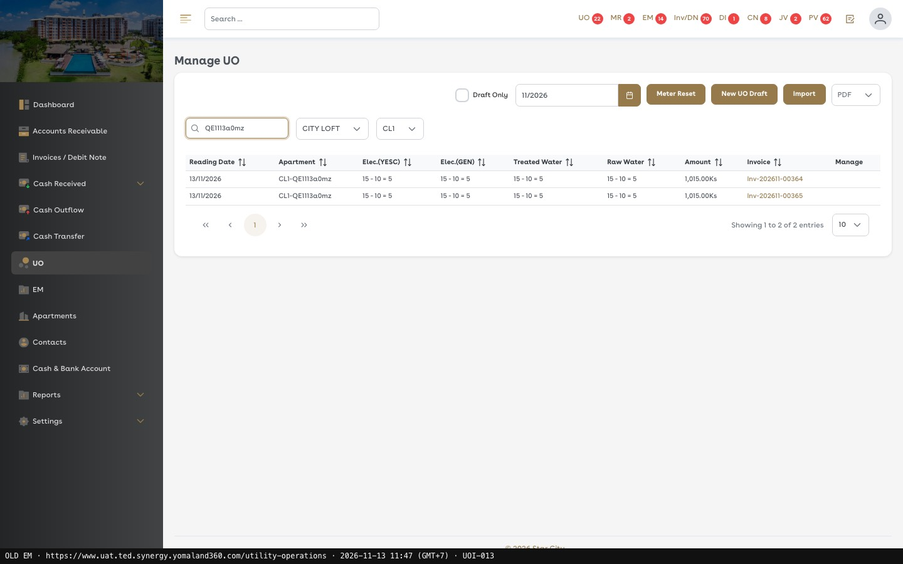

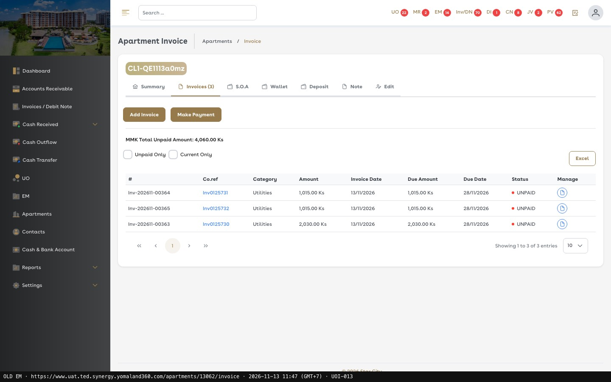

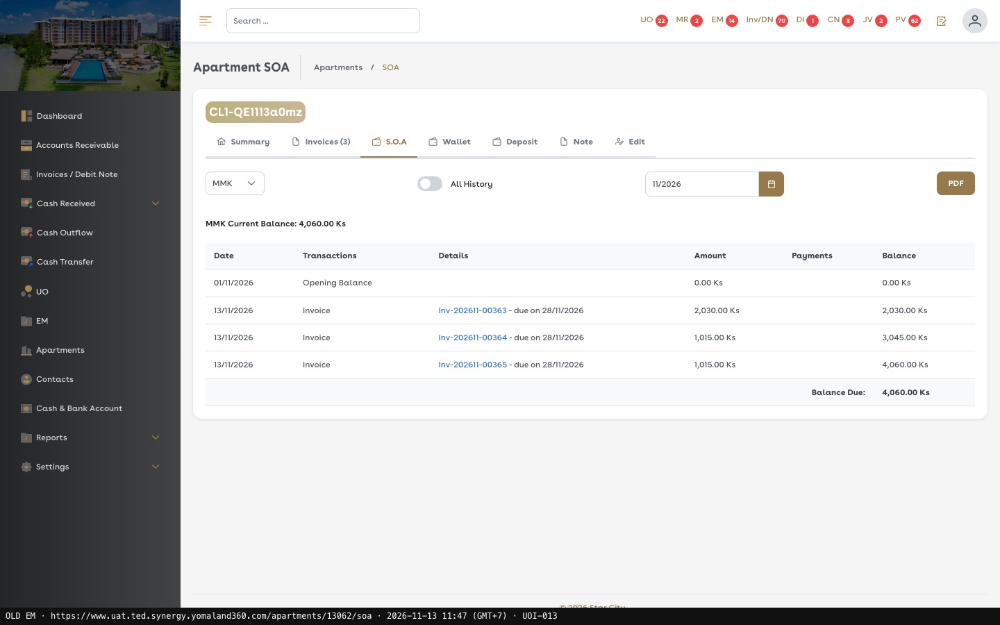

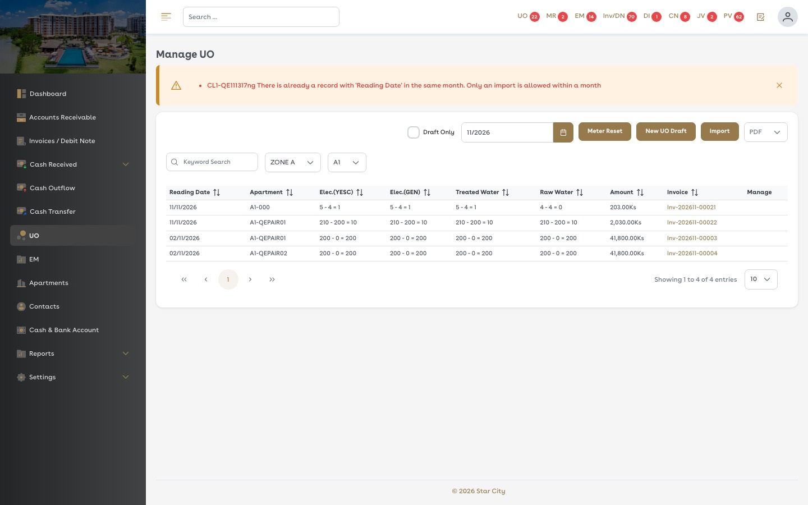

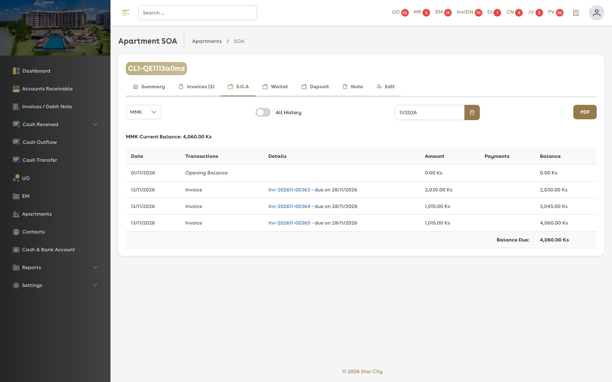

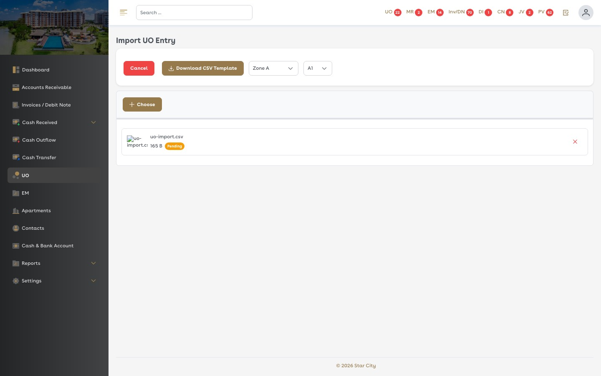

#### ❌ [UOI-013](../../em/docs/test-cases/features/06-uo-import.md#uoi-013--multi-record-import---second-record-in-same-monthdate-rejected-first-saved) [Same reading date, different data] · Multi-record import - second record in same month/date rejected (first saved)

Priority P2 · test: [issues/uo-bulk.spec.ts](../tests/issues/uo-bulk.spec.ts)

**Why it fails:** One import file with **two rows for the same apartment in the same month**: Old EM imports both ("2 UO Entry imported."), with no error for the second row. The apartment gets 2 UO entries and 2 invoices instead of 1, and the second row is also calculated from the old reading ("18 − 10 = 8" next to "15 − 10 = 5"), so the same usage is billed twice. Failed for all 4 variants in 3 of 3 runs. Re-uploading the same file and two uploads at the same moment were blocked in the test runs (the loser gets HTTP 500 "Internal Server Error"), but during a manual try two simultaneous uploads of the same file both went through and created 2 invoices.

**Impact:** Residents are billed twice for utilities.

**Decision needed:** Old EM defect (reported as "UO invoice duplication when bulk upload"). New EM must reject a second row for the same apartment and month within one file and lock concurrent uploads.

<details><summary>Test output</summary>

```text
Error: records imported — expected 1 (1st only), actual 2: "2 UO Entry imported."

expect(received).toBe(expected) // Object.is equality

Expected: 1
Received: 2

Error: a failure message for the 2nd record of CL1-QE1113frid — actual "2 UO Entry imported."

expect(received).toBe(expected) // Object.is equality

Expected: true
Received: false

Error: CL1-QE1113frid: UO entries this month — expected 1, actual 2 [Inv-202611-00367, Inv-202611-00368]

expect(received).toBe(expected) // Object.is equality

Expected: 1
Received: 2

Error: CL1-QE1113frid: Utilities invoices on the Invoices tab — expected 2 (1 earlier + 1 new), actual 3 [Inv-202611-00368, Inv-202611-00367, Inv-202611-00366]

expect(received).toBe(expected) // Object.is equality

Expected: 2
Received: 3

Error: CL1-QE1113frid: invoice rows on the S.O.A — expected 2, actual 3

expect(received).toBe(expected) // Object.is equality

Expected: 2
Received: 3

Error: the saved record is the 1st one (15 on 13/11/2026) — Elec.(YESC) expected ["15 - 10 = 5"], actual ["15 - 10 = 5","18 - 10 = 8"]

expect(received).toEqual(expected) // deep equality

- Expected  - 0
+ Received  + 1

  Array [
    "15 - 10 = 5",
+   "18 - 10 = 8",
  ]
```

</details>

![UOI-013 [Same reading date, different data] · same-reading-date-different-data_uo-list_QE1113frid](img/UOI-013_Same_reading_date_different_data-1.jpg)

![UOI-013 [Same reading date, different data] · same-reading-date-different-data_apartment-invoices_QE1113frid](img/UOI-013_Same_reading_date_different_data-2.jpg)

![UOI-013 [Same reading date, different data] · same-reading-date-different-data_apartment-soa_QE1113frid](img/UOI-013_Same_reading_date_different_data-3.jpg)

![UOI-013 [Same reading date, different data] · Screen at failure](img/UOI-013_Same_reading_date_different_data-4.jpg)

#### ❌ [UOI-013](../../em/docs/test-cases/features/06-uo-import.md#uoi-013--multi-record-import---second-record-in-same-monthdate-rejected-first-saved) [Same month, different dates] · Multi-record import - second record in same month/date rejected (first saved)

Priority P2 · test: [issues/uo-bulk.spec.ts](../tests/issues/uo-bulk.spec.ts)

**Why it fails:** One import file with **two rows for the same apartment in the same month**: Old EM imports both ("2 UO Entry imported."), with no error for the second row. The apartment gets 2 UO entries and 2 invoices instead of 1, and the second row is also calculated from the old reading ("18 − 10 = 8" next to "15 − 10 = 5"), so the same usage is billed twice. Failed for all 4 variants in 3 of 3 runs. Re-uploading the same file and two uploads at the same moment were blocked in the test runs (the loser gets HTTP 500 "Internal Server Error"), but during a manual try two simultaneous uploads of the same file both went through and created 2 invoices.

**Impact:** Residents are billed twice for utilities.

**Decision needed:** Old EM defect (reported as "UO invoice duplication when bulk upload"). New EM must reject a second row for the same apartment and month within one file and lock concurrent uploads.

<details><summary>Test output</summary>

```text
Error: records imported — expected 1 (1st only), actual 2: "2 UO Entry imported."

expect(received).toBe(expected) // Object.is equality

Expected: 1
Received: 2

Error: a failure message for the 2nd record of CL1-QE11134c69 — actual "2 UO Entry imported."

expect(received).toBe(expected) // Object.is equality

Expected: true
Received: false

Error: CL1-QE11134c69: UO entries this month — expected 1, actual 2 [Inv-202611-00371, Inv-202611-00370]

expect(received).toBe(expected) // Object.is equality

Expected: 1
Received: 2

Error: CL1-QE11134c69: Utilities invoices on the Invoices tab — expected 2 (1 earlier + 1 new), actual 3 [Inv-202611-00371, Inv-202611-00370, Inv-202611-00369]

expect(received).toBe(expected) // Object.is equality

Expected: 2
Received: 3

Error: CL1-QE11134c69: invoice rows on the S.O.A — expected 2, actual 3

expect(received).toBe(expected) // Object.is equality

Expected: 2
Received: 3

Error: the saved record is the 1st one (15 on 01/11/2026) — Elec.(YESC) expected ["15 - 10 = 5"], actual ["15 - 10 = 5","15 - 10 = 5"]

expect(received).toEqual(expected) // deep equality

- Expected  - 0
+ Received  + 1

  Array [
    "15 - 10 = 5",
+   "15 - 10 = 5",
  ]
```

</details>

![UOI-013 [Same month, different dates] · same-month-different-dates_uo-list_QE11134c69](img/UOI-013_Same_month_different_dates-1.jpg)

![UOI-013 [Same month, different dates] · same-month-different-dates_apartment-invoices_QE11134c69](img/UOI-013_Same_month_different_dates-2.jpg)

![UOI-013 [Same month, different dates] · same-month-different-dates_apartment-soa_QE11134c69](img/UOI-013_Same_month_different_dates-3.jpg)

![UOI-013 [Same month, different dates] · Screen at failure](img/UOI-013_Same_month_different_dates-4.jpg)

#### ❌ [UOI-013](../../em/docs/test-cases/features/06-uo-import.md#uoi-013--multi-record-import---second-record-in-same-monthdate-rejected-first-saved) [Same month 25/02, different units] · Multi-record import - second record in same month/date rejected (first saved)

Priority P2 · test: [issues/uo-bulk.spec.ts](../tests/issues/uo-bulk.spec.ts)

**Why it fails:** One import file with **two rows for the same apartment in the same month**: Old EM imports both ("2 UO Entry imported."), with no error for the second row. The apartment gets 2 UO entries and 2 invoices instead of 1, and the second row is also calculated from the old reading ("18 − 10 = 8" next to "15 − 10 = 5"), so the same usage is billed twice. Failed for all 4 variants in 3 of 3 runs. Re-uploading the same file and two uploads at the same moment were blocked in the test runs (the loser gets HTTP 500 "Internal Server Error"), but during a manual try two simultaneous uploads of the same file both went through and created 2 invoices.

**Impact:** Residents are billed twice for utilities.

**Decision needed:** Old EM defect (reported as "UO invoice duplication when bulk upload"). New EM must reject a second row for the same apartment and month within one file and lock concurrent uploads.

<details><summary>Test output</summary>

```text
Error: records imported — expected 1 (1st only), actual 2: "2 UO Entry imported."

expect(received).toBe(expected) // Object.is equality

Expected: 1
Received: 2

Error: a failure message for the 2nd record of CL1-QE1113r1ko — actual "2 UO Entry imported."

expect(received).toBe(expected) // Object.is equality

Expected: true
Received: false

Error: CL1-QE1113r1ko: UO entries this month — expected 1, actual 2 [Inv-202611-00374, Inv-202611-00373]

expect(received).toBe(expected) // Object.is equality

Expected: 1
Received: 2

Error: CL1-QE1113r1ko: Utilities invoices on the Invoices tab — expected 2 (1 earlier + 1 new), actual 3 [Inv-202611-00373, Inv-202611-00374, Inv-202611-00372]

expect(received).toBe(expected) // Object.is equality

Expected: 2
Received: 3

Error: CL1-QE1113r1ko: invoice rows on the S.O.A — expected 2, actual 3

expect(received).toBe(expected) // Object.is equality

Expected: 2
Received: 3

Error: the saved record is the 1st one (15 on 01/11/2026) — Elec.(YESC) expected ["15 - 10 = 5"], actual ["18 - 10 = 8","15 - 10 = 5"]

expect(received).toEqual(expected) // deep equality

- Expected  - 0
+ Received  + 1

  Array [
+   "18 - 10 = 8",
    "15 - 10 = 5",
  ]
```

</details>

![UOI-013 [Same month 25/02, different units] · same-month-25-02-different-units_uo-list_QE1113r1ko](img/UOI-013_Same_month_25_02_different_units-1.jpg)

![UOI-013 [Same month 25/02, different units] · same-month-25-02-different-units_apartment-invoices_QE1113r1ko](img/UOI-013_Same_month_25_02_different_units-2.jpg)

![UOI-013 [Same month 25/02, different units] · same-month-25-02-different-units_apartment-soa_QE1113r1ko](img/UOI-013_Same_month_25_02_different_units-3.jpg)

![UOI-013 [Same month 25/02, different units] · Screen at failure](img/UOI-013_Same_month_25_02_different_units-4.jpg)

### Payment Concurrency (1 Inv × 2 RV, 1 RV × 2 Inv)

Two simultaneous payments of the same invoice are both accepted: double payment, overpayment and wrong due amounts.

#### ❌ [CONC-001](../../em/docs/test-cases/features/12-payment-concurrency.md#-conc-001--1-invoice-2-concurrent-full-payments-2nd-rejected-as-paid-in-full-matrix) · 1 invoice, 2 concurrent full payments: 2nd rejected as paid in full (matrix)

Priority P1 · ★ critical business flow · test: [issues/concurrency.spec.ts](../tests/issues/concurrency.spec.ts)

**Why it fails:** Two users pay the same 1,000 Ks invoice in full at the same moment. Old EM does not handle it the same way twice: in 3 of 3 earlier races (12–13 Nov) **both payments were accepted** (SOA payments [1,000, 1,000], Balance Due −1,000, account +2,000); in the final run (13 Nov) the second payment failed with **HTTP 500 "Internal Server Error"** and only one was posted. The case expects the second user to see "This invoice has already been paid in full"; that message never appeared.

**Impact:** Invoices paid twice or overpaid, wrong due amounts and AR.

**Decision needed:** Old EM defect (reported as "Balance issue: concurrency"): New EM must lock the invoice (or re-check the due amount) when a payment is saved.

<details><summary>Test output</summary>

```text
Error: attempt 1: sessions shown "This invoice has already been paid in full. No further payments are required.". Expected 1, got 0: /apartments/13020/make-payment — "Internal Server Error" | /apartments/13020/soa — "Payment has been approved successfully"

expect(received).toBe(expected) // Object.is equality

Expected: 1
Received: 0
```

</details>

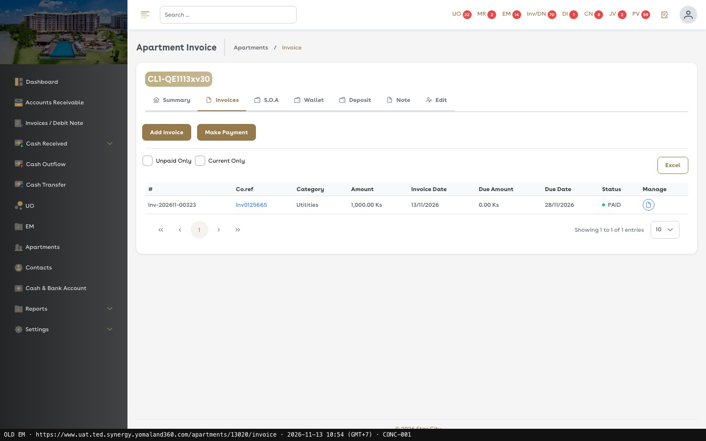

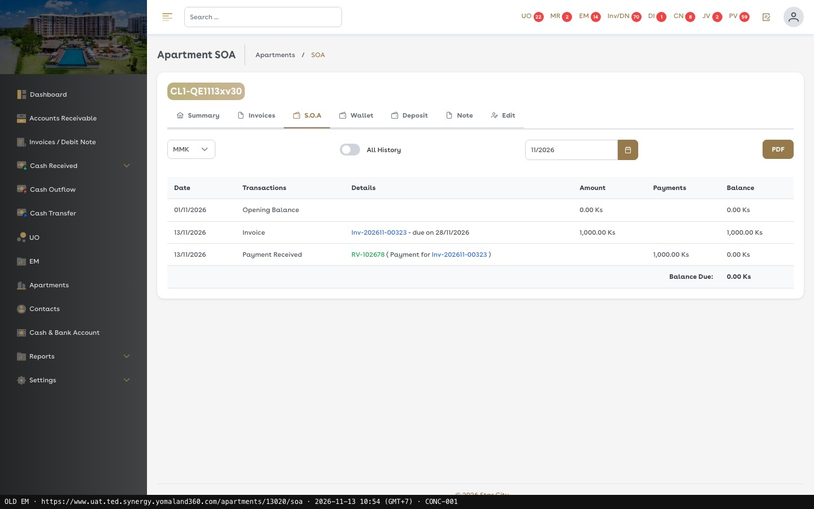

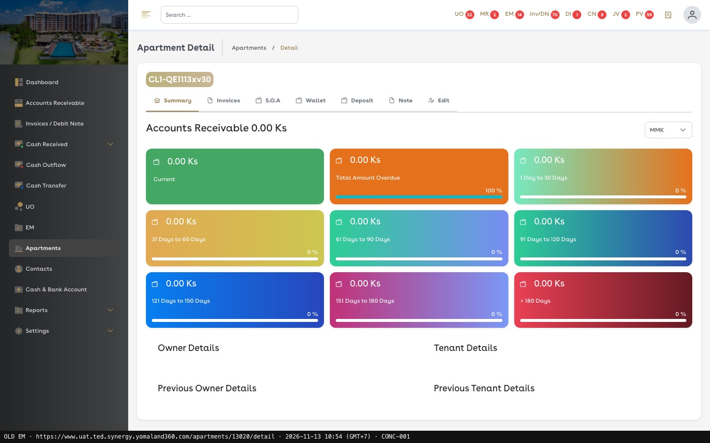

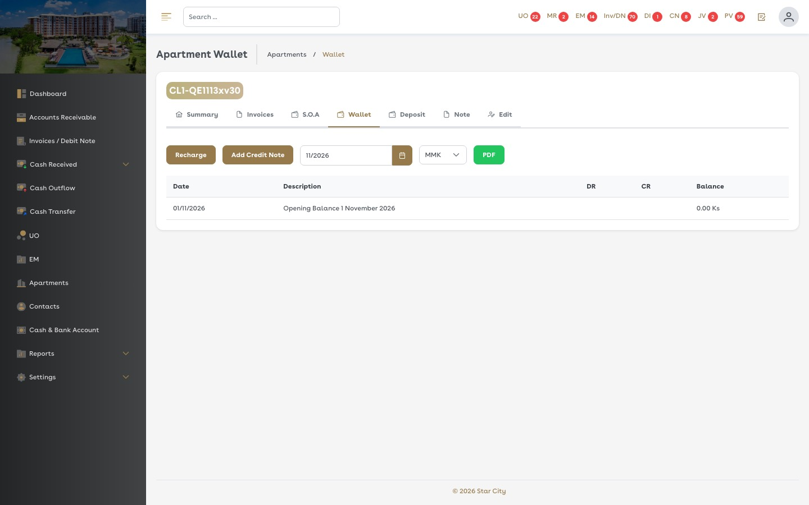

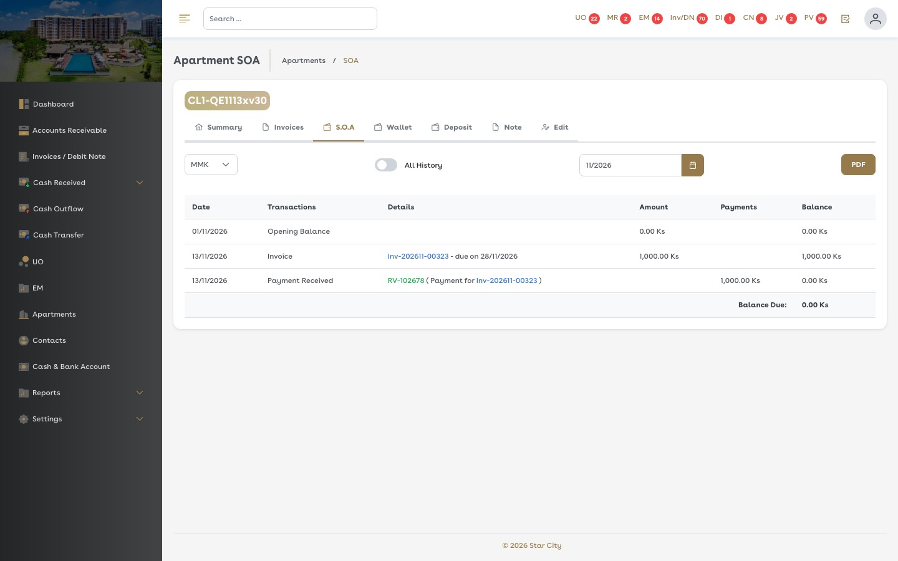

#### ❌ [CONC-003](../../em/docs/test-cases/features/12-payment-concurrency.md#-conc-003--1-invoice-2-concurrent-partial-payments-within-balance-both-accepted-matrix) · 1 invoice, 2 concurrent partial payments within balance: both accepted (matrix)

Priority P1 · ★ critical business flow · test: [issues/concurrency.spec.ts](../tests/issues/concurrency.spec.ts)

**Why it fails:** Two partial payments (400 and 500) of a 1,000 Ks invoice at the same moment; the case expects both to be accepted (due 100). Earlier races: both accepted but the due amount and AR showed **500 instead of 100** (one update overwrote the other). Final run: one payment failed with **HTTP 500**, so only 500 was paid.

**Impact:** Invoices paid twice or overpaid, wrong due amounts and AR.

**Decision needed:** Old EM defect (reported as "Balance issue: concurrency"): New EM must lock the invoice (or re-check the due amount) when a payment is saved.

<details><summary>Test output</summary>

```text
Error: attempt 1: sessions whose payment went through. Expected 2, got 1: /apartments/13021/soa — "Payment has been approved successfully" | /apartments/13021/make-payment — "Internal Server Error"

expect(received).toBe(expected) // Object.is equality

Expected: 2
Received: 1

Error: attempt 1: S.O.A payments for Inv-202611-00324

expect(received).toEqual(expected) // deep equality

- Expected  - 1
+ Received  + 0

  Array [
-   400,
    500,
  ]

Error: attempt 1: invoice due amount (1,000 − 900)

expect(received).toBe(expected) // Object.is equality

Expected: 100
Received: 500

Error: attempt 1: S.O.A Balance Due

expect(received).toBe(expected) // Object.is equality

Expected: 100
Received: 500

Error: attempt 1: apartment AR

expect(received).toBe(expected) // Object.is equality

Expected: 100
Received: 500

Error: attempt 1: money received into QE OLD 20261113-ko7p Cash

expect(received).toBe(expected) // Object.is equality

Expected: 900
Received: 500
```

</details>

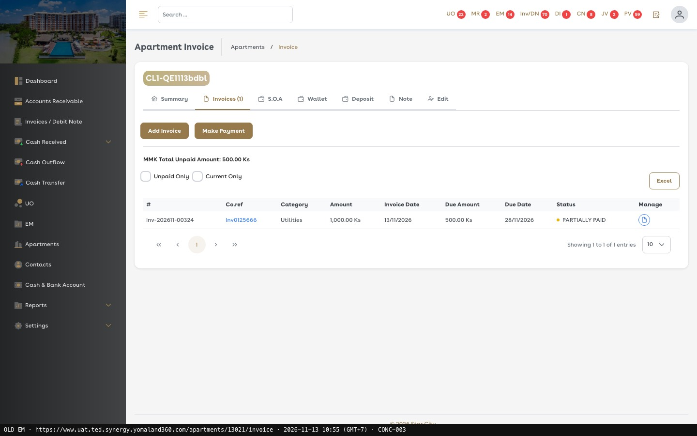


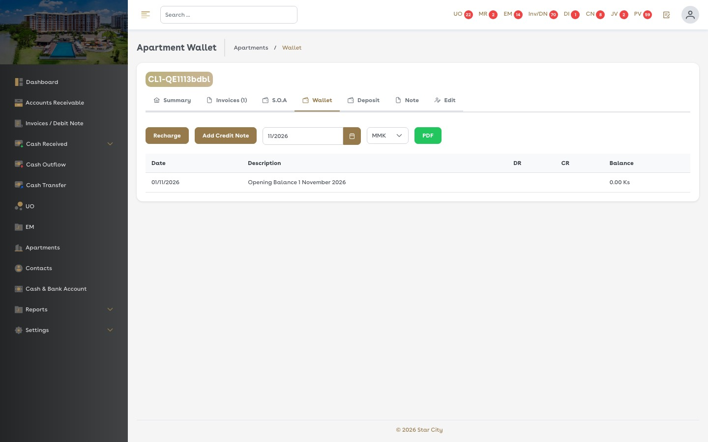

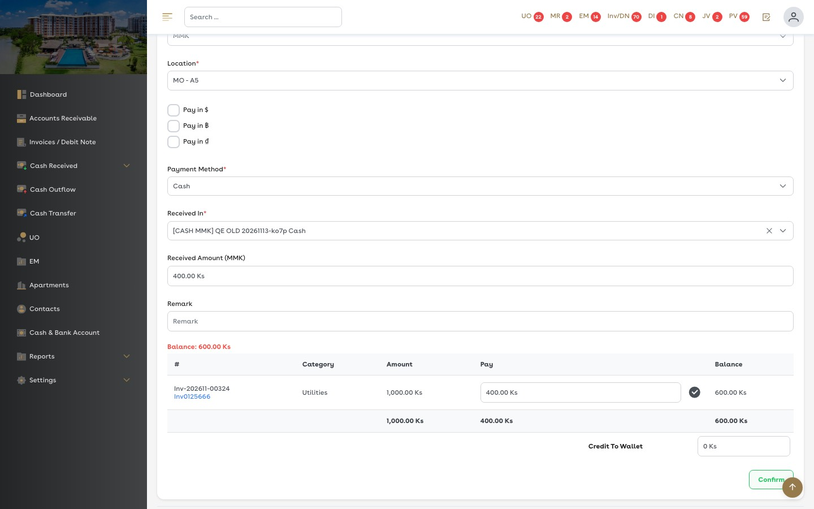

#### ❌ [CONC-004](../../em/docs/test-cases/features/12-payment-concurrency.md#-conc-004--1-invoice-2-concurrent-partials-exceeding-balance-2nd-asked-to-refresh-matrix) · 1 invoice, 2 concurrent partials exceeding balance: 2nd asked to refresh (matrix)

Priority P1 · ★ critical business flow · test: [issues/concurrency.spec.ts](../tests/issues/concurrency.spec.ts)

**Why it fails:** Two partial payments that together exceed the invoice (500 + 600 on 1,000 Ks); the case expects the second to be asked to refresh. Earlier races (3 of 3): **both accepted**, 1,100 paid, Balance Due −100. Final run: the second failed with **HTTP 500** instead of the refresh message.

**Impact:** Invoices paid twice or overpaid, wrong due amounts and AR.

**Decision needed:** Old EM defect (reported as "Balance issue: concurrency"): New EM must lock the invoice (or re-check the due amount) when a payment is saved.

<details><summary>Test output</summary>

```text
Error: attempt 1: sessions shown "This invoice has already been partially paid. Please refresh and try again.". Expected 1, got 0: /apartments/13022/make-payment — "Internal Server Error" | /apartments/13022/soa — "Payment has been approved successfully"

expect(received).toBe(expected) // Object.is equality

Expected: 1
Received: 0
```

</details>


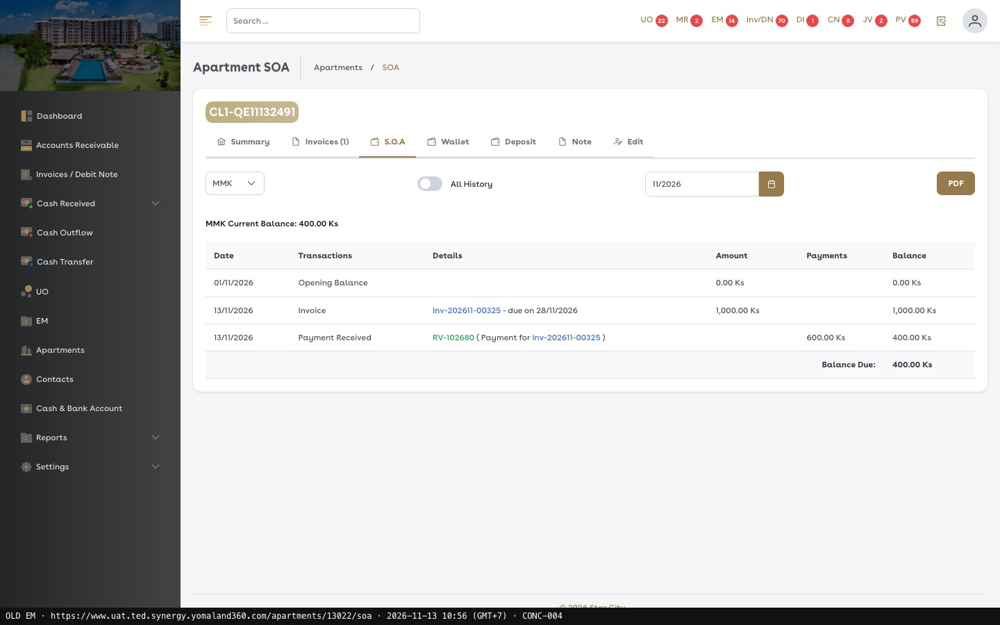


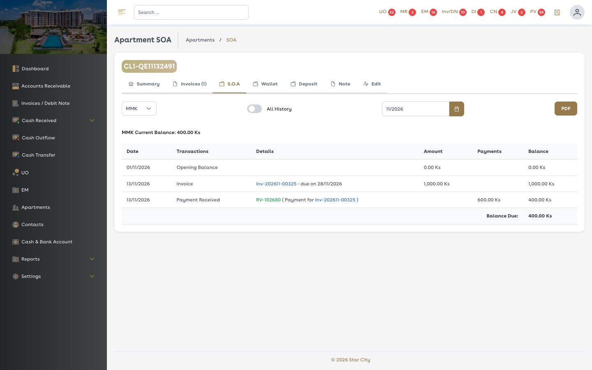

### Cash & Bank Account

Editing the initial balance after transactions is not carried into the next day's Account Statement; the account Type also has no default.

#### ❌ [CBA-001](../../em/docs/test-cases/features/15-cash-bank-account.md#cba-001--create-cash-account-with-initial-balance-balance-shown-in-account-list) · Create Cash account with initial balance; balance shown in account list

Priority P1 · test: [cash-bank-account/cash-bank-account.spec.ts](../tests/cash-bank-account/cash-bank-account.spec.ts)

**Why it fails:** Step 5 says the account **Type is "Cash" by default**. Old EM's New Account form shows "Select Type" with no default. The expected result itself passes: the new account shows Initial Balance and Closing Balance of 100,000.00 Ks in the list.

**Impact:** Low. The user has one more field to choose.

**Decision needed:** Default the Type to Cash in New EM, or remove step 5 from the case.

<details><summary>Test output</summary>

```text
Error: Case step 5: Type is "Cash" by default. Old EM shows "Select Type" (no default)

expect(received).toMatch(expected)

Expected pattern: /^cash$/i
Received string:  "Select Type"
```

</details>

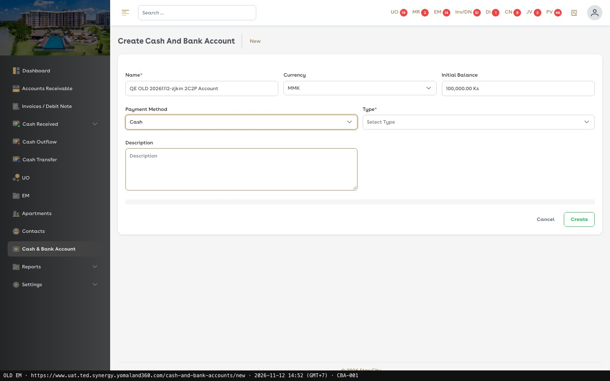

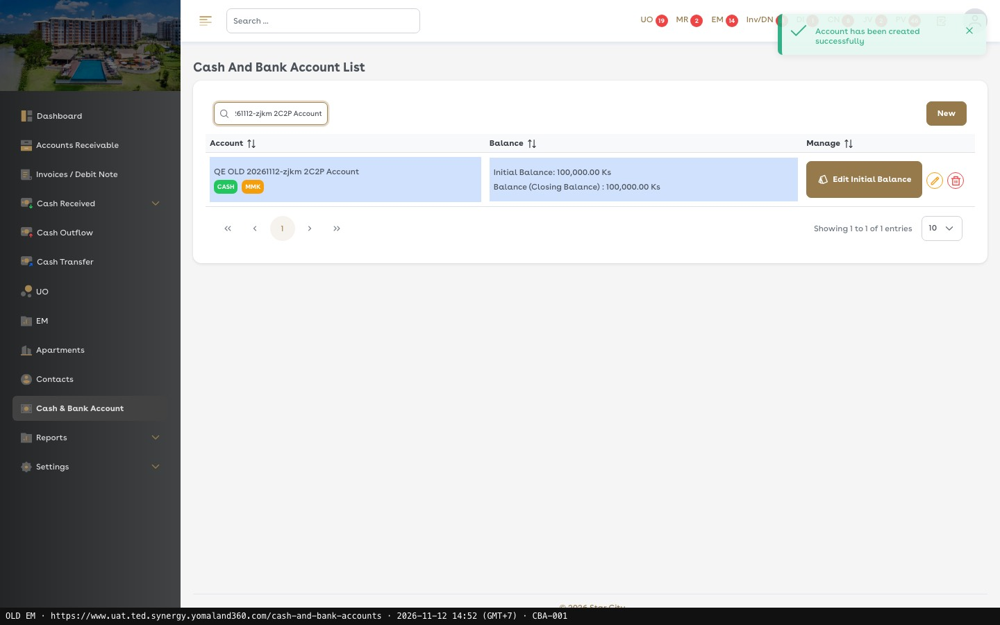

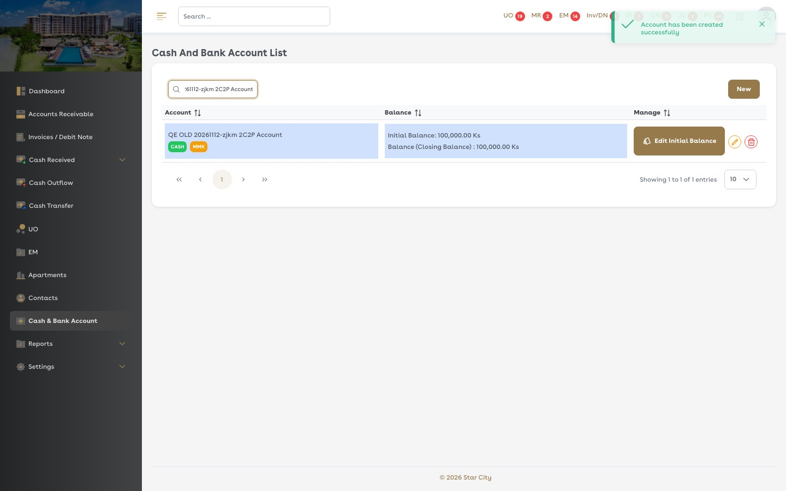

#### ❌ [CBA-010](../../em/docs/test-cases/features/15-cash-bank-account.md#-cba-010--edit-initial-balance-after-transactions-closing-balance-recalculated) · Edit initial balance after transactions; closing balance recalculated

Priority P1 · ★ critical business flow · test: [issues/initial-balance.spec.ts](../tests/issues/initial-balance.spec.ts)

**Why it fails:** After editing the initial balance of an account that already has transactions, the account list, the dashboard Cash & Bank Balance and today's Account Statement all show the new closing balance (51,100). But the statement for **tomorrow** opens at **11,100**, the balance before the edit: today's closing does not equal tomorrow's opening.

**Impact:** From the next day the Account Statement starts from a wrong balance and every later day is off by the edited amount.

**Decision needed:** Old EM defect (reported as "Balance issue: initial balance edit"). Fix in New EM; decide also whether editing the initial balance after transactions should be allowed at all (source-issues.md D6).

<details><summary>Test output</summary>

```text
Error: Statement 14/11/2026: Opening Balance

expect(received).toBe(expected) // Object.is equality

Expected: "51,100.00"
Received: "11,100.00"

Error: Statement 14/11/2026: closing balance

expect(received).toBe(expected) // Object.is equality

Expected: "51,100.00"
Received: "11,100.00"

Error: Statement 14/11/2026: Opening Balance = closing balance of the day before (as shown)

expect(received).toBe(expected) // Object.is equality

Expected: "51,100.00"
Received: "11,100.00"
```

</details>

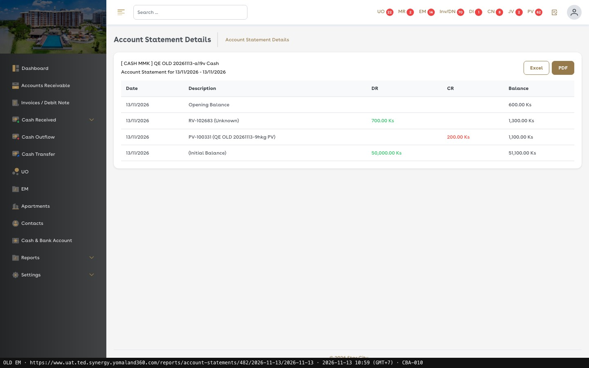

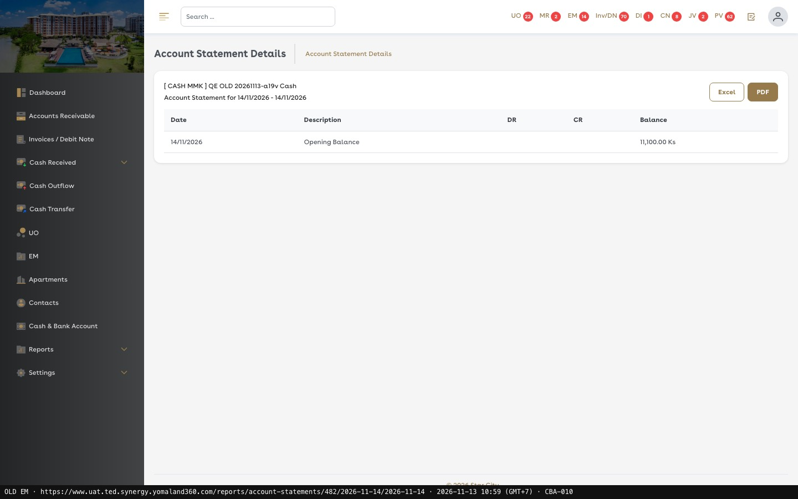


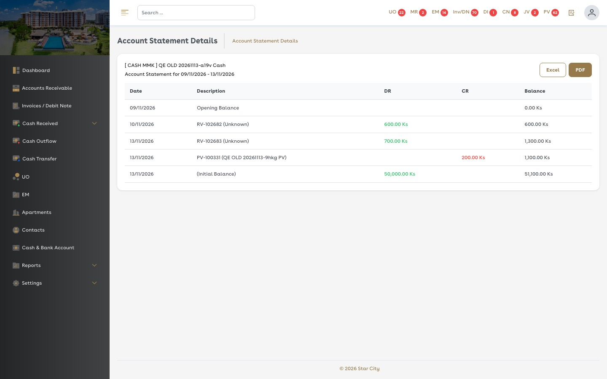

### Wallet — Opening / Closing Balance

After a credit note and a wallet payment, the next month's wallet opening balance ignores the payment. A full-balance refund draft can be created twice (approval still blocks it).

#### ❌ [OB-WAL-012](../../em/docs/test-cases/features/balances/20-wallet-ob-cb.md#-ob-wal-012--wallet-2-users-debit-fullover-balance-concurrently--second-is-refused) · Wallet: 2 users debit full/over balance concurrently — second is refused

Priority P1 · ★ critical business flow · test: [issues/concurrency.spec.ts](../tests/issues/concurrency.spec.ts)

**Why it fails:** Two wallet refund drafts of the full wallet balance (100,000) are both created; the case expects the second to be refused. Money stays safe: when both drafts are approved together, one is refused with "Insufficient Balance" and the wallet ends at 0.

**Impact:** Low: approval still blocks the overdraw; the approver sees a draft that cannot be approved.

**Decision needed:** Decide whether the balance check must happen when the draft is created (as the case says) or only at approval (Old EM).

<details><summary>Test output</summary>

```text
Error: attempt 1: Wallet Refund drafts created for the 100,000.00 Ks wallet. Expected 1 (second refused), got 2; sessions saw: /apartments/13023/wallet — "Wallet Refund has been created successfully" | /apartments/13023/wallet — "Wallet Refund has been created successfully"

expect(received).toBe(expected) // Object.is equality

Expected: 1
Received: 2

Error: attempt 1: sessions shown "Insufficient Balance in 'Withdraw From' Account"

expect(received).toBe(expected) // Object.is equality

Expected: 1
Received: 0
```

</details>

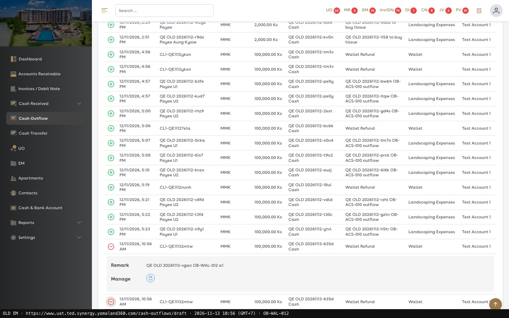

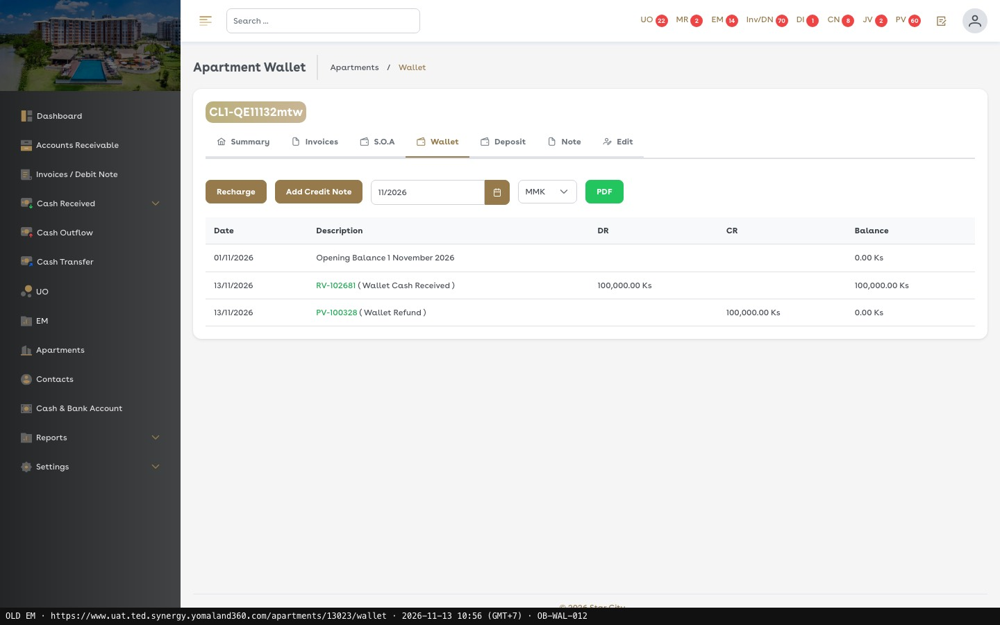

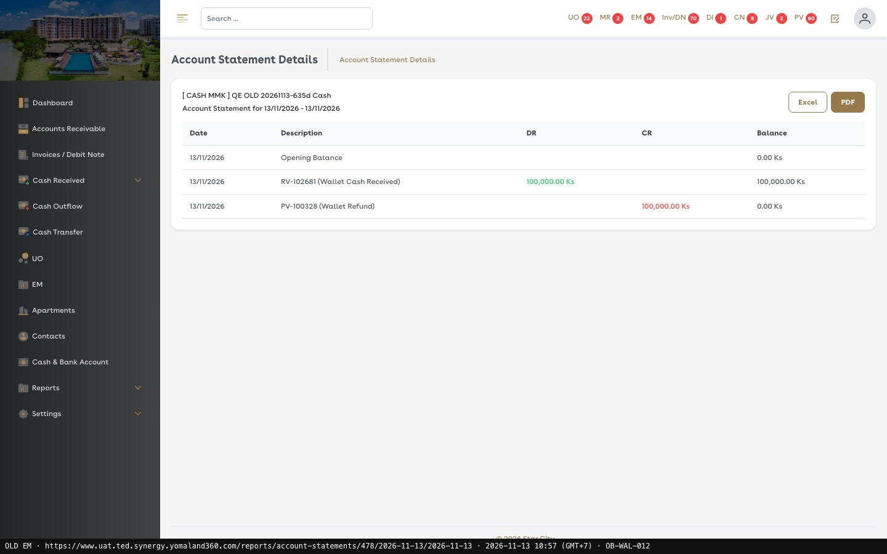

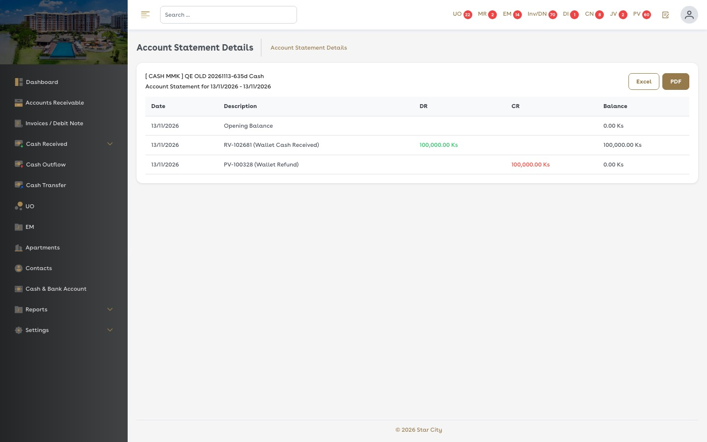

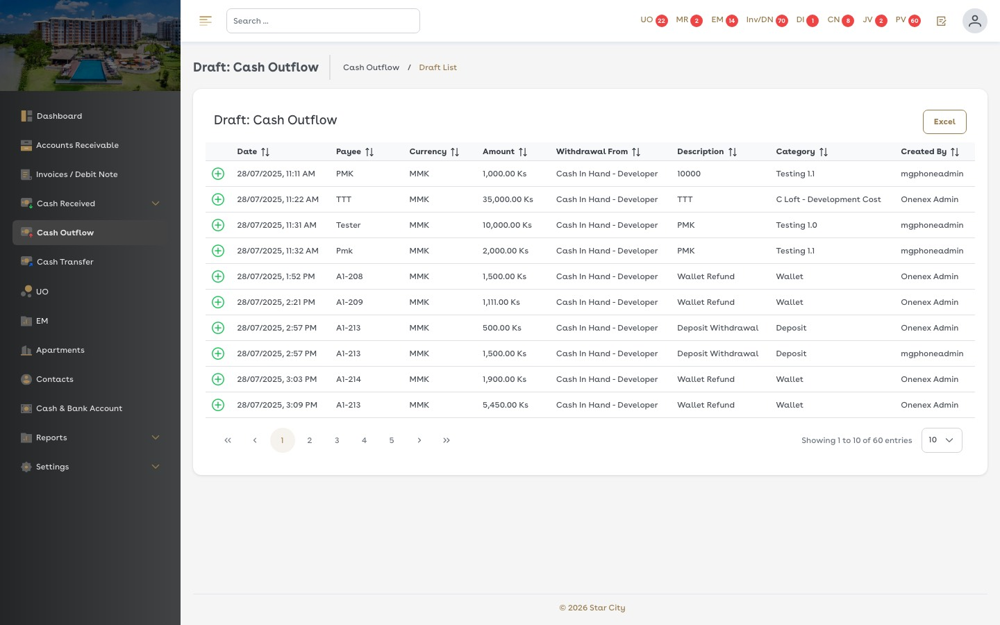

#### ❌ [OB-WAL-011](../../em/docs/test-cases/features/balances/20-wallet-ob-cb.md#-ob-wal-011--wallet-obcb-continuity--one-transaction-type-followed-by-another) [1st=Credit Note(CN); then 2nd=Wallet Payment(WP)] · Wallet OB/CB continuity — one transaction type followed by another

Priority P1 · ★ critical business flow · test: [issues/wallet-sequences.spec.ts](../tests/issues/wallet-sequences.spec.ts)

**Why it fails:** Credit note +50,000 then a Wallet Payment of 10,500: within November the wallet is right (closes at 39,500, Current Balance 39,500). The Opening Balance of 01/12/2026 shows **50,000.00**, expected **39,500.00**: the next month ignores the wallet payment.

**Impact:** The wallet statement of the following months shows more money than the resident has.

**Decision needed:** Old EM defect (reported as "Wallet Payment after Credit Note"). Fix in New EM.

<details><summary>Test output</summary>

```text
Error: wallet: Opening Balance 01/12/2026 = closing balance of 11/2026

expect(received).toBe(expected) // Object.is equality

Expected: "39,500.00"
Received: "50,000.00"
```

</details>

![OB-WAL-011 [1st=Credit Note(CN); then 2nd=Wallet Payment(WP)] · CN-WP_2-WP_soa](img/OB-WAL-011_1st_Credit_Note_CN_then_2nd_Wallet_Payment_WP-1.jpg)

![OB-WAL-011 [1st=Credit Note(CN); then 2nd=Wallet Payment(WP)] · CN-WP_wallet](img/OB-WAL-011_1st_Credit_Note_CN_then_2nd_Wallet_Payment_WP-2.jpg)

![OB-WAL-011 [1st=Credit Note(CN); then 2nd=Wallet Payment(WP)] · CN-WP_wallet-next-month](img/OB-WAL-011_1st_Credit_Note_CN_then_2nd_Wallet_Payment_WP-3.jpg)

![OB-WAL-011 [1st=Credit Note(CN); then 2nd=Wallet Payment(WP)] · Screen at failure](img/OB-WAL-011_1st_Credit_Note_CN_then_2nd_Wallet_Payment_WP-4.jpg)

### Account Statement — Opening / Closing Balance

#### ❌ [OB-ACS-010](../../em/docs/test-cases/features/balances/22-account-statement-ob-cb.md#-ob-acs-010--account-2-users-debit-fullover-balance-concurrently--second-is-refused) · Account: 2 users debit full/over balance concurrently — second is refused

Priority P1 · ★ critical business flow · test: [issues/concurrency.spec.ts](../tests/issues/concurrency.spec.ts)

**Why it fails:** Two cash outflows of the full account balance (100,000) approved at the same moment: the money is safe (one PV approved, account ends at 0, one PV row in the statement). But in 1 of 2 races the losing approval got **HTTP 500 "Internal Server Error"** instead of the expected "Insufficient Balance" message (the other race showed the correct message). Both drafts are also accepted at creation; the balance is only checked at approval.

**Impact:** Low: no wrong money, but the approver sees a server error instead of the reason.

**Decision needed:** New EM should refuse the second debit with a clear "Insufficient balance" message.

<details><summary>Test output</summary>

```text
Error: attempt 2: second outflow refused with "Insufficient balance" (at draft or approval). Drafts: /cash-outflows — "Cash Outflow has been created successfully" | /cash-outflows — "Cash Outflow has been created successfully"; approvals: /cash-outflows/6357/draft — "Internal Server Error" | /cash-outflows/draft — "Cash Outflow has been approved successfully"

expect(received).toBe(expected) // Object.is equality

Expected: 1
Received: 0
```

</details>

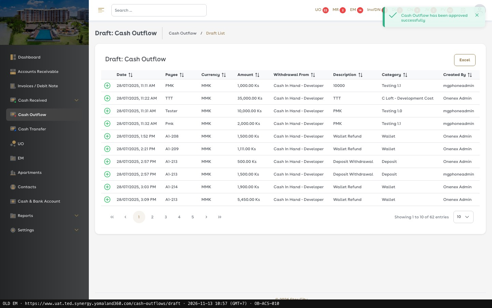

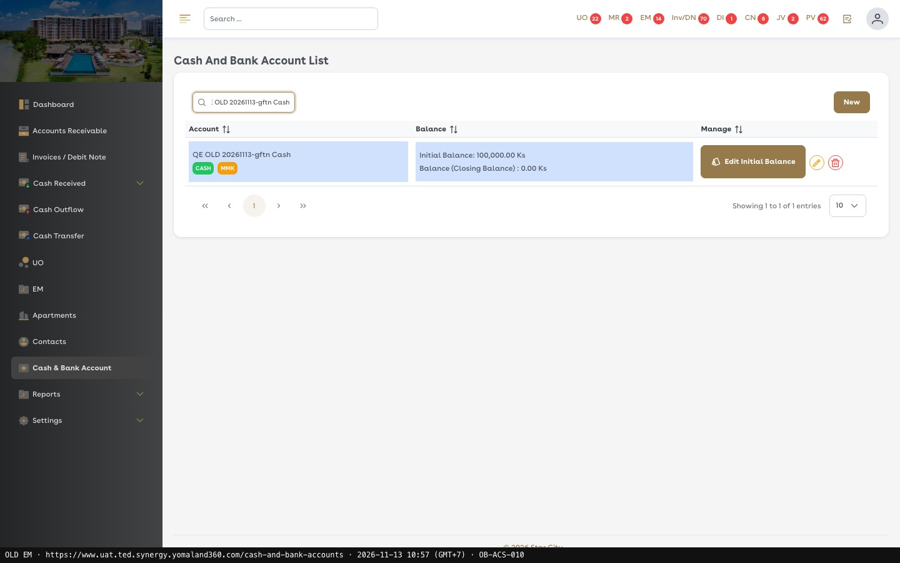

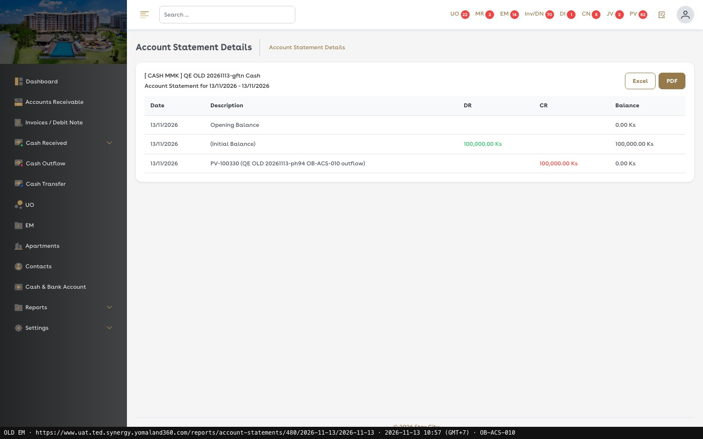

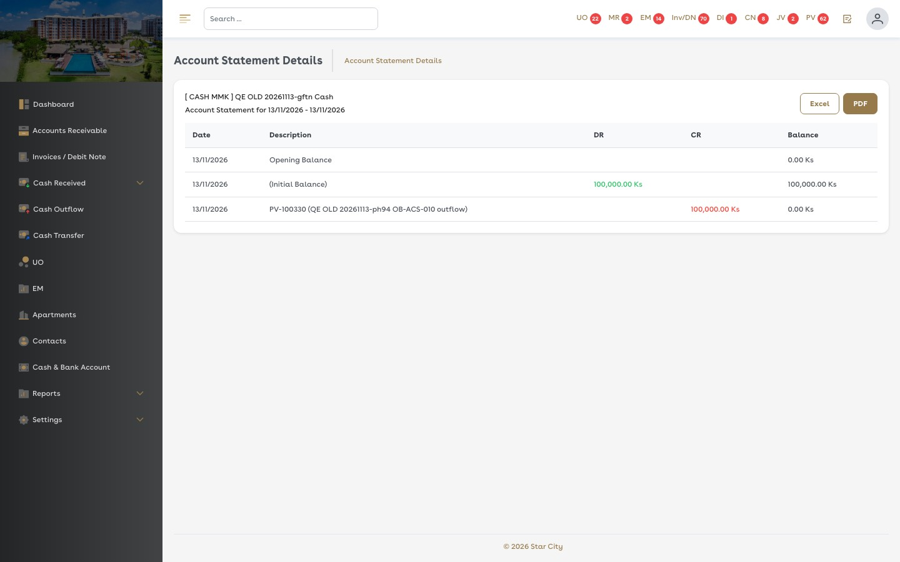


### Cash Received (RV / Unknown / Funding)

Unknown Received can only be deposited into bank accounts, while the case deposits into a cash account.

#### ❌ [CR-002](../../em/docs/test-cases/features/11-cash-received.md#-cr-002--record-unknown-received-mmk-rv-listed-for-allocation-and-account-balance-increases) · Record Unknown Received (MMK); RV listed for allocation and account balance increases

Priority P1 · ★ critical business flow · test: [collection/cash-received.spec.ts](../tests/collection/cash-received.spec.ts)

**Why it fails:** The case records an Unknown Received into **"[Cash MMK] 2C2P Account"**. On Old EM's Unknown Received form, the *Deposit In* list offers **only bank accounts** (0 cash accounts out of 84), even for a cash account with every payment method enabled. With a bank account, the rest of the case passes: RV listed for allocation, serial RV number, account balance +10,000.

**Impact:** Cash collected from an unknown payer cannot be recorded into a cash-in-hand account in Old EM.

**Decision needed:** May Unknown Received go to a cash account? If **yes**, this is an Old EM defect that New EM should fix. If **no**, change the case's test data to a bank account.

<details><summary>Test output</summary>

```text
Error: Deposit* should offer our [CASH MMK] account "QE OLD 20261112-98o4 Cash" (case data: "[Cash MMK] 2C2P Account"); Old EM lists 0 CASH accounts out of 84 (bank accounts only)

expect(received).toBe(expected) // Object.is equality

Expected: true
Received: false
```

</details>

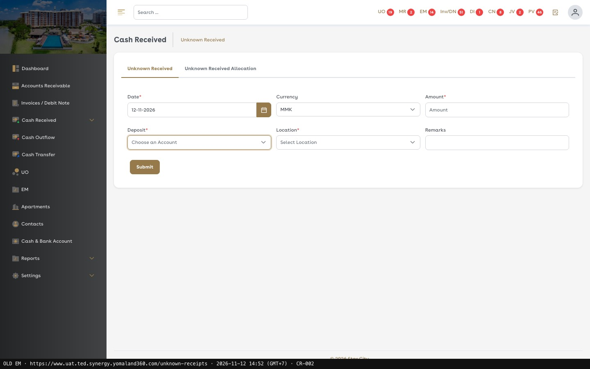

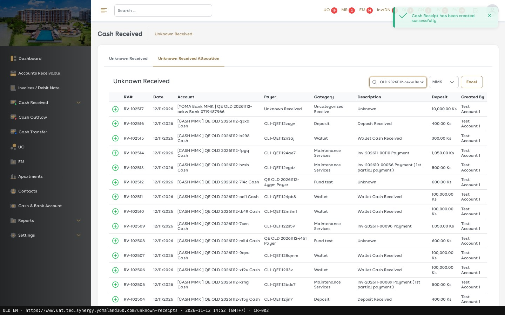

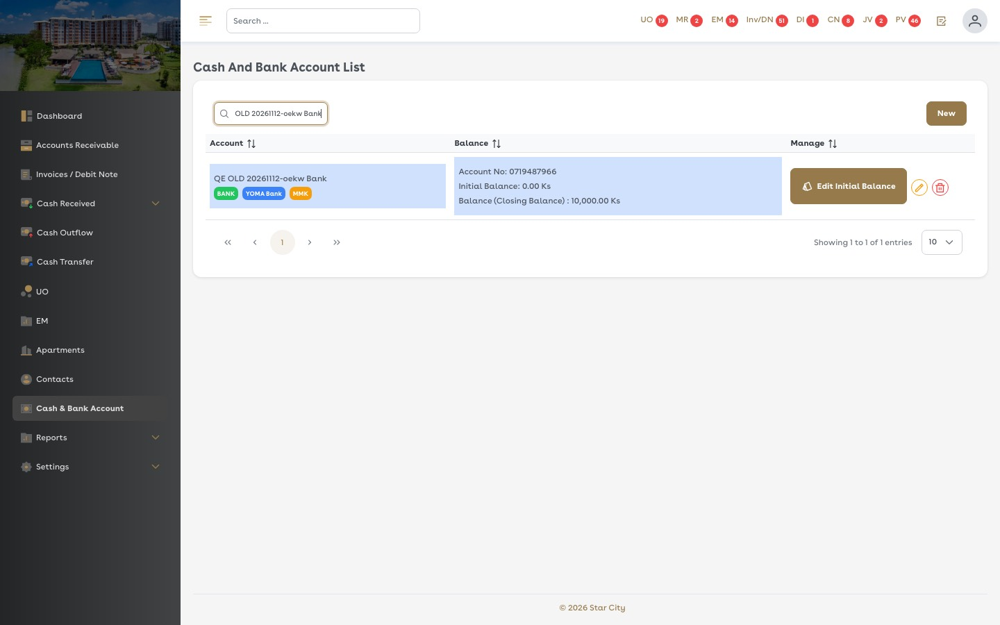

### Make Payment

Paying an invoice from the wallet works (invoice paid, wallet and AR reduced), but no receipt voucher (RV) appears in Cash Received. The two wallet-payment cases disagree on this point.

#### ❌ [PAY-005](../../em/docs/test-cases/features/10-make-payment.md#-pay-005--pay-invoice-from-wallet-balance-wp-created-wallet-and-ar-updated) · Pay invoice from wallet balance (WP created, wallet and AR updated)

Priority P1 · ★ critical business flow · test: [collection/make-payment.spec.ts](../tests/collection/make-payment.spec.ts)

**Why it fails:** Paying an invoice with the **Wallet** method creates a wallet payment voucher (`WP-…`) in the apartment SOA and Wallet tab. The case also expects a **new RV in the Cash Received list**, and Old EM creates none. Everything else in the case passes: SOA row, WP in the Wallet tab, invoice status Paid, wallet balance and AR reduced.

**Impact:** If an RV is required, Cash Received and the receipt reports miss wallet-paid invoices. If not, the case is wrong. The cash was already received as an RV when the wallet was recharged, so a second RV would count the same money twice. [WAL-020](../../em/docs/test-cases/features/16-wallet.md), the same payment seen from the wallet side, also expects "RV in SOA", and Old EM shows the WP there.

**Decision needed:** Should a wallet payment create an RV? Recommended answer: **no**. Then update PAY-005 expected result 2 and WAL-020 expected result 2 to "WP created", and New EM should behave like Old EM.

<details><summary>Test output</summary>

```text
Error: Recent Receipts: an RV for the wallet payment of Inv-202611-00118 (S.O.A shows "WP-100168")

expect(locator).toHaveCount(expected) failed

Locator:  getByRole('table').getByRole('rowgroup').nth(1).getByRole('row').filter({ hasText: 'Inv-202611-00118 Payment' })
Expected: 1
Received: 0
Timeout:  15000ms

    34 × locator resolved to 0 elements
```

</details>

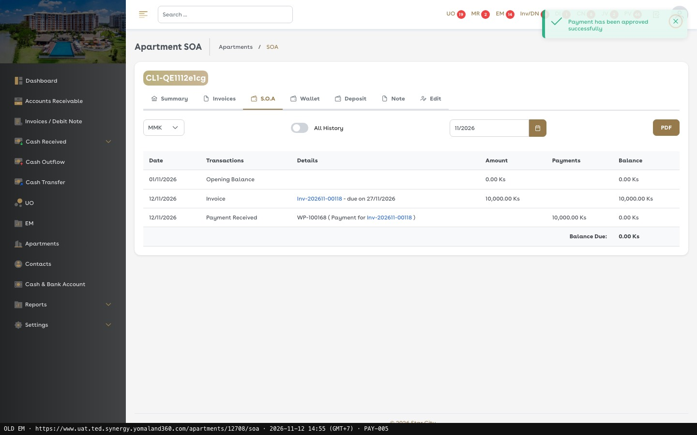

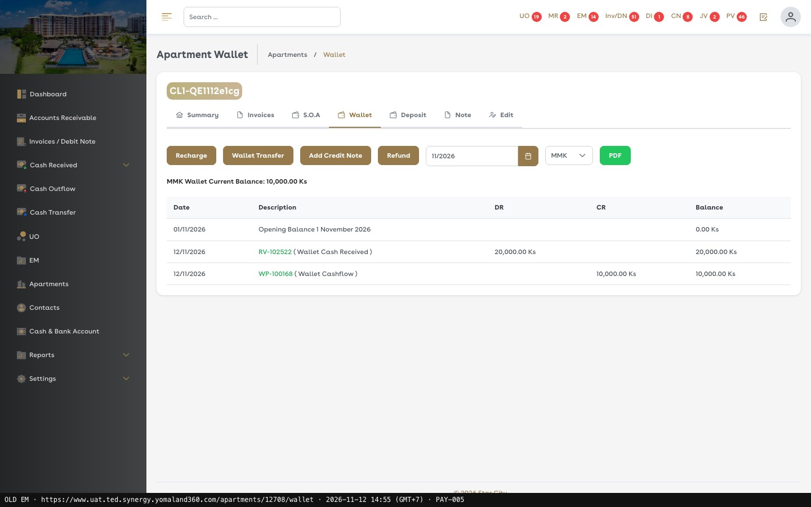

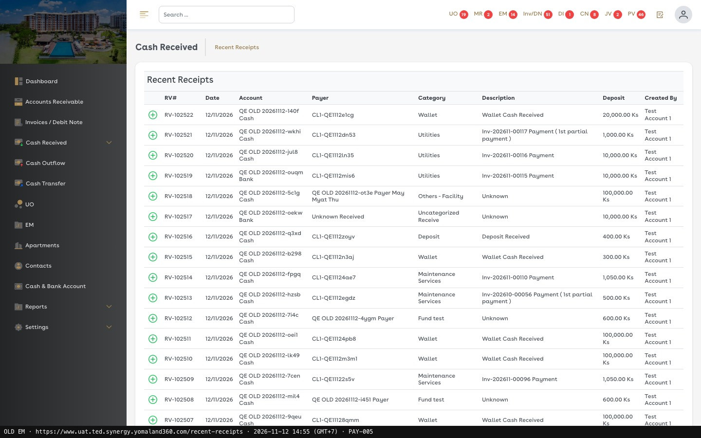

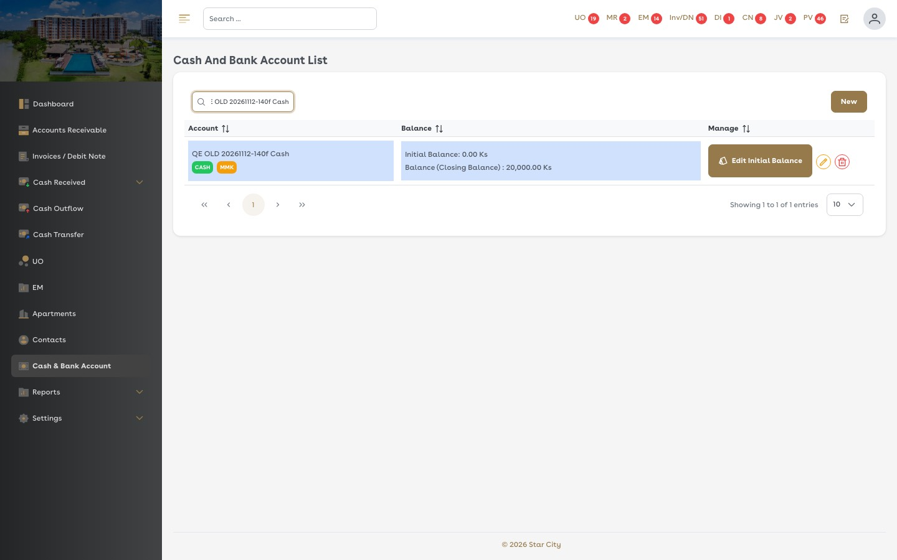

### Role & Permission

Cash Outflow approvers need an extra, undocumented category permission before they can see drafts.

#### ❌ [RBAC-061](../../em/docs/test-cases/features/24-role-permission.md#-rbac-061--cash-outflow-approve-permission-allows-approveremove-of-draft) · Cash Outflow approve permission allows approve/remove of draft

Priority P1 · ★ critical business flow · test: [role-permission/role-permission.spec.ts](../tests/role-permission/role-permission.spec.ts)

**Why it fails:** A role with Cash Outflow **Menu + View + Approve** (what the case lists) opens the PV draft list, but the drafts are **hidden**. They appear, and can then be approved or removed, only after the role is also given the draft's expense category under *Settings › Roles › Assign Categories* (here "Payment - Estate Management").

**Impact:** An approver set up exactly as the permission matrix says sees an empty draft list and cannot approve payments. Nothing on screen explains why.

**Decision needed:** Is the category scope intended? If **yes**, add the category requirement to RBAC-061 and the permission documentation, and New EM must apply the same scoping. If **no**, it is an Old EM defect.

<details><summary>Test output</summary>

```text
Error: Old EM: with Cash Outflows Menu+View+Approve the staff's draft list hides the "Landscaping Expenses" drafts; they show only after the role is assigned the expense category "Payment - Estate Management" (Assign Categories), a dependency the case does not list

expect(received).toBe(expected) // Object.is equality

Expected: true
Received: false
```

</details>

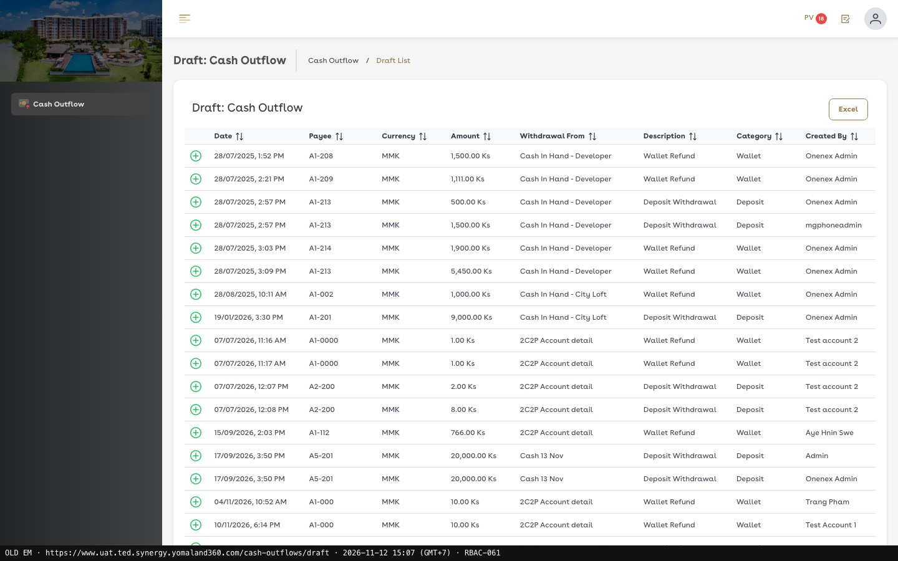

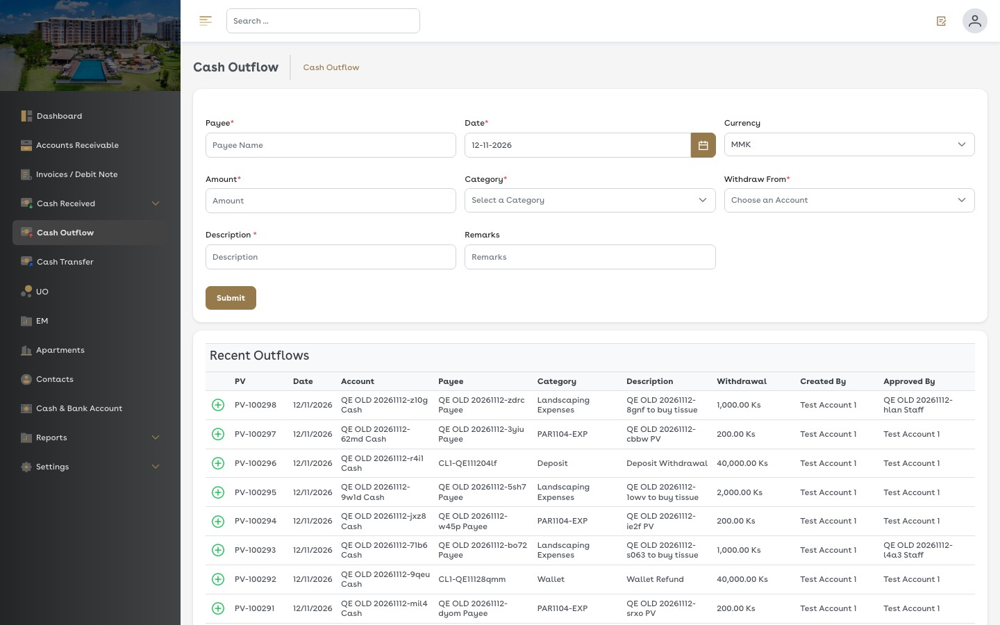


### SOA — Opening / Closing Balance

After a bulk-approved UO invoice paid from the wallet, the next month's SOA opening balance leaves out the invoice.

#### ❌ [OB-SOA-017](../../em/docs/test-cases/features/balances/19-soa-ob-cb.md#-ob-soa-017--soa-obcb-after-one-transaction-type-followed-by-another--type-pair-matrix) [1st=UO(bulk approve); 2nd=Wallet Payment (WP)] · SOA OB/CB after one transaction type followed by another — type-pair matrix

Priority P1 · ★ critical business flow · test: [issues/soa-balances.spec.ts](../tests/issues/soa-balances.spec.ts)

**Why it fails:** A UO invoice created by **Bulk Approve** (1,218 Ks) and then paid from the wallet: November is right (opens 2,100, +1,218, −1,218, closes 2,100). December's Opening Balance shows **882.00**, expected **2,100.00** (882 = 2,100 − 1,218): the next month counts the payment but leaves out the bulk-approved invoice. The other 7 sequences run (UO import, manual UO, Make Payment, WP, Invoice) are correct.

**Impact:** The apartment's SOA for the following months is wrong; the resident appears to owe less.

**Decision needed:** Old EM defect (reported as "SOA periodic balances are wrong"). Fix in New EM.

<details><summary>Test output</summary>

```text
Error: SOA 12/2026: Opening Balance (Σ all our documents)

expect(received).toBe(expected) // Object.is equality

Expected: "2,100.00"
Received: "882.00"

Error: Opening Balance 01/12/2026 = closing balance of 11/2026

expect(received).toBe(expected) // Object.is equality

Expected: "2,100.00"
Received: "882.00"
```

</details>

![OB-SOA-017 [1st=UO(bulk approve); 2nd=Wallet Payment (WP)] · UO-bulk-approve-_Wallet-Payment-WP-_soa-2026-11](img/OB-SOA-017_1st_UO_bulk_approve_2nd_Wallet_Payment_WP-1.jpg)

![OB-SOA-017 [1st=UO(bulk approve); 2nd=Wallet Payment (WP)] · UO-bulk-approve-_Wallet-Payment-WP-_soa-2026-12](img/OB-SOA-017_1st_UO_bulk_approve_2nd_Wallet_Payment_WP-2.jpg)

![OB-SOA-017 [1st=UO(bulk approve); 2nd=Wallet Payment (WP)] · UO-bulk-approve-_Wallet-Payment-WP-_soa-all-history](img/OB-SOA-017_1st_UO_bulk_approve_2nd_Wallet_Payment_WP-3.jpg)

![OB-SOA-017 [1st=UO(bulk approve); 2nd=Wallet Payment (WP)] · Screen at failure](img/OB-SOA-017_1st_UO_bulk_approve_2nd_Wallet_Payment_WP-4.jpg)

## Unstable cases (check by hand)

These failed in some runs and passed in others. The run result alone does not prove a defect.

#### ⚠️ [DASH-001](../../em/docs/test-cases/features/02-dashboard.md#-dash-001--dashboard-shows-ar-total-current-and-overdue-amounts--by-currency) · Dashboard shows AR total, current and overdue amounts — by currency

Priority P1 · ★ critical business flow · test: [dashboard/dashboard.spec.ts](../tests/dashboard/dashboard.spec.ts)

**What happens:** In the full run, the Dashboard was still loading after 15 seconds (screenshot below). It passed on both reruns, and the figures are correct once loaded.

**Impact:** Performance only. UAT holds very large totals (see observations), which may make the dashboard slow.

**Decision needed:** None for the rebuild, unless the dashboard is also slow in production.

<details><summary>Test output</summary>

```text
TimeoutError: locator.waitFor: Timeout 15000ms exceeded.
```

</details>


#### ⚠️ [WAL-020](../../em/docs/test-cases/features/16-wallet.md#-wal-020--pay-invoice-in-full-with-wallet-payment-method--wallet-soa-and-unpaid-total-updated) · Pay invoice in full with wallet payment method — wallet, SOA and unpaid total updated

Priority P1 · ★ critical business flow · test: [wallet/wallet.spec.ts](../tests/wallet/wallet.spec.ts)

**What happens:** In the full run, the Make Payment form's Currency still showed "Select Currency" when the test checked the default. It shows MMK once the apartment's data has loaded, and the case passed on both reruns.

**Impact:** Slow loading on UAT. A user who acts before the form has loaded sees an empty currency.

<details><summary>Test output</summary>

```text
Error: Step 4: currency is MMK by default. Old EM shows "Select Currency"

expect(received).toBe(expected) // Object.is equality

Expected: "MMK"
Received: "Select Currency"
```

</details>


## Other observations (not counted as failures)

- **Not checked: "Database data transformation".** The note (show formatted data to users instead of raw database data) has no test case: it needs a concrete example of a screen that shows raw data.
- **Accounts Receivable list hides debit notes by default.** With the Type filter on its default "All Type", the AR list shows invoices only. Debit notes appear only after choosing Type = Debit Note. The AR cases passed because the tests choose the type. Worth confirming: a user reading the default list underestimates receivables.
- **Totals on UAT are unrealistic.** Dashboard and AR show about 115,408,155,126,597,300 Ks (1.15 × 10¹⁷) owed. At that size the AR total differs from Current + Overdue by 6 Ks, which looks like floating-point rounding. It is test data on UAT, but it suggests Old EM adds money in floating point. New EM should use exact decimals.
- **New roles are sometimes refused until saved twice.** During test development (not in the final run), a newly created role was sometimes refused by the back end (403), and its user was signed out. It worked after the role was saved again with no changes. This looks like a permission cache that is not refreshed.
- **Old EM has no approver notification.** Cases CO-001, INV-001 and others expect "notification to approver". Old EM only increases the draft counters in the top bar (UO, EM, Inv/DN, PV, …). The tests check those counters.
- **A global setting changed during the run.** Settings › General › "Old CoRef No." was switched to Enable on UAT by someone during the session (not by these tests). Invoice, debit note and deposit invoice forms then require an "Old CoRef No." field. The tests fill it when it is shown.
- **Success messages differ from the cases' wording.** For example, the case says "Invoice approved successfully with ref number" and Old EM shows "Invoice has been approved successfully". The tests accept Old EM's wording; the cases can be aligned.

## Test-case corrections

The test was run with the closest working data or reading; the case text should be updated so manual testers do the same.

| Case | Note |
|---|---|
| [API-002](../../em/docs/test-cases/features/26-api.md#-api-002--access-token-is-not-issued-for-invalid-credentials-401) | Steps send an "invalid (or) uncomplete authentication token" to the token request; run as an invalid and a truncated API key (source-issues.md). |
| [EMF-005](../../em/docs/test-cases/features/07-estate-management-fee.md#-emf-005--approve-em-draft---debit-note-generated-unpaid-in-apartment) | Expected says "invoice (Inv)", but Old EM bills EM with a debit note (source-issues.md); the test expects a DN |
| [CO-001](../../em/docs/test-cases/features/13-cash-outflow.md#-co-001--create-cash-outflow-pv-mmk-saved-as-draft-and-approver-notified) | Withdraw from "[Bank MMK] Galaxy Tower 1" is shared UAT data: our own cash account used. "Notification to approver" = the top-bar PV draft counter (Old EM has no other approver notification on screen) |
| [CT-001](../../em/docs/test-cases/features/14-cash-transfer.md#-ct-001--transfer-between-mmk-accounts-jv-listed-and-both-balances-updated) | D2: the case does not mention approval. Old EM saves the JV as a draft; it is approved (admin, top-bar JV) before the Recent Transfers / balance checks, as the business summary says a JV posts on approval |
| [CR-002](../../em/docs/test-cases/features/11-cash-received.md#-cr-002--record-unknown-received-mmk-rv-listed-for-allocation-and-account-balance-increases) | Location "MO Zone A/B" does not exist on UAT: "MO - A5" used |
| [CR-004](../../em/docs/test-cases/features/11-cash-received.md#-cr-004--record-funding-received-mmk-rv-in-recent-receipts-and-account-balance-increases) | Category "others - EM" and Location "MO - Zone A/B" do not exist on UAT: "Others - Facility" and "MO - A5" used; deposit into our own cash account |
| [PAY-001](../../em/docs/test-cases/features/10-make-payment.md#-pay-001--make-full-payment-for-apartment-invoice-and-verify-soa-rv-invoice-status-and-ar) | Received In "CB Bank" is shared UAT data: paid into our own cash account (method Cash) instead |
| [PAY-003](../../em/docs/test-cases/features/10-make-payment.md#-pay-003--make-partial-payment-invoice-becomes-partial-paid-and-duear-reduce) | Received In "CB Bank" is shared UAT data: paid into our own cash account (method Cash) instead |
| [APT-016](../../em/docs/test-cases/features/08-apartments.md#-apt-016--make-full-payment-from-apartment--soa-ar-and-unpaid-total-updated) | Received in "[Cash MMK] 2C2P account" is shared UAT data: paid into our own cash account instead |
| [DEP-001](../../em/docs/test-cases/features/17-deposit.md#-dep-001--add-deposit-mmk-cash--deposit-balance-increases-and-rv-issued) | Test data account "[ Cash MMK ] Cash In Hand - Facility" / location "MO - Zone A/B" are shared UAT data (the location does not exist on UAT); the test uses its own cash account and location "MO - CL" |
| [DEP-012](../../em/docs/test-cases/features/17-deposit.md#-dep-012--approve-deposit-invoice--di-approved-and-printable) | Steps say "Check the cash outflow draft" (copy-paste): read as "check the deposit invoice draft"; "will be printed" checked as the approved DI offering its PDF (View / Download) |
| [SET-007](../../em/docs/test-cases/features/23-settings.md#set-007--create-fund-type-income-category-verify-it-appears-only-in-funding-received-form) | Step 2 has "Fund" on the New Income Category form; Old EM's New form takes only the name and has Fund / Status / Sort on the Edit form. The test creates the category, then sets Fund on Edit. |
| [WAL-001](../../em/docs/test-cases/features/16-wallet.md#-wal-001--recharge-wallet-mmk-cash--wallet-rv-and-received-in-account-balance-increase) | Test data account "[ Cash MMK ] Cash in Hand - Utility Operations" / location "Zone A/B" are shared UAT data; the test uses its own cash account and location "MO - CL" |
| [WAL-020](../../em/docs/test-cases/features/16-wallet.md#-wal-020--pay-invoice-in-full-with-wallet-payment-method--wallet-soa-and-unpaid-total-updated) | Expected 2 says "RV (receipt voucher) will be out in SOA"; Old EM numbers a wallet payment WP-100169 (WP = wallet payment). Checked as "a payment voucher for the invoice is in the SOA". |
| [OB-ACS-005](../../em/docs/test-cases/features/balances/22-account-statement-ob-cb.md#-ob-acs-005--account-statement-obcb-continuity-after-cash-transfer-jv-current-date--inout) | "to" (initial balance 0) gets the JV as its first transaction of the day and ever; "from" has its "(Initial Balance)" of 10,000 dated today, so for it the JV is the first transaction only when back-dated |
| [OB-ACS-005](../../em/docs/test-cases/features/balances/22-account-statement-ob-cb.md#-ob-acs-005--account-statement-obcb-continuity-after-cash-transfer-jv-current-date--inout) | Old EM saves the JV as a draft; it is approved (admin) before the statement checks, as only approved transfers post |
| [OB-ACS-006](../../em/docs/test-cases/features/balances/22-account-statement-ob-cb.md#-ob-acs-006--account-statement-obcb-continuity-after-back-dated-cash-transfer-jv--inout) | "to" (initial balance 0) gets the JV as its first transaction of the day and ever; "from" has its "(Initial Balance)" of 10,000 dated today, so for it the JV is the first transaction only when back-dated |
| [OB-ACS-006](../../em/docs/test-cases/features/balances/22-account-statement-ob-cb.md#-ob-acs-006--account-statement-obcb-continuity-after-back-dated-cash-transfer-jv--inout) | Old EM saves the JV as a draft; it is approved (admin) before the statement checks, as only approved transfers post |
| [CONC-001](../../em/docs/test-cases/features/12-payment-concurrency.md#-conc-001--1-invoice-2-concurrent-full-payments-2nd-rejected-as-paid-in-full-matrix) | The case says "2 users": UAT has no second account (APPROVER_* empty), so the second user is a second browser session of the same admin |
| [CONC-003](../../em/docs/test-cases/features/12-payment-concurrency.md#-conc-003--1-invoice-2-concurrent-partial-payments-within-balance-both-accepted-matrix) | The case says "2 users": UAT has no second account (APPROVER_* empty), so the second user is a second browser session of the same admin |
| [CONC-004](../../em/docs/test-cases/features/12-payment-concurrency.md#-conc-004--1-invoice-2-concurrent-partials-exceeding-balance-2nd-asked-to-refresh-matrix) | The case says "2 users": UAT has no second account (APPROVER_* empty), so the second user is a second browser session of the same admin |
| [OB-WAL-012](../../em/docs/test-cases/features/balances/20-wallet-ob-cb.md#-ob-wal-012--wallet-2-users-debit-fullover-balance-concurrently--second-is-refused) | The case says "2 users": UAT has no second account (APPROVER_* empty), so the second user is a second browser session of the same admin |
| [OB-ACS-010](../../em/docs/test-cases/features/balances/22-account-statement-ob-cb.md#-ob-acs-010--account-2-users-debit-fullover-balance-concurrently--second-is-refused) | The case says "2 users": UAT has no second account (APPROVER_* empty), so the second user is a second browser session of the same admin |
| [OB-SOA-017](../../em/docs/test-cases/features/balances/19-soa-ob-cb.md#-ob-soa-017--soa-obcb-after-one-transaction-type-followed-by-another--type-pair-matrix) | UO(manual) followed by UO (import): Old EM takes one UO reading per apartment per month, so the manual reading is dated the 5th of last month and the import is today's reading (both invoices are dated their approval day, today) |
| [UOI-029](../../em/docs/test-cases/features/06-uo-import.md#-uoi-029--duplicate-upload---re-uploading-the-same-file-is-rejected) | "Different user": Old EM UAT has no second account (APPROVER_* empty), so user 2 is a second, separately logged-in session of the same admin account in another browser context |
| [UOI-028](../../em/docs/test-cases/features/06-uo-import.md#-uoi-028--concurrent-upload---2nd-upload-blocked-while-users-1st-upload-in-progress) | Same user = two tabs of one logged-in browser; the file is the 1-row CSV of the test's own apartment (a large file would need other testers' apartments) |
| [UOI-013](../../em/docs/test-cases/features/06-uo-import.md#uoi-013--multi-record-import---second-record-in-same-monthdate-rejected-first-saved) | Case dates (last 01/01/2025, import 01/02 and 25/02/2025) moved to now: last reading 1st of last month, import 13/11/2026 and 13/11/2026; units 15 then 15 (case shows one data row; the variant's second row was derived from its label) |
| [UOI-013](../../em/docs/test-cases/features/06-uo-import.md#uoi-013--multi-record-import---second-record-in-same-monthdate-rejected-first-saved) | Case dates (last 01/01/2025, import 01/02 and 25/02/2025) moved to now: last reading 1st of last month, import 13/11/2026 and 13/11/2026; units 15 then 18 (case shows one data row; the variant's second row was derived from its label) |
| [UOI-013](../../em/docs/test-cases/features/06-uo-import.md#uoi-013--multi-record-import---second-record-in-same-monthdate-rejected-first-saved) | Case dates (last 01/01/2025, import 01/02 and 25/02/2025) moved to now: last reading 1st of last month, import 01/11/2026 and 13/11/2026; units 15 then 15 (case shows one data row; the variant's second row was derived from its label) |
| [UOI-013](../../em/docs/test-cases/features/06-uo-import.md#uoi-013--multi-record-import---second-record-in-same-monthdate-rejected-first-saved) | Case dates (last 01/01/2025, import 01/02 and 25/02/2025) moved to now: last reading 1st of last month, import 01/11/2026 and 13/11/2026; units 15 then 18 (case shows one data row; the variant's second row was derived from its label) |
| [OB-WAL-011](../../em/docs/test-cases/features/balances/20-wallet-ob-cb.md#-ob-wal-011--wallet-obcb-continuity--one-transaction-type-followed-by-another) | 1st transaction is a transfer out: the wallet is recharged with 50,000 Ks first (precondition, not in the case) |
| [WAL-017](../../em/docs/test-cases/features/16-wallet.md#wal-017--delete-draft-credit-note) | The draft credit note page has [Approve] [Remove], no "Delete" button (admin is creator and approver): "Remove" used |

<details><summary>Check areas not covered by the smoke run</summary>

| Case | Not checked |
|---|---|
| APT-001 | Cash Received › Unknown to apartment search box: needs an unassigned unknown receipt; creating one posts money |
| OB-ACS-001 | Account Statement PDF / Excel: file content is not parsed (no PDF / Excel reader in the framework) |
| OB-ACS-001 | Test way: first / mid / last time of the day: a test cannot choose the time of day it runs |
| OB-ACS-001 | Variants 2-9 (unknown received, assign, wallet, deposit, payment, SCLA): smoke runs the base row (Funding Received) only |
| OB-ACS-003 | Account Statement PDF / Excel: file content is not parsed (no PDF / Excel reader in the framework) |
| OB-ACS-003 | Test way: first / mid / last time of the day: a test cannot choose the time of day it runs |
| OB-ACS-003 | Variants 2-3 (wallet refund, deposit withdraw): smoke runs the base row (Cash Outflow) only |
| APT-021 | Variant 2 (USD SOA): smoke runs the base row (MMK) only |
| OB-SOA-001 | Apartment SOA PDF / Bulk SOA PDF: PDF content is not parsed (no PDF reader in the framework) |
| OB-SOA-001 | API › Apartment › SOA by Apartment / PDF Printouts: tests assert on screens; Old EM API responses are AES-encrypted |
| OB-SOA-001 | Variants 2-3 (Utilities, Estate Mgmt Fees): smoke runs the base row (normal invoice) only |
| OB-SOA-007 | Apartment SOA PDF / Bulk SOA PDF: PDF content is not parsed (no PDF reader in the framework) |
| OB-SOA-007 | API › Apartment › SOA by Apartment / PDF Printouts: tests assert on screens; Old EM API responses are AES-encrypted |
| OB-SOA-007 | Variants 2-8 (multiple, overflow to wallet, other currency): smoke runs the base row (single, same currency) only |
| OB-WAL-001 | Apartment Wallet PDF: PDF content is not parsed (no PDF reader in the framework) |
| OB-WAL-001 | API › Wallet by Apartment / Wallet PDF: tests assert on screens; Old EM API responses are AES-encrypted |
| OB-WAL-001 | Variants 2-6 (unknown RV conversions, overflow): smoke runs the base row (manual recharge) only |
| OB-DEP-001 | Apartment Deposit PDF: PDF content is not parsed (no PDF reader in the framework) |
| OB-DEP-001 | API › Deposit by Apartment / Deposit PDF: tests assert on screens; Old EM API responses are AES-encrypted |
| OB-DEP-001 | Variants 2-5 (unknown RV conversions, overflow): smoke runs the base row (manual add deposit) only |
| EMF-001 | Step 4 (dates filled from old EM data): new apartment has no earlier EM entry; EMF-007 imports after an earlier EM |
| EMF-001 | Dashboard / AR / Invoice list / Apartment / Contact / Report: an EM draft is not posted: the debit note is made on approval (checked in EMF-005) |
| EMF-005 | Dashboard AR amount: shared total; other testers and suites post to the same UAT during the run, so a delta cannot be attributed |
| EMF-007 | Dashboard AR amount: shared total; other testers and suites post to the same UAT during the run, so a delta cannot be attributed |
| INV-017 | Dashboard AR amount: shared total; other testers and suites post to the same UAT during the run, so a delta cannot be attributed |
| INV-020 | Dashboard / AR / Apartment / Contact / Report: a draft is not posted: Old EM posts an invoice / debit note on approval (checked in the approve case) |
| INV-031 | Dashboard AR amount: shared total; other testers and suites post to the same UAT during the run, so a delta cannot be attributed |
| UOI-001 | Variants 2 (previous = meter reset) and 3 (previous = bulk upload): smoke runs the base row only |
| UO-001 | Step 5 (date later than the last reading): new apartment has no earlier reading; covered by UO-002 |
| UO-001 | Dashboard / AR / Invoice list / Apartment / Contact / Report: a UO draft is not posted: the invoice is made on approval (checked in UO-007) |
| UO-007 | Dashboard AR amount: shared total; other testers and suites post to the same UAT during the run, so a delta cannot be attributed |
| CO-001 | Dashboard, Reports: smoke checks the Expected result |
| CO-010 | Dashboard, Reports: smoke checks the Expected result |
| CT-001 | Dashboard, Reports: smoke checks the Expected result |
| CBA-001 | Dashboard and Account Statement report: smoke checks the Expected result (account list) only |
| CR-002 | Dashboard, Reports: smoke checks the Expected result; shared totals are left to the balances suite |
| CR-004 | Dashboard, Reports: smoke checks the Expected result; shared totals are left to the balances suite |
| PAY-008 | Dashboard, Account Receivable list, Contact, Reports (incl. Assign Unknown Received Logs): smoke checks the Expected result |
| PAY-001 | Dashboard, Account Receivable list, Contact, Reports: smoke checks the Expected result; shared totals are left to the balances suite |
| PAY-003 | Dashboard, Account Receivable list, Contact, Reports: smoke checks the Expected result; shared totals are left to the balances suite |
| PAY-005 | Dashboard, Account Receivable list, Contact, Reports: smoke checks the Expected result; shared totals are left to the balances suite |
| APT-016 | Dashboard, Contact, Reports, Cash Received: smoke checks the Expected result; shared totals are left to the balances suite |
| DASH-001 | Variants 2-3 (other currency, AR sheet duplicate): smoke runs the base row (MMK) only |
| DASH-005 | Variants 2-6 (current month, last two months, other currency): smoke runs the base row (MMK, today) only |
| DEP-001 | Dashboard (Cash & Bank, Net Cash, Deposit): UAT-wide totals move with other testers' and parallel runs, so a delta cannot be tied to this test |
| DEP-001 | Report (Account Statement, Transactions, Cash Received): smoke checks the Expected result screens only |
| DEP-022 | Dashboard (Cash & Bank, Net Cash, Deposit): UAT-wide totals move with other testers' and parallel runs, so a delta cannot be tied to this test |
| DEP-022 | Report (Account Statement, Transactions, Cash Outflow): smoke checks the Expected result screens only |
| AR-001 | Variant 2 (Total overdue card on its own): smoke runs the base row; the overdue card is still read for the arithmetic |
| RPT-001 | Variant 2 (other currency): smoke runs the base row (MMK) only |
| SET-007 | Unknown Received › assign to funding form: needs an unknown receipt; the Funding Received form is checked instead |
| SET-007 | Accounts Receivable categories filter: the case does not say whether a fund category belongs there (Old EM lists every income, expense and fund category in it) |
| SET-008 | Apartment credit note form and Funding Received forms: smoke checks the list plus the invoice form and AR filter |
| SET-013 | Accounts Receivable categories filter: the case does not say whether an expense category belongs there (Old EM lists every income, expense and fund category in it) |
| SET-014 | Accounts Receivable categories filter: the case does not say whether an expense category belongs there |
| SET-021 | Apartment / Contact Make payment, Wallet recharge, Add deposit: smoke checks the Expected result (list + Cash & Bank account form) |
| WAL-001 | Dashboard (Cash & Bank, Net Cash, Wallet): UAT-wide totals move with other testers' and parallel runs, so a delta cannot be tied to this test |
| WAL-001 | Report (Account Statement, Transactions, Cash Received): smoke checks the Expected result screens only |
| WAL-006 | Report - Transaction (wallet transfer): smoke checks the Expected result screens only |
| WAL-016 | Report - Credit Note: smoke checks the Expected result screens only |
| WAL-020 | Dashboard (AR, Wallet), Accounts Receivable, Invoice/Debit Note list: UAT-wide totals move with other testers' and parallel runs, so a delta cannot be tied to this test |
| WAL-020 | Contact summary / Unpaid Invoices, Reports: smoke checks the apartment screens only |
| WAL-028 | Dashboard (Cash & Bank, Net Cash, Wallet): UAT-wide totals move with other testers' and parallel runs, so a delta cannot be tied to this test |
| WAL-028 | Report (Account Statement, Transactions, Cash Outflow): smoke checks the Expected result screens only |
| OB-ACS-005 | Account Statement PDF / Excel: file content is not parsed (no PDF / Excel reader in the framework) |
| OB-ACS-005 | Test way: first / mid / last time of the day: a test cannot choose the time of day it runs |
| OB-ACS-006 | Account Statement PDF / Excel: file content is not parsed (no PDF / Excel reader in the framework) |
| OB-ACS-006 | Test way: first / mid / last time of the day: a test cannot choose the time of day it runs |
| CONC-001 | Variants 2-12: base row only (make payment × make payment, same currency); unknown assign, wallet payment, SCLA and different-currency rows not run |
| CONC-001 | Dashboard, Accounts Receivable list, Reports: shared totals; the apartment AR / S.O.A / invoice are checked instead |
| CONC-003 | Variants 2-22: base row only (make payment 500 × make payment 400, same currency); other combinations not run |
| CONC-003 | Dashboard, Accounts Receivable list, Reports: shared totals; the apartment AR / S.O.A / invoice are checked instead |
| CONC-004 | Variants 2-11: base row only (make payment 500 × make payment 600, same currency); other combinations not run |
| CONC-004 | Dashboard, Accounts Receivable list, Reports: shared totals; the apartment AR / S.O.A / invoice are checked instead |
| OB-WAL-012 | Variants 2-6: base row only (Wallet Refund draft × Wallet Refund draft, 100,000 each); over-balance sums, wallet payment and wallet transfer rows not run |
| OB-ACS-010 | Variants 2-8: base row only (Cash Outflow 100,000 × Cash Outflow 100,000, approved); over-balance sums, wallet refund, deposit withdraw and cash transfer rows not run |
| CBA-009 | Dashboard - Cash & Bank Balance / Total per Bank / per Payment Type: shared UAT totals change with other testers' work, and the Dashboard shows banks and payment types, not single accounts: our account is checked in the Account Statement's Cash & Bank Balance instead |
| CBA-009 | Account Statement PDF / Excel: file content is not parsed |
| CBA-009 | Check area 3 (transactions earlier / same day / after the account create date): this case is "before transactions": the account has none; CBA-010 covers them |
| CBA-010 | Dashboard - Cash & Bank Balance / Total per Bank / per Payment Type: shared UAT totals change with other testers' work, and the Dashboard shows banks and payment types, not single accounts: our account is checked in the Account Statement's Cash & Bank Balance instead |
| CBA-010 | Account Statement PDF / Excel: file content is not parsed |
| CBA-010 | Transactions dated after the account create date: the account is created today and Old EM does not allow future dates: "after" = later the same day |
| INV-038 | Dashboard AR amount: shared total; other testers and suites post to the same UAT during the run, so a delta cannot be attributed |
| OB-SOA-003 | Apartment SOA PDF / Bulk SOA PDF: PDF content is not parsed (no PDF reader in the framework) |
| OB-SOA-003 | API › Apartment › SOA by Apartment / PDF Printouts: tests assert on screens; Old EM API responses are AES-encrypted |
| OB-SOA-010 | Apartment SOA PDF / Bulk SOA PDF: PDF content is not parsed (no PDF reader in the framework) |
| OB-SOA-010 | API › Apartment › SOA by Apartment / PDF Printouts: tests assert on screens; Old EM API responses are AES-encrypted |
| OB-SOA-017 | Apartment SOA PDF / Bulk SOA PDF: PDF content is not parsed (no PDF reader in the framework) |
| OB-SOA-017 | API › Apartment › SOA by Apartment / PDF Printouts: tests assert on screens; Old EM API responses are AES-encrypted |
| UO-008 | Dashboard AR amount: shared total; other testers and suites post to the same UAT during the run, so a delta cannot be attributed |
| UO-008 | Check areas 1-3, 6-7 for CL1-QE1113we35: same flow as CL1-QE11134bhf; the second apartment is checked on UO list, Invoices tab (unpaid), S.O.A and Created/Approved By only |
| OB-WAL-011 | Apartment Wallet PDF: PDF content is not parsed (no PDF reader in the framework) |
| OB-WAL-011 | API › Wallet by Apartment / Wallet PDF: tests assert on screens; Old EM API responses are AES-encrypted |
| OB-WAL-011 | Test way: time of the transactions: both transactions are made today, one after the other |
| OB-WAL-002 | Apartment Wallet PDF: PDF content is not parsed (no PDF reader in the framework) |
| OB-WAL-002 | API › Wallet by Apartment / Wallet PDF: tests assert on screens; Old EM API responses are AES-encrypted |
| WAL-033 | Dashboard - Wallet & Deposits: UAT-wide total moves with other testers' runs, so a delta cannot be tied to this test |
| WAL-033 | Precondition 3 (a second user): no APPROVER account for Old EM in .env: admin, who can approve, removes the draft |
| WAL-033 | Report › Credit Note beyond its first 100 rows: the report is newest first (last 30 days); a removed draft would be on the first page |

</details>

## Passing cases

| Case | Area |
|---|---|
| [APT-001](../../em/docs/test-cases/features/08-apartments.md#-apt-001--create-new-apartment-zone-building-unit) Create new apartment (zone, building, unit) | Apartments |
| [API-013](../../em/docs/test-cases/features/26-api.md#-api-013--get-apartment-soa-by-apartment-and-month) Get Apartment SOA by apartment and month | External API |
| [API-020](../../em/docs/test-cases/features/26-api.md#-api-020--get-ar-summary-by-apartment) Get AR summary by apartment | External API |
| [API-001](../../em/docs/test-cases/features/26-api.md#-api-001--get-access-token-with-valid-client-credentials) Get access token with valid client credentials | External API |
| [API-002](../../em/docs/test-cases/features/26-api.md#-api-002--access-token-is-not-issued-for-invalid-credentials-401) Access token is not issued for invalid credentials (401) | External API |
| [OB-ACS-001](../../em/docs/test-cases/features/balances/22-account-statement-ob-cb.md#-ob-acs-001--account-statement-obcb-continuity-after-cash-received-rv-current-date--by-rv-type) Account statement OB/CB continuity after cash received RV (current date) — by RV type | Account Statement — Opening / Closing Balance |
| [OB-ACS-003](../../em/docs/test-cases/features/balances/22-account-statement-ob-cb.md#-ob-acs-003--account-statement-obcb-continuity-after-cash-outflow-pv-current-date--by-pv-type) Account statement OB/CB continuity after cash outflow PV (current date) — by PV type | Account Statement — Opening / Closing Balance |
| [APT-021](../../em/docs/test-cases/features/08-apartments.md#-apt-021--apartment-monthly-soa-lists-transactions-and-ob--previous-month-cb--by-currency) Apartment monthly SOA lists transactions and OB = previous month CB — by currency | Apartments |
| [OB-SOA-001](../../em/docs/test-cases/features/balances/19-soa-ob-cb.md#-ob-soa-001--soa-obcb-continuity-after-current-date-invoice--by-category) SOA OB/CB continuity after current-date invoice — by category | SOA — Opening / Closing Balance |
| [OB-SOA-007](../../em/docs/test-cases/features/balances/19-soa-ob-cb.md#-ob-soa-007--soa-obcb-continuity-after-make-payment-rv--by-currency--singlemultipleoverflow) SOA OB/CB continuity after Make Payment RV — by currency × single/multiple/overflow | SOA — Opening / Closing Balance |
| [OB-WAL-001](../../em/docs/test-cases/features/balances/20-wallet-ob-cb.md#-ob-wal-001--wallet-obcb-continuity-after-wallet-recharge-rv-current-date--by-source) Wallet OB/CB continuity after wallet recharge RV (current date) — by source | Wallet — Opening / Closing Balance |
| [OB-DEP-001](../../em/docs/test-cases/features/balances/21-deposit-ob-cb.md#-ob-dep-001--deposit-obcb-continuity-after-current-date-add-deposit-rv--by-source) Deposit OB/CB continuity after current-date add deposit (RV) — by source | Deposit — Opening / Closing Balance |
| [EMF-001](../../em/docs/test-cases/features/07-estate-management-fee.md#-emf-001--create-single-em-draft-monthly-fee-x-number-of-months) Create single EM draft (monthly fee x number of months) | Estate Management Fee (EM) |
| [EMF-005](../../em/docs/test-cases/features/07-estate-management-fee.md#-emf-005--approve-em-draft---debit-note-generated-unpaid-in-apartment) Approve EM draft - debit note generated, unpaid in apartment | Estate Management Fee (EM) |
| [EMF-007](../../em/docs/test-cases/features/07-estate-management-fee.md#-emf-007--em-bulk-import-from-date--previous-end-date--1-creates-entries-without-approval) EM bulk import (from date = previous end date + 1) creates entries without approval | Estate Management Fee (EM) |
| [INV-017](../../em/docs/test-cases/features/04-invoice-debit-note.md#-inv-017--approve-invoice---ref-number-tax-included-unpaid-in-apartment) Approve invoice - ref number, tax included, unpaid in apartment | Invoice & Debit Note |
| [INV-020](../../em/docs/test-cases/features/04-invoice-debit-note.md#-inv-020--create-debit-note-mmk-dated-last-month-to-today-as-draft) Create debit note (MMK, dated last month to today) as draft | Invoice & Debit Note |
| [INV-031](../../em/docs/test-cases/features/04-invoice-debit-note.md#-inv-031--approve-debit-note---ref-number-unpaid-in-apartment) Approve debit note - ref number, unpaid in apartment | Invoice & Debit Note |
| [UOI-001](../../em/docs/test-cases/features/06-uo-import.md#-uoi-001--uo-import-succeeds-in-month-after-last-reading---by-previous-reading-source) UO import succeeds in month after last reading - by previous reading source | UO Import (bulk meter readings) |
| [UO-001](../../em/docs/test-cases/features/05-utility-operations-uo.md#-uo-001--create-single-uo-reading-draft-manual) Create single UO reading draft (manual) | Utility Operations (UO) — manual entry |
| [UO-007](../../em/docs/test-cases/features/05-utility-operations-uo.md#-uo-007--approve-uo-draft---invoice-generated-unpaid-in-apartment) Approve UO draft - invoice generated, unpaid in apartment | Utility Operations (UO) — manual entry |
| [CO-001](../../em/docs/test-cases/features/13-cash-outflow.md#-co-001--create-cash-outflow-pv-mmk-saved-as-draft-and-approver-notified) Create Cash Outflow PV (MMK) saved as draft and approver notified | Cash Outflow (PV) |
| [CO-010](../../em/docs/test-cases/features/13-cash-outflow.md#-co-010--approve-cash-outflow-pv-in-recent-outflows-and-account-balance-reduced) Approve Cash Outflow; PV in Recent Outflows and account balance reduced | Cash Outflow (PV) |
| [CT-001](../../em/docs/test-cases/features/14-cash-transfer.md#-ct-001--transfer-between-mmk-accounts-jv-listed-and-both-balances-updated) Transfer between MMK accounts; JV listed and both balances updated | Cash Transfer (JV) |
| [CR-004](../../em/docs/test-cases/features/11-cash-received.md#-cr-004--record-funding-received-mmk-rv-in-recent-receipts-and-account-balance-increases) Record Funding Received (MMK); RV in Recent Receipts and account balance increases | Cash Received (RV / Unknown / Funding) |
| [PAY-008](../../em/docs/test-cases/features/10-make-payment.md#-pay-008--assign-unknown-received-rv-to-apartment-invoices-rv-and-ar-updated) Assign Unknown Received RV to apartment invoices; RV and AR updated | Make Payment |
| [PAY-001](../../em/docs/test-cases/features/10-make-payment.md#-pay-001--make-full-payment-for-apartment-invoice-and-verify-soa-rv-invoice-status-and-ar) Make full payment for apartment invoice and verify SOA, RV, invoice status and AR | Make Payment |
| [PAY-003](../../em/docs/test-cases/features/10-make-payment.md#-pay-003--make-partial-payment-invoice-becomes-partial-paid-and-duear-reduce) Make partial payment; invoice becomes Partial Paid and due/AR reduce | Make Payment |
| [APT-016](../../em/docs/test-cases/features/08-apartments.md#-apt-016--make-full-payment-from-apartment--soa-ar-and-unpaid-total-updated) Make full payment from apartment — SOA, AR and unpaid total updated | Apartments |
| [CON-001](../../em/docs/test-cases/features/09-contacts.md#-con-001--create-contact--by-id-type-nrc-passport-company-reg-no) Create contact — by ID type (NRC, Passport, Company Reg. No.) | Contacts |
| [DASH-002](../../em/docs/test-cases/features/02-dashboard.md#-dash-002--dashboard-shows-total-cash--bank-balance--mmk-and-other-currency) Dashboard shows total Cash & Bank balance — MMK and other currency | Dashboard |
| [DASH-005](../../em/docs/test-cases/features/02-dashboard.md#dash-005--dashboard-net-cash-collection-payment-net--by-currency--period) Dashboard net cash (collection, payment, net) — by currency × period | Dashboard |
| [DEP-001](../../em/docs/test-cases/features/17-deposit.md#-dep-001--add-deposit-mmk-cash--deposit-balance-increases-and-rv-issued) Add deposit (MMK, cash) — deposit balance increases and RV issued | Deposit |
| [DEP-012](../../em/docs/test-cases/features/17-deposit.md#-dep-012--approve-deposit-invoice--di-approved-and-printable) Approve deposit invoice — DI approved and printable | Deposit |
| [DEP-022](../../em/docs/test-cases/features/17-deposit.md#-dep-022--approve-withdraw-deposit--deposit-balance-reduced-and-pv-in-cash-outflow) Approve withdraw deposit — deposit balance reduced and PV in Cash Outflow | Deposit |
| [AUTH-001](../../em/docs/test-cases/features/01-login.md#-auth-001--login-with-valid-credentials-lands-on-dashboard) Login with valid credentials lands on dashboard | Login & Authentication |
| [AR-001](../../em/docs/test-cases/features/03-accounts-receivable.md#-ar-001--ar-page-summary-cards-show-current-and-total-overdue-amounts) AR page summary cards show current and total overdue amounts | Accounts Receivable |
| [AR-003](../../em/docs/test-cases/features/03-accounts-receivable.md#-ar-003--ar-list-shows-invoicesdebit-notes-by-aging-with-paid-status) AR list shows invoices/debit notes by aging with paid status | Accounts Receivable |
| [RPT-001](../../em/docs/test-cases/features/18-reports.md#-rpt-001--account-statement-shows-total-cash-in-hand-and-bank--by-currency) Account Statement shows total cash in hand and bank — by currency | Reports |
| [RPT-006](../../em/docs/test-cases/features/18-reports.md#-rpt-006--account-statement-history-day-opening-balance-equals-previous-closing-balance) Account statement history: day opening balance equals previous closing balance | Reports |
| [RBAC-005](../../em/docs/test-cases/features/24-role-permission.md#-rbac-005--invoicedn-create-permission-limited-to-assigned-income-categories) Invoice/DN create permission limited to assigned income categories | Role & Permission |
| [RBAC-006](../../em/docs/test-cases/features/24-role-permission.md#-rbac-006--invoicedn-approve-permission-allows-approveremove-of-draft) Invoice/DN approve permission allows approve/remove of draft | Role & Permission |
| [RBAC-010](../../em/docs/test-cases/features/24-role-permission.md#-rbac-010--uo-approve-permission-allows-single-and-bulk-approve-of-drafts) UO approve permission allows single and bulk approve of drafts | Role & Permission |
| [RBAC-020](../../em/docs/test-cases/features/24-role-permission.md#-rbac-020--em-approve-permission-allows-single-and-bulk-approve-of-drafts) EM approve permission allows single and bulk approve of drafts | Role & Permission |
| [SET-007](../../em/docs/test-cases/features/23-settings.md#set-007--create-fund-type-income-category-verify-it-appears-only-in-funding-received-form) Create Fund-type income category; verify it appears only in Funding Received form | Settings (master data & configuration) |
| [SET-008](../../em/docs/test-cases/features/23-settings.md#set-008--add-child-income-category-under-a-parent-category) Add child income category under a parent category | Settings (master data & configuration) |
| [SET-013](../../em/docs/test-cases/features/23-settings.md#set-013--add-parent-expense-category-and-verify-it-appears-in-cash-outflow-form-only) Add parent expense category and verify it appears in Cash Outflow form only | Settings (master data & configuration) |
| [SET-014](../../em/docs/test-cases/features/23-settings.md#set-014--add-child-expense-category-under-a-parent-category) Add child expense category under a parent category | Settings (master data & configuration) |
| [SET-021](../../em/docs/test-cases/features/23-settings.md#set-021--add-payment-method-and-verify-it-appears-in-bank-account-create-form) Add payment method and verify it appears in bank account create form | Settings (master data & configuration) |
| [SET-003](../../em/docs/test-cases/features/23-settings.md#-set-003--edit-uo-pricing-unit-price-and-verify-new-uo-invoices-are-charged-at-the-new-rate) Edit UO pricing unit price and verify new UO invoices are charged at the new rate | Settings (master data & configuration) |
| [WAL-001](../../em/docs/test-cases/features/16-wallet.md#-wal-001--recharge-wallet-mmk-cash--wallet-rv-and-received-in-account-balance-increase) Recharge wallet (MMK, cash) — wallet, RV and received-in account balance increase | Wallet |
| [WAL-006](../../em/docs/test-cases/features/16-wallet.md#-wal-006--transfer-wallet-balance-to-another-apartment--both-wallets-updated-wt-created) Transfer wallet balance to another apartment — both wallets updated, WT created | Wallet |
| [WAL-016](../../em/docs/test-cases/features/16-wallet.md#-wal-016--approve-credit-note--cn-amount-added-to-wallet-balance) Approve credit note — CN amount added to wallet balance | Wallet |
| [WAL-028](../../em/docs/test-cases/features/16-wallet.md#-wal-028--approve-wallet-refund--wallet-and-refund-from-account-reduced-pv-issued) Approve wallet refund — wallet and refund-from account reduced, PV issued | Wallet |
| [OB-ACS-005](../../em/docs/test-cases/features/balances/22-account-statement-ob-cb.md#-ob-acs-005--account-statement-obcb-continuity-after-cash-transfer-jv-current-date--inout) Account statement OB/CB continuity after cash transfer JV (current date) — in/out | Account Statement — Opening / Closing Balance |
| [OB-ACS-005](../../em/docs/test-cases/features/balances/22-account-statement-ob-cb.md#-ob-acs-005--account-statement-obcb-continuity-after-cash-transfer-jv-current-date--inout) [Type=Create Cash Transfer JV (Cash Out); Date=Current date; Time=first/mid/last of day] Account statement OB/CB continuity after cash transfer JV (current date) — in/out | Account Statement — Opening / Closing Balance |
| [OB-ACS-006](../../em/docs/test-cases/features/balances/22-account-statement-ob-cb.md#-ob-acs-006--account-statement-obcb-continuity-after-back-dated-cash-transfer-jv--inout) Account statement OB/CB continuity after back-dated cash transfer JV — in/out | Account Statement — Opening / Closing Balance |
| [OB-ACS-006](../../em/docs/test-cases/features/balances/22-account-statement-ob-cb.md#-ob-acs-006--account-statement-obcb-continuity-after-back-dated-cash-transfer-jv--inout) [Type=Create Cash Transfer JV (Cash Out); Date=Back date; Time=first/mid/last of day] Account statement OB/CB continuity after back-dated cash transfer JV — in/out | Account Statement — Opening / Closing Balance |
| [RPT-036](../../em/docs/test-cases/features/18-reports.md#-rpt-036--created-by-and-approved-by-are-recorded-for-every-money-document--by-document-type) [Document=Make Payment RV] Created By and Approved By are recorded for every money document — by document type | Reports |
| [RPT-036](../../em/docs/test-cases/features/18-reports.md#-rpt-036--created-by-and-approved-by-are-recorded-for-every-money-document--by-document-type) [Document=Unknown Received RV] Created By and Approved By are recorded for every money document — by document type | Reports |
| [RPT-036](../../em/docs/test-cases/features/18-reports.md#-rpt-036--created-by-and-approved-by-are-recorded-for-every-money-document--by-document-type) [Document=Cash Outflow PV (approved)] Created By and Approved By are recorded for every money document — by document type | Reports |
| [RPT-036](../../em/docs/test-cases/features/18-reports.md#-rpt-036--created-by-and-approved-by-are-recorded-for-every-money-document--by-document-type) [Document=Wallet Refund PV (approved)] Created By and Approved By are recorded for every money document — by document type | Reports |
| [RPT-036](../../em/docs/test-cases/features/18-reports.md#-rpt-036--created-by-and-approved-by-are-recorded-for-every-money-document--by-document-type) [Document=Deposit Withdraw PV (approved)] Created By and Approved By are recorded for every money document — by document type | Reports |
| [CBA-009](../../em/docs/test-cases/features/15-cash-bank-account.md#-cba-009--edit-initial-balance-before-transactions-closing-balance-recalculated) Edit initial balance before transactions; closing balance recalculated | Cash & Bank Account |
| [OB-SOA-003](../../em/docs/test-cases/features/balances/19-soa-ob-cb.md#-ob-soa-003--soa-obcb-continuity-after-back-dated-invoice--by-category--date-position) SOA OB/CB continuity after back-dated invoice — by category × date position | SOA — Opening / Closing Balance |
| [OB-SOA-003](../../em/docs/test-cases/features/balances/19-soa-ob-cb.md#-ob-soa-003--soa-obcb-continuity-after-back-dated-invoice--by-category--date-position) [Category=Utilities; Date=Back date (1st/mid/last day)] SOA OB/CB continuity after back-dated invoice — by category × date position | SOA — Opening / Closing Balance |
| [OB-SOA-003](../../em/docs/test-cases/features/balances/19-soa-ob-cb.md#-ob-soa-003--soa-obcb-continuity-after-back-dated-invoice--by-category--date-position) [Category=Estate Mgmt Fees; Date=Back date (1st/mid/last day)] SOA OB/CB continuity after back-dated invoice — by category × date position | SOA — Opening / Closing Balance |
| [OB-SOA-010](../../em/docs/test-cases/features/balances/19-soa-ob-cb.md#-ob-soa-010--soa-obcb-continuity-after-wallet-payment-wp--single--multiple) SOA OB/CB continuity after Wallet Payment (WP) — single / multiple | SOA — Opening / Closing Balance |
| [OB-SOA-010](../../em/docs/test-cases/features/balances/19-soa-ob-cb.md#-ob-soa-010--soa-obcb-continuity-after-wallet-payment-wp--single--multiple) [Mode=Multiple] SOA OB/CB continuity after Wallet Payment (WP) — single / multiple | SOA — Opening / Closing Balance |
| [OB-SOA-017](../../em/docs/test-cases/features/balances/19-soa-ob-cb.md#-ob-soa-017--soa-obcb-after-one-transaction-type-followed-by-another--type-pair-matrix) [1st=Invoice (Inv); 2nd=UO (import)] SOA OB/CB after one transaction type followed by another — type-pair matrix | SOA — Opening / Closing Balance |
| [OB-SOA-017](../../em/docs/test-cases/features/balances/19-soa-ob-cb.md#-ob-soa-017--soa-obcb-after-one-transaction-type-followed-by-another--type-pair-matrix) [1st=UO (import); 2nd=Make Payment (RV)] SOA OB/CB after one transaction type followed by another — type-pair matrix | SOA — Opening / Closing Balance |
| [OB-SOA-017](../../em/docs/test-cases/features/balances/19-soa-ob-cb.md#-ob-soa-017--soa-obcb-after-one-transaction-type-followed-by-another--type-pair-matrix) [1st=UO (import); 2nd=Wallet Payment (WP)] SOA OB/CB after one transaction type followed by another — type-pair matrix | SOA — Opening / Closing Balance |
| [OB-SOA-017](../../em/docs/test-cases/features/balances/19-soa-ob-cb.md#-ob-soa-017--soa-obcb-after-one-transaction-type-followed-by-another--type-pair-matrix) [1st=UO(manual); 2nd=UO (import)] SOA OB/CB after one transaction type followed by another — type-pair matrix | SOA — Opening / Closing Balance |
| [OB-SOA-017](../../em/docs/test-cases/features/balances/19-soa-ob-cb.md#-ob-soa-017--soa-obcb-after-one-transaction-type-followed-by-another--type-pair-matrix) [1st=Make Payment (RV); 2nd=Wallet Payment (WP)] SOA OB/CB after one transaction type followed by another — type-pair matrix | SOA — Opening / Closing Balance |
| [OB-SOA-017](../../em/docs/test-cases/features/balances/19-soa-ob-cb.md#-ob-soa-017--soa-obcb-after-one-transaction-type-followed-by-another--type-pair-matrix) [1st=Wallet Payment (WP); 2nd=Invoice (Inv)] SOA OB/CB after one transaction type followed by another — type-pair matrix | SOA — Opening / Closing Balance |
| [OB-SOA-017](../../em/docs/test-cases/features/balances/19-soa-ob-cb.md#-ob-soa-017--soa-obcb-after-one-transaction-type-followed-by-another--type-pair-matrix) [1st=Wallet Payment (WP); 2nd=UO (import)] SOA OB/CB after one transaction type followed by another — type-pair matrix | SOA — Opening / Closing Balance |
| [UOI-029](../../em/docs/test-cases/features/06-uo-import.md#-uoi-029--duplicate-upload---re-uploading-the-same-file-is-rejected) Duplicate upload - re-uploading the same file is rejected | UO Import (bulk meter readings) |
| [UOI-029](../../em/docs/test-cases/features/06-uo-import.md#-uoi-029--duplicate-upload---re-uploading-the-same-file-is-rejected) [Different user; 1st in progress] Duplicate upload - re-uploading the same file is rejected | UO Import (bulk meter readings) |
| [UOI-029](../../em/docs/test-cases/features/06-uo-import.md#-uoi-029--duplicate-upload---re-uploading-the-same-file-is-rejected) [Different user; 1st completed] Duplicate upload - re-uploading the same file is rejected | UO Import (bulk meter readings) |
| [UOI-028](../../em/docs/test-cases/features/06-uo-import.md#-uoi-028--concurrent-upload---2nd-upload-blocked-while-users-1st-upload-in-progress) Concurrent upload - 2nd upload blocked while user's 1st upload in progress | UO Import (bulk meter readings) |
| [UOI-028](../../em/docs/test-cases/features/06-uo-import.md#-uoi-028--concurrent-upload---2nd-upload-blocked-while-users-1st-upload-in-progress) [Same user; different file] Concurrent upload - 2nd upload blocked while user's 1st upload in progress | UO Import (bulk meter readings) |
| [UO-008](../../em/docs/test-cases/features/05-utility-operations-uo.md#-uo-008--bulk-approve-uo-drafts---invoices-generated) Bulk approve UO drafts - invoices generated | Utility Operations (UO) — manual entry |
| [OB-WAL-011](../../em/docs/test-cases/features/balances/20-wallet-ob-cb.md#-ob-wal-011--wallet-obcb-continuity--one-transaction-type-followed-by-another) [1st=Wallet Transfer WT (Cash In); then 2nd=Wallet Payment(WP)] Wallet OB/CB continuity — one transaction type followed by another | Wallet — Opening / Closing Balance |
| [OB-WAL-011](../../em/docs/test-cases/features/balances/20-wallet-ob-cb.md#-ob-wal-011--wallet-obcb-continuity--one-transaction-type-followed-by-another) [1st=Wallet Transfer WT (Cash out); then 2nd=Wallet Payment(WP)] Wallet OB/CB continuity — one transaction type followed by another | Wallet — Opening / Closing Balance |
| [OB-WAL-011](../../em/docs/test-cases/features/balances/20-wallet-ob-cb.md#-ob-wal-011--wallet-obcb-continuity--one-transaction-type-followed-by-another) [1st=Wallet Recharge(RV); then 2nd=Wallet Transfer WT (Cash In)] Wallet OB/CB continuity — one transaction type followed by another | Wallet — Opening / Closing Balance |
| [OB-WAL-011](../../em/docs/test-cases/features/balances/20-wallet-ob-cb.md#-ob-wal-011--wallet-obcb-continuity--one-transaction-type-followed-by-another) [1st=Wallet Recharge(RV); then 2nd=Wallet Transfer WT (Cash out)] Wallet OB/CB continuity — one transaction type followed by another | Wallet — Opening / Closing Balance |
| [OB-WAL-002](../../em/docs/test-cases/features/balances/20-wallet-ob-cb.md#-ob-wal-002--wallet-obcb-continuity-after-back-dated-wallet-recharge-rv--by-source--day) Wallet OB/CB continuity after back-dated wallet recharge RV — by source × day | Wallet — Opening / Closing Balance |
| [OB-WAL-002](../../em/docs/test-cases/features/balances/20-wallet-ob-cb.md#-ob-wal-002--wallet-obcb-continuity-after-back-dated-wallet-recharge-rv--by-source--day) [Type=Convert other currency unknown RV to wallet RV direct to wallet; Date=Back date (1st/mid/last day of month)] Wallet OB/CB continuity after back-dated wallet recharge RV — by source × day | Wallet — Opening / Closing Balance |
| [OB-WAL-002](../../em/docs/test-cases/features/balances/20-wallet-ob-cb.md#-ob-wal-002--wallet-obcb-continuity-after-back-dated-wallet-recharge-rv--by-source--day) [Type=When assigning the unknown RV, it overflows and goes into the wallet.; Date=Back date (1st/mid/last day of month)] Wallet OB/CB continuity after back-dated wallet recharge RV — by source × day | Wallet — Opening / Closing Balance |
| [OB-WAL-002](../../em/docs/test-cases/features/balances/20-wallet-ob-cb.md#-ob-wal-002--wallet-obcb-continuity-after-back-dated-wallet-recharge-rv--by-source--day) [Type=When assigning the other currency unknown RV, it overflows and goes into the wallet.; Date=Back date (1st/mid/last day of month)] Wallet OB/CB continuity after back-dated wallet recharge RV — by source × day | Wallet — Opening / Closing Balance |
| [WAL-017](../../em/docs/test-cases/features/16-wallet.md#wal-017--delete-draft-credit-note) Delete draft credit note | Wallet |
| [WAL-033](../../em/docs/test-cases/features/16-wallet.md#-wal-033--removing-a-draft-credit-note-leaves-no-wallet-or-account-transaction-behind) Removing a draft credit note leaves no wallet or account transaction behind | Wallet |

## How to rerun

```bash
APP=old-em npx playwright test --project=chromium     # needs projects/old-em/.env (Old EM accounts)
node projects/old-em/scripts/build-report.mjs         # rewrites this report
```
